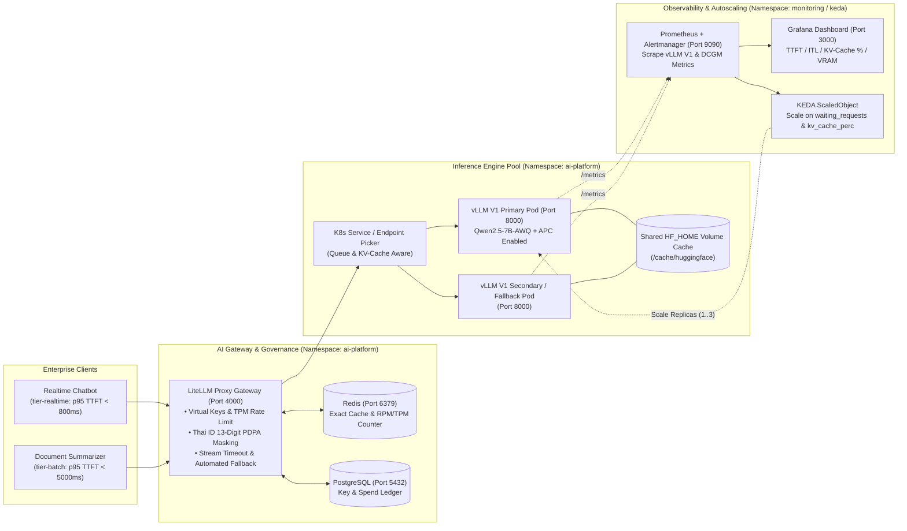

# AI Infrastructure & Platform Engineering Handbook
### Zero to Mid-Level-Capable in 12 Weeks (Competency-Based Roadmap & Hands-On Labs)

[](#)
[](#)
[](#)
[](#)

> **คู่มือวิศวกรรมเชิงปฏิบัติการ (Practical Engineering Handbook — 2026 Edition)** และชุดแล็บครบวงจร สำหรับปั้นวิศวกรจากระดับเริ่มต้น (เขียนโค้ดและใช้ Linux/Git พื้นฐานได้ แต่ยังไม่เคยดูแลระบบ Production) ไปสู่ระดับ **Mid-Level-Capable AI Platform / AI Infrastructure Engineer** ภายใน **12 สัปดาห์ (15 ชม./สัปดาห์ = 180 ชม.)**

---

## ทำไมต้องใช้คู่มือเล่มนี้? (Why This Roadmap & Handbook?)

จากการวิเคราะห์ความต้องการของตลาดงานจริงทั้งในประเทศไทย (**Agoda, SCBX / SCB DataX, KBTG, Sertis, LINE MAN Wongnai, True Digital, KTB/TTB, Amity**) และบริษัทระดับภูมิภาค/ระดับโลก (**Grab, Shopee, Remote Cloud-Native AI Teams**) พบว่าคอขวดที่สำคัญที่สุดขององค์กรในยุค Generative AI ไม่ใช่การเทรนโมเดลขนาดยักษ์ตั้งแต่ศูนย์ แต่คือ:

> **"จะนำ Open-weights LLM และบริการ AI ขึ้นรันบน Production Kubernetes อย่างไรให้มีความหน่วงต่ำ (Low TTFT/ITL), รับโหลดพร้อมกันได้สูงโดยไม่เกิดอาการการ์ดจอค้าง (CUDA OOM), ปลอดภัยตามกฎหมาย PDPA / OWASP LLM Top 10, มีระบบสลับสายอัตโนมัติเมื่อเกิดเหตุขัดข้อง (High Availability), และควบคุมต้นทุนต่อ 1 ล้าน Tokens ได้อย่างคุ้มค่าที่สุด"**

หนังสือและชุดแล็บนี้ถูกออกแบบด้วยหลักการ **Backward Competency Design** โดยยึดแนวทาง **3-Tier Hybrid Execution**:
- **Tier 1 — Local Lab (\$0 — 85–90% ของเวลาเรียน):**
  - *โหมด RAM 16GB No-GPU Safe:* ใช้ `Docker`, `OpenTofu`, `kind`, `Run:ai fake-gpu-operator`, `vllm-cpu` (`Qwen2.5-0.5B-Instruct`), และ `Lightweight FastAPI Mock vLLM Streaming Server (<80MB RAM/Pod)`
  - *โหมด HP Victus / WSL2 (RAM 32GB + RTX 4050 6GB Ada Lovelace):* รัน Full Local K8s Stack (Gateway + Prometheus + Grafana + KEDA) พร้อมกันโดยไม่เกิด OOM และรัน **`vLLM` V1 บน CUDA จริง** ด้วย `Qwen/Qwen2.5-1.5B-Instruct` vs `Qwen/Qwen2.5-3B-Instruct-AWQ` + `--kv-cache-dtype fp8`
- **Tier 2 — On-Demand Cloud GPU 24GB (Prepaid < \$10 หรือ AWS Spot \$10–\$30):** เช่าการ์ด **NVIDIA L4 (24GB VRAM)** (`RunPod`/`Vast.ai` หรือ **AWS EC2 `g6.xlarge` Spot + Auto-Terminate 180 นาที**) เฉพาะช่วงรัน Benchmark `Qwen2.5-7B` (`BF16` vs `AWQ` vs `FP8`) และเก็บตัวเลข Optimization จริงเข้า Portfolio
- **Tier 3 — Optional Cloud Platform Infra (`labs/optional-cloud-aws/`):** ใช้ OpenTofu สร้าง Private S3 Model Cache, Private ECR, IAM Role และ AWS Budget Alarm (เปิด-ปิดโหมด `enable_gpu_ec2 = true` ได้เมื่อพร้อมรัน `g6.xlarge` Spot) พร้อมตารางเทียบ Service ของ GCP

---

## แผนภาพเส้นทางการเรียนรู้ 12 สัปดาห์ (Visual Learning Roadmap)

```mermaid
flowchart TD
    Start(["เริ่มต้น: บทที่ 0 Onboarding & Setup\n(ตรวจสภาพแวดล้อม 16GB–32GB / RTX 4050 ด้วย make check-env)"])

    subgraph Phase1 ["Phase 1: Cloud-Native & GPU Foundations (Weeks 1–4)"]
        M1["บทที่ 1 (W1–W2): Reproducible AI Foundations\n• Multi-stage Docker + uv + Non-root + Read-only RootFS\n• FastAPI Bounded Queue (HTTP 429 Load Shedding)\n• OpenTofu IaC + GitHub Actions CI + Trivy Scan"]
        M2["บทที่ 2 (W3–W4): Kubernetes for AI & GPU Orchestration\n• Startup / Readiness / Liveness Probes + preStop Hook\n• Shared HF_HOME Model Cache PVC/HostPath\n• GPU VRAM Math (GQA) + Time-Slicing vs MIG + Fake GPU"]
        G1{{"Milestone Gate 1 (จบสัปดาห์ที่ 4)\nสั่ง tofu apply สร้าง K8s + Mock GPU + Deploy Helm ผ่าน CI 100%"}}
    end

    subgraph Phase2 ["Phase 2: LLM Serving Core & Enterprise AI Gateway (Weeks 5–8)"]
        M3["บทที่ 3 (W5–W6): High-Performance LLM Serving (vLLM V1)\n• PagedAttention + Continuous Batching + Unified Chunked Prefill\n• Automatic Prefix Caching (APC) + Quantization (AWQ / FP8)\n• Benchmarking (TTFT, ITL, TPS) & Unit Economics (USD/1M Tokens)"]
        M4["บทที่ 4 (W7–W8): Enterprise AI Gateway & Governance\n• LiteLLM Proxy + Multi-tenant Virtual Keys & TPM Budgets\n• Redis Caching + Automated Fallbacks & Timeouts\n• PDPA PII Masking (เลขบัตร 13 หลัก) + K8s Gateway EPP"]
        G2{{"Milestone Gate 2 & Buffer Week (จบสัปดาห์ที่ 8)\nต่อสายพาน Client → LiteLLM → K8s → vLLM พร้อมตัวเลข Before/After"}}
    end

    subgraph Phase3 ["Phase 3: AI SRE, Autoscaling & Capstone Defense (Weeks 9–12)"]
        M5["บทที่ 5 (W9–W10): AI Observability, Autoscaling & SRE\n• Prometheus + Grafana + DCGM Exporter + vLLM V1 Metrics\n• KEDA Autoscaling (Queue Depth & KV-Cache Usage %)\n• Chaos Failure Injection + Runbook + Blameless Postmortem"]
        M6["บทที่ 6 (W11–W12): Capstone — Project SiamShield AI\n• Multi-Tier Serving Platform (tier-realtime vs tier-batch)\n• System Design Doc + End-to-End IaC/K8s/Gateway/Observability\n• Two-Tier Optimization + Chaos Drill + Interview Trade-off Defense"]
        G3{{"Milestone Gate 3 (จบสัปดาห์ที่ 12)\nผ่านเกณฑ์ Definition of Done (DoD) ครบ 5 ข้อ พร้อมยื่นสมัครงาน"}}
    end

    Start --> M1 --> M2 --> G1 --> M3 --> M4 --> G2 --> M5 --> M6 --> G3
```



---

## สถาปัตยกรรมระบบปลายทางที่เราจะสร้างจริง (`Project SiamShield AI`)



---

## สารบัญหนังสือและโฟลเดอร์แล็บ (Table of Contents & Navigation)

| ลำดับ | บทเรียนในหนังสือ (`chapters/`) | โฟลเดอร์โค้ดปฏิบัติการ (`labs/`) | เวลาเรียน | สถานะ |
| :--- | :--- | :--- | :---: | :---: |
| **SSOT** | [**`SPEC_AND_STYLE_GUIDE.md`**](./SPEC_AND_STYLE_GUIDE.md)<br>*(มาตรฐานโครงสร้างบท ตัวแปรกลาง และกฎความถูกต้องทางวิศวกรรม 12 ข้อ)* | — | อ้างอิงตลอดเล่ม | พร้อมใช้งาน |
| **บทที่ 0** | [**`chapters/00-onboarding-and-setup.md`**](./chapters/00-onboarding-and-setup.md)<br>*การเตรียมเครื่อง Local 16GB–32GB (รองรับ RTX 4050 6GB & Containerized Lab), การติดตั้งเครื่องมือ (`Docker`, `kind`, `kubectl`, `helm`, `tofu`, `uv`) และวิธีป้องกันเครื่องค้าง* | [`Makefile`](./Makefile) (`make check-env`) | 2 ชม. (ก่อนเริ่ม W1) | พร้อมใช้งาน |
| **บทที่ 1** | [**`chapters/01-foundations-containers-iac.md`**](./chapters/01-foundations-containers-iac.md)<br>*Production AI Containers (`uv`, Multi-stage, Non-root), FastAPI Bounded Queue, GitHub Actions CI (`Trivy`) & OpenTofu IaC* | [`labs/m1-foundations/`](./labs/m1-foundations/) | สัปดาห์ที่ 1–2 (30 ชม.) | พร้อมใช้งาน |
| **บทที่ 2** | [**`chapters/02-kubernetes-gpu-orchestration.md`**](./chapters/02-kubernetes-gpu-orchestration.md)<br>*Kubernetes Probes สำหรับ LLM, Helm Chart, Shared `HF_HOME` Cache, GPU VRAM Math (GQA), Time-Slicing vs MIG & Fake GPU* | [`labs/m2-k8s-gpu/`](./labs/m2-k8s-gpu/) | สัปดาห์ที่ 3–4 (30 ชม.) | พร้อมใช้งาน |
| **บทที่ 3** | [**`chapters/03-vllm-serving-optimization.md`**](./chapters/03-vllm-serving-optimization.md)<br>*เจาะลึก `vLLM` V1 Engine, PagedAttention, Continuous Batching, Prefix Caching (APC), Quantization (AWQ/FP8) & Unit Economics* | [`labs/m3-vllm/`](./labs/m3-vllm/) | สัปดาห์ที่ 5–6 (30 ชม.) | พร้อมใช้งาน |
| **บทที่ 4** | [**`chapters/04-ai-gateway-governance.md`**](./chapters/04-ai-gateway-governance.md)<br>*Enterprise AI Gateway (`LiteLLM Proxy`), Multi-tenancy, Redis Cache, Automated Fallbacks, PDPA Guardrails & K8s Gateway EPP* | [`labs/m4-gateway/`](./labs/m4-gateway/) | สัปดาห์ที่ 7–8 (30 ชม.) | พร้อมใช้งาน |
| **บทที่ 5** | [**`chapters/05-observability-autoscaling-sre.md`**](./chapters/05-observability-autoscaling-sre.md)<br>*AI Observability (`Prometheus`, `Grafana`, `DCGM`, `vLLM` V1 Metrics), `KEDA` Autoscaling, Chaos Drill, Runbook & Postmortem* | [`labs/m5-observability-sre/`](./labs/m5-observability-sre/) | สัปดาห์ที่ 9–10 (30 ชม.) | พร้อมใช้งาน |
| **บทที่ 6** | [**`chapters/06-capstone-siamshield-ai.md`**](./chapters/06-capstone-siamshield-ai.md)<br>*Capstone Project (`Project SiamShield AI`): System Design Doc, End-to-End Multi-Tier Platform, Optimization & Interview Defense* | [`labs/m6-capstone-siamshield/`](./labs/m6-capstone-siamshield/) | สัปดาห์ที่ 11–12 (30 ชม.) | พร้อมใช้งาน |
| **เสริม Cloud** | [**`labs/optional-cloud-aws/README.md`**](./labs/optional-cloud-aws/README.md)<br>*Optional AWS Cloud Track: S3 Model Cache, ECR, IAM, Budgets & `g6.xlarge` Spot (NVIDIA L4 + Auto-Terminate)* | [`labs/optional-cloud-aws/`](./labs/optional-cloud-aws/) | เสริมช่วง W2/W3/W6 | พร้อมใช้งาน |
| **รวมเล่ม** | **โฟลเดอร์หนังสือฉบับสมบูรณ์ (`dist/`)** | [`dist/`](./dist/) | — | สำหรับรวมเล่ม |

---

## ตารางแผนการเรียนรู้ 12 สัปดาห์ × 6 Modules × 3 Milestone Gates

| สัปดาห์ | Module | หัวข้อการเรียนรู้และฝึกปฏิบัติ | ชิ้นงานที่ต้องส่งมอบใน Git Portfolio (Deliverables) | Milestone Gate |
| :---: | :---: | :--- | :--- | :--- |
| **W1** | **Module 1** | Production AI Containers (`uv`, Multi-stage, Non-root, Read-only RootFS), FastAPI Bounded Queue (`HTTP 429`) & GitHub Actions CI (`Trivy`) | `labs/m1-foundations/`: `Dockerfile`, `app/main.py`, CI workflow | — |
| **W2** | **Module 1** | Infrastructure as Code ด้วย `OpenTofu` (Declarative Local `kind` Cluster, ExtraMounts Cache & Helm Provider) | `labs/m1-foundations/infra/`: OpenTofu Modules + `docs/adr-001-container-and-model-cache-strategy.md` | — |
| **W3** | **Module 2** | Kubernetes สำหรับ AI Workloads (`startupProbe`, `readinessProbe`, `preStop` Hook, Taints/Tolerations, `PriorityClass`, Shared `HF_HOME` PVC) | `labs/m2-k8s-gpu/charts/`: Production Helm Chart | — |
| **W4** | **Module 2** | GPU Hardware Math (VRAM & Memory Bandwidth), NVIDIA GPU Operator, Time-Slicing (`--enforce-eager`) vs MIG & `fake-gpu-operator` | `vram_calculator.py` + `gpu-time-slicing-config.yaml` + `docs/adr-002-gpu-sharing-and-scheduling.md` | **Gate 1 (จบ W4):** สั่ง `tofu apply` สร้าง K8s + Mock GPU + Deploy Helm ผ่าน CI 100% |
| **W5** | **Module 3** | LLM Inference Internals (`vLLM` V1 Engine, PagedAttention, Continuous Batching, Unified Chunked Prefill) & Baseline Benchmarking | `labs/m3-vllm/`: สคริปต์รัน `vLLM` (Local CPU 0.5B & Cloud L4 7B) | — |
| **W6** | **Module 3** | Inference Optimization: Quantization (`AWQ`/`FP8`), Automatic Prefix Caching (APC), Token Budget Tuning & Cost per 1M Tokens Math | `optimization-report-template.md` (ตัวเลข Before/After ครบทุกมิติ) | — |
| **W7** | **Module 4** | Enterprise AI Gateway (`LiteLLM Proxy`), Multi-tenant Virtual Keys, TPM/RPM Budgets, Redis Caching & Automated Fallbacks | `labs/m4-gateway/`: `litellm_config.yaml` + `mock_vllm_server/` | — |
| **W8** | **Module 4 + Buffer** | Intelligent Routing (K8s Gateway API Inference Extension / EPP), PDPA PII Masking + **Buffer & Consolidation Week** | `tests/test_gateway_resilience.py` + `docs/adr-003-ai-gateway-and-inference-routing.md` + เก็บตกงาน W1–W7 | **Gate 2 (จบ W8):** ต่อสายพาน `Gateway → K8s → vLLM` พร้อมผลทดสอบ Failover & Optimization |
| **W9** | **Module 5** | AI Observability Stack: `Prometheus`, `Grafana`, `DCGM Exporter` & `vLLM` V1 Metrics (`kv_cache_usage_perc`, `prefix_cache_hits_total`) | `labs/m5-observability-sre/`: Grafana Dashboard JSON + Alert Rules | — |
| **W10** | **Module 5** | Event-Driven Autoscaling ด้วย `KEDA` (Queue/KV-Cache triggers), Chaos Failure Injection, Runbook & Blameless Postmortem | `keda-vllm-scaledobject.yaml` + `docs/runbook-kvcache-saturation-and-high-ttft.md` + `docs/postmortem-001-peak-hour-latency-outage.md` + `docs/adr-004-observability-and-keda-autoscaling.md` | — |
| **W11** | **Module 6** | Capstone Design Doc & End-to-End Implementation (`Project SiamShield AI`: Multi-Tier `tier-realtime` + `tier-batch` Platform) | `labs/m6-capstone-siamshield/`: `docs/design-doc.md` + Full Stack Repo | — |
| **W12** | **Module 6 + Buffer** | Capstone Two-Tier Load Testing & Optimization, Chaos Drill, Architecture Defense & **Final Buffer** | `reports/capstone-optimization-report.md` + `docs/runbooks/capstone-runbook.md` + `docs/postmortems/capstone-postmortem.md` + `docs/interview-defense-guide.md` | **Gate 3 (จบ W12):** ผ่านเกณฑ์ **Definition of Done (DoD)** ครบทั้ง 5 ข้อ |

---

## ตารางเชื่อมโยงกับเกณฑ์ผ่านระดับ Mid-Level (5 Definition of Done Traceability Matrix)

เมื่อเรียนจบและทำแล็บครบทั้ง 6 บท คุณจะมีหลักฐานเชิงประจักษ์ (Verifiable Engineering Artifacts) ใน Git Portfolio ที่พิสูจน์สมรรถนะครบทั้ง **5 ข้อของ Definition of Done (DoD)**:

| ข้อกำหนด Definition of Done (DoD) | ความสามารถระดับ Mid-Level ที่ต้องพิสูจน์ได้ | บทเรียนและแล็บที่สร้างหลักฐานชิ้นนี้ | ชิ้นงานหลักฐานใน Portfolio (Verifiable Artifacts) |
| :--- | :--- | :--- | :--- |
| **DoD #1: System Design & Architecture Trade-Offs** | รับโจทย์ธุรกิจและข้อจำกัด (SLO, ปริมาณงาน, งบประมาณ, กฎหมาย PDPA) แล้วคำนวณขนาด VRAM/Cost พร้อมเขียน Design Doc เปรียบเทียบทางเลือก $\ge 2$ ทางในทุกการตัดสินใจหลัก | บทที่ 1, 2, 4, 5, 6<br>(`m1`, `m2`, `m4`, `m5`, `m6`) | • `adr-001` (Model Artifact Strategy)<br>• `adr-002` (GPU Sharing: Time-Slicing vs MIG)<br>• `adr-003` (Gateway & EPP Routing)<br>• `adr-004` (Observability & KEDA Autoscaling)<br>• `labs/m6-capstone-siamshield/docs/design-doc.md` |
| **DoD #2: Reproducible IaC & Automated CI/CD** | สร้างและทำลายโครงสร้างพื้นฐานรวมถึง Deploy ระบบซ้ำได้ 100% ด้วยโค้ด (`OpenTofu` + `Helm` + `GitHub Actions` + `Trivy`) โดยไม่ต้องคลิกตั้งค่าด้วยมือใน Console | บทที่ 1, 2, 6<br>(`m1`, `m2`, `m6`) | • Multi-stage `Dockerfile` (`uv`, Non-root)<br>• OpenTofu Modules (`infra/`)<br>• Production Helm Chart (`charts/`)<br>• `.github/workflows/ci.yml` |
| **DoD #3: AI Observability & Measurable Optimization** | ติดตั้งระบบวัดผลระดับ Token/GPU (`Prometheus` + `Grafana` + `vLLM` V1 / `DCGM`), รัน Load Test และปรับจูนจนได้ตัวเลข **Before vs After** ที่ดีขึ้นอย่างมีนัยสำคัญ | บทที่ 2, 3, 4, 5, 6<br>(`m2`, `m3`, `m4`, `m5`, `m6`) | • `vram_calculator.py`<br>• `optimization-report-template.md` (TTFT ลด $\ge 50\%$, TPS เพิ่ม $\ge 40\%$)<br>• `grafana-dashboard-vllm-v1.json` + `KEDA ScaledObject` |
| **DoD #4: Incident Management, Runbook & Postmortem** | จำลองเหตุวิกฤตจริง (Chaos Injection: KV-Cache เต็ม, Noisy Neighbor, Primary Pod ค้าง, Bad Rollout) วินิจฉัยผ่านกราฟ กู้คืนระบบ และเขียน Runbook + Blameless Postmortem | บทที่ 4, 5, 6<br>(`m4`, `m5`, `m6`) | • `tests/test_gateway_resilience.py`<br>• `chaos/trigger_incident.py`<br>• `docs/runbook-kvcache-saturation-and-high-ttft.md`<br>• `docs/postmortem-001-peak-hour-latency-outage.md` |
| **DoD #5: Mid-Level Interview Trade-Off Defense** | อธิบายเหตุผลเชิงวิศวกรรมว่า **"ทำไมถึงเลือกวิธีนี้"** และ **"ได้อะไรแลกกับเสียอะไร"** พร้อมคำนวณตัวเลขสดและตอบโจทย์เมื่อเงื่อนไขเปลี่ยน (เช่น โหลดพุ่ง 10 เท่า หรือเปลี่ยนเป็นโมเดล 70B) | ทุกบท (บทที่ 1–6 หัวข้อที่ 8) | • คำถามสัมภาษณ์เชิงลึก 29 ข้อพร้อมเฉลย Model Answer ในบทที่ 1–6<br>• `docs/interview-defense-guide.md` ใน Capstone |

---

## 7. เริ่มต้นใช้งานอย่างรวดเร็ว 4 เส้นทาง (Quickstart — 4 Tracks)

ดูรายละเอียดขั้นตอนติดตั้งและแก้ปัญหาครบทุกสภาพแวดล้อมได้ที่ [**`PORTABILITY_AND_QUICKSTART.md`**](./PORTABILITY_AND_QUICKSTART.md)

### Track 1: อ่านหนังสือและแผนภาพแบบ Offline ทันที (Zero-Install)
เปิดไฟล์ [**`index.html`**](./index.html) หรือ [**`dist/AI_Infra_Interactive_Handbook.html`**](./dist/AI_Infra_Interactive_Handbook.html) ในเบราว์เซอร์ (รองรับ 100% แบบไม่มีอินเทอร์เน็ต) หรือสร้างไฟล์พกพา:
```bash
python3 scripts/make package
python3 scripts/make verify-archive
```

### Track 2: รันใน Containerized Lab (VS Code DevContainer / Docker Compose)
เหมาะสำหรับผู้ที่ไม่อยากติดตั้งเครื่องมือ CLI ทีละตัวบนเครื่องหลัก:
```bash
python3 scripts/make verify-container
docker compose -f docker-compose.lab.yml run --rm --service-ports lab
```

### Track 3: รันบนเครื่อง WSL2 / Linux ส่วนตัว (แนะนำสำหรับ HP Victus 32GB + RTX 4050 6GB)
1. **อ่านบทที่ 0 เพื่อตั้งค่า `.wslconfig` (22GB RAM) และ NVIDIA Container Toolkit:**
   เปิดอ่านไฟล์ [**`chapters/00-onboarding-and-setup.md`**](./chapters/00-onboarding-and-setup.md)
2. **ตรวจสอบความพร้อมของเครื่อง (RAM, GPU VRAM, Docker, Kind, Kubectl, Helm, OpenTofu, uv):**
   ```bash
   python3 scripts/make check-env
   ```
3. **รันชุดตรวจสอบอัตโนมัติแบบ Static ครบทุกโมดูล:**
   ```bash
   python3 scripts/make verify-static
   ```

### Track 4: รันบน AWS Cloud (งบ \$10–\$30 USD: S3 + ECR + `g6.xlarge` Spot L4)
1. ขอ GPU Service Quota ล่วงหน้า (`All G and VT Spot Instance Requests = 4`) และตั้ง AWS Budgets
2. ตรวจสอบโค้ดและเปิดใช้งานผ่าน [**`labs/optional-cloud-aws/README.md`**](./labs/optional-cloud-aws/README.md):
   ```bash
   python3 scripts/make verify-aws-optional
   ```

---

## 8. หนังสือและแหล่งเรียนรู้มาตรฐานที่ใช้อ้างอิงร่วม (Curated 2025–2026 References)

| หมวดหมู่ | ชื่อหนังสือ / เอกสารทางการ | จุดเด่นที่นำมาประยุกต์ใช้ใน Handbook ฉบับ 2026 |
| :--- | :--- | :--- |
| **GPU & Inference Performance** | **AI Systems Performance Engineering** *(Chris Fregly, O'Reilly 2025)* | เจาะลึก GPU Kernels, Roofline Model, vLLM/SGLang/NVIDIA Dynamo, Disaggregated Prefill–Decode และ Checklist จูน Production |
| **AI Platform & Eval** | **AI Engineering** *(Chip Huyen, O'Reilly 2025)* | กรอบการประเมินคุณภาพโมเดล (Eval Gate หลัง Quantization), Latency/Cost Engineering, Guardrails |
| **Distributed & Hardware Scaling** | **The Ultra-Scale Playbook** *(Hugging Face, 2025)* & **How to Scale Your Model** *(Google DeepMind, 2025)* | คณิตศาสตร์ Memory Bandwidth, Arithmetic Intensity, Tensor/Pipeline/Expert Parallelism สำหรับโมเดล 70B+ และ MoE |
| **Kubernetes & Platform Engineering** | **Production Kubernetes** *(O'Reilly)*, **Kubernetes Patterns (2nd Ed.)**, **Platform Engineering** *(O'Reilly)* | การออกแบบ Multi-tenant K8s, `NetworkPolicy`, Golden Paths, Kubernetes DRA และ Workload Isolation |
| **SRE & Incident Management** | **The Site Reliability Workbook** *(Google, Free Online)* | Multi-Window Error Budget Burn-Rate Alerts, Runbook Design และ Blameless Postmortem |
| **2026 Open Standards** | **Kubernetes Gateway API Inference Extension (`v1`) & CNCF `llm-d`**, **OWASP LLM Top 10 (2025)**, **OTel GenAI SemConv** | มาตรฐาน `InferencePool v1`, `InferenceObjective`, KV-Cache-Aware Routing และความปลอดภัยระดับองค์กร |
