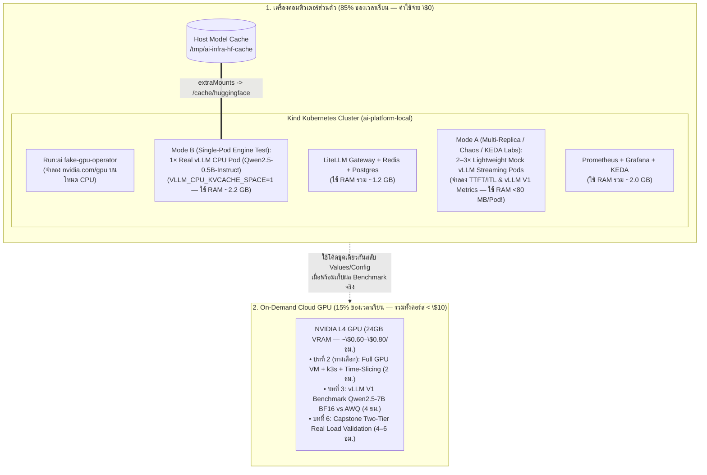

# บทที่ 0: การเตรียมสภาพแวดล้อมวิศวกรรมและกลยุทธ์การเรียนแบบ Hybrid (Onboarding & 16GB RAM Local Setup)

> **เวลาที่ใช้:** ~2 ชั่วโมง (ทำครั้งเดียวก่อนเริ่มสัปดาห์ที่ 1)  
> **ค่าใช้จ่าย:** \$0.00 (รันบนเครื่องคอมพิวเตอร์ส่วนตัว 100%)  
> **เป้าหมายของบทนี้:** ตั้งค่าเครื่องคอมพิวเตอร์ส่วนตัว (Linux, Windows WSL2 RAM 16GB หรือ **HP Victus 32GB + RTX 4050 6GB**, macOS, หรือ **Containerized Lab** ใน [`PORTABILITY_AND_QUICKSTART.md`](../PORTABILITY_AND_QUICKSTART.md)) ให้พร้อมรันชุดแล็บ Kubernetes, OpenTofu, vLLM และระบบ Observability ตลอดทั้ง 12 สัปดาห์โดยไม่เกิดอาการเครื่องค้าง (Out-of-Memory) และวางมาตรการควบคุมงบ Cloud GPU (Prepaid < \$10 หรือ AWS Spot \$10–\$30) อย่างปลอดภัย

---

## 1. ภาพรวมเส้นทางสายอาชีพและความคาดหวังที่สมจริง (Realistic Career Expectations)

ยินดีต้อนรับสู่คู่มือปฏิบัติการ **AI Infrastructure & Platform Engineering** หลักสูตรนี้ออกแบบมาสำหรับผู้ที่มีพื้นฐานการเขียนโค้ด (Python/Bash พื้นฐาน) และใช้คำสั่ง Linux/Git เบื้องต้นได้ แต่ **ยังไม่เคยดูแลระบบ Production หรือคลัสเตอร์ Kubernetes สำหรับงาน AI มาก่อน**

### 1.1 ทำไมองค์กรในไทยและทั่วโลกถึงต้องการตำแหน่งนี้อย่างเร่งด่วน?
เมื่อสำรวจตลาดงานจริงในประเทศไทย (เช่น Agoda, SCBX / SCB DataX, KBTG, Sertis, LINE MAN Wongnai, True Digital, KTB/TTB, Amity) และบริษัทเทคโนโลยีระดับภูมิภาค/ระดับโลก จะพบว่าบทบาทด้าน AI Infrastructure แบ่งออกเป็น 3 สายงานย่อย (Tracks):
1. **Track A — Inference & GPU Serving Infrastructure (สายหลักของเรา):** โฟกัสการนำโมเดลภาษาขนาดใหญ่ (LLM) ขึ้นรันบน Kubernetes, การจัดสรรทรัพยากรการ์ดจอ (NVIDIA GPU Operator, Time-Slicing, MIG), การรีดประสิทธิภาพด้วย `vLLM` (PagedAttention, Continuous Batching, Automatic Prefix Caching, Quantization), และการขยายระบบอัตโนมัติตามปริมาณงานจริง
2. **Track B — Classic MLOps & Distributed Training Platform:** โฟกัสไปที่ระบบท่อส่งข้อมูลสำหรับเทรนโมเดล (Kubeflow, Airflow, Feast) และการเทรนโมเดลข้ามเครื่องจำนวนมากด้วย InfiniBand/NCCL
3. **Track C — Enterprise LLM Platform, Gateway & Governance (สายรองของเรา):** โฟกัสไปที่การสร้างด่านหน้าควบคุมการใช้งาน AI ของทั้งองค์กรด้วย `LiteLLM Proxy` และ Kubernetes Gateway API Inference Extension เพื่อจัดการโควตารายแผนก (TPM/RPM Rate Limiting), การแคชคำตอบ (Redis), การสลับสายอัตโนมัติเมื่อระบบล่ม (Automated Fallbacks), และการกรองข้อมูลส่วนบุคคลตามกฎหมาย **PDPA** และมาตรฐาน **OWASP Top 10 for LLM Applications**

หลักสูตร 12 สัปดาห์นี้มุ่งเน้นที่จุดตัดของ **Track A + Track C** เนื่องจากเป็นทักษะที่มีความต้องการสูงที่สุดในตลาด และสามารถฝึกปฏิบัติจริงได้ครบทุกมิติภายใต้งบประมาณที่ต่ำมาก

### 1.2 ความจริงใจต่อผู้เรียน: อะไรที่คุณจะทำได้จริง และอะไรที่ต้องสะสมเพิ่ม?
ภายในเวลา 180 ชั่วโมง (15 ชั่วโมง/สัปดาห์ × 12 สัปดาห์) คุณจะก้าวขึ้นสู่ระดับ **Mid-Level-Capable ในขอบเขต AI Inference & Platform Engineering** ที่มีหลักฐานเชิงประจักษ์ครบทั้ง **5 ข้อของ Definition of Done (DoD)**:
- **สิ่งที่คุณจะทำได้ถึงระดับ Mid-Level จริง:**
  1. คำนวณขนาดหน่วยความจำการ์ดจอ (**GPU VRAM Math**) และต้นทุนต่อ 1 ล้าน Tokens พร้อมเขียนเอกสาร **System Design Doc** เปรียบเทียบข้อดี-ข้อเสียของแต่ละทางเลือกได้อย่างแม่นยำ
  2. เขียนโค้ดสร้างโครงสร้างพื้นฐานและสายพานอัตโนมัติด้วย **OpenTofu + Helm + GitHub Actions CI/CD + Trivy Security Scan**
  3. ติดตั้งระบบ **Observability (`Prometheus` + `Grafana` + `vLLM` V1 / `DCGM` Metrics)** รันทดสอบโหลดจริง และปรับจูนระบบจนมีตัวเลข **Before vs After** ที่พิสูจน์ได้
  4. รับมือกับเหตุวิกฤตจำลอง (Chaos Engineering) พร้อมเขียนคู่มือกู้คืนระบบ (**Runbook**) และรายงานวิเคราะห์สาเหตุโดยไม่กล่าวโทษตัวบุคคล (**Blameless Postmortem**)
  5. ตอบคำถามสัมภาษณ์เชิงลึกเรื่อง Trade-offs ได้อย่างมีหลักการและอ้างอิงตัวเลขจากโปรเจกต์ของตัวเองได้ทันที
- **สิ่งที่ยังไปไม่ถึงใน 12 สัปดาห์ (ต้องเก็บเกี่ยวต่อในการทำงานจริง):**
  - การดูแลระบบเครือข่ายและสิทธิ์ข้ามบัญชีที่ซับซ้อนระดับองค์กรขนาดใหญ่หลายร้อยโหนด (เช่น Multi-account Transit Gateway หรือ Multi-cluster Service Mesh)
  - การเขียนชุดคำสั่งระดับฮาร์ดแวร์ (Custom CUDA / Triton Kernels)

---

## 2. สถาปัตยกรรมการเรียนแบบ Hybrid 85/15 และการป้องกันเครื่อง 16GB RAM ค้าง

ปัญหาคลาสสิกของผู้เรียนสาย AI Infrastructure ที่ไม่มีการ์ดจอ NVIDIA ส่วนตัวมีอยู่ 2 ข้อ คือ: **(1) หากเช่า Cloud GPU เปิดทิ้งไว้ตลอดเวลา ค่าใช้จ่ายจะพุ่งทะลุหลักหมื่นบาท** และ **(2) หากพยายามรันโมเดล LLM ด้วย CPU หลายๆ ตัวพร้อมกับ Kubernetes และ Prometheus บนแล็ปท็อปที่มี RAM 16GB เครื่องจะค้างทันที (Linux OOM Killer ทำงาน)**

เพื่อแก้ปัญหาทั้งสองข้ออย่างเด็ดขาด เราจึงออกแบบสถาปัตยกรรมการฝึกปฏิบัติแบบ **Hybrid 85/15** ดังแผนภาพต่อไปนี้:



### 2.1 คณิตศาสตร์การจัดสรรหน่วยความจำบนเครื่อง RAM 16GB (Memory Budget Math)
ลองมาดูตัวเลขจริงว่าทำไมเราถึงต้องแยก **Mode A (Lightweight Mock vLLM Streaming Server)** และ **Mode B (Single-Pod Real vLLM CPU)** บนเครื่องที่มี RAM 16GB:

- **หากทำแบบไม่ระวัง (สิ่งที่ทำให้แล็ปท็อป 16GB ค้าง):**
  ถ้ารันคอนเทนเนอร์ `vllm-cpu` ด้วยโมเดลขนาด 1.5B (BF16 weights ~3.0 GB) ร่วมกับการจอง `VLLM_CPU_KVCACHE_SPACE=4` (4.0 GiB) และ PyTorch CPU runtime (~1.5 GB) จะกินหน่วยความจำถึง **~8.5 GB ต่อ 1 Pod** หากสั่งรัน 2 Pods เพื่อทดสอบ Load Balancing จะใช้ RAM ไปแล้ว **17.0 GB** เมื่อรวมกับ OS (3.5 GB), `kind` (1.5 GB), `LiteLLM/Postgres/Redis` (1.2 GB) และ `Prometheus/Grafana` (2.0 GB) จะพุ่งไปถึง **~25.2 GB** ซึ่งทำให้เครื่อง 16GB ค้างทันที!
- **การจัดสรรหน่วยความจำที่ปลอดภัยของเรา (16GB RAM Safe Budget):**

$$\text{Total Local RAM Usage} = \underbrace{3.5\text{ GB}}_{\text{OS / WSL2}} + \underbrace{1.5\text{ GB}}_{\text{Kind Nodes}} + \underbrace{1.2\text{ GB}}_{\text{LiteLLM + DB + Redis}} + \underbrace{2.0\text{ GB}}_{\text{Prometheus + Grafana + KEDA}} + \underbrace{\text{Inference Pods}}_{\le 2.5\text{ GB}} \approx \mathbf{10.7\text{ GB} < 16.0\text{ GB}}$$

โดยในส่วนของ **Inference Pods** เราแบ่งวิธีใช้งานอย่างชัดเจน:
1. **เมื่อต้องการทดสอบกลไกของ `vLLM` จริงบน CPU (บทที่ 3):** รันเพียง **1 Pod** ด้วยโมเดล **`Qwen/Qwen2.5-0.5B-Instruct`** พร้อมตั้งค่า `VLLM_CPU_KVCACHE_SPACE=1` และ `--max-model-len 2048` ซึ่งใช้ RAM เพียง **~2.2 GB**
2. **เมื่อต้องการรันหลาย Pods พร้อมกันเพื่อทดสอบ Gateway Failover, Rate Limiting, และ KEDA Autoscaling (บทที่ 4, 5, 6):** ใช้ **Lightweight FastAPI Mock vLLM Streaming Server** ที่เราเตรียมไว้ในแล็บ ซึ่งจำลองการส่งข้อความแบบ Streaming (Server-Sent Events), จำลองความหน่วง TTFT/ITL และส่งออก Prometheus Metrics ชื่อเดียวกับ `vLLM` V1 ทุกประการ (`vllm:kv_cache_usage_perc`, `vllm:num_requests_waiting`, `vllm:prefix_cache_hits_total`) โดยใช้ RAM เพียง **< 80 MB ต่อ Pod** (รัน 3 Pods ใช้ RAM รวมกันไม่ถึง 250 MB!)

### 2.2 การผูก Shared Model Cache (`HF_HOME`) เพื่อตัดเวลาดาวน์โหลดโมเดลซ้ำ
ในทุกบทเรียน เราจะสร้างโฟลเดอร์ `/tmp/ai-infra-hf-cache` บนเครื่องหลัก (Host) แล้วผูกเข้าสู่โหนดของ `kind` ผ่านการตั้งค่า `extraMounts` เพื่อให้ทุก Pod มองเห็นโฟลเดอร์นี้ที่พาธมาตรฐานสำหรับผู้ใช้ Non-root: `HF_HOME=/cache/huggingface` ผลลัพธ์คือ:
- ดาวน์โหลดโมเดลจาก Hugging Face เพียง **ครั้งเดียว**
- เมื่อ Pod ถูกลบ รีสตาร์ท หรือถูกสั่งขยายจำนวน (Scale-up):
  - **Mode A (Mock Pod):** สตาร์ทพร้อมรับโหลดภายใน **~8–10 วินาที** (ไม่ต้องโหลด weights จริง)
  - **Mode B / Cloud L4 Real vLLM:** ไม่ต้องดาวน์โหลดโมเดลซ้ำผ่านเน็ต เหลือเฉพาะเวลาอ่าน Safetensors เข้า GPU และคอมไพล์ CUDA Graph (**~35–75 วินาที**) แทนที่จะเป็น 5–10 นาที

---

## 3. ขั้นตอนการติดตั้งเครื่องมือประจำเครื่อง (Step-by-Step Tooling Setup)

รองรับระบบปฏิบัติการ **Ubuntu / Debian Linux**, **Windows 11 ที่เปิดใช้งาน WSL2 (Ubuntu 22.04/24.04)**, **macOS (Apple Silicon / Intel)** หรือรันผ่าน **Docker Compose / VS Code DevContainer** (ดูรายละเอียดใน [`PORTABILITY_AND_QUICKSTART.md`](../PORTABILITY_AND_QUICKSTART.md))

> **คำแนะนำสำหรับผู้ใช้ Windows WSL2 (เลือกตาม RAM เครื่องจริง):**  
> ให้สร้างหรือแก้ไขไฟล์ `%UserProfile%\.wslconfig` บนฝั่ง Windows แล้วรัน `wsl --shutdown` ใน PowerShell ก่อนเปิด Ubuntu ขึ้นมาใหม่:
> - **กรณีเครื่อง RAM 16GB:**
> ```ini
> [wsl2]
> memory=12GB
> processors=4
> swap=4GB
> ```
> - **กรณีเครื่อง RAM 32GB (เช่น HP Victus 16-r0357tx พร้อม RTX 4050 6GB):**
> ```ini
> [wsl2]
> memory=22GB
> processors=10
> swap=4GB
> ```
> *หมายเหตุสำหรับ HP Victus / WSL2 ที่มี NVIDIA GPU:* ติดตั้ง Game Ready / Studio Driver เวอร์ชันล่าสุดบนฝั่ง Windows (ไม่ต้องลง Driver ซ้ำใน WSL2) จากนั้นติดตั้ง **NVIDIA Container Toolkit** ใน Ubuntu WSL2 เพื่อให้ `docker run --gpus all` ส่งผ่าน RTX 4050 6GB เข้าคอนเทนเนอร์ `vLLM` ได้ทันที:
> ```bash
> nvidia-smi --query-gpu=name,memory.total --format=csv,noheader
> docker run --rm --gpus all nvidia/cuda:12.4.1-base-ubuntu22.04 nvidia-smi
> ```

### 3.1 ติดตั้งแพ็กเกจพื้นฐานและ Docker Engine
ตรวจสอบให้แน่ใจว่ามี `curl`, `git`, `make`, `jq` และ `docker` ที่สามารถรันได้โดยไม่ต้องพิมพ์ `sudo`:

```bash
# สำหรับ Ubuntu / Debian / WSL2
sudo apt-get update && sudo apt-get install -y \
  ca-certificates curl gnupg lsb-release git jq unzip build-essential make

# หากยังไม่ได้ติดตั้ง Docker Engine
if ! command -v docker &> /dev/null; then
  curl -fsSL https://get.docker.com | sudo sh
  sudo usermod -aG docker "$USER"
  echo "ติดตั้ง Docker สำเร็จ กรุณาออกจากระบบ (หรือรัน newgrp docker) เพื่อให้สิทธิ์กลุ่ม docker มีผล"
fi
```

### 3.2 ติดตั้ง `uv` (Astral Python Package & Environment Manager)
เราใช้ `uv` แทน `pip` แบบดั้งเดิมทั้งในเครื่องหลักและใน Multi-stage `Dockerfile` เพราะทำงานเร็วกว่า 10–100 เท่าและจัดการ Lockfile ได้อย่างแม่นยำ:

```bash
curl -LsSf https://astral.sh/uv/install.sh | sh
export PATH="$HOME/.local/bin:$PATH"
uv --version
```

### 3.3 ติดตั้ง `kubectl`, `kind`, และ `helm` (Kubernetes Toolchain)

```bash
# 1. ติดตั้ง kubectl (v1.31+)
ARCH=$(uname -m)
if [ "$ARCH" = "x86_64" ]; then K8S_ARCH="amd64"; else K8S_ARCH="arm64"; fi

curl -LO "https://dl.k8s.io/release/$(curl -L -s https://dl.k8s.io/release/stable.txt)/bin/linux/${K8S_ARCH}/kubectl"
chmod +x kubectl && sudo mv kubectl /usr/local/bin/

# 2. ติดตั้ง kind (Kubernetes in Docker v0.24+)
curl -Lo ./kind "https://kind.sigs.k8s.io/dl/v0.24.0/kind-linux-${K8S_ARCH}"
chmod +x ./kind && sudo mv ./kind /usr/local/bin/kind

# 3. ติดตั้ง Helm (v3.16+)
curl https://raw.githubusercontent.com/helm/helm/main/scripts/get-helm-3 | bash
```

### 3.4 ติดตั้ง `OpenTofu` (`tofu`) และ `Trivy` (IaC & Security Scanner)

```bash
# 1. ติดตั้ง OpenTofu (tofu)
curl --proto '=https' --tlsv1.2 -fsSL https://get.opentofu.org/install-opentofu.sh -o install-opentofu.sh
chmod +x install-opentofu.sh
./install-opentofu.sh --install-method deb
rm -f install-opentofu.sh

# 2. ติดตั้ง Trivy (สำหรับสแกนช่องโหว่ Container Image และ IaC ในบทที่ 1)
curl -sfL https://raw.githubusercontent.com/aquasecurity/trivy/main/contrib/install.sh | sudo sh -s -- -b /usr/local/bin
```

---

## 4. กฎความปลอดภัยในการเช่า Cloud GPU และการใช้ AWS / GCP Credit

ในหลักสูตรนี้ คุณจะใช้ Cloud GPU 24GB เฉพาะใน **บทที่ 2 (ทางเลือกเสริม 2 ชม.)**, **บทที่ 3 (4 ชม.)**, **บทที่ 5 (2 ชม.)**, และ **บทที่ 6 (4 ชม.)** รวมเวลาเช่าจริงประมาณ 10–12 ชั่วโมง (คิดเป็นเงินเพียง **~\$7.00–\$9.50** บน RunPod/Vast.ai หรือ **~\$6–\$12** ด้วย **AWS `g6.xlarge` Spot** ภายใต้งบ \$10–\$30)

### 4.1 ข้อควรรู้ก่อนใช้ AWS / GCP Free Credit กับ GPU Quota
| ช่องทาง Cloud | สถานะ GPU Quota เริ่มต้น | เหมาะกับงานแบบไหนใน Handbook นี้? |
| :--- | :--- | :--- |
| **Prepaid GPU Cloud (`RunPod`, `Vast.ai`)** | พร้อมใช้ทันทีหลังเติม \$10 | **คล่องตัวที่สุดสำหรับบทที่ 3 & 6:** ไม่ต้องขอ Quota, ตัดเงินเฉพาะเครดิตที่เติม |
| **AWS Paid Plan + Spot `g6.xlarge` (\$10–\$30)** *(ดูคู่มือใน [`labs/optional-cloud-aws/README.md`](../labs/optional-cloud-aws/README.md))* | Default = `0 vCPU` *(ต้องยื่นขอ `All G and VT Spot Instance Requests = 4` ใน `us-east-1` ล่วงหน้า)* | **แนะนำถ้าต้องการฝึก AWS จริง:** ได้ทั้ง `1x NVIDIA L4 (24GB)`, ฟรี `250GB NVMe`, S3 Model Cache, ECR และตั้ง Auto-Terminate `shutdown -h +180` |
| **GCP \$300 Free Trial** | **ถูกบล็อก (`0`, ปรับไม่ได้)** จนกว่าจะ Upgrade เป็น Paid Account และสร้าง Usage History | ไม่แนะนำให้พึ่งสำหรับ GPU Lab ในช่วงสัปดาห์แรกเพราะมักติด Ticket ขอ Quota หลายวัน |

### 4.2 ข้อแตกต่างสำคัญระหว่างผู้ให้บริการ GPU แบบ Container vs แบบ Full VM
วิศวกร AI Infrastructure ต้องแยกแยะรูปแบบของ Cloud GPU ให้ถูกต้องตามลักษณะงาน:

| รูปแบบบริการ Cloud GPU | ตัวอย่างผู้ให้บริการ | ข้อจำกัดทางสถาปัตยกรรม | ใช้ในบทเรียนไหนของคู่มือนี้? |
| :--- | :--- | :--- | :--- |
| **1. GPU Container-as-a-Service (Rootless/Unprivileged Pod)** | **RunPod Pods**, **Modal Labs**, **Vast.ai (Container Mode)** | คุณได้รับมอบหมายเป็น Docker Container ที่ต่อการ์ดจอมาให้แล้ว **ไม่มี Linux Kernel / `systemd` เป็นของตัวเอง** จึงไม่สามารถติดตั้ง `k3s` หรือ NVIDIA GPU Operator ซ้อนข้างในได้ | **เหมาะที่สุดสำหรับบทที่ 3 และบทที่ 6:** ใช้รัน `vLLM` V1 บนการ์ด NVIDIA L4 (24GB) เพื่อวัดผล Benchmark จริงได้ทันทีในราคาประหยัด (~\$0.60/ชม.) |
| **2. Full GPU Virtual Machine (IaaS VM พร้อม Kernel เต็มรูปแบบ)** | **AWS EC2 `g6.xlarge` Spot (L4)**, **GCP Spot VM (`g2-standard-8` L4)**, **Vast.ai (VM Mode)** | ได้เครื่องเสมือนที่มี Kernel และสิทธิ์ `root` เต็มรูปแบบ สามารถติดตั้ง `k3s`/`kubeadm`, NVIDIA Container Toolkit และ NVIDIA Device Plugin ได้ | **ใช้ได้ครบทั้งบทที่ 2, 3, 5 และ 6:** โดยเฉพาะ AWS `g6.xlarge` Spot ที่มีสคริปต์ OpenTofu + Dead-Man's Switch ใน `labs/optional-cloud-aws/` |

### 4.3 กฎเหล็ก 3 ข้อก่อนกดสร้าง Cloud GPU ทุกครั้ง (Zero-Surprise Billing Protocol)
1. **ตั้งเพดานงบ / ใช้ Prepaid Credit เสมอ:** บน RunPod/Vast.ai ให้เติมไว้ \$10; ส่วนบน AWS ให้ตั้ง **AWS Budgets Alert ที่ \$5, \$15, \$25** ก่อนเปิด `g6.xlarge`
2. **ตั้งเวลาปิดเครื่องอัตโนมัติ (Dead-Man's Switch):** ทุกครั้งที่เริ่มเซสชันบน Cloud GPU ให้ตั้ง `instance_initiated_shutdown_behavior = "terminate"` คู่กับ `sudo shutdown -h +180` เพื่อกันลืม
3. **ทำลายทรัพยากรด้วย `tofu destroy` ทันทีที่เก็บผลเสร็จ:** ดาวน์โหลดไฟล์ผลลัพธ์ JSON/Markdown กลับมาที่โฟลเดอร์ `labs/` บนเครื่องส่วนตัว แล้วสั่งทำลายอินสแตนซ์พร้อมตรวจสอบหน้า Billing ว่าไม่มี EC2, EBS หรือ EIP ค้างอยู่

---

## 5. การตรวจสอบความพร้อมของเครื่องด้วย `make check-env`

เราได้เตรียมไฟล์ `Makefile` ไว้ที่รากของโปรเจกต์เพื่อทำหน้าที่ตรวจสอบความพร้อมของฮาร์ดแวร์ (CPU, RAM, พื้นที่ว่างในดิสก์), โฟลเดอร์แคชสำหรับโมเดล (`/tmp/ai-infra-hf-cache`), และเครื่องมือที่จำเป็นทั้งหมด

ให้รันคำสั่งต่อไปนี้จากโฟลเดอร์รากของโปรเจกต์ (`ai-infra-handbook/`) หากยังไม่ได้ติดตั้ง GNU `make` สามารถใช้ `python3 scripts/make` แทนได้ทันที:

```bash
# จากโฟลเดอร์ ai-infra-handbook/
# 1. สร้างโฟลเดอร์กลางสำหรับเก็บแคชของโมเดล (HF_HOME)
make init-cache

# 2. รันสคริปต์ตรวจสอบความพร้อมของเครื่องและเครื่องมือ
make check-env

# (หรือใช้ตัวรันพกพาบนเครื่องที่ยังไม่มี GNU make)
python3 scripts/make verify-static
```

### 5.1 เกณฑ์ผ่านของบทที่ 0 (Pass Criteria ก่อนเริ่มบทที่ 1)
- [ ] คำสั่ง `make check-env` แสดงสถานะ `[OK]` สำหรับการตรวจสอบ RAM, พื้นที่ดิสก์ และโฟลเดอร์แคช
- [ ] อ่านและเข้าใจไฟล์มาตรฐานกลาง [**`SPEC_AND_STYLE_GUIDE.md`**](../SPEC_AND_STYLE_GUIDE.md) โดยเฉพาะตารางตัวแปรกลาง (Namespace `ai-platform`, ชื่อโมเดล, และชื่อ Prometheus Metrics ของ `vLLM` V1)
- [ ] พร้อมเข้าสู่ **บทที่ 1: Reproducible AI Foundations — Containers, CI/CD & Infrastructure as Code** (`chapters/01-foundations-containers-iac.md`)
