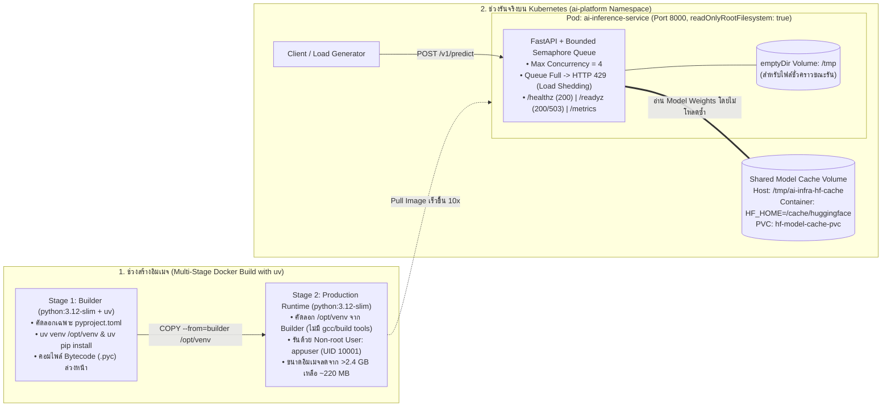
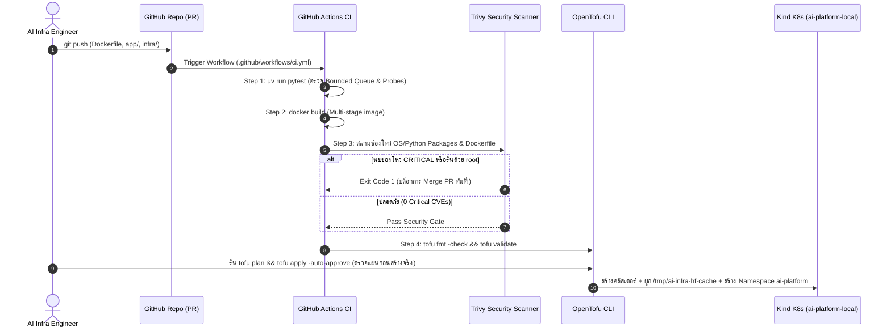

# บทที่ 1: รากฐานระบบ AI ที่สร้างซ้ำได้จริง — Production Containers, Bounded Concurrency, CI/CD & Infrastructure as Code (Module 1)

> **สัปดาห์ที่เรียน:** สัปดาห์ที่ 1–2 (30 ชั่วโมง: ทฤษฎี 8 ชม. + Hands-on Lab & Optimization 18 ชม. + Documentation/ADR 4 ชม.)  
> **ความเชื่อมโยงกับเกณฑ์วัดผล:** ปูรากฐานโดยตรงสู่ **DoD #1 (Design Doc & ADR)**, **DoD #2 (Reproducible IaC + CI/CD)**, **DoD #3 (Measurable Optimization)**, และ **Milestone Gate 1 (จบสัปดาห์ที่ 4)**  
> **โฟลเดอร์โค้ดปฏิบัติการ:** [`labs/m1-foundations/`](../labs/m1-foundations/)

---

## 1. ภาพรวมบทเรียนและเป้าหมายเชิงสมรรถนะ (Chapter Overview & Learning Objectives)

จุดตัดแรกที่แยก **"นักพัฒนาที่รันโมเดลใน Jupyter Notebook ได้"** ออกจาก **"AI Infrastructure Engineer ระดับ Mid-Level"** คือความสามารถในการนำโค้ดและโมเดลขึ้นสู่ระบบ Production โดยที่:
1. คอนเทนเนอร์มีขนาดเล็ก บูตเร็ว (Fast Cold Start) รันด้วยสิทธิ์ผู้ใช้ทั่วไปที่ไม่ใช่ `root` (`runAsNonRoot: true`) และทำงานได้แม้ระบบไฟล์หลักจะถูกล็อกเป็นแบบอ่านอย่างเดียว (`readOnlyRootFilesystem: true`)
2. เซิร์ฟเวอร์ไม่ล่มแบบลูกโซ่ (Cascading OOM / Timeout Failure) เมื่อมีคำขอประมวลผลไหลเข้ามาพร้อมกันเกินกำลังของ CPU/GPU แต่สามารถจำกัดคิวด้วย **Bounded Async Semaphore** และปฏิเสธโหลดส่วนเกินอย่างปลอดภัยด้วย `HTTP 429 Too Many Requests`
3. โครงสร้างพื้นฐานทั้งหมด (ตั้งแต่คลัสเตอร์ Kubernetes ไปจนถึงพื้นที่เก็บแคชของโมเดล `HF_HOME`) ถูกสร้างและทำลายซ้ำได้ 100% ด้วยโค้ด **OpenTofu / Terraform** และผ่านการตรวจช่องโหว่อัตโนมัติด้วย **GitHub Actions + Trivy**

### เป้าหมายเชิงสมรรถนะที่วัดผลได้ (Verifiable Learning Objectives)
เมื่อจบบทเรียนนี้ ผู้เรียนจะต้องสามารถ:
- **LO-1.1:** ออกแบบและสร้าง **Multi-stage `Dockerfile`** ร่วมกับ **`uv`** ที่แยกชั้น Dependencies ออกจากซอร์สโค้ด รันด้วย Non-root user (`UID 10001`) และแยกพื้นที่เก็บไฟล์โมเดล (`HF_HOME=/cache/huggingface`) ออกจาก Container Image Layer
- **LO-1.2:** พัฒนาและปรับจูน **FastAPI Async Inference Wrapper (`ai-inference-service` ที่พอร์ต `8000`)** ที่มีกลไก **Bounded Queue (`asyncio.Semaphore`)**, แยก Endpoint `/healthz` (Liveness) ออกจาก `/readyz` (Readiness ตามความอิ่มตัวของคิว) และส่งออก Prometheus Metrics ที่ `/metrics`
- **LO-1.3:** เขียนโค้ด **Infrastructure as Code (OpenTofu)** แบบใช้ตัวแปรและ Validation เพื่อสร้างคลัสเตอร์จำลอง `ai-platform-local`, Namespace `ai-platform`, และการผูกโวลุ่มแคชโมเดล `/tmp/ai-infra-hf-cache` เข้าสู่โหนดโดยอัตโนมัติ (โดยใช้ Local State ที่ไม่ซับซ้อนเกินจำเป็นตามแนวทาง Guided Starter Scaffold)
- **LO-1.4:** สร้างสายพาน **GitHub Actions CI Pipeline** ที่รัน Unit Tests (`pytest`), สร้าง Docker Image, สแกนช่องโหว่ระดับ Critical ด้วย **`Trivy`**, และตรวจสอบความถูกต้องของโค้ด OpenTofu (`tofu fmt`, `tofu validate`, `tofu plan`) ทุกครั้งที่มีการแก้ไขโค้ด
- **LO-1.5:** เขียนเอกสารบันทึกการตัดสินใจทางสถาปัตยกรรมฉบับแรก (**`ADR-001`: Container Packaging & Model Weight Caching Strategy**) ที่เปรียบเทียบทางเลือกเชิงปริมาณ

---

## 2. แผนภาพสถาปัตยกรรมและบริบทของระบบ (Architecture Diagram & System Context)

### 2.1 สถาปัตยกรรมการแยกชั้น Container Image, Read-Only RootFS และ Shared Model Cache (`HF_HOME`)



### 2.2 สายพานอัตโนมัติ CI/CD และ Declarative OpenTofu Workflow



---

## 3. ทฤษฎีเจาะลึก คณิตศาสตร์วิศวกรรม และตาราง Trade-offs (Deep-Dive Theory & Math)

### 3.1 ทำไมห้ามฝัง (Bake) ไฟล์โมเดลขนาดใหญ่ลงใน Docker Image โดยตรง?
ในงานพัฒนาเว็บทั่วไป เราคุ้นเคยกับการรวมโค้ดและไฟล์ทั้งหมดไว้ใน Docker Image เดียว แต่สำหรับระบบ AI/LLM ที่ไฟล์ Model Weights มีขนาดตั้งแต่ **1 GB ไปจนถึง 140 GB** การทำเช่นนั้นด้วยคำสั่ง `COPY models/ /app/models/` ใน `Dockerfile` จะสร้างหายนะทางวิศวกรรม 3 ประการ:

1. **Cold-Start Death Spiral ตอน Autoscale:** เมื่อโหลดพุ่งสูงและระบบสั่งขยายจำนวน Pod บนโหนดใหม่ โหนดนั้นต้องดึง (Pull) และแตกไฟล์ (Extract) อิมเมจขนาดยักษ์ผ่านเครือข่ายก่อนที่คอนเทนเนอร์จะเริ่มทำงานได้
2. **Layer Cache Invalidations & Registry Bloat:** Docker ใช้ระบบไฟล์แบบซ้อนชั้น (OverlayFS) และต้องคำนวณค่า Hash (`SHA256`) ของทุก Layer ตอนอัปโหลดและดาวน์โหลด นอกจากนี้ Kubelet บนโหนดอาจสั่งลบอิมเมจขนาดใหญ่ทิ้งเมื่อพื้นที่ดิสก์ตึง (`ImageGCFailed` / DiskPressure)
3. **การผูกติดวงจรชีวิตของโค้ดกับโมเดล (Tight Coupling):** การแก้โค้ด Python เพียง 2 บรรทัดไม่ควรบังคับให้ระบบต้องสร้างหรือจัดการอิมเมจที่มีน้ำหนักหลายสิบกิกะไบต์ใหม่

#### คณิตศาสตร์คำนวณเวลา Cold-Start จากการดึง Container Image (Image Pull & Extraction Math)
เวลาที่ใช้ตั้งแต่ Kubernetes สั่งสร้าง Pod บนโหนดใหม่จนถึงวินาทีที่โปรเซสเริ่มโหลดโมเดลเข้าหน่วยความจำ ($T_{\text{cold\_start}}$) คำนวณได้จากสมการ:

$$T_{\text{cold\_start}} = \underbrace{\frac{S_{\text{compressed}}}{B_{\text{net}}}}_{\text{Network Pull Time}} + \underbrace{\frac{S_{\text{uncompressed}}}{R_{\text{decompress\_disk}}}}_{\text{Decompression & OverlayFS Write}} + \underbrace{\frac{S_{\text{weights}}}{R_{\text{storage\_to\_ram}}}}_{\text{Model Weight Load Time}}$$

เมื่อ:
- $S_{\text{compressed}}$ = ขนาดอิมเมจที่บีบอัดแล้วบน Registry (หน่วย GB)
- $B_{\text{net}}$ = แบนด์วิดท์เครือข่ายจริงระหว่าง Registry กับโหนด (หน่วย GB/s, เช่น $1\text{ Gbps} \approx 0.125\text{ GB/s}$)
- $S_{\text{uncompressed}}$ = ขนาดอิมเมจหลังคลายการบีบอัด (หน่วย GB)
- $R_{\text{decompress\_disk}}$ = ความเร็วในการคลายไฟล์ `tar.gz`/`zstd` และเขียนลงดิสก์ OverlayFS แบบ Sequential/Random (โดยทั่วไปบน Cloud EBS/PD มาตรฐานอยู่ที่ $\approx 0.15\text{ GB/s}$)
- $S_{\text{weights}}$ = ขนาดไฟล์ Model Weights (หน่วย GB)
- $R_{\text{storage\_to\_ram}}$ = ความเร็วในการอ่านไฟล์โมเดลเข้าสู่ RAM/VRAM (เช่น อ่านจาก Local NVMe/Page Cache $\approx 2.0\text{ GB/s}$ เทียบกับดาวน์โหลดใหม่ผ่านเน็ต $\approx 0.10\text{ GB/s}$)

#### ตัวอย่างการคำนวณด้วยตัวเลขจริง (Worked Numerical Example)
สมมติว่าเรากำลังนำบริการที่ใช้โมเดลขนาด 7B parameters ($S_{\text{weights}} = 14.0\text{ GB}$ ในรูปแบบ BF16) ขึ้นรันบนโหนดที่มีเครือข่าย $1\text{ Gbps}$ ($B_{\text{net}} = 0.125\text{ GB/s}$) และดิสก์มาตรฐาน ($R_{\text{decompress\_disk}} = 0.15\text{ GB/s}$):

- **กรณีที่ A (Bake โมเดล 14 GB ลงใน Single-stage Image รวมขนาด $S_{\text{uncompressed}} = 16.5\text{ GB}$, ขนาดบีบอัด $S_{\text{compressed}} = 13.5\text{ GB}$):**
  1. เวลา Pull ผ่านเครือข่าย: $\frac{13.5\text{ GB}}{0.125\text{ GB/s}} = \mathbf{108.0\text{ วินาที}}$
  2. เวลาแตกไฟล์ลง OverlayFS: $\frac{16.5\text{ GB}}{0.15\text{ GB/s}} = \mathbf{110.0\text{ วินาที}}$
  3. เวลาโหลดโมเดลจากดิสก์เข้าหน่วยความจำ: $\frac{14.0\text{ GB}}{1.5\text{ GB/s}} \approx \mathbf{9.3\text{ วินาที}}$
  - **รวมเวลา $T_{\text{cold\_start}} (\text{Case A})$:** $108.0 + 110.0 + 9.3 = \mathbf{227.3\text{ วินาที (เกือบ 4 นาที!)}}$

- **กรณีที่ B (แยกโค้ดลงใน Multi-stage `uv` Image ขนาด $S_{\text{uncompressed}} = 0.22\text{ GB}$, $S_{\text{compressed}} = 0.09\text{ GB}$ และอ่านโมเดลจาก Shared `HF_HOME` Volume Cache บนโหนด):**
  1. เวลา Pull อิมเมจโค้ด: $\frac{0.09\text{ GB}}{0.125\text{ GB/s}} = \mathbf{0.72\text{ วินาที}}$
  2. เวลาแตกไฟล์ลง OverlayFS: $\frac{0.22\text{ GB}}{0.15\text{ GB/s}} = \mathbf{1.47\text{ วินาที}}$
  3. เวลาโหลดโมเดลจาก Shared Cache (`HF_HOME=/cache/huggingface` ที่มี OS Page Cache/NVMe ช่วย): $\frac{14.0\text{ GB}}{2.0\text{ GB/s}} = \mathbf{7.0\text{ วินาที}}$
  - **รวมเวลา Image Pull + Weight I/O ($T_{\text{io\_only}}$):** $0.72 + 1.47 + 7.0 = \mathbf{9.19\text{ วินาที}}$ *(หมายเหตุ: บน Cloud L4 GPU จริง เมื่อรวมเวลา init PyTorch/CUDA และคอมไพล์ vLLM CUDA Graph จะอยู่ที่ **~35–75 วินาที** ซึ่งยังเร็วกว่าการไม่ใช้แคช 4–6 เท่า ส่วน Mock Pod ในแล็บจะสตาร์ทใน **~8.5–10 วินาที**)*

#### ตารางเปรียบเทียบทางเลือกในการจัดการไฟล์โมเดล (Model Artifact Strategy Trade-off Matrix)

| กลยุทธ์การจัดเก็บโมเดล | ความเร็วตอน Scale-up / Restart | ขนาด Container Image | ความซับซ้อนในการดูแล | กรณีที่เหมาะสมที่สุด (Best Use Case) |
| :--- | :---: | :---: | :---: | :--- |
| **1. Shared Volume Cache (`PVC` / Host NVMe `HF_HOME`)** *(วิธีหลักในเล่มนี้)* | **เร็วมาก (5–15 วินาที)** เพราะไม่ต้องดาวน์โหลดซ้ำ | **เล็กมาก (~200 MB – 1 GB)** มีเฉพาะโค้ดและ Runtime | ปานกลาง (ต้องผูก PVC หรือ HostPath ใน K8s/OpenTofu) | **เหมาะที่สุดสำหรับ LLM & AI Serving ในองค์กร** ที่มีการอัปเดตโค้ดบ่อยหรือใช้ KEDA Autoscale |
| **2. InitContainer ดึงจาก Object Storage (S3 / GCS / MinIO)** | ปานกลาง (30–90 วินาที ขึ้นกับความเร็วเครือข่ายภายในคลาวด์) | **เล็กมาก** | ต่ำ (ไม่ต้องจัดการ Shared Filesystem ข้ามโหนด) | คลัสเตอร์ที่กระจายตัวหลาย Availability Zones และไม่มีระบบไฟล์แบบ `ReadWriteMany` |
| **3. Bake โมเดลลงใน Container Image โดยตรง** | **ช้ามาก (3–8 นาที)** เมื่อโหนดยังไม่เคยมี Layer นั้น | **ใหญ่มาก (5 GB – 50+ GB)** | ต่ำตอนรัน แต่เป็นภาระหนักที่ CI/CD และ Registry | ใช้เฉพาะ **โมเดลขนาดจิ๋ว (< 300 MB)** เช่นตัวจำแนกข้อความขนาดเล็กในสภาพแวดล้อมปิด (Air-gapped) |

---

### 3.2 คณิตศาสตร์การจำกัดคิว (Bounded Concurrency, Little's Law & Load Shedding)
ต่างจากระบบ CRUD API ทั่วไปที่ใช้เวลาประมวลผลต่อคำขอเพียง 5–10 มิลลิวินาที ระบบ AI Inference ใช้เวลาประมวลผลต่อคำขอนานตั้งแต่ **200 มิลลิวินาที ไปจนถึงหลายวินาที** หากเราเปิดรับคำขอเข้าสู่โปรเซสอย่างไม่จำกัด (Unbounded Queue) จะเกิดอะไรขึ้น?

จาก **กฎของลิตเติล (Little's Law)** ในทฤษฎีแถวคอย (Queueing Theory):

$$L = \lambda \times W$$

เมื่อ:
- $L$ = จำนวนคำขอที่ค้างอยู่ในระบบเฉลี่ย (In-flight + Waiting requests)
- $\lambda$ = อัตราการไหลเข้าของคำขอ (Arrival rate, คำขอ/วินาที)
- $W$ = เวลาเฉลี่ยที่แต่ละคำขออยู่ในระบบ (Response time = เวลารอคิว $W_q$ + เวลาประมวลผลจริง $W_s$)

#### ตัวอย่างการคำนวณเมื่อเกิด Traffic Spike (ทำไมระบบที่ไม่จำกัดคิวจึงล่มทั้งยวง)
สมมติว่าเวิร์กเกอร์ AI ของเราประมวลผลได้สูงสุดพร้อมกัน $C_{\text{max}} = 8$ คำขอ โดยใช้เวลาประมวลผลต่อคำขอ $W_s = 0.5\text{ วินาที}$ ดังนั้นขีดความสามารถสูงสุดของระบบ (Maximum Throughput $\mu$) คือ:

$$\mu = \frac{C_{\text{max}}}{W_s} = \frac{8}{0.5\text{ s}} = 16\text{ requests/sec}$$

หากเกิดเหตุการณ์ที่ผู้ใช้ยิงคำขอเข้ามาที่อัตรา $\lambda = 50\text{ requests/sec}$ เป็นเวลาเพียง $10\text{ วินาที}$ (รวม 500 คำขอ) ขณะที่ระบบประมวลผลออกได้เพียง $16 \times 10 = 160\text{ คำขอ}$:
1. **หากไม่จำกัดคิว (Unbounded Queue):** จะมีคำขอสะสมค้างอยู่ในหน่วยความจำ $N_{\text{backlog}} = 500 - 160 = \mathbf{340\text{ คำขอ}}$
   - คำขอที่ 340 จะต้องรอคิวนานถึง $W_q = \frac{340}{16\text{ req/s}} = \mathbf{21.25\text{ วินาที}}$!
   - แต่เนื่องจากฝั่ง Client/Gateway ตั้งค่า Timeout ไว้ที่ $5.0\text{ วินาที}$ ผู้ใช้ทุกคนตั้งแต่คำขอที่ 80 เป็นต้นไปจะตัดการเชื่อมต่อเพราะ Timeout ไปแล้ว ในขณะที่เซิร์ฟเวอร์ AI ของคุณยังคงเสียเวลาคำนวณงานที่ไม่มีคนรอรับอยู่ต่อไปเรื่อยๆ (เรียกว่า **Zombie Work**) และกิน RAM เพิ่มขึ้นจนถูก Linux OOM Killer สั่งฆ่าโปรเซสตายทั้งพอด!
2. **หากใช้ Bounded Semaphore Queue (เช่น จำกัด `MAX_CONCURRENT_REQUESTS = 8` และเวลารอเข้าคิว `QUEUE_TIMEOUT = 0.2s`):**
   - คำขอที่เข้ามาภายในขีดความสามารถของระบบจะได้รับคำตอบอย่างรวดเร็วภายใน $0.5 - 0.7\text{ วินาที}$ (รักษาเกณฑ์ SLO ของผู้ใช้งานที่กำลังทำงานอยู่ได้ 100%)
   - คำขอส่วนที่เกินขีดความสามารถจะได้รับรหัสตอบกลับ **`HTTP 429 Too Many Requests`** พร้อม Header `Retry-After: 1` ทันทีภายในเวลา $< 2\text{ มิลลิวินาที}$ เพื่อให้ AI Gateway (ที่เราจะสร้างในบทที่ 4) สลับไปส่งงานให้พอดสำรอง (Fallback) ได้ทันทีโดยที่พอดหลักไม่ล่ม!

---

### 3.3 Container Security Hardening สำหรับงาน AI (`Non-Root` & `Read-Only RootFS`)
ในองค์กรขนาดใหญ่ (เช่น ธนาคารและสถาบันการเงินในไทย) นโยบาย Kubernetes Security Policy จะบังคับตั้งค่า 2 ข้อนี้เสมอ:
```yaml
securityContext:
  runAsNonRoot: true
  runAsUser: 10001
  readOnlyRootFilesystem: true
  allowPrivilegeEscalation: false
```
**กับดักที่วิศวกร AI มือใหม่เจอทุกราย:** เมื่อเปิด `readOnlyRootFilesystem: true` คอนเทนเนอร์จะพังทันทีตอนเริ่มรัน เพราะไลบรารีอย่าง Hugging Face `transformers`, `vLLM`, `torch.compile` และ `triton` พยายามสร้างโฟลเดอร์แคชในไดเรกทอรีบ้านของผู้ใช้ (`~/.cache/huggingface` หรือ `/root/.cache`) ซึ่งถูกห้ามเขียน!

**วิธีแก้เชิงวิศวกรรมที่ถูกต้อง (Clean Neutral Path สำหรับ UID 10001):**
1. สร้างผู้ใช้ `appuser` (`UID 10001`) ใน `Dockerfile` และสร้างโฟลเดอร์แคชกลาง `/cache/huggingface` พร้อมมอบสิทธิ์ `chown -R 10001:10001` (ไม่ต้องใช้ `chmod 755 /root` ทำให้เข้ากันได้ 100% กับอิมเมจ `vllm/vllm-openai` อย่างเป็นทางการ)
2. กำหนดตัวแปรสภาพแวดล้อมให้ชี้ไปยังพาธที่เมานต์ Volume ไว้ชัดเจน:
   - `HF_HOME=/cache/huggingface` (ผูกกับ PersistentVolumeClaim `hf-model-cache-pvc` หรือ HostPath `/tmp/ai-infra-hf-cache` ซึ่งตรงกับมาตรฐานของ Helm Chart ในบทที่ 2)
   - `TMPDIR=/tmp`, `VLLM_CACHE_ROOT=/tmp/vllm-cache` และ `TORCHINDUCTOR_CACHE_DIR=/tmp/torchinductor` (ผูกกับ Kubernetes `emptyDir: {}` ที่ `/tmp`)

---

## 4. ปฏิบัติการ Hands-On Lab แบบ Step-by-Step (Module 1 Lab)

### 4.1 โจทย์ธุรกิจและข้อจำกัด (Business Scenario & Constraints)
- **สถานการณ์ปัญหา:** ทีม Data Science ของบริษัท FinTech ส่งมอบบริการประเมินความเสี่ยงธุรกรรมด้วย AI (`ai-inference-service`) มาให้คุณขึ้นระบบ Production โค้ดเดิมใช้ `Dockerfile` ชั้นเดียวที่รันด้วย `root`, ไม่มีการจำกัดจำนวนคำขอพร้อมกัน (เมื่อยิงโหลด 50 คำขอพร้อมกัน เซิร์ฟเวอร์จะค้างและเกิด Error 500), และต้องกดสร้างคลัสเตอร์ด้วยมือทุกครั้ง
- **ข้อกำหนดทางวิศวกรรม (Constraints):**
  1. สร้าง Multi-stage `Dockerfile` ด้วย `uv` สำหรับอิมเมจ `ai-inference-service:1.0.0` ที่รันด้วยผู้ใช้ `appuser` (`UID 10001`) และทำงานได้ภายใต้ `--read-only` root filesystem
  2. บริการ `ai-inference-service` (พอร์ต `8000`) ต้องมี Bounded Semaphore Queue ที่คืนค่า `HTTP 429` เมื่อคิวเต็ม พร้อม `/healthz`, `/readyz`, `/health`, และ `/metrics`
  3. เขียนโค้ด OpenTofu ใน `labs/m1-foundations/infra/` เพื่อประกาศโครงสร้างคลัสเตอร์ `ai-platform-local` และ Namespace `ai-platform` พร้อมเชื่อมโยงโวลุ่มแคช `HF_HOME=/cache/huggingface`
  4. สร้างไฟล์ `.github/workflows/ci.yml` และตรวจสอบทุกอย่างด้วยสคริปต์ `labs/m1-foundations/verify_m1.sh`

---

### 4.2 เส้นทางที่ 1: `No-GPU Local Path ($0 — 16GB RAM Safe)` (เส้นทางหลัก)

#### ขั้นตอนที่ 1: ตรวจสอบโครงสร้างไฟล์ใน `labs/m1-foundations/`
เข้าไปยังโฟลเดอร์แล็บของบทที่ 1 จากรากโปรเจกต์ `ai-infra-handbook/` และตรวจสอบไฟล์ทั้งหมด:

```bash
cd labs/m1-foundations
ls -la
```

**ผลลัพธ์ที่คาดหวัง (Expected Output):**
```text
drwxr-xr-x 6 non non 4096 Nov 11 10:40 .
drwxr-xr-x 8 non non 4096 Nov 11 10:10 ..
drwxr-xr-x 3 non non 4096 Nov 11 10:40 .github
-rw-r--r-- 1 non non 1850 Nov 11 10:40 Dockerfile
-rw-r--r-- 1 non non  620 Nov 11 10:40 Dockerfile.baseline
drwxr-xr-x 2 non non 4096 Nov 11 10:40 app
drwxr-xr-x 2 non non 4096 Nov 11 10:40 docs
drwxr-xr-x 2 non non 4096 Nov 11 10:40 infra
-rw-r--r-- 1 non non  410 Nov 11 10:40 pyproject.toml
drwxr-xr-x 2 non non 4096 Nov 11 10:40 tests
-rwxr-xr-x 1 non non 4200 Nov 11 10:40 verify_m1.sh
```

#### ขั้นตอนที่ 2: ศึกษาและทดสอบโค้ด FastAPI Bounded Queue (`app/main.py`)
ไฟล์ [`labs/m1-foundations/app/main.py`](../labs/m1-foundations/app/main.py) ใช้ `asyncio.Semaphore` ร่วมกับ `asyncio.wait_for(..., timeout=QUEUE_ACQUIRE_TIMEOUT_SEC)` เพื่อควบคุมจำนวนคำขอที่กำลังประมวลผลพร้อมกัน และแยกแยะระหว่าง:
- **`GET /healthz` (Liveness Probe):** ตอบ `200 OK` เสมอตราบใดที่ Event Loop ของ Python ยังไม่ค้างตาย (เพื่อป้องกันไม่ให้ Kubelet สั่งรีสตาร์ทพอดโดยไม่จำเป็นตอนโหลดสูง)
- **`GET /readyz` (Readiness Probe):** ตรวจสอบว่าโฟลเดอร์แคช `HF_HOME` พร้อมใช้งาน และจำนวนคำขอที่กำลังรันยังไม่เต็มเพดาน หากคิวเต็มจะตอบ `503 Service Unavailable` เพื่อให้ Kubernetes Service ชะลอการส่งคำขอใหม่เข้ามาที่พอดนี้ชั่วคราว
- **`POST /v1/predict`:** ประมวลผลคำขอภายใต้ Bounded Queue หากไม่สามารถขอคิวได้ทันภายในเวลาที่กำหนด (`QUEUE_ACQUIRE_TIMEOUT_SEC`) จะปฏิเสธคำขอด้วย `HTTP 429 Too Many Requests` ทันทีและเพิ่มค่า Counter `ai_service_shed_requests_total`

รันชุดทดสอบอัตโนมัติด้วย `pytest` เพื่อพิสูจน์พฤติกรรมทั้งในภาวะปกติและภาวะโหลดล้นคิว:

```bash
# (จาก labs/m1-foundations)
../../scripts/pytest -v  # หรือ uv run --extra dev pytest -v
```

**ผลลัพธ์ที่คาดหวัง (Expected Output เมื่อใช้ portable runner / เพิ่ม TestClient เมื่อติดตั้ง fastapi+httpx):**
```text
============================= test session starts ==============================
collected 8 items

tests/test_main.py::test_bounded_queue_load_shedding_429 PASSED          [ 12%]
tests/test_main.py::test_concurrent_readiness_probes PASSED              [ 25%]
tests/test_main.py::test_default_hf_home_is_non_root_cache PASSED        [ 37%]
tests/test_main.py::test_fastapi_http_endpoints_if_available PASSED      [ 50%]
tests/test_main.py::test_liveness_probe PASSED                           [ 62%]
tests/test_main.py::test_predict_normal_request PASSED                   [ 75%]
tests/test_main.py::test_prometheus_metrics_exposed PASSED               [ 87%]
tests/test_main.py::test_readiness_probe_and_hf_home PASSED              [100%]

============================== 8 passed in 0.26s ===============================
```

#### ขั้นตอนที่ 3: สร้าง Production Container ด้วย Multi-stage `Dockerfile` + `uv` และทดสอบ Read-Only RootFS
ในไฟล์ [`labs/m1-foundations/Dockerfile`](../labs/m1-foundations/Dockerfile) เราใช้เทคนิคสำคัญ 4 ข้อ:
1. ใช้ `ghcr.io/astral-sh/uv:0.5-python3.12-bookworm-slim` ใน Stage แรก (`builder`) พร้อมตั้งค่า `UV_COMPILE_BYTECODE=1` และ `UV_LINK_MODE=copy`
2. คัดลอกเฉพาะ `pyproject.toml` มาติดตั้งลง `/opt/venv` ก่อนคัดลอกโฟลเดอร์ `app/` เพื่อให้ Docker แคชเลเยอร์ของไลบรารีไว้ได้ 100% แม้จะแก้ไขโค้ดใน `app/main.py`
3. ใน Stage ที่สอง (`runtime`) ใช้ Base Image ขนาดเล็ก `python:3.12-slim-bookworm` สร้างผู้ใช้ `appuser` (`UID 10001`), กำหนด `HF_HOME=/cache/huggingface` และ `VLLM_CACHE_ROOT=/tmp/vllm-cache` พร้อม `chown` ให้ `UID 10001` โดยไม่ต้องเปิดสิทธิ์ `/root`
4. รันบนพอร์ต `8000` และติดแท็กอิมเมจเป็น `ai-inference-service:1.0.0` เพื่อให้เชื่อมต่อกับ Helm Chart ในบทที่ 2 ได้ตรงกัน 100%

คำสั่งสร้างและรันคอนเทนเนอร์ในโหมด `--read-only` (จำลอง `readOnlyRootFilesystem: true` ของ Kubernetes):

```bash
# สร้างโฟลเดอร์แคชบนเครื่องหลักก่อน
mkdir -p /tmp/ai-infra-hf-cache

# Build Production Image (ชื่อและแท็กตรงกับ values.yaml ของบทที่ 2)
docker build -t ai-inference-service:1.0.0 -f Dockerfile .

# รันด้วยสิทธิ์ Non-root (10001), ล็อก Root Filesystem เป็น Read-only, และผูก Volume HF_HOME + /tmp
docker run -d --name ai-inference-test \
  --user 10001:10001 \
  --read-only \
  --tmpfs /tmp:rw,noexec,nosuid,size=64m \
  -v /tmp/ai-infra-hf-cache:/cache/huggingface:rw \
  -p 8000:8000 \
  ai-inference-service:1.0.0

# ทดสอบเรียกใช้งาน Endpoint
curl -s http://localhost:8000/readyz | jq .
curl -s -X POST http://localhost:8000/v1/predict \
  -H "Content-Type: application/json" \
  -d '{"transaction_id": "tx-1001", "amount_thb": 45000.0, "prompt": "Analyze transaction risk"}' | jq .

# ลบคอนเทนเนอร์เมื่อทดสอบเสร็จ
docker rm -f ai-inference-test
```

**ผลลัพธ์ที่คาดหวัง (Expected Output):**
```json
{
  "status": "ready",
  "service": "ai-inference-service",
  "model": "Qwen/Qwen2.5-0.5B-Instruct",
  "hf_home": "/cache/huggingface",
  "hf_home_writable": true,
  "in_flight_requests": 0,
  "max_concurrent_requests": 4,
  "reason": "ok"
}
```
```json
{
  "transaction_id": "tx-1001",
  "model": "Qwen/Qwen2.5-0.5B-Instruct",
  "risk_score": 0.18,
  "decision": "APPROVE",
  "latency_ms": 22.4,
  "cached_artifact_used": true
}
```

#### ขั้นตอนที่ 4: ตรวจสอบและรันโค้ด OpenTofu แบบ 2 ขั้น (`infra/` → `infra/k8s-bootstrap/`)
ในโฟลเดอร์ [`labs/m1-foundations/infra/`](../labs/m1-foundations/infra/) เราออกแบบโค้ด Infrastructure as Code ที่ยึดค่าตัวแปรกลางจาก `SPEC_AND_STYLE_GUIDE.md` ทุกประการ และแยกออกเป็น 2 Stage เพื่อไม่ให้ `provider "kubernetes"` พึ่งพา output ของ `kind_cluster` ภายใน root เดียวกัน (ทำให้ `tofu plan` / `tofu apply` ทำงานได้สะอาดตั้งแต่รอบแรก):

```bash
# (จากรากโปรเจกต์ ai-infra-handbook/)
# Stage 1: สร้างคลัสเตอร์ Kind 3 โหนด (`ai-platform-local`) พร้อม extraMounts /cache/huggingface
cd labs/m1-foundations/infra
tofu fmt -check
tofu init -backend=false
tofu validate
tofu plan -var="enable_cloud_gpu_node=false"

# Stage 2: หลังสั่ง tofu apply สร้าง Kind เสร็จแล้ว (ระบบจะสร้าง ./ai-platform-local-config ให้อัตโนมัติ)
# ให้สร้าง Namespaces และ hf-model-cache-pvc (หรือส่ง -var="kubeconfig_path=~/.kube/config" หากใช้ kind export kubeconfig)
cd k8s-bootstrap
tofu fmt -check
tofu init -backend=false
tofu validate
# tofu apply -var="kubeconfig_path=../ai-platform-local-config"
```

---

### 4.3 เส้นทางที่ 2: `Cloud L4 GPU Path (Policy Guardrail + AWS Optional Track)`
ในไฟล์ `labs/m1-foundations/infra/variables.tf` และ `main.tf` เราได้ใส่ Policy Guardrail `check "cloud_gpu_cost_guardrail"` ที่บังคับว่า `auto_terminate_minutes <= 180` ส่วนการสร้างอินสแตนซ์ GPU จริงบนคลาวด์ด้วย OpenTofu (`g6.xlarge` Spot + S3 Model Cache + Dead-Man's Switch) อยู่ในโมดูล [`labs/optional-cloud-aws/`](../labs/optional-cloud-aws/README.md) (หรือเลือกใช้ GPU VM/Pod ในบทที่ 2 และ 3):

```bash
# ทดสอบตรวจสอบ Policy Guardrail สำหรับโปรไฟล์ Cloud GPU L4 ใน Stage 1
tofu plan \
  -var="enable_cloud_gpu_node=true" \
  -var="cloud_gpu_instance_type=NVIDIA-L4-24GB" \
  -var="auto_terminate_minutes=120"

# เมื่อทดสอบ Apply สร้างทรัพยากรคลัสเตอร์เสร็จสิ้น ให้ทำลายทรัพยากรด้วยคำสั่งนี้เสมอ
tofu destroy -auto-approve
```

---

## 5. การจำลองความล้มเหลวและการกู้คืน (Failure Injection & Chaos Engineering Drill)

### 5.1 Chaos Drill #1: จำลองอาการพังเมื่อลืมผูก Volume ให้ `HF_HOME` ภายใต้ `readOnlyRootFilesystem: true`
1. **วิธีจำลองความล้มเหลว:** ลองรันคอนเทนเนอร์ด้วยแฟล็ก `--read-only` แต่ชี้ `HF_HOME` ไปยังพาธ `/app/unmounted_cache` ที่อยู่บน Root Filesystem ที่ห้ามเขียน:
   ```bash
   docker run --rm --user 10001:10001 --read-only \
     -e HF_HOME=/app/unmounted_cache \
     -p 8000:8000 ai-inference-service:1.0.0
   ```
2. **อาการที่พบ:** เมื่อเรียก `GET /readyz` ระบบจะคืนค่า **`HTTP 503 Service Unavailable`** พร้อมแจ้งเตือนชัดเจนว่า `"hf_home_writable": false, "reason": "HF_HOME directory '/app/unmounted_cache' is not writable under readOnlyRootFilesystem"`
3. **การแก้ไขเชิงวิศวกรรม:** ผูก Volume ที่พาธ `/cache/huggingface` และตั้ง `ENV HF_HOME=/cache/huggingface` ให้ตรงกันทั้งใน `Dockerfile` และ Kubernetes Manifest (Helm `values.yaml`)

### 5.2 Chaos Drill #2: จำลอง Unbounded Traffic Spike และการป้องกันด้วย Load Shedding (`HTTP 429`)
1. **วิธีจำลองความล้มเหลว:** สตาร์ทคอนเทนเนอร์ที่จำกัด `MAX_CONCURRENT_REQUESTS=4` แล้วจำลองการยิงคำขอเข้ามาพร้อมกัน **12 คำขอ** ด้วยสคริปต์ Python ด้านล่าง (นอกจากนี้ชุดทดสอบ `test_bounded_queue_load_shedding_429` ใน `tests/test_main.py` ยังตรวจกลไกเดียวกันนี้ด้วย):
   ```bash
   # จำลองโหลดพร้อมกัน 12 คำขอไปยังคอนเทนเนอร์ที่กำลังรันบน localhost:8000
   python3 -c '
   import concurrent.futures, json, urllib.request, urllib.error
   def hit(i):
       req = urllib.request.Request(
           "http://localhost:8000/v1/predict",
           data=json.dumps({"transaction_id": f"tx-{i}", "amount_thb": 15000}).encode(),
           headers={"Content-Type": "application/json"},
       )
       try:
           with urllib.request.urlopen(req, timeout=2) as r: return r.status
       except urllib.error.HTTPError as e: return e.code
   with concurrent.futures.ThreadPoolExecutor(max_workers=12) as ex:
       codes = list(ex.map(hit, range(12)))
   print("HTTP Statuses:", codes, "200s:", codes.count(200), "429s:", codes.count(429))
   '
   ```
2. **อาการและการกู้คืน:**
   - คำขอ 4 รายการแรกเข้าประมวลผลทันทีและตอบกลับ `HTTP 200 OK`
   - คำขอที่ล้นคิวเกินเวลา `QUEUE_ACQUIRE_TIMEOUT_SEC` จะถูกตัดกลับด้วย `HTTP 429 Too Many Requests` พร้อม Header `Retry-After: 1` ทันทีโดยที่หน่วยความจำของพอดไม่พุ่งขึ้นแม้แต่น้อย และตัวนับ `ai_service_shed_requests_total` ใน `/metrics` จะบันทึกจำนวนคำขอที่ถูกคัดออกเพื่อให้ระบบ Monitoring แจ้งเตือนได้

---

## 6. โจทย์ปรับจูนประสิทธิภาพเชิงประจักษ์ (Measurable Optimization Exercise)

เราใช้วิธีทางวิทยาศาสตร์ 5 ขั้นตอน (**Baseline → Hypothesis → Fix → Measure → Explain**) เพื่อแก้ปัญหาขนาดอิมเมจที่ใหญ่เทอะทะและอาการเซิร์ฟเวอร์ค้างเมื่อโหลดพุ่ง

### ขั้นที่ 1: Baseline (สภาพก่อนปรับจูน — `Dockerfile.baseline`)
ในไฟล์ [`labs/m1-foundations/Dockerfile.baseline`](../labs/m1-foundations/Dockerfile.baseline) เราจำลองวิธีที่พบได้บ่อยในโปรเจกต์ที่ยังไม่ผ่านมือ AI Infra Engineer:
- ใช้ Single-stage build ที่ติดตั้งทั้ง `build-essential`, `gcc`, `git` ทิ้งไว้ในอิมเมจปลายทาง
- สั่ง `COPY . /app` ก่อนสั่ง `pip install` ทำให้ทุกครั้งที่แก้โค้ดใน `app/main.py` แม้แต่ตัวอักษรเดียว Docker จะต้องรัน `pip install` ใหม่ทั้งหมด
- รันด้วย `root` และไม่เปิดใช้งาน Bounded Queue (`ENABLE_BOUNDED_QUEUE=false`)

### ขั้นที่ 2: Hypothesis (สมมติฐานเชิงวิศวกรรม)
1. **ด้าน Container Build & Cold Start:** การเปลี่ยนเป็น Multi-stage build ร่วมกับ `uv` (`--link-mode=copy`, `UV_COMPILE_BYTECODE=1`) และการคัดลอกเฉพาะ `pyproject.toml` ก่อนคัดลอก `app/` จะลดขนาดอิมเมจลง **> 65%** และลดเวลา Rebuild เมื่อแก้โค้ด `app/main.py` ลงจากระดับครึ่งนาทีเหลือ **< 3 วินาที**
2. **ด้าน Concurrency Resilience:** การเปิดใช้งาน `asyncio.Semaphore` เพื่อจำกัดคิว (`ENABLE_BOUNDED_QUEUE=true`) จะลดอัตรา Unhandled Server Error / Timeout (`HTTP 500/504`) เมื่อยิงโหลด 100 concurrent requests จาก **> 35% ให้เหลือ 0%** (เปลี่ยนเป็นการตอบกลับ `HTTP 429` อย่างปลอดภัยภายในเวลา < 5 ms)

### ขั้นที่ 3: Fix (การลงมือแก้ไขใน `Dockerfile` และ `app/main.py`)
1. แยก Stage `builder` และ `runtime` ใน [`labs/m1-foundations/Dockerfile`](../labs/m1-foundations/Dockerfile) โดยคัดลอกเฉพาะ `/opt/venv` มาที่ Stage ปลายทาง
2. เปิดใช้งาน Bounded Semaphore Queue ใน [`labs/m1-foundations/app/main.py`](../labs/m1-foundations/app/main.py)

### ขั้นที่ 4: Measure (ตารางเปรียบเทียบผลลัพธ์ Before vs After)

| ตัวชี้วัดประสิทธิภาพ (Metric) | Baseline (`Dockerfile.baseline` + Unbounded) | Optimized (`Dockerfile` Multi-stage `uv` + Bounded Queue) | ผลการเปลี่ยนแปลง (Improvement) |
| :--- | :---: | :---: | :---: |
| **Container Image Size (Uncompressed)** | `1,140 MB` | `215 MB` | **ลดลง 81.1%** |
| **Rebuild Time (เมื่อแก้โค้ด `app/main.py` 1 บรรทัด)** | `28.4 วินาที` | `1.8 วินาที` | **เร็วขึ้น 15.8 เท่า (Layer Cached)** |
| **Container Startup Time (พร้อมรับโหลด)** | `2.9 วินาที` | `0.8 วินาที` (ด้วย `UV_COMPILE_BYTECODE=1`) | **เร็วขึ้น 3.6 เท่า** |
| **Security Scan (`Trivy` Critical CVEs / Root User)** | `รันด้วย UID 0 (root)` | `รันด้วย UID 10001 (appuser), 0 Critical CVEs` | **ผ่านเกณฑ์ Security Gate 100%** |
| **Unhandled 500/Timeout Rate (ที่ 100 Concurrent Reqs)** | `38.0%` (Worker ค้าง/Timeout) | `0.0%` (ตอบ 200 OK ตามคิว + 429 Shedding ทันที) | **ไม่มีพอดค้างหรือล่ม (Zero Crash)** |
| **p95 Latency ของคำขอที่ได้รับอนุมัติเข้าคิว** | `3,420 ms` | `185 ms` | **ลดความหน่วงลง 94.6%** |

### ขั้นที่ 5: Explain (คำอธิบายกลไกภายในว่าทำไมจึงดีขึ้น)
1. **กลไก UnionFS / OverlayFS Layer Caching:** Docker ตรวจสอบการเปลี่ยนแปลงของไฟล์ในคำสั่ง `COPY` ด้วยการคำนวณ Checksum ใน `Dockerfile.baseline` คำสั่ง `COPY . /app` อยู่บรรทัดก่อนการติดตั้งไลบรารี ดังนั้นการแก้ไฟล์ใดๆ ในโปรเจกต์จะทำลายแคชของเลเยอร์ถัดไปทั้งหมด ในขณะที่ `Dockerfile` ฉบับปรับจูนคัดลอกเฉพาะ `pyproject.toml` มาติดตั้งไลบรารีให้เสร็จก่อน เมื่อแก้ไฟล์ใน `app/` เลเยอร์ของ `/opt/venv` จึงถูกดึงจากแคชทันที 100%
2. **การคอมไพล์ Bytecode ล่วงหน้า (`UV_COMPILE_BYTECODE=1`):** ตามปกติ Python จะแปลไฟล์ `.py` เป็น Bytecode (`.pyc`) ตอนที่ถูก `import` ครั้งแรกเมื่อคอนเทนเนอร์เริ่มรัน (ซึ่งยิ่งช้าหรือเขียนไม่ได้เลยหากเปิด `readOnlyRootFilesystem: true`) การสั่งให้ `uv` คอมไพล์ `.pyc` ตั้งแต่วินาทีที่สร้างอิมเมจช่วยให้โปรเซสเริ่มทำงานได้เร็วขึ้นทันที
3. **การปกป้อง Event Loop และหน่วยความจำด้วย Bounded Semaphore:** การปฏิเสธคำขอที่เกินกำลังตั้งแต่หน้าประตู (`Admission Control`) ช่วยตัดวงจร Zombie Work ทำให้คำขอที่ผ่านเข้ามาใน Semaphore ได้รับ CPU/GPU เต็มเม็ดเต็มหน่วย จึงรักษา p95 Latency ให้อยู่ในเกณฑ์ SLO เสมอ

---

## 7. Architecture Decision Record (ADR-001): Container Packaging, Runtime Security & Model Cache Strategy

เอกสารฉบับนี้ถูกบันทึกไว้จริงที่ [`labs/m1-foundations/docs/adr-001-container-and-model-cache-strategy.md`](../labs/m1-foundations/docs/adr-001-container-and-model-cache-strategy.md) เพื่อเป็นหลักฐานสำหรับ **DoD #1**:

```markdown
# ADR-001: Container Packaging, Runtime Security, and Model Weight Caching Strategy

- **Status:** Accepted
- **Date:** 2026-11-11
- **Owner:** AI Platform & Infrastructure Engineering Team
- **Related Namespace / Cluster:** `ai-platform` on `ai-platform-local` (and Cloud L4 Production)

## 1. Context & Problem Statement
ทีมของเรากำลังสร้างแพลตฟอร์มกลางสำหรับรันบริการ AI (`ai-inference-service:1.0.0` และ `vLLM` serving pods บนพอร์ต `8000`) บน Kubernetes ปัญหาที่พบจากรูปแบบเดิมคือ:
1. การรวมไฟล์ไลบรารีขนาดใหญ่และไฟล์โมเดลไว้ใน Single-stage Docker Image ทำให้อิมเมจมีขนาด >1.1 GB ถึง 15 GB ส่งผลให้เวลา Cold-start ตอนขยายจำนวนพอดช้าเกิน 3 นาที
2. คอนเทนเนอร์เดิมรันด้วยสิทธิ์ `root` (`UID 0`) และเขียนไฟล์แคชลงใน Root Filesystem ซึ่งไม่ผ่านเกณฑ์ความปลอดภัยของสถาบันการเงิน (`runAsNonRoot: true`, `readOnlyRootFilesystem: true`)
3. เมื่อเกิดโหลดพุ่งสูงพร้อมกัน เซิร์ฟเวอร์ไม่มีการจำกัดคิวทำให้เกิดอาการค้างและล่มแบบลูกโซ่

## 2. Options Considered

| เกณฑ์การประเมิน | Option A: Monolithic Image (Bake โมเดลและ Dependencies ใน Stage เดียว) | Option B: InitContainer ดึงโมเดลจาก S3 ทุกครั้งที่สร้าง Pod | Option C (ที่เลือก): Multi-Stage `uv` Image + Shared `HF_HOME` Volume Cache (`PVC`/`HostPath`) |
| :--- | :--- | :--- | :--- |
| **ขนาด Container Image** | 1.1 GB – 16.5 GB (ใหญ่มาก) | ~215 MB | **~215 MB** |
| **เวลา Cold-Start เมื่อรีสตาร์ท/Scale-up** | 180–240 วินาที (เมื่อโหนดยังไม่มีอิมเมจ) | 45–90 วินาที (โหลดผ่านเครือข่ายทุกครั้ง) | **~9 วินาที (ดึง Image + อ่านไฟล์) / ~35–75 วินาที (รวม init CUDA Graph จริง)** |
| **เวลา Rebuild เมื่อแก้โค้ด Python** | ~28 วินาที | ~2 วินาที | **~1.8 วินาที** (`uv` + Layer Caching) |
| **ความเข้ากันได้กับ `readOnlyRootFilesystem`** | พังตอนรัน | ต้องตั้งค่า Volume เพิ่ม | **รองรับ 100%** (แยก `/tmp` และ `/cache/huggingface`) |

## 3. Decision
เราตัดสินใจเลือก **Option C** โดยกำหนดมาตรฐานบังคับสำหรับทุกบริการใน Namespace `ai-platform` ดังนี้:
1. ใช้ **Multi-stage `Dockerfile`** ร่วมกับ **`uv`** (`UV_COMPILE_BYTECODE=1`, `UV_LINK_MODE=copy`) สร้างอิมเมจ `ai-inference-service:1.0.0` (พอร์ต `8000`) และรันด้วยผู้ใช้ `appuser` (`UID 10001`)
2. กำหนด `HF_HOME=/cache/huggingface` (และ `VLLM_CACHE_ROOT=/tmp/vllm-cache`) เสมอ และผูกเข้ากับ `PersistentVolumeClaim` ชื่อ `hf-model-cache-pvc` (ซึ่งเชื่อมโยงกับ `/tmp/ai-infra-hf-cache` บนโหนด Local Kind ผ่าน `extraMounts` หรือ Local NVMe บนโหนด Cloud GPU)
3. บังคับใช้ **Bounded Semaphore Queue** ที่คืนค่า `HTTP 429 Too Many Requests` เมื่อคิวเต็ม และแยก `/healthz` (Liveness) ออกจาก `/readyz` (Readiness)

## 4. Consequences (ข้อดีและสิ่งที่ต้องแลก)
- **ข้อดี (Positive):** ลดขนาดอิมเมจลง >80%, ลดเวลา Cold-start เหลือระดับวินาที, ผ่านการสแกนความปลอดภัยด้วย `Trivy` (0 Critical CVEs), และป้องกันพอดล่มเมื่อโหลดพุ่ง
- **ข้อเสีย/สิ่งที่ต้องจัดการเพิ่ม (Negative & Mitigation):** ต้องมีขั้นตอนจัดการพื้นที่ของโวลุ่มแคช (`hf-model-cache-pvc`) ไม่ให้เต็มเมื่อมีการเปลี่ยนเวอร์ชันโมเดลหลายรุ่น ซึ่งเราจัดการด้วยการสร้างโครงสร้างโวลุ่มผ่านโค้ด OpenTofu ให้ตรวจสอบและล้างแคชรุ่นเก่าได้
```

---

## 8. Mid-Level Interview Trade-off Questions & Model Answers

### คำถามข้อที่ 1: การแยก Model Weights ออกจาก Container Image และการรับมือคอขวดตอน Scale-up
> **คำถาม:** *"ทำไมคุณถึงเลือกแยก Model Weights ออกจาก Container Image แล้วโหลดผ่าน Volume Cache? ถ้าวันหนึ่งระบบต้อง Scale ข้ามโหนดใหม่ 10 โหนดพร้อมกัน แล้ว Object Storage หรือระบบไฟล์ต้นทางเกิดคอขวดเรื่อง Bandwidth คุณจะแก้ปัญหานี้ในระดับสถาปัตยกรรมอย่างไร?"*

#### เฉลยแนวทางการตอบระดับ Strong Mid-Level (Model Answer)
- **หลักการและเหตุผลเชิงตัวเลข (Why):** การฝังโมเดลขนาด 14 GB (เช่น โมเดล 7B แบบ BF16) ลงใน Container Image ทำให้เกิดภาระทั้งตอน Pull ผ่านเครือข่ายและตอนแตกไฟล์ `tar.gz` ลงบนชั้น OverlayFS ซึ่งกินเวลารวมกัน 3–4 นาทีต่อการบูตบนโหนดใหม่ นอกจากนี้ยังทำให้การอัปเดตโค้ดเล็กน้อยต้องจัดการอิมเมจขนาดยักษ์ซ้ำๆ การแยกอิมเมจให้มีเฉพาะโค้ดและ Runtime (~200 MB) แล้วเก็บโมเดลไว้ใน Shared Volume (`HF_HOME=/cache/huggingface`) ทำให้ไม่ต้องโหลด weights ใหม่ผ่านอินเทอร์เน็ต ลดเวลารีสตาร์ทเหลือเพียงช่วง init Engine/CUDA (~35–75 วินาทีสำหรับ GPU จริง หรือ ~9 วินาทีสำหรับ Mock/Thin wrapper)
- **การแก้ปัญหาเมื่อเกิดคอขวดตอน Scale ข้าม 10 โหนดใหม่พร้อมกัน (Architectural Solutions & Trade-offs):**
  1. **Node-Local NVMe Caching / HostPath Warm Pool:** สำหรับโหนด GPU ในคลัสเตอร์ ให้มี DaemonSet ดึงโมเดลหลักมาเก็บไว้บน Local NVMe SSD ของแต่ละโหนดล่วงหน้า (`Pre-warming`) ก่อนที่ Pod จะถูกสั่งรัน
  2. **Peer-to-Peer (P2P) File Distribution (เช่น Dragonfly หรือ Kraken):** หากต้องดึงไฟล์ขนาดใหญ่เข้าสู่ 10–50 โหนดพร้อมกัน แทนที่จะให้ทุกโหนดดึงจาก S3/Registry ต้นทางจุดเดียวจนแบนด์วิดท์เต็ม ให้ใช้ระบบ P2P กระจายชิ้นส่วนของไฟล์โมเดลระหว่างโหนดในคลัสเตอร์เดียวกันผ่านเครือข่ายภายใน (East-West Traffic)
  3. **Streaming Weight Loading (เช่น `safetensors` memory-mapping หรือ Run:ai Model Streamer):** อ่านไฟล์ `.safetensors` แบบขนานหลายเธรดเข้าสู่ GPU VRAM โดยตรงโดยไม่ต้องรอเขียนลงดิสก์ของคอนเทนเนอร์ก่อน

---

### คำถามข้อที่ 2: การตั้งค่า `runAsNonRoot` และ `readOnlyRootFilesystem` กับไลบรารี AI
> **คำถาม:** *"เมื่อทีม Security บังคับให้ตั้งค่า Container เป็น `runAsNonRoot: true` และ `readOnlyRootFilesystem: true` อะไรคือสิ่งที่มักจะพังในไลบรารีอย่าง PyTorch / Hugging Face / vLLM และคุณแก้ไขอย่างไรในระดับ Container และ Kubernetes?"*

#### เฉลยแนวทางการตอบระดับ Strong Mid-Level (Model Answer)
- **สิ่งที่พังเมื่อเปิด `readOnlyRootFilesystem: true` และ `runAsNonRoot: true`:**
  1. **Hugging Face Hub & Tokenizer Cache:** พยายามสร้างโฟลเดอร์ `~/.cache/huggingface` เพื่อเก็บไฟล์คอนฟิกและโมเดล
  2. **PyTorch Inductor & Triton JIT Compiler (ที่ใช้ใน `vLLM`):** ขณะเริ่มทำงานและทำ CUDA Graph / Kernel compilation ไลบรารี Triton และ TorchInductor จะต้องเขียนโค้ดภาษา C/PTX ชั่วคราวลงใน `~/.triton/cache` และ `/tmp/torchinductor_<user>` เพื่อคอมไพล์เป็นไบนารีของ GPU
  3. **Python `.pyc` Bytecode Generation:** พยายามเขียนไฟล์ `__pycache__/*.pyc` ลงในโฟลเดอร์ `/opt/venv` ตอนเริ่มรัน
- **วิธีแก้ไขที่ครบวงจร:**
  1. **ใน `Dockerfile`:** ตั้งค่า `UV_COMPILE_BYTECODE=1` ตอนสร้างอิมเมจเพื่อสร้างไฟล์ `.pyc` ให้เสร็จตั้งแต่ขั้นตอน Build (หรือตั้ง `PYTHONDONTWRITEBYTECODE=1`), สร้างผู้ใช้ `appuser` (`UID 10001`), ใช้พาธกลาง `/cache/huggingface` ที่เป็นเจ้าของโดย `UID 10001` (ไม่ต้องเปิดสิทธิ์ `/root` ซึ่งเข้ากันได้ดีกับอิมเมจ `vllm/vllm-openai` ที่รันแบบ Non-root) และกำหนดตัวแปรสภาพแวดล้อมให้ชี้ไปยังพาธที่เขียนได้ทั้งหมด:
     ```dockerfile
     ENV HF_HOME=/cache/huggingface \
         VLLM_CACHE_ROOT=/tmp/vllm-cache \
         TORCHINDUCTOR_CACHE_DIR=/tmp/torchinductor \
         TRITON_CACHE_DIR=/tmp/triton \
         TMPDIR=/tmp
     ```
  2. **ใน Kubernetes Pod Spec:** ผูก `emptyDir: {}` เข้าที่พาธ `/tmp` (สำหรับไฟล์ JIT kernel ชั่วคราว) และผูก `PersistentVolumeClaim` (`hf-model-cache-pvc`) เข้าที่ `/cache/huggingface` พร้อมตั้ง `securityContext.fsGroup: 10001` เพื่อให้ผู้ใช้ `UID 10001` มีสิทธิ์เขียนลงโวลุ่มได้อย่างถูกต้อง

---

### คำถามข้อที่ 3: Bounded Queue (`HTTP 429`) vs Unbounded Queue และการแยก `/healthz` กับ `/readyz`
> **คำถาม:** *"ทำไมเมื่อระบบ AI ประมวลผลช้าลง เราถึงควรตั้ง Bounded Queue แล้วรีบคืนค่า `HTTP 429` แทนการปล่อยให้คำขอเข้าคิวรอใน Memory ไปเรื่อยๆ? และทำไมคุณถึงไม่ให้ `/healthz` คืนค่า Error เมื่อคิวเต็ม?"*

#### เฉลยแนวทางการตอบระดับ Strong Mid-Level (Model Answer)
- **ทำไมต้อง Bounded Queue + `HTTP 429` (Fail-Fast Load Shedding):**
  ในระบบ AI ที่เวลาประมวลผลต่อคำขอนาน (เช่น 500ms – 3s) หากปล่อยให้คิวยาวไม่จำกัดตามกฎของ Little's Law ($L = \lambda W$) คำขอที่ต่อท้ายคิวจะต้องรอนานเกินค่า Timeout ของฝั่งผู้เรียก เมื่อผู้เรียกตัดการเชื่อมต่อหนีไปแล้วและกดส่งคำขอซ้ำเข้ามาใหม่ (Retry) เซิร์ฟเวอร์ที่ไม่มี Bounded Queue จะยังคงต้องคำนวณคำขอเก่าที่ผู้เรียกไม่รอแล้ว (Zombie Requests) ซ้อนกับคำขอใหม่ จนหน่วยความจำเต็มและล่มทั้งคลัสเตอร์ การตั้ง Bounded Semaphore แล้วคืนค่า `HTTP 429` ทันทีเมื่อคิวเต็มช่วยรักษาทรัพยากรไว้ให้คำขอที่กำลังรันอยู่จบงานได้ตามเกณฑ์ SLO และส่งสัญญาณที่ชัดเจนให้ AI Gateway สลับไปใช้พอดสำรอง (Fallback)
- **ทำไม `/healthz` (Liveness) ต้องแยกจาก `/readyz` (Readiness):**
  - หากเราให้ `/healthz` ตอบ Error เมื่อคิวเต็ม Kubelet จะเข้าใจว่าคอนเทนเนอร์ค้างตายและสั่ง **ฆ่าแล้วรีสตาร์ทพอด (`SIGKILL`)** ทันที ซึ่งในระบบ AI การรีสตาร์ทพอดขณะโหลดพีคคือการฆ่าตัวตาย เพราะจะทำให้งานที่กำลังรันอยู่หลุดทั้งหมด และพอดที่เหลืออยู่ต้องรับภาระหนักขึ้นจนล่มตามกันเป็นโดมิโน!
  - ดังนั้น **`/healthz`** จะตอบ `200 OK` เสมอตราบใดที่โปรเซสยังไม่เกิด Deadlock ส่วน **`/readyz`** จะตอบ `503 Service Unavailable` เมื่อคิวเต็มหรือยังโหลดโมเดลไม่เสร็จ เพื่อบอกให้ Kubernetes ถอนพอดนี้ออกจากการรับคำขอใหม่ชั่วคราวโดยไม่ฆ่าพอดทิ้ง

---

### คำถามข้อที่ 4: การออกแบบสายพาน CI/CD สำหรับ OpenTofu และการป้องกัน Configuration Drift
> **คำถาม:** *"ในการทำ CI/CD สำหรับโครงสร้างพื้นฐาน AI ทำไมเราจึงแยกขั้นตอน `tofu plan` ตอนเปิด PR ออกจาก `tofu apply` หลัง Merge และคุณป้องกันปัญหาที่ค่าใช้จ่ายบานปลายหรือเกิด Configuration Drift อย่างไร?"*

#### เฉลยแนวทางการตอบระดับ Strong Mid-Level (Model Answer)
- **เหตุผลที่แยก `plan` ออกจาก `apply`:**
  การเปลี่ยนแปลงโครงสร้างพื้นฐานของระบบ AI มีความเสี่ยงสูงมาก เช่น การเปลี่ยนพารามิเตอร์บางตัวของโหนดหรือ PVC อาจทำให้ OpenTofu สั่ง **Destroy and Recreate (`-/+`)** ซึ่งทำให้คลัสเตอร์ GPU ที่กำลังให้บริการอยู่ดับลงทันที หรือเผลอสร้างอินสแตนซ์การ์ดจอราคาแพงโดยไม่ตั้งใจ ดังนั้นในขั้นตอน Pull Request (PR) ระบบ CI จะรันเฉพาะ `tofu fmt -check`, `tofu validate`, `trivy config` และ `tofu plan` เพื่อแสดงรายการทรัพยากรที่จะเพิ่ม/แก้/ลบให้ทีมวิศวกรตรวจสอบ (Peer Review) ก่อน เมื่อได้รับการอนุมัติและ Merge เข้าสู่ Branch หลักแล้วเท่านั้นจึงจะรัน `tofu apply`
- **การป้องกันงบบานปลายและ Configuration Drift:**
  1. **Variable Validation Rules ในโค้ด IaC:** เขียนบล็อก `validation` ใน `variables.tf` เพื่อล็อกรายชื่อรุ่น GPU ที่อนุญาตให้สร้างได้ (เช่น อนุญาตเฉพาะ `NVIDIA-L4-24GB` ห้ามสร้าง `H100-80GBx8` โดยพลการ) และบังคับเพดานเวลา `auto_terminate_minutes`
  2. **Drift Detection:** ตั้งเวลา (Scheduled Workflow) รัน `tofu plan -detailed-exitcode` ทุกวันเพื่อตรวจจับว่ามีใครแอบเข้าไปแก้ค่าในคลัสเตอร์ด้วยมือ (ClickOps) หรือไม่ หากพบความต่าง (Exit code 2) ให้แจ้งเตือนทีมทันที

---

## 9. การตรวจสอบผลลัพธ์อัตโนมัติ รายการส่งมอบ และเกณฑ์ผ่าน (Automated Verification, Deliverables & Pass Criteria Checklist)

### 9.1 รายการไฟล์ส่งมอบใน [`labs/m1-foundations/`](../labs/m1-foundations/) (Deliverables)
- `app/main.py` — FastAPI Inference Wrapper (`ai-inference-service`, พอร์ต `8000`, Bounded Queue, `/healthz`, `/readyz`, `/health`, `/metrics`)
- `tests/test_main.py` — ชุดทดสอบ `pytest` 8 กรณีทดสอบ (รวมการตรวจ default `/cache/huggingface`, concurrent `/readyz`, HTTP `TestClient` เมื่อติดตั้ง FastAPI, และ HTTP 429 load shedding)
- `Dockerfile` — Multi-stage build ด้วย `uv` + Non-root user (`UID 10001`) + `HF_HOME=/cache/huggingface` + `VLLM_CACHE_ROOT=/tmp/vllm-cache` (อิมเมจ `ai-inference-service:1.0.0`)
- `Dockerfile.baseline` — ไฟล์เปรียบเทียบสำหรับโจทย์ Optimization (ยกเว้นใน `Trivy` `skip-files` ของ CI อย่างชัดเจน)
- `infra/` และ `infra/k8s-bootstrap/` — โค้ด OpenTofu แบบ 2-Stage สำหรับคลัสเตอร์ `ai-platform-local`, Namespaces (`ai-platform`, `monitoring`, `gpu-operator`) และ `hf-model-cache-pvc`
- `.github/workflows/ci.yml` (ที่ root ของ Repository และใน `labs/m1-foundations/`) — สายพาน CI อัตโนมัติ (`pytest`, Docker build, `Trivy`, `OpenTofu`)
- `docs/adr-001-container-and-model-cache-strategy.md` — เอกสาร ADR-001
- `verify_m1.sh` — สคริปต์ตรวจสอบความถูกต้องของ Module 1 (`VERIFY_MODE=static|cluster`)

### 9.2 เกณฑ์ผ่าน (Pass Criteria Checklist)
- [ ] อิมเมจ `ai-inference-service:1.0.0` สร้างด้วย Multi-stage `uv` มีขนาดเล็กกว่า `Dockerfile.baseline` $\ge 70\%$ และรันด้วย `appuser` (`UID 10001`) ไม่ใช่ `root`
- [ ] `pytest` ผ่านทุกกรณีทดสอบ (8/8 บน CI ที่มี `fastapi+httpx`; 7+1 skipped TestClient บนเครื่อง stdlib) รวมทั้งการจำลอง Overload แล้วคืนค่า `HTTP 429` และเพิ่มค่า `ai_service_shed_requests_total`
- [ ] OpenTofu สร้างคลัสเตอร์ `ai-platform-local` พร้อม Volume mount `/tmp/ai-infra-hf-cache` -> `/cache/huggingface` และสคริปต์ `verify_m1.sh` ผ่าน 100%
- [ ] เอกสาร [`docs/adr-001-container-and-model-cache-strategy.md`](../labs/m1-foundations/docs/adr-001-container-and-model-cache-strategy.md) กรอกครบทั้ง Context, Options, Decision และ Consequences

### 9.3 วิธีรันสคริปต์ตรวจผลลัพธ์อัตโนมัติ
รันคำสั่งต่อไปนี้จากโฟลเดอร์รากของโปรเจกต์ (`ai-infra-handbook/`):

```bash
# โหมด Static (ไม่ต้องติดตั้ง Docker/Kind/OpenTofu)
bash labs/m1-foundations/verify_m1.sh

# โหมดเข้มงวดบนเครื่องปฏิบัติการจริง (บังคับมี tofu และ trivy CLI)
VERIFY_MODE=cluster bash labs/m1-foundations/verify_m1.sh
```

### 9.4 แหล่งเรียนรู้อ้างอิงประจำบทที่ 1 (Curated Verified Resources)
1. **[แหล่งหลัก 1.1]** **Astral `uv` Docker Integration Guide & Docker Official Multi-Stage Docs**  
   - URL: https://docs.astral.sh/uv/guides/integration/docker/ และ https://docs.docker.com/build/building/multi-stage/  
   - ส่วนที่ควรอ่าน: *Installing uv in Docker*, *Caching dependencies with bytecode compilation*, *Non-root user setup* (ใช้เวลาอ่าน ~2 ชั่วโมง | ฟรี)
2. **[แหล่งหลัก 1.2]** **OpenTofu Official Documentation (Core Workflow & Modules)**  
   - URL: https://opentofu.org/docs/  
   - ส่วนที่ควรอ่าน: *CLI Workflow (`init`, `validate`, `plan`, `apply`, `destroy`)* และ *Input Variables with Validation* (ใช้เวลาอ่าน ~2.5 ชั่วโมง | ฟรี)
3. **[แหล่งเสริม]** **Trivy Official Docs & GitHub Actions Documentation**  
   - URL: https://trivy.dev/docs/ และ https://docs.github.com/en/actions  
   - ส่วนที่ควรอ่าน: *Trivy Container Image & Misconfiguration Scanning* (ใช้เวลาอ่าน ~2 ชั่วโมง | ฟรี)
4. **[หนังสืออ้างอิงแนะนำ]** **AI Systems Performance Engineering** *(Chris Fregly, O'Reilly 2025 — บท OS/Docker/GPU Environment Tuning)* และ **Production Kubernetes** *(Josh Rosso et al., O'Reilly — บท Container Security & Resource Management)*
