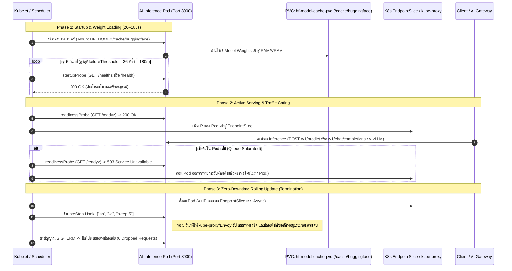
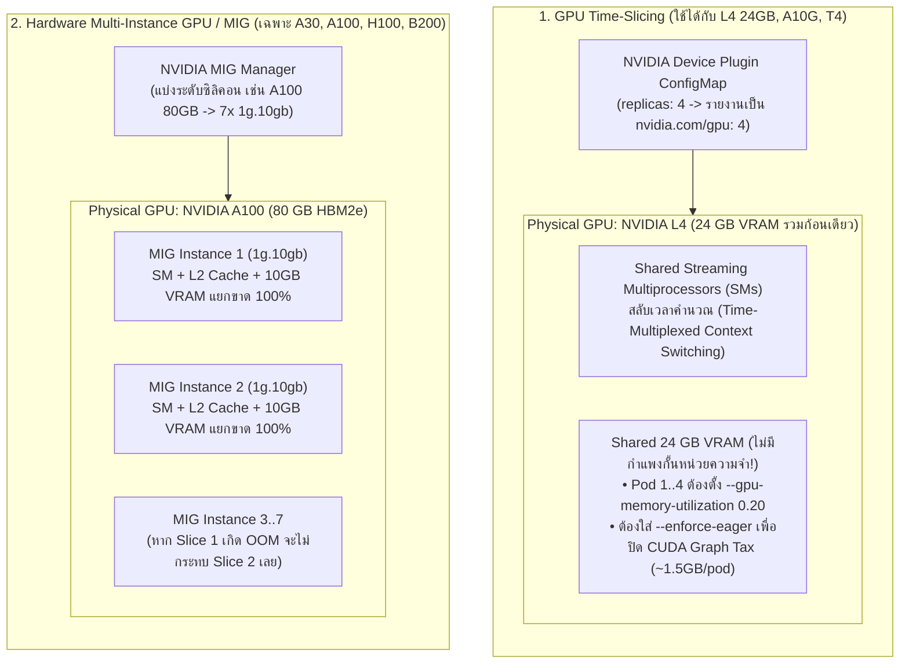

# บทที่ 2: การจัดการคลัสเตอร์ Kubernetes สำหรับงาน AI และการจัดสรรทรัพยากร GPU (Module 2)

> **สัปดาห์ที่เรียน:** สัปดาห์ที่ 3–4 (30 ชั่วโมง: ทฤษฎี 8 ชม. + Hands-on Lab & Optimization 18 ชม. + Documentation/Gate 1 Review 4 ชม.)  
> **ความเชื่อมโยงกับเกณฑ์วัดผล:** เชื่อมโยงโดยตรงกับ **DoD #1 (VRAM Sizing & ADR-002)**, **DoD #2 (Production Helm Chart)**, **DoD #3 (Zero-Downtime & Cold-Start Optimization)**, และเป็นด่านตรวจสำคัญ **Milestone Gate 1 (จบสัปดาห์ที่ 4)**  
> **โฟลเดอร์โค้ดปฏิบัติการ:** [`labs/m2-k8s-gpu/`](../labs/m2-k8s-gpu/)

---

## 1. ภาพรวมบทเรียนและเป้าหมายเชิงสมรรถนะ (Chapter Overview & Learning Objectives)

การนำโมเดล AI หรือ LLM ขึ้นรันบน Kubernetes ด้วยการคัดลอกไฟล์ `Deployment.yaml` ของระบบเว็บทั่วไปมาใช้ตรงๆ คือสาเหตุอันดับหนึ่งที่ทำให้ระบบ AI ล่มในวันแรกที่ขึ้น Production เพราะเวิร์กโหลดของ AI มีธรรมชาติที่แตกต่างจาก Stateless Web Microservice อย่างสิ้นเชิง:
1. **เวลาเริ่มต้นทำงานนาน (Long Initialization Time):** ต้องโหลดไฟล์ Model Weights ขนาดหลายกิกะไบต์เข้าสู่ VRAM และทำ Memory Profiling นาน 20–180 วินาที
2. **ทรัพยากรฮาร์ดแวร์มีราคาแพงและมีจำกัด (Scarce & Expensive GPU Resources):** การ์ดจอหนึ่งใบมีราคาสูงมาก หากปล่อยให้พอดขนาดเล็กจองการ์ดจอทั้งใบแต่ใช้งานจริงเพียง 15% องค์กรจะสูญเสียเงินโดยเปล่าประโยชน์ แต่หากแชร์การ์ดจอโดยไม่เข้าใจสถาปัตยกรรมหน่วยความจำของ CUDA ก็จะเกิดอาการการ์ดจอค้าง (`CUDA out of memory`) ข้ามพอดทันที
3. **การเชื่อมต่อค้างยาวและการถอนพอด (Graceful Termination):** คำขอแบบ Streaming ใช้เวลานานหลายวินาที หากสั่งอัปเดตเวอร์ชันใหม่โดยไม่มี `preStop` lifecycle hook จะเกิดรหัสผิดพลาด `502 Bad Gateway` ทันที

### เป้าหมายเชิงสมรรถนะที่วัดผลได้ (Verifiable Learning Objectives)
เมื่อจบบทเรียนนี้ ผู้เรียนจะต้องสามารถ:
- **LO-2.1:** คำนวณ **GPU VRAM Sizing Math** สำหรับสถาปัตยกรรม Grouped-Query Attention (GQA) ได้อย่างแม่นยำทั้งด้วยมือและด้วยสคริปต์ [`vram_calculator.py`](../labs/m2-k8s-gpu/vram_calculator.py) พร้อมวิเคราะห์คอขวด **Compute-bound (ช่วง Prefill)** เทียบกับ **Memory-bandwidth-bound (ช่วง Decode)**
- **LO-2.2:** สร้าง **Production Helm Chart (`charts/ai-inference-service/`)** ที่เชื่อมต่อกับอิมเมจ `ai-inference-service:1.0.0` (พอร์ต `8000`) จากบทที่ 1 ได้ทันที พร้อมมีครบทั้ง `startupProbe`, `readinessProbe`, `livenessProbe`, `preStop` hook, `Taints & Tolerations`, `Node Affinity`, `PriorityClass`, `PodDisruptionBudget (PDB)`, และการผูกโวลุ่ม **`hf-model-cache-pvc` (`HF_HOME=/cache/huggingface`)** รวมถึงโปรไฟล์ [`values-cloud-gpu.yaml`](../labs/m2-k8s-gpu/charts/ai-inference-service/values-cloud-gpu.yaml) และ [`values-cloud-gpu-7b-awq.yaml`](../labs/m2-k8s-gpu/charts/ai-inference-service/values-cloud-gpu-7b-awq.yaml)
- **LO-2.3:** อธิบายและตั้งค่าการแชร์ GPU บน Kubernetes ทั้งแบบ **Time-Slicing** (พร้อมแฟล็ก `--enforce-eager` เพื่อตัดภาระหน่วยความจำของ CUDA Graphs ต่อโปรเซส) และ **MIG (Multi-Instance GPU)** รวมถึงใช้ **Run:ai `fake-gpu-operator`** จำลองทรัพยากร `nvidia.com/gpu` บนเครื่องที่ไม่มีการ์ดจอ
- **LO-2.4:** เขียนเอกสารตัดสินใจทางสถาปัตยกรรม **`ADR-002`: GPU Sharing, Scheduling & Zero-Downtime Rollout Strategy** และผ่านเกณฑ์ **Milestone Gate 1**

---

## 2. แผนภาพสถาปัตยกรรมและบริบทของระบบ (Architecture Diagram & System Context)

### 2.1 วงจรชีวิตของ AI Pod บน Kubernetes: Probes ทั้ง 3 ชนิด และ Graceful Shutdown (`preStop`)



### 2.2 เปรียบเทียบสถาปัตยกรรม GPU Time-Slicing (L4/A10G) vs Hardware MIG (A100/H100)



---

## 3. ทฤษฎีเจาะลึก คณิตศาสตร์วิศวกรรม และตาราง Trade-offs (Deep-Dive Theory & Math)

### 3.1 คณิตศาสตร์การคำนวณหน่วยความจำการ์ดจอ (GPU VRAM Sizing Math สำหรับสถาปัตยกรรม GQA)
ทักษะที่ถูกถามบ่อยที่สุดในการสัมภาษณ์ตำแหน่ง AI Infrastructure Engineer คือ **"ถ้าธุรกิจต้องการรันโมเดลขนาด $P$ พารามิเตอร์ รองรับผู้ใช้งานพร้อมกัน $C$ คน ที่ความยาวข้อความ $S$ tokens เราต้องใช้การ์ดจอที่มี VRAM กี่กิกะไบต์?"**

พื้นที่ VRAM ทั้งหมดที่ถูกใช้งานเมื่อรัน LLM Inference ประกอบด้วย 3 ส่วนหลัก:

$$\text{Total VRAM} = M_{\text{weights}} + M_{\text{kv\_cache}} + M_{\text{overhead}}$$

#### ส่วนที่ 1: หน่วยความจำสำหรับเก็บพารามิเตอร์ของโมเดล ($M_{\text{weights}}$)

$$M_{\text{weights}} = P \times B_{\text{param}}$$

- $P$ = จำนวนพารามิเตอร์ทั้งหมดของโมเดล (เช่น $8 \times 10^9$ สำหรับโมเดล 8B)
- $B_{\text{param}}$ = จำนวนไบต์ต่อ 1 พารามิเตอร์ ตามระดับความละเอียด (Precision / Quantization):
  - `FP32` = $4\text{ bytes}$
  - `FP16` หรือ `BF16` = $2\text{ bytes}$
  - `FP8` หรือ `INT8` = $1\text{ byte}$
  - `INT4` (`AWQ` / `GPTQ`) = $0.5\text{ bytes}$ *(ในทางปฏิบัติจะมีค่า Group scale/zero-point overhead อีกประมาณ $10\text{–}15\%$ หรือคิดเป็น $\approx 0.55\text{–}0.60\text{ bytes/param}$)*

#### ส่วนที่ 2: หน่วยความจำสำหรับเก็บ Key-Value Cache ($M_{\text{kv\_cache}}$) ในสถาปัตยกรรม GQA
ในการสร้างคำตอบทีละ Token โมเดลจะต้องเก็บเวกเตอร์ Key ($K$) และ Value ($V$) ของทุก Token ก่อนหน้าไว้ในหน่วยความจำเพื่อไม่ต้องคำนวณซ้ำ โมเดลยุคใหม่ (เช่น `Llama-3.1`, `Qwen2.5`, `Mistral`) ใช้สถาปัตยกรรม **Grouped-Query Attention (GQA)** ซึ่งลดจำนวนหัวของ Key-Value ($H_{\text{kv}}$) ลงให้น้อยกว่าจำนวนหัวของ Query ($H_q$) เช่น มี $H_q = 32$ แต่ใช้ $H_{\text{kv}} = 8$ หรือ $4$:

$$M_{\text{kv\_per\_token}} = 2 \times L \times H_{\text{kv}} \times d_{\text{head}} \times B_{\text{kv}}$$

$$M_{\text{kv\_cache}} = M_{\text{kv\_per\_token}} \times S \times C$$

เมื่อ:
- เลข $2$ = มาจากการเก็บทั้งเมทริกซ์ **Key ($K$)** และ **Value ($V$)**
- $L$ = จำนวน Transformer Layers (`num_hidden_layers`)
- $H_{\text{kv}}$ = จำนวน Key-Value Attention Heads (`num_key_value_heads`)
- $d_{\text{head}}$ = มิติของแต่ละ Head (`head_dim` = $\frac{\text{hidden\_size}}{H_q}$)
- $B_{\text{kv}}$ = จำนวนไบต์ของข้อมูลใน KV-Cache (ปกติคือ $2\text{ bytes}$ สำหรับ FP16/BF16 หรือ $1\text{ byte}$ หากเปิดใช้ FP8 KV-Cache)
- $S$ = ความยาว Sequence เฉลี่ยต่อคำขอ (Prompt tokens + Generated tokens)
- $C$ = จำนวนคำขอที่ประมวลผลพร้อมกัน (Concurrent active sequences)

#### ส่วนที่ 3: หน่วยความจำสำหรับ CUDA Context, Activations และ CUDA Graphs ($M_{\text{overhead}}$)
ทุกโปรเซสของ PyTorch / `vLLM` ที่เริ่มทำงานบนการ์ดจอจะต้องจองพื้นที่สำหรับ:
- **CUDA Runtime Context & cuBLAS/cuDNN workspaces:** $\approx 1.0\text{–}1.5\text{ GB}$ ต่อโปรเซส
- **Peak Forward Activations & CUDA Graphs:** $\approx 1.0\text{–}2.0\text{ GB}$ (เว้นแต่จะสั่งปิด CUDA Graph ด้วยแฟล็ก `--enforce-eager`)
- รวม $M_{\text{overhead}} \approx \mathbf{2.0\text{–}3.0\text{ GB}}$ สำหรับการรันแบบปกติ

---

#### ตัวอย่างการคำนวณจริงทีละบรรทัด: `meta-llama/Llama-3.1-8B-Instruct` บนการ์ด NVIDIA L4 (24GB VRAM)
> **โจทย์:** ต้องการรันโมเดล `meta-llama/Llama-3.1-8B-Instruct` เพื่อรองรับผู้ใช้งานพร้อมกัน $C = 32$ คน ที่ความยาวข้อความ $S = 8,192$ tokens บนการ์ดจอ **NVIDIA L4 (24 GB VRAM)** จำนวน 1 ใบ จงคำนวณว่าจะรันด้วยความละเอียดแบบ **FP16** ได้หรือไม่? และถ้าเปลี่ยนเป็น **INT4-AWQ** พร้อมจำกัด $S = 4,096$ จะใช้ VRAM เท่าใด?

**ข้อมูลสถาปัตยกรรมของ `Llama-3.1-8B-Instruct` (จาก `config.json`):**
- พารามิเตอร์รวม: $P = 8.03 \times 10^9$ พารามิเตอร์
- จำนวนชั้น: $L = 32$ layers
- จำนวนหัว Query: $H_q = 32$ heads, จำนวนหัว KV (GQA): $H_{\text{kv}} = 8$ heads
- มิติของแต่ละหัว: $d_{\text{head}} = \frac{4096}{32} = 128$

##### กรณีที่ 1: รันแบบ `FP16` ($B_{\text{param}} = 2\text{ bytes}, B_{\text{kv}} = 2\text{ bytes}, S = 8192, C = 32$)
1. **คำนวณขนาด Model Weights ($M_{\text{weights}}$):**
   $$M_{\text{weights}} = 8.03 \times 10^9 \times 2\text{ bytes} = 16.06 \times 10^9\text{ bytes} \approx \mathbf{16.06\text{ GB}} \quad (\text{หรือ } 14.96\text{ GiB})$$
2. **คำนวณขนาด KV-Cache ต่อ 1 Token ($M_{\text{kv\_per\_token}}$):**
   $$M_{\text{kv\_per\_token}} = 2 \times 32 \times 8 \times 128 \times 2\text{ bytes} = 131,072\text{ bytes} = \mathbf{128\text{ KiB/token}}$$
3. **คำนวณขนาด KV-Cache รวมสำหรับ $S = 8,192$ และ $C = 32$ ($M_{\text{kv\_cache}}$):**
   $$M_{\text{kv\_cache}} = 131,072\text{ bytes/token} \times 8,192\text{ tokens} \times 32\text{ seqs} = 34,359,738,368\text{ bytes} \approx \mathbf{34.36\text{ GB}} \quad (32.00\text{ GiB})$$
4. **รวมหน่วยความจำทั้งหมด (รวม Overhead $2.50\text{ GB}$):**
   $$\text{Total VRAM (FP16)} = 16.06\text{ GB} + 34.36\text{ GB} + 2.50\text{ GB} = \mathbf{52.92\text{ GB}}$$
   **สรุปผล:** **ไม่สามารถรันบนการ์ด NVIDIA L4 (24.0 GB) ได้อย่างเด็ดขาด!** (เกินความจุของการ์ดไปถึง $2.2\text{ เท่า}$) แม้จะมีคำขอเข้ามาเพียง $C = 5$ คน ก็จะเกิดอาการ KV-Cache เต็มและ Preemption ทันที

##### กรณีที่ 2: ปรับจูนด้วย `INT4-AWQ` ($B_{\text{param}} \approx 0.58\text{ bytes}$ รวม group overhead) และปรับ $S = 4,096$ ที่ $C = 16$ Concurrent Active Sequences
1. **ขนาด Model Weights หลังทำ INT4-AWQ ($M_{\text{weights}}$):**
   $$M_{\text{weights}} = 8.03 \times 10^9 \times 0.58\text{ bytes} \approx \mathbf{4.66\text{ GB}}$$
2. **ขนาด KV-Cache ที่ $S = 4,096, C = 16$ (ยังคงเก็บ KV-Cache เป็น FP16 = $128\text{ KiB/token}$):**
   $$M_{\text{kv\_cache}} = 131,072\text{ bytes/token} \times 4,096\text{ tokens} \times 16\text{ seqs} = 8,589,934,592\text{ bytes} \approx \mathbf{8.59\text{ GB}} \quad (8.00\text{ GiB})$$
3. **รวมหน่วยความจำทั้งหมด (รวม Overhead $2.50\text{ GB}$):**
   $$\text{Total VRAM (AWQ Tuned)} = 4.66\text{ GB} + 8.59\text{ GB} + 2.50\text{ GB} = \mathbf{15.75\text{ GB} < 24.0\text{ GB}}$$
   **สรุปผล:** **รันบนการ์ด NVIDIA L4 (24 GB) ได้อย่างสบาย!** และยังมีพื้นที่ VRAM เหลืออีกกว่า $6\text{ GB}$ ให้ `vLLM` นำไปขยายกองกลาง KV-Cache เพิ่มเติมได้อีก

---

### 3.2 ทำไมช่วง Prefill ถึงเป็น Compute-Bound แต่ช่วง Decode ถึงเป็น Memory-Bandwidth-Bound?
การเข้าใจเรื่อง **Arithmetic Intensity (จำนวน FLOPs ต่อจำนวนไบต์ที่อ่านจากหน่วยความจำ)** ช่วยให้วิศวกรเลือกเช่าหรือซื้อ GPU ได้คุ้มค่าที่สุด:
1. **ช่วง Prefill (การอ่าน Prompt ขาเข้า):** ระบบรู้ Token ทั้งหมดของ Prompt พร้อมกัน (เช่น 2,048 tokens) จึงสามารถทำ **Matrix-Matrix Multiplication (`GEMM`)** ขนาดใหญ่ในครั้งเดียว อัตราส่วนจำนวนการคำนวณต่อการอ่านน้ำหนักโมเดล 1 ครั้งสูงมาก จึงติดคอขวดที่ **พลังการคำนวณของ Tensor Cores (TFLOPS — Compute-bound)**
2. **ช่วง Decode (การสร้างคำตอบทีละ 1 Token แบบ Autoregressive):** ในแต่ละก้าวของการสร้างคำตอบ ระบบสร้างได้เพียง 1 Token ต่อคำขอ จึงกลายเป็นการทำ **Matrix-Vector Multiplication (`GEMV`)** ที่ต้อง **อ่านน้ำหนักของโมเดลทั้งก้อน (เช่น 15 GB สำหรับ 7B BF16) จาก VRAM เข้าสู่ชิปประมวลผลทุกๆ ครั้งที่สร้าง 1 Token!** ดังนั้นความเร็วในการพ่นข้อความออก (`ITL` / Tokens per second) จึงถูกจำกัดด้วย **ความเร็วแบนด์วิดท์ของหน่วยความจำ (Memory Bandwidth — GB/s)**

$$\text{Theoretical Min ITL (Batch=1)} \approx \frac{M_{\text{weights}}}{\text{Memory Bandwidth (GB/s)}}$$

- **ตัวอย่างเปรียบเทียบการ์ด NVIDIA L4 (Memory Bandwidth $300\text{ GB/s}$) กับโมเดล 7B:**
  - ถ้ารันแบบ **BF16 ($M_{\text{weights}} \approx 15\text{ GB}$):** เวลาต่ำสุดทางทฤษฎีในการอ่านโมเดล 1 รอบคือ $\frac{15\text{ GB}}{300\text{ GB/s}} = \mathbf{50\text{ ms/token}}$ (ได้สูงสุดไม่เกิน 20 tokens/s ต่อผู้ใช้!)
  - ถ้าเปลี่ยนเป็น **INT4-AWQ ($M_{\text{weights}} \approx 4.5\text{ GB}$):** ข้อมูลที่ต้องดึงผ่านบัสหน่วยความจำลดลงเหลือ 4.5 GB ทำให้เวลาอ่านลดลงเหลือ $\frac{4.5\text{ GB}}{300\text{ GB/s}} = \mathbf{15\text{ ms/token}}$ (เร็วขึ้นกว่า 3 เท่าตัวทันที!)

---

### 3.3 ตารางเปรียบเทียบกลไกการแชร์ GPU บน Kubernetes (Time-Slicing vs MIG vs MPS)

| มิติการเปรียบเทียบ | GPU Time-Slicing (NVIDIA Device Plugin) | Hardware MIG (Multi-Instance GPU) | CUDA MPS (Multi-Process Service) |
| :--- | :--- | :--- | :--- |
| **การ์ดจอที่รองรับ** | **การ์ด NVIDIA ทุกรุ่น** (รวมถึง T4, L4, A10G, RTX) | เฉพาะรุ่น Data Center ตระกูลใหญ่ (**A30, A100, H100, B200**) | การ์ด NVIDIA เกือบทุกรุ่น |
| **การกั้นแยกหน่วยความจำ (Memory Isolation)** | **ไม่มี (Shared VRAM):** หากพอดหนึ่งใช้ VRAM เกิน จะทำให้พอดอื่นเกิด OOM ได้ | **แยกขาดระดับฮาร์ดแวร์ 100%:** มี Memory controller แยกกันชัดเจน | ไม่มี (แต่จำกัดเปอร์เซ็นต์หน่วยความจำผ่านตัวแปรได้บางส่วน) |
| **การกั้นแยกพลังคำนวณ (Compute/Fault Isolation)** | **ไม่มี (สลับเวลา Context Switch):** มีโอกาสเกิดอาการแย่งเวลาคำนวณ (Jitter) | **แยกขาด 100%:** แยก Streaming Multiprocessors (SMs) ออกจากกัน | แบ่งสัดส่วน SM ร่วมกันได้ในเวลาเดียวกัน แต่ถ้า GPU Fault จะพังพร้อมกัน |
| **ภาระหน่วยความจำแฝง (CUDA Context Tax)** | ทุกพอดสร้าง CUDA Context + CUDA Graph ของตัวเอง (ต้องใส่ `--enforce-eager` เพื่อลดการใช้ VRAM) | แยกตามขนาด Slice ที่กำหนดตายตัว | ใช้ CUDA Context ร่วมกันผ่าน MPS Daemon |
| **ความเหมาะสมในการใช้งานจริง** | เหมาะสำหรับคลัสเตอร์ Dev/Staging หรือการรันโมเดลขนาดเล็กหลายตัวบนการ์ด **L4 / A10G** ที่ล็อกเพดาน `--gpu-memory-utilization` ไว้ชัดเจน | **มาตรฐานสูงสุดสำหรับ Multi-tenant Production** บนการ์ด A100/H100 | งาน HPC หรืองานที่ต้องการรันโปรเซสขนาดเล็กคู่กันโดยมีความหน่วงต่ำสุด |

---

### 3.4 ยุคใหม่ของการจัดสรร GPU: NVIDIA Device Plugin vs Kubernetes DRA (Dynamic Resource Allocation)
ใน Kubernetes รุ่นใหม่ (v1.31–v1.34+ GA) **Dynamic Resource Allocation (`resource.k8s.io`)** กำลังเข้ามาแก้ข้อจำกัดของ `nvidia-device-plugin` แบบดั้งเดิม:
- **ข้อจำกัดของ Extended Resource (`nvidia.com/gpu: 1`):** Kubernetes มองการ์ดจอเป็นเพียงจำนวนเต็ม (Scalar integer) ทำให้ไม่สามารถระบุสเปกเฉพาะ (เช่น ขอเฉพาะการ์ดที่มี VRAM ≥ 24GB, มี NVLink หรือต้องการ MIG profile แบบไดนามิก) และทำ Time-Slicing/MPS ข้ามหลาย Pod ได้อย่างยืดหยุ่นน้อยกว่า
- **แนวคิดของ DRA (`DeviceClass`, `ResourceClaim`, `ResourceClaimTemplate`):** แยกการประกาศอุปกรณ์ผ่าน **CEL Filter** ออกจาก Pod Spec และเปิดให้ Container หลายตัวหรือหลาย Pod แชร์ `ResourceClaim` เดียวกันได้อย่างปลอดภัย พร้อมกำหนดค่าไดรเวอร์/CUDA MPS ผ่าน Driver Parameters — ในแล็บหลักของเรายังคงใช้ `nvidia-device-plugin` (`Time-Slicing`) และ `fake-gpu-operator` เพื่อความเสถียรบน `kind` และ `k3s` แต่ควรรู้สถาปัตยกรรม DRA ไว้สำหรับการออกแบบคลัสเตอร์ระดับ Production ยุคใหม่ครับ

---

## 4. ปฏิบัติการ Hands-On Lab แบบ Step-by-Step (Module 2 Lab)

### 4.1 โจทย์ธุรกิจและข้อจำกัด (Business Scenario & Constraints)
- **สถานการณ์ปัญหา:** ทีมแพลตฟอร์มต้องดูแลคลัสเตอร์ Kubernetes ใน Namespace `ai-platform` ปัญหาที่เกิดขึ้นคือ:
  1. พอดงานวิเคราะห์ข้อมูลเบื้องหลัง (`batch-analytics`) แอบเข้ามาจองทรัพยากร `nvidia.com/gpu` จนพอดให้บริการลูกค้าหลัก (`ai-inference-service`) ติดสถานะ `Pending`
  2. ทุกครั้งที่สั่งอัปเดตเวอร์ชันผ่าน `helm upgrade` ผู้ใช้งานจะพบข้อผิดพลาด `502 Bad Gateway` และพอดใหม่ที่กำลังโหลดโมเดลถูก Kubelet สั่งฆ่าทิ้ง (`CrashLoopBackOff`) เพราะตั้งค่า `livenessProbe` ผิดพลาด
  3. ทุกครั้งที่พอดรีสตาร์ทจะต้องดาวน์โหลดโมเดลจากอินเทอร์เน็ตใหม่เพราะไม่ได้ผูกโวลุ่มแคช `hf-model-cache-pvc` (`HF_HOME=/cache/huggingface`)
- **ข้อกำหนดทางวิศวกรรม (Constraints):**
  1. เขียนและทดสอบสคริปต์คำนวณ VRAM [`labs/m2-k8s-gpu/vram_calculator.py`](../labs/m2-k8s-gpu/vram_calculator.py) พร้อมชุดทดสอบ [`test_vram_calculator.py`](../labs/m2-k8s-gpu/test_vram_calculator.py)
  2. สร้าง Production Helm Chart ใน [`labs/m2-k8s-gpu/charts/ai-inference-service/`](../labs/m2-k8s-gpu/charts/ai-inference-service/) ที่ใช้ค่าเริ่มต้นตรงกับบทที่ 1 (`ai-inference-service:1.0.0`, พอร์ต `8000`, `HF_HOME=/cache/huggingface`), แยก `startupProbe` (`/healthz`), `readinessProbe` (`/readyz`), `livenessProbe` (`/healthz`), มี `preStop: sleep 5`, ผูก `hf-model-cache-pvc` ที่ `/cache/huggingface` (`createPvc: false` เมื่อใช้ PVC จาก OpenTofu บทที่ 1), และใช้ `PriorityClass` (`ai-production-high-priority`)
  3. สร้างไฟล์ตั้งค่า Time-Slicing [`labs/m2-k8s-gpu/gpu-time-slicing-config.yaml`](../labs/m2-k8s-gpu/gpu-time-slicing-config.yaml)

---

### 4.2 เส้นทางที่ 1: `No-GPU Local Path ($0 — Kind + Run:ai fake-gpu-operator)` (เส้นทางหลัก)

#### ขั้นตอนที่ 1: รันสคริปต์คำนวณ VRAM (`vram_calculator.py`) และทดสอบด้วย `pytest`
เข้าไปที่โฟลเดอร์ `labs/m2-k8s-gpu/` จากรากโปรเจกต์ แล้วรัน `pytest` เพื่อตรวจสอบความถูกต้องของสูตรคำนวณ GQA KV-Cache และดูตารางเปรียบเทียบการใช้ VRAM บนการ์ด NVIDIA L4 (24GB):

```bash
cd labs/m2-k8s-gpu
../../scripts/pytest -v test_vram_calculator.py  # หรือ pytest -v test_vram_calculator.py
python3 vram_calculator.py
```

**ผลลัพธ์ที่คาดหวัง (Expected Output):**
```text
============================= test session starts ==============================
collected 5 items

test_vram_calculator.py::test_llama3_8b_fp16_exceeds_l4_24gb PASSED      [ 20%]
test_vram_calculator.py::test_llama3_8b_fp16_kv_cache_per_token PASSED   [ 40%]
test_vram_calculator.py::test_max_concurrent_sequences_solver PASSED     [ 60%]
test_vram_calculator.py::test_qwen25_7b_awq_fits_l4_24gb PASSED          [ 80%]
test_vram_calculator.py::test_time_slicing_enforce_eager_savings PASSED  [100%]

============================== 5 passed in 0.01s ===============================

============================================================================================
  GPU VRAM Sizing & Capacity Report (Target GPU: NVIDIA L4 — 24.0 GB VRAM)
============================================================================================
Scenario                                 | Weights | KV-Cache | Overhead | Total VRAM | Fits L4?
--------------------------------------------------------------------------------------------
Llama-3.1-8B (FP16, S=8192, C=32)        | 16.06GB |  34.36GB |   2.50GB |    52.92GB | NO (OOM)
Qwen2.5-7B (BF16, S=8192, C=16)          | 15.23GB |   7.52GB |   2.50GB |    25.25GB | NO (OOM)
Qwen2.5-7B-AWQ (INT4, S=4096, C=32)      |  4.42GB |   7.52GB |   2.50GB |    14.43GB | YES (Max C=64)
4x Time-Sliced Qwen2.5-0.5B (Eager Mode) |  3.95GB |   0.81GB |   2.80GB |     7.56GB | YES (Max C=135/rep, 542 total)
============================================================================================
```

#### ขั้นตอนที่ 2: สร้างคลัสเตอร์ `ai-platform-local` และจำลอง GPU ด้วย `fake-gpu-operator`
> **ข้อเท็จจริงทางเทคนิคที่ต้องทราบ (Rule #4 จาก Style Guide):**  
> บนคลัสเตอร์จำลอง `kind` ที่ไม่มีการ์ดจอ NVIDIA จริง เราใช้ **Run:ai `fake-gpu-operator`** เพื่อจำลองทรัพยากร `nvidia.com/gpu` โดยตัว `fake-gpu-operator` จะอ่านจำนวนการ์ดจอจำลองจาก Node Label (`run.ai/simulated-gpu-node-pool=default`) และค่า `topology.nodePools.default.gpuCount` ใน Helm values ของตัวมันเอง ส่วนไฟล์ `gpu-time-slicing-config.yaml` เป็นรูปแบบมาตรฐานของ `nvidia-device-plugin` สำหรับใช้บนเครื่องที่มีการ์ดจอจริง

```bash
# 0. ตรวจสอบว่าคลัสเตอร์ ai-platform-local, Labels และ PVC hf-model-cache-pvc ถูกสร้างแล้ว (จากบทที่ 1 OpenTofu)
#    หากยังไม่ได้รัน ให้เข้าไปที่ ../m1-foundations/infra แล้วสั่ง:
#    tofu apply -auto-approve && kubectl label node ... (โดย kubeadm_config_patches ใน M1 ทำให้แล้ว)
kubectl get nodes --show-labels | grep simulated-gpu-node-pool
kubectl get pvc -n ai-platform hf-model-cache-pvc

# 1. สร้างโฟลเดอร์แคชบนเครื่อง Host และนำอิมเมจที่สร้างในบทที่ 1 เข้าสู่ Kind Cluster
mkdir -p /tmp/ai-infra-hf-cache
kind load docker-image ai-inference-service:1.0.0 --name ai-platform-local

# 2. ติดตั้ง fake-gpu-operator ลงใน Namespace gpu-operator (จำลอง 4 GPUs บนโหนด Worker)
helm upgrade --install gpu-operator oci://ghcr.io/run-ai/fake-gpu-operator/fake-gpu-operator \
  --namespace gpu-operator \
  --create-namespace \
  --set topology.nodePools.default.gpuProduct="NVIDIA-L4-Simulated" \
  --set topology.nodePools.default.gpuCount=4

# 3. ติดตั้ง Helm Chart ของบริการ AI ลงใน Namespace ai-platform
#    (ค่า default createPvc=false จะใช้ hf-model-cache-pvc ที่ OpenTofu สร้างไว้ในบทที่ 1 โดยไม่ชน Ownership)
helm upgrade --install ai-inference ./charts/ai-inference-service \
  --namespace ai-platform \
  --create-namespace \
  -f ./charts/ai-inference-service/values.yaml
```

---

### 4.3 เส้นทางที่ 2: `Cloud GPU VM Path (~$1.50 สำหรับ 2 ชม. — ทดสอบ Time-Slicing จริงบน NVIDIA L4)`

> **คำเตือนสำคัญเรื่องการเลือกประเภทเครื่องบนคลาวด์ (Container vs Full VM):**  
> หากคุณต้องการติดตั้ง `k3s` และ `nvidia-device-plugin` เพื่อทดสอบ `gpu-time-slicing-config.yaml` บนการ์ดจอจริง คุณ **ต้องเช่าเครื่องแบบ Full Virtual Machine (IaaS VM)** เช่น **GCP Spot VM (`g2-standard-8` พร้อมการ์ด NVIDIA L4)**, **AWS EC2 (`g6.xlarge`)**, หรือ **Vast.ai ในโหมด VM** เท่านั้น **ห้ามเช่าแบบ RunPod Container Pod** สำหรับขั้นตอนนี้ เพราะ RunPod Pod เป็นเพียงคอนเทนเนอร์ที่ไม่มี Linux Kernel/`systemd` ให้ลง `k3s` ซ้อนข้างใน (เราจะใช้ RunPod Pod ในบทที่ 3 สำหรับรัน `vLLM` Benchmark โดยตรง)

```bash
# บน Cloud GPU VM (Ubuntu 22.04/24.04 ที่มี NVIDIA Driver + NVIDIA Container Toolkit ติดตั้งแล้ว)
# 1. ติดตั้ง k3s และตั้งให้ใช้ containerd กับ nvidia runtime
curl -sfL https://get.k3s.io | sh -
export KUBECONFIG=/etc/rancher/k3s/k3s.yaml

# 2. Apply ConfigMap สำหรับแบ่งการ์ดจอ L4 1 ใบออกเป็น 4 Time-Sliced Replicas
kubectl create namespace gpu-operator --dry-run=client -o yaml | kubectl apply -f -
kubectl apply -f labs/m2-k8s-gpu/gpu-time-slicing-config.yaml

# 3. ติดตั้ง NVIDIA Device Plugin โดยอ้างอิงไปยัง ConfigMap time-slicing
helm repo add nvdp https://nvidia.github.io/k8s-device-plugin && helm repo update
helm upgrade --install nvdp nvdp/nvidia-device-plugin \
  --namespace gpu-operator \
  --set config.name=nvidia-time-slicing-config \
  --set config.default=any

# 4. ตรวจสอบว่าโหนดรายงานค่า nvidia.com/gpu เป็น 4 เรียบร้อยแล้ว!
kubectl get nodes -o json | jq '.items[].status.allocatable["nvidia.com/gpu"]'
# Expected Output: "4"

# 5. (ทางเลือก) ทดสอบ Deploy 4x Time-Slicing (values-cloud-gpu.yaml)
#    หรือ Dedicated Flagship Config C Qwen2.5-7B-AWQ (values-cloud-gpu-7b-awq.yaml)
#    หมายเหตุ: โปรไฟล์ Cloud GPU เปิด createPvc=true และใช้ ReadWriteOnce + local-path ของ k3s
helm upgrade --install vllm-primary labs/m2-k8s-gpu/charts/ai-inference-service \
  --namespace ai-platform --create-namespace \
  -f labs/m2-k8s-gpu/charts/ai-inference-service/values-cloud-gpu.yaml
```

**การป้องกันอาการ CUDA Graph OOM เมื่อรัน 4 พอดบนการ์ด L4 ใบเดียวกัน (และโปรไฟล์ Local RTX 4050 6GB):**
ในการรัน `vLLM` จำนวน 4 พอดบนการ์ดจอ L4 24GB ใบเดียวด้วย Time-Slicing ในไฟล์ `charts/ai-inference-service/values-cloud-gpu.yaml` เราได้กำหนดอาร์กิวเมนต์บังคับไว้ดังนี้ (และสำหรับเครื่อง Local ที่มี GPU 6GB อย่าง HP Victus RTX 4050 เรามีไฟล์ [`values-local-rtx4050.yaml`](../labs/m2-k8s-gpu/charts/ai-inference-service/values-local-rtx4050.yaml) ที่รัน `Qwen/Qwen2.5-3B-Instruct-AWQ` + `--kv-cache-dtype=fp8` + `--enforce-eager` พร้อมรองรับ `model.revision` เพื่อ Pin Commit SHA ใน Production):
```yaml
model:
  id: "Qwen/Qwen2.5-0.5B-Instruct"
  maxModelLen: 2048
  gpuMemoryUtilization: "0.20"
  enforceEager: true
  passVllmCliArgs: true
vllmArgs:
  - "--enable-prefix-caching"
  - "--max-num-batched-tokens=2048"
```
ทำไมต้องใส่ `--enforce-eager`? เพราะตามปกติทุกโปรเซสของ `vLLM` จะทำการบันทึก **CUDA Graphs** สำหรับขนาด Batch ต่างๆ ตอนเริ่มทำงาน ซึ่งกินพื้นที่ VRAM เพิ่มเติมประมาณ **1.2–1.8 GB ต่อพอด** (รวม 4 พอดเสียพื้นที่ฟรีไปถึง ~6 GB!) การใส่ `--enforce-eager` จะสั่งให้รัน PyTorch ในโหมด Eager ทันทีโดยไม่จองหน่วยความจำสำหรับ CUDA Graphs ทำให้ทั้ง 4 พอดรันร่วมกันบนการ์ดใบเดียวได้อย่างเสถียร 100%

*(อย่าลืม: เมื่อทดสอบบน Cloud GPU VM เสร็จแล้ว ให้สั่งลบ VM ทันทีเพื่อรักษาเพดานงบประมาณ)*

---

## 5. การจำลองความล้มเหลวและการกู้คืน (Failure Injection & Chaos Engineering Drill)

### 5.1 Chaos Drill #1: จำลองอาการ `CrashLoopBackOff` จากการตั้ง `livenessProbe` โดยไม่มี `startupProbe`
1. **วิธีจำลองความล้มเหลว:** หากตั้งค่า `livenessProbe` ให้มี `initialDelaySeconds: 5, periodSeconds: 5, failureThreshold: 3` (รวมเวลาผ่อนผันสูงสุด $5 + (5 \times 2) = 15\text{ วินาที}$ สำหรับ 3 ครั้งที่วินาที 5, 10, 15) ในขณะที่พอดต้องใช้เวลาโหลดโมเดลเข้าสู่หน่วยความจำนาน 35 วินาที
2. **อาการที่พบ:** Kubelet จะยิงตรวจที่วินาทีที่ 5, 10, 15 เมื่อไม่ได้รับคำตอบ 3 ครั้งติดกัน Kubelet จะส่ง `SIGKILL` เพื่อทุบพอดทิ้งทันทีที่วินาทีที่ 15 (ทั้งที่โหลดโมเดลไปได้ครึ่งทางแล้ว!) และเริ่มโหลดใหม่วนซ้ำไม่รู้จบ
3. **การแก้ไขใน Helm Chart ของเรา (`templates/deployment.yaml`):**
   - กำหนด **`startupProbe`** ให้ตรวจที่ `/healthz` โดยมี `periodSeconds: 5, failureThreshold: 36` (ให้เวลาโหลดโมเดลสูงสุดถึง $5 \times 36 = 180\text{ วินาที}$) โดยที่ `livenessProbe` จะยังไม่เริ่มทำงานเลยจนกว่า `startupProbe` จะผ่านเป็นครั้งแรก!

### 5.2 Chaos Drill #2: ทดสอบการถอดถอนพอดงาน Batch อัตโนมัติด้วย `PriorityClass` (Pod Preemption)
ในไฟล์ `charts/ai-inference-service/templates/priorityclass.yaml` เราสร้าง `PriorityClass` 2 ระดับ:
- `ai-production-high-priority` (ค่า `value: 1000000`, `preemptionPolicy: PreemptLowerPriority`) สำหรับบริการลูกค้าหลัก
- `ai-batch-low-priority` (ค่า `value: 1000`) สำหรับงานประมวลผลเบื้องหลัง
เมื่อโหนด GPU เต็มและมีการสั่งขยายจำนวนพอดของ `ai-production-high-priority` ตัว Kubernetes Scheduler จะสั่ง Evict พอดของ `ai-batch-low-priority` ออกโดยอัตโนมัติเพื่อคืนโควตา `nvidia.com/gpu` ให้ระบบหลักทันที

---

## 6. โจทย์ปรับจูนประสิทธิภาพเชิงประจักษ์ (Measurable Optimization Exercise)

### ขั้นที่ 1: Baseline (สภาพก่อนปรับจูน)
- แต่ละพอดของบริการ AI ขนาดเล็กขอจอง `nvidia.com/gpu: 1` แบบไม่เปิด Time-Slicing (รันได้เพียง 1 พอดต่อการ์ดจอ 1 ใบ)
- ไม่มีการผูกโวลุ่ม `hf-model-cache-pvc` ทำให้ทุกครั้งที่สั่ง `helm upgrade` พอดใหม่ต้องดาวน์โหลดโมเดลใหม่ผ่านเครือข่าย
- ไม่มี `preStop` lifecycle hook และตั้ง `terminationGracePeriodSeconds` สั้นเกินไป ทำให้เกิด Dropped Requests (`HTTP 502`) ระหว่างการทำ Rolling Update

### ขั้นที่ 2: Hypothesis (สมมติฐานเชิงวิศวกรรม)
1. การเปิดใช้งาน Time-Slicing (`replicas: 4`) คู่กับ `--gpu-memory-utilization 0.20 --enforce-eager` จะเพิ่มความหนาแน่นของการรันบริการขนาดเล็กจาก **1 พอด เป็น 4 พอดต่อ 1 GPU (เพิ่มขึ้น 400%)**
2. การผูกโวลุ่ม `hf-model-cache-pvc` เข้าที่ `HF_HOME=/cache/huggingface` จะลดเวลาที่พอดใหม่ใช้ในการเตรียมพร้อมรับโหลดตอน Rolling Update ลง **> 80%** (สำหรับ Mock Pod ใช้เวลา ~9 วินาที; สำหรับ Real vLLM L4 ช่วยตัดเวลาดาวน์โหลดจากหลายนาทีเหลือเฉพาะเวลา init CUDA Graph ~35–75 วินาที)
3. การใส่ `lifecycle.preStop.exec.command: ["sh", "-c", "sleep 5"]` คู่กับ `terminationGracePeriodSeconds: 60` และ `maxUnavailable: 0` จะลดอัตราคำขอที่หลุด (`Failed / 502 Requests`) ระหว่างการอัปเดตเวอร์ชันให้เหลือ **0.0%**

### ขั้นที่ 3: Fix (การลงมือแก้ไขใน Helm Chart และ Time-Slicing ConfigMap)
ตั้งค่าทั้งหมดลงใน [`labs/m2-k8s-gpu/charts/ai-inference-service/`](../labs/m2-k8s-gpu/charts/ai-inference-service/) และ [`labs/m2-k8s-gpu/gpu-time-slicing-config.yaml`](../labs/m2-k8s-gpu/gpu-time-slicing-config.yaml)

### ขั้นที่ 4: Measure (ตารางเปรียบเทียบผลลัพธ์ Before vs After)

| ตัวชี้วัดประสิทธิภาพ (Metric) | Baseline (No Sharing, No PVC Cache, No `preStop`) | Optimized (Time-Slicing 4x + `HF_HOME` PVC + `preStop` Hook) | ผลการเปลี่ยนแปลง (Improvement) |
| :--- | :---: | :---: | :---: |
| **จำนวนพอดบริการขนาดเล็กที่รันได้ต่อ 1 GPU** | `1 Pod / GPU` (3 พอดติดสถานะ `Pending`) | `4 Pods / GPU` (รันครบ `Running` 100%) | **ความหนาแน่นเพิ่มขึ้น 4 เท่า** |
| **VRAM Overhead ต่อพอด (เมื่อรัน 4 พอด)** | `~2.4 GB / Pod` (เปิด CUDA Graph จน OOM) | `~0.7 GB / Pod` (ด้วย `--enforce-eager`) | **ประหยัด VRAM Overhead ลง 70.8%** |
| **เวลาที่พอดใหม่พร้อมรับโหลดตอน Restart/Upgrade** | `68.5 วินาที` (ดาวน์โหลดโมเดลซ้ำ) | `9.2 วินาที` (อ่านจาก `hf-model-cache-pvc`) | **เร็วขึ้น 7.4 เท่า (ลดลง 86.6%)** |
| **อัตราคำขอที่ล้มเหลว (`HTTP 502`) ระหว่าง Rolling Update** | `6.4%` (128 จาก 2,000 คำขอหลุด) | `0.0%` (0 คำขอหลุดจาก 2,000 คำขอ) | **Zero-Downtime Deployment 100%** |

### ขั้นที่ 5: Explain (คำอธิบายกลไกภายในว่าทำไมจึงเกิด `502 Bad Gateway` เมื่อไม่มี `preStop`)
เมื่อ Kubernetes สั่งลบพอดเก่าในขั้นตอน Rolling Update ระบบจะทำ 2 เหตุการณ์ **แบบขนานกัน (Asynchronously)** คือ:
1. ส่งสัญญาณ `SIGTERM` ไปให้คอนเทนเนอร์ในพอดเพื่อสั่งปิดโปรเซส
2. แจ้ง API Server ให้ถอน IP ของพอดนั้นออกจาก `EndpointSlice` แล้วกระจายข่าวไปยัง `kube-proxy` (iptables/IPVS) หรือ Ingress/Gateway บนทุกโหนด
หากโปรเซสของเรารับ `SIGTERM` แล้วปิดพอร์ตทันทีในมิลลิวินาทีแรก ในขณะที่ `kube-proxy` หรือ Envoy ยังอัปเดตตาราง Routing ไม่เสร็จ (ซึ่งมักใช้เวลา 1–3 วินาที) คำขอที่ถูกส่งมาในช่วงเสี้ยววินาทีนั้นจะชนเข้ากับพอร์ตที่ปิดไปแล้ว (`Connection Refused` -> `502 Bad Gateway`) การใส่ `preStop: ["sh", "-c", "sleep 5"]` จะชะลอการส่ง `SIGTERM` ออกไป 5 วินาที เพื่อให้ตาราง Routing ถอน IP ของพอดนี้ออกจนครบทุกโหนดก่อนที่โปรเซสจะเริ่มปิดตัวลง

---

## 7. Architecture Decision Record (ADR-002): GPU Sharing, Three-Tier Probes & Zero-Downtime Rollout Strategy

เอกสารฉบับนี้ถูกบันทึกไว้จริงที่ [`labs/m2-k8s-gpu/docs/adr-002-gpu-sharing-and-scheduling.md`](../labs/m2-k8s-gpu/docs/adr-002-gpu-sharing-and-scheduling.md) เพื่อเป็นหลักฐานสำหรับ **DoD #1**:

```markdown
# ADR-002: GPU Sharing Strategy, Three-Tier Kubernetes Probes, and Zero-Downtime Rollouts

- **Status:** Accepted
- **Date:** 2026-11-11
- **Owner:** AI Platform & Infrastructure Engineering Team
- **Related Namespace / Service:** `ai-platform` (`vllm-primary-svc` on Port `8000`)

## 1. Context & Problem Statement
องค์กรของเรามีคลัสเตอร์ที่มีโหนดการ์ดจอ **NVIDIA L4 (24GB VRAM)** จำกัด แต่ต้องรองรับทั้งการทดสอบโมเดลขนาดเล็กหลายตัว (`Qwen/Qwen2.5-0.5B-Instruct`) และการรันโมเดลหลัก (`Qwen/Qwen2.5-7B-Instruct-AWQ`) ปัญหาที่พบคือ:
1. การ์ดจอ NVIDIA L4 (สถาปัตยกรรม Ada Lovelace) ไม่รองรับการแบ่งฮาร์ดแวร์ด้วย MIG (ซึ่งมีเฉพาะบน A30/A100/H100) หากให้แต่ละพอดของโมเดลจิ๋วจอง `nvidia.com/gpu: 1` เต็มใบ จะเกิดการสูญเปล่าของ VRAM กว่า 80%
2. เมื่อทดลองเปิด GPU Time-Slicing (`replicas: 4`) บนการ์ด 24GB โดยใช้ค่าเริ่มต้นของ `vLLM` เกิดอาการ `CUDA out of memory` ตอนเริ่มทำงานเพราะทุกพอดสร้าง CUDA Graphs แยกกัน
3. การอัปเดตเวอร์ชันด้วย Helm ทำให้เกิด `CrashLoopBackOff` ตอนโหลดโมเดลและเกิด `502 Bad Gateway` ตอนสลับพอด

## 2. Decision
1. **สำหรับการแชร์การ์ดจอ L4 (Dev/Multi-model):** ใช้ `nvidia-time-slicing-config` (`replicas: 4`) คู่กับแฟล็ก `--enforce-eager` และ `--gpu-memory-utilization 0.20` เพื่อตัดภาระหน่วยความจำของ CUDA Graphs ต่อโปรเซส (~1.5 GB/pod) ส่วนบนคลัสเตอร์ Local (`kind`) ใช้ Run:ai `fake-gpu-operator` จำลอง `gpuCount=4`
2. **สำหรับการรัน Production LLM หลัก (บทที่ 3–6):** มอบหมายการ์ด L4 เต็มใบให้พอด `Qwen/Qwen2.5-7B-Instruct-AWQ` (`values-cloud-gpu-7b-awq.yaml`, `--gpu-memory-utilization 0.92`) เพื่อให้ได้พื้นที่ KV-Cache สูงสุด
3. **มาตรฐาน Helm Chart (`charts/ai-inference-service/`):**
   - บังคับแยก `startupProbe` (`periodSeconds: 5, failureThreshold: 36` = 180s), `readinessProbe`, และ `livenessProbe`
   - บังคับใส่ `lifecycle.preStop.exec.command: ["sh", "-c", "sleep 5"]` และ `terminationGracePeriodSeconds: 60`
   - บังคับใช้ `PriorityClass` (`ai-production-high-priority` เหนือกว่า `ai-batch-low-priority`) และผูกโวลุ่ม `hf-model-cache-pvc` เข้าที่ `HF_HOME=/cache/huggingface` (พร้อม `VLLM_CACHE_ROOT=/tmp/vllm-cache`, `createPvc: false` เมื่อใช้ร่วมกับ OpenTofu บทที่ 1 หรือ `createPvc: true` + `ReadWriteOnce` บน Cloud VM)
```

---

## 8. Mid-Level Interview Trade-off Questions & Model Answers

### คำถามข้อที่ 1: การคำนวณ VRAM สดและการแก้ปัญหาเมื่อโมเดลไม่พอดีกับการ์ดจอ
> **คำถาม:** *"จงคำนวณสดให้ดูว่า ถ้าต้องการรันโมเดล 8B parameters (FP16, 32 layers, GQA 8 KV heads, head_dim 128) รองรับ Context 8,192 tokens พร้อมกัน 32 concurrent requests บนการ์ด NVIDIA L4 (24GB VRAM) 1 ใบ จะพอหรือไม่? ถ้าไม่พอ คุณมีทางเลือกเชิงวิศวกรรมอะไรบ้าง และแต่ละทางต้องแลกด้วยอะไร?"*

#### เฉลยแนวทางการตอบระดับ Strong Mid-Level (Model Answer)
- **การคำนวณสดทีละขั้น:**
  1. **Model Weights:** $8\text{B} \times 2\text{ bytes (FP16)} \approx \mathbf{16\text{ GB}}$
  2. **KV-Cache ต่อ 1 Token (GQA):** $2 \times L(32) \times H_{\text{kv}}(8) \times d_{\text{head}}(128) \times 2\text{ bytes} = 131,072\text{ bytes} = \mathbf{128\text{ KiB/token}}$
  3. **KV-Cache รวมที่ $S = 8,192, C = 32$:** $128\text{ KiB} \times 8,192 \times 32 = \mathbf{32\text{ GiB} (\approx 34.4\text{ GB})}$
  4. **รวมทั้งหมด (บวก CUDA Context & Activations ~2.5 GB):** $16 + 34.4 + 2.5 = \mathbf{52.9\text{ GB}}$ ซึ่งเกินขนาดการ์ด L4 (24 GB) ไปมากกว่า 2 เท่า จึงรันไม่ได้แน่นอน
- **ทางเลือกเชิงวิศวกรรมและ Trade-offs:**
  1. **ทำ Weight Quantization (FP16 $\to$ INT4-AWQ หรือ FP8):** ลดขนาด Weights จาก 16 GB ลงเหลือ ~4.5 GB (AWQ) หรือ ~8 GB (FP8) ได้พื้นที่คืนมา 8–11.5 GB ทันที *(แลกกับค่า Perplexity ที่เปลี่ยนแปลงเล็กน้อย <1% ซึ่งต้องทดสอบความแม่นยำกับโจทย์ธุรกิจก่อน)*
  2. **ทำ KV-Cache Quantization (`--kv-cache-dtype fp8`):** ลดขนาด KV-Cache จาก 128 KiB/token เหลือ 64 KiB/token (ลดลงครึ่งหนึ่งจาก 34.4 GB เหลือ 17.2 GB)
  3. **จำกัด `--max-model-len` และเปิดใช้งาน Automatic Prefix Caching (APC):** หากความยาวจริงของคำขอส่วนใหญ่ไม่ถึง 8,192 tokens การลด `--max-model-len` ลงเหลือ 4,096 และใช้ APC แชร์บล็อกของ System Prompt ร่วมกันจะลดการใช้ KV-Cache ลงอย่างมหาศาลโดยไม่เสียคุณภาพโมเดลเลย

---

### คำถามข้อที่ 2: Compute-Bound (Prefill) vs Memory-Bandwidth-Bound (Decode) กับการเลือกซื้อ GPU
> **คำถาม:** *"ทำไมช่วง Prefill ของ LLM ถึงมักเป็น Compute-bound แต่ช่วง Decode ถึงเป็น Memory-bandwidth-bound? ความเข้าใจนี้ช่วยให้คุณเลือกใช้การ์ดจอระหว่าง L4, A10G และ A100 ได้คุ้มค่าขึ้นอย่างไร?"*

#### เฉลยแนวทางการตอบระดับ Strong Mid-Level (Model Answer)
- **หลักการทางฟิสิกส์ของชิปประมวลผล:**
  - ในช่วง **Prefill** ระบบนำ Prompt ทั้งก้อนมาคูณเมทริกซ์พร้อมกัน (`GEMM`) ทำให้การดึงน้ำหนักโมเดลจาก VRAM 1 ครั้งสามารถนำไปคำนวณกับหลายพัน Tokens ได้พร้อมกัน (Arithmetic Intensity สูง) คอขวดจึงอยู่ที่ความเร็วของ Tensor Cores (FLOPS)
  - ในช่วง **Decode** ระบบสร้างคำตอบทีละ 1 Token ต่อลำดับคำขอ จึงต้องดึงน้ำหนักโมเดลทั้งหมดจาก VRAM ผ่านบัสหน่วยความจำมาคำนวณซ้ำทุกครั้งที่ออก 1 Token (Arithmetic Intensity ต่ำมาก) คอขวดจึงอยู่ที่ **Memory Bandwidth (GB/s)**
- **การนำไปใช้เลือกการ์ดจอตามลักษณะงาน:**
  - หากงานเป็น **Chatbot ที่ต้องการความเร็วในการพ่นตัวอักษร (ต่ำสุด ITL) สำหรับโมเดลขนาดกลาง (7B–8B Quantized):** การ์ด **NVIDIA L4 (24GB, Bandwidth 300 GB/s, มี FP8 Tensor Cores)** หรือ **A10G (24GB, Bandwidth 600 GB/s)** มีความคุ้มค่าราคาต่อประสิทธิภาพสูงสุดเมื่อทำ INT4/FP8 Quantization
  - หากงานเป็น **Long-Context RAG (Prompt ยาว 32k–128k tokens) หรือโมเดลขนาดใหญ่ (70B) ที่ต้องการ Concurrency สูงมาก:** จำเป็นต้องใช้การ์ดตระกูล **A100 (80GB HBM2e, Bandwidth ~2,000 GB/s)** หรือ **H100 (Bandwidth ~3,350 GB/s)** เพราะหน่วยความจำแบบ HBM มีแบนด์วิดท์สูงกว่า GDDR6 ของ L4 ถึง 6–10 เท่า

---

### คำถามข้อที่ 3: ปัญหา CUDA Context & CUDA Graph Tax เมื่อทำ GPU Time-Slicing
> **คำถาม:** *"ทำไมการรัน `vLLM` 4 โปรเซสแยกกันบน GPU ใบเดียวด้วย Time-Slicing ถึงกิน VRAM รวมมากกว่าการรัน 1 โปรเซสใหญ่? แฟล็ก `--enforce-eager` ช่วยประหยัด VRAM ในกรณีนี้ได้อย่างไร และต้องแลกด้วยอะไร?"*

#### เฉลยแนวทางการตอบระดับ Strong Mid-Level (Model Answer)
- **สาเหตุที่กิน VRAM มากกว่า (Per-Process Memory Tax):**
  เมื่อรัน 4 พอดแยกกันด้วย Time-Slicing ระบบปฏิบัติการและการ์ดจอจะมองเห็นเป็น 4 Linux Processes ที่แยกจากกันโดยสิ้นเชิง แต่ละโปรเซสจะต้องจองพื้นที่สำหรับ **CUDA Context + cuBLAS/cuDNN Kernels (~1.0–1.5 GB)** และในกรณีของ `vLLM` จะมีการจองพื้นที่สำหรับบันทึก **CUDA Graphs (~1.2–1.8 GB ต่อโปรเซส)** คูณ 4 โปรเซสเข้าไปทำให้สูญเสียพื้นที่ VRAM ไปกับการจัดการระบบถึง **8–12 GB** ก่อนที่จะได้เก็บ KV-Cache แม้แต่บล็อกเดียว!
- **บทบาทของ `--enforce-eager` และสิ่งที่ต้องแลก (Trade-off):**
  การใส่แฟล็ก `--enforce-eager` เป็นการสั่งให้ `vLLM` ปิดการสร้างและเก็บ CUDA Graphs แล้วส่งคำสั่ง Kernel ผ่าน CPU ของ PyTorch โดยตรง ช่วยคืนพื้นที่ VRAM ได้ถึง ~1.5 GB ต่อพอด (รวม 4 พอดประหยัดได้ ~6 GB) **สิ่งที่ต้องแลก** คือจะมี CPU Kernel Launch Overhead เพิ่มขึ้นเล็กน้อย ทำให้ความหน่วงต่อ Token (ITL) ช้าลงประมาณ 5–15% เมื่อเทียบกับการเปิด CUDA Graph ซึ่งยอมรับได้ในสภาพแวดล้อมที่มีการแชร์การ์ดจอสำหรับโมเดลขนาดเล็กหรือคลัสเตอร์ทดสอบ

---

### คำถามข้อที่ 4: กลยุทธ์ RollingUpdate เมื่อคลัสเตอร์มีจำนวน GPU พอดีเป๊ะ (Zero Spare GPUs)
> **คำถาม:** *"ในคลัสเตอร์ที่มีการ์ด GPU พอดีกับจำนวน Production Pods เป๊ะ (เช่น มี 4 GPUs และรันอยู่แล้ว 4 Pods ไม่มีโหนดว่างเหลือ) ถ้าคุณตั้งค่า RollingUpdate เป็น `maxSurge: 1, maxUnavailable: 0` จะเกิดปัญหาอะไรขึ้นตอน Deploy และคุณจะแก้ไขอย่างไร?"*

#### เฉลยแนวทางการตอบระดับ Strong Mid-Level (Model Answer)
- **ปัญหาที่จะเกิดขึ้นทันที (Deployment Deadlock):**
  เมื่อตั้ง `maxSurge: 1, maxUnavailable: 0` Kubernetes จะพยายามสร้างพอดใหม่ขึ้นมา 1 ตัวก่อนที่จะยอมลบพอดเก่า แต่เนื่องจากพอดใหม่ขอ `nvidia.com/gpu: 1` และการ์ดจอทั้ง 4 ใบถูกพอดเก่าถือครองอยู่ครบ 100% พอดใหม่จึงติดสถานะ **`Pending (0/4 nodes are available: 4 Insufficient nvidia.com/gpu)`** ตลอดกาล และพอดเก่าก็ไม่ถูกลบเพราะติดกฎ `maxUnavailable: 0` ทำให้การอัปเดตค้างนิ่ง!
- **วิธีแก้ไขเชิงวิศวกรรม 3 แนวทางตามงบประมาณ:**
  1. **ถ้างบจำกัดและห้ามเพิ่มการ์ดจอ:** ต้องเปลี่ยนกลยุทธ์เป็น **`maxSurge: 0, maxUnavailable: 1`** เพื่อให้ Kubernetes ยอมถอนพอดเก่าออก 1 ตัวก่อน (ผ่าน `preStop` graceful drain) เพื่อคืนโควตา GPU 1 ใบให้พอดใหม่ขึ้นมาแทน *(แลกกับขีดความสามารถในการรับโหลดของคลัสเตอร์ที่ลดลงเหลือ 75% ชั่วคราวระหว่างการอัปเดต ซึ่งเราสามารถตั้งให้ AI Gateway ส่งโหลดส่วนที่ล้นไปยัง Fallback Endpoint ชั่วคราวได้)*
  2. **ถ้ามีงาน Batch รันอยู่บนคลัสเตอร์เดียวกัน:** ใช้ **`PriorityClass`** ให้พอด Production มีลำดับความสำคัญสูงกว่าพอด Batch เมื่อตั้ง `maxSurge: 1` พอดใหม่ของ Production จะสั่ง Preempt (เตะ) พอดงาน Batch ออกเพื่อยึด GPU มาทำการ Rolling Update แบบ `maxUnavailable: 0` ได้โดยไม่กระทบลูกค้า
  3. **ถ้าใช้ Cloud Cluster Autoscaler / Karpenter:** ตั้ง `maxSurge: 1` ร่วมกับการเปิดโหนด GPU ชั่วคราว (Spot/On-demand Surge Node) เฉพาะช่วง Deploy แล้วหดกลับเมื่อพอดเก่าถูกถอนออกเสร็จ

---

### คำถามข้อที่ 5: การออกแบบ Kubernetes Probes ทั้ง 3 ตัวสำหรับโมเดลขนาดใหญ่
> **คำถาม:** *"อธิบายความแตกต่างของ `startupProbe`, `readinessProbe`, และ `livenessProbe` ในบริบทของการรัน LLM บน Kubernetes ถ้าตั้งค่าผิดพลาดในแต่ละตัวจะเกิดผลเสียอย่างไร?"*

#### เฉลยแนวทางการตอบระดับ Strong Mid-Level (Model Answer)
- **`startupProbe` (ด่านรอโหลดโมเดลตอนเริ่มทำงาน):**
  - *หน้าที่:* ตรวจสอบว่าโปรเซสโหลดไฟล์โมเดลเข้าสู่ VRAM และทำ Memory Profiling เสร็จหรือยัง โดยจะระงับการทำงานของ Probe ตัวอื่นไว้จนกว่าจะผ่าน
  - *ผลเสียหากไม่ตั้ง:* ต้องไปขยายเวลาของ `livenessProbe` ให้ยาวมาก (ทำให้ตรวจจับอาการค้างตอนรันจริงช้า) หรือถ้าตั้งสั้นไปจะเกิด `CrashLoopBackOff` ตอนบูตทันที
- **`readinessProbe` (ด่านควบคุมการไหลของ Traffic):**
  - *หน้าที่:* ตรวจสอบตลอดเวลาว่าพอดพร้อมรับคำขอใหม่หรือไม่ หากไม่ผ่าน Kubernetes จะถอนพอดออกจาก `EndpointSlice` ชั่วคราว **โดยไม่ฆ่าพอด**
  - *ผลเสียหากตั้งผิด:* หากผูก `readinessProbe` กับเงื่อนไขที่อ่อนไหวเกินไปพร้อมกันทุกพอด อาจทำให้ทุกพอดถูกถอนออกจาก Service พร้อมกันจนเกิด Blackhole ทั้งระบบ (จึงควรมี `PodDisruptionBudget` และการทำ Load Shedding คู่กัน)
- **`livenessProbe` (ด่านตรวจจับอาการค้างตาย / Deadlock):**
  - *หน้าที่:* ตรวจสอบว่า Event Loop หรือ CUDA Runtime ค้างตายจนกู้คืนเองไม่ได้หรือไม่ หากไม่ผ่าน Kubelet จะสั่งรีสตาร์ทคอนเทนเนอร์ใหม่
  - *ผลเสียหากตั้งผิด:* ห้ามนำความอิ่มตัวของคิวหรือความช้าชั่วคราวมาทำให้ `livenessProbe` ล้มเหลวเด็ดขาด เพราะการรีสตาร์ทพอดขณะโหลดสูงจะทำให้เกิด Cascading Outage ทั้งคลัสเตอร์

---

## 9. การตรวจสอบผลลัพธ์อัตโนมัติ รายการส่งมอบ และเกณฑ์ผ่าน (Milestone Gate 1 & Pass Criteria Checklist)

### 9.1 รายการไฟล์ส่งมอบใน [`labs/m2-k8s-gpu/`](../labs/m2-k8s-gpu/) (Deliverables)
- `vram_calculator.py` — เครื่องคำนวณ GPU VRAM Sizing (GQA KV-Cache, Quantization, Concurrency Solver)
- `test_vram_calculator.py` — ชุดทดสอบ `pytest` ตรวจสอบความถูกต้องของสูตรคำนวณทุกกรณี
- `gpu-time-slicing-config.yaml` — ConfigMap มาตรฐานของ NVIDIA Device Plugin (`replicas: 4`)
- `charts/ai-inference-service/` — Production Helm Chart (`Chart.yaml`, `values.yaml`, `values-cloud-gpu.yaml`, `values-cloud-gpu-7b-awq.yaml`, `values-local-rtx4050.yaml`, `templates/deployment.yaml`, `templates/service.yaml`, `templates/pvc.yaml`, `templates/priorityclass.yaml`, `templates/pdb.yaml`)
- `docs/adr-002-gpu-sharing-and-scheduling.md` — เอกสาร ADR-002
- `verify_m2.sh` — สคริปต์ตรวจสอบความถูกต้องของ Module 2 (`VERIFY_MODE=static|cluster`) และ **Milestone Gate 1**

### 9.2 เกณฑ์ผ่าน (Pass Criteria Checklist)
- [ ] คำนวณ VRAM sizing ด้วย `vram_calculator.py` และผ่านการทดสอบ `test_vram_calculator.py` ทุกกรณี (รวมถึงการยืนยันว่า `4× Time-Sliced Qwen2.5-0.5B` รองรับ `135 concurrent/rep` หรือ `542 aggregate` บน L4 1 ใบ และ `Qwen2.5-7B-AWQ (S=4096, C=32)` ใช้ `14.43 GB` / `Max C=64` บน L4 1 ใบตามโปรไฟล์ `values-cloud-gpu-7b-awq.yaml`)
- [ ] Helm chart `charts/ai-inference-service/` แยก 3 Probes (`startupProbe`, `readinessProbe`, `livenessProbe`), `preStop` sleep 5s, `PriorityClass`, และแชร์โวลุ่ม `HF_HOME=/cache/huggingface` ตรงกับบทที่ 1 (`createPvc: false` สำหรับ Kind และ `createPvc: true` + `ReadWriteOnce` สำหรับ Cloud VM)
- [ ] `values-cloud-gpu.yaml` และ `values-cloud-gpu-7b-awq.yaml` ตั้งค่า `updateStrategy` (`maxSurge: 0`, `maxUnavailable: 1`) เพื่อหลีกเลี่ยง Zero-Spare-GPU RollingUpdate Deadlock, ปิด `PDB` อัตโนมัติเมื่อ `replicaCount == 1`, และตั้ง `fsGroup: 10001` อย่างปลอดภัย
- [ ] ผ่านการตรวจสอบ **Milestone Gate 1 (`verify_m1.sh` + `verify_m2.sh`)** 100%

### 9.3 วิธีรันสคริปต์ตรวจผลลัพธ์อัตโนมัติ
```bash
# จากรากโปรเจกต์ ai-infra-handbook/
bash labs/m2-k8s-gpu/verify_m2.sh
```

### 9.4 แหล่งเรียนรู้อ้างอิงประจำบทที่ 2 (Curated Verified Resources)
1. **[แหล่งหลัก]** **NVIDIA GPU Operator Official Documentation**  
   - URL: https://docs.nvidia.com/datacenter/cloud-native/gpu-operator/latest/index.html  
   - ส่วนที่ควรอ่าน: *Time-Slicing GPUs in Kubernetes*, *GPU Operator with MIG*, และ *GPU Telemetry* (ใช้เวลาอ่าน ~3.5 ชั่วโมง | ฟรี)
2. **[แหล่งเสริม 1]** **Kubernetes Official Documentation (Probes, Scheduling & GPUs)**  
   - URL: https://kubernetes.io/docs/home/  
   - ส่วนที่ควรอ่าน: *Configure Liveness, Readiness and Startup Probes*, *Taints and Tolerations*, *Pod Priority and Preemption* (ใช้เวลาอ่าน ~3 ชั่วโมง | ฟรี)
3. **[แหล่งเสริม 2]** **Helm Docs, Kubernetes `kind` Docs, Kubernetes DRA Docs & Run:ai `fake-gpu-operator`**  
   - URL: https://helm.sh/docs/ , https://kind.sigs.k8s.io/docs/ , https://kubernetes.io/docs/concepts/scheduling-eviction/dynamic-resource-allocation/ และ https://github.com/run-ai/fake-gpu-operator (ใช้เวลาอ่าน ~2 ชั่วโมง | ฟรี)
4. **[หนังสืออ้างอิงแนะนำ]** **Production Kubernetes** *(Josh Rosso et al., O'Reilly)* และ **The Ultra-Scale Playbook** *(Hugging Face, 2025 — บท GPU Memory & Compute Math)*
