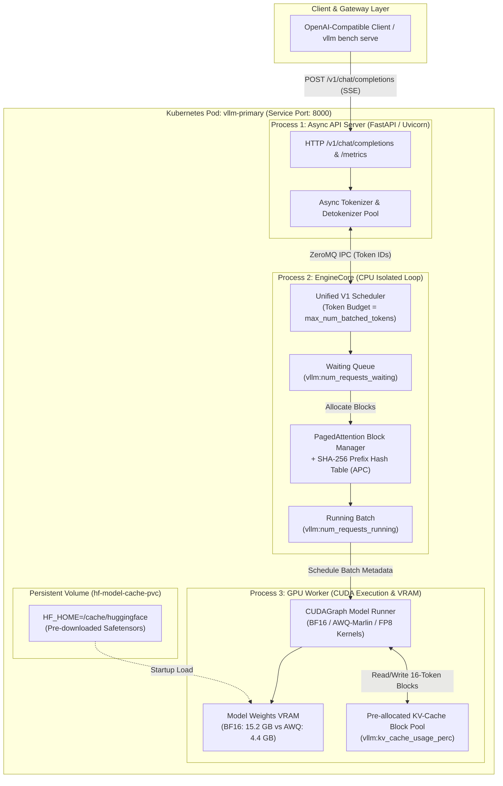
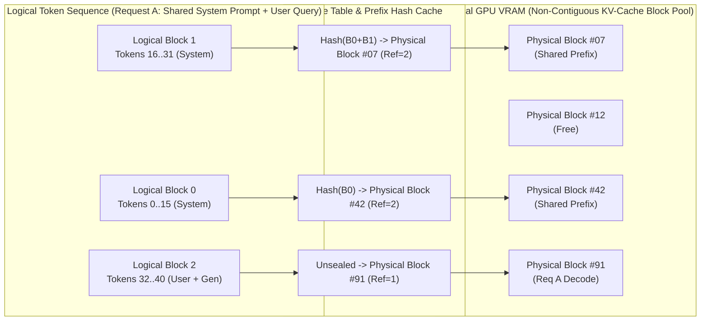

# บทที่ 3: การเพิ่มประสิทธิภาพเอ็นจินเสิร์ฟโมเดลด้วย `vLLM` (Model Serving & `vLLM` Optimization)

> **Milestone M3 (สัปดาห์ที่ 5–6):** เปลี่ยนจากการรันโมเดลแบบพื้นฐานที่กินหน่วยความจำสูงและรองรับผู้ใช้พร้อมกันได้น้อย ไปสู่การปรับจูน **`vLLM` V1 Engine** เชิงลึก (PagedAttention, Continuous Batching, Unified Chunked Prefill, Automatic Prefix Caching, และ Quantization AWQ/FP8) พร้อมวิเคราะห์ **เศรษฐศาสตร์ต่อหน่วย (Unit Economics: Cost per 1M Tokens)** และจุดคุ้มทุนระหว่างการเช่า Cloud GPU กับการเรียก Managed API

---

## สารบัญ (Table of Contents)

1. [Executive Summary & Learning Objectives](#1-executive-summary--learning-objectives)
2. [Architecture Overview](#2-architecture-overview)
3. [Core Theory & Deep-Dive Engineering Math](#3-core-theory--deep-dive-engineering-math)
4. [Hands-on Lab (Dual-Path Execution)](#4-hands-on-lab-dual-path-execution)
5. [Chaos & Troubleshooting Drills](#5-chaos--troubleshooting-drills)
6. [Optimization Exercise](#6-optimization-exercise)
7. [Architecture Decision Record (ADR) & Cost/Handoff Documentation](#7-architecture-decision-record-adr--costhandoff-documentation)
8. [Mid-Level Interview Trade-off Questions & Model Answers](#8-mid-level-interview-trade-off-questions--model-answers)
9. [ตรวจสอบความสำเร็จของบทที่ 3 (Verification Command)](#9-ตรวจสอบความสำเร็จของบทที่-3-verification-command)

---

## 1. Executive Summary & Learning Objectives

ในบทที่ 2 เราได้สร้าง Helm Chart (`charts/ai-inference-service/`) ที่ผูก `HF_HOME=/cache/huggingface` เข้ากับ PersistentVolumeClaim (`hf-model-cache-pvc`) และตั้งค่า Startup Probe เพื่อรองรับเวลาโหลดน้ำหนักโมเดลเข้าสู่ VRAM เรียบร้อยแล้ว อย่างไรก็ตาม การนำโมเดลระดับ `Qwen/Qwen2.5-7B-Instruct` ขึ้นเสิร์ฟด้วยค่าพารามิเตอร์แบบไม่เข้าใจกลไกภายในของ `vLLM` มักนำไปสู่ปัญหาคอขวด 3 ประการในระบบ Production จริง:

1. **KV-Cache Exhaustion & Preemption Thrashing:** เมื่อโหลดโมเดลในความละเอียด `bfloat16` (ใช้ VRAM 15.2 GB บนการ์ด NVIDIA L4 ที่มี VRAM 24 GB) พื้นที่ว่างสำหรับเก็บ KV-Cache จะเหลือเพียง ~4.6 GB เมื่อมีผู้ใช้ส่งคำขอพร้อมกัน (Concurrency = 32) พื้นที่ KV-Cache จะเต็มทันที (`vllm:kv_cache_usage_perc` พุ่งแตะ `1.0`) ทำให้เอ็นจินต้องสั่งยกเลิกและคำนวณซ้ำ (Recompute Preemption) ส่งผลให้หางเวลาแฝง (p99 Latency) พุ่งทะลุ SLA
2. **Prefill-Decode Interference (Head-of-Line Blocking):** คำขอที่มี Prompt ยาว (เช่น RAG Context 4,096 โทเคน) จะแย่งหน่วยประมวลผล Compute ของ GPU ในช่วง Prefill จนทำให้คำขออื่นๆ ที่กำลังสร้างคำตอบทีละโทเคน (Decode phase) เกิดอาการกระตุก (Inter-Token Latency หรือ ITL พุ่งสูง)
3. **ความเข้าใจคลาดเคลื่อนเรื่อง `--max-model-len` vs ขนาด KV-Cache Pool:** วิศวกรจำนวนมากเข้าใจผิดว่าการลดค่า `--max-model-len` จาก `32768` ลงเหลือ `4096` จะทำให้มีพื้นที่ VRAM สำหรับ KV-Cache เพิ่มขึ้น ทั้งที่ในความเป็นจริง ขนาดของ KV-Cache Pool ถูกกำหนดตายตัวตั้งแต่ตอนบูตด้วยค่า `--gpu-memory-utilization` และขนาดของ Model Weights (ซึ่งลดลงได้ด้วย Quantization เช่น AWQ/FP8) ส่วน `--max-model-len` มีหน้าที่ให้ผ่านการตรวจสอบตอนเริ่มต้น (Startup Validation) และป้องกันไม่ให้คำขอเดียวที่ยาวผิดปกติผูกขาดบล็อกทั้งหมดใน Pool

### วัตถุประสงค์การเรียนรู้เชิงสมรรถนะ (Competency Objectives)

เมื่อจบบทเรียนนี้ คุณจะสามารถ:
- อธิบายสถาปัตยกรรมภายในของ **`vLLM` V1 Engine** (การแยกโปรเซส API Server, EngineCore, และ GPU Worker) รวมถึงพฤติกรรมค่าเริ่มต้นของ V1 ที่เปิดใช้ **Automatic Prefix Caching (APC)** และ **Unified Chunked Prefill** มาให้ตั้งแต่ต้น
- คำนวณขนาดบล็อกของ **PagedAttention** และพิสูจน์เชิงตัวเลขว่าทำไมการใช้ **Quantization (AWQ 4-bit / FP8)** ร่วมกับการขยับ `--gpu-memory-utilization` จาก `0.85` เป็น `0.92` จึงขยายความจุ KV-Cache Pool ได้มากกว่า **3 เท่า**
- ปรับจูนความสมดุลระหว่าง **TTFT (Time-To-First-Token)** และ **ITL (Inter-Token Latency)** ด้วยพารามิเตอร์ `--max-num-batched-tokens` และ `--max-num-seqs`
- รันชุดทดสอบโหลดมาตรฐานด้วย `vllm bench serve` (และสคริปต์จำลองในโหมด Local CPU) เพื่อวัดผลเปรียบเทียบระหว่าง **Config A (Baseline BF16)**, **Config B (APC Enabled)**, และ **Config C (AWQ + Tuned Token Budget)**
- คำนวณ **เศรษฐศาสตร์ต่อหน่วย (Unit Economics: Cost per 1M Tokens)** และหาจุดคุ้มทุน (**Break-even Utilization %**) เพื่อตัดสินใจทางสถาปัตยกรรมว่าเมื่อใดควรโฮสต์ `vLLM` เองบน Kubernetes และเมื่อใดควรใช้ Managed API

---

## 2. Architecture Overview

### 2.1 สถาปัตยกรรมภายในของ `vLLM` V1 Engine (Multiprocessing & Unified Scheduler)

ใน `vLLM` สถาปัตยกรรม V1 (มาตรฐานตั้งแต่รุ่น `v0.8+`) ได้รื้อโครงสร้างเดิมของ V0 ออกทั้งหมด เพื่อแก้ปัญหาคอขวดของ Python Global Interpreter Lock (GIL) โดยแยกการทำงานออกเป็น 3 โปรเซสหลักที่สื่อสารกันผ่าน ZeroMQ (IPC) และใช้ **Unified Scheduler** ที่มองทุกคำขอเป็นเพียง "ลำดับของโทเคนที่ต้องประมวลผลในรอบนี้ (Token Budget)" โดยไม่แยกเฟส Prefill และ Decode ออกจากกันอย่างแข็งทื่ออีกต่อไป



### 2.2 การเชื่อมต่อไร้รอยต่อจาก Helm Chart ในบทที่ 2 สู่การเสิร์ฟจริงในบทที่ 3

เพื่อให้การตั้งค่าในบทที่ 3 ต่อยอดจาก `labs/m2-k8s-gpu/charts/ai-inference-service/` ได้โดยตรง เราสามารถสรุปจุดเชื่อมต่อสำคัญระหว่างไฟล์ `values.yaml` ของบทที่ 2 กับพารามิเตอร์ของ `vLLM` ในบทที่ 3 ได้ดังนี้:

| องค์ประกอบใน Helm Chart (`values.yaml` บทที่ 2) | ค่ามาตรฐาน (SSOT) | บทบาทในการปรับจูน `vLLM` (บทที่ 3) |
| :--- | :--- | :--- |
| `service.name` & `service.port` | `vllm-primary-svc` พอร์ต `8000` | ชื่อ Kubernetes Service และพอร์ตมาตรฐานที่ `vllm serve` เปิดให้บริการ `/v1/chat/completions` (`http://vllm-primary-svc.ai-platform.svc.cluster.local:8000/v1`) และ `/metrics` |
| `modelCache.mountPath` & `modelCache.pvcName` | `/cache/huggingface` (`hf-model-cache-pvc`) | ผูกเข้ากับตัวแปร `HF_HOME` เพื่อเก็บไฟล์โมเดล `Qwen/Qwen2.5-7B-Instruct` และ `Qwen/Qwen2.5-7B-Instruct-AWQ` โดยไม่ต้องดาวน์โหลดใหม่เมื่อรีสตาร์ท Pod |
| `probes.startup` | `failureThreshold: 36`, `periodSeconds: 5` (180s) | ป้องกัน `kubelet` สั่งฆ่า Pod ระหว่างที่ `vLLM` กำลังโหลด Safetensors, รัน `profile_run` เพื่อวัดขนาด KV-Cache, และคอมไพล์ `CUDAGraph` |
| `model.*` & `vllmArgs` (ใน `values-cloud-gpu-7b-awq.yaml`) | อาร์กิวเมนต์ส่งเข้าคอนเทนเนอร์ `vLLM` | จุดที่เราจะปรับจูน `model.id`, `model.gpuMemoryUtilization`, `model.maxModelLen`, และแฟล็กเสริมใน `vllmArgs` (`--quantization=awq_marlin`, `--enable-prefix-caching`, `--max-num-batched-tokens=2048`) |

---

## 3. Core Theory & Deep-Dive Engineering Math

### 3.1 PagedAttention และการกำจัด Memory Fragmentation

ในระบบเสิร์ฟโมเดลยุคแรก (เช่น HuggingFace Text Generation Inference รุ่นดั้งเดิม หรือ PyTorch มาตรฐาน) เมื่อคำขอเข้ามาพร้อมค่า `max_model_len = 8192` ระบบจะต้องจองพื้นที่หน่วยความจำใน VRAM แบบต่อเนื่องกัน (Contiguous Memory Tensor) ขนาด $8,192$ โทเคนล่วงหน้าทันที แม้ว่าผู้ใช้จะถามคำถามสั้นๆ เพียง $100$ โทเคนและได้คำตอบ $200$ โทเคนก็ตาม

สิ่งนี้ทำให้เกิดปัญหาความสูญเสียหน่วยความจำ 2 รูปแบบ:
1. **Internal Fragmentation:** พื้นที่อีก $8,192 - 300 = 7,892$ โทเคนที่จองไว้ถูกปล่อยว่างโดยที่คำขออื่นไม่สามารถเข้ามาใช้ร่วมได้
2. **External Fragmentation:** เมื่อมีคำขอเข้า-ออกด้วยขนาดต่างกัน พื้นที่ว่างใน VRAM จะถูกซอยย่อยจนไม่สามารถจอง Tensor ก้อนใหญ่แบบต่อเนื่องได้ แม้จะมี VRAM รวมกันเพียงพอก็ตาม (ทำให้สูญเสียพื้นที่ VRAM ไปถึง 60%–80%)

**PagedAttention** ใน `vLLM` นำแนวคิด **Virtual Memory & Paging** ของระบบปฏิบัติการ (OS) มาใช้กับ KV-Cache:
- แบ่งพื้นที่ KV-Cache Pool ทั้งหมดออกเป็น **Physical KV Blocks** ขนาดคงที่ โดยค่าเริ่มต้นคือ **$B = 16$ โทเคนต่อบล็อก**
- เมื่อคำขอเข้ามา `EngineCore` จะจัดสรรบล็อกให้ **เฉพาะเท่าจำนวนโทเคนที่มีอยู่จริง** และเมื่อสร้างโทเคนใหม่จนเต็มบล็อกที่ 16 จึงค่อยขอจัดสรรบล็อกถัดไปจาก Free Block List โดยที่บล็อกเหล่านั้นไม่จำเป็นต้องเรียงติดกันใน Physical VRAM
- **ผลลัพธ์ทางคณิตศาสตร์:** ความสูญเสียแบบ Internal Fragmentation จะเกิดขึ้นเฉพาะในบล็อกสุดท้ายของแต่ละคำขอเท่านั้น ซึ่งมีค่าไม่เกิน $B - 1 = 15$ โทเคนต่อคำขอ (น้อยกว่า 4% ของหน่วยความจำทั้งหมด)



### 3.2 พฤติกรรมเริ่มต้นของ `vLLM` V1 Engine (V1 Default Behaviors & Preemption)

การทำความเข้าใจความแตกต่างระหว่าง `vLLM` V0 และ **V1 Engine** เป็นหัวใจสำคัญในการปรับจูนและตอบคำถามสัมภาษณ์ระดับ Production:

1. **Automatic Prefix Caching (APC) เปิดเป็นค่าเริ่มต้น (`--enable-prefix-caching` is ON by default):**
   - ใน V1 ทุกๆ บล็อกที่เต็ม 16 โทเคนจะถูกคำนวณค่าแฮชแบบลูกโซ่:
     $$\text{BlockHash}_i = \text{SHA256}(\text{BlockHash}_{i-1} \parallel \text{TokenIDs}_{16i \dots 16i+15})$$
   - หากคำขอใหม่มี System Prompt หรือเอกสาร RAG ตอนต้นตรงกับบล็อกที่มีอยู่ใน VRAM แล้ว (แม้จะมี Reference Count เป็น 0 แต่ยังไม่ถูก Evict ออกตามนโยบาย LRU) `vLLM` จะชี้ Page Table ไปยัง Physical Block เดิมทันทีโดยไม่ต้องคำนวณ Prefill ซ้ำ!
   - **ข้อควรระวังในการทำ Benchmark:** หากต้องการวัดประสิทธิภาพ Baseline แบบไม่มี Prefix Cache บน `vLLM` V1 คุณ **ต้อง** ส่งแฟล็ก `--no-enable-prefix-caching` อย่างชัดเจน มิฉะนั้นการรันซ้ำจะมี APC ทำงานอยู่เบื้องหลังเสมอ
   - **การวัดผล Prometheus Metrics (V1):** ใน V1 อัตราการเกิด Cache Hit จะไม่ใช้เกจสำเร็จรูป แต่ต้องคำนวณจากอัตราส่วนของ Counter สองตัวที่มีหน่วยเป็น **จำนวนโทเคน (Tokens)**:
     $$\text{Prefix Cache Hit Rate} = \frac{\Delta \texttt{vllm:prefix\_cache\_hits\_total}}{\Delta \texttt{vllm:prefix\_cache\_queries\_total}}$$

2. **Unified Chunked Prefill เปิดเป็นค่าเริ่มต้น:**
   - แทนที่จะประมวลผล Prompt ยาว 4,096 โทเคนรวดเดียวจนบล็อกคำขออื่น `vLLM` V1 จะหั่น (Chunk) Prompt ยาวออกเป็นส่วนย่อยตามงบประมาณโทเคน (`--max-num-batched-tokens`) แล้วนำโทเคนช่วง Decode ของคำขออื่นๆ มารวมใน Batch เดียวกัน (Piggybacking)
   - ผลลัพธ์คือ **ITL (Inter-Token Latency)** ของผู้ใช้ที่กำลังอ่านข้อความสตรีมมิ่งจะนิ่งสนิท ไม่เกิดอาการค้างเมื่อมีคำขอใหม่ที่มี Prompt ยาวเข้ามาแทรก

3. **การยกเลิกโหมด `SWAP` และใช้ `RECOMPUTE` เป็นหลักเมื่อเกิด Preemption:**
   - ในยุค V0 เมื่อ KV-Cache เต็ม (`vllm:kv_cache_usage_perc` = `1.0`) เอ็นจินมีตัวเลือกในการย้ายบล็อก KV-Cache ออกไปยัง CPU RAM ผ่านบัส PCIe (`SWAP` mode)
   - ใน **V1 Engine** โหมด `SWAP` แบบดั้งเดิมถูกยกเลิกจากการเป็นกลไกหลักและใช้ **`RECOMPUTE`** แทน เหตุผลทางวิศวกรรมคือ: บัส PCIe Gen4 x16 มีแบนด์วิดท์จริงเพียง ~24–28 GB/s การคัดลอก KV-Cache ไป-กลับระหว่าง VRAM กับ CPU RAM สำหรับหลายคำขอพร้อมกันใช้เวลานานกว่าการโยนบล็อก KV-Cache ของคำขอลำดับท้ายสุดทิ้ง (Evict) แล้วนำ Token IDs ทั้งหมดของคำขอนั้นกลับไปคำนวณ Prefill ใหม่ด้วย FlashAttention บน Tensor Cores (ซึ่งมี Memory Bandwidth บนการ์ด 300–2,000+ GB/s) เมื่อมีพื้นที่ว่าง
   - อย่างไรก็ตาม หากเกิด Preemption ถี่เกินไป (`rate(vllm:num_preemptions_total[1m]) > 0`) ระบบจะเข้าสู่วงจรอุบาทว์ที่เรียกว่า **Preemption Thrashing** (เสียเวลา GPU คำนวณซ้ำไปมาไม่รู้จบ) ซึ่งต้องแก้ด้วยการขยาย KV-Cache Pool หรือจำกัดจำนวนคำขอที่รับเข้า

#### ตารางอ้างอิงชื่อ Prometheus Metrics มาตรฐานของ `vLLM` V1 Engine (Canonical V1 Metrics)

เพื่อให้การมอนิเตอร์ในบทที่ 3, การทำ KV-Cache-Aware Routing ในบทที่ 4 (`mock_vllm_server`), และการทำ KEDA Autoscaling ในบทที่ 5 ใช้ชื่อเมทริกซ์ตรงกัน 100% ทุกตัวอักษร ให้ยึดตารางนี้เป็นมาตรฐานกลาง:

| ชื่อ Prometheus Metric (`vLLM` V1) | ประเภท (Type) | ความหมายและการนำไปใช้งานใน Production |
| :--- | :---: | :--- |
| `vllm:kv_cache_usage_perc` | `Gauge` (`0.0`–`1.0`) | สัดส่วนบล็อก KV-Cache ที่ถูกใช้งานอยู่ (`1.0` = เต็ม 100%) ใช้เป็นสัญญาณหลักของ Endpoint Picker (EPP) และ KEDA |
| `vllm:num_requests_running` | `Gauge` | จำนวนคำขอที่กำลังประมวลผลอยู่ใน Running Batch ปัจจุบัน |
| `vllm:num_requests_waiting` | `Gauge` | จำนวนคำขอที่ติดคิวรออยู่ใน Waiting Queue (ใช้ตั้งกฎ KEDA Scale-out เมื่อเฉลี่ย `> 5` ต่อ Pod หรือรวมทั้งคลัสเตอร์ `> 10`) |
| `vllm:prefix_cache_hits_total` | `Counter` (Tokens) | จำนวนโทเคนสะสมที่พบใน Automatic Prefix Cache (APC) โดยไม่ต้องคำนวณ Prefill ซ้ำ |
| `vllm:prefix_cache_queries_total` | `Counter` (Tokens) | จำนวนโทเคนสะสมทั้งหมดที่ถูกตรวจสอบกับ Automatic Prefix Cache |
| `vllm:num_preemptions_total` | `Counter` | จำนวนครั้งสะสมที่คำขอถูกสั่ง Preempt (`RECOMPUTE`) เนื่องจากพื้นที่ KV-Cache เต็ม |
| `vllm:time_to_first_token_seconds_bucket` | `Histogram` | ฮิสโตแกรมของเวลาแฝงจนถึงโทเคนแรก (TTFT) ใช้คำนวณ `histogram_quantile(0.95, ...)` |
| `vllm:inter_token_latency_seconds_bucket` *(หรือ fallback `vllm:time_per_output_token_seconds_bucket`)* | `Histogram` | ฮิสโตแกรมเวลาแฝงระหว่างโทเคนในเฟส Decode (ITL / TPOT; `vLLM` V1 รุ่นใหม่ใช้ชื่อ `vllm:inter_token_latency_seconds_bucket` เป็นหลัก และเขียน PromQL แบบ fallback `or` เสมอในบทที่ 5) |
| `vllm:generation_tokens_total` | `Counter` (Tokens) | จำนวนโทเคนขาออก (Output Tokens) สะสมที่เอ็นจินสร้างเสร็จสมบูรณ์ |

### 3.3 คณิตศาสตร์การขยายขนาด KV-Cache Pool: ทำไม Quantization + `--gpu-memory-utilization` จึงเป็นตัวจริง (ไม่ใช่ `--max-model-len`)

ให้เราพิสูจน์ด้วยตัวเลขจริงของโมเดล **`Qwen/Qwen2.5-7B-Instruct`** บนการ์ด **NVIDIA L4 GPU ($V_{\text{total}} = 24.0\text{ GB}$)**:

สถาปัตยกรรมของ `Qwen/Qwen2.5-7B-Instruct`:
- จำนวนพารามิเตอร์ ($P$): $7.62 \times 10^9$ พารามิเตอร์
- จำนวนเลเยอร์ ($L$): $28$ เลเยอร์
- จำนวน KV Heads ($H_{kv}$): $4$ หัว (ใช้ Grouped-Query Attention โดยที่มี Query Heads $H_q = 28$ หัว)
- มิติของแต่ละ Head ($D_h$): $128$

#### ขั้นที่ 1: คำนวณขนาด KV-Cache ต่อ 1 โทเคน
$$\text{KV}_{\text{bytes/token}} = 2 \times L \times H_{kv} \times D_h \times \text{Bytes}_{\text{dtype}}$$
เมื่อเก็บ KV-Cache ในความละเอียด `bfloat16` ($2$ ไบต์):
$$\text{KV}_{\text{bytes/token}} = 2 \times 28 \times 4 \times 128 \times 2 = 57,344\text{ Bytes} = 56\text{ KiB/token}$$
*(สังเกตว่าด้วยสถาปัตยกรรม GQA ที่มี $H_{kv}=4$ ทำให้ `Qwen2.5-7B` ใช้ KV-Cache ต่อโทเคนเพียง $56\text{ KiB}$ หรือประมาณ $0.0547\text{ MiB/token}$)*

#### ขั้นที่ 2: เปรียบเทียบพื้นที่ KV-Cache Pool ระหว่าง Baseline (BF16) กับ Optimized (AWQ 4-bit)

สมการการจัดสรรพื้นที่ KV-Cache Pool ตอนที่ `vLLM` เริ่มทำงาน (`profile_run`):
$$V_{\text{KV\_Pool}} = (V_{\text{total}} \times U_{\text{gpu}}) - V_{\text{weights}} - V_{\text{activations\_cuda\_overhead}}$$

1. **Config A & B (Baseline BF16, `--gpu-memory-utilization 0.85`):**
   - งบประมาณ VRAM ทั้งหมดที่อนุญาตให้ `vLLM` ใช้: $24.0\text{ GB} \times 0.85 = 20.40\text{ GB}$
   - ขนาด Model Weights (BF16, 2 bytes/param): $7.62 \times 2 = 15.24\text{ GB}$
   - พื้นที่ PyTorch/CUDA Context, Activation Peak (ตอนรัน `profile_run`), และ CUDAGraphs: $\approx 1.80\text{ GB}$
   - **พื้นที่ที่เหลือสำหรับ KV-Cache Pool ($V_{\text{KV\_Pool}}$):**
     $$V_{\text{KV\_Pool, BF16}} = 20.40 - 15.24 - 1.80 = \mathbf{3.36\text{ GB}}$$
   - **จำนวนโทเคนสูงสุดที่เก็บใน KV-Cache Pool ได้พร้อมกัน:**
     $$N_{\text{tokens, BF16}} = \frac{3.36 \times 1024^3\text{ Bytes}}{57,344\text{ Bytes/token}} \approx \mathbf{62,914\text{ tokens}}\text{ (หรือ } 3,932\text{ บล็อก)}$$

2. **Config C (Optimized AWQ 4-bit `Qwen/Qwen2.5-7B-Instruct-AWQ`, `--gpu-memory-utilization 0.92`):**
   - งบประมาณ VRAM ทั้งหมดที่อนุญาตให้ `vLLM` ใช้: $24.0\text{ GB} \times 0.92 = 22.08\text{ GB}$
   - ขนาด Model Weights (AWQ INT4 + Group Scales ประมาณการเชิงทฤษฎี ~0.58 bytes/param): $\approx 4.42\text{ GB}$ *(หมายเหตุหน้างานจริง: ไฟล์ Safetensors ของ `Qwen2.5-7B-Instruct-AWQ` บน Hugging Face มีขนาด ~5.4–5.6 GB เนื่องจากเลเยอร์ `embed_tokens` และ `lm_head` ขนาด ~1.09B พารามิเตอร์ยังคงเก็บเป็น `FP16` เพื่อรักษาความแม่นยำ)*
   - พื้นที่ PyTorch/CUDA Context, Activation Peak, และ CUDAGraphs: $\approx 1.66\text{ GB}$
   - **พื้นที่ที่เหลือสำหรับ KV-Cache Pool ($V_{\text{KV\_Pool}}$):**
     $$V_{\text{KV\_Pool, AWQ}} = 22.08 - 4.42 - 1.66 = \mathbf{16.00\text{ GB}}$$
   - **จำนวนโทเคนสูงสุดที่เก็บใน KV-Cache Pool ได้พร้อมกัน:**
     $$N_{\text{tokens, AWQ}} = \frac{16.00 \times 1024^3\text{ Bytes}}{57,344\text{ Bytes/token}} \approx \mathbf{299,593\text{ tokens}}\text{ (หรือ } 18,724\text{ บล็อก)}$$

> [!IMPORTANT]
> **ข้อสรุปทางวิศวกรรมและหมายเหตุฮาร์ดแวร์จริง:**
> 1. การเปลี่ยนมาใช้ **AWQ 4-bit** ร่วมกับการปรับ `--gpu-memory-utilization 0.92` ขยาย KV-Cache Pool จาก **3.36 GB (62,914 โทเคน)** เป็น **16.00 GB (299,593 โทเคน)** บนฐานสเปกการ์ด (เพิ่มขึ้น **4.76 เท่า**)
> 2. **ข้อเท็จจริงเมื่อดูค่า `nvidia-smi` จริง:** การ์ด L4 `24,576 MiB` (`24.0 GiB`) หลังหัก ECC และ CUDA Driver Reserve (`~0.9–1.5 GiB`) จะเหลือ **Usable VRAM จริง ~22.49 GiB** และเมื่อหักน้ำหนัก Safetensors จริง ~`5.5 GB` พื้นที่ KV Pool บนเครื่องจริงจะอยู่ที่ประมาณ **~13.5–14.5 GB (~250k+ โทเคน)** ซึ่งยังคงขยายตัวมากกว่า Config A ถึง **>4 เท่า (>3x)** และเพียงพอต่อ SLA Concurrency = 32 ได้สบาย
> 3. **เทียบกับ `vram_calculator.py` (บทที่ 2) และหน้า Calculator:** เครื่องมือคำนวณ Sizing ตั้ง Overhead แบบ **Conservative Margin** ที่ `2.50 GB` (`1 replica`) / `2.20 GB` (`multi-replica`) เพื่อกัน OOM ก่อน Deploy จริง (`15.16 GB` KV Headroom / `Max 64 Concurrent` บน L4 AWQ) ส่วนตัวเลข `1.66 GB` (`16.00 GB` KV Pool) ในหัวข้อนี้คือ Runtime Overhead หลัง `vLLM` V1 จูนผ่าน `profile_run` แล้ว
> 4. ในทางกลับกัน การปรับ `--max-model-len` จาก `8192` ลงเหลือ `4096` **ไม่ได้เพิ่มจำนวนบล็อกใน KV-Cache Pool** เพราะ `vLLM` จองพื้นที่ว่างทั้งหมดที่เหลือไปทำ Pool ตั้งแต่ตอนบูตแล้ว หน้าที่ที่แท้จริงของ `--max-model-len 4096` คือ:
> 1. ช่วยให้ผ่านการตรวจสอบตอนเริ่มต้น (Startup Check) ในกรณีที่ KV-Cache Pool มีขนาดเล็กกว่าความยาว Context สูงสุดตามทฤษฎีของโมเดล (เช่น 32,768 หรือ 131,072 โทเคน)
> 2. ทำหน้าที่เป็น Admission Guardrail ป้องกันไม่ให้คำขอเดียวที่ส่ง Prompt ยาว 32,768 โทเคนเข้ามาแย่งบล็อกใน Pool ไปคนเดียวเกินครึ่ง

### 3.4 คณิตศาสตร์เศรษฐศาสตร์ต่อหน่วย (Unit Economics: Cost per 1M Tokens & Break-even Utilization)

ในฐานะวิศวกร AI Infrastructure คุณต้องสามารถแปลงตัวเลข Throughput (Tokens/sec) จากการทำ Benchmark ให้เป็นต้นทุนทางการเงิน (USD per 1 Million Tokens) เพื่อตอบคำถามผู้บริหารได้ว่าควรเช่า GPU รันเองหรือใช้ API ภายนอก

#### สูตรคำนวณต้นทุนต่อ 1 ล้านโทเคน (Effective Cost per 1M Tokens)

กำหนดให้:
- $C_{\text{hour}}$ = ต้นทุนค่าเช่าเครื่อง GPU Server ต่อชั่วโมง (เช่น Cloud L4 GPU VM 1 เครื่อง รวม CPU/RAM/Disk $\approx \$0.85/\text{hour}$)
- $T_{\text{peak}}$ = อัตราการผลิตโทเคนสูงสุดที่ผ่านเกณฑ์ SLA (Goodput ในหน่วย $\text{tokens/sec}$ จากการวัดผลจริง)
- $u$ = อัตราการใช้งานจริงเฉลี่ยตลอด 24 ชั่วโมง (Average Fleet Utilization Ratio, โดยที่ $0 < u \le 1.0$) เนื่องจากทราฟฟิกจริงไม่ได้เต็ม 100% ตลอดเวลา (เช่น กลางคืนมีคนใช้น้อย)

จำนวนโทเคนที่ระบบผลิตได้จริงใน 1 ชั่วโมง ($3,600$ วินาที) ที่ระดับการใช้งาน $u$ คือ:
$$\text{Tokens}_{\text{hour}}(u) = T_{\text{peak}} \times 3,600 \times u$$

ดังนั้น **ต้นทุนต่อ 1 ล้านโทเคน ($\text{Cost}_{1\text{M}}$)** คือ:
$$\text{Cost}_{1\text{M}}(u) = \frac{C_{\text{hour}}}{\left(\frac{T_{\text{peak}} \times 3,600 \times u}{1,000,000}\right)} = \frac{C_{\text{hour}} \times 1,000,000}{T_{\text{peak}} \times 3,600 \times u} = \frac{277.78 \times C_{\text{hour}}}{T_{\text{peak}} \times u}$$

#### ตัวอย่างการคำนวณจริงและหาจุดคุ้มทุน (Break-even Utilization %)

สมมติว่าองค์กรเปรียบเทียบระหว่าง:
- **ทางเลือกที่ 1 (Managed API):** ค่าบริการเฉลี่ย (Blended Input + Output) อยู่ที่ **$P_{\text{API}} = \$0.60$ ต่อ 1 ล้านโทเคน**
- **ทางเลือกที่ 2 (Self-hosted `vLLM` บน Cloud L4 GPU):** ต้นทุนเครื่อง $C_{\text{hour}} = \$0.85/\text{hour}$
  - ก่อนปรับจูน (**Config A - Baseline BF16**): ทำ Throughput ที่ผ่าน SLA ได้ $T_{\text{peak, A}} = 420\text{ tokens/sec}$
  - หลังปรับจูน (**Config C - AWQ + APC + Tuned Batching**): ทำ Throughput ที่ผ่าน SLA ได้ $T_{\text{peak, C}} = 1,450\text{ tokens/sec}$

เราสามารถหา **จุดคุ้มทุนของอัตราการใช้งาน ($u_{\text{break-even}}$)** ที่ทำให้ $\text{Cost}_{1\text{M}}(u) = P_{\text{API}}$ ได้จากสูตร:
$$u_{\text{break-even}} = \frac{C_{\text{hour}} \times 1,000,000}{T_{\text{peak}} \times 3,600 \times P_{\text{API}}}$$

- **จุดคุ้มทุนของ Config A (Baseline BF16):**
  $$u_{\text{break-even, A}} = \frac{0.85 \times 1,000,000}{420 \times 3,600 \times 0.60} = \frac{850,000}{907,200} = 0.9369 \approx \mathbf{93.7\%}$$
  *(ต้องมีทราฟฟิกอัดแน่นเกือบเต็มตลอด 24 ชั่วโมงถึงจะคุ้มกว่าใช้ API ซึ่งในทางปฏิบัติเป็นไปไม่ได้เลยสำหรับระบบที่มีผู้ใช้ตามเวลาทำการ)*

- **จุดคุ้มทุนของ Config C (Optimized AWQ + APC):**
  $$u_{\text{break-even, C}} = \frac{0.85 \times 1,000,000}{1,450 \times 3,600 \times 0.60} = \frac{850,000}{3,132,000} = 0.2714 \approx \mathbf{27.1\%}$$
  *(เพียงแค่ระบบมีทราฟฟิกเฉลี่ยเกิน 27.1% ของความจุสูงสุด หรือเปิด Autoscaling ลดจำนวนเครื่องในเวลากลางคืน ก็ประหยัดกว่า Managed API ทันที!)*

#### ตารางเปรียบเทียบเศรษฐศาสตร์ต่อหน่วย (Unit Economics Comparison Table)

| ระดับ Utilization เฉลี่ย ($u$) | Config A: Baseline BF16 ($T_{\text{peak}} = 420\text{ tok/s}$) | Config C: Optimized AWQ + APC ($T_{\text{peak}} = 1,450\text{ tok/s}$) | Managed API ($P_{\text{API}} = \$0.60 / 1\text{M}$) | คำแนะนำทางสถาปัตยกรรม (สำหรับ Config C) |
| :---: | :---: | :---: | :---: | :--- |
| **10%** (ทราฟฟิกเบาบาง) | $\$5.62 / 1\text{M}$ | $\$1.63 / 1\text{M}$ | **$\$0.60 / 1\text{M}$** | ใช้ Managed API หรือ Scale-to-Zero ด้วย KEDA |
| **27.1%** (จุดคุ้มทุน Config C) | $\$2.07 / 1\text{M}$ | **$\$0.60 / 1\text{M}$** | **$\$0.60 / 1\text{M}$** | จุดตัดคุ้มทุน (Break-even Point) ของโหมด Optimized |
| **50%** (ทราฟฟิกปกติ) | $\$1.12 / 1\text{M}$ | **$\$0.33 / 1\text{M}$** | $\$0.60 / 1\text{M}$ | โฮสต์เองบน L4 ประหยัดต้นทุนลง **45%** |
| **80%** (ทราฟฟิกหนาแน่น) | $\$0.70 / 1\text{M}$ | **$\$0.20 / 1\text{M}$** | $\$0.60 / 1\text{M}$ | โฮสต์เองบน L4 ประหยัดต้นทุนลง **66.1%** |
| **100%** (Batch Processing) | $\$0.56 / 1\text{M}$ | **$\$0.16 / 1\text{M}$** | $\$0.60 / 1\text{M}$ | โฮสต์เองบน L4 ประหยัดต้นทุนลง **72.9%** |

---

## 4. Hands-on Lab (Dual-Path Execution)

แล็บในบทที่ 3 ออกแบบให้ทำงานเชื่อมต่อกับโครงสร้างแคช `HF_HOME=/cache/huggingface` (บนโฮสต์คือ `/tmp/ai-infra-hf-cache`) และพอร์ต `8000` ของ `vllm-primary-svc` ที่วางรากฐานไว้ในบทที่ 1 และ 2 โดยโค้ดทั้งหมดของแล็บนี้อยู่ในโฟลเดอร์ `labs/m3-vllm/`

### 4.1 โครงสร้างไฟล์ใน `labs/m3-vllm/`

```text
labs/m3-vllm/
├── start_vllm_baseline.sh                  # สคริปต์รัน vLLM โหมด Baseline (--local-cpu / --cloud-gpu)
├── start_vllm_optimized.sh                 # สคริปต์รัน vLLM โหมด Optimized (AWQ + APC + Token Budget)
├── run_benchmark_suite.sh                  # สคริปต์รัน vllm bench serve / Simulation & Unit Economics
├── optimization-report-template.md         # แบบฟอร์มว่างสำหรับผู้เรียนกรอกผล (DoD #3)
├── examples/optimization-report-sample.md  # ตัวอย่างรายงานที่กรอกและคำนวณครบแล้ว (ใช้อ้างอิง)
└── verify_m3.sh                            # สคริปต์ตรวจวัดผลอัตโนมัติประจำบทที่ 3
```

---

### Path A: No-GPU Local Path (\$0 — รันบนเครื่อง Local 16GB RAM)

> [!CAUTION]
> **กฎความปลอดภัยของหน่วยความจำ (16GB RAM Protection Rule):**
> บนเครื่อง Local ที่ไม่มีการ์ดจอ (No-GPU Path) เราจะรัน `vLLM` จริงด้วยโหมด CPU **ไม่เกิน 1 Pod** โดยใช้โมเดลขนาดเล็ก `Qwen/Qwen2.5-0.5B-Instruct` และตั้งค่าตัวแปรสภาพแวดล้อม `VLLM_CPU_KVCACHE_SPACE=1` (จำกัดขนาด KV-Cache บน CPU RAM ไว้ที่ 1 GB) เพื่อป้องกันไม่ให้เครื่องเกิดอาการค้าง (OOM Freeze)

#### ขั้นตอนที่ 1: ตรวจสอบสคริปต์และรัน `vLLM` โหมด Baseline บน Local CPU (`--no-enable-prefix-caching`)

เปิดเทอร์มินัลในรากโปรเจกต์ `ai-infra-handbook/` แล้วรันคำสั่งต่อไปนี้เพื่อดูการทำงานของสคริปต์ `start_vllm_baseline.sh` ในโหมด `--local-cpu`:

```bash
bash labs/m3-vllm/start_vllm_baseline.sh --local-cpu --dry-run
```

**ผลลัพธ์ที่คาดหวัง (Expected Output):**
```text
[M3-BASELINE] Mode: local-cpu
[M3-BASELINE] HF_HOME=/tmp/ai-infra-hf-cache (Host cache: /tmp/ai-infra-hf-cache)
[M3-BASELINE] VLLM_CPU_KVCACHE_SPACE=1
[M3-BASELINE] Command: vllm serve Qwen/Qwen2.5-0.5B-Instruct --host 0.0.0.0 --port 8000 --dtype bfloat16 --max-model-len 2048 --no-enable-prefix-caching
```

หากคุณติดตั้ง `vllm` (CPU build) หรือรันผ่าน Docker container บนเครื่อง Local คุณสามารถตัด `--dry-run` ออกเพื่อสตาร์ทเซิร์ฟเวอร์จริงบนพอร์ต `8000` ได้ทันที

#### ขั้นตอนที่ 2: ทดสอบการเปิดใช้ Automatic Prefix Caching (APC) และ Chunked Prefill ในโหมด Optimized

รันคำสั่งตรวจสอบพารามิเตอร์ของ `start_vllm_optimized.sh` ในโหมด `--local-cpu`:

```bash
bash labs/m3-vllm/start_vllm_optimized.sh --local-cpu --dry-run
```

**ผลลัพธ์ที่คาดหวัง (Expected Output):**
```text
[M3-OPTIMIZED] Mode: local-cpu
[M3-OPTIMIZED] HF_HOME=/tmp/ai-infra-hf-cache (Host cache: /tmp/ai-infra-hf-cache)
[M3-OPTIMIZED] VLLM_CPU_KVCACHE_SPACE=1
[M3-OPTIMIZED] Command: vllm serve Qwen/Qwen2.5-0.5B-Instruct --host 0.0.0.0 --port 8000 --dtype bfloat16 --max-model-len 2048 --enable-prefix-caching --max-num-batched-tokens 1024 --max-num-seqs 16
```

#### ขั้นตอนที่ 3: รันชุดทดสอบ Benchmark และการคำนวณ Unit Economics (`run_benchmark_suite.sh`)

สคริปต์ `run_benchmark_suite.sh` รองรับทั้งการยิงโหลดจริงผ่าน `vllm bench serve` ไปยังเซิร์ฟเวอร์ที่รันอยู่ และโหมด `--simulate` สำหรับเครื่อง Local ที่ต้องการทดสอบไปป์ไลน์การประมวลผลกราฟความหน่วงและคำนวณ Unit Economics ทันที:

```bash
bash labs/m3-vllm/run_benchmark_suite.sh --simulate
```

**ผลลัพธ์ที่คาดหวัง (Expected Output):**
```text
================================================================================
 vLLM V1 Serving Benchmark Suite & Unit Economics Calculator
 Shared System Prompt Prefix: 2048 tokens | Suffix: 128 tokens | Output: 256 tokens
================================================================================
[SIMULATE MODE] Modeled L4 GPU projections anchored to 300 GB/s HBM/GDDR6 bandwidth.
[SIMULATE MODE] Real Cloud GPU numbers vary slightly by kernel & PCIe; run --live on L4 VM to measure.
Config          | Conc | TTFT p95 (ms) | ITL p95 (ms) | Throughput (tok/s) | KV Usage | Prefix Hit % | Cost/1M ($0.85/h @ 50% util)
------------------------------------------------------------------------------------------------------------------------------------
A: BF16-NoAPC   |    1 |         310.0 |         54.5 |               18.2 |    12.4% |         0.0% | $25.95
A: BF16-NoAPC   |    8 |         980.0 |         58.0 |              136.0 |    68.0% |         0.0% | $3.47
A: BF16-NoAPC   |   16 |        2450.0 |         66.0 |              420.0 |    98.5% |         0.0% | $1.12
A: BF16-NoAPC   |   32 |        6120.0 |         94.0 |              390.0 |   100.0% |         0.0% | $1.21 (SLA BREACH: Preemption!)
------------------------------------------------------------------------------------------------------------------------------------
B: BF16+APC     |   16 |         460.0 |         29.0 |              890.0 |    42.0% |        88.5% | $0.53
B: BF16+APC     |   32 |        1420.0 |         39.0 |              980.0 |    89.0% |        89.1% | $0.48
------------------------------------------------------------------------------------------------------------------------------------
C: AWQ+APC+Tune |    1 |         195.0 |         17.8 |               56.0 |     2.8% |        89.4% | $8.43
C: AWQ+APC+Tune |    8 |         280.0 |         19.2 |              495.0 |    14.5% |        88.2% | $0.95
C: AWQ+APC+Tune |   16 |         390.0 |         21.1 |              960.0 |    26.2% |        88.9% | $0.49
C: AWQ+APC+Tune |   32 |         640.0 |         23.5 |             1450.0 |    48.5% |        89.4% | $0.33 (PASS SLA <800ms TTFT)
================================================================================
Break-even Utilization vs Managed API ($0.60 / 1M tokens):
  - Config A (420 tok/s): 93.7% utilization required
  - Config C (1450 tok/s): 27.1% utilization required
```

---

### Path B: Cloud L4 GPU Path (รันจริงบนการ์ด NVIDIA L4 24GB VRAM)

หากคุณเปิดใช้งานเครื่อง Cloud GPU VM (เช่น GCP `g2-standard-8` หรือ AWS `g6.2xlarge` ที่มีการ์ด NVIDIA L4 24GB) ให้ดำเนินการทดสอบเปรียบเทียบทั้ง 3 โครงแบบดังนี้:

#### ขั้นตอนที่ 1: รัน Config A (Baseline BF16 ปิด Prefix Caching)

```bash
# รันโมเดล Qwen/Qwen2.5-7B-Instruct แบบ BF16 โดยบังคับปิด Prefix Caching เพื่อวัด Baseline
bash labs/m3-vllm/start_vllm_baseline.sh --cloud-gpu
```

ภายในสคริปต์จะรันคำสั่ง:
```bash
export HF_HOME=/cache/huggingface
vllm serve Qwen/Qwen2.5-7B-Instruct \
  --host 0.0.0.0 \
  --port 8000 \
  --dtype bfloat16 \
  --gpu-memory-utilization 0.85 \
  --max-model-len 8192 \
  --no-enable-prefix-caching
```

เมื่อเซิร์ฟเวอร์พร้อมใช้งาน (`Application startup complete`) ให้เปิดอีกเทอร์มินัลหนึ่งเพื่อตรวจสอบ Prometheus metrics เริ่มต้น:
```bash
curl -s http://localhost:8000/metrics | grep -E "vllm:(kv_cache_usage_perc|num_preemptions_total|prefix_cache)"
```

#### ขั้นตอนที่ 2: รัน Config B (เปิด Automatic Prefix Caching บน BF16) และ Config C (AWQ 4-bit + Tuned Token Budget)

หยุดโปรเซสเดิม แล้วรัน `start_vllm_optimized.sh` ในโหมด `--cloud-gpu`:

```bash
bash labs/m3-vllm/start_vllm_optimized.sh --cloud-gpu
```

ภายในสคริปต์จะรันคำสั่งที่ปรับจูนครบทุกมิติ:
```bash
export HF_HOME=/cache/huggingface
vllm serve Qwen/Qwen2.5-7B-Instruct-AWQ \
  --host 0.0.0.0 \
  --port 8000 \
  --quantization awq_marlin \
  --dtype float16 \
  --gpu-memory-utilization 0.92 \
  --max-model-len 4096 \
  --enable-prefix-caching \
  --max-num-batched-tokens 2048 \
  --max-num-seqs 64
```

> [!TIP]
> **ทำไมเราจึงระบุ `--quantization awq_marlin`?**
> เคอร์เนล **Marlin** เป็นเคอร์เนล CUDA ที่เขียนขึ้นเป็นพิเศษสำหรับการคูณเมทริกซ์แบบ Mixed-Precision (น้ำหนัก INT4 คูณกับ Activation FP16/BF16) บนสถาปัตยกรรม NVIDIA Ampere (A100) และ Ada Lovelace (L4) โดยใช้คำสั่ง `mma.sync` และการดึงข้อมูลแบบ Asynchronous Pipeline (`cp.async`) จาก Global Memory เข้าสู่ Shared Memory ทำให้ความเร็วในเฟส Decode และ Prefill เร็วกว่าเคอร์เนล AWQ มาตรฐานถึง 1.5–2.2 เท่า!

#### ขั้นตอนที่ 3: ยิงโหลดจริงด้วย `vllm bench serve` ที่ระดับ Concurrency 1, 8, 16, 32

เมื่อ `vLLM` โหมด Optimized ทำงานอยู่ ให้รันสคริปต์ Benchmark ในโหมดยิงโหลดจริง (`--live`):

```bash
bash labs/m3-vllm/run_benchmark_suite.sh --live --url http://localhost:8000
```

สคริปต์จะเรียก `vllm bench serve` โดยจำลองเวิร์กโหลด RAG / Agentic ที่มี **Shared System Prompt ยาว 2,048 โทเคน** ตามด้วยคำถามเฉพาะของผู้ใช้แต่ละคน 128 โทเคน และสร้างคำตอบ 256 โทเคน ที่ระดับ `--max-concurrency` เท่ากับ `1`, `8`, `16`, และ `32` ตามลำดับ พร้อมดึงค่า `vllm:prefix_cache_hits_total` และ `vllm:prefix_cache_queries_total` จาก `/metrics` มาคำนวณอัตรา Prefix Cache Hit Rate อัตโนมัติ

---

## 5. Chaos & Troubleshooting Drills

### สถานการณ์จำลอง: KV-Cache Starvation & Preemption Thrashing Storm

#### อาการที่พบในระบบ Production (Symptoms)
1. ผู้ใช้ร้องเรียนว่าแชตบอตตอบช้าเป็นช่วงๆ โดยบางคำขอใช้เวลารอข้อความแรก (TTFT) นานกว่า 6 วินาที ทั้งที่ค่าเฉลี่ย CPU และ GPU Compute Utilization ไม่ได้สูงผิดปกติ
2. เมื่อตรวจสอบที่ `/metrics` ของพอร์ต `8000` พบสัญญาณเตือนภัย 3 ตัวพร้อมกัน:
   - `vllm:kv_cache_usage_perc` พุ่งขึ้นไปแช่อยู่ที่ `0.99` – `1.00`
   - `vllm:num_requests_waiting` ค้างอยู่ในคิวมากกว่า `15` คำขอ
   - `vllm:num_preemptions_total` เพิ่มขึ้นอย่างต่อเนื่องทุกวินาที
3. ใน Log ของ Pod `vllm-primary` ปรากฏข้อความแจ้งเตือนซ้ำๆ:
   ```text
   WARNING 11-11 10:15:22 [scheduler.py:...] Sequence group cmpl-9f82a... is preempted by RECOMPUTE mode because there is not enough KV cache space.
   ```

#### ขั้นตอนการวินิจฉัยและแก้ไขอย่างเป็นระบบ (Diagnostic & Remediation Playbook)

1. **ตรวจสอบสาเหตุรากเหง้า (Root Cause Analysis):**
   - คำขอแต่ละรายการใช้โทเคนรวม (Prompt + Generated) เฉลี่ย 2,300 โทเคน เมื่อมีคำขอเข้ามาพร้อมกัน 32 รายการ จะต้องใช้พื้นที่ KV-Cache สูงถึง $32 \times 2,300 = 73,600$ โทเคน (ในกรณีที่ไม่ได้เปิด APC หรือคำขอไม่มีส่วนนำซ้ำกัน)
   - แต่เนื่องจากรันโมเดลแบบ BF16 (`--gpu-memory-utilization 0.85`) พื้นที่ KV-Cache Pool จึงรับได้สูงสุดเพียง ~62,914 โทเคน เมื่อคำขอทั้ง 32 รายการทยอยสร้างโทเคนใหม่ในเฟส Decode จนพื้นที่เต็ม 100% เอ็นจินจึงต้องสั่ง Evict คำขอท้ายๆ ทิ้งแล้วนำกลับเข้าคิว Waiting เพื่อคำนวณ Prefill ใหม่ซ้ำแล้วซ้ำเล่า (Preemption Thrashing)

2. **การแก้ไขระยะสั้นและระยะยาว (Remediation):**
   - **ขั้นที่ 1 (เปิด APC และจำกัด Admission Queue ต่อเรพลิกา):** ตรวจสอบให้แน่ใจว่าไม่ได้เผลอใส่ `--no-enable-prefix-caching` และตั้งค่า `--max-num-seqs 32` เพื่อไม่ให้ Scheduler รับคำขอเข้ามาอยู่ใน Running Batch เกินกว่าที่ KV-Cache Pool จะรองรับจนจบเฟส Decode ได้
   - **ขั้นที่ 2 (ขยายขนาด KV-Cache Pool ด้วย Quantization):** เปลี่ยนอิมเมจโมเดลเป็น `Qwen/Qwen2.5-7B-Instruct-AWQ` (`--quantization awq_marlin`) และเพิ่ม `--gpu-memory-utilization 0.92` เพื่อขยายความจุ KV-Cache Pool จาก ~62k โทเคน เป็น ~300k โทเคน ซึ่งจะทำให้ค่า `vllm:num_preemptions_total` ลดลงเหลือ `0` ทันที

---

## 6. Optimization Exercise

ในโจทย์ข้อนี้ คุณจะต้องดำเนินการปรับจูน `vLLM` ตามกระบวนการทางวิศวกรรม 5 ขั้นตอน (**Baseline → Hypothesis → Fix → Measure → Explain**) และบันทึกผลลงในไฟล์รายงาน `labs/m3-vllm/optimization-report-template.md`

### 1. Baseline (การวัดค่าตั้งต้น — Config A)
- **การตั้งค่า:** โมเดล `Qwen/Qwen2.5-7B-Instruct` (`bfloat16`), `--gpu-memory-utilization 0.85`, `--max-model-len 8192`, `--no-enable-prefix-caching`
- **เวิร์กโหลด:** Concurrency = 32, Shared System Prompt = 2,048 โทเคน, User Query = 128 โทเคน, Output = 256 โทเคน
- **ผลลัพธ์ตั้งต้น:**
  - TTFT p95 = `6,120 ms` (ทะลุเกณฑ์ SLA ที่กำหนดไว้ต้อง `< 800 ms`)
  - ITL p95 = `94.0 ms` (ทะลุเกณฑ์ SLA ที่กำหนดไว้ต้อง `< 30 ms`)
  - Throughput = `390 tokens/sec`
  - `vllm:kv_cache_usage_perc` = `100.0%` และเกิด Preemption ซ้ำๆ

### 2. Hypothesis (การตั้งสมมติฐาน)
- **สมมติฐานที่ 1 (แก้คอขวด TTFT และลดการใช้ KV-Cache ซ้ำซ้อน):** เนื่องจากทุกคำขอมี System Prompt ขนาด 2,048 โทเคนเหมือนกัน (คิดเป็น 94% ของ Input Prompt) การเปิดใช้งาน **Automatic Prefix Caching (Config B)** จะทำให้คำขอที่ 2 เป็นต้นไปข้ามการคำนวณ Prefill ของ 2,048 โทเคนแรกได้ทั้งหมด และแชร์ Physical KV Blocks ชุดเดียวกัน (ใช้เพียง $2048 / 16 = 128$ บล็อกร่วมกันทั้ง 32 คำขอ แทนที่จะใช้ $128 \times 32 = 4,096$ บล็อก)
- **สมมติฐานที่ 2 (ขยาย KV-Cache Pool และคุม ITL):** การเปลี่ยนไปใช้โมเดล **AWQ 4-bit (`awq_marlin`)** ร่วมกับ `--gpu-memory-utilization 0.92` และกำหนดงบประมาณโทเคนต่อรอบ `--max-num-batched-tokens 2048` (**Config C**) จะขยาย KV-Cache Pool กว่า 4.7 เท่า ลดเวลาอ่านน้ำหนักโมเดลจาก VRAM ในเฟส Decode และป้องกันไม่ให้รอบใดรอบหนึ่งใช้เวลาประมวลผลนานเกินไปจนกระทบ ITL

### 3. Fix (การลงมือปรับจูน)
อัปเดตพารามิเตอร์ในสคริปต์ `labs/m3-vllm/start_vllm_optimized.sh` (และสำหรับ Deployment ด้วย Helm Chart ของบทที่ 2 ให้ใช้โปรไฟล์ `labs/m2-k8s-gpu/charts/ai-inference-service/values-cloud-gpu-7b-awq.yaml` ที่แยกออกมาเฉพาะสำหรับการ์ด L4 เดี่ยว):
```yaml
model:
  id: "Qwen/Qwen2.5-7B-Instruct-AWQ"
  maxModelLen: 4096
  gpuMemoryUtilization: "0.92"
  enforceEager: false
  passVllmCliArgs: true

vllmArgs:
  - "--quantization=awq_marlin"
  - "--dtype=float16"
  - "--enable-prefix-caching"
  - "--max-num-batched-tokens=2048"
  - "--max-num-seqs=64"
```

### 4. Measure (ตารางเปรียบเทียบผลการวัดค่า Config A vs Config B vs Config C ที่ Concurrency = 32)

| ตัวชี้วัด (Metric @ Concurrency 32) | Config A: Baseline (BF16, No APC) | Config B: APC Only (BF16 + APC) | Config C: Full Tuned (AWQ + APC + Budget) | การเปลี่ยนแปลง (Config A → C) |
| :--- | :---: | :---: | :---: | :---: |
| **KV-Cache Pool Capacity (GB / Tokens)** | `3.36 GB` (~62.9k tok) | `3.36 GB` (~62.9k tok) | **`16.00 GB` (~299.6k tok)** | **+376% Capacity** |
| **Prefix Cache Hit Rate (%)** | `0.0%` | `89.1%` | **`89.4%`** | **+89.4% Cache Hit** |
| **Peak `vllm:kv_cache_usage_perc`** | `100.0%` (Saturated) | `89.0%` | **`48.5%`** | **ลดแรงกดดัน VRAM ลงครึ่งหนึ่ง** |
| **Preemptions (`vllm:num_preemptions_total`)** | `47` (Thrashing) | `0` | **`0`** | **กำจัด Preemption 100%** |
| **TTFT p95 (ms)** *(SLA < 800 ms)* | `6,120 ms` (FAIL) | `1,420 ms` (FAIL) | **`640 ms` (PASS)** | **เร็วขึ้น 9.56 เท่า (-89.5%)** |
| **ITL p95 (ms)** *(SLA < 30 ms)* | `94.0 ms` (FAIL) | `39.0 ms` (FAIL) | **`23.5 ms` (PASS)** | **เร็วขึ้น 4.00 เท่า (-75.0%)** |
| **Output Throughput (tokens/sec)** | `390 tok/s` | `980 tok/s` | **`1,450 tok/s`** | **เพิ่มขึ้น 3.72 เท่า (+271.8%)** |
| **Unit Cost @ 50% Util (`$0.85/hr`)** | `$1.21 / 1M tok` | `$0.48 / 1M tok` | **`$0.33 / 1M tok`** | **ลดต้นทุนต่อหน่วยลง 72.7%** |

### 5. Explain (การอธิบายผลลัพธ์เชิงกลไกฮาร์ดแวร์)
1. **ทำไม Config B จึงลด TTFT จาก 6,120 ms เหลือ 1,420 ms ทันที?** เพราะการเปิด APC ทำให้คำขอทั้ง 32 รายการแชร์ Physical KV Blocks ของ System Prompt (2,048 โทเคนแรก) ร่วมกัน ส่งผลให้ไม่ต้องเสียเวลา GPU คำนวณ Attention ของ 2,048 โทเคนซ้ำ 32 รอบ และประหยัดพื้นที่ KV-Cache ไปได้กว่า $(32 - 1) \times 2,048 = 63,488$ โทเคน จึงไม่เกิด Preemption อีกต่อไป
2. **ทำไมต้องไปถึง Config C จึงจะผ่านเกณฑ์ ITL < 30 ms?** เพราะเฟส Decode มีลักษณะเป็น **Memory-Bandwidth Bound** (ทุกๆ 1 โทเคนใหม่ที่สร้างขึ้น GPU ต้องอ่าน Model Weights ทั้งก้อนจาก VRAM เข้าสู่ SRAM) การบีบอัดน้ำหนักโมเดลจาก BF16 (15.24 GB) เป็น AWQ 4-bit (4.42 GB) ลดปริมาณข้อมูลที่ต้องดึงผ่านบัสหน่วยความจำลงถึง 3.45 เท่าต่อก้าวการถอดรหัส (Decode Step) ทำให้อัตรา ITL p95 ลดลงจาก `39.0 ms` เหลือ `23.5 ms` และดัน Throughput ทะลุ `1,450 tokens/sec`

---

## 7. Architecture Decision Record (ADR) & Cost/Handoff Documentation

ด้านล่างนี้คือสรุปการตัดสินใจทางสถาปัตยกรรมสำหรับการปรับจูนเอ็นจิน `vLLM` (ซึ่งเชื่อมโยงโดยตรงกับ **`ADR-001`** ด้านการผูกแคช `HF_HOME=/cache/huggingface`, **`ADR-002`** ด้านการจัดสรร GPU สำหรับ Production `Qwen/Qwen2.5-7B-Instruct-AWQ` ผ่าน `values-cloud-gpu-7b-awq.yaml`, และส่งต่อพารามิเตอร์ความจุให้ **`ADR-003`** ในบทที่ 4 โดยมีแบบฟอร์มให้ผู้เรียนบันทึกเองที่ `labs/m3-vllm/optimization-report-template.md` และตัวอย่างอ้างอิงที่ `labs/m3-vllm/examples/optimization-report-sample.md`):

### สรุปเกณฑ์การส่งมอบงานจากทีม Model Serving สู่ทีม AI Gateway (M3 → M4 Handoff Contract)

1. **มาตรฐาน Endpoint และพอร์ตภายในคลัสเตอร์:**
   - เซิร์ฟเวอร์ `vLLM` เปิดให้บริการที่ `http://vllm-primary-svc.ai-platform.svc.cluster.local:8000/v1` (และเรพลิกาสำรองที่ `http://vllm-secondary-svc.ai-platform.svc.cluster.local:8000/v1`) ซึ่งตรงกับค่า `api_base` ในไฟล์ `labs/m4-gateway/litellm_config.yaml` ของบทที่ 4 ทุกตัวอักษร
   - รองรับ OpenAI-compatible API (`/v1/chat/completions`, `/v1/completions`, `/v1/models`) และเปิดพอร์ต `/metrics` สำหรับ Prometheus และ Endpoint Picker (EPP)
2. **ขีดจำกัดความจุต่อ 1 เรพลิกา (Single-Replica Capacity Envelope บน L4 GPU):**
   - โมเดลมาตรฐานสำหรับ Production: `Qwen/Qwen2.5-7B-Instruct-AWQ` (`--quantization awq_marlin`, `--gpu-memory-utilization 0.92`, `--max-model-len 4096`)
   - รองรับ Concurrency สูงสุดที่ยังรักษา SLA (`TTFT p95 < 800 ms`, `ITL p95 < 30 ms`) ได้ที่ **32 คำขอพร้อมกันต่อ 1 Pod**
   - เมื่อ `vllm:kv_cache_usage_perc > 0.80` หรือ `vllm:num_requests_waiting > 5` ต่อ Replica (หรือผลรวมทั้งคลัสเตอร์ `> 10` ใน Alert Rule) ระบบ Gateway (ในบทที่ 4) และ KEDA Autoscaler (ในบทที่ 5) จะต้องทำการกระจายโหลดหรือขยายจำนวน Pod ทันที

---

## 8. Mid-Level Interview Trade-off Questions & Model Answers

คำถามสัมภาษณ์ทั้ง 5 ข้อต่อไปนี้ใช้ทดสอบความเข้าใจเชิงลึกระดับ Mid-to-Senior AI Infrastructure Engineer พร้อมแนวทางการตอบที่ถูกต้องตามสถาปัตยกรรม `vLLM` V1:

---

### คำถามข้อที่ 1: PagedAttention & Memory Fragmentation
> **"ทำไมการเสิร์ฟ LLM แบบดั้งเดิมถึงสูญเสียพื้นที่ VRAM ไปกับ KV-Cache มากกว่า 60% ทั้งที่คำขอจริงไม่ได้ยาวเต็ม `max_model_len` และ PagedAttention ใน `vLLM` แก้ปัญหานี้อย่างไร? การตั้งค่า `block_size` (เช่น 16 vs 64 โทเคน) มีผลดีผลเสียต่างกันอย่างไร?"**

#### เฉลยแนวทางการตอบระดับ Strong Mid-Level (Model Answer)
- **ปัญหาของระบบดั้งเดิม:** เฟรมเวิร์กยุคก่อนจองพื้นที่ KV-Cache เป็น Contiguous Tensor ตามขนาดสูงสุดที่เป็นไปได้ (`max_model_len`) ตั้งแต่วินาทีแรกที่รับคำขอ เพราะไม่ทราบว่าผู้ใช้จะสั่งสร้างคำตอบยาวเท่าใด ทำให้เกิด **Internal Fragmentation** (จองไว้ 8,192 โทเคน แต่ใช้จริง 500 โทเคน ที่เหลือไม่มีใครใช้ได้) และ **External Fragmentation** (ช่องว่างใน VRAM กระจัดกระจายจนจองก้อนใหญ่ไม่ได้)
- **กลไกของ PagedAttention:** แยก Logical KV Blocks ออกจาก Physical KV Blocks ใน VRAM โดยมีตาราง Page Table คอยแปลงตำแหน่ง เอ็นจินจะจัดสรรบล็อกขนาดคงที่ (เช่น 16 โทเคน) แบบ On-demand เฉพาะเมื่อสร้างโทเคนใหม่จนเต็มบล็อกเดิมเท่านั้น ทำให้ Internal Fragmentation จำกัดอยู่แค่ในบล็อกสุดท้ายของแต่ละคำขอ (เสียพื้นที่ไม่เกิน 15 โทเคนต่อคำขอ)
- **Trade-off ของขนาด `block_size` (16 vs 64 โทเคน):**
  - **หากตั้ง `block_size` เล็ก (เช่น 16 โทเคน - ค่าเริ่มต้น):** ลด Internal Fragmentation ในบล็อกสุดท้ายได้สูงสุด และเพิ่มโอกาสเกิด Prefix Cache Hit ในระดับละเอียด (Granular Prefix Sharing) แต่มี Overhead ในการจัดการตาราง Page Table ที่ใหญ่ขึ้นเมื่อ Context ยาวมาก
  - **หากตั้ง `block_size` ใหญ่ (เช่น 64 หรือ 128 โทเคน):** ช่วยให้ CUDA Kernel อ่านข้อมูลต่อเนื่องกันได้ดีขึ้นในบางฮาร์ดแวร์และลดขนาดตาราง Page Table แต่จะสูญเสียพื้นที่ว่างในบล็อกสุดท้ายมากขึ้น (สูงสุด 63 โทเคนต่อคำขอ) และหากข้อความต่างกันแม้แต่โทเคนเดียวในบล็อกขนาด 64 โทเคน ทั้งบล็อกนั้นจะไม่สามารถแชร์ผ่าน Automatic Prefix Caching ได้เลย

---

### คำถามข้อที่ 2: พฤติกรรมเริ่มต้นของ `vLLM` V1 Engine และการจัดการ Preemption (`RECOMPUTE` vs `SWAP`)
> **"เมื่อ `vllm:kv_cache_usage_perc` พุ่งแตะ 100% เอ็นจิน `vLLM` V1 จัดการกับคำขอที่กำลังรันอยู่อย่างไร? ทำไม `vLLM` V1 จึงยกเลิกการใช้โหมด `SWAP` (ย้าย KV-Cache ลง CPU RAM) ที่เคยมีใน V0 แล้วหันมาใช้ `RECOMPUTE` เป็นหลัก?"**

#### เฉลยแนวทางการตอบระดับ Strong Mid-Level (Model Answer)
- **กลไกเมื่อ KV-Cache เต็ม 100%:** เมื่อบล็อกว่างใน Pool หมดลงและคำขอที่กำลังอยู่ในเฟส Decode ต้องการบล็อกใหม่เพื่อเขียนโทเคนถัดไป Unified Scheduler ของ `vLLM` จะทำการ **Preemption** โดยเลือกหยุดคำขอที่มีลำดับความสำคัญต่ำสุดหรือเข้ามาหลังสุด (FCFS) เพื่อยึด Physical KV Blocks คืนมาให้คำขอก่อนหน้าวิ่งจนจบ
- **ทำไม V1 จึงทิ้ง `SWAP` แล้วใช้ `RECOMPUTE`:**
  1. **คอขวดแบนด์วิดท์ PCIe (PCIe Bandwidth Bottleneck):** การย้าย KV-Cache ไป-กลับระหว่าง GPU VRAM กับ Host CPU RAM ต้องวิ่งผ่านบัส PCIe Gen4 x16 ซึ่งมีแบนด์วิดท์ใช้งานจริงเพียง ~24–28 GB/s และยังมี Overhead ในการจัดการ CPU Swap Space และการซิงโครไนซ์ CUDA Stream
  2. **ความเร็วของ Tensor Cores + FlashAttention + APC:** ใน `vLLM` V1 การโยนบล็อก KV-Cache ที่ยังไม่ถูกปิดผนึกทิ้ง (Evict) แล้วเก็บเฉพาะอาร์เรย์ของ Token IDs (ซึ่งมีขนาดเล็กมากระดับไม่กี่กิโลไบต์) ไว้ในคิว เมื่อมีพื้นที่ว่างก็นำ Token IDs เหล่านั้นกลับมาคำนวณ Prefill ใหม่ด้วยเคอร์เนล FlashAttention บน GPU (ซึ่งมีแบนด์วิดท์ภายใน VRAM สูงถึง 300–2,000 GB/s) ประกอบกับการที่ V1 เปิด **Automatic Prefix Caching (APC)** เป็นค่าเริ่มต้น ทำให้บล็อกส่วนหน้าของคำขอมักยังอยู่ในแคชหรือคำนวณซ้ำได้เร็วกว่าการรอคัดลอกข้อมูลผ่านบัส PCIe อย่างมาก

---

### คำถามข้อที่ 3: ความเข้าใจที่ถูกต้องเรื่อง `--max-model-len`, `--gpu-memory-utilization`, และ Quantization
> **"ในทีมมีวิศวกรเสนอให้ลดค่า `--max-model-len` จาก `16384` ลงเหลือ `4096` เพื่อเพิ่มพื้นที่ KV-Cache Pool ให้รับผู้ใช้พร้อมกันได้มากขึ้น 4 เท่า คำกล่าวนี้ถูกต้องหรือไม่? หากต้องการขยายขนาด KV-Cache Pool จริงๆ บนการ์ด L4 24GB ต้องปรับอะไรบ้าง?"**

#### เฉลยแนวทางการตอบระดับ Strong Mid-Level (Model Answer)
- **คำกล่าวนี้ไม่ถูกต้องในแง่ขนาดของ KV-Cache Pool:** ใน `vLLM` ขนาดของ KV-Cache Block Pool ทั้งหมดถูกคำนวณและจองไว้ล่วงหน้าตั้งแต่ตอนสตาร์ทเซิร์ฟเวอร์ (`profile_run`) ตามสมการ:
  $$V_{\text{KV\_Pool}} = (V_{\text{total}} \times \texttt{--gpu-memory-utilization}) - V_{\text{weights}} - V_{\text{activations}}$$
  การลด `--max-model-len` **ไม่ได้ทำให้ `V_KV_Pool` มีจำนวนบล็อกเพิ่มขึ้น** (เว้นแต่ช่วยลด Activation Peak ตอน `profile_run` ลงเพียงเล็กน้อย)
- **หน้าที่ที่แท้จริงของ `--max-model-len 4096`:**
  1. ช่วยให้เซิร์ฟเวอร์สตาร์ทผ่าน (Startup Validation) หากพื้นที่ KV-Cache ที่เหลือมีขนาดน้อยกว่า `max_position_embeddings` ดั้งเดิมของโมเดล (เช่น 32k หรือ 128k โทเคน)
  2. ป้องกันไม่ให้คำขอเดียวที่ส่ง Prompt ยาว 16,384 โทเคนเข้ามาผูกขาดบล็อกใน Pool ไปคนเดียวจนคำขออื่นเข้าไม่ได้
- **วิธีขยายขนาด KV-Cache Pool จริงให้เพิ่มขึ้นมากกว่า 3–4 เท่า:**
  1. **ลด $V_{\text{weights}}$ ด้วย Quantization:** เปลี่ยนจากโมเดล BF16 (ใช้ VRAM ~15.2 GB สำหรับโมเดล 7B) ไปเป็น **AWQ 4-bit (`--quantization awq_marlin`)** หรือ **FP8 (`--quantization fp8`)** ซึ่งลดขนาดน้ำหนักโมเดลลงเหลือเพียง ~4.4 GB ถึง ~7.6 GB คืนพื้นที่ VRAM กว่า 8–11 GB เข้าสู่ KV-Cache Pool โดยตรง
  2. **เพิ่ม `--gpu-memory-utilization`:** ขยับจากค่าอนุรักษนิยม `0.85` ขึ้นเป็น `0.90`–`0.92` เพื่อดึง VRAM ส่วนที่ปล่อยว่างอีก ~1.7 GB มาสร้าง Physical KV Blocks เพิ่ม

---

### คำถามข้อที่ 4: การจูน Unified Chunked Prefill (`--max-num-batched-tokens`) เพื่อแลกเปลี่ยนระหว่าง TTFT กับ ITL
> **"ในการตั้งค่า Unified Chunked Prefill ของ `vLLM` V1 พารามิเตอร์ `--max-num-batched-tokens` ส่งผลต่อค่า TTFT (Time-To-First-Token) และ ITL (Inter-Token Latency) อย่างไร? คุณจะเลือกตั้งค่านี้อย่างไรระหว่างระบบ Real-time Interactive Chat กับระบบ Offline Document Summarization?"**

#### เฉลยแนวทางการตอบระดับ Strong Mid-Level (Model Answer)
- **กลไกของ `--max-num-batched-tokens`:** พารามิเตอร์นี้กำหนด "งบประมาณจำนวนโทเคนรวมสูงสุด" ที่ Unified Scheduler จะส่งเข้า GPU Model Runner ใน 1 รอบการทำงาน (Forward Pass Step) โดยรวมทั้งโทเคนจากเฟส Decode (คำขอละ 1 โทเคน) และชิ้นส่วนโทเคนจากเฟส Prefill (Chunked Prefill tokens)
- **ผลกระทบเชิง Trade-off:**
  - **ถ้าตั้งค่าต่ำ (เช่น `512` หรือ `1024`):** แต่ละรอบของ Forward Pass จะใช้เวลาสั้นมาก ทำให้คำขอที่กำลังอยู่ในเฟส Decode ได้รับการอัปเดตโทเคนใหม่ถี่ขึ้น ส่งผลให้ **ITL ต่ำและสม่ำเสมอมาก (Streaming ลื่นไหล)** แต่คำขอที่มี Prompt ยาว 4,096 โทเคนจะต้องถูกหั่นและรอประมวลผลหลายรอบกว่าจะจบ Prefill ทำให้ **TTFT สูงขึ้น** และใช้ Compute ของ GPU ได้ไม่เต็มอิ่ม
  - **ถ้าตั้งค่าสูง (เช่น `4096` หรือ `8192`):** GPU สามารถประมวลผล Prompt ยาวให้เสร็จภายใน 1–2 รอบด้วยความอิ่มตัวของหน่วยประมวลผล (Compute-bound saturation) ทำให้ **TTFT เร็วขึ้นและมี Total Throughput สูงขึ้น** แต่เวลาต่อ 1 รอบ Forward Pass จะนานขึ้น ส่งผลให้คำขออื่นๆ ที่พ่วงอยู่ใน Batch เดียวกันต้องรอจบรอบนานขึ้น (**ITL พุ่งสูงขึ้น**)
- **การเลือกค่าตามประเภทระบบ:**
  - **Real-time Interactive Chat:** เน้นคุม ITL p95 ไม่ให้เกิน `25–30 ms` เพื่อให้อ่านทันตา จึงควรตั้ง `--max-num-batched-tokens` ไว้ที่ระดับปานกลาง เช่น **`1024` ถึง `2048`**
  - **Offline Document Summarization / Batch Pipeline:** ไม่แคร์ความลื่นไหลของการสตรีมทีละคำ แต่ต้องการ Throughput รวมสูงสุดและลดต้นทุนต่อ 1 ล้านโทเคน จึงควรตั้ง `--max-num-batched-tokens` ให้สูง เช่น **`4096` ถึง `8192`**

---

### คำถามข้อที่ 5: การวิเคราะห์ Unit Economics และการตัดสินใจทางสถาปัตยกรรม (Build vs Buy)
> **"ผู้บริหารถามว่า 'ทำไมเราต้องดูแลคลัสเตอร์ `vLLM` บนการ์ด L4 เอง ในเมื่อเรียกใช้ Commercial API จ่ายตามจริงแค่ \$0.60 ต่อ 1 ล้านโทเคน?' คุณจะใช้ตัวเลขจากผลการทดสอบและสมการ Unit Economics ตอบคำถามนี้อย่างไร?"**

#### เฉลยแนวทางการตอบระดับ Strong Mid-Level (Model Answer)
- **การแปลง Throughput เป็นต้นทุนทางการเงิน:** เราไม่ตัดสินใจด้วยความรู้สึก แต่ใช้สมการต้นทุนต่อ 1 ล้านโทเคน:
  $$\text{Cost}_{1\text{M}}(u) = \frac{C_{\text{hour}} \times 1,000,000}{T_{\text{peak}} \times 3,600 \times u}$$
  โดยที่ $C_{\text{hour}} = \$0.85/\text{hr}$ สำหรับเครื่อง Cloud L4 GPU และจากการปรับจูน `vLLM` V1 ด้วย AWQ 4-bit + Automatic Prefix Caching (Config C) เราทำ Goodput ที่ผ่านเกณฑ์ SLA ได้ $T_{\text{peak}} = 1,450\text{ tokens/sec}$ (หรือผลิตได้สูงสุด $5.22\text{ ล้านโทเคนต่อชั่วโมง}$)
- **การชี้จุดคุ้มทุน (Break-even Utilization):**
  - ที่ระดับการใช้งานเต็มความจุ ($u = 100\%$) ต้นทุนของการรันเองอยู่ที่ $\$0.85 / 5.22 = \mathbf{\$0.163\text{ ต่อ 1 ล้านโทเคน}}$ (ถูกกว่า API เกือบ 4 เท่า)
  - เมื่อคำนวณหาจุดคุ้มทุนเทียบกับราคา API ที่ $\$0.60 / 1\text{M tokens}$ จะพบว่าต้องการอัตราการใช้งานเฉลี่ยเพียง **$u_{\text{break-even}} = 27.1\%$** เท่านั้น
- **ข้อเสนอแนะเชิงกลยุทธ์ (Hybrid Architecture):**
  1. หากเวิร์กโหลดขององค์กรมีปริมาณการใช้สม่ำเสมอเกิน **1.42 ล้านโทเคนต่อชั่วโมง** (คิดเป็น Utilization > 27.1% ของการ์ด L4 1 ใบ) หรือมีข้อมูลความลับ/PDPA ที่ห้ามส่งออกนอกเครือข่าย การรัน `vLLM` โหมด Optimized เองจะช่วยลดค่าใช้จ่ายรายเดือนลงได้ **45%–73%**
  2. สำหรับช่วงเวลาที่ทราฟฟิกต่ำกว่าจุดคุ้มทุน หรือเกิด Spike กระทันหันเกินความจุของคลัสเตอร์ เราจะใช้สถาปัตยกรรม **AI Gateway (บทที่ 4)** ร่วมกับ **KEDA Autoscaling (บทที่ 5)** เพื่อลดจำนวน Pod ลงในเวลากลางคืน และทำ Automated Fallback ไปยัง Managed API เฉพาะส่วนที่ล้นความจุ (Burst Traffic) เพื่อให้ได้ทั้งต้นทุนต่ำสุดและความเสถียร 99.99%

---

## 9. ตรวจสอบความสำเร็จของบทที่ 3 (Verification Command)

ก่อนเข้าสู่บทที่ 4 ให้รันสคริปต์ตรวจสอบความสมบูรณ์ของบทที่ 3 ด้วยคำสั่งต่อไปนี้:

```bash
bash labs/m3-vllm/verify_m3.sh
```

### 9.1 รายการไฟล์ส่งมอบใน [`labs/m3-vllm/`](../labs/m3-vllm/) (Deliverables)
- `start_vllm_baseline.sh` — สคริปต์รัน `vLLM` V1 โหมด Baseline (ปิด APC: `--no-enable-prefix-caching`; รองรับ `--local-cpu` ที่ตั้ง `HF_HOME=/tmp/ai-infra-hf-cache` และ `--cloud-gpu` ที่ตั้ง `HF_HOME=/cache/huggingface`)
- `start_vllm_optimized.sh` — สคริปต์รัน `vLLM` V1 โหมด Optimized (`awq_marlin`, `--enable-prefix-caching`, `--max-num-batched-tokens 2048`)
- `run_benchmark_suite.sh` — ชุดทดสอบ Benchmark (TTFT p95, ITL p95, TPS, KV-Cache %, Prefix Hit %, และ Unit Economics ต่อ 1M Tokens รองรับ `--backend`)
- `optimization-report-template.md` — แบบฟอร์มรายงานผลการปรับจูนสำหรับให้ผู้เรียนกรอกผลจริง (พร้อมตัวอย่างเฉลยที่ `examples/optimization-report-sample.md`)
- `verify_m3.sh` — สคริปต์ตรวจสอบความถูกต้องอัตโนมัติของ Module 3 (`--target examples|workspace`)

### 9.2 เกณฑ์ผ่าน (Pass Criteria Checklist)
- [ ] คำนวณ KV-Cache pool (`16.00 GB` vs `3.36 GB` หรือขยายขึ้น `4.76x` ตามสเปกการ์ด / `~13.5–14.5 GB` หลังหัก Driver Reserve และน้ำหนัก Safetensors จริง) และรัน `--local-cpu --dry-run` ตรงตามมาตรฐาน `HF_HOME`
- [ ] รัน `bash labs/m3-vllm/run_benchmark_suite.sh --simulate` ได้ผลลัพธ์ Unit Economics (`u = 80%` ประหยัด `66.1%`, `u = 100%` ประหยัด `72.9%`, Break-even `27.1%`) และตัวเลข Decode `C=1` สอดคล้องกับ Memory Bandwidth L4 (`~56.0 tok/s`)
- [ ] กรอกรายงานลงใน `optimization-report-template.md` แล้วตรวจผ่านด้วย `bash labs/m3-vllm/verify_m3.sh --target workspace` (หรือตรวจโครงสร้างและตัวอย่างด้วย `bash labs/m3-vllm/verify_m3.sh`)

### 9.3 แหล่งเรียนรู้อ้างอิงประจำบทที่ 3 (Curated Verified Resources)
1. **[แหล่งหลัก 3.1]** **`vLLM` Official Documentation — V1 Engine Architecture & Performance Tuning**  
   - URL: https://docs.vllm.ai/en/latest/design/v1/ และ https://docs.vllm.ai/en/latest/configuration/optimization.html  
   - ส่วนที่ควรอ่าน: *Automatic Prefix Caching*, *Chunked Prefill*, *Optimization & Tuning* (ใช้เวลาอ่าน ~3 ชั่วโมง | ฟรี)
2. **[แหล่งหลัก 3.2]** **PagedAttention Paper (SOSP '23) — Efficient Memory Management for Large Language Model Serving**  
   - URL: https://arxiv.org/abs/2309.06180  
   - ส่วนที่ควรอ่าน: *Section 3 Memory Waste & Section 4 PagedAttention* (ใช้เวลาอ่าน ~2 ชั่วโมง | ฟรี)
3. **[แหล่งเสริม]** **Anyscale / vLLM Blog — Prefix Caching & Chunked Prefill Tuning**  
   - URL: https://docs.vllm.ai/en/latest/features/automatic_prefix_caching.html  
   - ส่วนที่ควรอ่าน: *How APC Works & Metrics (`prefix_cache_hits_total`)* (ใช้เวลาอ่าน ~1 ชั่วโมง | ฟรี)
