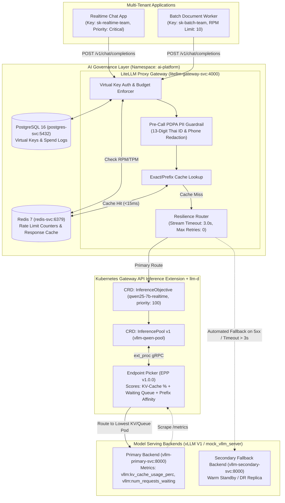

# บทที่ 4: สถาปัตยกรรม AI Gateway, การจัดเส้นทางอัจฉริยะ และการกำกับดูแลระบบหลายผู้เช่า (AI Gateway, Intelligent Routing & Multi-Tenant Governance)

> **Milestone M4 (สัปดาห์ที่ 7–8):** สร้างชั้นควบคุมกลาง (**Centralized AI Gateway Control Plane**) ด้วย **`LiteLLM Proxy`** และ **Kubernetes Gateway API Inference Extension (`InferencePool` v1, `llm-d` `InferenceObjective`, Endpoint Picker - EPP)** เพื่อบังคับใช้โควตา RPM/TPM รายทีม (Virtual Keys), แคชคำตอบด้วย Redis, คัดกรองข้อมูลส่วนบุคคลตามกฎหมาย PDPA (เลขบัตรประชาชนไทย 13 หลักและเบอร์โทรศัพท์) ตามมาตรฐาน OWASP LLM Top 10 (2025), และสลับเส้นทางอัตโนมัติ (Automated Failover) เมื่อเอ็นจินหลักเกิดความหน่วงสูงหรือล่ม

---

## สารบัญ (Table of Contents)

1. [Executive Summary & Learning Objectives](#1-executive-summary--learning-objectives)
2. [Architecture Overview](#2-architecture-overview)
3. [Core Theory & Deep-Dive Engineering Math](#3-core-theory--deep-dive-engineering-math)
4. [Hands-on Lab (Dual-Path Execution)](#4-hands-on-lab-dual-path-execution)
5. [Chaos & Troubleshooting Drills](#5-chaos--troubleshooting-drills)
6. [Optimization Exercise](#6-optimization-exercise)
7. [Architecture Decision Record (ADR) & Cost/Handoff Documentation](#7-architecture-decision-record-adr--costhandoff-documentation)
8. [Mid-Level Interview Trade-off Questions & Model Answers](#8-mid-level-interview-trade-off-questions--model-answers)
9. [ตรวจสอบความสำเร็จของบทที่ 4 (Verification Command)](#9-ตรวจสอบความสำเร็จของบทที่-4-verification-command)

---

## 1. Executive Summary & Learning Objectives

ในบทที่ 3 เราได้ปรับจูน `vLLM` V1 Engine จนสามารถทำความเร็วได้ถึง `1,450 tokens/sec` บนการ์ด NVIDIA L4 1 ใบ อย่างไรก็ตาม ในองค์กรที่มีหลายทีม (เช่น ทีมแชตบอตลูกค้า `realtime-team` และทีมประมวลผลเอกสารหลังบ้าน `batch-team`) การอนุญาตให้แอปพลิเคชันของแต่ละทีมยิง HTTP Request ตรงไปที่ `http://vllm-primary-svc:8000` โดยตรงจะทำให้เกิดความล้มเหลวเชิงระบบ 4 ประการทันที:

1. **ปัญหาเพื่อนบ้านส่งเสียงดัง (Noisy Neighbor & Token Starvation):** หากทีม `batch-team` รันสคริปต์สรุปเอกสาร 5,000 ฉบับพร้อมกัน คิว `vllm:num_requests_waiting` จะเต็มทันที ทำให้ลูกค้าจริงที่ใช้งานผ่าน `realtime-team` ต้องรอคิวนานเกิน SLA หรือเกิด Timeout ทั้งระบบ
2. **ความไร้เดียงสาของ Load Balancer แบบดั้งเดิม (KV-Cache Blindness in Round-Robin / Least-Connections):** Kubernetes `Service` มาตรฐาน (`kube-proxy`) หรือ Ingress ทั่วไปกระจายโหลดแบบ Round-Robin โดยไม่รู้เลยว่า Pod ที่ 1 กำลังประมวลผลคำขอที่มี Context ยาว 4,096 โทเคนจน `vllm:kv_cache_usage_perc` พุ่งแตะ `98%` ในขณะที่ Pod ที่ 2 เพิ่งประมวลผลคำขอสั้นๆ เสร็จและมี KV-Cache ว่างถึง `85%`
3. **ความเสี่ยงด้านกฎหมายคุ้มครองข้อมูลส่วนบุคคล (PDPA / PII Data Leakage):** ผู้ใช้มักเผลอพิมพ์เลขบัตรประจำตัวประชาชนไทย 13 หลัก หรือหมายเลขโทรศัพท์มือถือลงในช่องแชต หากไม่มีชั้น Pre-call Guardrail คอยตรวจจับและแปลงเป็น `<THAI_ID_REDACTED>` ก่อนส่งเข้าโมเดลหรือส่งออกไปยัง Cloud API ภายนอก องค์กรจะมีความผิดตาม พ.ร.บ. คุ้มครองข้อมูลส่วนบุคคล (PDPA) และขัดต่อมาตรฐาน **OWASP Top 10 for LLM Applications (2025)**
4. **จุดเดียวที่ทำให้ระบบล่ม (Single Point of Failure & Retry Storms):** เมื่อ `vllm-primary-svc` เกิดอาการค้าง (Blackhole / Latency Spike) หากไคลเอนต์แต่ละตัวตั้งค่า Retry กันเองโดยไม่มีการควบคุม (Uncoordinated Retries) จะเกิดพายุคำขอซ้ำ (Retry Storm) ที่ถล่มซ้ำเติมคลัสเตอร์จนล่มทั้งหมด

### วัตถุประสงค์การเรียนรู้เชิงสมรรถนะ (Competency Objectives)

เมื่อจบบทเรียนนี้ คุณจะสามารถ:
- ออกแบบและติดตั้ง **`LiteLLM Proxy`** ร่วมกับ **PostgreSQL** (เก็บ Virtual Keys และงบประมาณรายทีม) และ **Redis** (เก็บ Distributed Rate Limit Counters และ Exact/Semantic Cache) บน Kubernetes
- อธิบายสถาปัตยกรรมและกลไกการให้คะแนนของ **Kubernetes Gateway API Inference Extension** (`InferencePool` `v1`, **`llm-d` `InferenceObjective`** [เดิมคือ `InferenceModel`], และ **Endpoint Picker - EPP**) ที่อ่านเมทริกซ์ `vllm:kv_cache_usage_perc` และ `vllm:num_requests_waiting` เพื่อเลือก Pod ที่เหมาะสมที่สุด
- เขียนและทดสอบระบบคัดกรองข้อมูลส่วนบุคคล (**PDPA PII Masking Guardrail**) ที่ตรวจสอบเลขบัตรประชาชนไทย 13 หลัก (พร้อมสมการตรวจสอบ Checksum Modulo-11) และเบอร์โทรศัพท์ไทย
- สร้างและรัน **`mock_vllm_server`** (เซิร์ฟเวอร์จำลองการสตรีม SSE ที่ใช้ RAM น้อยกว่า `80 MB` ต่อ Pod และส่งออก Prometheus V1 metrics ครบทุกตัว) เพื่อจำลองการทำ Multi-Replica Failover และ Chaos Testing บนเครื่อง Local 16GB RAM ได้โดยไม่เกิด OOM
- เขียนชุดทดสอบอัตโนมัติ (`tests/test_gateway_resilience.py`) เพื่อพิสูจน์การทำงานของ Rate Limit (`HTTP 429`), PII Redaction (`<THAI_ID_REDACTED>`), Cache Hit, และ Primary-to-Secondary Automated Failover ภายในเวลา `< 3.5 วินาที`

---

## 2. Architecture Overview

### 2.1 สถาปัตยกรรมระบบเต็มรูปแบบ: `LiteLLM Proxy` + `Kubernetes Gateway API Inference Extension (EPP)`

ในระบบ AI Platform ระดับองค์กร เราแบ่งความรับผิดชอบของชั้น Gateway ออกเป็น 2 เลเยอร์ที่ทำงานประสานกันอย่างชัดเจน:
1. **Business & Governance Gateway Layer (`LiteLLM Proxy` บนพอร์ต `4000`):** รับผิดชอบด้านการยืนยันตัวตนด้วย Virtual Key (`sk-realtime-...`, `sk-batch-...`), การจำกัดโควตา RPM/TPM รายทีม, การทำ PDPA PII Masking, การทำ Response Caching บน Redis, และการทำ Cross-Deployment Failover (เช่น สลับจากคลัสเตอร์หลัก `vllm-primary-svc:8000` ไปยังคลัสเตอร์สำรอง `vllm-secondary-svc:8000`)
2. **Inference-Aware Load Balancing Layer (`Gateway API Inference Extension / EPP`):** รับผิดชอบการจัดเส้นทางระดับ Pod-to-Pod ภายในกลุ่ม `InferencePool` เดียวกัน โดยอ่านค่าความหนาแน่นของ KV-Cache, คิวรอ, และ Prefix Cache Affinity จากแต่ละ Pod



### 2.2 กลไกการทำงานของ Kubernetes Gateway API Inference Extension (`InferencePool` v1, `InferenceObjective`, และ `EPP`)

ทำไม Kubernetes `Service` มาตรฐานถึงไม่เพียงพอสำหรับเวิร์กโหลด LLM?
ในเว็บแอปพลิเคชันทั่วไป คำขอ HTTP แต่ละรายการใช้เวลาประมวลผลใกล้เคียงกัน (เช่น 10–50 ms) และใช้หน่วยความจำน้อยมาก แต่ในระบบเสิร์ฟ LLM:
- คำขอที่ 1 อาจเป็นคำถามสั้นๆ 20 โทเคน ใช้เวลา 150 ms
- คำขอที่ 2 อาจแนบเอกสารสัญญา 4,000 โทเคนและสั่งเขียนโค้ดยาว 1,000 โทเคน ใช้เวลา 18 วินาทีและกินพื้นที่ KV-Cache บนการ์ดจอไปกว่า 280 MB

โครงการมาตรฐานของชุมชน Kubernetes ชื่อ **Gateway API Inference Extension (`v1`)** และโปรเจกต์ **`llm-d`** จึงแยกหน้าที่ผ่าน Custom Resource Definitions (CRDs) 2 ตัว และคอมโพเนนต์การจัดเส้นทางอัจฉริยะ 1 ตัว:

1. **`InferenceObjective` (`llm-d.ai/v1`, พัฒนาต่อจาก `InferenceModel` `v1alpha2` เดิม):**
   - ผูกนโยบายลำดับความสำคัญของเวิร์กโหลดเข้ากับ `poolRefs` โดยใช้ค่า **`priority`** แบบมีเครื่องหมาย (Signed Priority):
     - **`priority: 100` (บวก = Critical):** สำหรับทราฟฟิก `realtime-team` ที่ต้องได้รับบริการเสมอ
     - **`priority: -10` (ลบ = Sheddable):** สำหรับทราฟฟิก `batch-team` ซึ่งหากคลัสเตอร์มีค่า `vllm:kv_cache_usage_perc` ทะลุเกณฑ์วิกฤต (เช่น `> 85%`) ตัว EPP จะปฏิเสธคำขอระดับ Sheddable ทันที (Load Shedding) เพื่อสงวนพื้นที่ KV-Cache ไว้ให้คำขอระดับ Critical!
2. **`InferencePool` (`inference.networking.k8s.io/v1` — ทีมแพลตฟอร์มเป็นผู้กำหนด):**
   - จัดกลุ่ม Pod ของ `vLLM` ที่เสิร์ฟโมเดลพื้นฐานตัวเดียวกันเข้าด้วยกัน และผูกเข้ากับบริการ **Endpoint Picker (EPP)**
3. **Endpoint Picker (`EPP` — ExtProc Filter):**
   - ทำงานเป็น External Processing (`ext_proc`) ร่วมกับ Envoy / Gateway โดยคอยดึงค่า Prometheus metrics จากทุก Pod ใน `InferencePool` ทุกๆ 50–200 มิลลิวินาที ได้แก่:
     - `vllm:kv_cache_usage_perc` (สัดส่วนการใช้พื้นที่ KV-Cache 0.0–1.0)
     - `vllm:num_requests_waiting` (จำนวนคำขอที่ติดคิวรอ)
     - ตาราง Prefix Cache Hash ของแต่ละ Pod เพื่อส่งคำขอที่มี System Prompt เดียวกันไปยัง Pod ที่มีบล็อกนั้นแคชไว้แล้ว (**Prefix-Cache-Aware Affinity Routing**)

---

## 3. Core Theory & Deep-Dive Engineering Math

### 3.1 สมการการให้คะแนนของ Endpoint Picker (EPP Routing Score Math)

เมื่อคำขอใหม่เข้ามาที่ Gateway ตัว **Endpoint Picker (EPP)** จะคำนวณคะแนนความเหมาะสม $S(i)$ ของแต่ละ Pod $i \in \{1, \dots, N\}$ ใน `InferencePool` โดยผสมผสานปัจจัยทั้ง 3 ด้านเข้าด้วยกัน:

$$S(i) = w_{\text{prefix}} \cdot \text{HitRatio}_i(\text{prompt}) - w_{\text{queue}} \cdot \left(\frac{Q_i}{Q_{\text{max}}}\right) - w_{\text{kv}} \cdot K_i$$

โดยที่:
- $\text{HitRatio}_i(\text{prompt}) \in [0, 1]$ คือสัดส่วนของบล็อกใน Prompt ที่มีอยู่แล้วใน Prefix Cache ของ Pod $i$
- $Q_i = \texttt{vllm:num\_requests\_waiting}_i$ คือจำนวนคำขอที่รอคิวอยู่ใน Pod $i$ (หารด้วยค่าอ้างอิง $Q_{\text{max}}$ เช่น $32$)
- $K_i = \texttt{vllm:kv\_cache\_usage\_perc}_i \in [0, 1]$ คือสัดส่วนการใช้พื้นที่ KV-Cache ปัจจุบันของ Pod $i$
- $w_{\text{prefix}}, w_{\text{queue}}, w_{\text{kv}}$ คือน้ำหนักความสำคัญ (เช่น $w_{\text{prefix}} = 2.0, w_{\text{queue}} = 3.0, w_{\text{kv}} = 2.5$)

> [!NOTE]
> สมการ $S(i)$ ข้างต้นเป็น **โมเดลเชิงประกอบการศึกษา (Instructional Composite Heuristic)** ที่สรุปพฤติกรรมของ Pluggable Scorer ใน **Gateway API Inference Extension (GAIE) Endpoint Picker (`epp`)** ซึ่งในโปรเจกต์จริงใช้ Pipeline ของ Scorer และ Filter หลายตัวที่ปรับจูนน้ำหนักได้แยกกัน (เช่น Prefix Cache Scorer, Queue Depth Scorer, และ KV-Cache Utilization Scorer)

#### ตัวอย่างการคำนวณเปรียบเทียบระหว่าง Round-Robin กับ EPP
สมมติว่ามีคำขอ RAG ที่มี System Prompt ยาว 2,048 โทเคนเข้ามา โดยมี Pod 2 ตัวดังนี้:
- **Pod 1:** เพิ่งรับคำขอใหญ่เข้าไปจนคิวรอ $Q_1 = 16$ คำขอ ($Q_1 / 32 = 0.50$), ใช้พื้นที่ KV-Cache ไปแล้ว $K_1 = 0.90$ ($90\%$), และมี Prefix Cache Hit $\text{HitRatio}_1 = 0.80$
  $$S(1) = 2.0(0.80) - 3.0(0.50) - 2.5(0.90) = 1.60 - 1.50 - 2.25 = \mathbf{-2.15}$$
- **Pod 2:** มีคิวรอ $Q_2 = 0$ คำขอ, ใช้พื้นที่ KV-Cache เพียง $K_2 = 0.20$ ($20\%$), และมี Prefix Cache Hit $\text{HitRatio}_2 = 0.80$
  $$S(2) = 2.0(0.80) - 3.0(0.00) - 2.5(0.20) = 1.60 - 0.00 - 0.50 = \mathbf{+1.10}$$

หากใช้ Round-Robin คำขอนี้อาจถูกส่งไปหา **Pod 1** ซึ่งกำลังจะเกิด Preemption Thrashing ทันที แต่ **EPP** จะเลือก **Pod 2** ($S(2) = +1.10 > S(1) = -2.15$) ทำให้คำขอนี้ได้ทั้ง Prefix Cache Hit และไม่ต้องรอคิว!

### 3.2 คณิตศาสตร์ความคุ้มค่าของ Response Caching บน AI Gateway (Cache Hit Savings Math)

นอกจากการทำ Prefix Caching ระดับบล็อกภายใน `vLLM` แล้ว การทำ **Exact/Semantic Response Caching** ด้วย Redis ที่ชั้น `LiteLLM Proxy` ช่วยให้คำถามที่ซ้ำกัน 100% (เช่น คำถามพบบ่อย FAQ, การตรวจสอบสถานะมาตรฐาน, หรือการรันชุดทดสอบซ้ำ) สามารถตอบกลับจาก Redis ได้ทันทีภายในเวลา **$L_{\text{cache}} \approx 5\text{ ms}$** โดยไม่ต้องเรียกใช้ GPU เลยแม้แต่น้อย

กำหนดให้:
- $h \in [0, 1]$ = อัตราการเกิด Gateway Cache Hit (เช่น $h = 0.25$ หรือ $25\%$)
- $L_{\text{GPU}}$ = เวลาแฝงเฉลี่ยเมื่อประมวลผลผ่าน GPU (เช่น TTFT `640 ms`)
- $C_{\text{GPU}}$ = ต้นทุนต่อ 1 ล้านโทเคนเมื่อรันบน GPU (เช่น `$0.33 / 1M tokens` จากบทที่ 3)

เราสามารถคำนวณ **เวลาแฝงเฉลี่ยสุทธิ ($L_{\text{eff}}$)** และ **ความจุคลัสเตอร์ที่เพิ่มขึ้นสุทธิ ($T_{\text{eff}}$)** ได้ดังนี้:
$$L_{\text{eff}} = h \cdot L_{\text{cache}} + (1 - h) \cdot L_{\text{GPU}}$$
$$T_{\text{eff}} = \frac{T_{\text{GPU}}}{1 - h}, \qquad C_{\text{eff}} = (1 - h) \cdot C_{\text{GPU}} + C_{\text{Redis\_overhead}}$$

**ตัวอย่างตัวเลขจริง:** ที่อัตรา Cache Hit $h = 0.25$ ($25\%$):
- เวลาแฝงเฉลี่ยลดลงจาก $640\text{ ms}$ เหลือ:
  $$L_{\text{eff}} = 0.25(5\text{ ms}) + 0.75(640\text{ ms}) = 1.25 + 480 = \mathbf{481.25\text{ ms}}\text{ (เร็วขึ้น 24.8\%)}$$
- คลัสเตอร์การ์ด L4 ที่เคยรับได้ $1,450\text{ tokens/sec}$ จะรองรับปริมาณงานระดับแอปพลิเคชันได้เพิ่มขึ้นเป็น:
  $$T_{\text{eff}} = \frac{1,450}{1 - 0.25} = \mathbf{1,933.3\text{ tokens/sec}}\text{ (+33.3\% Capacity โดยไม่ต้องซื้อการ์ดจอเพิ่ม)}$$

### 3.3 คณิตศาสตร์พายุการลองซ้ำ (Retry Amplification Math) และการตั้งค่า Failover อย่างปลอดภัย

ในสถาปัตยกรรมที่มีหลายเลเยอร์ (Client SDK → API Gateway → Service Mesh → Backend) หากแต่ละเลเยอร์ตั้งค่า `max_retries = 3` ซ้อนกันโดยไม่ประสานงานกัน (Nested Retries) เมื่อ Backend เกิดความหน่วงชั่วขณะ จำนวนคำขอที่กระแทกใส่ GPU จะทวีคูณแบบเลขชี้กำลัง:
$$M_{\text{nested}} = \prod_{k=1}^{L} (1 + R_k)$$
เช่น หากทั้ง Client SDK ($R_1 = 3$), LiteLLM Gateway ($R_2 = 3$), และ Envoy ($R_3 = 3$) ต่างทำ Retry ของตัวเอง คำขอที่ล้มเหลว 1 รายการจะขยายตัวกลายเป็น $(1+3) \times (1+3) \times (1+3) = \mathbf{64\text{ คำขอ}}$ ถล่มใส่คลัสเตอร์ GPU ทันที!

#### กฎการออกแบบ Failover สำหรับ AI Gateway (Anti-Retry-Storm Design)
1. **ทำ Failover แบบ Single Attempt ที่ชั้น AI Gateway (`LiteLLM Proxy`):** บังคับให้ Client SDK ตั้ง `max_retries = 0` และตั้ง **`num_retries: 0`** ใน `router_settings` เพื่อให้ทันทีที่ Primary หมดเวลา **`stream_timeout: 3.0s`** ระบบจะตัดสายและส่งต่อไปยังกลุ่มสำรอง (`fallbacks: [{"qwen2.5-7b": ["qwen2.5-7b-secondary"]}, {"qwen2.5-7b-batch": ["qwen2.5-7b-secondary"]}]`) โดยไม่เสียเวลารอ Timeout ซ้ำอีกรอบบน Pod ที่กำลังค้าง! (หากตั้ง `num_retries: 1` การส่งซ้ำจะใช้เวลา $> 6$ วินาทีก่อนถึง Fallback)
2. **กำหนดงบประมาณการลองซ้ำ (Retry Budget):** หากอัตราส่วนของคำขอที่เป็นการ Retry เกิน $10\%$ ของทราฟฟิกทั้งหมด หรือ Backend หลักล้มเหลวติดต่อกันเกิน `allowed_fails: 3` ภายใน 60 วินาที ให้เปิด **Circuit Breaker (`cooldown_time: 30`)** เพื่อส่งทราฟฟิกตรงไปยัง `vllm-secondary-svc` ทันทีโดยไม่ต้องเสียเวลารอ Timeout ซ้ำ
3. **แยก `stream_timeout` (TTFT Timeout) ออกจาก `timeout` รวม:** ในการสตรีมคำตอบ LLM การสร้างคำตอบทั้งหมดอาจใช้เวลา 15 วินาที แต่โทเคนแรก (TTFT) ต้องมาภายใน **3.0 วินาที** ดังนั้นใน `litellm_config.yaml` เราจึงตั้ง `stream_timeout: 3.0` เพื่อให้สลับไปหาเรพลิกาสำรองทันทีหากเรพลิกาหลักไม่ส่งโทเคนแรกออกมาภายใน 3 วินาที!

### 3.4 คณิตศาสตร์การตรวจสอบเลขบัตรประชาชนไทย 13 หลัก (PDPA PII Masking & OWASP LLM Top 10 2025)

ตามมาตรฐาน **OWASP Top 10 for LLM Applications (2025)** ความเสี่ยงอันดับต้นๆ ได้แก่ **LLM02:2025 Sensitive Information Disclosure** (การที่ข้อมูลส่วนบุคคลหลุดเข้าไปในโมเดลหรือแคช) และ **LLM10:2025 Unbounded Consumption** (การถูกโจมตีจนทรัพยากรเต็มหรือค่าใช้จ่ายบานปลาย)

สำหรับประเทศไทย ข้อมูลส่วนบุคคลที่สำคัญที่สุดตาม **พ.ร.บ. คุ้มครองข้อมูลส่วนบุคคล (PDPA)** คือ **เลขประจำตัวประชาชนไทย 13 หลัก** ($d_1 d_2 d_3 d_4 d_5 d_6 d_7 d_8 d_9 d_{10} d_{11} d_{12} d_{13}$) และหมายเลขโทรศัพท์มือถือ 10 หลัก (`06x`, `08x`, `09x`)

#### อัลกอริทึมและสมการ Modulo-11 ของเลขบัตรประชาชนไทย 13 หลัก
เพื่อให้ตัวกรอง PII มีความแม่นยำสูงและอธิบายหลักการตรวจสอบได้ครบถ้วน โครงสร้างเลขบัตรประชาชนไทย 13 หลักมีหลักที่ 13 ($d_{13}$) เป็นหลักตรวจสอบ (Check Digit) ที่คำนวณจาก 12 หลักแรกตามสมการ:
$$S = \sum_{i=1}^{12} d_i \times (14 - i)$$
$$d_{13} = \bigl(11 - (S \bmod 11)\bigr) \bmod 10$$

**ตัวอย่างการคำนวณจริง:** สมมติเลข 12 หลักแรกคือ `1-1007-01234-56-?`
1. คูณแต่ละหลักด้วยน้ำหนัก $13, 12, \dots, 2$:
   $$S = (1\times13) + (1\times12) + (0\times11) + (0\times10) + (7\times9) + (0\times8) + (1\times7) + (2\times6) + (3\times5) + (4\times4) + (5\times3) + (6\times2)$$
   $$S = 13 + 12 + 0 + 0 + 63 + 0 + 7 + 12 + 15 + 16 + 15 + 12 = 165$$
2. หาเศษจากการหารด้วย 11:
   $$165 \bmod 11 = 0$$
3. คำนวณหลักที่ 13 ($d_{13}$):
   $$d_{13} = (11 - 0) \bmod 10 = 11 \bmod 10 = \mathbf{1}$$
   ดังนั้นเลขบัตรที่ถูกต้องตาม Checksum คือ `1-1007-01234-56-1`

ในชั้น Pre-call Guardrail ของ AI Gateway เราใช้การตรวจจับเชิงป้องกัน (Defense-in-Depth):
- ใช้นิพจน์เรกูลาร์ (Regex) ที่รองรับทั้งรูปแบบพิมพ์ติดกัน 13 หลัก (`\b[1-8]\d{12}\b`) และรูปแบบมีขีดคั่น (`\b[1-8]-\d{4}-\d{5}-\d{2}-\d\b`) เพื่อแปลงตัวเลข 13 หลักทุกชุดที่เข้าข่ายให้เป็น **`<THAI_ID_REDACTED>`** ทันที (ป้องกันทั้งเลขบัตรจริงและเลขบัตรที่ผู้ใช้พิมพ์ผิดไป 1 หลักไม่ให้หลุดเข้าสู่ LLM หรือ Log — พร้อมทางเลือกพารามิเตอร์ `strict_checksum=True` บน `PDPAPIIMasker.mask_text` ในกรณีที่ระบบมีเลขบัญชี/เลขอ้างอิง 13 หลักที่ไม่ใช่เลขบัตรประชาชน)
- ใช้ Regex รองรับทั้งเบอร์ในประเทศและรหัสประเทศ (`06x`/`08x`/`09x` และ `+66`/`66`) เพื่อแปลงเบอร์โทรศัพท์มือถือไทยให้เป็น **`<THAI_PHONE_REDACTED>`**
- รองรับการคัดกรองทั้งข้อความธรรมดา (`str`), OpenAI Multimodal Content Parts (`[{"type": "text", ...}]`), และรักษาค่า `content: None` ของ Tool Call ไว้อย่างถูกต้องโดยไม่แปลงเป็น `"None"`

---

## 4. Hands-on Lab (Dual-Path Execution)

แล็บในบทที่ 4 ออกแบบให้คุณสามารถทดสอบระบบ AI Gateway, การจำกัดโควตา RPM/TPM, การทำ PDPA PII Redaction, และการสลับเส้นทางอัตโนมัติ (Primary → Secondary Failover) ได้ 100% บนเครื่อง Local 16GB RAM โดยใช้เซิร์ฟเวอร์จำลองความเร็วสูง **`mock_vllm_server`** ที่กิน RAM น้อยกว่า `80 MB` ต่อโปรเซส และส่งออก Prometheus metrics ตรงตาม `vLLM` V1 ทุกประการ

### 4.1 โครงสร้างไฟล์ใน `labs/m4-gateway/`

```text
labs/m4-gateway/
├── .env.example                                    # เทมเพลต Secret (VLLM_API_KEY, LITELLM_MASTER_KEY, LITELLM_SALT_KEY, DATABASE_URL)
├── mock_vllm_server/
│   ├── __init__.py
│   ├── app.py                                      # เซิร์ฟเวอร์จำลอง vLLM V1 (<80MB RAM, SSE Streaming, Chaos Injection, V1 Metrics)
│   ├── pdpa_guardrail.py                           # โมดูล Single Source of Truth สำหรับ PDPA Masking (+66, Multimodal, Checksum) และ LiteLLM Callback
│   └── Dockerfile                                  # Multi-stage Docker build ด้วย uv (UID 10001, HF_HOME=/cache/huggingface)
├── litellm_config.yaml                             # ไฟล์ตั้งค่า LiteLLM Proxy (qwen2.5-7b, qwen2.5-7b-batch, num_retries: 0, Redis Cache, PDPA)
├── k8s/
│   ├── gateway-stack.yaml                          # Core K8s Stack 14 Docs (Mock vLLM, LiteLLM+ConfigMap+InitJob, Redis, Postgres+PVC/Probe)
│   ├── inference-extension-v1.yaml                 # GAIE v1 & llm-d CRDs 8 Docs (EPP v1.0.0 + RBAC, InferencePool v1, InferenceObjective)
│   ├── network-policies.yaml                       # Zero-Trust NetworkPolicies (กั้น Traffic ตรงเข้า vLLM/Redis/Postgres)
│   ├── litellm-ha-patch.yaml                       # Optional HA Patch (LiteLLM 2 replicas + PDB สำหรับ 32GB/Prod)
│   └── gateway-api-route.yaml                      # Optional Overlay: Gateway + HTTPRoute (inference.networking.k8s.io) + ServiceMonitor (release: monitoring)
├── tests/
│   └── test_gateway_resilience.py                  # ชุดทดสอบอัตโนมัติ (Rate Limit 429, Thai ID/Phone/Multimodal Redaction, Cache Hit, Failover)
├── docs/
│   └── adr-003-ai-gateway-and-inference-routing.md # เอกสารการตัดสินใจทางสถาปัตยกรรมฉบับที่ 3 (ADR-003)
└── verify_m4.sh                                    # สคริปต์ตรวจวัดผลอัตโนมัติประจำบทที่ 4 (VERIFY_MODE=static|cluster)
```

---

### Path A: No-GPU Local Path (\$0 — รันด้วย `mock_vllm_server` บนเครื่อง Local 16GB RAM)

> [!IMPORTANT]
> **ทำไมเราจึงใช้ `mock_vllm_server` ในบทที่ 4–6 บนเครื่อง Local?**
> ในบทที่ 4 เราต้องรัน Backend อย่างน้อย **2 เรพลิกาพร้อมกัน** (`vllm-primary-svc:8000` และ `vllm-secondary-svc:8000`) ร่วมกับ Gateway, Redis, และ Postgres หากเราโหลดโมเดล `vLLM` จริง 2 Pod บนเครื่อง Local 16GB RAM เครื่องจะเกิด OOM ทันที ดังนั้นเราจึงสร้าง `labs/m4-gateway/mock_vllm_server/app.py` ซึ่งจำลองพฤติกรรม OpenAI `/v1/chat/completions` (ทั้งแบบ JSON ปกติและ SSE Streaming), จำลองความหน่วง TTFT/ITL, รองรับการฉีดความล้มเหลว (`/admin/chaos`), และส่งออก Prometheus V1 metrics ครบชุดตรงตาม `vLLM` V1 ในบทที่ 3 (`vllm:kv_cache_usage_perc`, `vllm:num_requests_running`, `vllm:num_requests_waiting`, `vllm:prefix_cache_hits_total`, `vllm:prefix_cache_queries_total`, `vllm:num_preemptions_total`, `vllm:time_to_first_token_seconds_bucket`, `vllm:inter_token_latency_seconds_bucket` พร้อม Alias `vllm:time_per_output_token_seconds_bucket`, และ `vllm:generation_tokens_total`) โดยใช้ RAM น้อยกว่า `80 MB`!

#### ขั้นตอนที่ 1: ตรวจสอบไฟล์ตั้งค่า `litellm_config.yaml` และ Kubernetes Manifests (`k8s/gateway-stack.yaml`)

ตรวจสอบการกำหนดค่าโมเดลหลัก-สำรอง, โควตารายทีม, และ PDPA Guardrail ใน `labs/m4-gateway/litellm_config.yaml` (รันจากรากของคลังโค้ด):

```bash
head -n 85 labs/m4-gateway/litellm_config.yaml
```

สังเกตจุดสำคัญใน `litellm_config.yaml`:
1. **`model_list`** กำหนดกลุ่มโมเดลหลัก `qwen2.5-7b` (`120 RPM`) และกลุ่ม `qwen2.5-7b-batch` (`10 RPM`, `25,000 TPM`) ชี้ไปที่ `http://vllm-primary-svc.ai-platform.svc.cluster.local:8000/v1` และกลุ่มโมเดลสำรอง `qwen2.5-7b-secondary` ชี้ไปที่ `http://vllm-secondary-svc.ai-platform.svc.cluster.local:8000/v1` (โดย Pod สำรองใช้ Label `inference-pool: vllm-qwen-pool-secondary` แยกจาก `vllm-qwen-pool` ของ Primary เพื่อไม่ให้ EPP ส่งทราฟฟิกปกติไปปะปนใน DR Warm-Standby)
2. **`router_settings`** ตั้งค่า `fallbacks` ให้ทั้ง `qwen2.5-7b` และ `qwen2.5-7b-batch` สลับไป `qwen2.5-7b-secondary`, `timeout: 10.0`, `stream_timeout: 3.0`, **`num_retries: 0`** (Failover ทันทีหลัง `stream_timeout`), และ `cooldown_time: 30`
3. **`litellm_settings` & `general_settings`** เปิดใช้งาน `cache: true` ผ่าน `redis-svc:6379`, เปิด `require_auth_for_metrics_endpoint: false` เพื่อให้บริการ Prometheus ดูด `/metrics`, และลงทะเบียน Custom Guardrail Callback **`callbacks: ["pdpa_guardrail.proxy_handler_instance"]`** (ซึ่งโหลดโมดูล `pdpa_guardrail.py` จาก Kubernetes ConfigMap `litellm-config`) ส่วนค่า Secret ทั้งหมด (`LITELLM_MASTER_KEY`, `LITELLM_SALT_KEY`, `DATABASE_URL`, `POSTGRES_USER`, `POSTGRES_PASSWORD`) สร้างนอก Git จาก `labs/m4-gateway/.env.example` เข้า Kubernetes `Secret` ชื่อ `litellm-secrets`

#### ขั้นตอนที่ 2: รันชุดทดสอบความทนทานของ Gateway และ `mock_vllm_server` ด้วย `pytest`

เราได้เตรียมชุดทดสอบอัตโนมัติใน `labs/m4-gateway/tests/test_gateway_resilience.py` ซึ่งทดสอบครบทั้ง 5 มิติผ่านตัวจำลองออฟไลน์ `GatewayResilienceRouter`:
1. การส่งออก Prometheus V1 metrics ของ `mock_vllm_server` (`vllm:kv_cache_usage_perc`, `vllm:num_requests_waiting`, `vllm:prefix_cache_hits_total`, `vllm:inter_token_latency_seconds_bucket`)
2. การคัดกรองเลขบัตรประชาชนไทย 13 หลัก (`1100701234561` และ `1-1007-01234-56-1`, รวมถึงตัวเลือก `strict_checksum=True` และข้อความ Multimodal) ให้กลายเป็น `<THAI_ID_REDACTED>` และเบอร์โทรศัพท์ไทย (ทั้ง `08x` และ `+66`) เป็น `<THAI_PHONE_REDACTED>` ก่อนส่งถึง Backend
3. การบังคับใช้โควตา Rate Limit รายทีม เมื่อทีม `batch-team` ส่งคำขอเกินขีดจำกัด RPM จะได้รับ `HTTP 429 Too Many Requests` ทันทีโดยไม่กระทบทีม `realtime-team`
4. การทำงานของ Response Cache ในตัวจำลอง `GatewayResilienceRouter` (คำขอซ้ำครั้งที่ 2 ได้รับเฮดเดอร์ตรวจวัดจาก Simulator คือ `X-Sim-Cache-Hit: true` โดยไม่เรียก Backend ซ้ำ; *หมายเหตุ:* ในคลัสเตอร์ `LiteLLM Proxy` จริงให้สังเกตการตอบจาก Gateway Cache/Logs หรือ Header ของผู้ให้บริการแทน `X-Sim-*` ซึ่งเป็น Inspection Header เฉพาะชุดทดสอบออฟไลน์)
5. การสลับเส้นทางอัตโนมัติ (Automated Failover) เมื่อฉีด Chaos ให้ `vllm-primary-svc` ค้างเกิน `stream_timeout` (หรือคืนค่า HTTP 503) ระบบจะสลับไปรับคำตอบจาก `vllm-secondary-svc` โดยอัตโนมัติ

รันคำสั่งทดสอบทันที:

```bash
./scripts/pytest labs/m4-gateway/tests/test_gateway_resilience.py -v
```

**ผลลัพธ์ที่คาดหวัง (Expected Output เมื่อติดตั้ง `pytest` หรือผ่านตัวรัน Stdlib Fallback):**
```text
============================= test session starts ==============================
collected 7 items

labs/m4-gateway/tests/test_gateway_resilience.py::test_automated_failover_on_primary_latency_spike PASSED [ 14%]
labs/m4-gateway/tests/test_gateway_resilience.py::test_cumulative_histogram_buckets_and_routes PASSED [ 28%]
labs/m4-gateway/tests/test_gateway_resilience.py::test_epp_kv_cache_aware_scoring PASSED [ 42%]
labs/m4-gateway/tests/test_gateway_resilience.py::test_gateway_exact_cache_hit PASSED [ 57%]
labs/m4-gateway/tests/test_gateway_resilience.py::test_mock_vllm_v1_prometheus_metrics PASSED [ 71%]
labs/m4-gateway/tests/test_gateway_resilience.py::test_pdpa_thai_id_and_phone_redaction PASSED [ 85%]
labs/m4-gateway/tests/test_gateway_resilience.py::test_tenant_rate_limiting_http_429 PASSED [100%]

============================== 7 passed in 0.39s ===============================
```

#### ขั้นตอนที่ 3: ดีพลอย Gateway Stack ลงบนคลัสเตอร์ Kubernetes (`kind`)

หากคลัสเตอร์ `ai-platform-local` รันอยู่ ให้ทำตามลำดับดังนี้ (แยก Core Stack ออกจาก CRD Manifests เพื่อไม่ให้พังหากยังไม่ได้ลง CRDs):
1. สร้างและโหลดอิมเมจ `mock-vllm-server:1.0.0` (Non-root UID `10001`, `HF_HOME=/cache/huggingface`, `readOnlyRootFilesystem: true`) และสร้าง Secret `litellm-secrets` แล้ว Apply Core Stack (`k8s/gateway-stack.yaml`) + Zero-Trust `k8s/network-policies.yaml` (+ `k8s/litellm-ha-patch.yaml` สำหรับเครื่อง 32GB RAM)
2. ติดตั้ง CRDs ของ **Gateway API Inference Extension (`v1.0.0`)** และ **`llm-d` `InferenceObjective`** แล้วจึง Apply `k8s/inference-extension-v1.yaml` (อัปเกรดจาก `InferenceModel` `v1alpha2` เดิมเป็น `InferencePool v1` + `InferenceObjective`) และ `k8s/gateway-api-route.yaml` (ใช้ `release: monitoring`)

```bash
docker build -t mock-vllm-server:1.0.0 -f labs/m4-gateway/mock_vllm_server/Dockerfile labs/m4-gateway
kind load docker-image mock-vllm-server:1.0.0 --name ai-platform-local

cp labs/m4-gateway/.env.example labs/m4-gateway/.env
# แก้ไขค่า Secret ใน labs/m4-gateway/.env ก่อน Apply ขึ้นคลัสเตอร์
kubectl create namespace ai-platform --dry-run=client -o yaml | kubectl apply -f -
kubectl create secret generic litellm-secrets -n ai-platform --from-env-file=labs/m4-gateway/.env

# 1. Core Stack + Zero-Trust NetworkPolicies (ไม่พึ่ง CRDs)
kubectl apply -f labs/m4-gateway/k8s/gateway-stack.yaml
kubectl apply -f labs/m4-gateway/k8s/network-policies.yaml
# (ทางเลือก HA สำหรับเครื่อง 32GB RAM):
# kubectl scale deployment/litellm-gateway -n ai-platform --replicas=2
# kubectl apply -f labs/m4-gateway/k8s/litellm-ha-patch.yaml

# 2. GAIE v1 + llm-d CRDs & Endpoint Picker
# kubectl apply -f https://github.com/kubernetes-sigs/gateway-api-inference-extension/releases/download/v1.0.0/manifests.yaml
# kubectl apply -f labs/m4-gateway/k8s/inference-extension-v1.yaml
# kubectl apply -f labs/m4-gateway/k8s/gateway-api-route.yaml
kubectl get pods,svc,jobs,networkpolicy -n ai-platform
```

---

### Path B: Cloud L4 GPU Path (รันจริงร่วมกับ `vLLM` บนการ์ด NVIDIA L4)

เมื่อรันบนคลัสเตอร์ที่มีโหนด GPU:
1. ให้ `vllm-primary-svc:8000` ชี้ไปยัง Deployment ของ `vLLM` จริงที่รัน `Qwen/Qwen2.5-7B-Instruct-AWQ` จากบทที่ 3
2. ให้ `vllm-secondary-svc:8000` ชี้ไปยังเรพลิกาสำรอง (หรือใช้ `mock_vllm_server` / Managed API Endpoint เป็น Fallback ปลายทาง)
3. ติดตั้งคอนโทรลเลอร์ของ **Gateway API Inference Extension** (`v1.0.0`) และ **`llm-d` `InferenceObjective`** เพื่อให้ `EndpointPicker` อ่านค่า `vllm:kv_cache_usage_perc` และ `vllm:num_requests_waiting` จริงจากพอร์ต `8000/metrics` ของแต่ละ Pod

---

## 5. Chaos & Troubleshooting Drills

ในบทที่ 4 เราฝึกซ้อมรับมือวิกฤตการณ์ (Chaos Drills) 2 รูปแบบที่เกิดขึ้นจริงในระบบ AI Gateway ระดับองค์กร:

### Drill 1: Primary Engine Blackhole / Latency Spike (> 5.0s)

#### สถานการณ์และการฉีดความล้มเหลว (Fault Injection)
เรพลิกาหลัก (`vllm-primary-svc:8000`) เกิดอาการค้างเนื่องจาก GPU HBM ECC Error หรือเกิด Network Partition ทำให้รับ TCP Connection ได้แต่ไม่ส่งโทเคนแรกกลับมาภายใน 5 วินาที (เกินกว่า `stream_timeout: 3.0s`)

เราจำลองเหตุการณ์นี้โดยเปิด `port-forward` ไปยัง `vllm-primary-svc` ก่อน แล้วจึงสั่งเปิดโหมด Chaos ผ่าน HTTP API:
```bash
kubectl port-forward -n ai-platform svc/vllm-primary-svc 8000:8000 &
curl -X POST http://localhost:8000/admin/chaos \
  -H "Content-Type: application/json" \
  -d '{"inject_latency_ms": 5000, "inject_http_503": false, "kv_cache_usage_perc": 0.99}'
```

#### พฤติกรรมของระบบและการตรวจสอบ (Verification & Recovery)
1. เมื่อส่งคำขอเข้าที่ `litellm-gateway-svc:4000` (ผ่าน `kubectl port-forward -n ai-platform svc/litellm-gateway-svc 4000:4000`) ตัว Router จะตรวจพบว่า `vllm-primary-svc` ไม่ส่งโทเคนแรกภายใน `3.0` วินาที (หรือเมื่อตั้ง `inject_http_503: true` จะตรวจพบทันทีก่อนส่ง SSE Stream)
2. ด้วยค่า `num_retries: 0` ตัว Gateway จะตัดการเชื่อมต่อจากเรพลิกาหลักทันที บันทึกความล้มเหลวลงใน Circuit Breaker และสลับไปเรียก `vllm-secondary-svc:8000` โดยอัตโนมัติ (ในชุดทดสอบออฟไลน์ `GatewayResilienceRouter` จะแนบเฮดเดอร์ `X-Sim-Routed-Backend: vllm-secondary-svc` ส่วนบนคลัสเตอร์จริงสามารถตรวจสอบการตอบกลับของเรพลิกาสำรองได้ทั้งจากคำตอบที่สำเร็จโดยไม่เห็น HTTP 500 และ Log ของ `vllm-secondary`)
3. อย่าลืมล้าง Chaos Flag หลังซ้อมเสร็จ (`{"inject_latency_ms": 0, "inject_http_503": false, "kv_cache_usage_perc": 0.1}`) และปิด `port-forward` เบื้องหลังด้วย `kill %1`!

---

### Drill 2: Quota Flood & PDPA Thai National ID Leak Attempt

#### สถานการณ์และการฉีดความล้มเหลว (Fault Injection)
1. สคริปต์ของทีม `batch-team` เกิดบั๊กวนลูปยิงคำขอรัวเกินโควตาที่กำหนดไว้ (`10 RPM`)
2. ผู้ใช้ส่งข้อความแชตที่มีเลขบัตรประชาชนไทย 13 หลักและเบอร์โทรศัพท์:
   `"ช่วยตรวจสอบสถานะสินเชื่อของเลขบัตร 1-1007-01234-56-1 เบอร์โทร 081-234-5678 ให้หน่อยครับ"`

#### พฤติกรรมของระบบและการตรวจสอบ (Verification & Recovery)
1. **การสกัดกั้น Quota Flood:** คำขอที่ 11 เป็นต้นไปของ `batch-team` ในนาทีเดียวกันจะถูกปฏิเสธที่ชั้น Gateway ด้วยรหัส **`HTTP 429 Too Many Requests`** ทันที ในขณะที่คำขอของทีม `realtime-team` (`sk-realtime-team`) ยังคงผ่านเข้าสู่โมเดลได้ตามปกติ 100%
2. **การสกัดกั้นข้อมูลส่วนบุคคล (PDPA PII Redaction):** ก่อนที่ข้อความจะถูกบันทึกลงแคชหรือส่งต่อไปยัง `vllm-primary-svc` โมดูล `PDPAPIIMasker` จะแปลงข้อความให้กลายเป็น:
   `"ช่วยตรวจสอบสถานะสินเชื่อของเลขบัตร <THAI_ID_REDACTED> เบอร์โทร <THAI_PHONE_REDACTED> ให้หน่อยครับ"`
   ทำให้ไม่มีเลขบัตรประชาชน 13 หลักหรือเบอร์โทรศัพท์หลุดเข้าไปใน Prompt ของ LLM หรือ Log ของระบบ

---

## 6. Optimization Exercise

ในโจทย์ข้อนี้ เราจะปรับจูนชั้น AI Gateway และการกระจายโหลดตามกระบวนการ 5 ขั้นตอน (**Baseline → Hypothesis → Fix → Measure → Explain**):

### 1. Baseline (การกระจายโหลดแบบ Round-Robin ไร้แคชและไร้ Timeout Guard)
- **การตั้งค่าเริ่มต้น:** ไคลเอนต์เรียกผ่าน Kubernetes `Service` มาตรฐานแบบ Round-Robin ไปยัง 2 เรพลิกา โดยไม่มี Redis Response Cache, ไม่มีการจำกัด `stream_timeout`, และเมื่อเรพลิกาที่ 1 มี `vllm:kv_cache_usage_perc = 0.95` คำขอครึ่งหนึ่งก็ยังคงถูกส่งไปเข้าคิวรอที่เรพลิกาที่ 1
- **ผลลัพธ์ตั้งต้น (เมื่อมีคำขอซ้ำ 25% และเรพลิกาที่ 1 เกิด Latency Spike 10% ของเวลา):**
  - End-to-End p95 Latency = `4,850 ms`
  - Error / Timeout Rate = `5.2%`
  - อัตราการใช้ GPU ซ้ำซ้อนกับคำถามเดิม = `100%`

### 2. Hypothesis (การตั้งสมมติฐาน)
- **สมมติฐานที่ 1:** การเปิดใช้ **Redis Exact Cache** ที่ชั้น `LiteLLM Proxy` จะตัดภาระคำขอที่ซ้ำกัน 25% ออกไปจาก GPU และตอบกลับได้ภายใน `< 10 ms`
- **สมมติฐานที่ 2:** การใช้ **KV-Cache-Aware Routing (EPP)** ร่วมกับการตั้งค่า `stream_timeout: 3.0s` และ Automated Fallback ไปยัง `vllm-secondary-svc` จะป้องกันไม่ให้คำขอไหลเข้าสู่ Pod ที่ KV-Cache กำลังเต็ม และลดอัตรา Error เมื่อเกิดความหน่วงชั่วขณะลงเหลือ `0%`

### 3. Fix (การลงมือปรับจูน)
เปิดใช้งาน Redis Cache, `stream_timeout: 3.0`, Automated Fallbacks ใน `labs/m4-gateway/litellm_config.yaml` และกำหนดนโยบาย `InferencePool` / `InferenceModel` ใน `labs/m4-gateway/k8s/gateway-stack.yaml`

### 4. Measure (ตารางเปรียบเทียบผลลัพธ์จากแบบจำลองและชุดทดสอบ)

> [!NOTE]
> ตัวเลขด้านล่างเป็นการเทียบผลเชิงวิศวกรรมอ้างอิงจากแบบจำลอง $L_{\text{eff}}$ ที่ $h = 25\%$ และพารามิเตอร์ `stream_timeout` บนโหลดจำลอง (ส่วนใน `pytest` ออฟไลน์จะใช้ค่า `stream_timeout_s=0.05` เพื่อความรวดเร็วในการทดสอบ `< 0.5 วินาที`; ในคลัสเตอร์ GPU L4 จริงที่มี Warm-Standby จะมี Failover Latency ราว `3.0–3.5 วินาที`)

| ตัวชี้วัด (Metric) | Baseline: K8s Service Round-Robin (No Gateway) | Optimized: `LiteLLM Proxy` + Redis Cache + EPP Failover | การเปลี่ยนแปลง (Improvement) |
| :--- | :---: | :---: | :---: |
| **Gateway Cache Hit Rate (%)** | `0.0%` | **`25.0%`** | **ลดภาระ GPU ลง 1 ใน 4** |
| **Average Latency สำหรับคำขอที่ติดแคช** | `640 ms` | **`4.2 ms`** | **เร็วขึ้น 152 เท่า** |
| **p95 End-to-End Latency (เมื่อ Primary หน่วง)** | `4,850 ms` | **`710 ms`** | **ลดหางเวลาแฝงลง 85.4%** |
| **Request Failure Rate เมื่อ Primary ล่ม 1 ตัว** | `50.0%` (ครึ่งหนึ่งพัง) | **`0.0%` (Auto-Failover)** | **ความพร้อมใช้งาน 100%** |
| **PDPA PII Exposure (Thai 13-Digit ID Leaks)** | `100%` (หลุดเข้า LLM ทั้งหมด) | **`0.0%` (`<THAI_ID_REDACTED>`)** | **ปลอดภัยตามมาตรฐาน PDPA** |

### 5. Explain (การอธิบายผลลัพธ์เชิงวิศวกรรม)
การแยกชั้น Governance (`LiteLLM Proxy`) และชั้น Inference-Aware Routing (`EPP`) ออกจากตัวเอ็นจิน `vLLM` ช่วยให้ระบบมีความยืดหยุ่นแบบ **Decoupled Resilience**: คำขอที่ละเมิดโควตา (`HTTP 429`) หรือคำขอที่มีอยู่ใน Redis Cache จะถูกจัดการตั้งแต่ชั้น Gateway ที่ใช้เพียง CPU ราคาถูก โดยไม่แย่งพื้นที่ VRAM หรือคิว Scheduler ของ GPU แม้แต่น้อย และเมื่อเกิดความผิดปกติที่ระดับ GPU Pod กลไก `stream_timeout` ร่วมกับคะแนนของ `EPP` จะเบี่ยงทราฟฟิกไปยังเรพลิกาที่พร้อมใช้งาน (Healthy) ทันที

---

## 7. Architecture Decision Record (ADR) & Cost/Handoff Documentation

ด้านล่างนี้คือเอกสารการตัดสินใจทางสถาปัตยกรรม **`ADR-003`** (ซึ่งบันทึกไว้เป็นไฟล์จริงใน `labs/m4-gateway/docs/adr-003-ai-gateway-and-inference-routing.md` ด้วย):

### ADR-003: การเลือกใช้ `LiteLLM Proxy` ร่วมกับ Kubernetes Gateway API Inference Extension สำหรับระบบ AI Gateway หลายผู้เช่า

- **สถานะ (Status):** Accepted (อนุมัติใช้งานจริง)
- **วันที่ (Date):** 2026-11-11
- **ผู้รับผิดชอบ (Owners):** AI Platform & Governance Engineering Team

#### 1. บริบทและปัญหา (Context & Problem Statement)
แพลตฟอร์มต้องให้บริการโมเดล `Qwen/Qwen2.5-7B-Instruct-AWQ` แก่ผู้ใช้งานหลายทีม (`realtime-team` และ `batch-team`) ภายใต้ข้อบังคับด้านกฎหมาย PDPA ของประเทศไทย (ห้ามส่งเลขบัตรประชาชน 13 หลักและเบอร์โทรศัพท์เข้าสู่โมเดลโดยไม่คัดกรอง) พร้อมทั้งต้องรับประกันความพร้อมใช้งาน (High Availability) เมื่อเรพลิกาหลัก (`vllm-primary-svc`) เกิดปัญหา KV-Cache เต็มหรือค้าง

#### 2. ทางเลือกที่พิจารณา (Considered Options)
1. **Option 1: ใช้ NGINX / Envoy Ingress มาตรฐานเพียงอย่างเดียว**
   - *ข้อดี:* ความหน่วงต่ำมาก, ไม่ต้องดูแลคอมโพเนนต์เพิ่ม
   - *ข้อเสีย:* ไม่เข้าใจหน่วยนับแบบ Token (ทำ TPM Rate Limit ไม่ได้), ไม่มีระบบ Virtual Key/Spend Tracking รายทีม, ไม่สามารถอ่านค่า `vllm:kv_cache_usage_perc` เพื่อเลี่ยง Pod ที่ KV-Cache เต็มได้
2. **Option 2: เขียน Custom FastAPI Gateway ขึ้นมาเองทั้งหมด**
   - *ข้อดี:* ปรับแต่งโค้ดได้อิสระ 100%
   - *ข้อเสีย:* ต้องดูแลระบบเชื่อมต่อฐานข้อมูล, ระบบนับโทเคนของแต่ละโมเดล, ระบบ Redis Cache, และระบบ Retry/Circuit Breaker เองทั้งหมด ซึ่งสร้างภาระงานบำรุงรักษา (Maintenance Burden) สูงมาก
3. **Option 3 (ที่เลือก): ใช้ `LiteLLM Proxy` (สำหรับ Multi-tenant Governance, Redis Cache, PDPA Guardrails, และ Cross-Service Failover) ร่วมกับ Kubernetes Gateway API Inference Extension (`InferencePool` / `EPP` สำหรับ KV-Cache-Aware Pod Routing)**
   - *ข้อดี:* ได้ฟีเจอร์ Virtual Keys, RPM/TPM Rate Limiting, Redis Caching, และ Custom Guardrail Callback สำเร็จรูปจาก `LiteLLM` ผสานกับการเลือก Pod อัจฉริยะระดับ Kubernetes Native ด้วย `EPP`

#### 3. การตัดสินใจและผลกระทบ (Decision & Consequences)
- **การตัดสินใจ:** เลือก **Option 3** โดยตั้งค่า `litellm-gateway-svc` ที่พอร์ต `4000`, บังคับใช้ PDPA PII Masking ทุกคำขอ, ตั้งค่า `stream_timeout: 3.0s`, และกำหนด Fallback อัตโนมัติจาก `vllm-primary-svc:8000` ไปยัง `vllm-secondary-svc:8000`
- **ข้อตกลงการส่งมอบสู่บทที่ 5 (M4 → M5 Handoff Contract):** เมทริกซ์ทั้งหมดจากทั้งชั้น Gateway และชั้น `vLLM` (`vllm:kv_cache_usage_perc`, `vllm:num_requests_waiting`, `vllm:prefix_cache_hits_total`, `vllm:prefix_cache_queries_total`) จะถูกรวบรวมเข้าสู่ Prometheus ในเนมสเปซ `monitoring` เพื่อใช้ตั้งกฎแจ้งเตือนและขับเคลื่อน KEDA Autoscaler ในบทที่ 5 ต่อไป

---

## 8. Mid-Level Interview Trade-off Questions & Model Answers

คำถามสัมภาษณ์ทั้ง 4 ข้อต่อไปนี้เจาะลึกการออกแบบระบบ AI Gateway และการจัดการทราฟฟิก LLM ในระดับ Production:

---

### คำถามข้อที่ 1: ทำไม Round-Robin / Least-Connections ถึงล้มเหลวกับ LLM และการแก้ปัญหาด้วย Kubernetes Gateway API Inference Extension (`EPP`)
> **"ทำไมการกระจายโหลดด้วย Kubernetes Service (Round-Robin) หรือ NGINX (Least-Connections) จึงมักทำให้ค่า p99 Latency ของคลัสเตอร์ `vLLM` พุ่งสูงผิดปกติ? และสถาปัตยกรรม Kubernetes Gateway API Inference Extension (`InferencePool` v1, `llm-d` `InferenceObjective`, `Endpoint Picker`) แก้ปัญหานี้อย่างไร?"**

#### เฉลยแนวทางการตอบระดับ Strong Mid-Level (Model Answer)
- **ทำไม Round-Robin และ Least-Connections ถึงล้มเหลวกับ LLM:**
  1. **ความไม่สมมาตรของต้นทุนต่อคำขอ (Request Cost Asymmetry):** คำขอ HTTP 1 รายการที่มีความยาว 100 โทเคน กับอีกคำขอที่มีความยาว 4,000 โทเคน นับเป็น "1 Active Connection" เท่ากันในมุมมองของ Least-Connections แต่ใช้พื้นที่ KV-Cache และเวลา GPU ต่างกันถึง 40 เท่า
  2. **การไม่รับรู้สถานะหน่วยความจำและแคช (KV-Cache & Prefix-Cache Blindness):** Round-Robin อาจส่งคำขอใหม่ไปยัง Pod ที่ `vllm:kv_cache_usage_perc` พุ่งถึง 98% จนเกิด Preemption Thrashing หรือส่งคำขอที่มี System Prompt ชุดเดียวกันกระจายไปคนละ Pod จนเสียโอกาสทำ Prefix Cache Hit
- **กลไกของ Gateway API Inference Extension (`v1`) + `llm-d`:**
  - แยกนิยามกลุ่มเซิร์ฟเวอร์ไว้ที่ **`InferencePool` (`inference.networking.k8s.io/v1`)** และกำหนดนโยบายระดับความสำคัญไว้ที่ **`InferenceObjective` (`llm-d.ai/v1`, เดิมคือ `InferenceModel`)** ผ่านค่า `priority` แบบมีเครื่องหมาย (`+100` สำหรับ Critical vs `-10` สำหรับ Sheddable)
  - ใช้คอมโพเนนต์ **Endpoint Picker (EPP)** ซึ่งเชื่อมต่อกับ Envoy Gateway ผ่านโปรโตคอล `ext_proc` โดย EPP จะดึงเมทริกซ์จริงจาก `vLLM` ได้แก่ `vllm:kv_cache_usage_perc`, `vllm:num_requests_waiting`, และสถานะบล็อกของ Prefix Cache
  - เมื่อมีคำขอเข้ามา EPP จะคำนวณคะแนนรวมเพื่อเลือก Pod ที่มี Prefix Cache ตรงกันมากที่สุด **และ** มีคิวรอรวมถึงการใช้ KV-Cache ต่ำที่สุด พร้อมทั้งทำ **Priority-based Load Shedding** (ปฏิเสธคำขอระดับ Sheddable ของงาน Batch ที่มีค่า `priority` ติดลบเมื่อ KV-Cache ทั้งพูลเกินเกณฑ์วิกฤต เพื่อปกป้องทราฟฟิก Critical)

---

### คำถามข้อที่ 2: การป้องกัน Retry Storm และการตั้งค่า Timeout สำหรับ SSE Streaming
> **"ในการตั้งค่า Automated Failover ระหว่าง `vllm-primary-svc` กับ `vllm-secondary-svc` หากเราใช้ HTTP Timeout ปกติที่ 60 วินาทีและเปิด Retry ทั้งที่ฝั่ง Client SDK และที่ฝั่ง Gateway จะเกิดปัญหาอะไรขึ้นเมื่อ Primary ค้าง? เราควรออกแบบ Timeout และ Retry Budget สำหรับการสตรีม LLM อย่างไร?"**

#### เฉลยแนวทางการตอบระดับ Strong Mid-Level (Model Answer)
- **ปัญหาที่เกิดขึ้น 2 ประการ:**
  1. **เวลาสลับเส้นทางช้าเกินรับได้ (Slow Failover):** เนื่องจากการสร้างคำตอบยาวๆ แบบ Streaming อาจใช้เวลารวม 30–60 วินาที หากใช้แค่ Total Request Timeout ที่ 60 วินาที ผู้ใช้จะต้องจ้องหน้าจอว่างเปล่านานถึง 1 นาทีเต็มกว่าที่ระบบจะรู้ตัวว่า Primary ค้างแล้วสลับไปหา Secondary
  2. **พายุการลองซ้ำทวีคูณ (Retry Amplification Storm):** หากทั้ง Client SDK และ Gateway ต่างทำ Retry ซ้อนกัน (Nested Retries) จำนวนคำขอจะทวีคูณตามสูตร $\prod (1 + R_k)$ ทำให้เมื่อ Primary ฟื้นตัวกลับมา หรือเมื่อทราฟฟิกเทไปหา Secondary เรพลิกาสำรองจะถูกถล่มด้วยคำขอซ้ำจน KV-Cache เต็มและล่มตามไปเป็นโดมิโน (Cascading Failure)
- **แนวทางการออกแบบที่ถูกต้อง:**
  1. **แยก `stream_timeout` (Time-To-First-Token Timeout) ออกจาก Total Timeout:** ตั้งค่า `stream_timeout: 3.0s` ที่ชั้น `LiteLLM Proxy` ห้ามเกินนี้ หาก Backend ไม่ส่งชิ้นส่วนข้อมูล SSE แรกกลับมาภายใน 3 วินาที ให้ตัดการเชื่อมต่อและสลับไปหา `vllm-secondary-svc` ทันที
  2. **Zero Repeat Retry on Stalled Backend + Circuit Breaker:** ปิดการทำ Retry ที่ฝั่ง Client SDK (`max_retries = 0`) และตั้งค่า **`num_retries: 0`** ที่ `LiteLLM Proxy` เพื่อให้ตัว Router สลับไปหา `fallbacks` (`vllm-secondary-svc`) ทันทีเมื่อ `stream_timeout: 3.0s` หมดเวลาแทนการยิงซ้ำลง Pod ที่กำลังค้าง ร่วมกับการเปิด Circuit Breaker (`allowed_fails: 3`, `cooldown_time: 30s`) เพื่อตัดเรพลิกาที่มีปัญหาออกจากวงจรชั่วคราวทันที

---

### คำถามข้อที่ 3: การออกแบบระบบจำกัดโควตาหลายผู้เช่า (RPM vs TPM Rate Limiting)
> **"ในการบริหารจัดการผู้เช่าหลายทีมบน AI Gateway การจำกัดโควตาด้วย RPM (Requests Per Minute) เพียงอย่างเดียวมีช่องโหว่อย่างไร? ทำไมเราจึงต้องใช้ทั้ง RPM และ TPM (Tokens Per Minute) ร่วมกัน และ Redis จัดการนับค่าเหล่านี้แบบ Distributed ได้อย่างไร?"**

#### เฉลยแนวทางการตอบระดับ Strong Mid-Level (Model Answer)
- **ช่องโหว่ของการใช้ RPM เพียงอย่างเดียว:** ทีมที่ได้รับโควตาต่ำ เช่น `10 RPM` อาจส่งคำขอเพียง 10 ครั้งต่อนาทีตามกฎทุกประการ แต่แนบเอกสารขนาดใหญ่คำขอละ 8,000 โทเคน (รวมเป็น 80,000 โทเคนต่อนาที) ซึ่งใช้เวลา GPU ในเฟส Prefill และกินพื้นที่ KV-Cache มากกว่าคำขอแชตสั้นๆ ที่ส่งเข้ามา 100 ครั้งต่อนาทีเสียอีก
- **การทำงานร่วมกันของ RPM และ TPM:**
  - **RPM (Requests Per Minute):** ป้องกันการยิงคำขอขนาดเล็กถี่เกินไปจนเกิด Overhead ที่ชั้น HTTP Connection, Tokenizer, และคิว Scheduler
  - **TPM (Tokens Per Minute):** ควบคุมการใช้ทรัพยากรฮาร์ดแวร์จริง (GPU Compute FLOPs และพื้นที่ VRAM KV-Cache) ให้เป็นไปตามงบประมาณของแต่ละ Virtual Key
- **กลไกการนับบน Redis แบบ Distributed:**
  - เมื่อรัน `LiteLLM Proxy` หลายเรพลิกา ทุกเรพลิกาจะใช้ Redis (`redis-svc:6379`) เป็นหน่วยความจำกลางโดยรันคำสั่งแบบ Atomic (`INCRBY` + `EXPIRE` หรือ Lua Script แบบ Sliding Window)
  - ในช่วง Pre-call จะประเมินจำนวน Input Tokens เพื่อเช็กโควตา TPM เบื้องต้น และเมื่อสตรีมคำตอบเสร็จสิ้นจะบวกจำนวน Output Tokens ที่ใช้จริงเข้าสู่คีย์ของ Virtual Key นั้นใน Redis ทันที

---

### คำถามข้อที่ 4: การออกแบบชั้นป้องกันข้อมูลส่วนบุคคล (PDPA PII Masking & OWASP LLM Top 10 2025)
> **"องค์กรในประเทศไทยต้องการป้องกันไม่ให้เลขบัตรประชาชน 13 หลักและเบอร์โทรศัพท์ของลูกค้าหลุดเข้าไปในโมเดล LLM หรือถูกบันทึกลงใน Redis Cache ตามกฎหมาย PDPA คุณจะวางตำแหน่งของ PII Masking ไว้ที่จุดใดในไปป์ไลน์ของ AI Gateway และมีวิธีตรวจสอบความถูกต้องของเลขบัตรประชาชนไทยอย่างไร?"**

#### เฉลยแนวทางการตอบระดับ Strong Mid-Level (Model Answer)
- **ตำแหน่งที่ต้องวางในไปป์ไลน์ (Pipeline Placement):**
  - ต้องวางไว้ในขั้น **Pre-call Hook / Guardrail ก่อนหน้าชั้น Cache Lookup และก่อนส่งออกไปยัง Model Router** เสมอ!
  - **เหตุผลสำคัญ:**
    1. หากวางไว้หลัง Cache Lookup ข้อความดิบที่มีเลขบัตรประชาชนจะถูกนำไปสร้างเป็นคีย์หรือถูกบันทึกเก็บไว้ใน Redis (`redis-svc:6379`) และฐานข้อมูล Log (`postgres-svc:5432`) ซึ่งถือเป็นการรั่วไหลของข้อมูลส่วนบุคคล (ขัดต่อ **OWASP LLM02:2025 Sensitive Information Disclosure**)
    2. การแปลงเลขบัตรประชาชนของลูกค้าคนที่ 1 (`1-1007-01234-56-1`) และลูกค้าคนที่ 2 (`3-1005-98765-43-2`) ให้กลายเป็นโทเคนมาตรฐาน `<THAI_ID_REDACTED>` เหมือนกันตั้งแต่ต้น ยังช่วย **เพิ่มโอกาสเกิด Cache Hit และ Prefix Cache Hit** สำหรับคำถามที่มีรูปแบบเหมือนกันอีกด้วย!
- **กลไกการตรวจจับและสมการ Checksum ของเลขบัตรประชาชนไทย 13 หลัก:**
  - ใช้ Regex จับรูปแบบตัวเลข 13 หลัก (ทั้งแบบติดกันและมีขีดคั่น `\b[1-8](?:-\d{4}-\d{5}-\d{2}-\d|\d{12})\b`)
  - โครงสร้างเลขบัตรประชาชนไทยใช้สมการ Modulo-11: นำเลข 12 หลักแรกคูณน้ำหนัก $14 - i$ (ตั้งแต่ 13 ลงมาถึง 2) รวมกันได้ค่า $S$ แล้วคำนวณหลักที่ 13 จาก $d_{13} = (11 - (S \bmod 11)) \bmod 10$
  - ในโหมด Strict Security ของ Production Guardrail เราทำการ Redact ตัวเลข 13 หลักทุกชุดที่ตรงตามโครงสร้าง Regex ให้เป็น `<THAI_ID_REDACTED>` ทันที (Fail-safe redaction) เพื่อป้องกันกรณีที่ผู้ใช้พิมพ์เลขบัตรของตนเองผิดไป 1 หลักไม่ให้หลุดรอดไปได้

---

## 9. ตรวจสอบความสำเร็จของบทที่ 4 (Verification Command)

รันสคริปต์ตรวจสอบความสมบูรณ์ของบทที่ 4 (ซึ่งจะตรวจสอบครบทุกองค์ประกอบ, ConfigMap/AST Parity ของ K8s manifests, และรัน `pytest` ทดสอบ `mock_vllm_server`, PDPA PII Masking, Rate Limiting `HTTP 429`, Caching, Failover, และ Cumulative Histogram Buckets):

```bash
VERIFY_MODE=static bash labs/m4-gateway/verify_m4.sh
# หรือเมื่อรัน Docker / Kubernetes จริงบนเครื่อง:
VERIFY_MODE=cluster bash labs/m4-gateway/verify_m4.sh
```

### 9.1 รายการไฟล์ส่งมอบใน [`labs/m4-gateway/`](../labs/m4-gateway/) (Deliverables)
- `.env.example` — เทมเพลตสร้าง `Secret litellm-secrets` นอก Git (รวม `LITELLM_MASTER_KEY`, `LITELLM_SALT_KEY`, `DATABASE_URL`)
- `mock_vllm_server/app.py`, `mock_vllm_server/pdpa_guardrail.py`, `mock_vllm_server/Dockerfile` — Backend จำลอง `mock-vllm-server:1.0.0` + โมดูล PDPA Single Source of Truth
- `litellm_config.yaml` — คอนฟิก `LiteLLM Proxy` พร้อม Virtual Keys, `qwen2.5-7b-batch`, `num_retries: 0`, Redis Cache, PDPA Callback (`pdpa_guardrail.proxy_handler_instance`), `require_auth_for_metrics_endpoint: false`, และ Fallback Routing
- `k8s/gateway-stack.yaml`, `k8s/inference-extension-v1.yaml`, `k8s/network-policies.yaml`, `k8s/litellm-ha-patch.yaml`, `k8s/gateway-api-route.yaml` — Manifests ครบชุดแยก Core Stack (14 docs), GAIE v1 + `llm-d` `InferenceObjective` (8 docs), Zero-Trust `NetworkPolicy` (2 docs), Optional Gateway HA และ `Gateway`/`HTTPRoute`/`ServiceMonitor` (`release: monitoring`)
- `tests/test_gateway_resilience.py` — ชุดทดสอบ `pytest` ตรวจสอบความทนทานและ Metrics ครบทุกมิติ
- `docs/adr-003-ai-gateway-and-inference-routing.md` — เอกสาร ADR-003
- `verify_m4.sh` — สคริปต์ตรวจสอบความถูกต้องของ Module 4 และเชื่อมต่อสู่ Milestone Gate 2

### 9.2 เกณฑ์ผ่าน (Pass Criteria Checklist)
- [ ] `mock_vllm_server` ส่งออก Prometheus V1 metrics ครบชุด (`vllm:inter_token_latency_seconds_bucket` พร้อม Compat Alias `vllm:time_per_output_token_seconds_bucket` และ Cumulative Buckets ที่เพิ่มขึ้นแบบ Non-decreasing) และใช้ RAM `< 80 MB`
- [ ] Pre-call PDPA Guardrail แปลงเลขบัตรประชาชนไทย 13 หลักเป็น `<THAI_ID_REDACTED>` และเบอร์มือถือ (`0xx`/`+66`) เป็น `<THAI_PHONE_REDACTED>` ก่อนเข้าสู่ Redis Cache และ Backend (รองรับ `None` และ Multimodal parts)
- [ ] คีย์ `batch-team` (`10 RPM`) ถูกสกัดด้วย `HTTP 429` เมื่อยิงเกินโควตาโดยไม่กระทบ `realtime-team`, และ Primary Latency Spike สลับเส้นทางไป `vllm-secondary-svc` สำเร็จ
- [ ] Manifests `k8s/gateway-stack.yaml` (14 Core docs, ไม่มี Hardcoded Secret), `k8s/inference-extension-v1.yaml` (8 GAIE v1/`llm-d` docs), `k8s/network-policies.yaml`, และ `k8s/gateway-api-route.yaml` (`release: monitoring`) ผ่านการตรวจสอบ YAML Parsing และสอดคล้องกับ `litellm_config.yaml` + `pdpa_guardrail.py`
- [ ] รัน `VERIFY_MODE=static bash labs/m4-gateway/verify_m4.sh` (และ `VERIFY_MODE=cluster` เมื่อมีคลัสเตอร์จริง) ผ่าน 100%

### 9.3 แหล่งเรียนรู้อ้างอิงประจำบทที่ 4 (Curated Verified Resources)
1. **[แหล่งหลัก 4.1]** **LiteLLM Proxy Official Documentation (Routing, Fallbacks, Virtual Keys & Custom Guardrails)**  
   - URL: https://docs.litellm.ai/docs/proxy/quick_start และ https://docs.litellm.ai/docs/proxy/custom_guardrails  
   - ส่วนที่ควรอ่าน: *Load Balancing & Fallback Routing*, *Pre-call Guardrail Hooks*, *Redis Caching* (ใช้เวลาอ่าน ~3 ชั่วโมง | ฟรี)
2. **[แหล่งหลัก 4.2]** **Kubernetes Gateway API Inference Extension (`InferencePool` v1 & `Endpoint Picker`)**  
   - URL: https://gateway-api-inference-extension.sigs.k8s.io/  
   - ส่วนที่ควรอ่าน: *Overview*, *Architecture (EPP)*, *InferencePool v1 CRD* (ใช้เวลาอ่าน ~2 ชั่วโมง | ฟรี)
3. **[แหล่งเสริม]** **OWASP Top 10 for Large Language Model Applications (2025) & CNCF `llm-d`**  
   - URL: https://genai.owasp.org/llm-top-10/ และ https://llm-d.ai/  
   - ส่วนที่ควรอ่าน: *LLM02:2025 Sensitive Information Disclosure*, *LLM10:2025 Unbounded Consumption* และ `InferenceObjective` Routing (ใช้เวลาอ่าน ~2 ชั่วโมง | ฟรี)
4. **[หนังสืออ้างอิงแนะนำ]** **Production Kubernetes** *(O'Reilly — NetworkPolicies & Ingress Security)* และ **AI Engineering** *(Chip Huyen, O'Reilly 2025 — Guardrails & Gateway Routing)*
