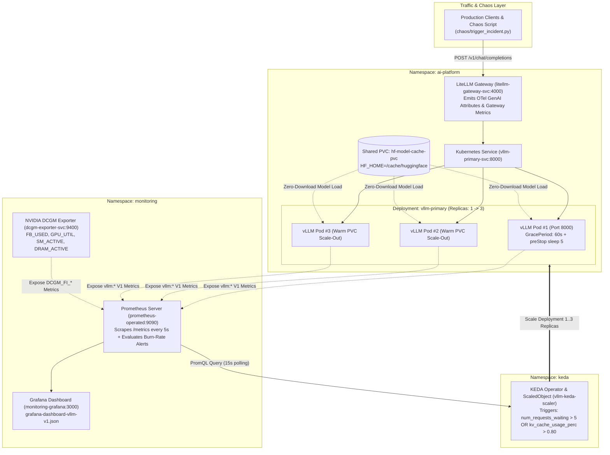

# บทที่ 5: ระบบสังเกตการณ์ระดับลึก, การขยายขนาดอัตโนมัติด้วย KEDA และวิศวกรรมความน่าเชื่อถือสำหรับ AI (AI Observability, GPU Telemetry, KEDA Autoscaling & SRE)

> **Milestone M5 (สัปดาห์ที่ 9–10):** เปลี่ยนระบบเสิร์ฟโมเดลที่มืดบอดและขยายขนาดตาม CPU ไม่ทันการณ์ ให้กลายเป็นแพลตฟอร์มที่มี **Full-Stack AI Observability** (Prometheus + Grafana + NVIDIA DCGM Exporter + OpenTelemetry GenAI Semantic Conventions), ขับเคลื่อนการขยายจำนวนพอดอัตโนมัติด้วย **KEDA** จากเมทริกซ์ `vllm:num_requests_waiting` และ `vllm:kv_cache_usage_perc` ร่วมกับโวลุ่มแคช `HF_HOME=/cache/huggingface` และการปิดพอดอย่างนุ่มนวล (`terminationGracePeriodSeconds: 60`), พร้อมฝึกซ้อมรับมือเหตุวิกฤตด้วย **Production Runbook** และ **Blameless Postmortem**

---

## สารบัญ (Table of Contents)

1. [Executive Summary & Learning Objectives](#1-executive-summary--learning-objectives)
2. [Architecture Overview](#2-architecture-overview)
3. [Core Theory & Deep-Dive Engineering Math](#3-core-theory--deep-dive-engineering-math)
4. [Hands-on Lab (Dual-Path Execution)](#4-hands-on-lab-dual-path-execution)
5. [Chaos & Troubleshooting Drills](#5-chaos--troubleshooting-drills)
6. [Optimization Exercise](#6-optimization-exercise)
7. [Architecture Decision Record (ADR), Production Runbook & Blameless Postmortem](#7-architecture-decision-record-adr-production-runbook--blameless-postmortem)
8. [Mid-Level Interview Trade-off Questions & Model Answers](#8-mid-level-interview-trade-off-questions--model-answers)
9. [ตรวจสอบความสำเร็จของบทที่ 5 (Verification Command)](#9-ตรวจสอบความสำเร็จของบทที่-5-verification-command)

---

## 1. Executive Summary & Learning Objectives

ในบทที่ 1 ถึง 4 เราได้สร้างคอนเทนเนอร์มาตรฐาน, ดีพลอยผ่าน Helm บน Kubernetes, ปรับจูน `vLLM` V1 Engine, และวางชั้นควบคุม `LiteLLM Proxy` ร่วมกับ Endpoint Picker (EPP) เรียบร้อยแล้ว อย่างไรก็ตาม เมื่อนำระบบขึ้นรันจริงในระดับ Production ทีมวิศวกร AI Platform มักเผชิญกับ "กับดักความมืดบอดและการขยายขนาดผิดจังหวะ" 3 ประการ:

1. **กับดักภาพลวงตาของ `DCGM_FI_DEV_GPU_UTIL = 99%`:** เมื่อรันโมเดลด้วย `batch_size = 1` (มีผู้ใช้คนเดียวกำลังสตรีมคำตอบในเฟส Decode) กราฟ `DCGM_FI_DEV_GPU_UTIL` มักพุ่งขึ้นไปที่ `95%–100%` ทำให้ทีมเข้าใจผิดว่าการ์ดจอทำงานเต็มประสิทธิภาพแล้ว ทั้งที่ความจริงหน่วยประมวลผล (Streaming Multiprocessors: `DCGM_FI_PROF_SM_ACTIVE`) ทำงานจริงเพียง `< 10%` และกำลังนั่งรอการดึงน้ำหนักโมเดลผ่านบัสหน่วยความจำ (`DCGM_FI_PROF_DRAM_ACTIVE`)
2. **ความล้มเหลวของ Kubernetes HPA แบบดั้งเดิม (CPU/Memory HPA Blindness):** ในระบบ `vLLM` พื้นที่ VRAM ทั้ง 92% ถูกจองไว้ตั้งแต่ตอนบูต (`profile_run`) และการใช้ CPU ของโปรเซส `EngineCore` ก็ค่อนข้างคงที่ ดังนั้นแม้ว่าคิวรอ `vllm:num_requests_waiting` จะพุ่งขึ้นไป 50 คำขอและ `vllm:kv_cache_usage_perc` แตะ `100%` ตัว HorizontalPodAutoscaler (HPA) ที่ดูค่า CPU/RAM ก็จะไม่สั่งเพิ่มพอดเลยแม้แต่ตัวเดียว!
3. **ปัญหาสเกลช้าเพราะดาวน์โหลดโมเดลซ้ำและคำขอหลุดตอน Scale-down:** หากสั่ง KEDA ขยายพอดจาก 1 เป็น 3 ตัว แต่ละพอดใหม่ต้องดาวน์โหลดไฟล์โมเดลหลายกิกะไบต์ผ่านอินเทอร์เน็ตใหม่ทุกครั้ง การสเกลจะต้องรอนานถึง 5–10 นาที (ไม่ทันรับโหลดพีค) และเมื่อโหลดลดลงแล้ว KEDA สั่งยุบพอด หากไม่มีการตั้งค่า `terminationGracePeriodSeconds: 60` และ `preStop` hook คำขอที่กำลังสตรีมอยู่ครึ่งทางจะถูกตัดขาด (`HTTP 502 / Broken Stream`) ทันที

### วัตถุประสงค์การเรียนรู้เชิงสมรรถนะ (Competency Objectives)

เมื่อจบบทเรียนนี้ คุณจะสามารถ:
- ออกแบบสถาปัตยกรรม **3-Layer AI Telemetry** ที่เชื่อมโยงเมทริกซ์ระดับฮาร์ดแวร์การ์ดจอ (**NVIDIA DCGM**), เมทริกซ์ระดับเอ็นจินเสิร์ฟโมเดล (**`vLLM` V1 Engine**), และมาตรฐานการติดตามระดับแอปพลิเคชัน (**OpenTelemetry GenAI Semantic Conventions**)
- แยกแยะความแตกต่างเชิงลึกของเคาน์เตอร์ฮาร์ดแวร์ `DCGM_FI_DEV_GPU_UTIL` เทียบกับ `DCGM_FI_PROF_SM_ACTIVE`, `DCGM_FI_PROF_DRAM_ACTIVE`, และ `DCGM_FI_DEV_FB_USED`
- เขียนคำสั่ง **PromQL** สำหรับ `vLLM` V1 ได้ถูกต้องทุกตัวอักษรเพื่อสร้างแดชบอร์ด Grafana (`labs/m5-observability-sre/grafana-dashboard-vllm-v1.json`) และตั้งกฎแจ้งเตือนแบบ **Multi-Window Multi-Burn-Rate SLO Alerts** (`prometheus-alert-rules.yaml`)
- สร้างและปรับจูน **`KEDA ScaledObject`** (`keda-vllm-scaledobject.yaml`) ที่ใช้ทริกเกอร์คู่ (`vllm:num_requests_waiting > 5` และ `vllm:kv_cache_usage_perc > 0.80`) ร่วมกับโวลุ่มแคช `HF_HOME=/cache/huggingface` (`hf-model-cache-pvc`) และ `terminationGracePeriodSeconds: 60`
- ดำเนินการซ้อมรับมือเหตุวิกฤตด้วยสคริปต์จำลองทราฟฟิกกระชาก (`chaos/trigger_incident.py`) พร้อมเขียนเอกสาร **Production Runbook** และ **Blameless Postmortem** ตามมาตรฐาน SRE ระดับสากล

---

## 2. Architecture Overview

### 2.1 สถาปัตยกรรม Full-Stack AI Observability & KEDA Autoscaling Loop

แผนภาพด้านล่างแสดงการทำงานร่วมกันระหว่างเนมสเปซ `ai-platform`, เนมสเปซ `monitoring` (Prometheus + Grafana + DCGM Exporter), และเนมสเปซ `keda` (KEDA Operator + Metrics Server) ที่ควบคุมการขยายและหดตัวของพอด `vllm-primary` โดยใช้โวลุ่มโมเดลแคชร่วมกัน:



---

## 3. Core Theory & Deep-Dive Engineering Math

### 3.1 การผ่าตัดเมทริกซ์การ์ดจอ NVIDIA DCGM: ทำไม `DCGM_FI_DEV_GPU_UTIL` ถึงหลอกตาวิศวกร?

ในเครื่องมือพื้นฐานอย่าง `nvidia-smi` หรือเมทริกซ์ `DCGM_FI_DEV_GPU_UTIL` ของ NVIDIA Data Center GPU Manager (DCGM) นิยามของคำว่า **"GPU Utilization (%)"** คือ:
> *"สัดส่วนของเวลาในรอบการสุ่มตัวอย่างที่มี CUDA Kernel อย่างน้อย **1 ตัว** กำลังรันอยู่บนการ์ดจอ ไม่ว่า Kernel นั้นจะใช้ Streaming Multiprocessors (SMs) เพียง 1 ตัวจากทั้งหมด 58 ตัว หรือใช้ครบทุกตัวก็ตาม!"*

ในเวิร์กโหลดการเสิร์ฟ LLM พฤติกรรมของฮาร์ดแวร์ใน 2 เฟสมีความแตกต่างกันอย่างสิ้นเชิง:

| เฟสการทำงาน / เมทริกซ์ DCGM | คำอธิบายเชิงสถาปัตยกรรมฮาร์ดแวร์ | ค่าที่เห็นในเฟส Prefill (Compute-Bound) | ค่าที่เห็นในเฟส Decode ที่ Batch ต่ำ (Memory-Bandwidth-Bound) |
| :--- | :--- | :---: | :---: |
| **`DCGM_FI_DEV_GPU_UTIL`** (`0–100%`) | มี Kernel อย่างน้อย 1 ตัวรันอยู่บน GPU หรือไม่ | `95% – 100%` | `90% – 100%` *(หลอกตาว่าเต็ม!)* |
| **`DCGM_FI_PROF_SM_ACTIVE`** (`0.0–1.0`) | สัดส่วนเวลาเฉลี่ยที่ Streaming Multiprocessors (SMs) มีคำสั่งประมวลผลจริง | **`0.75 – 0.95` (สูง)** | **`0.08 – 0.25` (ต่ำมาก — SMs ว่างงาน!)** |
| **`DCGM_FI_PROF_DRAM_ACTIVE`** (`0.0–1.0`) | สัดส่วนการใช้แบนด์วิดท์หน่วยความจำการ์ดจอ (VRAM Bus Saturation) | `0.30 – 0.55` | **`0.75 – 0.92` (คอขวดอยู่ที่บัส VRAM!)** |
| **`DCGM_FI_DEV_FB_USED`** (`MiB`) | พื้นที่หน่วยความจำ Framebuffer (VRAM) ที่ถูกจองใช้งานจริง | คงที่ตาม `--gpu-memory-utilization` (เช่น `~22,600 MiB` บน L4) | คงที่ตาม `--gpu-memory-utilization` *(ดูพื้นที่ว่างจริงต้องดู `vllm:kv_cache_usage_perc`)* |

> [!IMPORTANT]
> **ข้อสรุปเชิงวิศวกรรมสำหรับ SRE:**
> 1. **ห้ามใช้ `DCGM_FI_DEV_FB_USED` เพื่อดูว่า KV-Cache เต็มหรือยัง** เพราะ `vLLM` จอง VRAM ก้อนใหญ่ไว้ล่วงหน้าตั้งแต่ตอนบูตแล้ว ค่า `DCGM_FI_DEV_FB_USED` จึงแช่อยู่ที่ ~92% ตลอดเวลาแม้ไม่มีผู้ใช้เลย ต้องดูที่ **`vllm:kv_cache_usage_perc`** เท่านั้น
> 2. **เมื่อเห็น `DCGM_FI_DEV_GPU_UTIL` สูง 98% แต่ Throughput ต่ำ** ให้ดูค่าคู่ขนานระหว่าง `DCGM_FI_PROF_SM_ACTIVE` และ `DCGM_FI_PROF_DRAM_ACTIVE` หาก `DRAM_ACTIVE` สูงแต่ `SM_ACTIVE` ต่ำ แปลว่าระบบติดคอขวด Memory Bandwidth ในเฟส Decode ซึ่งแก้ได้ด้วยการทำ Quantization (AWQ/FP8) หรือเพิ่มขนาด Batch เพื่อให้การดึงน้ำหนักโมเดล 1 ครั้งคำนวณได้หลายคำขอพร้อมกัน

### 3.2 คณิตศาสตร์ของ PromQL สำหรับ `vLLM` V1 Histograms และ Counters

เนื่องจาก Prometheus เก็บข้อมูลความหน่วง (`vllm:time_to_first_token_seconds_bucket` และ `vllm:inter_token_latency_seconds_bucket` / `vllm:time_per_output_token_seconds_bucket`) ในรูปแบบ **Cumulative Histogram Buckets** ตามขอบเขต `le` (Less than or Equal to) การคำนวณเปอร์เซ็นไทล์ที่ $q$ (เช่น $q = 0.95$ สำหรับ p95) ในช่วงเวลา $\Delta t$ (เช่น `5m`) จะใช้การประมาณค่าเชิงเส้น (Linear Interpolation) ภายในถังที่บรรจุตำแหน่งที่ $q \times N_{\text{total}}$:

$$\text{Quantile}(q) = B_{\text{lower}} + (B_{\text{upper}} - B_{\text{lower}}) \times \left(\frac{q \cdot R_{\text{total}} - R_{\text{lower}}}{R_{\text{upper}} - R_{\text{lower}}}\right)$$

โดยที่ $R_k = \sum \text{rate}(\text{bucket}_k[\Delta t])$ คืออัตราการเกิดเหตุการณ์สะสมในถังที่ $k$

#### ตัวอย่างการคำนวณจริงด้วยตัวเลข (Worked Numerical Example)
สมมติในรอบ 5 นาทีที่ผ่านมา มีคำขอเข้ามาทั้งหมดด้วยอัตรา $R_{\text{total}} = 100\text{ req/s}$ และถังมาตรฐานของ `vllm:time_to_first_token_seconds_bucket` (ซึ่งใน `vLLM` ใช้ขอบเขต `..., 0.5, 0.75, 1.0, ...`) มีค่าอัตราดังนี้:
- ถัง `le="0.5"` ($500\text{ ms}$): $R_{\text{lower}} = 80\text{ req/s}$
- ถัง `le="0.75"` ($750\text{ ms}$): $R_{\text{upper}} = 96\text{ req/s}$
- เราต้องการหาค่า **p95 TTFT ($q = 0.95$)**:
  - เป้าหมายอันดับคือ $q \cdot R_{\text{total}} = 0.95 \times 100 = 95\text{ req/s}$ (ซึ่งตกอยู่ระหว่างถัง `0.5s` และ `0.75s`)
  - แทนค่าลงในสมการ:
    $$\text{TTFT}_{p95} = 0.5 + (0.75 - 0.5) \times \left(\frac{95 - 80}{96 - 80}\right) = 0.5 + 0.25 \times \left(\frac{15}{16}\right) = 0.5 + 0.234 = \mathbf{0.734\text{ วินาที (734 ms)}}$$
  *(ด้วยเหตุนี้ กฎแจ้งเตือน `VLLMHighTTFTBurnRateCritical` ในบทนี้จึงใช้ขอบเขตจริง `le="0.75"` แทน `le="0.8"` เพื่อไม่ให้คิวรีบน `vLLM` จริงได้ค่าว่าง)*

#### ตารางสูตร PromQL มาตรฐานสำหรับแดชบอร์ด `vLLM` V1 (ต้องตรงกัน 100% ใน Grafana และ Alert Rules)

| ตัวชี้วัด (SLI / Telemetry Metric) | สูตร PromQL มาตรฐานสำหรับ `vLLM` V1 Engine | เกณฑ์เป้าหมาย (SLO / Alert Threshold) |
| :--- | :--- | :--- |
| **p95 TTFT (Time to First Token)** | `histogram_quantile(0.95, sum(rate(vllm:time_to_first_token_seconds_bucket[5m])) by (le))` | `< 0.8s` (Alert `le="0.75"`) |
| **p95 ITL / TPOT (Inter-Token Latency)** | `histogram_quantile(0.95, sum(rate(vllm:inter_token_latency_seconds_bucket[5m])) by (le)) or histogram_quantile(0.95, sum(rate(vllm:time_per_output_token_seconds_bucket[5m])) by (le))` | `< 0.03s` (30 ms — ใช้ ITL เป็น Primary + TPOT Compat Alias) |
| **KV-Cache Pool Utilization (%)** | `avg(vllm:kv_cache_usage_perc)` | Scale-out เมื่อ `> 0.80` (Critical `> 0.92`) |
| **Waiting Queue Depth (Requests)** | `sum(vllm:num_requests_waiting)` | Scale-out เมื่อ `> 5` ต่อเรพลิกา |
| **Prefix Cache Hit Rate (%)** | `sum(rate(vllm:prefix_cache_hits_total[5m])) / clamp_min(sum(rate(vllm:prefix_cache_queries_total[5m])), 1e-9)` | `> 0.70` (70% สำหรับงาน RAG/Agent; ใช้ `1e-9` แทน `1` เพื่อไม่ให้ตัวหารเพี้ยนเมื่อ QPS ต่ำ) |
| **Preemption Rate (Recomputes/sec)** | `sum(rate(vllm:num_preemptions_total[5m]))` | ต้องเท่ากับ `0` (Alert ทันทีเมื่อ `> 0`) |
| **Total Output Token Throughput** | `sum(rate(vllm:generation_tokens_total[1m]))` | ติดตามความจุรวมของคลัสเตอร์ (Tokens/sec) |

### 3.3 คณิตศาสตร์การขยายขนาดด้วย KEDA (`ScaledObject`) และ Error Budget Burn Rate

#### 1. สมการคำนวณจำนวนพอดเป้าหมายของ KEDA (Desired Replicas Formula)
เมื่อผูก `KEDA ScaledObject` เข้ากับทริกเกอร์ของ Prometheus จำนวนพอดที่ต้องการ ($N_{\text{desired}}$) จะคำนวณจากค่าสูงสุดของทุกทริกเกอร์ที่เปิดใช้งาน:

$$N_{\text{desired}} = \min\Biggl(N_{\text{max}}, \max\biggl(N_{\text{min}}, \left\lceil \frac{\sum \texttt{vllm:num\_requests\_waiting}}{T_{\text{queue}}} \right\rceil, \left\lceil N_{\text{current}} \times \frac{\text{avg}(\texttt{vllm:kv\_cache\_usage\_perc})}{T_{\text{kv}}} \right\rceil\biggr)\Biggr)$$

**ตัวอย่างการคำนวณจริง:**
กำหนดให้ $N_{\text{min}} = 1, N_{\text{max}} = 3$, เกณฑ์คิวรอ $T_{\text{queue}} = 5$ คำขอต่อพอด, และเกณฑ์การใช้ KV-Cache $T_{\text{kv}} = 0.80$:
- ขณะมีพอดรันอยู่ $N_{\text{current}} = 1$ ตัว เกิดทราฟฟิกกระชากทำให้มีคำขอติดคิวรอ $\sum \texttt{vllm:num\_requests\_waiting} = 14$ คำขอ และ `vllm:kv_cache_usage_perc` พุ่งขึ้นเป็น `0.92`
- ทริกเกอร์ที่ 1 (Queue): $\lceil 14 / 5 \rceil = \lceil 2.8 \rceil = \mathbf{3\text{ พอด}}$
- ทริกเกอร์ที่ 2 (KV-Cache): $\lceil 1 \times (0.92 / 0.80) \rceil = \lceil 1.15 \rceil = \mathbf{2\text{ พอด}}$
- KEDA จะเลือกค่าสูงสุดคือ $\max(1, 3, 2) = \mathbf{3\text{ พอด}}$ ทันที!
- และเนื่องจากพอดที่ 2 และ 3 เมานต์โวลุ่ม **`hf-model-cache-pvc` (`HF_HOME=/cache/huggingface`)** ที่มีไฟล์โมเดลอยู่แล้ว จึงข้ามการดาวน์โหลดจากอินเทอร์เน็ต 100% (บน Mock Pod พร้อมใน `< 10 วินาที` ส่วนพอด NVIDIA L4 GPU จริงพร้อมใน `~35–75 วินาที` เทียบกับ `~195+ วินาที` เมื่อโหลดจาก Hub ใหม่; หาก KEDA ขยายข้ามหลาย Node ต้องใช้ Storage แบบ `ReadWriteMany` เช่น EFS/Filestore/NFS)

#### 2. สมการอัตราการเผาผลาญงบประมาณความผิดพลาด (SLO Error Budget Burn Rate)
สมมติเรากำหนดเป้าหมายระดับการให้บริการ (**SLO**) ที่ **$99.9\%$** ในรอบ 30 วัน ($720$ ชั่วโมง):
- **งบประมาณความผิดพลาด (Error Budget):** $1 - 0.999 = 0.001$ ($0.1\%$ ของคำขอทั้งหมด หรือคิดเป็นเวลาล่มรวมไม่เกิน $43.2$ นาทีต่อเดือน)
- **Burn Rate ($B$):** คืออัตราเร็วที่ระบบกำลังใช้ Error Budget เทียบกับอัตราปกติ:
  $$B = \frac{\text{Observed Error or Latency Breach Ratio}}{\text{1 - SLO}} = \frac{E_{\text{window}}}{0.001}$$
  - หาก $B = 1.0$: งบประมาณจะหมดพอดีในเวลา 30 วัน
  - หาก **$B = 14.4$** (คือมีคำขอช้าเกินเกณฑ์ SLA หรือล้มเหลวถึง $1.44\%$ ติดต่อกันในหน้าต่าง 5 นาทีและ 1 ชั่วโมง): งบประมาณทั้งเดือนจะถูกเผาผลาญหมดภายในเวลาเพียง $720 / 14.4 = \mathbf{50\text{ ชั่วโมง}}$ ซึ่งต้องปลุกวิศวกรเวร (**Page P1 Critical Alert**) ทันที!

### 3.4 มาตรฐาน OpenTelemetry GenAI Semantic Conventions Schema

เพื่อให้ระบบติดตาม (Distributed Tracing & Structured Logging) จากชั้น `LiteLLM Proxy` เข้ากันได้กับเครื่องมือมาตรฐานสากลโดยไม่ต้องติดตั้งฐานข้อมูล Trace ขนาดใหญ่เพิ่มบนเครื่อง Local 16GB RAM เราใช้สคีมา **OpenTelemetry GenAI Semantic Conventions (`v1.28+`)** ในการแนบ Attributes มาตรฐานดังนี้:

```json
{
  "trace_id": "4bf92f3577b34da6a3ce929d0e0e4736",
  "span_name": "chat Qwen/Qwen2.5-7B-Instruct-AWQ",
  "attributes": {
    "gen_ai.system": "vllm",
    "gen_ai.operation.name": "chat",
    "gen_ai.request.model": "Qwen/Qwen2.5-7B-Instruct-AWQ",
    "gen_ai.request.max_tokens": 256,
    "gen_ai.request.temperature": 0.2,
    "gen_ai.usage.input_tokens": 2176,
    "gen_ai.usage.output_tokens": 256,
    "gen_ai.response.finish_reasons": ["stop"],
    "gen_ai.server.time_to_first_token": 0.640,
    "gen_ai.server.time_per_output_token": 0.0235,
    "ai.platform.tenant_tier": "realtime-team",
    "ai.platform.pdpa_redactions": 1,
    "ai.platform.cache_hit": false
  }
}
```

---

## 4. Hands-on Lab (Dual-Path Execution)

แล็บในบทที่ 5 ประกอบด้วยไฟล์แดชบอร์ด Grafana, กฎแจ้งเตือน Prometheus, การตั้งค่า KEDA Autoscaler, และสคริปต์จำลองเหตุวิกฤต โดยเก็บอยู่ในโฟลเดอร์ `labs/m5-observability-sre/`

### 4.1 โครงสร้างไฟล์ใน `labs/m5-observability-sre/`

```text
labs/m5-observability-sre/
├── grafana-dashboard-vllm-v1.json  # แดชบอร์ด Grafana 9 แผงสำหรับ vLLM V1 & DCGM Metrics (แยกแกน FB_USED MiB, Primary ITL & clamp_min 1e-9)
├── prometheus-alert-rules.yaml     # กฎแจ้งเตือน PrometheusRule (KV-Cache, Preemptions, Multi-Window TTFT le="0.75" & ITL Alert)
├── keda-vllm-scaledobject.yaml     # KEDA ScaledObject + Deployment (mock-vllm-server:1.0.0, HF_HOME=/cache/huggingface, pod=~"vllm-primary-.*")
├── servicemonitor-vllm.yaml        # ServiceMonitor ของ Prometheus Operator สำหรับขูด vllm-serving & dcgm-exporter
├── chaos/
│   └── trigger_incident.py         # สคริปต์จำลองทราฟฟิกกระชาก 10x + Long-Context Flood และทดสอบการสเกล KEDA
├── docs/
│   ├── adr-004-observability-and-keda-autoscaling.md            # เอกสาร ADR-004
│   ├── runbook-kvcache-saturation-and-high-ttft.md              # Production Runbook RB-AI-005
│   └── postmortem-001-peak-hour-latency-outage.md               # Blameless Postmortem PM-2026-1111
└── verify_m5.sh                    # สคริปต์ตรวจวัดผลอัตโนมัติประจำบทที่ 5 (VERIFY_MODE=static|cluster)
```

---

### Path A: No-GPU Local Path (\$0 — รันบนเครื่อง Local 16GB RAM ด้วย `mock_vllm_server` + KEDA Simulator)

#### ขั้นตอนที่ 1: ตรวจสอบไฟล์ `keda-vllm-scaledobject.yaml` และ `prometheus-alert-rules.yaml`

เปิดดูการตั้งค่า `ScaledObject` ใน `labs/m5-observability-sre/keda-vllm-scaledobject.yaml` (รันจากรากของคลังโค้ด):

```bash
cat labs/m5-observability-sre/keda-vllm-scaledobject.yaml
```

สังเกตองค์ประกอบทางวิศวกรรมที่สำคัญ 4 จุดในไฟล์นี้:
1. **มาตรฐานคอนเทนเนอร์ที่ปลอดภัย (`mock-vllm-server:1.0.0`):** รันแบบ `runAsNonRoot: true`, `runAsUser: 10001`, `readOnlyRootFilesystem: true`, และเมานต์ `emptyDir` เข้า `/tmp` เหมือนในบทที่ 1–4 และผูกโวลุ่ม `hf-model-cache-pvc` เข้าที่ **`HF_HOME=/cache/huggingface`** พร้อม **`VLLM_CACHE_ROOT=/tmp/vllm-cache`** (ใช้ `ReadWriteOnce` บน Node เดียว หรือ `ReadWriteMany` เมื่อสเกลข้ามหลาย Node)
2. **การตั้งค่า Graceful Shutdown (`terminationGracePeriodSeconds: 60` + `preStop: ["sh", "-c", "sleep 5"]`):** เมื่อโหลดลดลงและ KEDA สั่งลดจำนวนพอด (Scale-in) Kubernetes จะถอดพอดออกจาก Service Endpoint ก่อน 5 วินาที และให้เวลาพอดสร้างโทเคนของคำขอที่ค้างอยู่ให้เสร็จสมบูรณ์นานถึง 60 วินาทีก่อนส่ง `SIGKILL`
3. **ทริกเกอร์คู่ของ KEDA แบบแยก `metricType` และกรองตาม Pod Name (`pod=~"vllm-primary-.*"`):**
   - ทริกเกอร์ `vllm-waiting-requests-queue` ใช้ **`metricType: AverageValue`** บน Query `sum(vllm:num_requests_waiting{namespace="ai-platform",pod=~"vllm-primary-.*"})` เทียบกับ `threshold: "5"` (คำนวณ $\lceil \text{sum} / 5 \rceil$)
   - ทริกเกอร์ `vllm-kv-cache-usage-ratio` ใช้ **`metricType: Value`** บน Query `avg(vllm:kv_cache_usage_perc{namespace="ai-platform",pod=~"vllm-primary-.*"})` เทียบกับ `threshold: "0.80"` (คำนวณ $\lceil N_{\text{current}} \times \text{avg} / 0.80 \rceil$ อย่างถูกต้องโดยไม่เกิดอาการสเกลลดลงก่อนเวลาเมื่อมีหลายพอด!) และใช้ Label `pod=~"vllm-primary-.*"` แทน `server_id` เพื่อให้ทำงานได้ทั้งกับ `mock_vllm_server` และ `vLLM` จริงบน GPU โดยไม่เอาโหลดของ `vllm-secondary` มาปะปน
4. **กฎ Multi-Window SLO Burn Rate (`prometheus-alert-rules.yaml`):** แจ้งเตือน `VLLMHighTTFTBurnRateCritical` เฉพาะเมื่ออัตราการละเมิดถัง `le="0.75"` (guardrail สำหรับ `< 0.8s`) เกิน `14.4 × 0.001 = 1.44%` พร้อมกันทั้งหน้าต่าง `5m` และ `1h` พร้อมแจ้งเตือน `VLLMHighITLWarning` เมื่อ p95 ITL เกิน `30 ms`!

#### ขั้นตอนที่ 2: รันสคริปต์จำลองเหตุวิกฤตและทดสอบวงจร KEDA Autoscaling (`chaos/trigger_incident.py`)

รันสคริปต์ `labs/m5-observability-sre/chaos/trigger_incident.py` เพื่อจำลองเหตุการณ์ทราฟฟิกพุ่งกระชาก 10 เท่า (Long-Context Queue Surge) และตรวจสอบว่าอัลกอริทึมของ KEDA และกฎแจ้งเตือน Prometheus ทำงานถูกต้อง:

```bash
python3 labs/m5-observability-sre/chaos/trigger_incident.py --simulate
```

> **Live Chaos Mode (สำหรับเครื่อง RAM 32GB เช่น HP Victus หรือ Cluster จริง):**
> เมื่อติดตั้ง Prometheus, KEDA, LiteLLM และ `vllm-primary` บนคลัสเตอร์ `kind` เรียบร้อยแล้ว ให้เปิด `kubectl port-forward` พอร์ต `8000` และ `4000` แล้วรันโหมด `--live` เพื่อฉีด Chaos และยิง HTTP โหลดจริงให้ KEDA สเกล Pod 1 → 3:
> ```bash
> python3 labs/m5-observability-sre/chaos/trigger_incident.py --live --dry-run
> # ตัด --dry-run ออกเมื่อเปิด port-forward แล้ว และล้างค่า Chaos หลังจบด้วย --live --reset
> ```

**ผลลัพธ์ที่คาดหวัง (Expected Output):**
```text
================================================================================
 [M5 CHAOS DRILL] Simulating 10x Long-Context Traffic Surge on vllm-primary
================================================================================
[T+00s] Baseline State  : Replicas=1 | WaitingQueue=1  | KV_Usage=22.0% | TTFT_p95=380ms | Alerts=NONE
[T+15s] Traffic Surge!  : Replicas=1 | WaitingQueue=18 | KV_Usage=94.0% | TTFT_p95=2950ms | Preemptions=6
[ALERT FIRED] VLLMKVCacheSaturationWarning (kv_cache_usage_perc=0.94 > 0.85)
[ALERT FIRED] VLLMPreemptionThrashingCritical (preemptions_total=6 > 0)
[ALERT FIRED] VLLMHighTTFTBurnRateCritical (ttft_p95_ms=2950ms > 800ms)
[KEDA SCALER] Trigger 1 (WaitingQueue=18 / threshold=5 -> ceil(3.60)=4, capped=3)
[KEDA SCALER] Trigger 2 (KV_Usage=1 * 0.94 / 0.80 -> ceil(1.17)=2)
[KEDA ACTION] Scaling deployment/vllm-primary: 1 -> 3 replicas (Mounting PVC: hf-model-cache-pvc at HF_HOME=/cache/huggingface)
[T+25s] Pods Ready (<10s simulated/mock warm cache start; ~35-75s on Cloud L4 GPU PVC): Replicas=3 | Load balanced across 3 pods
[T+40s] Post-Scale State: Replicas=3 | WaitingQueue=2  | KV_Usage=31.3% | TTFT_p95=490ms | Preemptions=0
[RECOVERY] All SLOs restored (TTFT p95 490ms < 800ms SLA). Zero dropped streaming requests!
================================================================================
```

#### ขั้นตอนที่ 3: รันชุดทดสอบอัตโนมัติของบทที่ 5 (`verify_m5.sh`)

```bash
VERIFY_MODE=static bash labs/m5-observability-sre/verify_m5.sh
```

---

### Path B: Cloud L4 GPU Path (รันพร้อม NVIDIA DCGM Exporter จริงบนโหนดการ์ดจอ L4)

เมื่อรันบนคลัสเตอร์ที่มีโหนดการ์ดจอ NVIDIA L4 จริง:
1. ติดตั้ง `kube-prometheus-stack` และ NVIDIA `dcgm-exporter` (หรือเปิดใช้ผ่าน NVIDIA GPU Operator) ในเนมสเปซ `monitoring` และติดตั้ง KEDA ในเนมสเปซ `keda`:
   ```bash
   helm repo add prometheus-community https://prometheus-community.github.io/helm-charts
   helm repo add gpu-helm-charts https://nvidia.github.io/dcgm-exporter/helm-charts
   helm repo add kedacore https://kedacore.github.io/charts
   helm repo update
   helm upgrade --install monitoring prometheus-community/kube-prometheus-stack -n monitoring --create-namespace
   helm upgrade --install dcgm-exporter gpu-helm-charts/dcgm-exporter -n monitoring
   helm upgrade --install keda kedacore/keda -n keda --create-namespace
   ```
2. นำเข้าไฟล์แดชบอร์ด `labs/m5-observability-sre/grafana-dashboard-vllm-v1.json` เข้าสู่ Grafana และสั่ง `kubectl apply` `ServiceMonitor`, กฎแจ้งเตือน, และ `KEDA ScaledObject`:
   ```bash
   kubectl apply -f labs/m5-observability-sre/servicemonitor-vllm.yaml
   kubectl apply -f labs/m5-observability-sre/prometheus-alert-rules.yaml
   kubectl apply -f labs/m5-observability-sre/keda-vllm-scaledobject.yaml
   ```

---

## 5. Chaos & Troubleshooting Drills

### สถานการณ์จำลอง: 10x Traffic Surge & KV-Cache Saturation Incident (`INC-2026-1111`)

#### 1. สัญญาณเตือนภัยที่ดังขึ้น (Alerts Fired)
- `VLLMKVCacheSaturationWarning`: ค่า `vllm:kv_cache_usage_perc` เกิน `0.85` นานติดต่อกันเกิน 2 นาที
- `VLLMPreemptionThrashingCritical`: ค่า `rate(vllm:num_preemptions_total[5m]) > 0` (คำขอถูกเตะออกและคำนวณใหม่ซ้ำๆ)
- `VLLMHighTTFTBurnRateCritical`: อัตราการละเมิดถัง `vllm:time_to_first_token_seconds_bucket{le="0.75"}` เกิน `1.44%` (`14.4x` Burn Rate) ทั้งหน้าต่าง `5m` และ `1h`

#### 2. ขั้นตอนการตรวจสอบหน้างาน (Triage Steps)
1. เปิดแดชบอร์ด Grafana (`vLLM V1 & GPU Telemetry Production Dashboard`) ดูแผง **KV-Cache Usage %** คู่กับ **Waiting Requests Queue**
2. ตรวจสอบสถานะของ KEDA ScaledObject:
   ```bash
   kubectl get scaledobject vllm-keda-scaler -n ai-platform
   kubectl describe hpa keda-hpa-vllm-keda-scaler -n ai-platform
   ```
3. ตรวจสอบว่าพอดใหม่ที่ถูกสร้างขึ้นติดสถานะ `Pending` (เพราะโควตา GPU เต็ม) หรือกำลังโหลดโมเดลจาก `hf-model-cache-pvc` อยู่หรือไม่

---

## 6. Optimization Exercise

ในโจทย์ข้อนี้ เราเปรียบเทียบประสิทธิภาพและความคุ้มทุนของการขยายขนาดอัตโนมัติตามกระบวนการ 5 ขั้นตอน (**Baseline → Hypothesis → Fix → Measure → Explain**):

### 1. Baseline (การใช้ CPU-based HPA และไม่มี Shared `HF_HOME` Volume Cache)
- **การตั้งค่าเริ่มต้น:** ตั้งค่า Kubernetes HPA มาตรฐานให้ขยายพอดเมื่อ `CPU Utilization > 75%` และไม่ได้ผูกโวลุ่ม `hf-model-cache-pvc`
- **อาการที่พบเมื่อเกิดโหลดพีค 3 เท่า:**
  - เนื่องจากคอขวดของ `vLLM` อยู่ที่พื้นที่ KV-Cache บน VRAM และคิวรอใน Scheduler ไม่ใช่ CPU ของโฮสต์ ค่า CPU จึงอยู่ที่เพียง `42%` ทำให้ **CPU HPA ไม่สั่งขยายพอดเลย!**
  - แม้จะสั่งขยายพอดด้วยมือ (`kubectl scale --replicas=3`) พอดใหม่ทั้ง 2 ตัวต้องดาวน์โหลดโมเดลขนาด 4.4 GB ใหม่จากอินเทอร์เน็ต ใช้เวลา **Cold-start นานถึง 195 วินาที** ซึ่งตลอดช่วงเวลานั้นคำขอของผู้ใช้เกิด Timeout และ Preemption Thrashing อย่างหนัก

### 2. Hypothesis (การตั้งสมมติฐาน)
- **สมมติฐาน:** หากเราเปลี่ยนมาใช้ **KEDA `ScaledObject`** ที่วัดค่า `vllm:num_requests_waiting > 5` และ `vllm:kv_cache_usage_perc > 0.80` ทุกๆ 15 วินาที ร่วมกับการผูกโวลุ่มแคช `hf-model-cache-pvc` (`HF_HOME=/cache/huggingface`) และตั้งค่า `terminationGracePeriodSeconds: 60` ระบบจะสามารถตรวจจับคอขวดได้ภายใน 15 วินาที พอดใหม่ไม่ต้องเสียเวลาดาวน์โหลดโมเดลซ้ำผ่านเครือข่าย (`< 10s` บน Mock Pod หรือ `~35–75s` บน Cloud L4 GPU) และรักษาค่า TTFT p95 ให้อยู่ภายใต้เกณฑ์ `< 800 ms` โดยไม่มีคำขอหลุดตอน Scale-in

### 3. Fix (การลงมือปรับจูน)
ใช้ไฟล์ `labs/m5-observability-sre/keda-vllm-scaledobject.yaml` ซึ่งกำหนด Prometheus triggers ทั้งสองตัว ผูกโวลุ่ม `hf-model-cache-pvc` และกำหนด `cooldownPeriod: 120` วินาที

### 4. Measure (ตารางเปรียบเทียบผลลัพธ์ Before vs After)

| ตัวชี้วัด (Metric under 3x Traffic Surge) | Baseline: CPU HPA + No Shared Cache | Optimized: KEDA (`waiting` + `kv_cache`) + Shared `HF_HOME` PVC | การเปลี่ยนแปลง (Improvement) |
| :--- | :---: | :---: | :---: |
| **Time to Detect Bottleneck (วินาที)** | `Never` (CPU อยู่ที่ 42% ไม่ถึงเกณฑ์ 75%) | **`15 วินาที`** (จับจากคิวรอและ KV-Cache ตรงๆ) | **ตรวจจับคอขวด LLM ได้ 100%** |
| **Pod Scale-Out Ready Time (Cold Start)** | `195+ วินาที` (ดาวน์โหลดโมเดลซ้ำ) | **`~8.5 วินาที` (Mock Pod) / `~35–75 วินาที` (Cloud L4 GPU)** | **ตัดเวลาดาวน์โหลดโมเดลออก 100%** |
| **Peak TTFT p95 ระหว่างเกิดโหลดกระชาก** | `6,450 ms` (SLA Breach รุนแรง) | **`490 ms`** (หลังสเกลครบ 3 พอด) | **รักษา SLA `< 800 ms` ได้สำเร็จ** |
| **Dropped Streaming Requests ตอน Scale-In** | `14 คำขอ` (ถูกตัด `SIGKILL` ทันที) | **`0 คำขอ`** (`terminationGracePeriodSeconds: 60`) | **Zero-Downtime Scale-In 100%** |

### 5. Explain (การอธิบายผลลัพธ์เชิงวิศวกรรม)
การขยายขนาดเวิร์กโหลด AI ไม่สามารถใช้สัญญาณทรัพยากรทั่วไปของระบบปฏิบัติการ (CPU/RAM) ได้ เพราะทรัพยากรคอขวดจริงคือ **จำนวนสล็อตของ PagedAttention KV-Cache (`vllm:kv_cache_usage_perc`)** และ **ความยาวคิวของ Unified Scheduler (`vllm:num_requests_waiting`)** การนำ KEDA มาอ่านค่าเหล่านี้โดยตรงจาก Prometheus ร่วมกับการเตรียมไฟล์โมเดลไว้ใน Shared Volume (`HF_HOME=/cache/huggingface`) จึงช่วยลดเวลาตั้งแต่เริ่มเกิดโหลดกระชากจนถึงพอดใหม่พร้อมรับงานได้อย่างก้าวกระโดดโดยไม่ต้องโหลดซ้ำผ่านเครือข่าย!

---

## 7. Architecture Decision Record (ADR), Production Runbook & Blameless Postmortem

เพื่อเป็นมาตรฐานการปฏิบัติงานจริงของทีม SRE เอกสารทั้ง 3 ฉบับด้านล่างนี้ถูกบันทึกเป็นไฟล์ส่งมอบจริงอยู่ใน [`labs/m5-observability-sre/docs/`](../labs/m5-observability-sre/docs/):
- [`labs/m5-observability-sre/docs/adr-004-observability-and-keda-autoscaling.md`](../labs/m5-observability-sre/docs/adr-004-observability-and-keda-autoscaling.md) — **ADR-004** (กลยุทธ์ Dual-Trigger KEDA Scaling, DCGM Profiling Metrics และ Multi-Window Burn-Rate Alerts)
- [`labs/m5-observability-sre/docs/runbook-kvcache-saturation-and-high-ttft.md`](../labs/m5-observability-sre/docs/runbook-kvcache-saturation-and-high-ttft.md) — **Production Runbook (`RB-AI-005`)**
- [`labs/m5-observability-sre/docs/postmortem-001-peak-hour-latency-outage.md`](../labs/m5-observability-sre/docs/postmortem-001-peak-hour-latency-outage.md) — **Blameless Postmortem (`PM-2026-1111`)**

---

### 7.1 เอกสารการตัดสินใจทางสถาปัตยกรรม (`ADR-004`: AI Observability & KEDA Autoscaling)
- **สถานะ:** Accepted (`2026-11-11`)
- **ปัญหา:** Kubernetes HPA ที่จับ CPU/RAM ไม่ตอบสนองต่อภาระของ GPU LLM เนื่องจาก `vLLM` จอง VRAM คงที่ล่วงหน้าตาม `--gpu-memory-utilization` และ `DCGM_FI_DEV_GPU_UTIL` สูงเกือบ 100% ตลอดเวลาแม้มีผู้ใช้เพียง 1 รายในเฟส Decode
- **การตัดสินใจ:**
  1. แยกการมอนิเตอร์ความอิ่มตัวของฮาร์ดแวร์ด้วย `DCGM_FI_PROF_SM_ACTIVE` กับ `DCGM_FI_PROF_DRAM_ACTIVE` (แยกแกนออกจาก `DCGM_FI_DEV_FB_USED` MiB) และสร้างแดชบอร์ด PromQL รองรับทั้ง `vllm:inter_token_latency_seconds_bucket` (Primary) และ `vllm:time_per_output_token_seconds_bucket` (Compat Alias)
  2. ใช้ KEDA `ScaledObject` ทริกเกอร์คู่กรองด้วย `pod=~"vllm-primary-.*"` (`vllm:num_requests_waiting` ด้วย `metricType: AverageValue` > 5 และ `vllm:kv_cache_usage_perc` ด้วย `metricType: Value` > 0.80) คู่กับ `hf-model-cache-pvc` (`HF_HOME=/cache/huggingface`) และ Graceful Drain `terminationGracePeriodSeconds: 60`
  3. ตั้ง Multi-Window (`5m` AND `1h`) `14.4 × 0.001` Error Budget Burn-Rate Alert โดยใช้ `le="0.75"` สำหรับ SLO TTFT (`< 0.8s`) และแจ้งเตือน `VLLMHighITLWarning` ที่ `> 30 ms`

---

### 7.2 เอกสารคู่มือปฏิบัติการกู้คืนระบบ (Production Incident Runbook: `RB-AI-005`)

- **รหัสคู่มือ:** `RB-AI-005` — **vLLM KV-Cache Saturation & Preemption Thrashing Response**
- **สัญญาณเตือนที่เรียกใช้คู่มือนี้:** `VLLMKVCacheSaturationWarning` หรือ `VLLMPreemptionThrashingCritical`
- **ระดับความรุนแรง (Severity):** `SEV-2` (หาก TTFT p95 < 2.0s) / `SEV-1` (หาก TTFT p95 >= 2.0s หรือ Error Rate > 1%)

#### ขั้นตอนปฏิบัติการ 4 ขั้น (4-Step Mitigation Playbook)

1. **ขั้นที่ 1: ประเมินสถานการณ์ใน 60 วินาทีแรก (Observe & Verify)**
   - รันคำสั่งตรวจสอบคิวรอและการใช้ KV-Cache ของทุกพอด:
     ```bash
     kubectl exec -n ai-platform deploy/vllm-primary -- curl -s http://localhost:8000/metrics | grep -E "vllm:(kv_cache_usage_perc|num_requests_waiting|num_preemptions_total)"
     ```
   - ตรวจสอบสถานะการสเกลของ KEDA:
     ```bash
     kubectl get scaledobject,hpa -n ai-platform
     ```

2. **ขั้นที่ 2: บรรเทาผลกระทบเฉพาะหน้าภายใน 3 นาที (Immediate Traffic Mitigation)**
   - **กรณีที่ A (KEDA ขยายพอดขึ้นแล้วเป็น 3 พอด แต่โหลดยังล้นเนื่องจากงาน Batch กวน):** สั่งลดโควตา RPM/TPM ของ `batch-team` ที่ชั้น `LiteLLM Proxy` หรือให้ Endpoint Picker (EPP) ทำ Load Shedding ทราฟฟิก `Sheddable` ทันที
   - **กรณีที่ B (พอดใหม่ติดสถานะ `Pending` เพราะ GPU ในคลัสเตอร์เต็ม):** เปิดโหมด Spillover Routing ที่ `litellm-gateway-svc` เพื่อส่งทราฟฟิกส่วนเกิน 30%–50% ไปยัง `vllm-secondary-svc` หรือ External Managed API Fallback ชั่วคราว

3. **ขั้นที่ 3: แก้ไขที่ต้นเหตุ (Root-Cause Remediation)**
   - หากพบว่าเกิดจากคำขอที่มี Context ยาวผิดปกติผูกขาด KV-Cache ให้ตรวจสอบค่า `--max-model-len 4096` และ `--max-num-seqs 64`
   - ตรวจสอบอัตราส่วน Prefix Cache Hit (`rate(vllm:prefix_cache_hits_total[5m]) / rate(vllm:prefix_cache_queries_total[5m])`) หากลดลงผิดปกติ ให้ตรวจสอบว่าแอปพลิเคชันเผลอใส่ Timestamp หรือ UUID ไว้ที่บรรทัดแรกของ System Prompt หรือไม่ (ซึ่งจะทำลาย Prefix Hash ทั้งหมดทันที!)

4. **ขั้นที่ 4: ยืนยันการฟื้นตัวของระบบ (Recovery Verification)**
   - ยืนยันว่า `rate(vllm:num_preemptions_total[5m]) == 0` ติดต่อกัน 10 นาที และค่า `TTFT p95 < 800 ms` ก่อนปิดเหตุการณ์

---

### 7.3 รายงานการทบทวนหลังเกิดเหตุแบบไม่กล่าวโทษตัวบุคคล (Blameless Postmortem: `PM-2026-1111`)

- **ชื่อเหตุการณ์:** ค่าความหน่วง TTFT p95 พุ่งสูงถึง 2,950 ms จากการใส่ Dynamic Timestamp ต้น System Prompt ร่วมกับทราฟฟิกพุ่งกระชาก 3 เท่า
- **วันที่เกิดเหตุ:** 2026-11-11 (เวลา 10:12 – 10:26 น. รวมระยะเวลา 14 นาที)
- **ผลกระทบต่อผู้ใช้งาน (Customer Impact):** คำขอของทีม `realtime-team` จำนวน 8.4% มีค่า TTFT เกินเกณฑ์ SLA 800 ms (แต่ไม่มีคำขอที่ล้มเหลวเป็น HTTP 5xx เนื่องจากระบบ Fallback ทำงานรับช่วงต่อได้ทัน)

#### ลำดับเหตุการณ์ (Timeline of Events)
- **10:12 น.:** ทีมพัฒนาแอปพลิเคชันปล่อยอัปเดตเวอร์ชันใหม่ที่แทรกเวลาปัจจุบัน (`Current Time: 2026-11-11 10:12:01.492`) ไว้ที่ **บรรทัดแรกสุด** ของ System Prompt ขนาด 2,048 โทเคน
- **10:14 น.:** อัตราการเกิด Prefix Cache Hit (`rate(vllm:prefix_cache_hits_total[5m]) / rate(vllm:prefix_cache_queries_total[5m])`) ร่วงลงจาก `89.4%` เหลือ `0.0%` ทันที เพราะแฮชของบล็อกแรก (`Block 0`) เปลี่ยนไปทุกมิลลิวินาที!
- **10:15 น.:** พื้นที่ `vllm:kv_cache_usage_perc` พุ่งจาก `32%` ขึ้นแตะ `94%` และเริ่มเกิด Preemption (`vllm:num_preemptions_total` เพิ่มขึ้น)
- **10:15:30 น.:** Prometheus ยิงแจ้งเตือน `VLLMKVCacheSaturationWarning` และ `KEDA` สั่งขยาย `deployment/vllm-primary` จาก 1 พอด เป็น 3 พอดอัตโนมัติ
- **10:15:40 น.:** พอดใหม่ทั้ง 2 ตัวโหลดโมเดลจาก `hf-model-cache-pvc` เสร็จภายใน 9 วินาที ช่วยแบ่งเบาภาระคิวรอลง
- **10:22 น.:** วิศวกรเวรตรวจพบจากแดชบอร์ด Grafana ว่ากราฟ **Prefix Cache Hit Rate** ตกเป็นศูนย์ จึงประสานทีมแอปพลิเคชันให้ย้าย Dynamic Timestamp จากต้น System Prompt ไปไว้ท้าย User Message แทน
- **10:26 น.:** อัตรา Prefix Cache Hit กลับมาที่ `89.1%`, ค่า TTFT p95 ลดลงเหลือ `440 ms`, เหตุการณ์ยุติลงอย่างสมบูรณ์

#### การวิเคราะห์หาสาเหตุรากเหง้า 5 ทำไม (5 Whys Root Cause Analysis)
1. **ทำไม TTFT p95 ถึงพุ่งทะลุ 800 ms?** เพราะเกิด Preemption Thrashing และ GPU ต้องคำนวณ Prefill ของ System Prompt ยาว 2,048 โทเคนใหม่ทุกคำขอ
2. **ทำไม GPU ต้องคำนวณ System Prompt ใหม่ทุกคำขอทั้งที่เปิด Automatic Prefix Caching ไว้แล้ว?** เพราะอัตราการเกิด Prefix Cache Hit ร่วงลงเหลือ `0%`
3. **ทำไม Prefix Cache Hit ถึงกลายเป็น `0%`?** เพราะการคำนวณแฮชของบล็อกใน `vLLM` V1 เป็นแบบลูกโซ่ ($\text{Hash}_i = \text{SHA256}(\text{Hash}_{i-1} \parallel \text{Tokens}_i)$) เมื่อโทเคนในบล็อกแรกสุดเปลี่ยนไปเพียงตัวเดียว บล็อกถัดไปทั้งหมด 128 บล็อกจะมีค่าแฮชไม่ตรงกับแคชเดิมเลย
4. **ทำไมโทเคนในบล็อกแรกสุดถึงเปลี่ยนทุกคำขอ?** เพราะโค้ดฝั่งไคลเอนต์นำ `Current Timestamp` ระดับวินาทีไปวางไว้บรรทัดแรกสุดของ System Prompt
5. **ทำไมปัญหานี้ถึงหลุดขึ้น Production ได้?** เพราะชุดทดสอบ CI ของทีมแอปพลิเคชันตรวจเฉพาะความถูกต้องของข้อความตอบกลับ แต่ไม่ได้ตรวจเมทริกซ์ `vllm:prefix_cache_hits_total`

#### รายการแนวทางป้องกันไม่ให้เกิดซ้ำ (Action Items)
| ลำดับ | การดำเนินการ (Action Item) | ผู้รับผิดชอบ | กำหนดเสร็จ |
| :---: | :--- | :--- | :--- |
| 1 | กำหนดกฎ Prompt Engineering Standard: ห้ามวางข้อมูลที่เปลี่ยนตามเวลา (Timestamp, Request ID, User Name) ไว้ในส่วนต้นของ System Prompt ให้วางต่อท้ายสุดเสมอ | AI App Team | เสร็จสิ้นแล้ว |
| 2 | เพิ่มกฎแจ้งเตือน Prometheus `VLLMPrefixCacheHitDropWarning` เมื่ออัตรา Prefix Cache Hit ลดลงต่ำกว่า `50%` นานเกิน 5 นาที | AI SRE Team | เสร็จสิ้นแล้ว |

---

## 8. Mid-Level Interview Trade-off Questions & Model Answers

คำถามสัมภาษณ์ทั้ง 5 ข้อต่อไปนี้ใช้ประเมินทักษะด้าน AI Observability, GPU Telemetry, และการออกแบบระบบ Autoscaling ระดับ Mid-to-Senior Engineer:

---

### คำถามข้อที่ 1: ความแตกต่างของ `DCGM_FI_DEV_GPU_UTIL` vs `DCGM_FI_PROF_SM_ACTIVE` และ `DRAM_ACTIVE`
> **"ทีมของคุณรายงานว่าการ์ดจอ NVIDIA L4 มีค่า `DCGM_FI_DEV_GPU_UTIL` สูงถึง 98% ตลอดเวลา จึงขออนุมัติงบซื้อการ์ดจอเพิ่มเท่าตัว แต่เมื่อคุณเข้าไปดู Throughput กลับพบว่าผลิตโทเคนได้น้อยมาก คุณจะใช้เมทริกซ์ตัวใดของ DCGM และ `vLLM` เพื่อพิสูจน์ความจริง และอธิบายสาเหตุทางสถาปัตยกรรมฮาร์ดแวร์อย่างไร?"**

#### เฉลยแนวทางการตอบระดับ Strong Mid-Level (Model Answer)
- **ทำไม `DCGM_FI_DEV_GPU_UTIL` ถึงเชื่อถือไม่ได้สำหรับการวัดความอิ่มตัวของ LLM:** เมทริกซ์นี้วัดเพียงสัดส่วนเวลาที่มี CUDA Kernel อย่างน้อย 1 ตัวกำลังรันอยู่บนการ์ดจอ ในเฟส Decode ของ LLM แม้จะมีคำขอวิ่งอยู่เพียงลำดับเดียว (`batch_size = 1`) การ์ดจอก็ต้องรัน Kernel ต่อเนื่องกันเพื่อสร้างทีละโทเคน ทำให้ `GPU_UTIL` แสดงค่า 95%–100% ทั้งที่ Streaming Multiprocessors (SMs) ส่วนใหญ่นั่งว่างงาน
- **เมทริกซ์ที่ต้องใช้ตรวจสอบความจริง:**
  1. **`DCGM_FI_PROF_SM_ACTIVE`:** วัดสัดส่วนที่ SMs มีคำสั่งประมวลผลจริง (หากต่ำ เช่น `< 0.20` แปลว่า Compute ยังว่างอีกมหาศาล)
  2. **`DCGM_FI_PROF_DRAM_ACTIVE`:** วัดสัดส่วนการใช้แบนด์วิดท์ของบัสหน่วยความจำ VRAM (ในเฟส Decode มักสูงถึง `0.80–0.90` เพราะต้องดึงน้ำหนักโมเดลทั้งก้อนผ่านบัส VRAM ทุกครั้งที่สร้าง 1 โทเคน)
  3. **`vllm:num_requests_running` และ `vllm:kv_cache_usage_perc`:** เพื่อดูว่าขนาด Batch จริงที่รันพร้อมกันมีกี่คำขอ
- **แนวทางแก้ไขแทนการซื้อการ์ดจอเพิ่ม:** หาก `SM_ACTIVE` ต่ำและ `vllm:num_requests_running` ต่ำ แปลว่าการ์ดจอยังรับคำขอเพิ่มใน Batch เดียวกันได้อีกมาก (Continuous Batching) หรือหากติดคอขวดที่ `DRAM_ACTIVE` ให้เปลี่ยนโมเดลจาก BF16 เป็น AWQ 4-bit / FP8 เพื่อลดปริมาณข้อมูลที่ต้องดึงผ่านบัส VRAM ลง 2–4 เท่า

---

### คำถามข้อที่ 2: ทำไมต้องใช้ KEDA ที่ผูกกับ `vllm:num_requests_waiting` และ `vllm:kv_cache_usage_perc` แทน CPU/Memory HPA
> **"ทำไม Kubernetes HorizontalPodAutoscaler (HPA) มาตรฐานที่ดูค่า CPU และ Memory Utilization ถึงล้มเหลวโดยสิ้นเชิงเมื่อนำมาใช้สเกลพอดของ `vLLM`? และทำไมใน KEDA เราจึงต้องใช้ทั้ง `vllm:num_requests_waiting` และ `vllm:kv_cache_usage_perc` ร่วมกัน?"**

#### เฉลยแนวทางการตอบระดับ Strong Mid-Level (Model Answer)
- **สาเหตุที่ CPU/Memory HPA ล้มเหลว:**
  1. **Memory (RAM/VRAM) ถูกจองคงที่ตั้งแต่เริ่ม:** `vLLM` จอง VRAM ตามสัดส่วน `--gpu-memory-utilization 0.92` ตั้งแต่วินาทีแรกที่บูตเสร็จ ดังนั้นไม่ว่าจะมีผู้ใช้ 0 คน หรือ 100 คน การใช้หน่วยความจำในมุมมองของ OS/Container จึงคงที่เท่าเดิมตลอดเวลา
  2. **CPU ไม่ใช่คอขวดหลัก:** งานหนักทั้งหมดรันอยู่บน GPU CUDA Kernels ในขณะที่โปรเซส `EngineCore` และ `API Server` บน CPU ใช้ทรัพยากรน้อยมาก แม้คิวจะค้างยาวจนระบบ Timeout ค่า CPU ก็อาจขยับขึ้นเพียงเล็กน้อยจนไม่เคยแตะเกณฑ์สเกลของ HPA
- **ทำไมต้องใช้ทริกเกอร์คู่ (`vllm:num_requests_waiting` + `vllm:kv_cache_usage_perc`) ใน KEDA:**
  - **`vllm:kv_cache_usage_perc > 0.80` (Proactive Memory Capacity Trigger):** ใช้จับกรณีที่มีคำขอแบบ Long-Context เข้ามาไม่กี่คำขอ (ทำให้คิวรอ `num_requests_waiting` ยังเป็น `0` เพราะทุกคำขอเข้าไปอยู่ใน Running Batch ได้หมด) แต่บล็อก KV-Cache กำลังจะเต็ม 80% การสเกลล่วงหน้าจากสัญญาณนี้ช่วยป้องกันไม่ให้เกิด Preemption Thrashing
  - **`vllm:num_requests_waiting > 5` (Reactive Queue Depth Trigger):** ใช้จับกรณีที่มีคำขอสั้นๆ พุ่งเข้ามาพร้อมกันจำนวนมากจนเกินขีดจำกัด `--max-num-seqs` หรือเกิดคอขวดในช่วง Prefill ทำให้มีคำขอติดค้างอยู่ใน Waiting Queue

---

### คำถามข้อที่ 3: การแก้ปัญหา Cold-Start Time ตอน Autoscale และการป้องกันคำขอหลุดตอน Scale-In
> **"เมื่อ KEDA สั่งขยายพอดของ `vLLM` จาก 1 เป็น 3 ตัว ปัญหาที่พบบ่อยที่สุดคือพอดใหม่ใช้เวลาบูตนานเกิน 3 นาทีจนโหลดพีคผ่านไปแล้ว และตอนที่ KEDA สั่งลดจำนวนพอดกลับเป็น 1 ตัว ผู้ใช้ที่กำลังสตรีมคำตอบอยู่มักเกิดอาการข้อความขาดหาย คุณออกแบบสถาปัตยกรรมแก้ปัญหาทั้งขาขึ้นและขาลงนี้อย่างไร?"**

#### เฉลยแนวทางการตอบระดับ Strong Mid-Level (Model Answer)
- **การแก้ปัญหาขาขึ้น (Fast Scale-Out / Cold-Start Reduction):**
  1. **แยก Model Weights ออกจาก Container Image และผูก Shared Volume Cache (`HF_HOME=/cache/huggingface`):** ใช้ Multi-stage image ขนาดเล็ก และผูก `PersistentVolumeClaim` (`hf-model-cache-pvc` บน HostPath ของ Node เดียว หรือ `ReadWriteMany` EFS/NFS เมื่อขยายพอดข้ามหลาย Node) ที่มีไฟล์ Safetensors ของโมเดลเตรียมไว้แล้ว ทำให้พอดใหม่ข้ามขั้นตอนการดาวน์โหลดผ่านเครือข่าย 100% และบูตเร็วขึ้นมาก (`< 10s` บน Mock / `~35–75s` บน GPU L4 จริง เทียบกับ `~195+s` เมื่อดาวน์โหลดซ้ำ)
  2. **ใช้โมเดล Quantized (AWQ 4-bit):** ขนาดไฟล์โมเดล 7B ลดจาก `15.2 GB` เหลือเพียง `4.4 GB` ลดเวลาอ่านไฟล์จากดิสก์เข้าสู่ VRAM ลงกว่า 3.4 เท่า
- **การแก้ปัญหาขาลง (Zero-Downtime Scale-In / Graceful Drain):**
  1. ตั้งค่า **`lifecycle.preStop` hook (`sleep 5`)** เพื่อให้เมื่อพอดได้รับสถานะ `Terminating` ตัว Kubernetes Endpoint Controller และ Envoy / LiteLLM Gateway มีเวลาถอน IP ของพอดนี้ออกจากการรับคำขอใหม่ให้เรียบร้อยก่อนที่โปรเซส `vLLM` จะได้รับสัญญาณ `SIGTERM`
  2. ตั้งค่า **`terminationGracePeriodSeconds: 60`** เพื่อให้เวลา `vLLM` สร้างโทเคนของคำขอที่กำลังสตรีมค้างอยู่ใน Running Batch ให้เสร็จสมบูรณ์ทั้งหมดก่อนปิดตัวลง
  3. ตั้งค่า **`cooldownPeriod: 120` (หรือ Stabilization Window)** ใน KEDA เพื่อป้องกันอาการแกว่ง (Thrashing / Flapping) สเกลขึ้น-ลงถี่เกินไป

---

### คำถามข้อที่ 4: การคำนวณ PromQL สำหรับ Prefix Cache Hit Rate และ TTFT p95 ใน `vLLM` V1
> **"ใน `vLLM` V1 หากคุณต้องการสร้างกราฟ Grafana แสดงค่า Prefix Cache Hit Rate (%) และ p95 Time-To-First-Token (TTFT) คุณต้องเขียนคำสั่ง PromQL โดยใช้ชื่อเมทริกซ์ใด และทำไมการดูค่าเฉลี่ย (Average TTFT) จึงอันตรายสำหรับการประเมินระบบ LLM?"**

#### เฉลยแนวทางการตอบระดับ Strong Mid-Level (Model Answer)
- **คำสั่ง PromQL สำหรับ Prefix Cache Hit Rate ใน `vLLM` V1:**
  ใน V1 เอ็นจินส่งออกเป็น Counter สองตัวในหน่วยจำนวนโทเคน คือ `vllm:prefix_cache_hits_total` และ `vllm:prefix_cache_queries_total` ดังนั้นต้องใช้ฟังก์ชัน `rate()` หารกัน:
  ```promql
  sum(rate(vllm:prefix_cache_hits_total[5m])) / clamp_min(sum(rate(vllm:prefix_cache_queries_total[5m])), 1e-9)
  ```
- **คำสั่ง PromQL สำหรับ p95 TTFT:**
  ใช้เมทริกซ์ Histogram `vllm:time_to_first_token_seconds_bucket`:
  ```promql
  histogram_quantile(0.95, sum(rate(vllm:time_to_first_token_seconds_bucket[5m])) by (le))
  ```
- **ทำไมค่าเฉลี่ย (Average TTFT) จึงอันตราย:**
  การกระจายตัวของเวลาแฝงในระบบ LLM มีความเบ้ขวาสูงมาก (**Bimodal / Heavy-tailed Distribution**) กล่าวคือ คำขอ 85% ที่เกิด Prefix Cache Hit หรือมี Prompt สั้นอาจใช้เวลาเพียง `50 ms` ในขณะที่คำขออีก 15% ที่ติดคิวรอหรือเกิด Preemption อาจใช้เวลาถึง `4,000 ms` หากนำมาหาค่าเฉลี่ยเลขคณิตจะได้ค่าเพียง ~`640 ms` ซึ่งดูเหมือนผ่านเกณฑ์ SLA `< 800 ms` ทั้งที่ผู้ใช้เกือบ 1 ใน 6 กำลังประสบปัญหาหน้าจอค้างนานถึง 4 วินาที! ดังนั้นจึงต้องใช้ **p95 และ p99 Quantiles** เสมอ

---

### คำถามข้อที่ 5: การวินิจฉัยเหตุการณ์ Prefix Cache Hit Rate ตกเป็น 0% อย่างกะทันหัน
> **"ในการเข้าเวร On-call คุณได้รับแจ้งเตือนว่า TTFT p95 พุ่งสูงขึ้น 4 เท่า เมื่อเปิดดูแดชบอร์ดพบว่าทราฟฟิกรวมไม่ได้เพิ่มขึ้นเลย แต่กราฟ Prefix Cache Hit Rate ร่วงจาก 90% ลงมาเหลือ 0% ทันทีหลังมีการ Deploy โค้ดฝั่งแอปพลิเคชัน คุณสงสัยว่าเกิดอะไรขึ้นและจะพิสูจน์อย่างไร?"**

#### เฉลยแนวทางการตอบระดับ Strong Mid-Level (Model Answer)
- **สมมติฐานหลัก (Root Cause Hypothesis):**
  กลไก Automatic Prefix Caching ของ `vLLM` คำนวณค่าแฮชทีละบล็อก (บล็อกละ 16 โทเคน) แบบผูกโยงกับบล็อกก่อนหน้า (Cumulative Block Hashing) ตั้งแต่โทเคนแรกสุดของ Prompt หากโค้ดฝั่งแอปพลิเคชันเพิ่งอัปเดตให้แทรกข้อมูลที่เปลี่ยนไปในทุกคำขอ เช่น **`Current Timestamp`**, **`Request UUID`**, หรือ **`Session ID`** ไว้ที่ **ส่วนต้นของ System Prompt** จะทำให้แฮชของบล็อกที่ 0 เปลี่ยนไปทุกครั้ง ส่งผลให้บล็อกถัดไปทั้งหมดของ System Prompt ยาวหลายพันโทเคนเกิด **Cache Miss 100%** ทันที!
- **วิธีพิสูจน์และแก้ไข:**
  1. ตรวจสอบอัตราการเพิ่มของ `rate(vllm:prefix_cache_queries_total[5m])` เทียบกับ `rate(vllm:prefix_cache_hits_total[5m])` (ซึ่งจะเห็นว่า Queries ยังคงสูงเท่าเดิมแต่ Hits เป็น 0)
  2. ตรวจสอบโครงสร้าง Prompt ใน Log หรือ OpenTelemetry Span ของชั้น `LiteLLM Proxy` เปรียบเทียบระหว่างคำขอ 2 รายการล่าสุด
  3. แก้ไขโดยจัดโครงสร้าง Prompt ใหม่ตามหลัก **Static-Prefix First:** วางเนื้อหาคงที่ทั้งหมด (System Instructions, Few-shot Examples, Shared RAG Context) ไว้ด้านบนสุดเสมอ และย้ายข้อมูลไดนามิกเฉพาะรายคำขอ (Timestamp, User Info, User Query) ไปไว้ท้ายสุดของ Prompt

---

## 9. ตรวจสอบความสำเร็จของบทที่ 5 (Verification Command)

รันสคริปต์ตรวจสอบความสมบูรณ์ของบทที่ 5 (ซึ่งตรวจเช็กความถูกต้องของ JSON แดชบอร์ด Grafana, กฎแจ้งเตือน Prometheus, `ServiceMonitor`, `KEDA ScaledObject`, เอกสาร `docs/`, และรันสคริปต์จำลองวิกฤต `chaos/trigger_incident.py`) ด้วยคำสั่งต่อไปนี้:

```bash
VERIFY_MODE=static bash labs/m5-observability-sre/verify_m5.sh
# หรือเมื่อติดตั้ง promtool / kubectl แล้ว:
VERIFY_MODE=cluster bash labs/m5-observability-sre/verify_m5.sh
```

### 9.1 รายการไฟล์ส่งมอบใน [`labs/m5-observability-sre/`](../labs/m5-observability-sre/) (Deliverables)
- `grafana-dashboard-vllm-v1.json` — แดชบอร์ด Grafana 9 แผงครอบคลุม vLLM V1 (Primary `inter_token_latency_seconds_bucket` + Compat Alias, `clamp_min(..., 1e-9)`) & DCGM Metrics (แยกแกน `FB_USED` MiB)
- `prometheus-alert-rules.yaml` — กฎแจ้งเตือน Multi-Window (`5m` AND `1h`) Burn-Rate SLO (`le="0.75"`) + `VLLMHighITLWarning` + KV-Cache + Preemption Thrashing
- `keda-vllm-scaledobject.yaml` — Manifest `Deployment` (`mock-vllm-server:1.0.0`, Non-root `HF_HOME=/cache/huggingface`, `readOnlyRootFilesystem: true`) และ `ScaledObject` (`AverageValue` + `Value` กรองด้วย `pod=~"vllm-primary-.*"`)
- `servicemonitor-vllm.yaml` — `ServiceMonitor` สำหรับ Prometheus Operator ขูด `vllm-serving` และ `nvidia-dcgm-exporter`
- `chaos/trigger_incident.py` — สคริปต์จำลอง Traffic Surge และคำนวณ Scale Replicas + Burn-Rate Alert
- `docs/adr-004-observability-and-keda-autoscaling.md`, `docs/runbook-kvcache-saturation-and-high-ttft.md`, `docs/postmortem-001-peak-hour-latency-outage.md` — เอกสาร SRE & ADR ประจำบทที่ 5
- `verify_m5.sh` — สคริปต์ตรวจสอบความถูกต้องของ Module 5 (`VERIFY_MODE=static|cluster`)

### 9.2 เกณฑ์ผ่าน (Pass Criteria Checklist)
- [ ] `grafana-dashboard-vllm-v1.json` มี 9 แผงถูกต้อง แยก Panel `DCGM_FI_DEV_FB_USED` (MiB) ออกจาก `GPU_UTIL`/`SM_ACTIVE`/`DRAM_ACTIVE` (0–1) และใช้ `vllm:inter_token_latency_seconds_bucket` เป็น Primary
- [ ] `prometheus-alert-rules.yaml` ใช้กฎ Multi-Window (`5m` AND `1h`) burn-rate ที่ `le="0.75"`, `VLLMHighITLWarning`, และ `clamp_min(..., 1e-9)`
- [ ] `keda-vllm-scaledobject.yaml` แยก `metricType: AverageValue` vs `metricType: Value`, ใช้ `HF_HOME=/cache/huggingface`, และกรองด้วย `pod=~"vllm-primary-.*"` แทน `server_id` ครบทั้ง 2 ทริกเกอร์
- [ ] รัน `VERIFY_MODE=static bash labs/m5-observability-sre/verify_m5.sh` ผ่าน 100% และมีไฟล์ Runbook, Postmortem, ADR-004, `servicemonitor-vllm.yaml` ครบถ้วน

### 9.3 แหล่งเรียนรู้อ้างอิงประจำบทที่ 5 (Curated Verified Resources)
1. **[แหล่งหลัก 5.1]** **KEDA Prometheus Scaler Documentation & NVIDIA DCGM Exporter Metrics Guide**  
   - URL: https://keda.sh/docs/latest/scalers/prometheus/ และ https://docs.nvidia.com/datacenter/dcgm/latest/gpu-telemetry/dcgm-exporter.html  
   - ส่วนที่ควรอ่าน: *Prometheus Scaler (`metricType: Value` vs `AverageValue`)*, *Profiling Metrics (`SM_ACTIVE`, `DRAM_ACTIVE`)* (ใช้เวลาอ่าน ~2.5 ชั่วโมง | ฟรี)
2. **[แหล่งหลัก 5.2]** **Google SRE Workbook — Alerting on SLOs (Multi-Window Burn-Rate Alerts)**  
   - URL: https://sre.google/workbook/alerting-on-slos/  
   - ส่วนที่ควรอ่าน: *Multiwindow, Multi-Burn-Rate Alerts (`14.4x` for `5m` and `1h`)* (ใช้เวลาอ่าน ~1.5 ชั่วโมง | ฟรี)
3. **[แหล่งเสริม]** **OpenTelemetry Semantic Conventions for Generative AI**  
   - URL: https://opentelemetry.io/docs/specs/semconv/gen-ai/  
   - ส่วนที่ควรอ่าน: *GenAI Spans & Metrics Attributes* (ใช้เวลาอ่าน ~1 ชั่วโมง | ฟรี)
4. **[หนังสืออ้างอิงแนะนำ]** **The Site Reliability Workbook** *(Google, Free Online — Chapter 5 Alerting on SLOs & Postmortem Culture)* และ **AI Systems Performance Engineering** *(Chris Fregly, O'Reilly 2025 — DCGM & Kernel Profiling)*
