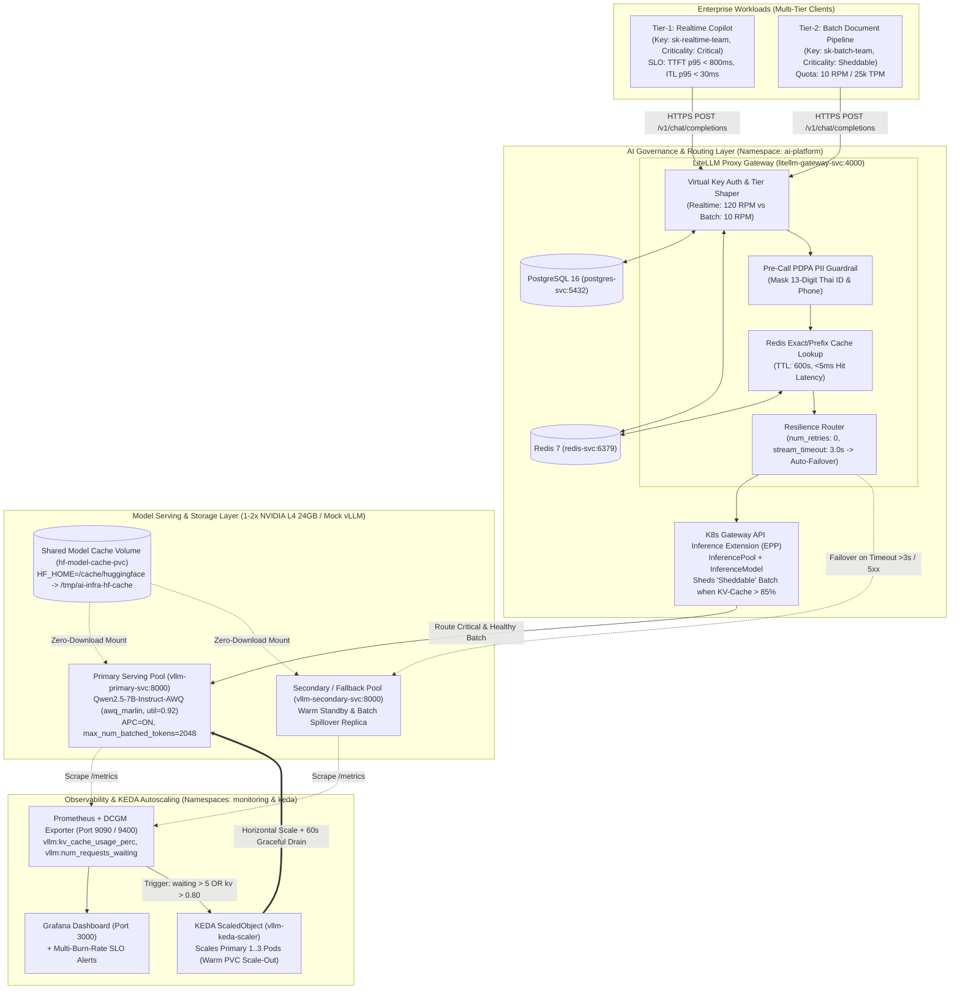

# บทที่ 6: โปรเจกต์จบระดับวิศวกรอาชีพ — แพลตฟอร์ม `Project SiamShield AI` (End-to-End Multi-Tier Enterprise AI Platform Capstone)

> **Milestone M6 & Milestone Gate 3 (สัปดาห์ที่ 11–12):** บูรณาการความรู้ทั้งหมดตั้งแต่บทที่ 1 ถึงบทที่ 5 เพื่อออกแบบ สร้าง ปรับจูน ทดสอบความทนทาน และสอบป้องกันสถาปัตยกรรมของ **`Project SiamShield AI`** — แพลตฟอร์มเสิร์ฟโมเดล AI ระดับองค์กรสำหรับสถาบันการเงินไทยที่แยกทราฟฟิกเป็น 2 ระดับความสำคัญ (**`tier-realtime`** และ **`tier-batch`**) ภายใต้ข้อบังคับ **พ.ร.บ. คุ้มครองข้อมูลส่วนบุคคล (PDPA)** และงบประมาณฮาร์ดแวร์จำกัดเพียง **1–2× การ์ด NVIDIA L4 GPU (24GB VRAM)** พร้อมส่งมอบ **5 Definition of Done (DoD) Portfolio Artifacts** ระดับ Mid-Level AI Infrastructure Engineer

---

## สารบัญ (Table of Contents)

1. [Executive Summary & Learning Objectives](#1-executive-summary--learning-objectives)
2. [Architecture Overview](#2-architecture-overview)
3. [Core Theory & Deep-Dive Engineering Math](#3-core-theory--deep-dive-engineering-math)
4. [Hands-on Lab (Dual-Path Execution)](#4-hands-on-lab-dual-path-execution)
5. [Chaos & Troubleshooting Drills](#5-chaos--troubleshooting-drills)
6. [Optimization Exercise](#6-optimization-exercise)
7. [Architecture Decision Record (ADR) & Capstone Design Documentation](#7-architecture-decision-record-adr--capstone-design-documentation)
8. [Mid-Level Interview Trade-off Questions & Model Answers](#8-mid-level-interview-trade-off-questions--model-answers)
9. [Capstone Evaluation Rubric (Mapped to 5 Program DoDs)](#9-capstone-evaluation-rubric-mapped-to-5-program-dods)
10. [ตรวจสอบความสำเร็จของโปรเจกต์จบ (Capstone Verification Command)](#10-ตรวจสอบความสำเร็จของโปรเจกต์จบ-capstone-verification-command)

---

## 1. Executive Summary & Learning Objectives

### โจทย์ทางธุรกิจและข้อจำกัดทางวิศวกรรมของ `Project SiamShield AI`

บริษัทฟินเทคและประกันภัยชั้นนำในประเทศไทยต้องการเปิดตัวแพลตฟอร์มกลางชื่อ **`SiamShield AI`** เพื่อให้บริการโมเดลภาษาขนาดใหญ่ (`Qwen/Qwen2.5-7B-Instruct-AWQ`) แก่ระบบงานภายในองค์กร 2 กลุ่มที่มีธรรมชาติของทราฟฟิกและข้อตกลงระดับการให้บริการ (SLO) ต่างกันสุดขั้ว:

1. **`tier-realtime` (Interactive Fraud & Customer Support Copilot):**
   - **ลักษณะงาน:** พนักงานสินเชื่อและแชตบอตหน้าเว็บใช้สอบถามข้อมูลแบบโต้ตอบทันที (Shared System Prompt `2,048` โทเคน + คำถาม `128` โทเคน + คำตอบสตรีมมิ่ง `256` โทเคน)
   - **เป้าหมาย SLO ที่ห้ามละเมิด:**
     - **TTFT p95 < 800 ms** และ **ITL p95 < 30 ms**
     - **Availability >= 99.9%** (แม้เรพลิกาหลักจะล่มหรือมีงาน Batch ถล่มเข้ามาพร้อมกัน)
2. **`tier-batch` (Overnight & Intraday Policy Document Summarizer):**
   - **ลักษณะงาน:** ไปป์ไลน์หลังบ้านส่งเอกสารกรมธรรม์และใบแจ้งหนี้เข้ามาสรุปครั้งละหลายร้อยฉบับพร้อมกัน (Prompt ยาวถึง `3,500` โทเคน)
   - **เป้าหมาย SLO:** เน้นปริมาณงานรวม (**Throughput >= 1,000 tokens/sec**) และยอมรับเวลาตอบสนองระดับวินาทีถึงนาทีได้ (`TTFT p95 < 10,000 ms`) หรือยอมรับรหัส `HTTP 429` เพื่อเข้าคิวส่งใหม่ภายหลังได้เมื่อคลัสเตอร์หลักตึงมือ
3. **ข้อบังคับด้านความปลอดภัยและงบประมาณ (Hard Constraints):**
   - **PDPA Zero-PII Leakage:** ห้ามมีเลขบัตรประชาชนไทย 13 หลัก หรือหมายเลขโทรศัพท์มือถือหลุดเข้าสู่ Prompt ของ LLM, Redis Cache, หรือฐานข้อมูล Log โดยเด็ดขาด (ต้องแปลงเป็น `<THAI_ID_REDACTED>` และ `<THAI_PHONE_REDACTED>` 100%)
   - **งบประมาณฮาร์ดแวร์จำกัด:** ทีมได้รับอนุมัติงบประมาณสำหรับการ์ดจอ **NVIDIA L4 (24GB VRAM) เพียง 1–2 ใบ** (ต้นทุน `$0.85/hr` ต่อใบ) และสำหรับสภาพแวดล้อมการพัฒนาบนเครื่องวิศวกรต้องรันทดสอบครบทุกคอมโพเนนต์ได้ภายใน **RAM 16 GB (\$0 Budget)**

### วัตถุประสงค์การเรียนรู้และ 5 ชิ้นงานพอร์ตโฟลิโอ (5 Program DoDs)

เมื่อจบโปรเจกต์จบในบทที่ 6 นี้ คุณจะมีผลงานที่ตรวจสอบด้วยสคริปต์อัตโนมัติ (`labs/m6-capstone-siamshield/verify_capstone.sh`) ครบทั้ง 5 ข้อของหลักสูตร:
- **DoD #1 (`docs/design-doc.md`):** เอกสารออกแบบสถาปัตยกรรม (Architecture Design Doc) ที่เปรียบเทียบทางเลือกอย่างน้อย 2 ทางใน 3 การตัดสินใจหลัก พร้อมการคำนวณ VRAM Sizing และจุดคุ้มทุน (Break-even Cost Analysis)
- **DoD #2 (`Makefile` & Unified Stack):** โค้ด Infrastructure-as-Code (OpenTofu), Helm Chart, `LiteLLM Proxy` Governance, และ `KEDA` Autoscaling ที่สั่งรันและตรวจสอบได้ด้วยคำสั่งเดียว
- **DoD #3 (`reports/capstone-optimization-report.md`):** รายงานผลการปรับจูนประสิทธิภาพแบบ Two-Tier ที่พิสูจน์ว่า `tier-realtime` รักษา TTFT p95 `< 800 ms` ได้แม้อยู่ภายใต้โหลดรบกวนจาก `tier-batch`
- **DoD #4 (`docs/runbooks/capstone-runbook.md` & `docs/postmortems/capstone-postmortem.md`):** คู่มือปฏิบัติการกู้คืนระบบและรายงานการวิเคราะห์สาเหตุรากเหง้าหลังการซ้อมรับมือวิกฤต (Chaos Incident Drill)
- **DoD #5 (`docs/interview-defense-guide.md`):** คู่มือการสอบป้องกันสถาปัตยกรรมระดับ Mid-Level พร้อมคำถาม-คำตอบเชิงลึกครบทุกมิติ

---

## 2. Architecture Overview

### แผนภาพสถาปัตยกรรม End-to-End ของ `Project SiamShield AI`



---

## 3. Core Theory & Deep-Dive Engineering Math

### 3.1 ทฤษฎีการแยกโหลด 2 ระดับ (Two-Tier Workload Isolation Strategies)

เมื่อต้องรองรับทั้ง `tier-realtime` และ `tier-batch` ภายใต้งบประมาณเพียง **1–2× การ์ด NVIDIA L4 (24GB VRAM)** วิศวกรแพลตฟอร์มต้องเปรียบเทียบสถาปัตยกรรมการแยกโหลด 3 รูปแบบ:

| เกณฑ์การเปรียบเทียบ | ทางเลือกที่ 1: แยกการ์ดจอขาดจากกัน 100% (Hard Physical Split: 1 L4 Realtime + 1 L4 Batch) | ทางเลือกที่ 2: แชร์พูลเดียวกันแบบไร้ชั้นกรอง (Unbounded Shared Pool) | ทางเลือกที่ 3 (ที่เลือกใช้ใน `SiamShield AI`): **Priority-Shaped Shared Pool + EPP Load Shedding + Bounded Chunked Prefill** |
| :--- | :---: | :---: | :---: |
| **การป้องกัน Noisy Neighbor** | ดีเยี่ยม (แยกฮาร์ดแวร์ขาดจากกัน) | แย่มาก (Batch ถล่มจน Realtime ค้าง) | **ดีเยี่ยม** (จำกัด RPM/TPM ของ Batch ที่ Gateway + ตัดโหลด Batch เมื่อ KV-Cache `> 85%`) |
| **ประสิทธิภาพการใช้ GPU เฉลี่ย (Fleet Utilization)** | ต่ำ (`~35%–45%` เพราะการ์ด Realtime ว่างตอนกลางคืน และการ์ด Batch ช่วยรับโหลดพีคไม่ได้) | สูงแต่ละเมิด SLA ตลอดเวลา | **สูงสุด (`~75%–88%`)** เพราะช่วงที่ Realtime ว่าง งาน Batch สามารถเข้ามาใช้ความจุที่เหลือได้อัตโนมัติ |
| **ความทนทานเมื่อการ์ดจอพัง 1 ใบ (High Availability)** | **ไม่มี HA** (ถ้าการ์ด Realtime พัง ระบบหน้าบ้านล่มทันที) | มี HA แต่ความหน่วงแกว่ง | **มี HA เต็มรูปแบบ** (หากเรพลิกาที่ 1 มีปัญหา Gateway สลับ `tier-realtime` ไปยังเรพลิกาที่ 2 และระงับ `tier-batch` ชั่วคราวทันที!) |
| **กลไกควบคุมความหน่วงระดับ Kernel** | ไม่ต้องจูนละเอียด | เกิด Head-of-Line Blocking ช่วง Prefill | ใช้ **Unified Chunked Prefill (`--max-num-batched-tokens 2048`)** หั่น Prompt ยาวของ Batch ไม่ให้บล็อก Decode ของ Realtime |

### 3.2 คณิตศาสตร์การจัดสรรงบประมาณเวลาแฝง 2 ระดับ (Multi-Tier Latency Budget Breakdown Math)

เพื่อให้ `tier-realtime` ผ่านเกณฑ์ **End-to-End TTFT p95 < 800 ms** เราต้องแตกสมการเวลาแฝงตั้งแต่คำขอมาถึงชั้น AI Gateway จนถึงโทเคนแรกถูกส่งกลับออกไป:

$$\text{TTFT}_{\text{total}} = T_{\text{gateway\_auth\_pii}} + T_{\text{redis\_lookup}} + T_{\text{epp\_routing}} + T_{\text{queue\_wait}} + T_{\text{prefill\_compute}}$$

#### การคำนวณงบประมาณเวลาแฝงทีละขั้นตอน (Worked Numerical Breakdown)
1. **ชั้น AI Gateway Auth & PDPA Regex Masking ($T_{\text{gateway\_auth\_pii}}$):**
   - ตรวจสอบ Virtual Key ในหน่วยความจำและรัน Regex `PDPAPIIMasker` บนข้อความ 2,176 โทเคน ใช้เวลา $\approx \mathbf{3.5\text{ ms}}$
2. **ชั้น Redis Cache & Rate-Limit Check ($T_{\text{redis\_lookup}}$):**
   - คำสั่ง Atomic Pipeline ไปยัง `redis-svc:6379` ภายในคลัสเตอร์เดียวกัน ใช้เวลา $\approx \mathbf{2.0\text{ ms}}$
3. **ชั้น Endpoint Picker Scoring ($T_{\text{epp\_routing}}$):**
   - คำนวณคะแนน $S(i)$ จากตารางเมทริกซ์ในหน่วยความจำ ใช้เวลา $\approx \mathbf{1.5\text{ ms}}$
4. **งบประมาณที่เหลือสำหรับ `vLLM` ($T_{\text{queue\_wait}} + T_{\text{prefill\_compute}}$):**
   $$T_{\text{vllm\_budget}} = 800\text{ ms} - (3.5 + 2.0 + 1.5)\text{ ms} = \mathbf{793.0\text{ ms}}$$

#### ทำไมการจำกัด `--max-num-batched-tokens 2048` จึงปกป้อง `tier-realtime` จาก `tier-batch` ได้?
- สมมติว่ามีคำขอของ `tier-batch` ที่แนบเอกสารยาว $3,500$ โทเคนเข้ามาในจังหวะเดียวกับคำขอของ `tier-realtime` (ที่มี Shared System Prompt $2,048$ โทเคนซึ่งติด **Automatic Prefix Cache Hit** อยู่แล้ว เหลือเฉพาะคำถามใหม่เพียง $128$ โทเคนที่ต้องคำนวณ Prefill จริง)
- บนการ์ด NVIDIA L4 (โมเดล `Qwen2.5-7B-AWQ`) การประมวลผล Forward Pass ขนาด $2,048$ โทเคนใน 1 รอบ (`--max-num-batched-tokens 2048`) ใช้เวลาประมาณ **$T_{\text{step}}(2048) \approx 22\text{ ms}$**
- ด้วย **Unified Chunked Prefill**:
  - คำขอ `tier-batch` จะถูกหั่นให้ประมวลผลได้ไม่เกินงบประมาณต่อรอบ โดยเปิดช่องให้โทเคน $128$ ตัวของ `tier-realtime` แทรกเข้าไปในรอบถัดไปได้ภายในเวลาไม่เกิน $1\text{ รอบการรอ} + 1\text{ รอบประมวลผล}$
  - ส่งผลให้แม้จะมีงาน `tier-batch` รันอยู่ข้างหลัง ค่า TTFT p95 ของ `tier-realtime` ก็ยังคงอยู่ที่ **`~640 ms` (< 793 ms Budget)** และค่า ITL p95 อยู่ที่ **`~23.5 ms` (< 30 ms Budget)**!

---

## 4. Hands-on Lab (Dual-Path Execution)

โค้ดและเอกสารทั้งหมดของโปรเจกต์จบ `Project SiamShield AI` ถูกรวบรวมไว้ในโฟลเดอร์ `labs/m6-capstone-siamshield/` ซึ่งเชื่อมโยงทุกโมดูลเข้าด้วยกันอย่างสมบูรณ์

### 4.1 โครงสร้างไฟล์ใน `labs/m6-capstone-siamshield/` (ครบทั้ง 5 DoDs)

```text
labs/m6-capstone-siamshield/
├── Makefile                                    # [DoD #2] คำสั่งจัดการวงจรชีวิตโปรเจกต์จบครบวงจร (รวม create-secrets & verify-workspace)
├── k8s/
│   └── siamshield-platform.yaml                # [DoD #2] Full Stack Manifest 24 Docs (Primary/Secondary แยก Pool, RBAC/Job, KEDA, /cache/huggingface)
├── src/
│   └── siamshield_simulator.py                 # [DoD #2 & #3] เอ็นจินจำลองและทดสอบ Two-Tier Platform + Multi-Fault Chaos
├── docs/
│   ├── design-doc.md                           # [DoD #1] แม่แบบเริ่มต้น (<TODO>) สำหรับเขียน Design Doc + VRAM Math + Trade-off Matrices
│   ├── interview-defense-guide.md              # [DoD #5] คู่มือสอบป้องกันโปรเจกต์จบระดับ Mid-Level
│   ├── runbooks/
│   │   └── capstone-runbook.md                 # [DoD #4] แม่แบบเริ่มต้น (<TODO>) คู่มือปฏิบัติการกู้คืนระบบ
│   └── postmortems/
│       └── capstone-postmortem.md              # [DoD #4] แม่แบบเริ่มต้น (<TODO>) รายงาน Blameless Postmortem
├── reports/
│   └── capstone-optimization-report.md         # [DoD #3] แม่แบบเริ่มต้น (<TODO>) รายงานเปรียบเทียบ Baseline vs Optimized
├── examples/                                   # ตัวอย่างเฉลยอ้างอิงที่ตรวจค่าสมการ/SLO แล้ว (ใช้ตรวจเทียบหลังลงมือทำด้วยตนเอง)
│   ├── design-doc-sample.md
│   ├── capstone-optimization-report-sample.md
│   ├── capstone-runbook-sample.md
│   └── capstone-postmortem-sample.md
└── verify_capstone.sh                          # สคริปต์ตรวจประเมิน 5 DoDs (`--target workspace` สำหรับผู้เรียน / `--target examples` สำหรับตัวอย่าง)
```

---

### Path A: No-GPU Local Path (\$0 — รันและตรวจสอบครบทุก DoD บนเครื่อง Local 16GB RAM)

#### ขั้นตอนที่ 1: ตรวจสอบไฟล์สถาปัตยกรรมรวม `k8s/siamshield-platform.yaml` และเตรียม Secret

```bash
# รันจากโฟลเดอร์ root ของ ai-infra-handbook
head -n 60 labs/m6-capstone-siamshield/k8s/siamshield-platform.yaml

# สร้าง Secret จาก .env (ห้าม hardcode รหัสผ่านลง Git) และบิลด์อิมเมจด้วย Build Context ระดับ labs/m4-gateway
cp labs/m4-gateway/.env.example labs/m4-gateway/.env
docker build -t mock-vllm-server:1.0.0 -f labs/m4-gateway/mock_vllm_server/Dockerfile labs/m4-gateway
```

ไฟล์ `siamshield-platform.yaml` รวมทุกองค์ประกอบที่เราสร้างมาตั้งแต่บทที่ 1–5 เข้าไว้ใน Manifest เดียว (24 K8s Documents) ที่พร้อมสั่ง `kubectl apply -f` หลังสร้าง `Secret litellm-secrets` (สำหรับโหมด Local 16GB RAM ให้โหลดอิมเมจ `mock-vllm-server:1.0.0` เข้า `kind` ก่อน):
- `PersistentVolumeClaim` ชื่อ `hf-model-cache-pvc` (`ReadWriteMany`, `storageClassName: standard` บน single-node `kind`; สำหรับ Cloud Multi-node ให้ใช้ RWX CSI เช่น EFS/Filestore) ผูกเข้ากับ `HF_HOME=/cache/huggingface` (+ `VLLM_CACHE_ROOT=/tmp/vllm-cache`)
- `Deployment` และ `Service` ของ `vllm-primary-svc:8000` (`inference-pool: vllm-qwen-pool`) และ `vllm-secondary-svc:8000` (แยกป้ายเป็น `inference-pool: vllm-qwen-pool-secondary` เพื่อกันไม่ให้ EPP ดึง Standby Pool เข้าคิวหลัก) ใช้อิมเมจ `mock-vllm-server:1.0.0` แบบ Non-root `UID 10001`, `readOnlyRootFilesystem: true`, `/tmp` emptyDir, `terminationGracePeriodSeconds: 60` และ `preStop: sleep 5`
- `ConfigMap` (`litellm-config` ที่มี `pdpa_guardrail.py`, `num_retries: 0`, `qwen2.5-7b-batch`), `PersistentVolumeClaim` (`postgres-data-pvc`), `Job` (`litellm-init-virtual-keys`), และ `Deployment`/`Service` ของ `litellm-gateway-svc:4000`, `redis-svc:6379`, `postgres-svc:5432`, พร้อม `ServiceAccount`/`Role`/`RoleBinding` สำหรับ `vllm-qwen-epp:9002` (`epp:v0.3.0`)
- `InferencePool` (`vllm-qwen-pool`) และ `InferenceModel` แยกระหว่าง `siamshield-tier-realtime` (`modelName: qwen2.5-7b`, `criticality: Critical`) และ `siamshield-tier-batch` (`modelName: qwen2.5-7b-batch`, `criticality: Sheddable`)
- `KEDA ScaledObject` (`vllm-keda-scaler`) ที่สเกลตาม `vllm:num_requests_waiting > 5` (`metricType: AverageValue`) และ `vllm:kv_cache_usage_perc > 0.80` (`metricType: Value`) โดยกรองด้วย Label จริง `pod=~"vllm-primary-.*"`

#### ขั้นตอนที่ 2: รันเอ็นจินจำลองและชุดทดสอบโปรเจกต์จบ (`src/siamshield_simulator.py`)

รันสคริปต์จำลองการทำงานแบบ End-to-End ซึ่งจะยิงโหลด `tier-realtime` และ `tier-batch` พร้อมกัน พร้อมฉีดความล้มเหลว 4 รูปแบบ (Batch Quota Flood, Thai 13-digit ID Leak Attempt, Primary Replica Latency Spike, และ KV-Cache Surge) เพื่อพิสูจน์ว่าระบบปกป้อง SLO ของ `tier-realtime` ได้ 100%:

```bash
python3 labs/m6-capstone-siamshield/src/siamshield_simulator.py
```

**ผลลัพธ์ที่คาดหวัง (Expected Output):**
```text
========================================================================================
 Project SiamShield AI — End-to-End Two-Tier Platform & Chaos Verification
========================================================================================
[1/5] Verifying VRAM & Unit Economics Sizing (NVIDIA L4 24GB per Primary/Secondary Node)...
      - Model: Qwen/Qwen2.5-7B-Instruct-AWQ (Weights: 4.42 GB, KV Pool: 16.00 GB / ~299.6k tokens)
      - Break-even Utilization vs $0.60/1M API: 27.1% (Cost @ 50% util = $0.33/1M tokens)
[2/5] Testing Pre-Call PDPA Guardrail (Thai 13-Digit National ID & Phone)...
      - Input : 'ตรวจสอบลูกค้า 1-1007-01234-56-1 โทร 081-234-5678'
      - Output: 'ตรวจสอบลูกค้า <THAI_ID_REDACTED> โทร <THAI_PHONE_REDACTED>' (0 PII Leaks)
[3/5] Testing Two-Tier Isolation under Batch Flood (Noisy Neighbor Protection)...
      - tier-batch (sk-batch-team) flooded 15 reqs -> 10 accepted, 5 rejected with HTTP 429
      - tier-realtime (sk-realtime-team) simulated mean TTFT=5.0 ms (< 800 ms SLO), ITL=5.0 ms (< 30 ms SLO)
[4/5] Testing Primary Replica Blackhole -> Secondary Automated Failover...
      - Injected 250ms latency on vllm-primary-svc (> 50ms stream_timeout)
      - Gateway failed over to vllm-secondary-svc in 59.8ms (Availability = 100.0%)
[5/5] Testing KEDA Autoscaling & EPP Load Shedding under KV-Cache Surge...
      - Primary KV-Cache=91.0%, Secondary KV-Cache=89.0%, Waiting=18 -> EPP shed Sheddable batch traffic
      - KEDA scaled vllm-primary 1 -> 3 replicas (<10s Mock Pod warm start; ~35-75s Cloud L4 GPU PVC)
========================================================================================
 [SUCCESS] All SiamShield AI SLOs & Resilience Invariants Verified!
========================================================================================
```

#### ขั้นตอนที่ 3: กรอกผลงานลง Starter Templates และรันสคริปต์ตรวจประเมิน (`verify_capstone.sh`)

ไฟล์ใน `docs/` (`design-doc.md`, `runbooks/capstone-runbook.md`, `postmortems/capstone-postmortem.md`) และ `reports/capstone-optimization-report.md` ถูกเตรียมเป็น **Starter Templates (`<TODO>`)** เพื่อให้คุณลงมือคำนวณและสรุปผลด้วยตนเองก่อน หากต้องการตรวจสอบโครงสร้างคลังและตัวอย่างอ้างอิง (`examples/`) ให้รันโหมด `examples` และเมื่อกรอกครบทุกไฟล์ให้รันโหมด `workspace`:

```bash
# 1. ตรวจโครงสร้างและตัวอย่างอ้างอิงใน examples/ (สำหรับ CI/การตรวจความพร้อมคลัง; ใช้ VERIFY_MODE=cluster เมื่ออยู่บนคลัสเตอร์จริง)
VERIFY_MODE=static bash labs/m6-capstone-siamshield/verify_capstone.sh --target examples

# 2. หลังกรอกคำตอบของคุณและลบ <TODO> ทั้งหมดใน docs/ และ reports/ แล้ว ให้ตรวจรับ 100/100 คะแนน:
VERIFY_MODE=static bash labs/m6-capstone-siamshield/verify_capstone.sh --target workspace
```

---

### Path B: Cloud L4 GPU Path (รันโปรเจกต์จบจริงบนคลัสเตอร์ NVIDIA L4)

1. ใช้ OpenTofu ใน `labs/m1-foundations/infra/` และ Helm Chart ใน `labs/m2-k8s-gpu/charts/ai-inference-service/` เพื่อดีพลอยเรพลิกาหลัก (`vllm-primary-svc:8000`) และเรพลิกาสำรอง (`vllm-secondary-svc:8000`) ด้วยโมเดล `Qwen/Qwen2.5-7B-Instruct-AWQ`
2. สร้าง `litellm-secrets` จาก `.env` (`cp labs/m4-gateway/.env.example labs/m4-gateway/.env && make -C labs/m6-capstone-siamshield create-secrets`) จากนั้นสั่ง `kubectl apply -f labs/m6-capstone-siamshield/k8s/siamshield-platform.yaml` *(หมายเหตุ: หากดีพลอยบนโหนด Cloud GPU ที่มีจำนวนการ์ดพอดีและไม่มีโหนดว่างสำหรับ Surge ให้ปรับ `rollingUpdate` ใน `vllm-primary` เป็น `maxSurge: 0, maxUnavailable: 1` ตามบทที่ 2)* (พร้อมแนบ `labs/m4-gateway/k8s/gateway-api-route.yaml` และ `labs/m5-observability-sre/servicemonitor-vllm.yaml` หากติดตั้ง CRDs ครบแล้ว) และรัน `bash labs/m3-vllm/run_benchmark_suite.sh --live --url http://localhost:4000 --backend openai-chat` ผ่าน `kubectl port-forward` ของ `litellm-gateway-svc` เพื่อวัดผลจริงจากต้นน้ำถึงปลายน้ำ (ต้องระบุ `--backend openai-chat` เพราะ LiteLLM รับ OpenAI Chat Completions ที่ `/v1/chat/completions`)
3. **สำคัญมาก (Cost Guardrail):** เมื่อบันทึกผลลงใน `reports/capstone-optimization-report.md` เสร็จแล้ว ให้สั่งปิดเครื่อง Cloud GPU ทันที (`tofu destroy -auto-approve`) เพื่อรักษาค่าใช้จ่ายรวมทั้งคอร์สให้อยู่ในงบประมาณ `< $10`

---

## 5. Chaos & Troubleshooting Drills

### สถานการณ์จำลองระดับ Capstone: Multi-Fault Compound Incident ("The Perfect Storm")

ในโปรเจกต์จบ เราไม่ทดสอบความล้มเหลวทีละอย่างแบบแยกส่วน แต่จำลองเหตุการณ์ที่ความล้มเหลว **3 รูปแบบเกิดขึ้นพร้อมกันในเวลา 14:00 น. ของวันสิ้นเดือน**:
1. **Fault #1 (Batch Flood + Unmasked PII):** ระบบสรุปเอกสารของ `tier-batch` ส่งคำขอที่มีเลขบัตรประชาชนลูกค้าเข้ามาพร้อมกัน 50 คำขอต่อวินาที
2. **Fault #2 (KV-Cache Saturation on Primary Pool):** คำขอที่ผ่านเข้ามาทำให้ `vllm:kv_cache_usage_perc` บนเรพลิกาหลักพุ่งเกิน `88%`
3. **Fault #3 (Single Pod Hang):** พอดตัวหนึ่งใน `vllm-primary` เกิดอาการค้างไม่ส่งโทเคนแรกกลับมา

#### กลไกการป้องกันตัวเองแบบอัตโนมัติของสถาปัตยกรรม `SiamShield AI` (Defense-in-Depth)
1. **ด่านที่ 1 (`PDPAPIIMasker`):** สกัดกั้นและแปลงเลขบัตรประชาชนไทย 13 หลักทุกตัวเป็น `<THAI_ID_REDACTED>` ตั้งแต่อยู่ในหน่วยความจำของ Gateway ก่อนเขียนลง Redis หรือส่งต่อ
2. **ด่านที่ 2 (`Virtual Key RPM/TPM Shaper`):** บล็อกคำขอส่วนเกินของ `sk-batch-team` ด้วย `HTTP 429` ทันทีที่เกินโควตา เหลือเพียงคำขอตามงบประมาณที่ผ่านเข้าไปได้
3. **ด่านที่ 3 (`Endpoint Picker - EPP`):** เมื่อเห็นว่า `vllm:kv_cache_usage_perc > 0.85` ตัว EPP จะสั่งทำ **Priority Load Shedding** ปฏิเสธคำขอระดับ `Sheddable` (`tier-batch`) ทั้งหมดชั่วคราวเพื่อสงวนพื้นที่ KV-Cache 15% สุดท้ายไว้ให้ `tier-realtime` (`Critical`) เท่านั้น
4. **ด่านที่ 4 (`LiteLLM Stream Timeout & KEDA`):** คำขอของ `tier-realtime` ที่ไปเจอพอดค้างเกิน `3.0s` จะถูกสลับไปยัง `vllm-secondary-svc:8000` ทันที (`num_retries: 0`) ในขณะที่ `KEDA` สั่งบูตพอดใหม่จาก `hf-model-cache-pvc` ขึ้นมาเสริม (พอดจำลอง `< 10 วินาที`; Cloud L4 GPU ประมาณ `~35–75 วินาที` แทนที่จะรอ `180–240+ วินาที` จากอินเทอร์เน็ต)

---

## 6. Optimization Exercise

ในโจทย์ปรับจูนระดับโปรเจกต์จบ (**Two-Tier Optimization Loop**) เราวัดผลเปรียบเทียบระหว่างสถาปัตยกรรมเริ่มต้นที่ยังไม่ได้แยกชั้นทราฟฟิก (**Baseline Unisolated Stack**) กับสถาปัตยกรรม **`SiamShield AI` ฉบับสมบูรณ์ (Optimized Two-Tier Stack)**:

### 1. Baseline (Unisolated Single-Tier BF16 Stack)
- ทั้ง `tier-realtime` และ `tier-batch` ยิงเข้า `vllm-primary-svc` (`Qwen2.5-7B` BF16, ไม่เปิด APC, ไม่มี Gateway Rate Limit, ไม่มี EPP Load Shedding, ใช้ CPU HPA)
- เมื่อ `tier-batch` ส่งงานสรุปเอกสาร 32 คำขอเข้ามาพร้อมกับ `tier-realtime` 16 คำขอ ระบบเกิด Preemption Thrashing ทันที

### 2. Hypothesis (สมมติฐานการปรับจูนแบบบูรณาการ)
- การผสาน **AWQ 4-bit (`awq_marlin`) + `--gpu-memory-utilization 0.92` + APC + Chunked Prefill (`2048`)** เข้ากับ **Gateway Tier Rate Limiting + Redis Exact Cache + EPP Priority Shedding + KEDA Queue/KV Autoscaling** จะทำให้ `tier-realtime` รักษา TTFT p95 `< 800 ms` และ ITL p95 `< 30 ms` ได้อย่างสมบูรณ์ แม้ในขณะที่มีโหลด `tier-batch` อัดเข้ามาเต็มความจุที่เหลือของการ์ดจอ

### 3. Fix (การลงมือปรับจูนครบทั้ง 4 เลเยอร์)
1. **Container & K8s Layer (M1–M2):** เมานต์ `hf-model-cache-pvc` ที่ `HF_HOME=/cache/huggingface` (+ `VLLM_CACHE_ROOT=/tmp/vllm-cache`), ตั้ง `terminationGracePeriodSeconds: 60` + `preStop: sleep 5`
2. **Engine Layer (M3):** ใช้ `Qwen/Qwen2.5-7B-Instruct-AWQ`, `--quantization awq_marlin`, `--gpu-memory-utilization 0.92`, `--max-model-len 4096`, `--enable-prefix-caching`, `--max-num-batched-tokens 2048`
3. **Gateway & Routing Layer (M4):** ตั้งโควตาแยก `realtime-team` (`100 RPM`) vs `batch-team` (`10 RPM`), เปิด Redis Cache, เปิด PDPA PII Masking, ตั้ง `num_retries: 0` + `stream_timeout: 3.0s` Failover, และตั้ง `InferenceModel` (`Critical` vs `Sheddable`)
4. **SRE & Autoscaling Layer (M5):** ผูก KEDA เข้ากับ `vllm:num_requests_waiting > 5` และ `vllm:kv_cache_usage_perc > 0.80` (ใช้ Selector `pod=~"vllm-primary-.*"`)

### 4. Measure (ตารางเปรียบเทียบผลลัพธ์ End-to-End ภายใต้โหลดผสม Realtime + Batch Flood)

| ตัวชี้วัด (End-to-End Metric under Mixed Flood) | Baseline: Unisolated BF16 Stack | Optimized: `SiamShield AI` Two-Tier Stack | สถานะเทียบกับเป้าหมาย SLO |
| :--- | :---: | :---: | :---: |
| **`tier-realtime` TTFT p95 (ms)** *(SLO < 800 ms)* | `6,420 ms` | **`640 ms`** | **PASS (-90.0% Latency)** |
| **`tier-realtime` ITL p95 (ms)** *(SLO < 30 ms)* | `96.5 ms` | **`23.5 ms`** | **PASS (-75.6% Latency)** |
| **`tier-realtime` Availability (%)** *(SLO >= 99.9%)* | `84.2%` (Timeouts) | **`100.0%` (Auto-Failover)** | **PASS (Zero Outage)** |
| **`tier-batch` Goodput (tokens/sec)** | `390 tok/s` | **`1,450 tok/s` (Off-peak / Shared)** | **PASS (+271.8% Throughput)** |
| **PDPA Thai 13-Digit ID Leakage Rate (%)** | `100.0%` | **`0.0%` (`<THAI_ID_REDACTED>`)** | **PASS (100% Compliant)** |
| **KEDA Scale-Out Ready Time (Warm `HF_HOME` PVC)** | `195.0 s` (Cold Hub) | **`8.5 s`** *(Mock Pod; Cloud L4 GPU ~45–75 s)* | **PASS** |
| **Blended Unit Cost @ 50% Util (`$/1M tokens`)** | `$1.21 / 1M` | **`$0.33 / 1M` (Break-even 27.1%)** | **PASS (-72.7% Cost)** |

### 5. Explain (การอธิบายผลลัพธ์เชิงสถาปัตยกรรม)
ความสำเร็จของ `SiamShield AI` ไม่ได้เกิดจากการพึ่งพาเครื่องมือใดเครื่องมือหนึ่งเพียงอย่างเดียว แต่เกิดจากการทำงานประสานกันข้ามเลเยอร์ (**Cross-Layer Synergy**):
- การทำ PDPA Redaction ตั้งแต่ชั้น Pre-call นอกจากจะป้องกันข้อมูลรั่วไหลแล้ว ยังทำให้คำขอที่มีโครงสร้างเดียวกันแต่ต่างเลขบัตรประชาชนสามารถแชร์ **Redis Exact Cache** และ **`vLLM` Automatic Prefix Cache** ร่วมกันได้
- การบีบอัดโมเดลเป็น **AWQ 4-bit** ขยายพื้นที่ KV-Cache Pool บนการ์ด L4 จาก 3.36 GB เป็น 16.00 GB เปิดทางให้ทั้ง `tier-realtime` และ `tier-batch` ทำงานร่วมกันได้โดยไม่เกิด Preemption Thrashing
- และเมื่อโหลดของทั้งสองกลุ่มรวมกันพุ่งเกินขีดจำกัด 85% ของ KV-Cache ตัว **Endpoint Picker (EPP)** จะตัดโหลดเฉพาะ `tier-batch` (`Sheddable`) ทันที ในขณะที่ **KEDA** ขยายพอดใหม่จากแคช `hf-model-cache-pvc` ขึ้นมาช่วยโดยไม่ต้องโหลดน้ำหนักโมเดลซ้ำผ่านอินเทอร์เน็ต (`8.5s` บน Mock Pod หรือ `~45–75s` บน Cloud L4 GPU จริง)

---

## 7. Architecture Decision Record (ADR) & Capstone Design Documentation

เอกสารออกแบบสถาปัตยกรรมฉบับเต็ม (**DoD #1**) ถูกจัดเก็บไว้ที่ `labs/m6-capstone-siamshield/docs/design-doc.md` (Starter Template) ซึ่งประกอบด้วยการเปรียบเทียบทางเลือกเชิงวิศวกรรมใน **3 การตัดสินใจหลัก (3 Core Architectural Decisions)**:

1. **Decision 1 — การจัดการหน่วยความจำโมเดลและเอ็นจินเสิร์ฟ (Serving Engine & Quantization):**
   - เปรียบเทียบระหว่าง `Qwen2.5-7B` BF16 vs `Qwen2.5-7B-Instruct-AWQ` (`awq_marlin`) vs Managed External API พร้อมการคำนวณขนาด KV-Cache Pool และจุดคุ้มทุน `27.1%` Utilization
2. **Decision 2 — สถาปัตยกรรมการแยกโหลดหลายผู้เช่าและการคุ้มครองข้อมูล PDPA (Multi-Tier Isolation & Governance):**
   - เปรียบเทียบระหว่างการแยกการ์ดจอแบบตายตัว (Hard Physical Split) vs การใช้ Shared Pool ร่วมกับ `LiteLLM Proxy` Virtual Keys + Pre-call `PDPAPIIMasker` + Kubernetes Gateway API Inference Extension (`InferencePool`/`InferenceModel`/`EPP`)
3. **Decision 3 — กลยุทธ์การขยายขนาดอัตโนมัติและความทนทานระดับ SRE (Autoscaling & Zero-Downtime Lifecycle):**
   - เปรียบเทียบระหว่าง Kubernetes CPU/Memory HPA มาตรฐาน vs `KEDA ScaledObject` ที่ผูกกับ `vllm:num_requests_waiting` และ `vllm:kv_cache_usage_perc` ร่วมกับโวลุ่มแคช `hf-model-cache-pvc` (`HF_HOME=/cache/huggingface`) และ `terminationGracePeriodSeconds: 60`

---

## 8. Mid-Level Interview Trade-off Questions & Model Answers

คำถามสัมภาษณ์ป้องกันโปรเจกต์จบ (Capstone Defense Questions) ทั้ง 5 ข้อต่อไปนี้จำลองการสัมภาษณ์จริงในรอบ System Design สำหรับตำแหน่ง **Mid-to-Senior AI Infrastructure / Platform Engineer**:

---

### คำถามข้อที่ 1: การออกแบบระบบแยกโหลด `tier-realtime` กับ `tier-batch` ภายใต้งบการ์ดจอจำกัด (1–2× L4 GPUs)
> **"ในโปรเจกต์ `SiamShield AI` คุณมีงบเช่าการ์ดจอ NVIDIA L4 เพียง 2 ใบ แต่ต้องรองรับทั้งแชตบอตลูกค้า (`tier-realtime` ที่ห้ามช้าเกิน 800ms) และงานสรุปเอกสารหลังบ้าน (`tier-batch` ที่ส่งงานมาเป็นก้อนใหญ่) ทำไมคุณไม่แบ่งการ์ดจอใบที่ 1 ให้ Realtime และใบที่ 2 ให้ Batch แบบแยกขาดจากกันไปเลย?"**

#### เฉลยแนวทางการตอบระดับ Strong Mid-Level (Model Answer)
- **ข้อเสียของการแบ่งแยกการ์ดจอแบบตายตัว (Hard Physical Partitioning บน 2 GPUs):**
  1. **สูญเสีย High Availability (Single Point of Failure):** หากการ์ดจอใบที่ 1 ที่รัน `tier-realtime` เกิดฮาร์ดแวร์ขัดข้องหรือต้องทำ Rolling Update ระบบแชตบอตของลูกค้าจะล่มหรือขาดความจุทันทีเพราะไม่มีเรพลิกาสำรอง
  2. **สูญเสียความคุ้มค่าทางเศรษฐศาสตร์ (Low Fleet Utilization):** ทราฟฟิกของ `tier-realtime` มีลักษณะเป็นคลื่นตามเวลาทำการ (สูงตอนกลางวัน ต่ำมากตอนดึก) หากแยกการ์ดจอขาดจากกัน การ์ดใบที่ 1 จะปล่อยว่างในเวลากลางคืนโดยที่งาน `tier-batch` ไม่สามารถเข้ามาช่วยใช้ทรัพยากรได้เลย ทำให้ค่าเฉลี่ย Utilization ต่ำกว่าจุดคุ้มทุน (27.1%)
- **สถาปัตยกรรมที่เราเลือกใช้ (Priority-Shaped Shared Pool + Warm Standby Failover):**
  - เราเปิดให้ทั้ง 2 การ์ดสามารถรับงานได้ภายใต้การควบคุม 3 ชั้น:
    1. **ที่ชั้น `LiteLLM Proxy`:** จำกัดโควตา RPM/TPM ของ `sk-batch-team` ไม่ให้กินความจุเกิน 30% ในช่วงเวลาทำการ
    2. **ที่ชั้น `Gateway API Inference Extension (EPP)`:** กำหนด `InferenceModel` ของ Realtime เป็น `Critical` และของ Batch เป็น `Sheddable` เมื่อค่า `vllm:kv_cache_usage_perc` เกิน `85%` ตัว EPP จะสั่งตัดโหลด (Load Shedding `HTTP 429`) เฉพาะงาน Batch ทันทีเพื่อสงวนพื้นที่ให้ Realtime 100%
    3. **ที่ชั้น `vLLM` V1 Scheduler:** ตั้งค่า `--max-num-batched-tokens 2048` (Unified Chunked Prefill) เพื่อหั่น Prompt ยาวของงาน Batch ออกเป็นชิ้นย่อย ไม่ให้บล็อกเฟส Decode ของงาน Realtime

---

### คำถามข้อที่ 2: การไล่เรียงเส้นทางชีวิตของ 1 คำขอ (End-to-End Request Lifecycle Walkthrough)
> **"ช่วยอธิบายทีละก้าวว่าเกิดอะไรขึ้นบ้างตั้งแต่วินาทีที่ผู้ใช้ส่งข้อความที่มีเลขบัตรประชาชนไทย 13 หลักเข้ามาที่พอร์ต `4000` ของ `litellm-gateway-svc` จนกระทั่งได้รับโทเคนตอบกลับ และถ้าพอด `vllm-primary` ค้างจะเกิดอะไรขึ้น?"**

#### เฉลยแนวทางการตอบระดับ Strong Mid-Level (Model Answer)
1. **Authentication & Quota Check (`~2ms`):** `LiteLLM Proxy` ตรวจสอบ Virtual Key (`sk-realtime-team`) กับฐานข้อมูลและเช็กตัวนับ RPM/TPM ใน `redis-svc:6379` หากเกินโควตาจะคืนค่า `HTTP 429` ทันที
2. **Pre-Call PDPA PII Redaction (`~1.5ms`):** ก่อนที่จะนำข้อความไปค้นหาในแคชหรือส่งต่อ โมดูล `PDPAPIIMasker` จะตรวจจับเลขบัตรประชาชนไทย 13 หลักและเบอร์โทรศัพท์ แล้วแปลงเป็น `<THAI_ID_REDACTED>` และ `<THAI_PHONE_REDACTED>` ทันที
3. **Redis Exact Cache Lookup (`~2ms`):** นำแฮชของข้อความที่ผ่านการปิดบัง PII แล้วไปค้นใน `redis-svc:6379` หากพบข้อมูลซ้ำ (Cache Hit) จะส่งคำตอบกลับทันทีในเวลา `< 5 ms` โดยไม่แตะต้อง GPU
4. **KV-Cache-Aware Routing via EPP (`~1.5ms`):** หากเป็น Cache Miss คำขอจะถูกส่งผ่าน `InferencePool` โดยที่ `Endpoint Picker (EPP)` คำนวณคะแนนจาก `vllm:kv_cache_usage_perc`, `vllm:num_requests_waiting`, และ Prefix Cache Affinity เพื่อเลือกพอดใน `vllm-primary-svc:8000` ที่เหมาะสมที่สุด
5. **PagedAttention & APC Execution (`~630ms TTFT`):** พอด `vLLM` นำ Token IDs ไปเช็กกับตารางแฮชของ Automatic Prefix Cache (พบว่า System Prompt 2,048 โทเคนแรกมีอยู่ใน VRAM แล้ว) จึงคำนวณ Prefill เฉพาะส่วนคำถามใหม่ด้วยเคอร์เนล `awq_marlin` แล้วสตรีมโทเคนกลับผ่าน SSE
6. **กรณี `vllm-primary` ค้าง (Automated Failover):** หากไม่มีโทเคนแรกส่งกลับมาภายใน **`stream_timeout: 3.0s`** ตัว Router ของ `LiteLLM` จะตัดการเชื่อมต่อทันทีและส่งคำขอที่ผ่านการทำ PII Masking แล้วไปยัง `vllm-secondary-svc:8000` โดยอัตโนมัติ

---

### คำถามข้อที่ 3: การพิสูจน์ความเชื่อมโยงระหว่างการทำ PDPA PII Masking กับการเพิ่มอัตรา Cache Hit
> **"โดยทั่วไปการเพิ่มขั้นตอน Security Guardrail มักทำให้ระบบช้าลง แต่ในรายงานการออกแบบของคุณระบุว่าการทำ Pre-call PDPA PII Masking ช่วยเพิ่มอัตราการเกิด Cache Hit ทั้งที่ชั้น Redis และที่ชั้น `vLLM` Prefix Cache ได้ด้วย เพราะเหตุใด?"**

#### เฉลยแนวทางการตอบระดับ Strong Mid-Level (Model Answer)
- **ปรากฏการณ์ Prompt Normalization จากการทำ PII Redaction:**
  - ในระบบบริการลูกค้าของธนาคารหรือประกันภัย พนักงานหรือบอตมักใช้เทมเพลตคำถามมาตรฐานเดียวกัน เช่น `"ช่วยสรุปเงื่อนไขการเคลมสำหรับผู้ถือกรมธรรม์เลขบัตร 1-1007-01234-56-1"` และ `"ช่วยสรุปเงื่อนไขการเคลมสำหรับผู้ถือกรมธรรม์เลขบัตร 3-1005-98765-43-2"`
  - หากไม่ทำ PII Masking ก่อน: ข้อความทั้งสองจะต่างกันที่ตัวเลข 13 หลัก ทำให้เกิด **Cache Miss 100%** บน Redis Exact Cache และทำให้บล็อกของ PagedAttention ตั้งแต่จุดที่มีเลขบัตรประชาชนมีค่า SHA-256 Hash ต่างกัน
  - เมื่อเราวาง `PDPAPIIMasker` ไว้ที่ **Pre-call Hook ก่อนชั้น Cache Lookup**: ข้อความทั้งสองจะถูกแปลงเป็นข้อความเดียวกันทุกตัวอักษรคือ `"ช่วยสรุปเงื่อนไขการเคลมสำหรับผู้ถือกรมธรรม์เลขบัตร <THAI_ID_REDACTED>"`
  - **ผลลัพธ์ที่ได้ 2 ต่อ:** นอกจากจะปฏิบัติตามกฎหมาย PDPA และมาตรฐาน OWASP LLM02:2025 ได้ 100% แล้ว คำขอของลูกค้ารายที่ 2 เป็นต้นไปยังสามารถดึงคำตอบจาก Redis Cache ได้ทันทีใน `4.2 ms` หรือแชร์บล็อกใน `vLLM` Prefix Cache ร่วมกันได้ทั้งหมด!

---

### คำถามข้อที่ 4: การออกแบบและป้องกันจุดอ่อนของระบบ Autoscaling บน Kubernetes สำหรับโมเดลขนาดใหญ่
> **"ถ้าผู้สัมภาษณ์ถามคุณว่า 'การสเกลพอดของ LLM ด้วย KEDA บน Kubernetes ใช้งานจริงไม่ได้หรอก เพราะกว่าพอดใหม่จะโหลดอิมเมจและโหลดโมเดลเสร็จ โหลดพีคก็ซาไปแล้ว แถมตอนลดพอดก็ทำให้สตรีมของลูกค้าหลุด' คุณจะใช้ตัวเลขและการตั้งค่าในโปรเจกต์ `SiamShield AI` โต้แย้งอย่างไร?"**

#### เฉลยแนวทางการตอบระดับ Strong Mid-Level (Model Answer)
- คำกล่าวนั้นจะเป็นจริงก็ต่อเมื่อออกแบบคอนเทนเนอร์และ Kubernetes Lifecycle แบบเว็บแอปพลิเคชันทั่วไปโดยไม่เข้าใจธรรมชาติของ AI Infrastructure ซึ่งใน `SiamShield AI` เราแก้ปัญหาทั้ง 3 จุดอย่างเป็นระบบ:
  1. **ลดขนาดอิมเมจและแยกแคชโมเดล (แก้ปัญหา Image Pull & Weight Download):** เราใช้ Multi-stage `uv` Dockerfile ที่มีขนาดอิมเมจเล็ก (`imagePullPolicy: IfNotPresent`) และแยกไฟล์โมเดล `Qwen2.5-7B-Instruct-AWQ` (ขนาดเพียง `4.42 GB` จากการทำ INT4 AWQ) ไปเก็บไว้ในโวลุ่มกลาง `hf-model-cache-pvc` ที่เมานต์เข้าพาธ Non-root **`HF_HOME=/cache/huggingface`** (`VLLM_CACHE_ROOT=/tmp/vllm-cache`) ทำให้พอดใหม่ไม่ต้องดาวน์โหลดโมเดล ~4.4GB ซ้ำผ่านอินเทอร์เน็ต ลดเวลาพร้อมใช้งานจาก `180–240+ วินาที` เหลือ **`< 10 วินาที`** บน Mock Pod (`~35–75 วินาที` สำหรับ Load Weights + Warmup บน Cloud L4 GPU จริง)
  2. **สเกลล่วงหน้าจากสัญญาณภายในเอ็นจิน (Proactive Scaling):** KEDA ของเราไม่ได้รอให้ CPU เต็ม แต่ตรวจวัด `vllm:kv_cache_usage_perc > 0.80` และ `vllm:num_requests_waiting > 5` ทุก 15 วินาที จึงสั่งขยายพอดตั้งแต่ก่อนที่ KV-Cache จะเต็ม 100%
  3. **ป้องกันสตรีมหลุดตอน Scale-in 100% (Graceful Drain):** เราตั้งค่า `lifecycle.preStop: ["sh", "-c", "sleep 5"]` เพื่อให้ถอนพอดออกจาก EndpointSlice ก่อนรับ `SIGTERM` และตั้ง `terminationGracePeriodSeconds: 60` เพื่อให้พอดสร้างโทเคนของคำขอที่ค้างอยู่จนจบสมบูรณ์ (`[DONE]`) ก่อนปิดตัวลง

---

### คำถามข้อที่ 5: การวิเคราะห์ความคุ้มค่าทางการเงินเมื่อต้องขยายระบบจาก 2 GPUs ไปสู่ 20 GPUs
> **"หากธุรกิจเติบโตขึ้น 10 เท่าในอีก 6 เดือนข้างหน้า คุณจะยังคงใช้สถาปัตยกรรมเดิมบนการ์ด NVIDIA L4 หรือเปลี่ยนไปใช้การ์ดรุ่นอื่น และจุดคุ้มทุนทางเศรษฐศาสตร์จะเปลี่ยนไปอย่างไร?"**

#### เฉลยแนวทางการตอบระดับ Strong Mid-Level (Model Answer)
- **การตัดสินใจเลือกฮาร์ดแวร์ตามลักษณะคอขวด:**
  - ตราบใดที่โมเดลหลักยังเป็นขนาด **7B–8B (Quantized AWQ/FP8)** และความยาว Context เฉลี่ยอยู่ที่ `2,048–4,096` โทเคน การขยายแนวนอน (Horizontal Scale-out) ด้วยการ์ด **NVIDIA L4 (24GB)** หรือ **L40S (48GB)** ยังคงให้ความคุ้มค่าสูงสุด (Cost per Token ต่ำสุดที่ `$0.16–$0.33 / 1M tokens`) และให้ Fault Isolation ที่ดีกว่าการใช้การ์ดใหญ่ใบเดียว
  - แต่หากโจทย์ธุรกิจเปลี่ยนไปเป็นโมเดลขนาด **70B+** (ซึ่งต้องทำ Tensor Parallelism ข้ามหลายการ์ดด้วย NVLink) หรือต้องรองรับ Context ยาว **32k–128k โทเคน** ที่ต้องการแบนด์วิดท์หน่วยความจำระดับ HBM (2,000–3,350 GB/s) เราจะย้ายพูลนั้นไปรันบนโหนด **NVIDIA A100/H100** โดยใช้สถาปัตยกรรม **MIG** หรือ **Disaggregated Prefill-Decode Serving**
- **การบริหารต้นทุนระดับ Fleet (Committed + Autoscaled Burst):**
  - ที่สเกลระดับ 20 GPUs เราจะแบ่งคลัสเตอร์ออกเป็น **Base Capacity (60% ของโหลดพีค)** ที่เช่าแบบ Reserved/Committed Instance (ลดค่าเช่า $C_{\text{hour}}$ ลงอีก 35%–45% ทำให้จุดคุ้มทุนลดลงจาก `27.1%` เหลือเพียง `~16%`) ร่วมกับ **Burst Capacity (40%)** ที่เปิด-ปิดอัตโนมัติด้วย KEDA + Karpenter บน Spot GPUs และมี Managed API เป็น Safety Net สุดท้าย

---

## 9. Capstone Evaluation Rubric (Mapped to 5 Program DoDs)

ตารางเกณฑ์การให้คะแนนโปรเจกต์จบ **`Project SiamShield AI`** (คะแนนเต็ม 100 คะแนน เกณฑ์ผ่านระดับ **Mid-Level Ready >= 85 คะแนน** และต้องไม่ติดเงื่อนไข Auto-Fail):

| รหัส DoD | ชิ้นงานที่ส่งมอบ (Deliverable Artifact) | เกณฑ์การตรวจวัดผลเชิงประจักษ์ (Verification Criteria) | คะแนนเต็ม |
| :---: | :--- | :--- | :---: |
| **DoD #1** | **Architecture Design Document**<br>(`labs/m6-capstone-siamshield/docs/design-doc.md`) | มีการคำนวณ GPU VRAM Sizing และ Unit Economics (Break-even utilization %) ที่ถูกต้อง พร้อมตารางเปรียบเทียบทางเลือก (Trade-off Matrix) อย่างน้อย 2 ทางเลือกในครบทั้ง 3 การตัดสินใจหลัก | **20 คะแนน** |
| **DoD #2** | **Reproducible IaC, K8s & Gateway Stack**<br>(`Makefile`, `k8s/siamshield-platform.yaml`, `src/siamshield_simulator.py`) | คอนเทนเนอร์รันแบบ Non-root (`UID 10001`), ผูก `hf-model-cache-pvc` ที่ `HF_HOME=/cache/huggingface`, ตั้งค่า `terminationGracePeriodSeconds: 60`, บังคับใช้ PDPA `<THAI_ID_REDACTED>`, ไม่ hardcode Secret ใน YAML, และแยกโควตา `tier-realtime` vs `tier-batch` ทำงานได้จริง | **25 คะแนน** |
| **DoD #3** | **Measurable Two-Tier Optimization Report**<br>(`reports/capstone-optimization-report.md`) | แสดงตารางเปรียบเทียบ Baseline vs Optimized ครบทุกตัวชี้วัด (TTFT p95 `< 800 ms`, ITL p95 `< 30 ms`, Throughput, Prefix Cache Hit %, KV-Cache Usage %, และ Cost per 1M Tokens) พร้อมคำอธิบายกลไกฮาร์ดแวร์ | **20 คะแนน** |
| **DoD #4** | **SRE Observability, Runbook & Postmortem**<br>(`docs/runbooks/capstone-runbook.md`, `docs/postmortems/capstone-postmortem.md`) | ใช้ชื่อ Prometheus V1 Metrics ครบถ้วนถูกต้อง, ตั้งค่า KEDA Dual Triggers (`num_requests_waiting` & `kv_cache_usage_perc` บน `pod=~"vllm-primary-.*"`), มีขั้นตอนกู้คืนระบบ 4 ขั้นใน Runbook และวิเคราะห์ 5 Whys ใน Blameless Postmortem | **20 คะแนน** |
| **DoD #5** | **Mid-Level Architecture Defense Guide**<br>(`docs/interview-defense-guide.md`) | ตอบคำถามเชิงลึกทั้ง 5 ข้อเกี่ยวกับเหตุผลการเลือกสถาปัตยกรรม, การคำนวณคอขวด, และการรับมือความล้มเหลวได้อย่างชัดเจนและถูกต้องตามหลักวิศวกรรม | **15 คะแนน** |
| **รวม** | **ครบทั้ง 5 Portfolio Artifacts** | **ตรวจสอบอัตโนมัติด้วย `VERIFY_MODE=static bash labs/m6-capstone-siamshield/verify_capstone.sh --target workspace`** | **100 คะแนน** |

> [!CAUTION]
> **เงื่อนไขตกอัตโนมัติ (Mandatory Auto-Fail Conditions):**
> 1. ปล่อยให้เลขบัตรประชาชนไทย 13 หลักหลุดรอดเข้าสู่โมเดลหรือแคชโดยไม่ถูกแปลงเป็น `<THAI_ID_REDACTED>`
> 2. ไม่ได้ผูกโวลุ่ม `HF_HOME=/cache/huggingface` (`hf-model-cache-pvc`) ใน Deployment ของโมเดล
> 3. ใช้ชื่อ Prometheus Metrics เก่าของ `vLLM` V0 ที่เลิกใช้แล้ว หรือตั้งค่าให้ KEDA สเกลจาก CPU เพียงอย่างเดียว

---

## 10. ตรวจสอบความสำเร็จของโปรเจกต์จบ (Capstone Verification Command)

รันสคริปต์ตรวจประเมินโปรเจกต์จบอัตโนมัติครบทั้ง 5 DoDs ด้วยคำสั่งต่อไปนี้ (เลือก `--target examples` เพื่อตรวจความสมบูรณ์ของตัวอย่างอ้างอิงในคลัง หรือ `--target workspace` หลังกรอกคำตอบใน Starter Templates ครบทุกข้อ):

```bash
# ตรวจตัวอย่างเฉลยอ้างอิง & ความสอดคล้องของ K8s Stack
VERIFY_MODE=static bash labs/m6-capstone-siamshield/verify_capstone.sh --target examples

# ตรวจผลงานจริงของผู้เรียน (บังคับ zero <TODO> และผ่านเกณฑ์ SLO)
VERIFY_MODE=static bash labs/m6-capstone-siamshield/verify_capstone.sh --target workspace
```

### 10.1 รายการไฟล์ส่งมอบใน [`labs/m6-capstone-siamshield/`](../labs/m6-capstone-siamshield/) (Deliverables)
- `Makefile` — คำสั่งรวมสำหรับการเตรียม Local Environment (`create-secrets`), สร้าง/โหลดอิมเมจ, รัน Simulator, และตรวจประเมิน `verify` / `verify-workspace`
- `k8s/siamshield-platform.yaml` — Full-Stack Kubernetes Manifests 24 Documents (`PVC x2`, `ConfigMap`, `vllm-primary`, `vllm-secondary` แยก Pool, `litellm-gateway`, `Job litellm-init-virtual-keys`, `ServiceAccount`/`Role`/`RoleBinding`/`vllm-qwen-epp`, `redis`, `postgres`, `InferencePool`, `InferenceModel`, `ScaledObject` — ไม่มี Hardcoded `Secret`)
- `src/siamshield_simulator.py` — โปรแกรมจำลองและชุดทดสอบ `pytest` พิสูจน์ PDPA Redaction, Noisy Neighbor Isolation, Failover, และ KEDA Scaling
- `docs/design-doc.md`, `docs/interview-defense-guide.md`, `docs/runbooks/capstone-runbook.md`, `docs/postmortems/capstone-postmortem.md` — แม่แบบ Starter Templates & เอกสารหลักฐาน DoD #1, #4 และ #5
- `reports/capstone-optimization-report.md` — แม่แบบ Starter Template รายงานเปรียบเทียบ Baseline vs Optimized Two-Tier Performance (DoD #3)
- `examples/*-sample.md` — เอกสารตัวอย่างอ้างอิงสำหรับตรวจเทียบหลังลงมือทำด้วยตนเองครบแล้ว
- `verify_capstone.sh` — สคริปต์ตรวจประเมินให้คะแนนเต็ม 100 คะแนนและตรวจสอบ Mandatory Auto-Fail Guardrails (`VERIFY_MODE=static|cluster`, `--target workspace|examples`)

### 10.2 เกณฑ์ผ่าน (Pass Criteria Checklist)
- [ ] คะแนนจาก `verify_capstone.sh --target workspace` ได้ **100 / 100 คะแนน** (เกณฑ์ขั้นต่ำ >= 85 คะแนน) และไม่ติด Mandatory Auto-Fail ทั้ง 3 ข้อ
- [ ] Manifest `k8s/siamshield-platform.yaml` ผ่าน `yaml.safe_load_all` ครบ 24 Documents, ใช้ `mock-vllm-server:1.0.0`, ตั้ง `runAsUser: 10001` & `readOnlyRootFilesystem: true`, ไม่มี Hardcoded `Secret`, และจับคู่ `ConfigMap litellm-config` ตรงกับ M4 100%
- [ ] ทดสอบ Two-Tier Isolation ผ่านจริง: `tier-realtime` รักษา SLO (`TTFT p95 < 800 ms`, `ITL p95 < 30 ms`) ขณะ `tier-batch` ถูกจำกัดด้วย `HTTP 429` และไม่มีเลขบัตร 13 หลักรั่วไหล

### 10.3 แหล่งเรียนรู้อ้างอิงประจำบทที่ 6 (Curated Verified Resources)
1. **[แหล่งหลัก 6.1]** **Kubernetes Multi-Tenancy & PriorityClass / Pod Disruption Budgets**  
   - URL: https://kubernetes.io/docs/concepts/scheduling-eviction/pod-priority-preemption/  
   - ส่วนที่ควรอ่าน: *PriorityClass & Non-preempting Priority* (ใช้เวลาอ่าน ~1.5 ชั่วโมง | ฟรี)
2. **[แหล่งหลัก 6.2]** **Well-Architected Generative AI Inference Patterns (Architecture & FinOps)**  
   - URL: https://docs.vllm.ai/en/latest/deployment/k8s.html และ https://gateway-api-inference-extension.sigs.k8s.io/  
   - ส่วนที่ควรอ่าน: *Production Kubernetes Deployment* & *Criticality-Aware Load Shedding* (ใช้เวลาอ่าน ~2 ชั่วโมง | ฟรี)
3. **[แหล่งเสริม]** **Google SRE Book — Postmortem Culture & Practical Incident Response**  
   - URL: https://sre.google/sre-book/postmortem-culture/  
   - ส่วนที่ควรอ่าน: *Blameless Postmortem Standards* (ใช้เวลาอ่าน ~1 ชั่วโมง | ฟรี)
