# AI Infrastructure & Platform Engineering Handbook (Complete Unabridged Edition)

> **ฉบับรวมเล่มสมบูรณ์ (Zero-Truncation Master Manuscript):** รวบรวมเนื้อหาทั้งหมดจาก `README.md`, `บทที่ 0–6`, พร้อม **สารบัญหลักอัตโนมัติ (ToC)** และ **ภาคผนวกครบทั้ง Modules 0–6 และ 5 DoDs Verification Matrix**

## สารบัญหลักของหนังสือ (Master Table of Contents)

- [AI Infrastructure & Platform Engineering Handbook](#ai-infrastructure--platform-engineering-handbook)
  - [Zero to Mid-Level-Capable in 12 Weeks (Competency-Based Roadmap & Hands-On Labs)](#zero-to-mid-level-capable-in-12-weeks-competency-based-roadmap--hands-on-labs)
  - [ทำไมต้องใช้คู่มือเล่มนี้? (Why This Roadmap & Handbook?)](#ทำไมต้องใช้คู่มือเล่มนี้-why-this-roadmap--handbook)
  - [แผนภาพเส้นทางการเรียนรู้ 12 สัปดาห์ (Visual Learning Roadmap)](#แผนภาพเส้นทางการเรียนรู้-12-สัปดาห์-visual-learning-roadmap)
  - [สถาปัตยกรรมระบบปลายทางที่เราจะสร้างจริง (`Project SiamShield AI`)](#สถาปัตยกรรมระบบปลายทางที่เราจะสร้างจริง-project-siamshield-ai)
  - [สารบัญหนังสือและโฟลเดอร์แล็บ (Table of Contents & Navigation)](#สารบัญหนังสือและโฟลเดอร์แล็บ-table-of-contents--navigation)
  - [ตารางแผนการเรียนรู้ 12 สัปดาห์ × 6 Modules × 3 Milestone Gates](#ตารางแผนการเรียนรู้-12-สัปดาห์--6-modules--3-milestone-gates)
  - [ตารางเชื่อมโยงกับเกณฑ์ผ่านระดับ Mid-Level (5 Definition of Done Traceability Matrix)](#ตารางเชื่อมโยงกับเกณฑ์ผ่านระดับ-mid-level-5-definition-of-done-traceability-matrix)
  - [7. เริ่มต้นใช้งานอย่างรวดเร็ว 4 เส้นทาง (Quickstart — 4 Tracks)](#7-เริ่มต้นใช้งานอย่างรวดเร็ว-4-เส้นทาง-quickstart--4-tracks)
    - [Track 1: อ่านหนังสือและแผนภาพแบบ Offline ทันที (Zero-Install)](#track-1-อ่านหนังสือและแผนภาพแบบ-offline-ทันที-zero-install)
    - [Track 2: รันใน Containerized Lab (VS Code DevContainer / Docker Compose)](#track-2-รันใน-containerized-lab-vs-code-devcontainer--docker-compose)
    - [Track 3: รันบนเครื่อง WSL2 / Linux ส่วนตัว (แนะนำสำหรับ HP Victus 32GB + RTX 4050 6GB)](#track-3-รันบนเครื่อง-wsl2--linux-ส่วนตัว-แนะนำสำหรับ-hp-victus-32gb--rtx-4050-6gb)
    - [Track 4: รันบน AWS Cloud (งบ \$10–\$30 USD: S3 + ECR + `g6.xlarge` Spot L4)](#track-4-รันบน-aws-cloud-งบ-1030-usd-s3--ecr--g6xlarge-spot-l4)
  - [8. หนังสือและแหล่งเรียนรู้มาตรฐานที่ใช้อ้างอิงร่วม (Curated 2025–2026 References)](#8-หนังสือและแหล่งเรียนรู้มาตรฐานที่ใช้อ้างอิงร่วม-curated-20252026-references)
- [บทที่ 0: การเตรียมสภาพแวดล้อมวิศวกรรมและกลยุทธ์การเรียนแบบ Hybrid (Onboarding & 16GB RAM Local Setup)](#บทที่-0-การเตรียมสภาพแวดล้อมวิศวกรรมและกลยุทธ์การเรียนแบบ-hybrid-onboarding--16gb-ram-local-setup)
  - [1. ภาพรวมเส้นทางสายอาชีพและความคาดหวังที่สมจริง (Realistic Career Expectations)](#1-ภาพรวมเส้นทางสายอาชีพและความคาดหวังที่สมจริง-realistic-career-expectations)
    - [1.1 ทำไมองค์กรในไทยและทั่วโลกถึงต้องการตำแหน่งนี้อย่างเร่งด่วน?](#11-ทำไมองค์กรในไทยและทั่วโลกถึงต้องการตำแหน่งนี้อย่างเร่งด่วน)
    - [1.2 ความจริงใจต่อผู้เรียน: อะไรที่คุณจะทำได้จริง และอะไรที่ต้องสะสมเพิ่ม?](#12-ความจริงใจต่อผู้เรียน-อะไรที่คุณจะทำได้จริง-และอะไรที่ต้องสะสมเพิ่ม)
  - [2. สถาปัตยกรรมการเรียนแบบ Hybrid 85/15 และการป้องกันเครื่อง 16GB RAM ค้าง](#2-สถาปัตยกรรมการเรียนแบบ-hybrid-8515-และการป้องกันเครื่อง-16gb-ram-ค้าง)
    - [2.1 คณิตศาสตร์การจัดสรรหน่วยความจำบนเครื่อง RAM 16GB (Memory Budget Math)](#21-คณิตศาสตร์การจัดสรรหน่วยความจำบนเครื่อง-ram-16gb-memory-budget-math)
    - [2.2 การผูก Shared Model Cache (`HF_HOME`) เพื่อตัดเวลาดาวน์โหลดโมเดลซ้ำ](#22-การผูก-shared-model-cache-hf_home-เพื่อตัดเวลาดาวน์โหลดโมเดลซ้ำ)
  - [3. ขั้นตอนการติดตั้งเครื่องมือประจำเครื่อง (Step-by-Step Tooling Setup)](#3-ขั้นตอนการติดตั้งเครื่องมือประจำเครื่อง-step-by-step-tooling-setup)
    - [3.1 ติดตั้งแพ็กเกจพื้นฐานและ Docker Engine](#31-ติดตั้งแพ็กเกจพื้นฐานและ-docker-engine)
    - [3.2 ติดตั้ง `uv` (Astral Python Package & Environment Manager)](#32-ติดตั้ง-uv-astral-python-package--environment-manager)
    - [3.3 ติดตั้ง `kubectl`, `kind`, และ `helm` (Kubernetes Toolchain)](#33-ติดตั้ง-kubectl-kind-และ-helm-kubernetes-toolchain)
    - [3.4 ติดตั้ง `OpenTofu` (`tofu`) และ `Trivy` (IaC & Security Scanner)](#34-ติดตั้ง-opentofu-tofu-และ-trivy-iac--security-scanner)
  - [4. กฎความปลอดภัยในการเช่า Cloud GPU และการใช้ AWS / GCP Credit](#4-กฎความปลอดภัยในการเช่า-cloud-gpu-และการใช้-aws--gcp-credit)
    - [4.1 ข้อควรรู้ก่อนใช้ AWS / GCP Free Credit กับ GPU Quota](#41-ข้อควรรู้ก่อนใช้-aws--gcp-free-credit-กับ-gpu-quota)
    - [4.2 ข้อแตกต่างสำคัญระหว่างผู้ให้บริการ GPU แบบ Container vs แบบ Full VM](#42-ข้อแตกต่างสำคัญระหว่างผู้ให้บริการ-gpu-แบบ-container-vs-แบบ-full-vm)
    - [4.3 กฎเหล็ก 3 ข้อก่อนกดสร้าง Cloud GPU ทุกครั้ง (Zero-Surprise Billing Protocol)](#43-กฎเหล็ก-3-ข้อก่อนกดสร้าง-cloud-gpu-ทุกครั้ง-zero-surprise-billing-protocol)
  - [5. การตรวจสอบความพร้อมของเครื่องด้วย `make check-env`](#5-การตรวจสอบความพร้อมของเครื่องด้วย-make-check-env)
    - [5.1 เกณฑ์ผ่านของบทที่ 0 (Pass Criteria ก่อนเริ่มบทที่ 1)](#51-เกณฑ์ผ่านของบทที่-0-pass-criteria-ก่อนเริ่มบทที่-1)
- [บทที่ 1: รากฐานระบบ AI ที่สร้างซ้ำได้จริง — Production Containers, Bounded Concurrency, CI/CD & Infrastructure as Code (Module 1)](#บทที่-1-รากฐานระบบ-ai-ที่สร้างซ้ำได้จริง--production-containers-bounded-concurrency-cicd--infrastructure-as-code-module-1)
  - [1. ภาพรวมบทเรียนและเป้าหมายเชิงสมรรถนะ (Chapter Overview & Learning Objectives)](#1-ภาพรวมบทเรียนและเป้าหมายเชิงสมรรถนะ-chapter-overview--learning-objectives)
    - [เป้าหมายเชิงสมรรถนะที่วัดผลได้ (Verifiable Learning Objectives)](#เป้าหมายเชิงสมรรถนะที่วัดผลได้-verifiable-learning-objectives)
  - [2. แผนภาพสถาปัตยกรรมและบริบทของระบบ (Architecture Diagram & System Context)](#2-แผนภาพสถาปัตยกรรมและบริบทของระบบ-architecture-diagram--system-context)
    - [2.1 สถาปัตยกรรมการแยกชั้น Container Image, Read-Only RootFS และ Shared Model Cache (`HF_HOME`)](#21-สถาปัตยกรรมการแยกชั้น-container-image-read-only-rootfs-และ-shared-model-cache-hf_home)
    - [2.2 สายพานอัตโนมัติ CI/CD และ Declarative OpenTofu Workflow](#22-สายพานอัตโนมัติ-cicd-และ-declarative-opentofu-workflow)
  - [3. ทฤษฎีเจาะลึก คณิตศาสตร์วิศวกรรม และตาราง Trade-offs (Deep-Dive Theory & Math)](#3-ทฤษฎีเจาะลึก-คณิตศาสตร์วิศวกรรม-และตาราง-trade-offs-deep-dive-theory--math)
    - [3.1 ทำไมห้ามฝัง (Bake) ไฟล์โมเดลขนาดใหญ่ลงใน Docker Image โดยตรง?](#31-ทำไมห้ามฝัง-bake-ไฟล์โมเดลขนาดใหญ่ลงใน-docker-image-โดยตรง)
    - [3.2 คณิตศาสตร์การจำกัดคิว (Bounded Concurrency, Little's Law & Load Shedding)](#32-คณิตศาสตร์การจำกัดคิว-bounded-concurrency-littles-law--load-shedding)
    - [3.3 Container Security Hardening สำหรับงาน AI (`Non-Root` & `Read-Only RootFS`)](#33-container-security-hardening-สำหรับงาน-ai-non-root--read-only-rootfs)
  - [4. ปฏิบัติการ Hands-On Lab แบบ Step-by-Step (Module 1 Lab)](#4-ปฏิบัติการ-hands-on-lab-แบบ-step-by-step-module-1-lab)
    - [4.1 โจทย์ธุรกิจและข้อจำกัด (Business Scenario & Constraints)](#41-โจทย์ธุรกิจและข้อจำกัด-business-scenario--constraints)
    - [4.2 เส้นทางที่ 1: `No-GPU Local Path ($0 — 16GB RAM Safe)` (เส้นทางหลัก)](#42-เส้นทางที่-1-no-gpu-local-path-0--16gb-ram-safe-เส้นทางหลัก)
    - [4.3 เส้นทางที่ 2: `Cloud L4 GPU Path (Policy Guardrail + AWS Optional Track)`](#43-เส้นทางที่-2-cloud-l4-gpu-path-policy-guardrail--aws-optional-track)
  - [5. การจำลองความล้มเหลวและการกู้คืน (Failure Injection & Chaos Engineering Drill)](#5-การจำลองความล้มเหลวและการกู้คืน-failure-injection--chaos-engineering-drill)
    - [5.1 Chaos Drill #1: จำลองอาการพังเมื่อลืมผูก Volume ให้ `HF_HOME` ภายใต้ `readOnlyRootFilesystem: true`](#51-chaos-drill-1-จำลองอาการพังเมื่อลืมผูก-volume-ให้-hf_home-ภายใต้-readonlyrootfilesystem-true)
    - [5.2 Chaos Drill #2: จำลอง Unbounded Traffic Spike และการป้องกันด้วย Load Shedding (`HTTP 429`)](#52-chaos-drill-2-จำลอง-unbounded-traffic-spike-และการป้องกันด้วย-load-shedding-http-429)
  - [6. โจทย์ปรับจูนประสิทธิภาพเชิงประจักษ์ (Measurable Optimization Exercise)](#6-โจทย์ปรับจูนประสิทธิภาพเชิงประจักษ์-measurable-optimization-exercise)
    - [ขั้นที่ 1: Baseline (สภาพก่อนปรับจูน — `Dockerfile.baseline`)](#ขั้นที่-1-baseline-สภาพก่อนปรับจูน--dockerfilebaseline)
    - [ขั้นที่ 2: Hypothesis (สมมติฐานเชิงวิศวกรรม)](#ขั้นที่-2-hypothesis-สมมติฐานเชิงวิศวกรรม)
    - [ขั้นที่ 3: Fix (การลงมือแก้ไขใน `Dockerfile` และ `app/main.py`)](#ขั้นที่-3-fix-การลงมือแก้ไขใน-dockerfile-และ-appmainpy)
    - [ขั้นที่ 4: Measure (ตารางเปรียบเทียบผลลัพธ์ Before vs After)](#ขั้นที่-4-measure-ตารางเปรียบเทียบผลลัพธ์-before-vs-after)
    - [ขั้นที่ 5: Explain (คำอธิบายกลไกภายในว่าทำไมจึงดีขึ้น)](#ขั้นที่-5-explain-คำอธิบายกลไกภายในว่าทำไมจึงดีขึ้น)
  - [7. Architecture Decision Record (ADR-001): Container Packaging, Runtime Security & Model Cache Strategy](#7-architecture-decision-record-adr-001-container-packaging-runtime-security--model-cache-strategy)
  - [8. Mid-Level Interview Trade-off Questions & Model Answers](#8-mid-level-interview-trade-off-questions--model-answers)
    - [คำถามข้อที่ 1: การแยก Model Weights ออกจาก Container Image และการรับมือคอขวดตอน Scale-up](#คำถามข้อที่-1-การแยก-model-weights-ออกจาก-container-image-และการรับมือคอขวดตอน-scale-up)
    - [คำถามข้อที่ 2: การตั้งค่า `runAsNonRoot` และ `readOnlyRootFilesystem` กับไลบรารี AI](#คำถามข้อที่-2-การตั้งค่า-runasnonroot-และ-readonlyrootfilesystem-กับไลบรารี-ai)
    - [คำถามข้อที่ 3: Bounded Queue (`HTTP 429`) vs Unbounded Queue และการแยก `/healthz` กับ `/readyz`](#คำถามข้อที่-3-bounded-queue-http-429-vs-unbounded-queue-และการแยก-healthz-กับ-readyz)
    - [คำถามข้อที่ 4: การออกแบบสายพาน CI/CD สำหรับ OpenTofu และการป้องกัน Configuration Drift](#คำถามข้อที่-4-การออกแบบสายพาน-cicd-สำหรับ-opentofu-และการป้องกัน-configuration-drift)
  - [9. การตรวจสอบผลลัพธ์อัตโนมัติ รายการส่งมอบ และเกณฑ์ผ่าน (Automated Verification, Deliverables & Pass Criteria Checklist)](#9-การตรวจสอบผลลัพธ์อัตโนมัติ-รายการส่งมอบ-และเกณฑ์ผ่าน-automated-verification-deliverables--pass-criteria-checklist)
    - [9.1 รายการไฟล์ส่งมอบใน `labs/m1-foundations/` (Deliverables)](#91-รายการไฟล์ส่งมอบใน-labsm1-foundations-deliverables)
    - [9.2 เกณฑ์ผ่าน (Pass Criteria Checklist)](#92-เกณฑ์ผ่าน-pass-criteria-checklist)
    - [9.3 วิธีรันสคริปต์ตรวจผลลัพธ์อัตโนมัติ](#93-วิธีรันสคริปต์ตรวจผลลัพธ์อัตโนมัติ)
    - [9.4 แหล่งเรียนรู้อ้างอิงประจำบทที่ 1 (Curated Verified Resources)](#94-แหล่งเรียนรู้อ้างอิงประจำบทที่-1-curated-verified-resources)
- [บทที่ 2: การจัดการคลัสเตอร์ Kubernetes สำหรับงาน AI และการจัดสรรทรัพยากร GPU (Module 2)](#บทที่-2-การจัดการคลัสเตอร์-kubernetes-สำหรับงาน-ai-และการจัดสรรทรัพยากร-gpu-module-2)
  - [1. ภาพรวมบทเรียนและเป้าหมายเชิงสมรรถนะ (Chapter Overview & Learning Objectives)](#1-ภาพรวมบทเรียนและเป้าหมายเชิงสมรรถนะ-chapter-overview--learning-objectives-1)
    - [เป้าหมายเชิงสมรรถนะที่วัดผลได้ (Verifiable Learning Objectives)](#เป้าหมายเชิงสมรรถนะที่วัดผลได้-verifiable-learning-objectives-1)
  - [2. แผนภาพสถาปัตยกรรมและบริบทของระบบ (Architecture Diagram & System Context)](#2-แผนภาพสถาปัตยกรรมและบริบทของระบบ-architecture-diagram--system-context-1)
    - [2.1 วงจรชีวิตของ AI Pod บน Kubernetes: Probes ทั้ง 3 ชนิด และ Graceful Shutdown (`preStop`)](#21-วงจรชีวิตของ-ai-pod-บน-kubernetes-probes-ทั้ง-3-ชนิด-และ-graceful-shutdown-prestop)
    - [2.2 เปรียบเทียบสถาปัตยกรรม GPU Time-Slicing (L4/A10G) vs Hardware MIG (A100/H100)](#22-เปรียบเทียบสถาปัตยกรรม-gpu-time-slicing-l4a10g-vs-hardware-mig-a100h100)
  - [3. ทฤษฎีเจาะลึก คณิตศาสตร์วิศวกรรม และตาราง Trade-offs (Deep-Dive Theory & Math)](#3-ทฤษฎีเจาะลึก-คณิตศาสตร์วิศวกรรม-และตาราง-trade-offs-deep-dive-theory--math-1)
    - [3.1 คณิตศาสตร์การคำนวณหน่วยความจำการ์ดจอ (GPU VRAM Sizing Math สำหรับสถาปัตยกรรม GQA)](#31-คณิตศาสตร์การคำนวณหน่วยความจำการ์ดจอ-gpu-vram-sizing-math-สำหรับสถาปัตยกรรม-gqa)
    - [3.2 ทำไมช่วง Prefill ถึงเป็น Compute-Bound แต่ช่วง Decode ถึงเป็น Memory-Bandwidth-Bound?](#32-ทำไมช่วง-prefill-ถึงเป็น-compute-bound-แต่ช่วง-decode-ถึงเป็น-memory-bandwidth-bound)
    - [3.3 ตารางเปรียบเทียบกลไกการแชร์ GPU บน Kubernetes (Time-Slicing vs MIG vs MPS)](#33-ตารางเปรียบเทียบกลไกการแชร์-gpu-บน-kubernetes-time-slicing-vs-mig-vs-mps)
    - [3.4 ยุคใหม่ของการจัดสรร GPU: NVIDIA Device Plugin vs Kubernetes DRA (Dynamic Resource Allocation)](#34-ยุคใหม่ของการจัดสรร-gpu-nvidia-device-plugin-vs-kubernetes-dra-dynamic-resource-allocation)
  - [4. ปฏิบัติการ Hands-On Lab แบบ Step-by-Step (Module 2 Lab)](#4-ปฏิบัติการ-hands-on-lab-แบบ-step-by-step-module-2-lab)
    - [4.1 โจทย์ธุรกิจและข้อจำกัด (Business Scenario & Constraints)](#41-โจทย์ธุรกิจและข้อจำกัด-business-scenario--constraints-1)
    - [4.2 เส้นทางที่ 1: `No-GPU Local Path ($0 — Kind + Run:ai fake-gpu-operator)` (เส้นทางหลัก)](#42-เส้นทางที่-1-no-gpu-local-path-0--kind--runai-fake-gpu-operator-เส้นทางหลัก)
    - [4.3 เส้นทางที่ 2: `Cloud GPU VM Path (~$1.50 สำหรับ 2 ชม. — ทดสอบ Time-Slicing จริงบน NVIDIA L4)`](#43-เส้นทางที่-2-cloud-gpu-vm-path-150-สำหรับ-2-ชม--ทดสอบ-time-slicing-จริงบน-nvidia-l4)
  - [5. การจำลองความล้มเหลวและการกู้คืน (Failure Injection & Chaos Engineering Drill)](#5-การจำลองความล้มเหลวและการกู้คืน-failure-injection--chaos-engineering-drill-1)
    - [5.1 Chaos Drill #1: จำลองอาการ `CrashLoopBackOff` จากการตั้ง `livenessProbe` โดยไม่มี `startupProbe`](#51-chaos-drill-1-จำลองอาการ-crashloopbackoff-จากการตั้ง-livenessprobe-โดยไม่มี-startupprobe)
    - [5.2 Chaos Drill #2: ทดสอบการถอดถอนพอดงาน Batch อัตโนมัติด้วย `PriorityClass` (Pod Preemption)](#52-chaos-drill-2-ทดสอบการถอดถอนพอดงาน-batch-อัตโนมัติด้วย-priorityclass-pod-preemption)
  - [6. โจทย์ปรับจูนประสิทธิภาพเชิงประจักษ์ (Measurable Optimization Exercise)](#6-โจทย์ปรับจูนประสิทธิภาพเชิงประจักษ์-measurable-optimization-exercise-1)
    - [ขั้นที่ 1: Baseline (สภาพก่อนปรับจูน)](#ขั้นที่-1-baseline-สภาพก่อนปรับจูน)
    - [ขั้นที่ 2: Hypothesis (สมมติฐานเชิงวิศวกรรม)](#ขั้นที่-2-hypothesis-สมมติฐานเชิงวิศวกรรม-1)
    - [ขั้นที่ 3: Fix (การลงมือแก้ไขใน Helm Chart และ Time-Slicing ConfigMap)](#ขั้นที่-3-fix-การลงมือแก้ไขใน-helm-chart-และ-time-slicing-configmap)
    - [ขั้นที่ 4: Measure (ตารางเปรียบเทียบผลลัพธ์ Before vs After)](#ขั้นที่-4-measure-ตารางเปรียบเทียบผลลัพธ์-before-vs-after-1)
    - [ขั้นที่ 5: Explain (คำอธิบายกลไกภายในว่าทำไมจึงเกิด `502 Bad Gateway` เมื่อไม่มี `preStop`)](#ขั้นที่-5-explain-คำอธิบายกลไกภายในว่าทำไมจึงเกิด-502-bad-gateway-เมื่อไม่มี-prestop)
  - [7. Architecture Decision Record (ADR-002): GPU Sharing, Three-Tier Probes & Zero-Downtime Rollout Strategy](#7-architecture-decision-record-adr-002-gpu-sharing-three-tier-probes--zero-downtime-rollout-strategy)
  - [8. Mid-Level Interview Trade-off Questions & Model Answers](#8-mid-level-interview-trade-off-questions--model-answers-1)
    - [คำถามข้อที่ 1: การคำนวณ VRAM สดและการแก้ปัญหาเมื่อโมเดลไม่พอดีกับการ์ดจอ](#คำถามข้อที่-1-การคำนวณ-vram-สดและการแก้ปัญหาเมื่อโมเดลไม่พอดีกับการ์ดจอ)
    - [คำถามข้อที่ 2: Compute-Bound (Prefill) vs Memory-Bandwidth-Bound (Decode) กับการเลือกซื้อ GPU](#คำถามข้อที่-2-compute-bound-prefill-vs-memory-bandwidth-bound-decode-กับการเลือกซื้อ-gpu)
    - [คำถามข้อที่ 3: ปัญหา CUDA Context & CUDA Graph Tax เมื่อทำ GPU Time-Slicing](#คำถามข้อที่-3-ปัญหา-cuda-context--cuda-graph-tax-เมื่อทำ-gpu-time-slicing)
    - [คำถามข้อที่ 4: กลยุทธ์ RollingUpdate เมื่อคลัสเตอร์มีจำนวน GPU พอดีเป๊ะ (Zero Spare GPUs)](#คำถามข้อที่-4-กลยุทธ์-rollingupdate-เมื่อคลัสเตอร์มีจำนวน-gpu-พอดีเป๊ะ-zero-spare-gpus)
    - [คำถามข้อที่ 5: การออกแบบ Kubernetes Probes ทั้ง 3 ตัวสำหรับโมเดลขนาดใหญ่](#คำถามข้อที่-5-การออกแบบ-kubernetes-probes-ทั้ง-3-ตัวสำหรับโมเดลขนาดใหญ่)
  - [9. การตรวจสอบผลลัพธ์อัตโนมัติ รายการส่งมอบ และเกณฑ์ผ่าน (Milestone Gate 1 & Pass Criteria Checklist)](#9-การตรวจสอบผลลัพธ์อัตโนมัติ-รายการส่งมอบ-และเกณฑ์ผ่าน-milestone-gate-1--pass-criteria-checklist)
    - [9.1 รายการไฟล์ส่งมอบใน `labs/m2-k8s-gpu/` (Deliverables)](#91-รายการไฟล์ส่งมอบใน-labsm2-k8s-gpu-deliverables)
    - [9.2 เกณฑ์ผ่าน (Pass Criteria Checklist)](#92-เกณฑ์ผ่าน-pass-criteria-checklist-1)
    - [9.3 วิธีรันสคริปต์ตรวจผลลัพธ์อัตโนมัติ](#93-วิธีรันสคริปต์ตรวจผลลัพธ์อัตโนมัติ-1)
    - [9.4 แหล่งเรียนรู้อ้างอิงประจำบทที่ 2 (Curated Verified Resources)](#94-แหล่งเรียนรู้อ้างอิงประจำบทที่-2-curated-verified-resources)
- [บทที่ 3: การเพิ่มประสิทธิภาพเอ็นจินเสิร์ฟโมเดลด้วย `vLLM` (Model Serving & `vLLM` Optimization)](#บทที่-3-การเพิ่มประสิทธิภาพเอ็นจินเสิร์ฟโมเดลด้วย-vllm-model-serving--vllm-optimization)
  - [สารบัญ (Table of Contents)](#สารบัญ-table-of-contents)
  - [1. Executive Summary & Learning Objectives](#1-executive-summary--learning-objectives)
    - [วัตถุประสงค์การเรียนรู้เชิงสมรรถนะ (Competency Objectives)](#วัตถุประสงค์การเรียนรู้เชิงสมรรถนะ-competency-objectives)
  - [2. Architecture Overview](#2-architecture-overview)
    - [2.1 สถาปัตยกรรมภายในของ `vLLM` V1 Engine (Multiprocessing & Unified Scheduler)](#21-สถาปัตยกรรมภายในของ-vllm-v1-engine-multiprocessing--unified-scheduler)
    - [2.2 การเชื่อมต่อไร้รอยต่อจาก Helm Chart ในบทที่ 2 สู่การเสิร์ฟจริงในบทที่ 3](#22-การเชื่อมต่อไร้รอยต่อจาก-helm-chart-ในบทที่-2-สู่การเสิร์ฟจริงในบทที่-3)
  - [3. Core Theory & Deep-Dive Engineering Math](#3-core-theory--deep-dive-engineering-math)
    - [3.1 PagedAttention และการกำจัด Memory Fragmentation](#31-pagedattention-และการกำจัด-memory-fragmentation)
    - [3.2 พฤติกรรมเริ่มต้นของ `vLLM` V1 Engine (V1 Default Behaviors & Preemption)](#32-พฤติกรรมเริ่มต้นของ-vllm-v1-engine-v1-default-behaviors--preemption)
    - [3.3 คณิตศาสตร์การขยายขนาด KV-Cache Pool: ทำไม Quantization + `--gpu-memory-utilization` จึงเป็นตัวจริง (ไม่ใช่ `--max-model-len`)](#33-คณิตศาสตร์การขยายขนาด-kv-cache-pool-ทำไม-quantization----gpu-memory-utilization-จึงเป็นตัวจริง-ไม่ใช่---max-model-len)
    - [3.4 คณิตศาสตร์เศรษฐศาสตร์ต่อหน่วย (Unit Economics: Cost per 1M Tokens & Break-even Utilization)](#34-คณิตศาสตร์เศรษฐศาสตร์ต่อหน่วย-unit-economics-cost-per-1m-tokens--break-even-utilization)
    - [3.5 สถาปัตยกรรม Inference ยุค 2026: Native FP8, Disaggregated PD, Multi-GPU TP/MoE & Agentic Serving](#35-สถาปัตยกรรม-inference-ยุค-2026-native-fp8-disaggregated-pd-multi-gpu-tpmoe--agentic-serving)
  - [4. Hands-on Lab (Dual-Path Execution)](#4-hands-on-lab-dual-path-execution)
    - [4.1 โครงสร้างไฟล์ใน `labs/m3-vllm/`](#41-โครงสร้างไฟล์ใน-labsm3-vllm)
    - [Path A: No-GPU Local Path (\$0 — รันบนเครื่อง Local 16GB RAM)](#path-a-no-gpu-local-path-0--รันบนเครื่อง-local-16gb-ram)
    - [Path A2: Local RTX 4050 6GB CUDA Path (\$0 — สำหรับเครื่อง HP Victus / WSL2)](#path-a2-local-rtx-4050-6gb-cuda-path-0--สำหรับเครื่อง-hp-victus--wsl2)
    - [Path B: Cloud L4 GPU Path (รันจริงบนการ์ด NVIDIA L4 24GB VRAM)](#path-b-cloud-l4-gpu-path-รันจริงบนการ์ด-nvidia-l4-24gb-vram)
  - [5. Chaos & Troubleshooting Drills](#5-chaos--troubleshooting-drills)
    - [สถานการณ์จำลอง: KV-Cache Starvation & Preemption Thrashing Storm](#สถานการณ์จำลอง-kv-cache-starvation--preemption-thrashing-storm)
  - [6. Optimization Exercise](#6-optimization-exercise)
    - [1. Baseline (การวัดค่าตั้งต้น — Config A)](#1-baseline-การวัดค่าตั้งต้น--config-a)
    - [2. Hypothesis (การตั้งสมมติฐาน)](#2-hypothesis-การตั้งสมมติฐาน)
    - [3. Fix (การลงมือปรับจูน)](#3-fix-การลงมือปรับจูน)
    - [4. Measure (ตารางเปรียบเทียบผลการวัดค่า Config A vs Config B vs Config C ที่ Concurrency = 32)](#4-measure-ตารางเปรียบเทียบผลการวัดค่า-config-a-vs-config-b-vs-config-c-ที่-concurrency--32)
    - [5. Explain (การอธิบายผลลัพธ์เชิงกลไกฮาร์ดแวร์)](#5-explain-การอธิบายผลลัพธ์เชิงกลไกฮาร์ดแวร์)
  - [7. Architecture Decision Record (ADR) & Cost/Handoff Documentation](#7-architecture-decision-record-adr--costhandoff-documentation)
    - [สรุปเกณฑ์การส่งมอบงานจากทีม Model Serving สู่ทีม AI Gateway (M3 → M4 Handoff Contract)](#สรุปเกณฑ์การส่งมอบงานจากทีม-model-serving-สู่ทีม-ai-gateway-m3--m4-handoff-contract)
  - [8. Mid-Level Interview Trade-off Questions & Model Answers](#8-mid-level-interview-trade-off-questions--model-answers-2)
    - [คำถามข้อที่ 1: PagedAttention & Memory Fragmentation](#คำถามข้อที่-1-pagedattention--memory-fragmentation)
    - [คำถามข้อที่ 2: พฤติกรรมเริ่มต้นของ `vLLM` V1 Engine และการจัดการ Preemption (`RECOMPUTE` vs `SWAP`)](#คำถามข้อที่-2-พฤติกรรมเริ่มต้นของ-vllm-v1-engine-และการจัดการ-preemption-recompute-vs-swap)
    - [คำถามข้อที่ 3: ความเข้าใจที่ถูกต้องเรื่อง `--max-model-len`, `--gpu-memory-utilization`, และ Quantization](#คำถามข้อที่-3-ความเข้าใจที่ถูกต้องเรื่อง---max-model-len---gpu-memory-utilization-และ-quantization)
    - [คำถามข้อที่ 4: การจูน Unified Chunked Prefill (`--max-num-batched-tokens`) เพื่อแลกเปลี่ยนระหว่าง TTFT กับ ITL](#คำถามข้อที่-4-การจูน-unified-chunked-prefill---max-num-batched-tokens-เพื่อแลกเปลี่ยนระหว่าง-ttft-กับ-itl)
    - [คำถามข้อที่ 5: การวิเคราะห์ Unit Economics และการตัดสินใจทางสถาปัตยกรรม (Build vs Buy)](#คำถามข้อที่-5-การวิเคราะห์-unit-economics-และการตัดสินใจทางสถาปัตยกรรม-build-vs-buy)
    - [คำถามข้อที่ 6 (2026 Extension): Disaggregated Prefill–Decode (PD) และการตรวจ Eval Gate หลัง Quantization](#คำถามข้อที่-6-2026-extension-disaggregated-prefilldecode-pd-และการตรวจ-eval-gate-หลัง-quantization)
  - [9. ตรวจสอบความสำเร็จของบทที่ 3 (Verification Command)](#9-ตรวจสอบความสำเร็จของบทที่-3-verification-command)
    - [9.1 รายการไฟล์ส่งมอบใน `labs/m3-vllm/` (Deliverables)](#91-รายการไฟล์ส่งมอบใน-labsm3-vllm-deliverables)
    - [9.2 เกณฑ์ผ่าน (Pass Criteria Checklist)](#92-เกณฑ์ผ่าน-pass-criteria-checklist-2)
    - [9.3 แหล่งเรียนรู้อ้างอิงประจำบทที่ 3 (Curated Verified Resources)](#93-แหล่งเรียนรู้อ้างอิงประจำบทที่-3-curated-verified-resources)
- [บทที่ 4: สถาปัตยกรรม AI Gateway, การจัดเส้นทางอัจฉริยะ และการกำกับดูแลระบบหลายผู้เช่า (AI Gateway, Intelligent Routing & Multi-Tenant Governance)](#บทที่-4-สถาปัตยกรรม-ai-gateway-การจัดเส้นทางอัจฉริยะ-และการกำกับดูแลระบบหลายผู้เช่า-ai-gateway-intelligent-routing--multi-tenant-governance)
  - [สารบัญ (Table of Contents)](#สารบัญ-table-of-contents-1)
  - [1. Executive Summary & Learning Objectives](#1-executive-summary--learning-objectives-1)
    - [วัตถุประสงค์การเรียนรู้เชิงสมรรถนะ (Competency Objectives)](#วัตถุประสงค์การเรียนรู้เชิงสมรรถนะ-competency-objectives-1)
  - [2. Architecture Overview](#2-architecture-overview-1)
    - [2.1 สถาปัตยกรรมระบบเต็มรูปแบบ: `LiteLLM Proxy` + `Kubernetes Gateway API Inference Extension (EPP)`](#21-สถาปัตยกรรมระบบเต็มรูปแบบ-litellm-proxy--kubernetes-gateway-api-inference-extension-epp)
    - [2.2 กลไกการทำงานของ Kubernetes Gateway API Inference Extension (`InferencePool` v1, `InferenceObjective`, และ `EPP`)](#22-กลไกการทำงานของ-kubernetes-gateway-api-inference-extension-inferencepool-v1-inferenceobjective-และ-epp)
  - [3. Core Theory & Deep-Dive Engineering Math](#3-core-theory--deep-dive-engineering-math-1)
    - [3.1 สมการการให้คะแนนของ Endpoint Picker (EPP Routing Score Math)](#31-สมการการให้คะแนนของ-endpoint-picker-epp-routing-score-math)
    - [3.2 คณิตศาสตร์ความคุ้มค่าของ Response Caching บน AI Gateway (Cache Hit Savings Math)](#32-คณิตศาสตร์ความคุ้มค่าของ-response-caching-บน-ai-gateway-cache-hit-savings-math)
    - [3.3 คณิตศาสตร์พายุการลองซ้ำ (Retry Amplification Math) และการตั้งค่า Failover อย่างปลอดภัย](#33-คณิตศาสตร์พายุการลองซ้ำ-retry-amplification-math-และการตั้งค่า-failover-อย่างปลอดภัย)
    - [3.4 คณิตศาสตร์การตรวจสอบเลขบัตรประชาชนไทย 13 หลัก (PDPA PII Masking & OWASP LLM Top 10 2025)](#34-คณิตศาสตร์การตรวจสอบเลขบัตรประชาชนไทย-13-หลัก-pdpa-pii-masking--owasp-llm-top-10-2025)
  - [4. Hands-on Lab (Dual-Path Execution)](#4-hands-on-lab-dual-path-execution-1)
    - [4.1 โครงสร้างไฟล์ใน `labs/m4-gateway/`](#41-โครงสร้างไฟล์ใน-labsm4-gateway)
    - [Path A: No-GPU Local Path (\$0 — รันด้วย `mock_vllm_server` บนเครื่อง Local 16GB RAM)](#path-a-no-gpu-local-path-0--รันด้วย-mock_vllm_server-บนเครื่อง-local-16gb-ram)
    - [Path B: Cloud L4 GPU Path (รันจริงร่วมกับ `vLLM` บนการ์ด NVIDIA L4)](#path-b-cloud-l4-gpu-path-รันจริงร่วมกับ-vllm-บนการ์ด-nvidia-l4)
  - [5. Chaos & Troubleshooting Drills](#5-chaos--troubleshooting-drills-1)
    - [Drill 1: Primary Engine Blackhole / Latency Spike (> 5.0s)](#drill-1-primary-engine-blackhole--latency-spike--50s)
    - [Drill 2: Quota Flood & PDPA Thai National ID Leak Attempt](#drill-2-quota-flood--pdpa-thai-national-id-leak-attempt)
  - [6. Optimization Exercise](#6-optimization-exercise-1)
    - [1. Baseline (การกระจายโหลดแบบ Round-Robin ไร้แคชและไร้ Timeout Guard)](#1-baseline-การกระจายโหลดแบบ-round-robin-ไร้แคชและไร้-timeout-guard)
    - [2. Hypothesis (การตั้งสมมติฐาน)](#2-hypothesis-การตั้งสมมติฐาน-1)
    - [3. Fix (การลงมือปรับจูน)](#3-fix-การลงมือปรับจูน-1)
    - [4. Measure (ตารางเปรียบเทียบผลลัพธ์จากแบบจำลองและชุดทดสอบ)](#4-measure-ตารางเปรียบเทียบผลลัพธ์จากแบบจำลองและชุดทดสอบ)
    - [5. Explain (การอธิบายผลลัพธ์เชิงวิศวกรรม)](#5-explain-การอธิบายผลลัพธ์เชิงวิศวกรรม)
  - [7. Architecture Decision Record (ADR) & Cost/Handoff Documentation](#7-architecture-decision-record-adr--costhandoff-documentation-1)
    - [ADR-003: การเลือกใช้ `LiteLLM Proxy` ร่วมกับ Kubernetes Gateway API Inference Extension สำหรับระบบ AI Gateway หลายผู้เช่า](#adr-003-การเลือกใช้-litellm-proxy-ร่วมกับ-kubernetes-gateway-api-inference-extension-สำหรับระบบ-ai-gateway-หลายผู้เช่า)
  - [8. Mid-Level Interview Trade-off Questions & Model Answers](#8-mid-level-interview-trade-off-questions--model-answers-3)
    - [คำถามข้อที่ 1: ทำไม Round-Robin / Least-Connections ถึงล้มเหลวกับ LLM และการแก้ปัญหาด้วย Kubernetes Gateway API Inference Extension (`EPP`)](#คำถามข้อที่-1-ทำไม-round-robin--least-connections-ถึงล้มเหลวกับ-llm-และการแก้ปัญหาด้วย-kubernetes-gateway-api-inference-extension-epp)
    - [คำถามข้อที่ 2: การป้องกัน Retry Storm และการตั้งค่า Timeout สำหรับ SSE Streaming](#คำถามข้อที่-2-การป้องกัน-retry-storm-และการตั้งค่า-timeout-สำหรับ-sse-streaming)
    - [คำถามข้อที่ 3: การออกแบบระบบจำกัดโควตาหลายผู้เช่า (RPM vs TPM Rate Limiting)](#คำถามข้อที่-3-การออกแบบระบบจำกัดโควตาหลายผู้เช่า-rpm-vs-tpm-rate-limiting)
    - [คำถามข้อที่ 4: การออกแบบชั้นป้องกันข้อมูลส่วนบุคคล (PDPA PII Masking & OWASP LLM Top 10 2025)](#คำถามข้อที่-4-การออกแบบชั้นป้องกันข้อมูลส่วนบุคคล-pdpa-pii-masking--owasp-llm-top-10-2025)
  - [9. ตรวจสอบความสำเร็จของบทที่ 4 (Verification Command)](#9-ตรวจสอบความสำเร็จของบทที่-4-verification-command)
    - [9.1 รายการไฟล์ส่งมอบใน `labs/m4-gateway/` (Deliverables)](#91-รายการไฟล์ส่งมอบใน-labsm4-gateway-deliverables)
    - [9.2 เกณฑ์ผ่าน (Pass Criteria Checklist)](#92-เกณฑ์ผ่าน-pass-criteria-checklist-3)
    - [9.3 แหล่งเรียนรู้อ้างอิงประจำบทที่ 4 (Curated Verified Resources)](#93-แหล่งเรียนรู้อ้างอิงประจำบทที่-4-curated-verified-resources)
- [บทที่ 5: ระบบสังเกตการณ์ระดับลึก, การขยายขนาดอัตโนมัติด้วย KEDA และวิศวกรรมความน่าเชื่อถือสำหรับ AI (AI Observability, GPU Telemetry, KEDA Autoscaling & SRE)](#บทที่-5-ระบบสังเกตการณ์ระดับลึก-การขยายขนาดอัตโนมัติด้วย-keda-และวิศวกรรมความน่าเชื่อถือสำหรับ-ai-ai-observability-gpu-telemetry-keda-autoscaling--sre)
  - [สารบัญ (Table of Contents)](#สารบัญ-table-of-contents-2)
  - [1. Executive Summary & Learning Objectives](#1-executive-summary--learning-objectives-2)
    - [วัตถุประสงค์การเรียนรู้เชิงสมรรถนะ (Competency Objectives)](#วัตถุประสงค์การเรียนรู้เชิงสมรรถนะ-competency-objectives-2)
  - [2. Architecture Overview](#2-architecture-overview-2)
    - [2.1 สถาปัตยกรรม Full-Stack AI Observability & KEDA Autoscaling Loop](#21-สถาปัตยกรรม-full-stack-ai-observability--keda-autoscaling-loop)
  - [3. Core Theory & Deep-Dive Engineering Math](#3-core-theory--deep-dive-engineering-math-2)
    - [3.1 การผ่าตัดเมทริกซ์การ์ดจอ NVIDIA DCGM: ทำไม `DCGM_FI_DEV_GPU_UTIL` ถึงหลอกตาวิศวกร?](#31-การผ่าตัดเมทริกซ์การ์ดจอ-nvidia-dcgm-ทำไม-dcgm_fi_dev_gpu_util-ถึงหลอกตาวิศวกร)
    - [3.2 คณิตศาสตร์ของ PromQL สำหรับ `vLLM` V1 Histograms และ Counters](#32-คณิตศาสตร์ของ-promql-สำหรับ-vllm-v1-histograms-และ-counters)
    - [3.3 คณิตศาสตร์การขยายขนาดด้วย KEDA (`ScaledObject`) และ Error Budget Burn Rate](#33-คณิตศาสตร์การขยายขนาดด้วย-keda-scaledobject-และ-error-budget-burn-rate)
    - [3.4 มาตรฐาน OpenTelemetry GenAI Semantic Conventions Schema](#34-มาตรฐาน-opentelemetry-genai-semantic-conventions-schema)
  - [4. Hands-on Lab (Dual-Path Execution)](#4-hands-on-lab-dual-path-execution-2)
    - [4.1 โครงสร้างไฟล์ใน `labs/m5-observability-sre/`](#41-โครงสร้างไฟล์ใน-labsm5-observability-sre)
    - [Path A: No-GPU Local Path (\$0 — รันบนเครื่อง Local 16GB RAM ด้วย `mock_vllm_server` + KEDA Simulator)](#path-a-no-gpu-local-path-0--รันบนเครื่อง-local-16gb-ram-ด้วย-mock_vllm_server--keda-simulator)
    - [Path B: Cloud L4 GPU Path (รันพร้อม NVIDIA DCGM Exporter จริงบนโหนดการ์ดจอ L4)](#path-b-cloud-l4-gpu-path-รันพร้อม-nvidia-dcgm-exporter-จริงบนโหนดการ์ดจอ-l4)
  - [5. Chaos & Troubleshooting Drills](#5-chaos--troubleshooting-drills-2)
    - [สถานการณ์จำลอง: 10x Traffic Surge & KV-Cache Saturation Incident (`INC-2026-1111`)](#สถานการณ์จำลอง-10x-traffic-surge--kv-cache-saturation-incident-inc-2026-1111)
  - [6. Optimization Exercise](#6-optimization-exercise-2)
    - [1. Baseline (การใช้ CPU-based HPA และไม่มี Shared `HF_HOME` Volume Cache)](#1-baseline-การใช้-cpu-based-hpa-และไม่มี-shared-hf_home-volume-cache)
    - [2. Hypothesis (การตั้งสมมติฐาน)](#2-hypothesis-การตั้งสมมติฐาน-2)
    - [3. Fix (การลงมือปรับจูน)](#3-fix-การลงมือปรับจูน-2)
    - [4. Measure (ตารางเปรียบเทียบผลลัพธ์ Before vs After)](#4-measure-ตารางเปรียบเทียบผลลัพธ์-before-vs-after)
    - [5. Explain (การอธิบายผลลัพธ์เชิงวิศวกรรม)](#5-explain-การอธิบายผลลัพธ์เชิงวิศวกรรม-1)
  - [7. Architecture Decision Record (ADR), Production Runbook & Blameless Postmortem](#7-architecture-decision-record-adr-production-runbook--blameless-postmortem)
    - [7.1 เอกสารการตัดสินใจทางสถาปัตยกรรม (`ADR-004`: AI Observability & KEDA Autoscaling)](#71-เอกสารการตัดสินใจทางสถาปัตยกรรม-adr-004-ai-observability--keda-autoscaling)
    - [7.2 เอกสารคู่มือปฏิบัติการกู้คืนระบบ (Production Incident Runbook: `RB-AI-005`)](#72-เอกสารคู่มือปฏิบัติการกู้คืนระบบ-production-incident-runbook-rb-ai-005)
    - [7.3 รายงานการทบทวนหลังเกิดเหตุแบบไม่กล่าวโทษตัวบุคคล (Blameless Postmortem: `PM-2026-1111`)](#73-รายงานการทบทวนหลังเกิดเหตุแบบไม่กล่าวโทษตัวบุคคล-blameless-postmortem-pm-2026-1111)
  - [8. Mid-Level Interview Trade-off Questions & Model Answers](#8-mid-level-interview-trade-off-questions--model-answers-4)
    - [คำถามข้อที่ 1: ความแตกต่างของ `DCGM_FI_DEV_GPU_UTIL` vs `DCGM_FI_PROF_SM_ACTIVE` และ `DRAM_ACTIVE`](#คำถามข้อที่-1-ความแตกต่างของ-dcgm_fi_dev_gpu_util-vs-dcgm_fi_prof_sm_active-และ-dram_active)
    - [คำถามข้อที่ 2: ทำไมต้องใช้ KEDA ที่ผูกกับ `vllm:num_requests_waiting` และ `vllm:kv_cache_usage_perc` แทน CPU/Memory HPA](#คำถามข้อที่-2-ทำไมต้องใช้-keda-ที่ผูกกับ-vllmnum_requests_waiting-และ-vllmkv_cache_usage_perc-แทน-cpumemory-hpa)
    - [คำถามข้อที่ 3: การแก้ปัญหา Cold-Start Time ตอน Autoscale และการป้องกันคำขอหลุดตอน Scale-In](#คำถามข้อที่-3-การแก้ปัญหา-cold-start-time-ตอน-autoscale-และการป้องกันคำขอหลุดตอน-scale-in)
    - [คำถามข้อที่ 4: การคำนวณ PromQL สำหรับ Prefix Cache Hit Rate และ TTFT p95 ใน `vLLM` V1](#คำถามข้อที่-4-การคำนวณ-promql-สำหรับ-prefix-cache-hit-rate-และ-ttft-p95-ใน-vllm-v1)
    - [คำถามข้อที่ 5: การวินิจฉัยเหตุการณ์ Prefix Cache Hit Rate ตกเป็น 0% อย่างกะทันหัน](#คำถามข้อที่-5-การวินิจฉัยเหตุการณ์-prefix-cache-hit-rate-ตกเป็น-0-อย่างกะทันหัน)
  - [9. ตรวจสอบความสำเร็จของบทที่ 5 (Verification Command)](#9-ตรวจสอบความสำเร็จของบทที่-5-verification-command)
    - [9.1 รายการไฟล์ส่งมอบใน `labs/m5-observability-sre/` (Deliverables)](#91-รายการไฟล์ส่งมอบใน-labsm5-observability-sre-deliverables)
    - [9.2 เกณฑ์ผ่าน (Pass Criteria Checklist)](#92-เกณฑ์ผ่าน-pass-criteria-checklist-4)
    - [9.3 แหล่งเรียนรู้อ้างอิงประจำบทที่ 5 (Curated Verified Resources)](#93-แหล่งเรียนรู้อ้างอิงประจำบทที่-5-curated-verified-resources)
- [บทที่ 6: โปรเจกต์จบระดับวิศวกรอาชีพ — แพลตฟอร์ม `Project SiamShield AI` (End-to-End Multi-Tier Enterprise AI Platform Capstone)](#บทที่-6-โปรเจกต์จบระดับวิศวกรอาชีพ--แพลตฟอร์ม-project-siamshield-ai-end-to-end-multi-tier-enterprise-ai-platform-capstone)
  - [สารบัญ (Table of Contents)](#สารบัญ-table-of-contents-3)
  - [1. Executive Summary & Learning Objectives](#1-executive-summary--learning-objectives-3)
    - [โจทย์ทางธุรกิจและข้อจำกัดทางวิศวกรรมของ `Project SiamShield AI`](#โจทย์ทางธุรกิจและข้อจำกัดทางวิศวกรรมของ-project-siamshield-ai)
    - [วัตถุประสงค์การเรียนรู้และ 5 ชิ้นงานพอร์ตโฟลิโอ (5 Program DoDs)](#วัตถุประสงค์การเรียนรู้และ-5-ชิ้นงานพอร์ตโฟลิโอ-5-program-dods)
  - [2. Architecture Overview](#2-architecture-overview-3)
    - [แผนภาพสถาปัตยกรรม End-to-End ของ `Project SiamShield AI`](#แผนภาพสถาปัตยกรรม-end-to-end-ของ-project-siamshield-ai)
  - [3. Core Theory & Deep-Dive Engineering Math](#3-core-theory--deep-dive-engineering-math-3)
    - [3.1 ทฤษฎีการแยกโหลด 2 ระดับ (Two-Tier Workload Isolation Strategies)](#31-ทฤษฎีการแยกโหลด-2-ระดับ-two-tier-workload-isolation-strategies)
    - [3.2 คณิตศาสตร์การจัดสรรงบประมาณเวลาแฝง 2 ระดับ (Multi-Tier Latency Budget Breakdown Math)](#32-คณิตศาสตร์การจัดสรรงบประมาณเวลาแฝง-2-ระดับ-multi-tier-latency-budget-breakdown-math)
  - [4. Hands-on Lab (Dual-Path Execution)](#4-hands-on-lab-dual-path-execution-3)
    - [4.1 โครงสร้างไฟล์ใน `labs/m6-capstone-siamshield/` (ครบทั้ง 5 DoDs)](#41-โครงสร้างไฟล์ใน-labsm6-capstone-siamshield-ครบทั้ง-5-dods)
    - [Path A: No-GPU Local Path (\$0 — รันและตรวจสอบครบทุก DoD บนเครื่อง Local 16GB RAM)](#path-a-no-gpu-local-path-0--รันและตรวจสอบครบทุก-dod-บนเครื่อง-local-16gb-ram)
    - [Path B: Cloud L4 GPU Path (รันโปรเจกต์จบจริงบนคลัสเตอร์ NVIDIA L4)](#path-b-cloud-l4-gpu-path-รันโปรเจกต์จบจริงบนคลัสเตอร์-nvidia-l4)
  - [5. Chaos & Troubleshooting Drills](#5-chaos--troubleshooting-drills-3)
    - [สถานการณ์จำลองระดับ Capstone: Multi-Fault Compound Incident ("The Perfect Storm")](#สถานการณ์จำลองระดับ-capstone-multi-fault-compound-incident-the-perfect-storm)
  - [6. Optimization Exercise](#6-optimization-exercise-3)
    - [1. Baseline (Unisolated Single-Tier BF16 Stack)](#1-baseline-unisolated-single-tier-bf16-stack)
    - [2. Hypothesis (สมมติฐานการปรับจูนแบบบูรณาการ)](#2-hypothesis-สมมติฐานการปรับจูนแบบบูรณาการ)
    - [3. Fix (การลงมือปรับจูนครบทั้ง 4 เลเยอร์)](#3-fix-การลงมือปรับจูนครบทั้ง-4-เลเยอร์)
    - [4. Measure (ตารางเปรียบเทียบผลลัพธ์ End-to-End ภายใต้โหลดผสม Realtime + Batch Flood)](#4-measure-ตารางเปรียบเทียบผลลัพธ์-end-to-end-ภายใต้โหลดผสม-realtime--batch-flood)
    - [5. Explain (การอธิบายผลลัพธ์เชิงสถาปัตยกรรม)](#5-explain-การอธิบายผลลัพธ์เชิงสถาปัตยกรรม)
  - [7. Architecture Decision Record (ADR) & Capstone Design Documentation](#7-architecture-decision-record-adr--capstone-design-documentation)
  - [8. Mid-Level Interview Trade-off Questions & Model Answers](#8-mid-level-interview-trade-off-questions--model-answers-5)
    - [คำถามข้อที่ 1: การออกแบบระบบแยกโหลด `tier-realtime` กับ `tier-batch` ภายใต้งบการ์ดจอจำกัด (1–2× L4 GPUs)](#คำถามข้อที่-1-การออกแบบระบบแยกโหลด-tier-realtime-กับ-tier-batch-ภายใต้งบการ์ดจอจำกัด-12-l4-gpus)
    - [คำถามข้อที่ 2: การไล่เรียงเส้นทางชีวิตของ 1 คำขอ (End-to-End Request Lifecycle Walkthrough)](#คำถามข้อที่-2-การไล่เรียงเส้นทางชีวิตของ-1-คำขอ-end-to-end-request-lifecycle-walkthrough)
    - [คำถามข้อที่ 3: การพิสูจน์ความเชื่อมโยงระหว่างการทำ PDPA PII Masking กับการเพิ่มอัตรา Cache Hit](#คำถามข้อที่-3-การพิสูจน์ความเชื่อมโยงระหว่างการทำ-pdpa-pii-masking-กับการเพิ่มอัตรา-cache-hit)
    - [คำถามข้อที่ 4: การออกแบบและป้องกันจุดอ่อนของระบบ Autoscaling บน Kubernetes สำหรับโมเดลขนาดใหญ่](#คำถามข้อที่-4-การออกแบบและป้องกันจุดอ่อนของระบบ-autoscaling-บน-kubernetes-สำหรับโมเดลขนาดใหญ่)
    - [คำถามข้อที่ 5: การวิเคราะห์ความคุ้มค่าทางการเงินเมื่อต้องขยายระบบจาก 2 GPUs ไปสู่ 20 GPUs](#คำถามข้อที่-5-การวิเคราะห์ความคุ้มค่าทางการเงินเมื่อต้องขยายระบบจาก-2-gpus-ไปสู่-20-gpus)
  - [9. Capstone Evaluation Rubric (Mapped to 5 Program DoDs)](#9-capstone-evaluation-rubric-mapped-to-5-program-dods)
  - [10. ตรวจสอบความสำเร็จของโปรเจกต์จบ (Capstone Verification Command)](#10-ตรวจสอบความสำเร็จของโปรเจกต์จบ-capstone-verification-command)
    - [10.1 รายการไฟล์ส่งมอบใน `labs/m6-capstone-siamshield/` (Deliverables)](#101-รายการไฟล์ส่งมอบใน-labsm6-capstone-siamshield-deliverables)
    - [10.2 เกณฑ์ผ่าน (Pass Criteria Checklist)](#102-เกณฑ์ผ่าน-pass-criteria-checklist)
    - [10.3 แหล่งเรียนรู้อ้างอิงประจำบทที่ 6 (Curated Verified Resources)](#103-แหล่งเรียนรู้อ้างอิงประจำบทที่-6-curated-verified-resources)
- [ภาคผนวก (Appendices)](#ภาคผนวก-appendices)
  - [ภาคผนวก ก: รวมแหล่งเรียนรู้อ้างอิงฉบับสมบูรณ์ครบทุก Module (Consolidated Curated Verified Resources: M0–M6)](#ภาคผนวก-ก-รวมแหล่งเรียนรู้อ้างอิงฉบับสมบูรณ์ครบทุก-module-consolidated-curated-verified-resources-m0m6)
    - [Module 0: สภาพแวดล้อมวิศวกรรม, 16GB RAM Strategy & มาตรฐานกลาง (`chapters/00`)](#module-0-สภาพแวดล้อมวิศวกรรม-16gb-ram-strategy--มาตรฐานกลาง-chapters00)
    - [Module 1: Production Containers, Bounded Concurrency, CI/CD & IaC (`chapters/01`)](#module-1-production-containers-bounded-concurrency-cicd--iac-chapters01)
    - [Module 2: Kubernetes GPU Orchestration, VRAM Sizing & Time-Slicing (`chapters/02`)](#module-2-kubernetes-gpu-orchestration-vram-sizing--time-slicing-chapters02)
    - [Module 3: `vLLM` V1 Internals, Prefix Caching, Quantization & FinOps (`chapters/03`)](#module-3-vllm-v1-internals-prefix-caching-quantization--finops-chapters03)
    - [Module 4: `LiteLLM` AI Gateway, K8s `InferencePool`/`EPP` & PDPA Guardrails (`chapters/04`)](#module-4-litellm-ai-gateway-k8s-inferencepoolepp--pdpa-guardrails-chapters04)
    - [Module 5: NVIDIA DCGM Telemetry, Prometheus, KEDA & SRE Drills (`chapters/05`)](#module-5-nvidia-dcgm-telemetry-prometheus-keda--sre-drills-chapters05)
    - [Module 6: Capstone — `Project SiamShield AI` (`chapters/06`)](#module-6-capstone--project-siamshield-ai-chapters06)
  - [ภาคผนวก ข: ตารางตรวจสอบเกณฑ์ผ่าน 5 Definitions of Done (5 DoDs Traceability & Verification Matrix)](#ภาคผนวก-ข-ตารางตรวจสอบเกณฑ์ผ่าน-5-definitions-of-done-5-dods-traceability--verification-matrix)
    - [ชุดคำสั่งตรวจสอบอัตโนมัติครบทั้งเล่ม (Complete Verification Suite Commands)](#ชุดคำสั่งตรวจสอบอัตโนมัติครบทั้งเล่ม-complete-verification-suite-commands)
    - [เงื่อนไขตกอัตโนมัติที่ต้องเฝ้าระวังเป็นพิเศษ (Mandatory Auto-Fail Checklist)](#เงื่อนไขตกอัตโนมัติที่ต้องเฝ้าระวังเป็นพิเศษ-mandatory-auto-fail-checklist)

---

> **ส่วนนำ — ภาพรวมแผนการเรียนรู้และสถาปัตยกรรมหลัก** ([`README.md`](../README.md))

# AI Infrastructure & Platform Engineering Handbook
### Zero to Mid-Level-Capable in 12 Weeks (Competency-Based Roadmap & Hands-On Labs)

[](#)
[](#)
[](#)
[](#)

> **คู่มือวิศวกรรมเชิงปฏิบัติการ (Practical Engineering Handbook — 2026 Edition)** และชุดแล็บครบวงจร สำหรับปั้นวิศวกรจากระดับเริ่มต้น (เขียนโค้ดและใช้ Linux/Git พื้นฐานได้ แต่ยังไม่เคยดูแลระบบ Production) ไปสู่ระดับ **Mid-Level-Capable AI Platform / AI Infrastructure Engineer** ภายใน **12 สัปดาห์ (15 ชม./สัปดาห์ = 180 ชม.)**

---

## ทำไมต้องใช้คู่มือเล่มนี้? (Why This Roadmap & Handbook?)

จากการวิเคราะห์ความต้องการของตลาดงานจริงทั้งในประเทศไทย (**Agoda, SCBX / SCB DataX, KBTG, Sertis, LINE MAN Wongnai, True Digital, KTB/TTB, Amity**) และบริษัทระดับภูมิภาค/ระดับโลก (**Grab, Shopee, Remote Cloud-Native AI Teams**) พบว่าคอขวดที่สำคัญที่สุดขององค์กรในยุค Generative AI ไม่ใช่การเทรนโมเดลขนาดยักษ์ตั้งแต่ศูนย์ แต่คือ:

> **"จะนำ Open-weights LLM และบริการ AI ขึ้นรันบน Production Kubernetes อย่างไรให้มีความหน่วงต่ำ (Low TTFT/ITL), รับโหลดพร้อมกันได้สูงโดยไม่เกิดอาการการ์ดจอค้าง (CUDA OOM), ปลอดภัยตามกฎหมาย PDPA / OWASP LLM Top 10, มีระบบสลับสายอัตโนมัติเมื่อเกิดเหตุขัดข้อง (High Availability), และควบคุมต้นทุนต่อ 1 ล้าน Tokens ได้อย่างคุ้มค่าที่สุด"**

หนังสือและชุดแล็บนี้ถูกออกแบบด้วยหลักการ **Backward Competency Design** โดยยึดแนวทาง **3-Tier Hybrid Execution**:
- **Tier 1 — Local Lab (\$0 — 85–90% ของเวลาเรียน):**
  - *โหมด RAM 16GB No-GPU Safe:* ใช้ `Docker`, `OpenTofu`, `kind`, `Run:ai fake-gpu-operator`, `vllm-cpu` (`Qwen2.5-0.5B-Instruct`), และ `Lightweight FastAPI Mock vLLM Streaming Server (<80MB RAM/Pod)`
  - *โหมด HP Victus / WSL2 (RAM 32GB + RTX 4050 6GB Ada Lovelace):* รัน Full Local K8s Stack (Gateway + Prometheus + Grafana + KEDA) พร้อมกันโดยไม่เกิด OOM และรัน **`vLLM` V1 บน CUDA จริง** ด้วย `Qwen/Qwen2.5-1.5B-Instruct` vs `Qwen/Qwen2.5-3B-Instruct-AWQ` + `--kv-cache-dtype fp8`
- **Tier 2 — On-Demand Cloud GPU 24GB (Prepaid < \$10 หรือ AWS Spot \$10–\$30):** เช่าการ์ด **NVIDIA L4 (24GB VRAM)** (`RunPod`/`Vast.ai` หรือ **AWS EC2 `g6.xlarge` Spot + Auto-Terminate 180 นาที**) เฉพาะช่วงรัน Benchmark `Qwen2.5-7B` (`BF16` vs `AWQ` vs `FP8`) และเก็บตัวเลข Optimization จริงเข้า Portfolio
- **Tier 3 — Optional Cloud Platform Infra (`labs/optional-cloud-aws/`):** ใช้ OpenTofu สร้าง Private S3 Model Cache, Private ECR, IAM Role และ AWS Budget Alarm (เปิด-ปิดโหมด `enable_gpu_ec2 = true` ได้เมื่อพร้อมรัน `g6.xlarge` Spot) พร้อมตารางเทียบ Service ของ GCP

---

## แผนภาพเส้นทางการเรียนรู้ 12 สัปดาห์ (Visual Learning Roadmap)

```mermaid
flowchart TD
    Start(["เริ่มต้น: บทที่ 0 Onboarding & Setup\n(ตรวจสภาพแวดล้อม 16GB–32GB / RTX 4050 ด้วย make check-env)"])

    subgraph Phase1 ["Phase 1: Cloud-Native & GPU Foundations (Weeks 1–4)"]
        M1["บทที่ 1 (W1–W2): Reproducible AI Foundations\n• Multi-stage Docker + uv + Non-root + Read-only RootFS\n• FastAPI Bounded Queue (HTTP 429 Load Shedding)\n• OpenTofu IaC + GitHub Actions CI + Trivy Scan"]
        M2["บทที่ 2 (W3–W4): Kubernetes for AI & GPU Orchestration\n• Startup / Readiness / Liveness Probes + preStop Hook\n• Shared HF_HOME Model Cache PVC/HostPath\n• GPU VRAM Math (GQA) + Time-Slicing vs MIG + Fake GPU"]
        G1{{"Milestone Gate 1 (จบสัปดาห์ที่ 4)\nสั่ง tofu apply สร้าง K8s + Mock GPU + Deploy Helm ผ่าน CI 100%"}}
    end

    subgraph Phase2 ["Phase 2: LLM Serving Core & Enterprise AI Gateway (Weeks 5–8)"]
        M3["บทที่ 3 (W5–W6): High-Performance LLM Serving (vLLM V1)\n• PagedAttention + Continuous Batching + Unified Chunked Prefill\n• Automatic Prefix Caching (APC) + Quantization (AWQ / FP8)\n• Benchmarking (TTFT, ITL, TPS) & Unit Economics (USD/1M Tokens)"]
        M4["บทที่ 4 (W7–W8): Enterprise AI Gateway & Governance\n• LiteLLM Proxy + Multi-tenant Virtual Keys & TPM Budgets\n• Redis Caching + Automated Fallbacks & Timeouts\n• PDPA PII Masking (เลขบัตร 13 หลัก) + K8s Gateway EPP"]
        G2{{"Milestone Gate 2 & Buffer Week (จบสัปดาห์ที่ 8)\nต่อสายพาน Client → LiteLLM → K8s → vLLM พร้อมตัวเลข Before/After"}}
    end

    subgraph Phase3 ["Phase 3: AI SRE, Autoscaling & Capstone Defense (Weeks 9–12)"]
        M5["บทที่ 5 (W9–W10): AI Observability, Autoscaling & SRE\n• Prometheus + Grafana + DCGM Exporter + vLLM V1 Metrics\n• KEDA Autoscaling (Queue Depth & KV-Cache Usage %)\n• Chaos Failure Injection + Runbook + Blameless Postmortem"]
        M6["บทที่ 6 (W11–W12): Capstone — Project SiamShield AI\n• Multi-Tier Serving Platform (tier-realtime vs tier-batch)\n• System Design Doc + End-to-End IaC/K8s/Gateway/Observability\n• Two-Tier Optimization + Chaos Drill + Interview Trade-off Defense"]
        G3{{"Milestone Gate 3 (จบสัปดาห์ที่ 12)\nผ่านเกณฑ์ Definition of Done (DoD) ครบ 5 ข้อ พร้อมยื่นสมัครงาน"}}
    end

    Start --> M1 --> M2 --> G1 --> M3 --> M4 --> G2 --> M5 --> M6 --> G3
```

---

## สถาปัตยกรรมระบบปลายทางที่เราจะสร้างจริง (`Project SiamShield AI`)

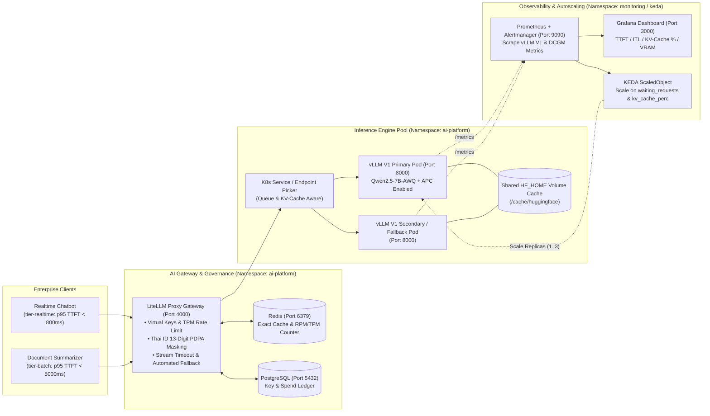

---

## สารบัญหนังสือและโฟลเดอร์แล็บ (Table of Contents & Navigation)

| ลำดับ | บทเรียนในหนังสือ (`chapters/`) | โฟลเดอร์โค้ดปฏิบัติการ (`labs/`) | เวลาเรียน | สถานะ |
| :--- | :--- | :--- | :---: | :---: |
| **SSOT** | [**`SPEC_AND_STYLE_GUIDE.md`**](../SPEC_AND_STYLE_GUIDE.md)<br>*(มาตรฐานโครงสร้างบท ตัวแปรกลาง และกฎความถูกต้องทางวิศวกรรม 12 ข้อ)* | — | อ้างอิงตลอดเล่ม | พร้อมใช้งาน |
| **บทที่ 0** | [**`chapters/00-onboarding-and-setup.md`**](../chapters/00-onboarding-and-setup.md)<br>*การเตรียมเครื่อง Local 16GB–32GB (รองรับ RTX 4050 6GB & Containerized Lab), การติดตั้งเครื่องมือ (`Docker`, `kind`, `kubectl`, `helm`, `tofu`, `uv`) และวิธีป้องกันเครื่องค้าง* | [`Makefile`](../Makefile) (`make check-env`) | 2 ชม. (ก่อนเริ่ม W1) | พร้อมใช้งาน |
| **บทที่ 1** | [**`chapters/01-foundations-containers-iac.md`**](../chapters/01-foundations-containers-iac.md)<br>*Production AI Containers (`uv`, Multi-stage, Non-root), FastAPI Bounded Queue, GitHub Actions CI (`Trivy`) & OpenTofu IaC* | [`labs/m1-foundations/`](../labs/m1-foundations/) | สัปดาห์ที่ 1–2 (30 ชม.) | พร้อมใช้งาน |
| **บทที่ 2** | [**`chapters/02-kubernetes-gpu-orchestration.md`**](../chapters/02-kubernetes-gpu-orchestration.md)<br>*Kubernetes Probes สำหรับ LLM, Helm Chart, Shared `HF_HOME` Cache, GPU VRAM Math (GQA), Time-Slicing vs MIG & Fake GPU* | [`labs/m2-k8s-gpu/`](../labs/m2-k8s-gpu/) | สัปดาห์ที่ 3–4 (30 ชม.) | พร้อมใช้งาน |
| **บทที่ 3** | [**`chapters/03-vllm-serving-optimization.md`**](../chapters/03-vllm-serving-optimization.md)<br>*เจาะลึก `vLLM` V1 Engine, PagedAttention, Continuous Batching, Prefix Caching (APC), Quantization (AWQ/FP8) & Unit Economics* | [`labs/m3-vllm/`](../labs/m3-vllm/) | สัปดาห์ที่ 5–6 (30 ชม.) | พร้อมใช้งาน |
| **บทที่ 4** | [**`chapters/04-ai-gateway-governance.md`**](../chapters/04-ai-gateway-governance.md)<br>*Enterprise AI Gateway (`LiteLLM Proxy`), Multi-tenancy, Redis Cache, Automated Fallbacks, PDPA Guardrails & K8s Gateway EPP* | [`labs/m4-gateway/`](../labs/m4-gateway/) | สัปดาห์ที่ 7–8 (30 ชม.) | พร้อมใช้งาน |
| **บทที่ 5** | [**`chapters/05-observability-autoscaling-sre.md`**](../chapters/05-observability-autoscaling-sre.md)<br>*AI Observability (`Prometheus`, `Grafana`, `DCGM`, `vLLM` V1 Metrics), `KEDA` Autoscaling, Chaos Drill, Runbook & Postmortem* | [`labs/m5-observability-sre/`](../labs/m5-observability-sre/) | สัปดาห์ที่ 9–10 (30 ชม.) | พร้อมใช้งาน |
| **บทที่ 6** | [**`chapters/06-capstone-siamshield-ai.md`**](../chapters/06-capstone-siamshield-ai.md)<br>*Capstone Project (`Project SiamShield AI`): System Design Doc, End-to-End Multi-Tier Platform, Optimization & Interview Defense* | [`labs/m6-capstone-siamshield/`](../labs/m6-capstone-siamshield/) | สัปดาห์ที่ 11–12 (30 ชม.) | พร้อมใช้งาน |
| **เสริม Cloud** | [**`labs/optional-cloud-aws/README.md`**](../labs/optional-cloud-aws/README.md)<br>*Optional AWS Cloud Track: S3 Model Cache, ECR, IAM, Budgets & `g6.xlarge` Spot (NVIDIA L4 + Auto-Terminate)* | [`labs/optional-cloud-aws/`](../labs/optional-cloud-aws/) | เสริมช่วง W2/W3/W6 | พร้อมใช้งาน |
| **รวมเล่ม** | **โฟลเดอร์หนังสือฉบับสมบูรณ์ (`dist/`)** | [`dist/`](../dist/) | — | สำหรับรวมเล่ม |

---

## ตารางแผนการเรียนรู้ 12 สัปดาห์ × 6 Modules × 3 Milestone Gates

| สัปดาห์ | Module | หัวข้อการเรียนรู้และฝึกปฏิบัติ | ชิ้นงานที่ต้องส่งมอบใน Git Portfolio (Deliverables) | Milestone Gate |
| :---: | :---: | :--- | :--- | :--- |
| **W1** | **Module 1** | Production AI Containers (`uv`, Multi-stage, Non-root, Read-only RootFS), FastAPI Bounded Queue (`HTTP 429`) & GitHub Actions CI (`Trivy`) | `labs/m1-foundations/`: `Dockerfile`, `app/main.py`, CI workflow | — |
| **W2** | **Module 1** | Infrastructure as Code ด้วย `OpenTofu` (Declarative Local `kind` Cluster, ExtraMounts Cache & Helm Provider) | `labs/m1-foundations/infra/`: OpenTofu Modules + `docs/adr-001-container-and-model-cache-strategy.md` | — |
| **W3** | **Module 2** | Kubernetes สำหรับ AI Workloads (`startupProbe`, `readinessProbe`, `preStop` Hook, Taints/Tolerations, `PriorityClass`, Shared `HF_HOME` PVC) | `labs/m2-k8s-gpu/charts/`: Production Helm Chart | — |
| **W4** | **Module 2** | GPU Hardware Math (VRAM & Memory Bandwidth), NVIDIA GPU Operator, Time-Slicing (`--enforce-eager`) vs MIG & `fake-gpu-operator` | `vram_calculator.py` + `gpu-time-slicing-config.yaml` + `docs/adr-002-gpu-sharing-and-scheduling.md` | **Gate 1 (จบ W4):** สั่ง `tofu apply` สร้าง K8s + Mock GPU + Deploy Helm ผ่าน CI 100% |
| **W5** | **Module 3** | LLM Inference Internals (`vLLM` V1 Engine, PagedAttention, Continuous Batching, Unified Chunked Prefill) & Baseline Benchmarking | `labs/m3-vllm/`: สคริปต์รัน `vLLM` (Local CPU 0.5B & Cloud L4 7B) | — |
| **W6** | **Module 3** | Inference Optimization: Quantization (`AWQ`/`FP8`), Automatic Prefix Caching (APC), Token Budget Tuning & Cost per 1M Tokens Math | `optimization-report-template.md` (ตัวเลข Before/After ครบทุกมิติ) | — |
| **W7** | **Module 4** | Enterprise AI Gateway (`LiteLLM Proxy`), Multi-tenant Virtual Keys, TPM/RPM Budgets, Redis Caching & Automated Fallbacks | `labs/m4-gateway/`: `litellm_config.yaml` + `mock_vllm_server/` | — |
| **W8** | **Module 4 + Buffer** | Intelligent Routing (K8s Gateway API Inference Extension / EPP), PDPA PII Masking + **Buffer & Consolidation Week** | `tests/test_gateway_resilience.py` + `docs/adr-003-ai-gateway-and-inference-routing.md` + เก็บตกงาน W1–W7 | **Gate 2 (จบ W8):** ต่อสายพาน `Gateway → K8s → vLLM` พร้อมผลทดสอบ Failover & Optimization |
| **W9** | **Module 5** | AI Observability Stack: `Prometheus`, `Grafana`, `DCGM Exporter` & `vLLM` V1 Metrics (`kv_cache_usage_perc`, `prefix_cache_hits_total`) | `labs/m5-observability-sre/`: Grafana Dashboard JSON + Alert Rules | — |
| **W10** | **Module 5** | Event-Driven Autoscaling ด้วย `KEDA` (Queue/KV-Cache triggers), Chaos Failure Injection, Runbook & Blameless Postmortem | `keda-vllm-scaledobject.yaml` + `docs/runbook-kvcache-saturation-and-high-ttft.md` + `docs/postmortem-001-peak-hour-latency-outage.md` + `docs/adr-004-observability-and-keda-autoscaling.md` | — |
| **W11** | **Module 6** | Capstone Design Doc & End-to-End Implementation (`Project SiamShield AI`: Multi-Tier `tier-realtime` + `tier-batch` Platform) | `labs/m6-capstone-siamshield/`: `docs/design-doc.md` + Full Stack Repo | — |
| **W12** | **Module 6 + Buffer** | Capstone Two-Tier Load Testing & Optimization, Chaos Drill, Architecture Defense & **Final Buffer** | `reports/capstone-optimization-report.md` + `docs/runbooks/capstone-runbook.md` + `docs/postmortems/capstone-postmortem.md` + `docs/interview-defense-guide.md` | **Gate 3 (จบ W12):** ผ่านเกณฑ์ **Definition of Done (DoD)** ครบทั้ง 5 ข้อ |

---

## ตารางเชื่อมโยงกับเกณฑ์ผ่านระดับ Mid-Level (5 Definition of Done Traceability Matrix)

เมื่อเรียนจบและทำแล็บครบทั้ง 6 บท คุณจะมีหลักฐานเชิงประจักษ์ (Verifiable Engineering Artifacts) ใน Git Portfolio ที่พิสูจน์สมรรถนะครบทั้ง **5 ข้อของ Definition of Done (DoD)**:

| ข้อกำหนด Definition of Done (DoD) | ความสามารถระดับ Mid-Level ที่ต้องพิสูจน์ได้ | บทเรียนและแล็บที่สร้างหลักฐานชิ้นนี้ | ชิ้นงานหลักฐานใน Portfolio (Verifiable Artifacts) |
| :--- | :--- | :--- | :--- |
| **DoD #1: System Design & Architecture Trade-Offs** | รับโจทย์ธุรกิจและข้อจำกัด (SLO, ปริมาณงาน, งบประมาณ, กฎหมาย PDPA) แล้วคำนวณขนาด VRAM/Cost พร้อมเขียน Design Doc เปรียบเทียบทางเลือก $\ge 2$ ทางในทุกการตัดสินใจหลัก | บทที่ 1, 2, 4, 5, 6<br>(`m1`, `m2`, `m4`, `m5`, `m6`) | • `adr-001` (Model Artifact Strategy)<br>• `adr-002` (GPU Sharing: Time-Slicing vs MIG)<br>• `adr-003` (Gateway & EPP Routing)<br>• `adr-004` (Observability & KEDA Autoscaling)<br>• `labs/m6-capstone-siamshield/docs/design-doc.md` |
| **DoD #2: Reproducible IaC & Automated CI/CD** | สร้างและทำลายโครงสร้างพื้นฐานรวมถึง Deploy ระบบซ้ำได้ 100% ด้วยโค้ด (`OpenTofu` + `Helm` + `GitHub Actions` + `Trivy`) โดยไม่ต้องคลิกตั้งค่าด้วยมือใน Console | บทที่ 1, 2, 6<br>(`m1`, `m2`, `m6`) | • Multi-stage `Dockerfile` (`uv`, Non-root)<br>• OpenTofu Modules (`infra/`)<br>• Production Helm Chart (`charts/`)<br>• `.github/workflows/ci.yml` |
| **DoD #3: AI Observability & Measurable Optimization** | ติดตั้งระบบวัดผลระดับ Token/GPU (`Prometheus` + `Grafana` + `vLLM` V1 / `DCGM`), รัน Load Test และปรับจูนจนได้ตัวเลข **Before vs After** ที่ดีขึ้นอย่างมีนัยสำคัญ | บทที่ 2, 3, 4, 5, 6<br>(`m2`, `m3`, `m4`, `m5`, `m6`) | • `vram_calculator.py`<br>• `optimization-report-template.md` (TTFT ลด $\ge 50\%$, TPS เพิ่ม $\ge 40\%$)<br>• `grafana-dashboard-vllm-v1.json` + `KEDA ScaledObject` |
| **DoD #4: Incident Management, Runbook & Postmortem** | จำลองเหตุวิกฤตจริง (Chaos Injection: KV-Cache เต็ม, Noisy Neighbor, Primary Pod ค้าง, Bad Rollout) วินิจฉัยผ่านกราฟ กู้คืนระบบ และเขียน Runbook + Blameless Postmortem | บทที่ 4, 5, 6<br>(`m4`, `m5`, `m6`) | • `tests/test_gateway_resilience.py`<br>• `chaos/trigger_incident.py`<br>• `docs/runbook-kvcache-saturation-and-high-ttft.md`<br>• `docs/postmortem-001-peak-hour-latency-outage.md` |
| **DoD #5: Mid-Level Interview Trade-Off Defense** | อธิบายเหตุผลเชิงวิศวกรรมว่า **"ทำไมถึงเลือกวิธีนี้"** และ **"ได้อะไรแลกกับเสียอะไร"** พร้อมคำนวณตัวเลขสดและตอบโจทย์เมื่อเงื่อนไขเปลี่ยน (เช่น โหลดพุ่ง 10 เท่า หรือเปลี่ยนเป็นโมเดล 70B) | ทุกบท (บทที่ 1–6 หัวข้อที่ 8) | • คำถามสัมภาษณ์เชิงลึก 29 ข้อพร้อมเฉลย Model Answer ในบทที่ 1–6<br>• `docs/interview-defense-guide.md` ใน Capstone |

---

## 7. เริ่มต้นใช้งานอย่างรวดเร็ว 4 เส้นทาง (Quickstart — 4 Tracks)

ดูรายละเอียดขั้นตอนติดตั้งและแก้ปัญหาครบทุกสภาพแวดล้อมได้ที่ [**`PORTABILITY_AND_QUICKSTART.md`**](../PORTABILITY_AND_QUICKSTART.md)

### Track 1: อ่านหนังสือและแผนภาพแบบ Offline ทันที (Zero-Install)
เปิดไฟล์ [**`index.html`**](../index.html) หรือ [**`dist/AI_Infra_Interactive_Handbook.html`**](../dist/AI_Infra_Interactive_Handbook.html) ในเบราว์เซอร์ (รองรับ 100% แบบไม่มีอินเทอร์เน็ต) หรือสร้างไฟล์พกพา:
```bash
python3 scripts/make package
python3 scripts/make verify-archive
```

### Track 2: รันใน Containerized Lab (VS Code DevContainer / Docker Compose)
เหมาะสำหรับผู้ที่ไม่อยากติดตั้งเครื่องมือ CLI ทีละตัวบนเครื่องหลัก:
```bash
python3 scripts/make verify-container
docker compose -f docker-compose.lab.yml run --rm --service-ports lab
```

### Track 3: รันบนเครื่อง WSL2 / Linux ส่วนตัว (แนะนำสำหรับ HP Victus 32GB + RTX 4050 6GB)
1. **อ่านบทที่ 0 เพื่อตั้งค่า `.wslconfig` (22GB RAM) และ NVIDIA Container Toolkit:**
   เปิดอ่านไฟล์ [**`chapters/00-onboarding-and-setup.md`**](../chapters/00-onboarding-and-setup.md)
2. **ตรวจสอบความพร้อมของเครื่อง (RAM, GPU VRAM, Docker, Kind, Kubectl, Helm, OpenTofu, uv):**
   ```bash
   python3 scripts/make check-env
   ```
3. **รันชุดตรวจสอบอัตโนมัติแบบ Static ครบทุกโมดูล:**
   ```bash
   python3 scripts/make verify-static
   ```

### Track 4: รันบน AWS Cloud (งบ \$10–\$30 USD: S3 + ECR + `g6.xlarge` Spot L4)
1. ขอ GPU Service Quota ล่วงหน้า (`All G and VT Spot Instance Requests = 4`) และตั้ง AWS Budgets
2. ตรวจสอบโค้ดและเปิดใช้งานผ่าน [**`labs/optional-cloud-aws/README.md`**](../labs/optional-cloud-aws/README.md):
   ```bash
   python3 scripts/make verify-aws-optional
   ```

---

## 8. หนังสือและแหล่งเรียนรู้มาตรฐานที่ใช้อ้างอิงร่วม (Curated 2025–2026 References)

| หมวดหมู่ | ชื่อหนังสือ / เอกสารทางการ | จุดเด่นที่นำมาประยุกต์ใช้ใน Handbook ฉบับ 2026 |
| :--- | :--- | :--- |
| **GPU & Inference Performance** | **AI Systems Performance Engineering** *(Chris Fregly, O'Reilly 2025)* | เจาะลึก GPU Kernels, Roofline Model, vLLM/SGLang/NVIDIA Dynamo, Disaggregated Prefill–Decode และ Checklist จูน Production |
| **AI Platform & Eval** | **AI Engineering** *(Chip Huyen, O'Reilly 2025)* | กรอบการประเมินคุณภาพโมเดล (Eval Gate หลัง Quantization), Latency/Cost Engineering, Guardrails |
| **Distributed & Hardware Scaling** | **The Ultra-Scale Playbook** *(Hugging Face, 2025)* & **How to Scale Your Model** *(Google DeepMind, 2025)* | คณิตศาสตร์ Memory Bandwidth, Arithmetic Intensity, Tensor/Pipeline/Expert Parallelism สำหรับโมเดล 70B+ และ MoE |
| **Kubernetes & Platform Engineering** | **Production Kubernetes** *(O'Reilly)*, **Kubernetes Patterns (2nd Ed.)**, **Platform Engineering** *(O'Reilly)* | การออกแบบ Multi-tenant K8s, `NetworkPolicy`, Golden Paths, Kubernetes DRA และ Workload Isolation |
| **SRE & Incident Management** | **The Site Reliability Workbook** *(Google, Free Online)* | Multi-Window Error Budget Burn-Rate Alerts, Runbook Design และ Blameless Postmortem |
| **2026 Open Standards** | **Kubernetes Gateway API Inference Extension (`v1`) & CNCF `llm-d`**, **OWASP LLM Top 10 (2025)**, **OTel GenAI SemConv** | มาตรฐาน `InferencePool v1`, `InferenceObjective`, KV-Cache-Aware Routing และความปลอดภัยระดับองค์กร |

---

> **ส่วนที่ 0 — Onboarding & 16GB RAM Setup** ([`chapters/00-onboarding-and-setup.md`](../chapters/00-onboarding-and-setup.md))

# บทที่ 0: การเตรียมสภาพแวดล้อมวิศวกรรมและกลยุทธ์การเรียนแบบ Hybrid (Onboarding & 16GB RAM Local Setup)

> **เวลาที่ใช้:** ~2 ชั่วโมง (ทำครั้งเดียวก่อนเริ่มสัปดาห์ที่ 1)  
> **ค่าใช้จ่าย:** \$0.00 (รันบนเครื่องคอมพิวเตอร์ส่วนตัว 100%)  
> **เป้าหมายของบทนี้:** ตั้งค่าเครื่องคอมพิวเตอร์ส่วนตัว (Linux, Windows WSL2 RAM 16GB หรือ **HP Victus 32GB + RTX 4050 6GB**, macOS, หรือ **Containerized Lab** ใน [`PORTABILITY_AND_QUICKSTART.md`](../PORTABILITY_AND_QUICKSTART.md)) ให้พร้อมรันชุดแล็บ Kubernetes, OpenTofu, vLLM และระบบ Observability ตลอดทั้ง 12 สัปดาห์โดยไม่เกิดอาการเครื่องค้าง (Out-of-Memory) และวางมาตรการควบคุมงบ Cloud GPU (Prepaid < \$10 หรือ AWS Spot \$10–\$30) อย่างปลอดภัย

---

## 1. ภาพรวมเส้นทางสายอาชีพและความคาดหวังที่สมจริง (Realistic Career Expectations)

ยินดีต้อนรับสู่คู่มือปฏิบัติการ **AI Infrastructure & Platform Engineering** หลักสูตรนี้ออกแบบมาสำหรับผู้ที่มีพื้นฐานการเขียนโค้ด (Python/Bash พื้นฐาน) และใช้คำสั่ง Linux/Git เบื้องต้นได้ แต่ **ยังไม่เคยดูแลระบบ Production หรือคลัสเตอร์ Kubernetes สำหรับงาน AI มาก่อน**

### 1.1 ทำไมองค์กรในไทยและทั่วโลกถึงต้องการตำแหน่งนี้อย่างเร่งด่วน?
เมื่อสำรวจตลาดงานจริงในประเทศไทย (เช่น Agoda, SCBX / SCB DataX, KBTG, Sertis, LINE MAN Wongnai, True Digital, KTB/TTB, Amity) และบริษัทเทคโนโลยีระดับภูมิภาค/ระดับโลก จะพบว่าบทบาทด้าน AI Infrastructure แบ่งออกเป็น 3 สายงานย่อย (Tracks):
1. **Track A — Inference & GPU Serving Infrastructure (สายหลักของเรา):** โฟกัสการนำโมเดลภาษาขนาดใหญ่ (LLM) ขึ้นรันบน Kubernetes, การจัดสรรทรัพยากรการ์ดจอ (NVIDIA GPU Operator, Time-Slicing, MIG), การรีดประสิทธิภาพด้วย `vLLM` (PagedAttention, Continuous Batching, Automatic Prefix Caching, Quantization), และการขยายระบบอัตโนมัติตามปริมาณงานจริง
2. **Track B — Classic MLOps & Distributed Training Platform:** โฟกัสไปที่ระบบท่อส่งข้อมูลสำหรับเทรนโมเดล (Kubeflow, Airflow, Feast) และการเทรนโมเดลข้ามเครื่องจำนวนมากด้วย InfiniBand/NCCL
3. **Track C — Enterprise LLM Platform, Gateway & Governance (สายรองของเรา):** โฟกัสไปที่การสร้างด่านหน้าควบคุมการใช้งาน AI ของทั้งองค์กรด้วย `LiteLLM Proxy` และ Kubernetes Gateway API Inference Extension เพื่อจัดการโควตารายแผนก (TPM/RPM Rate Limiting), การแคชคำตอบ (Redis), การสลับสายอัตโนมัติเมื่อระบบล่ม (Automated Fallbacks), และการกรองข้อมูลส่วนบุคคลตามกฎหมาย **PDPA** และมาตรฐาน **OWASP Top 10 for LLM Applications**

หลักสูตร 12 สัปดาห์นี้มุ่งเน้นที่จุดตัดของ **Track A + Track C** เนื่องจากเป็นทักษะที่มีความต้องการสูงที่สุดในตลาด และสามารถฝึกปฏิบัติจริงได้ครบทุกมิติภายใต้งบประมาณที่ต่ำมาก

### 1.2 ความจริงใจต่อผู้เรียน: อะไรที่คุณจะทำได้จริง และอะไรที่ต้องสะสมเพิ่ม?
ภายในเวลา 180 ชั่วโมง (15 ชั่วโมง/สัปดาห์ × 12 สัปดาห์) คุณจะก้าวขึ้นสู่ระดับ **Mid-Level-Capable ในขอบเขต AI Inference & Platform Engineering** ที่มีหลักฐานเชิงประจักษ์ครบทั้ง **5 ข้อของ Definition of Done (DoD)**:
- **สิ่งที่คุณจะทำได้ถึงระดับ Mid-Level จริง:**
  1. คำนวณขนาดหน่วยความจำการ์ดจอ (**GPU VRAM Math**) และต้นทุนต่อ 1 ล้าน Tokens พร้อมเขียนเอกสาร **System Design Doc** เปรียบเทียบข้อดี-ข้อเสียของแต่ละทางเลือกได้อย่างแม่นยำ
  2. เขียนโค้ดสร้างโครงสร้างพื้นฐานและสายพานอัตโนมัติด้วย **OpenTofu + Helm + GitHub Actions CI/CD + Trivy Security Scan**
  3. ติดตั้งระบบ **Observability (`Prometheus` + `Grafana` + `vLLM` V1 / `DCGM` Metrics)** รันทดสอบโหลดจริง และปรับจูนระบบจนมีตัวเลข **Before vs After** ที่พิสูจน์ได้
  4. รับมือกับเหตุวิกฤตจำลอง (Chaos Engineering) พร้อมเขียนคู่มือกู้คืนระบบ (**Runbook**) และรายงานวิเคราะห์สาเหตุโดยไม่กล่าวโทษตัวบุคคล (**Blameless Postmortem**)
  5. ตอบคำถามสัมภาษณ์เชิงลึกเรื่อง Trade-offs ได้อย่างมีหลักการและอ้างอิงตัวเลขจากโปรเจกต์ของตัวเองได้ทันที
- **สิ่งที่ยังไปไม่ถึงใน 12 สัปดาห์ (ต้องเก็บเกี่ยวต่อในการทำงานจริง):**
  - การดูแลระบบเครือข่ายและสิทธิ์ข้ามบัญชีที่ซับซ้อนระดับองค์กรขนาดใหญ่หลายร้อยโหนด (เช่น Multi-account Transit Gateway หรือ Multi-cluster Service Mesh)
  - การเขียนชุดคำสั่งระดับฮาร์ดแวร์ (Custom CUDA / Triton Kernels)

---

## 2. สถาปัตยกรรมการเรียนแบบ Hybrid 85/15 และการป้องกันเครื่อง 16GB RAM ค้าง

ปัญหาคลาสสิกของผู้เรียนสาย AI Infrastructure ที่ไม่มีการ์ดจอ NVIDIA ส่วนตัวมีอยู่ 2 ข้อ คือ: **(1) หากเช่า Cloud GPU เปิดทิ้งไว้ตลอดเวลา ค่าใช้จ่ายจะพุ่งทะลุหลักหมื่นบาท** และ **(2) หากพยายามรันโมเดล LLM ด้วย CPU หลายๆ ตัวพร้อมกับ Kubernetes และ Prometheus บนแล็ปท็อปที่มี RAM 16GB เครื่องจะค้างทันที (Linux OOM Killer ทำงาน)**

เพื่อแก้ปัญหาทั้งสองข้ออย่างเด็ดขาด เราจึงออกแบบสถาปัตยกรรมการฝึกปฏิบัติแบบ **Hybrid 85/15** ดังแผนภาพต่อไปนี้:

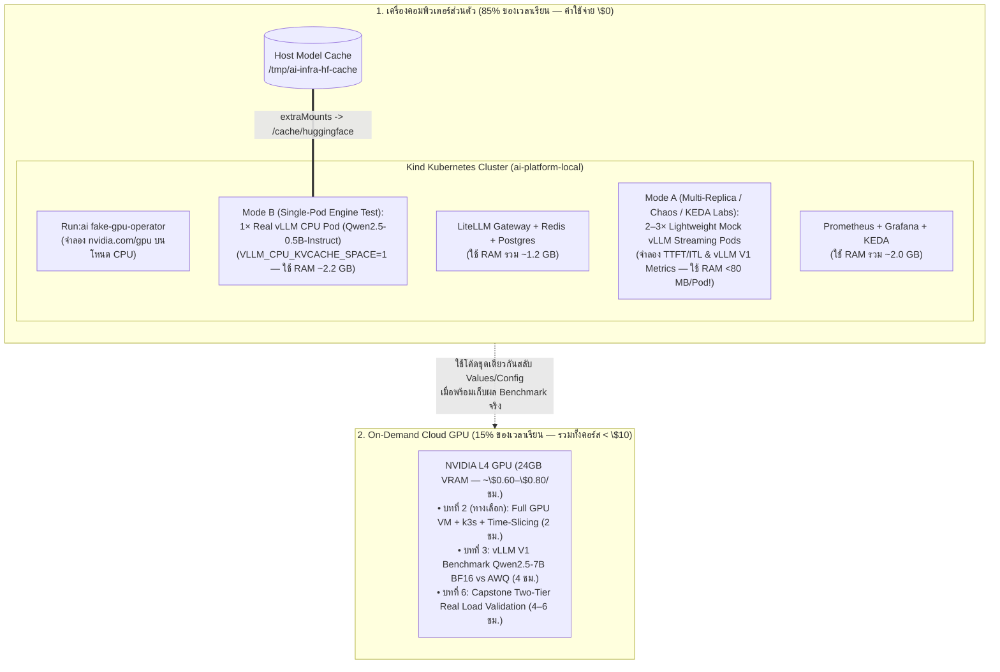

### 2.1 คณิตศาสตร์การจัดสรรหน่วยความจำบนเครื่อง RAM 16GB (Memory Budget Math)
ลองมาดูตัวเลขจริงว่าทำไมเราถึงต้องแยก **Mode A (Lightweight Mock vLLM Streaming Server)** และ **Mode B (Single-Pod Real vLLM CPU)** บนเครื่องที่มี RAM 16GB:

- **หากทำแบบไม่ระวัง (สิ่งที่ทำให้แล็ปท็อป 16GB ค้าง):**
  ถ้ารันคอนเทนเนอร์ `vllm-cpu` ด้วยโมเดลขนาด 1.5B (BF16 weights ~3.0 GB) ร่วมกับการจอง `VLLM_CPU_KVCACHE_SPACE=4` (4.0 GiB) และ PyTorch CPU runtime (~1.5 GB) จะกินหน่วยความจำถึง **~8.5 GB ต่อ 1 Pod** หากสั่งรัน 2 Pods เพื่อทดสอบ Load Balancing จะใช้ RAM ไปแล้ว **17.0 GB** เมื่อรวมกับ OS (3.5 GB), `kind` (1.5 GB), `LiteLLM/Postgres/Redis` (1.2 GB) และ `Prometheus/Grafana` (2.0 GB) จะพุ่งไปถึง **~25.2 GB** ซึ่งทำให้เครื่อง 16GB ค้างทันที!
- **การจัดสรรหน่วยความจำที่ปลอดภัยของเรา (16GB RAM Safe Budget):**

$$\text{Total Local RAM Usage} = \underbrace{3.5\text{ GB}}_{\text{OS / WSL2}} + \underbrace{1.5\text{ GB}}_{\text{Kind Nodes}} + \underbrace{1.2\text{ GB}}_{\text{LiteLLM + DB + Redis}} + \underbrace{2.0\text{ GB}}_{\text{Prometheus + Grafana + KEDA}} + \underbrace{\text{Inference Pods}}_{\le 2.5\text{ GB}} \approx \mathbf{10.7\text{ GB} < 16.0\text{ GB}}$$

โดยในส่วนของ **Inference Pods** เราแบ่งวิธีใช้งานอย่างชัดเจน:
1. **เมื่อต้องการทดสอบกลไกของ `vLLM` จริงบน CPU (บทที่ 3):** รันเพียง **1 Pod** ด้วยโมเดล **`Qwen/Qwen2.5-0.5B-Instruct`** พร้อมตั้งค่า `VLLM_CPU_KVCACHE_SPACE=1` และ `--max-model-len 2048` ซึ่งใช้ RAM เพียง **~2.2 GB**
2. **เมื่อต้องการรันหลาย Pods พร้อมกันเพื่อทดสอบ Gateway Failover, Rate Limiting, และ KEDA Autoscaling (บทที่ 4, 5, 6):** ใช้ **Lightweight FastAPI Mock vLLM Streaming Server** ที่เราเตรียมไว้ในแล็บ ซึ่งจำลองการส่งข้อความแบบ Streaming (Server-Sent Events), จำลองความหน่วง TTFT/ITL และส่งออก Prometheus Metrics ชื่อเดียวกับ `vLLM` V1 ทุกประการ (`vllm:kv_cache_usage_perc`, `vllm:num_requests_waiting`, `vllm:prefix_cache_hits_total`) โดยใช้ RAM เพียง **< 80 MB ต่อ Pod** (รัน 3 Pods ใช้ RAM รวมกันไม่ถึง 250 MB!)

### 2.2 การผูก Shared Model Cache (`HF_HOME`) เพื่อตัดเวลาดาวน์โหลดโมเดลซ้ำ
ในทุกบทเรียน เราจะสร้างโฟลเดอร์ `/tmp/ai-infra-hf-cache` บนเครื่องหลัก (Host) แล้วผูกเข้าสู่โหนดของ `kind` ผ่านการตั้งค่า `extraMounts` เพื่อให้ทุก Pod มองเห็นโฟลเดอร์นี้ที่พาธมาตรฐานสำหรับผู้ใช้ Non-root: `HF_HOME=/cache/huggingface` ผลลัพธ์คือ:
- ดาวน์โหลดโมเดลจาก Hugging Face เพียง **ครั้งเดียว**
- เมื่อ Pod ถูกลบ รีสตาร์ท หรือถูกสั่งขยายจำนวน (Scale-up):
  - **Mode A (Mock Pod):** สตาร์ทพร้อมรับโหลดภายใน **~8–10 วินาที** (ไม่ต้องโหลด weights จริง)
  - **Mode B / Cloud L4 Real vLLM:** ไม่ต้องดาวน์โหลดโมเดลซ้ำผ่านเน็ต เหลือเฉพาะเวลาอ่าน Safetensors เข้า GPU และคอมไพล์ CUDA Graph (**~35–75 วินาที**) แทนที่จะเป็น 5–10 นาที

---

## 3. ขั้นตอนการติดตั้งเครื่องมือประจำเครื่อง (Step-by-Step Tooling Setup)

รองรับระบบปฏิบัติการ **Ubuntu / Debian Linux**, **Windows 11 ที่เปิดใช้งาน WSL2 (Ubuntu 22.04/24.04)**, **macOS (Apple Silicon / Intel)** หรือรันผ่าน **Docker Compose / VS Code DevContainer** (ดูรายละเอียดใน [`PORTABILITY_AND_QUICKSTART.md`](../PORTABILITY_AND_QUICKSTART.md))

> **คำแนะนำสำหรับผู้ใช้ Windows WSL2 (เลือกตาม RAM เครื่องจริง):**  
> ให้สร้างหรือแก้ไขไฟล์ `%UserProfile%\.wslconfig` บนฝั่ง Windows แล้วรัน `wsl --shutdown` ใน PowerShell ก่อนเปิด Ubuntu ขึ้นมาใหม่:
> - **กรณีเครื่อง RAM 16GB:**
> ```ini
> [wsl2]
> memory=12GB
> processors=4
> swap=4GB
> ```
> - **กรณีเครื่อง RAM 32GB (เช่น HP Victus 16-r0357tx พร้อม RTX 4050 6GB):**
> ```ini
> [wsl2]
> memory=22GB
> processors=10
> swap=4GB
> ```
> *หมายเหตุสำหรับ HP Victus / WSL2 ที่มี NVIDIA GPU:* ติดตั้ง Game Ready / Studio Driver เวอร์ชันล่าสุดบนฝั่ง Windows (ไม่ต้องลง Driver ซ้ำใน WSL2) จากนั้นติดตั้ง **NVIDIA Container Toolkit** ใน Ubuntu WSL2 เพื่อให้ `docker run --gpus all` ส่งผ่าน RTX 4050 6GB เข้าคอนเทนเนอร์ `vLLM` ได้ทันที:
> ```bash
> nvidia-smi --query-gpu=name,memory.total --format=csv,noheader
> docker run --rm --gpus all nvidia/cuda:12.4.1-base-ubuntu22.04 nvidia-smi
> ```

### 3.1 ติดตั้งแพ็กเกจพื้นฐานและ Docker Engine
ตรวจสอบให้แน่ใจว่ามี `curl`, `git`, `make`, `jq` และ `docker` ที่สามารถรันได้โดยไม่ต้องพิมพ์ `sudo`:

```bash
# สำหรับ Ubuntu / Debian / WSL2
sudo apt-get update && sudo apt-get install -y \
  ca-certificates curl gnupg lsb-release git jq unzip build-essential make

# หากยังไม่ได้ติดตั้ง Docker Engine
if ! command -v docker &> /dev/null; then
  curl -fsSL https://get.docker.com | sudo sh
  sudo usermod -aG docker "$USER"
  echo "ติดตั้ง Docker สำเร็จ กรุณาออกจากระบบ (หรือรัน newgrp docker) เพื่อให้สิทธิ์กลุ่ม docker มีผล"
fi
```

### 3.2 ติดตั้ง `uv` (Astral Python Package & Environment Manager)
เราใช้ `uv` แทน `pip` แบบดั้งเดิมทั้งในเครื่องหลักและใน Multi-stage `Dockerfile` เพราะทำงานเร็วกว่า 10–100 เท่าและจัดการ Lockfile ได้อย่างแม่นยำ:

```bash
curl -LsSf https://astral.sh/uv/install.sh | sh
export PATH="$HOME/.local/bin:$PATH"
uv --version
```

### 3.3 ติดตั้ง `kubectl`, `kind`, และ `helm` (Kubernetes Toolchain)

```bash
# 1. ติดตั้ง kubectl (v1.31+)
ARCH=$(uname -m)
if [ "$ARCH" = "x86_64" ]; then K8S_ARCH="amd64"; else K8S_ARCH="arm64"; fi

curl -LO "https://dl.k8s.io/release/$(curl -L -s https://dl.k8s.io/release/stable.txt)/bin/linux/${K8S_ARCH}/kubectl"
chmod +x kubectl && sudo mv kubectl /usr/local/bin/

# 2. ติดตั้ง kind (Kubernetes in Docker v0.24+)
curl -Lo ./kind "https://kind.sigs.k8s.io/dl/v0.24.0/kind-linux-${K8S_ARCH}"
chmod +x ./kind && sudo mv ./kind /usr/local/bin/kind

# 3. ติดตั้ง Helm (v3.16+)
curl https://raw.githubusercontent.com/helm/helm/main/scripts/get-helm-3 | bash
```

### 3.4 ติดตั้ง `OpenTofu` (`tofu`) และ `Trivy` (IaC & Security Scanner)

```bash
# 1. ติดตั้ง OpenTofu (tofu)
curl --proto '=https' --tlsv1.2 -fsSL https://get.opentofu.org/install-opentofu.sh -o install-opentofu.sh
chmod +x install-opentofu.sh
./install-opentofu.sh --install-method deb
rm -f install-opentofu.sh

# 2. ติดตั้ง Trivy (สำหรับสแกนช่องโหว่ Container Image และ IaC ในบทที่ 1)
curl -sfL https://raw.githubusercontent.com/aquasecurity/trivy/main/contrib/install.sh | sudo sh -s -- -b /usr/local/bin
```

---

## 4. กฎความปลอดภัยในการเช่า Cloud GPU และการใช้ AWS / GCP Credit

ในหลักสูตรนี้ คุณจะใช้ Cloud GPU 24GB เฉพาะใน **บทที่ 2 (ทางเลือกเสริม 2 ชม.)**, **บทที่ 3 (4 ชม.)**, **บทที่ 5 (2 ชม.)**, และ **บทที่ 6 (4 ชม.)** รวมเวลาเช่าจริงประมาณ 10–12 ชั่วโมง (คิดเป็นเงินเพียง **~\$7.00–\$9.50** บน RunPod/Vast.ai หรือ **~\$6–\$12** ด้วย **AWS `g6.xlarge` Spot** ภายใต้งบ \$10–\$30)

### 4.1 ข้อควรรู้ก่อนใช้ AWS / GCP Free Credit กับ GPU Quota
| ช่องทาง Cloud | สถานะ GPU Quota เริ่มต้น | เหมาะกับงานแบบไหนใน Handbook นี้? |
| :--- | :--- | :--- |
| **Prepaid GPU Cloud (`RunPod`, `Vast.ai`)** | พร้อมใช้ทันทีหลังเติม \$10 | **คล่องตัวที่สุดสำหรับบทที่ 3 & 6:** ไม่ต้องขอ Quota, ตัดเงินเฉพาะเครดิตที่เติม |
| **AWS Paid Plan + Spot `g6.xlarge` (\$10–\$30)** *(ดูคู่มือใน [`labs/optional-cloud-aws/README.md`](../labs/optional-cloud-aws/README.md))* | Default = `0 vCPU` *(ต้องยื่นขอ `All G and VT Spot Instance Requests = 4` ใน `us-east-1` ล่วงหน้า)* | **แนะนำถ้าต้องการฝึก AWS จริง:** ได้ทั้ง `1x NVIDIA L4 (24GB)`, ฟรี `250GB NVMe`, S3 Model Cache, ECR และตั้ง Auto-Terminate `shutdown -h +180` |
| **GCP \$300 Free Trial** | **ถูกบล็อก (`0`, ปรับไม่ได้)** จนกว่าจะ Upgrade เป็น Paid Account และสร้าง Usage History | ไม่แนะนำให้พึ่งสำหรับ GPU Lab ในช่วงสัปดาห์แรกเพราะมักติด Ticket ขอ Quota หลายวัน |

### 4.2 ข้อแตกต่างสำคัญระหว่างผู้ให้บริการ GPU แบบ Container vs แบบ Full VM
วิศวกร AI Infrastructure ต้องแยกแยะรูปแบบของ Cloud GPU ให้ถูกต้องตามลักษณะงาน:

| รูปแบบบริการ Cloud GPU | ตัวอย่างผู้ให้บริการ | ข้อจำกัดทางสถาปัตยกรรม | ใช้ในบทเรียนไหนของคู่มือนี้? |
| :--- | :--- | :--- | :--- |
| **1. GPU Container-as-a-Service (Rootless/Unprivileged Pod)** | **RunPod Pods**, **Modal Labs**, **Vast.ai (Container Mode)** | คุณได้รับมอบหมายเป็น Docker Container ที่ต่อการ์ดจอมาให้แล้ว **ไม่มี Linux Kernel / `systemd` เป็นของตัวเอง** จึงไม่สามารถติดตั้ง `k3s` หรือ NVIDIA GPU Operator ซ้อนข้างในได้ | **เหมาะที่สุดสำหรับบทที่ 3 และบทที่ 6:** ใช้รัน `vLLM` V1 บนการ์ด NVIDIA L4 (24GB) เพื่อวัดผล Benchmark จริงได้ทันทีในราคาประหยัด (~\$0.60/ชม.) |
| **2. Full GPU Virtual Machine (IaaS VM พร้อม Kernel เต็มรูปแบบ)** | **AWS EC2 `g6.xlarge` Spot (L4)**, **GCP Spot VM (`g2-standard-8` L4)**, **Vast.ai (VM Mode)** | ได้เครื่องเสมือนที่มี Kernel และสิทธิ์ `root` เต็มรูปแบบ สามารถติดตั้ง `k3s`/`kubeadm`, NVIDIA Container Toolkit และ NVIDIA Device Plugin ได้ | **ใช้ได้ครบทั้งบทที่ 2, 3, 5 และ 6:** โดยเฉพาะ AWS `g6.xlarge` Spot ที่มีสคริปต์ OpenTofu + Dead-Man's Switch ใน `labs/optional-cloud-aws/` |

### 4.3 กฎเหล็ก 3 ข้อก่อนกดสร้าง Cloud GPU ทุกครั้ง (Zero-Surprise Billing Protocol)
1. **ตั้งเพดานงบ / ใช้ Prepaid Credit เสมอ:** บน RunPod/Vast.ai ให้เติมไว้ \$10; ส่วนบน AWS ให้ตั้ง **AWS Budgets Alert ที่ \$5, \$15, \$25** ก่อนเปิด `g6.xlarge`
2. **ตั้งเวลาปิดเครื่องอัตโนมัติ (Dead-Man's Switch):** ทุกครั้งที่เริ่มเซสชันบน Cloud GPU ให้ตั้ง `instance_initiated_shutdown_behavior = "terminate"` คู่กับ `sudo shutdown -h +180` เพื่อกันลืม
3. **ทำลายทรัพยากรด้วย `tofu destroy` ทันทีที่เก็บผลเสร็จ:** ดาวน์โหลดไฟล์ผลลัพธ์ JSON/Markdown กลับมาที่โฟลเดอร์ `labs/` บนเครื่องส่วนตัว แล้วสั่งทำลายอินสแตนซ์พร้อมตรวจสอบหน้า Billing ว่าไม่มี EC2, EBS หรือ EIP ค้างอยู่

---

## 5. การตรวจสอบความพร้อมของเครื่องด้วย `make check-env`

เราได้เตรียมไฟล์ `Makefile` ไว้ที่รากของโปรเจกต์เพื่อทำหน้าที่ตรวจสอบความพร้อมของฮาร์ดแวร์ (CPU, RAM, พื้นที่ว่างในดิสก์), โฟลเดอร์แคชสำหรับโมเดล (`/tmp/ai-infra-hf-cache`), และเครื่องมือที่จำเป็นทั้งหมด

ให้รันคำสั่งต่อไปนี้จากโฟลเดอร์รากของโปรเจกต์ (`ai-infra-handbook/`) หากยังไม่ได้ติดตั้ง GNU `make` สามารถใช้ `python3 scripts/make` แทนได้ทันที:

```bash
# จากโฟลเดอร์ ai-infra-handbook/
# 1. สร้างโฟลเดอร์กลางสำหรับเก็บแคชของโมเดล (HF_HOME)
make init-cache

# 2. รันสคริปต์ตรวจสอบความพร้อมของเครื่องและเครื่องมือ
make check-env

# (หรือใช้ตัวรันพกพาบนเครื่องที่ยังไม่มี GNU make)
python3 scripts/make verify-static
```

### 5.1 เกณฑ์ผ่านของบทที่ 0 (Pass Criteria ก่อนเริ่มบทที่ 1)
- [ ] คำสั่ง `make check-env` แสดงสถานะ `[OK]` สำหรับการตรวจสอบ RAM, พื้นที่ดิสก์ และโฟลเดอร์แคช
- [ ] อ่านและเข้าใจไฟล์มาตรฐานกลาง [**`SPEC_AND_STYLE_GUIDE.md`**](../SPEC_AND_STYLE_GUIDE.md) โดยเฉพาะตารางตัวแปรกลาง (Namespace `ai-platform`, ชื่อโมเดล, และชื่อ Prometheus Metrics ของ `vLLM` V1)
- [ ] พร้อมเข้าสู่ **บทที่ 1: Reproducible AI Foundations — Containers, CI/CD & Infrastructure as Code** (`chapters/01-foundations-containers-iac.md`)

---

> **ส่วนที่ 1 — Module 1: Containers, Bounded Queue & IaC** ([`chapters/01-foundations-containers-iac.md`](../chapters/01-foundations-containers-iac.md))

# บทที่ 1: รากฐานระบบ AI ที่สร้างซ้ำได้จริง — Production Containers, Bounded Concurrency, CI/CD & Infrastructure as Code (Module 1)

> **สัปดาห์ที่เรียน:** สัปดาห์ที่ 1–2 (30 ชั่วโมง: ทฤษฎี 8 ชม. + Hands-on Lab & Optimization 18 ชม. + Documentation/ADR 4 ชม.)  
> **ความเชื่อมโยงกับเกณฑ์วัดผล:** ปูรากฐานโดยตรงสู่ **DoD #1 (Design Doc & ADR)**, **DoD #2 (Reproducible IaC + CI/CD)**, **DoD #3 (Measurable Optimization)**, และ **Milestone Gate 1 (จบสัปดาห์ที่ 4)**  
> **โฟลเดอร์โค้ดปฏิบัติการ:** [`labs/m1-foundations/`](../labs/m1-foundations/)

---

## 1. ภาพรวมบทเรียนและเป้าหมายเชิงสมรรถนะ (Chapter Overview & Learning Objectives)

จุดตัดแรกที่แยก **"นักพัฒนาที่รันโมเดลใน Jupyter Notebook ได้"** ออกจาก **"AI Infrastructure Engineer ระดับ Mid-Level"** คือความสามารถในการนำโค้ดและโมเดลขึ้นสู่ระบบ Production โดยที่:
1. คอนเทนเนอร์มีขนาดเล็ก บูตเร็ว (Fast Cold Start) รันด้วยสิทธิ์ผู้ใช้ทั่วไปที่ไม่ใช่ `root` (`runAsNonRoot: true`) และทำงานได้แม้ระบบไฟล์หลักจะถูกล็อกเป็นแบบอ่านอย่างเดียว (`readOnlyRootFilesystem: true`)
2. เซิร์ฟเวอร์ไม่ล่มแบบลูกโซ่ (Cascading OOM / Timeout Failure) เมื่อมีคำขอประมวลผลไหลเข้ามาพร้อมกันเกินกำลังของ CPU/GPU แต่สามารถจำกัดคิวด้วย **Bounded Async Semaphore** และปฏิเสธโหลดส่วนเกินอย่างปลอดภัยด้วย `HTTP 429 Too Many Requests`
3. โครงสร้างพื้นฐานทั้งหมด (ตั้งแต่คลัสเตอร์ Kubernetes ไปจนถึงพื้นที่เก็บแคชของโมเดล `HF_HOME`) ถูกสร้างและทำลายซ้ำได้ 100% ด้วยโค้ด **OpenTofu / Terraform** และผ่านการตรวจช่องโหว่อัตโนมัติด้วย **GitHub Actions + Trivy**

### เป้าหมายเชิงสมรรถนะที่วัดผลได้ (Verifiable Learning Objectives)
เมื่อจบบทเรียนนี้ ผู้เรียนจะต้องสามารถ:
- **LO-1.1:** ออกแบบและสร้าง **Multi-stage `Dockerfile`** ร่วมกับ **`uv`** ที่แยกชั้น Dependencies ออกจากซอร์สโค้ด รันด้วย Non-root user (`UID 10001`) และแยกพื้นที่เก็บไฟล์โมเดล (`HF_HOME=/cache/huggingface`) ออกจาก Container Image Layer
- **LO-1.2:** พัฒนาและปรับจูน **FastAPI Async Inference Wrapper (`ai-inference-service` ที่พอร์ต `8000`)** ที่มีกลไก **Bounded Queue (`asyncio.Semaphore`)**, แยก Endpoint `/healthz` (Liveness) ออกจาก `/readyz` (Readiness ตามความอิ่มตัวของคิว) และส่งออก Prometheus Metrics ที่ `/metrics`
- **LO-1.3:** เขียนโค้ด **Infrastructure as Code (OpenTofu)** แบบใช้ตัวแปรและ Validation เพื่อสร้างคลัสเตอร์จำลอง `ai-platform-local`, Namespace `ai-platform`, และการผูกโวลุ่มแคชโมเดล `/tmp/ai-infra-hf-cache` เข้าสู่โหนดโดยอัตโนมัติ (โดยใช้ Local State ที่ไม่ซับซ้อนเกินจำเป็นตามแนวทาง Guided Starter Scaffold)
- **LO-1.4:** สร้างสายพาน **GitHub Actions CI Pipeline** ที่รัน Unit Tests (`pytest`), สร้าง Docker Image, สแกนช่องโหว่ระดับ Critical ด้วย **`Trivy`**, และตรวจสอบความถูกต้องของโค้ด OpenTofu (`tofu fmt`, `tofu validate`, `tofu plan`) ทุกครั้งที่มีการแก้ไขโค้ด
- **LO-1.5:** เขียนเอกสารบันทึกการตัดสินใจทางสถาปัตยกรรมฉบับแรก (**`ADR-001`: Container Packaging & Model Weight Caching Strategy**) ที่เปรียบเทียบทางเลือกเชิงปริมาณ

---

## 2. แผนภาพสถาปัตยกรรมและบริบทของระบบ (Architecture Diagram & System Context)

### 2.1 สถาปัตยกรรมการแยกชั้น Container Image, Read-Only RootFS และ Shared Model Cache (`HF_HOME`)

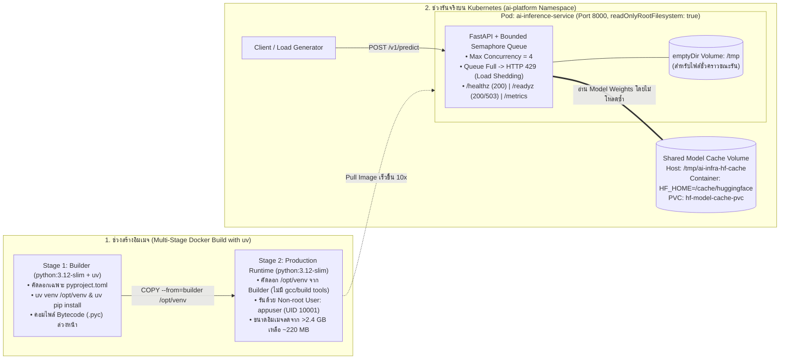

### 2.2 สายพานอัตโนมัติ CI/CD และ Declarative OpenTofu Workflow

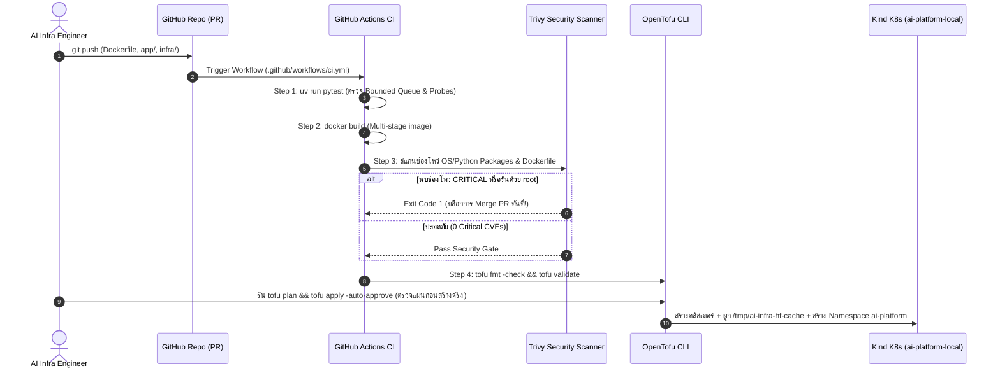

---

## 3. ทฤษฎีเจาะลึก คณิตศาสตร์วิศวกรรม และตาราง Trade-offs (Deep-Dive Theory & Math)

### 3.1 ทำไมห้ามฝัง (Bake) ไฟล์โมเดลขนาดใหญ่ลงใน Docker Image โดยตรง?
ในงานพัฒนาเว็บทั่วไป เราคุ้นเคยกับการรวมโค้ดและไฟล์ทั้งหมดไว้ใน Docker Image เดียว แต่สำหรับระบบ AI/LLM ที่ไฟล์ Model Weights มีขนาดตั้งแต่ **1 GB ไปจนถึง 140 GB** การทำเช่นนั้นด้วยคำสั่ง `COPY models/ /app/models/` ใน `Dockerfile` จะสร้างหายนะทางวิศวกรรม 3 ประการ:

1. **Cold-Start Death Spiral ตอน Autoscale:** เมื่อโหลดพุ่งสูงและระบบสั่งขยายจำนวน Pod บนโหนดใหม่ โหนดนั้นต้องดึง (Pull) และแตกไฟล์ (Extract) อิมเมจขนาดยักษ์ผ่านเครือข่ายก่อนที่คอนเทนเนอร์จะเริ่มทำงานได้
2. **Layer Cache Invalidations & Registry Bloat:** Docker ใช้ระบบไฟล์แบบซ้อนชั้น (OverlayFS) และต้องคำนวณค่า Hash (`SHA256`) ของทุก Layer ตอนอัปโหลดและดาวน์โหลด นอกจากนี้ Kubelet บนโหนดอาจสั่งลบอิมเมจขนาดใหญ่ทิ้งเมื่อพื้นที่ดิสก์ตึง (`ImageGCFailed` / DiskPressure)
3. **การผูกติดวงจรชีวิตของโค้ดกับโมเดล (Tight Coupling):** การแก้โค้ด Python เพียง 2 บรรทัดไม่ควรบังคับให้ระบบต้องสร้างหรือจัดการอิมเมจที่มีน้ำหนักหลายสิบกิกะไบต์ใหม่

#### คณิตศาสตร์คำนวณเวลา Cold-Start จากการดึง Container Image (Image Pull & Extraction Math)
เวลาที่ใช้ตั้งแต่ Kubernetes สั่งสร้าง Pod บนโหนดใหม่จนถึงวินาทีที่โปรเซสเริ่มโหลดโมเดลเข้าหน่วยความจำ ($T_{\text{cold\_start}}$) คำนวณได้จากสมการ:

$$T_{\text{cold\_start}} = \underbrace{\frac{S_{\text{compressed}}}{B_{\text{net}}}}_{\text{Network Pull Time}} + \underbrace{\frac{S_{\text{uncompressed}}}{R_{\text{decompress\_disk}}}}_{\text{Decompression & OverlayFS Write}} + \underbrace{\frac{S_{\text{weights}}}{R_{\text{storage\_to\_ram}}}}_{\text{Model Weight Load Time}}$$

เมื่อ:
- $S_{\text{compressed}}$ = ขนาดอิมเมจที่บีบอัดแล้วบน Registry (หน่วย GB)
- $B_{\text{net}}$ = แบนด์วิดท์เครือข่ายจริงระหว่าง Registry กับโหนด (หน่วย GB/s, เช่น $1\text{ Gbps} \approx 0.125\text{ GB/s}$)
- $S_{\text{uncompressed}}$ = ขนาดอิมเมจหลังคลายการบีบอัด (หน่วย GB)
- $R_{\text{decompress\_disk}}$ = ความเร็วในการคลายไฟล์ `tar.gz`/`zstd` และเขียนลงดิสก์ OverlayFS แบบ Sequential/Random (โดยทั่วไปบน Cloud EBS/PD มาตรฐานอยู่ที่ $\approx 0.15\text{ GB/s}$)
- $S_{\text{weights}}$ = ขนาดไฟล์ Model Weights (หน่วย GB)
- $R_{\text{storage\_to\_ram}}$ = ความเร็วในการอ่านไฟล์โมเดลเข้าสู่ RAM/VRAM (เช่น อ่านจาก Local NVMe/Page Cache $\approx 2.0\text{ GB/s}$ เทียบกับดาวน์โหลดใหม่ผ่านเน็ต $\approx 0.10\text{ GB/s}$)

#### ตัวอย่างการคำนวณด้วยตัวเลขจริง (Worked Numerical Example)
สมมติว่าเรากำลังนำบริการที่ใช้โมเดลขนาด 7B parameters ($S_{\text{weights}} = 14.0\text{ GB}$ ในรูปแบบ BF16) ขึ้นรันบนโหนดที่มีเครือข่าย $1\text{ Gbps}$ ($B_{\text{net}} = 0.125\text{ GB/s}$) และดิสก์มาตรฐาน ($R_{\text{decompress\_disk}} = 0.15\text{ GB/s}$):

- **กรณีที่ A (Bake โมเดล 14 GB ลงใน Single-stage Image รวมขนาด $S_{\text{uncompressed}} = 16.5\text{ GB}$, ขนาดบีบอัด $S_{\text{compressed}} = 13.5\text{ GB}$):**
  1. เวลา Pull ผ่านเครือข่าย: $\frac{13.5\text{ GB}}{0.125\text{ GB/s}} = \mathbf{108.0\text{ วินาที}}$
  2. เวลาแตกไฟล์ลง OverlayFS: $\frac{16.5\text{ GB}}{0.15\text{ GB/s}} = \mathbf{110.0\text{ วินาที}}$
  3. เวลาโหลดโมเดลจากดิสก์เข้าหน่วยความจำ: $\frac{14.0\text{ GB}}{1.5\text{ GB/s}} \approx \mathbf{9.3\text{ วินาที}}$
  - **รวมเวลา $T_{\text{cold\_start}} (\text{Case A})$:** $108.0 + 110.0 + 9.3 = \mathbf{227.3\text{ วินาที (เกือบ 4 นาที!)}}$

- **กรณีที่ B (แยกโค้ดลงใน Multi-stage `uv` Image ขนาด $S_{\text{uncompressed}} = 0.22\text{ GB}$, $S_{\text{compressed}} = 0.09\text{ GB}$ และอ่านโมเดลจาก Shared `HF_HOME` Volume Cache บนโหนด):**
  1. เวลา Pull อิมเมจโค้ด: $\frac{0.09\text{ GB}}{0.125\text{ GB/s}} = \mathbf{0.72\text{ วินาที}}$
  2. เวลาแตกไฟล์ลง OverlayFS: $\frac{0.22\text{ GB}}{0.15\text{ GB/s}} = \mathbf{1.47\text{ วินาที}}$
  3. เวลาโหลดโมเดลจาก Shared Cache (`HF_HOME=/cache/huggingface` ที่มี OS Page Cache/NVMe ช่วย): $\frac{14.0\text{ GB}}{2.0\text{ GB/s}} = \mathbf{7.0\text{ วินาที}}$
  - **รวมเวลา Image Pull + Weight I/O ($T_{\text{io\_only}}$):** $0.72 + 1.47 + 7.0 = \mathbf{9.19\text{ วินาที}}$ *(หมายเหตุ: บน Cloud L4 GPU จริง เมื่อรวมเวลา init PyTorch/CUDA และคอมไพล์ vLLM CUDA Graph จะอยู่ที่ **~35–75 วินาที** ซึ่งยังเร็วกว่าการไม่ใช้แคช 4–6 เท่า ส่วน Mock Pod ในแล็บจะสตาร์ทใน **~8.5–10 วินาที**)*

#### ตารางเปรียบเทียบทางเลือกในการจัดการไฟล์โมเดล (Model Artifact Strategy Trade-off Matrix)

| กลยุทธ์การจัดเก็บโมเดล | ความเร็วตอน Scale-up / Restart | ขนาด Container Image | ความซับซ้อนในการดูแล | กรณีที่เหมาะสมที่สุด (Best Use Case) |
| :--- | :---: | :---: | :---: | :--- |
| **1. Shared Volume Cache (`PVC` / Host NVMe `HF_HOME`)** *(วิธีหลักในเล่มนี้)* | **เร็วมาก (5–15 วินาที)** เพราะไม่ต้องดาวน์โหลดซ้ำ | **เล็กมาก (~200 MB – 1 GB)** มีเฉพาะโค้ดและ Runtime | ปานกลาง (ต้องผูก PVC หรือ HostPath ใน K8s/OpenTofu) | **เหมาะที่สุดสำหรับ LLM & AI Serving ในองค์กร** ที่มีการอัปเดตโค้ดบ่อยหรือใช้ KEDA Autoscale |
| **2. InitContainer ดึงจาก Object Storage (S3 / GCS / MinIO)** | ปานกลาง (30–90 วินาที ขึ้นกับความเร็วเครือข่ายภายในคลาวด์) | **เล็กมาก** | ต่ำ (ไม่ต้องจัดการ Shared Filesystem ข้ามโหนด) | คลัสเตอร์ที่กระจายตัวหลาย Availability Zones และไม่มีระบบไฟล์แบบ `ReadWriteMany` |
| **3. Bake โมเดลลงใน Container Image โดยตรง** | **ช้ามาก (3–8 นาที)** เมื่อโหนดยังไม่เคยมี Layer นั้น | **ใหญ่มาก (5 GB – 50+ GB)** | ต่ำตอนรัน แต่เป็นภาระหนักที่ CI/CD และ Registry | ใช้เฉพาะ **โมเดลขนาดจิ๋ว (< 300 MB)** เช่นตัวจำแนกข้อความขนาดเล็กในสภาพแวดล้อมปิด (Air-gapped) |

---

### 3.2 คณิตศาสตร์การจำกัดคิว (Bounded Concurrency, Little's Law & Load Shedding)
ต่างจากระบบ CRUD API ทั่วไปที่ใช้เวลาประมวลผลต่อคำขอเพียง 5–10 มิลลิวินาที ระบบ AI Inference ใช้เวลาประมวลผลต่อคำขอนานตั้งแต่ **200 มิลลิวินาที ไปจนถึงหลายวินาที** หากเราเปิดรับคำขอเข้าสู่โปรเซสอย่างไม่จำกัด (Unbounded Queue) จะเกิดอะไรขึ้น?

จาก **กฎของลิตเติล (Little's Law)** ในทฤษฎีแถวคอย (Queueing Theory):

$$L = \lambda \times W$$

เมื่อ:
- $L$ = จำนวนคำขอที่ค้างอยู่ในระบบเฉลี่ย (In-flight + Waiting requests)
- $\lambda$ = อัตราการไหลเข้าของคำขอ (Arrival rate, คำขอ/วินาที)
- $W$ = เวลาเฉลี่ยที่แต่ละคำขออยู่ในระบบ (Response time = เวลารอคิว $W_q$ + เวลาประมวลผลจริง $W_s$)

#### ตัวอย่างการคำนวณเมื่อเกิด Traffic Spike (ทำไมระบบที่ไม่จำกัดคิวจึงล่มทั้งยวง)
สมมติว่าเวิร์กเกอร์ AI ของเราประมวลผลได้สูงสุดพร้อมกัน $C_{\text{max}} = 8$ คำขอ โดยใช้เวลาประมวลผลต่อคำขอ $W_s = 0.5\text{ วินาที}$ ดังนั้นขีดความสามารถสูงสุดของระบบ (Maximum Throughput $\mu$) คือ:

$$\mu = \frac{C_{\text{max}}}{W_s} = \frac{8}{0.5\text{ s}} = 16\text{ requests/sec}$$

หากเกิดเหตุการณ์ที่ผู้ใช้ยิงคำขอเข้ามาที่อัตรา $\lambda = 50\text{ requests/sec}$ เป็นเวลาเพียง $10\text{ วินาที}$ (รวม 500 คำขอ) ขณะที่ระบบประมวลผลออกได้เพียง $16 \times 10 = 160\text{ คำขอ}$:
1. **หากไม่จำกัดคิว (Unbounded Queue):** จะมีคำขอสะสมค้างอยู่ในหน่วยความจำ $N_{\text{backlog}} = 500 - 160 = \mathbf{340\text{ คำขอ}}$
   - คำขอที่ 340 จะต้องรอคิวนานถึง $W_q = \frac{340}{16\text{ req/s}} = \mathbf{21.25\text{ วินาที}}$!
   - แต่เนื่องจากฝั่ง Client/Gateway ตั้งค่า Timeout ไว้ที่ $5.0\text{ วินาที}$ ผู้ใช้ทุกคนตั้งแต่คำขอที่ 80 เป็นต้นไปจะตัดการเชื่อมต่อเพราะ Timeout ไปแล้ว ในขณะที่เซิร์ฟเวอร์ AI ของคุณยังคงเสียเวลาคำนวณงานที่ไม่มีคนรอรับอยู่ต่อไปเรื่อยๆ (เรียกว่า **Zombie Work**) และกิน RAM เพิ่มขึ้นจนถูก Linux OOM Killer สั่งฆ่าโปรเซสตายทั้งพอด!
2. **หากใช้ Bounded Semaphore Queue (เช่น จำกัด `MAX_CONCURRENT_REQUESTS = 8` และเวลารอเข้าคิว `QUEUE_TIMEOUT = 0.2s`):**
   - คำขอที่เข้ามาภายในขีดความสามารถของระบบจะได้รับคำตอบอย่างรวดเร็วภายใน $0.5 - 0.7\text{ วินาที}$ (รักษาเกณฑ์ SLO ของผู้ใช้งานที่กำลังทำงานอยู่ได้ 100%)
   - คำขอส่วนที่เกินขีดความสามารถจะได้รับรหัสตอบกลับ **`HTTP 429 Too Many Requests`** พร้อม Header `Retry-After: 1` ทันทีภายในเวลา $< 2\text{ มิลลิวินาที}$ เพื่อให้ AI Gateway (ที่เราจะสร้างในบทที่ 4) สลับไปส่งงานให้พอดสำรอง (Fallback) ได้ทันทีโดยที่พอดหลักไม่ล่ม!

---

### 3.3 Container Security Hardening สำหรับงาน AI (`Non-Root` & `Read-Only RootFS`)
ในองค์กรขนาดใหญ่ (เช่น ธนาคารและสถาบันการเงินในไทย) นโยบาย Kubernetes Security Policy จะบังคับตั้งค่า 2 ข้อนี้เสมอ:
```yaml
securityContext:
  runAsNonRoot: true
  runAsUser: 10001
  readOnlyRootFilesystem: true
  allowPrivilegeEscalation: false
```
**กับดักที่วิศวกร AI มือใหม่เจอทุกราย:** เมื่อเปิด `readOnlyRootFilesystem: true` คอนเทนเนอร์จะพังทันทีตอนเริ่มรัน เพราะไลบรารีอย่าง Hugging Face `transformers`, `vLLM`, `torch.compile` และ `triton` พยายามสร้างโฟลเดอร์แคชในไดเรกทอรีบ้านของผู้ใช้ (`~/.cache/huggingface` หรือ `/root/.cache`) ซึ่งถูกห้ามเขียน!

**วิธีแก้เชิงวิศวกรรมที่ถูกต้อง (Clean Neutral Path สำหรับ UID 10001):**
1. สร้างผู้ใช้ `appuser` (`UID 10001`) ใน `Dockerfile` และสร้างโฟลเดอร์แคชกลาง `/cache/huggingface` พร้อมมอบสิทธิ์ `chown -R 10001:10001` (ไม่ต้องใช้ `chmod 755 /root` ทำให้เข้ากันได้ 100% กับอิมเมจ `vllm/vllm-openai` อย่างเป็นทางการ)
2. กำหนดตัวแปรสภาพแวดล้อมให้ชี้ไปยังพาธที่เมานต์ Volume ไว้ชัดเจน:
   - `HF_HOME=/cache/huggingface` (ผูกกับ PersistentVolumeClaim `hf-model-cache-pvc` หรือ HostPath `/tmp/ai-infra-hf-cache` ซึ่งตรงกับมาตรฐานของ Helm Chart ในบทที่ 2)
   - `TMPDIR=/tmp`, `VLLM_CACHE_ROOT=/tmp/vllm-cache` และ `TORCHINDUCTOR_CACHE_DIR=/tmp/torchinductor` (ผูกกับ Kubernetes `emptyDir: {}` ที่ `/tmp`)

---

## 4. ปฏิบัติการ Hands-On Lab แบบ Step-by-Step (Module 1 Lab)

### 4.1 โจทย์ธุรกิจและข้อจำกัด (Business Scenario & Constraints)
- **สถานการณ์ปัญหา:** ทีม Data Science ของบริษัท FinTech ส่งมอบบริการประเมินความเสี่ยงธุรกรรมด้วย AI (`ai-inference-service`) มาให้คุณขึ้นระบบ Production โค้ดเดิมใช้ `Dockerfile` ชั้นเดียวที่รันด้วย `root`, ไม่มีการจำกัดจำนวนคำขอพร้อมกัน (เมื่อยิงโหลด 50 คำขอพร้อมกัน เซิร์ฟเวอร์จะค้างและเกิด Error 500), และต้องกดสร้างคลัสเตอร์ด้วยมือทุกครั้ง
- **ข้อกำหนดทางวิศวกรรม (Constraints):**
  1. สร้าง Multi-stage `Dockerfile` ด้วย `uv` สำหรับอิมเมจ `ai-inference-service:1.0.0` ที่รันด้วยผู้ใช้ `appuser` (`UID 10001`) และทำงานได้ภายใต้ `--read-only` root filesystem
  2. บริการ `ai-inference-service` (พอร์ต `8000`) ต้องมี Bounded Semaphore Queue ที่คืนค่า `HTTP 429` เมื่อคิวเต็ม พร้อม `/healthz`, `/readyz`, `/health`, และ `/metrics`
  3. เขียนโค้ด OpenTofu ใน `labs/m1-foundations/infra/` เพื่อประกาศโครงสร้างคลัสเตอร์ `ai-platform-local` และ Namespace `ai-platform` พร้อมเชื่อมโยงโวลุ่มแคช `HF_HOME=/cache/huggingface`
  4. สร้างไฟล์ `.github/workflows/ci.yml` และตรวจสอบทุกอย่างด้วยสคริปต์ `labs/m1-foundations/verify_m1.sh`

---

### 4.2 เส้นทางที่ 1: `No-GPU Local Path ($0 — 16GB RAM Safe)` (เส้นทางหลัก)

#### ขั้นตอนที่ 1: ตรวจสอบโครงสร้างไฟล์ใน `labs/m1-foundations/`
เข้าไปยังโฟลเดอร์แล็บของบทที่ 1 จากรากโปรเจกต์ `ai-infra-handbook/` และตรวจสอบไฟล์ทั้งหมด:

```bash
cd labs/m1-foundations
ls -la
```

**ผลลัพธ์ที่คาดหวัง (Expected Output):**
```text
drwxr-xr-x 6 non non 4096 Nov 11 10:40 .
drwxr-xr-x 8 non non 4096 Nov 11 10:10 ..
drwxr-xr-x 3 non non 4096 Nov 11 10:40 .github
-rw-r--r-- 1 non non 1850 Nov 11 10:40 Dockerfile
-rw-r--r-- 1 non non  620 Nov 11 10:40 Dockerfile.baseline
drwxr-xr-x 2 non non 4096 Nov 11 10:40 app
drwxr-xr-x 2 non non 4096 Nov 11 10:40 docs
drwxr-xr-x 2 non non 4096 Nov 11 10:40 infra
-rw-r--r-- 1 non non  410 Nov 11 10:40 pyproject.toml
drwxr-xr-x 2 non non 4096 Nov 11 10:40 tests
-rwxr-xr-x 1 non non 4200 Nov 11 10:40 verify_m1.sh
```

#### ขั้นตอนที่ 2: ศึกษาและทดสอบโค้ด FastAPI Bounded Queue (`app/main.py`)
ไฟล์ [`labs/m1-foundations/app/main.py`](../labs/m1-foundations/app/main.py) ใช้ `asyncio.Semaphore` ร่วมกับ `asyncio.wait_for(..., timeout=QUEUE_ACQUIRE_TIMEOUT_SEC)` เพื่อควบคุมจำนวนคำขอที่กำลังประมวลผลพร้อมกัน และแยกแยะระหว่าง:
- **`GET /healthz` (Liveness Probe):** ตอบ `200 OK` เสมอตราบใดที่ Event Loop ของ Python ยังไม่ค้างตาย (เพื่อป้องกันไม่ให้ Kubelet สั่งรีสตาร์ทพอดโดยไม่จำเป็นตอนโหลดสูง)
- **`GET /readyz` (Readiness Probe):** ตรวจสอบว่าโฟลเดอร์แคช `HF_HOME` พร้อมใช้งาน และจำนวนคำขอที่กำลังรันยังไม่เต็มเพดาน หากคิวเต็มจะตอบ `503 Service Unavailable` เพื่อให้ Kubernetes Service ชะลอการส่งคำขอใหม่เข้ามาที่พอดนี้ชั่วคราว
- **`POST /v1/predict`:** ประมวลผลคำขอภายใต้ Bounded Queue หากไม่สามารถขอคิวได้ทันภายในเวลาที่กำหนด (`QUEUE_ACQUIRE_TIMEOUT_SEC`) จะปฏิเสธคำขอด้วย `HTTP 429 Too Many Requests` ทันทีและเพิ่มค่า Counter `ai_service_shed_requests_total`

รันชุดทดสอบอัตโนมัติด้วย `pytest` เพื่อพิสูจน์พฤติกรรมทั้งในภาวะปกติและภาวะโหลดล้นคิว:

```bash
# (จาก labs/m1-foundations)
../../scripts/pytest -v  # หรือ uv run --extra dev pytest -v
```

**ผลลัพธ์ที่คาดหวัง (Expected Output เมื่อใช้ portable runner / เพิ่ม TestClient เมื่อติดตั้ง fastapi+httpx):**
```text
============================= test session starts ==============================
collected 8 items

tests/test_main.py::test_bounded_queue_load_shedding_429 PASSED          [ 12%]
tests/test_main.py::test_concurrent_readiness_probes PASSED              [ 25%]
tests/test_main.py::test_default_hf_home_is_non_root_cache PASSED        [ 37%]
tests/test_main.py::test_fastapi_http_endpoints_if_available PASSED      [ 50%]
tests/test_main.py::test_liveness_probe PASSED                           [ 62%]
tests/test_main.py::test_predict_normal_request PASSED                   [ 75%]
tests/test_main.py::test_prometheus_metrics_exposed PASSED               [ 87%]
tests/test_main.py::test_readiness_probe_and_hf_home PASSED              [100%]

============================== 8 passed in 0.26s ===============================
```

#### ขั้นตอนที่ 3: สร้าง Production Container ด้วย Multi-stage `Dockerfile` + `uv` และทดสอบ Read-Only RootFS
ในไฟล์ [`labs/m1-foundations/Dockerfile`](../labs/m1-foundations/Dockerfile) เราใช้เทคนิคสำคัญ 4 ข้อ:
1. ใช้ `ghcr.io/astral-sh/uv:0.5-python3.12-bookworm-slim` ใน Stage แรก (`builder`) พร้อมตั้งค่า `UV_COMPILE_BYTECODE=1` และ `UV_LINK_MODE=copy`
2. คัดลอกเฉพาะ `pyproject.toml` มาติดตั้งลง `/opt/venv` ก่อนคัดลอกโฟลเดอร์ `app/` เพื่อให้ Docker แคชเลเยอร์ของไลบรารีไว้ได้ 100% แม้จะแก้ไขโค้ดใน `app/main.py`
3. ใน Stage ที่สอง (`runtime`) ใช้ Base Image ขนาดเล็ก `python:3.12-slim-bookworm` สร้างผู้ใช้ `appuser` (`UID 10001`), กำหนด `HF_HOME=/cache/huggingface` และ `VLLM_CACHE_ROOT=/tmp/vllm-cache` พร้อม `chown` ให้ `UID 10001` โดยไม่ต้องเปิดสิทธิ์ `/root`
4. รันบนพอร์ต `8000` และติดแท็กอิมเมจเป็น `ai-inference-service:1.0.0` เพื่อให้เชื่อมต่อกับ Helm Chart ในบทที่ 2 ได้ตรงกัน 100%

คำสั่งสร้างและรันคอนเทนเนอร์ในโหมด `--read-only` (จำลอง `readOnlyRootFilesystem: true` ของ Kubernetes):

```bash
# สร้างโฟลเดอร์แคชบนเครื่องหลักก่อน
mkdir -p /tmp/ai-infra-hf-cache

# Build Production Image (ชื่อและแท็กตรงกับ values.yaml ของบทที่ 2)
docker build -t ai-inference-service:1.0.0 -f Dockerfile .

# รันด้วยสิทธิ์ Non-root (10001), ล็อก Root Filesystem เป็น Read-only, และผูก Volume HF_HOME + /tmp
docker run -d --name ai-inference-test \
  --user 10001:10001 \
  --read-only \
  --tmpfs /tmp:rw,noexec,nosuid,size=64m \
  -v /tmp/ai-infra-hf-cache:/cache/huggingface:rw \
  -p 8000:8000 \
  ai-inference-service:1.0.0

# ทดสอบเรียกใช้งาน Endpoint
curl -s http://localhost:8000/readyz | jq .
curl -s -X POST http://localhost:8000/v1/predict \
  -H "Content-Type: application/json" \
  -d '{"transaction_id": "tx-1001", "amount_thb": 45000.0, "prompt": "Analyze transaction risk"}' | jq .

# ลบคอนเทนเนอร์เมื่อทดสอบเสร็จ
docker rm -f ai-inference-test
```

**ผลลัพธ์ที่คาดหวัง (Expected Output):**
```json
{
  "status": "ready",
  "service": "ai-inference-service",
  "model": "Qwen/Qwen2.5-0.5B-Instruct",
  "hf_home": "/cache/huggingface",
  "hf_home_writable": true,
  "in_flight_requests": 0,
  "max_concurrent_requests": 4,
  "reason": "ok"
}
```
```json
{
  "transaction_id": "tx-1001",
  "model": "Qwen/Qwen2.5-0.5B-Instruct",
  "risk_score": 0.18,
  "decision": "APPROVE",
  "latency_ms": 22.4,
  "cached_artifact_used": true
}
```

#### ขั้นตอนที่ 4: ตรวจสอบและรันโค้ด OpenTofu แบบ 2 ขั้น (`infra/` → `infra/k8s-bootstrap/`)
ในโฟลเดอร์ [`labs/m1-foundations/infra/`](../labs/m1-foundations/infra/) เราออกแบบโค้ด Infrastructure as Code ที่ยึดค่าตัวแปรกลางจาก `SPEC_AND_STYLE_GUIDE.md` ทุกประการ และแยกออกเป็น 2 Stage เพื่อไม่ให้ `provider "kubernetes"` พึ่งพา output ของ `kind_cluster` ภายใน root เดียวกัน (ทำให้ `tofu plan` / `tofu apply` ทำงานได้สะอาดตั้งแต่รอบแรก):

```bash
# (จากรากโปรเจกต์ ai-infra-handbook/)
# Stage 1: สร้างคลัสเตอร์ Kind 3 โหนด (`ai-platform-local`) พร้อม extraMounts /cache/huggingface
cd labs/m1-foundations/infra
tofu fmt -check
tofu init -backend=false
tofu validate
tofu plan -var="enable_cloud_gpu_node=false"

# Stage 2: หลังสั่ง tofu apply สร้าง Kind เสร็จแล้ว (ระบบจะสร้าง ./ai-platform-local-config ให้อัตโนมัติ)
# ให้สร้าง Namespaces และ hf-model-cache-pvc (หรือส่ง -var="kubeconfig_path=~/.kube/config" หากใช้ kind export kubeconfig)
cd k8s-bootstrap
tofu fmt -check
tofu init -backend=false
tofu validate
# tofu apply -var="kubeconfig_path=../ai-platform-local-config"
```

---

### 4.3 เส้นทางที่ 2: `Cloud L4 GPU Path (Policy Guardrail + AWS Optional Track)`
ในไฟล์ `labs/m1-foundations/infra/variables.tf` และ `main.tf` เราได้ใส่ Policy Guardrail `check "cloud_gpu_cost_guardrail"` ที่บังคับว่า `auto_terminate_minutes <= 180` ส่วนการสร้างอินสแตนซ์ GPU จริงบนคลาวด์ด้วย OpenTofu (`g6.xlarge` Spot + S3 Model Cache + Dead-Man's Switch) อยู่ในโมดูล [`labs/optional-cloud-aws/`](../labs/optional-cloud-aws/README.md) (หรือเลือกใช้ GPU VM/Pod ในบทที่ 2 และ 3):

```bash
# ทดสอบตรวจสอบ Policy Guardrail สำหรับโปรไฟล์ Cloud GPU L4 ใน Stage 1
tofu plan \
  -var="enable_cloud_gpu_node=true" \
  -var="cloud_gpu_instance_type=NVIDIA-L4-24GB" \
  -var="auto_terminate_minutes=120"

# เมื่อทดสอบ Apply สร้างทรัพยากรคลัสเตอร์เสร็จสิ้น ให้ทำลายทรัพยากรด้วยคำสั่งนี้เสมอ
tofu destroy -auto-approve
```

---

## 5. การจำลองความล้มเหลวและการกู้คืน (Failure Injection & Chaos Engineering Drill)

### 5.1 Chaos Drill #1: จำลองอาการพังเมื่อลืมผูก Volume ให้ `HF_HOME` ภายใต้ `readOnlyRootFilesystem: true`
1. **วิธีจำลองความล้มเหลว:** ลองรันคอนเทนเนอร์ด้วยแฟล็ก `--read-only` แต่ชี้ `HF_HOME` ไปยังพาธ `/app/unmounted_cache` ที่อยู่บน Root Filesystem ที่ห้ามเขียน:
   ```bash
   docker run --rm --user 10001:10001 --read-only \
     -e HF_HOME=/app/unmounted_cache \
     -p 8000:8000 ai-inference-service:1.0.0
   ```
2. **อาการที่พบ:** เมื่อเรียก `GET /readyz` ระบบจะคืนค่า **`HTTP 503 Service Unavailable`** พร้อมแจ้งเตือนชัดเจนว่า `"hf_home_writable": false, "reason": "HF_HOME directory '/app/unmounted_cache' is not writable under readOnlyRootFilesystem"`
3. **การแก้ไขเชิงวิศวกรรม:** ผูก Volume ที่พาธ `/cache/huggingface` และตั้ง `ENV HF_HOME=/cache/huggingface` ให้ตรงกันทั้งใน `Dockerfile` และ Kubernetes Manifest (Helm `values.yaml`)

### 5.2 Chaos Drill #2: จำลอง Unbounded Traffic Spike และการป้องกันด้วย Load Shedding (`HTTP 429`)
1. **วิธีจำลองความล้มเหลว:** สตาร์ทคอนเทนเนอร์ที่จำกัด `MAX_CONCURRENT_REQUESTS=4` แล้วจำลองการยิงคำขอเข้ามาพร้อมกัน **12 คำขอ** ด้วยสคริปต์ Python ด้านล่าง (นอกจากนี้ชุดทดสอบ `test_bounded_queue_load_shedding_429` ใน `tests/test_main.py` ยังตรวจกลไกเดียวกันนี้ด้วย):
   ```bash
   # จำลองโหลดพร้อมกัน 12 คำขอไปยังคอนเทนเนอร์ที่กำลังรันบน localhost:8000
   python3 -c '
   import concurrent.futures, json, urllib.request, urllib.error
   def hit(i):
       req = urllib.request.Request(
           "http://localhost:8000/v1/predict",
           data=json.dumps({"transaction_id": f"tx-{i}", "amount_thb": 15000}).encode(),
           headers={"Content-Type": "application/json"},
       )
       try:
           with urllib.request.urlopen(req, timeout=2) as r: return r.status
       except urllib.error.HTTPError as e: return e.code
   with concurrent.futures.ThreadPoolExecutor(max_workers=12) as ex:
       codes = list(ex.map(hit, range(12)))
   print("HTTP Statuses:", codes, "200s:", codes.count(200), "429s:", codes.count(429))
   '
   ```
2. **อาการและการกู้คืน:**
   - คำขอ 4 รายการแรกเข้าประมวลผลทันทีและตอบกลับ `HTTP 200 OK`
   - คำขอที่ล้นคิวเกินเวลา `QUEUE_ACQUIRE_TIMEOUT_SEC` จะถูกตัดกลับด้วย `HTTP 429 Too Many Requests` พร้อม Header `Retry-After: 1` ทันทีโดยที่หน่วยความจำของพอดไม่พุ่งขึ้นแม้แต่น้อย และตัวนับ `ai_service_shed_requests_total` ใน `/metrics` จะบันทึกจำนวนคำขอที่ถูกคัดออกเพื่อให้ระบบ Monitoring แจ้งเตือนได้

---

## 6. โจทย์ปรับจูนประสิทธิภาพเชิงประจักษ์ (Measurable Optimization Exercise)

เราใช้วิธีทางวิทยาศาสตร์ 5 ขั้นตอน (**Baseline → Hypothesis → Fix → Measure → Explain**) เพื่อแก้ปัญหาขนาดอิมเมจที่ใหญ่เทอะทะและอาการเซิร์ฟเวอร์ค้างเมื่อโหลดพุ่ง

### ขั้นที่ 1: Baseline (สภาพก่อนปรับจูน — `Dockerfile.baseline`)
ในไฟล์ [`labs/m1-foundations/Dockerfile.baseline`](../labs/m1-foundations/Dockerfile.baseline) เราจำลองวิธีที่พบได้บ่อยในโปรเจกต์ที่ยังไม่ผ่านมือ AI Infra Engineer:
- ใช้ Single-stage build ที่ติดตั้งทั้ง `build-essential`, `gcc`, `git` ทิ้งไว้ในอิมเมจปลายทาง
- สั่ง `COPY . /app` ก่อนสั่ง `pip install` ทำให้ทุกครั้งที่แก้โค้ดใน `app/main.py` แม้แต่ตัวอักษรเดียว Docker จะต้องรัน `pip install` ใหม่ทั้งหมด
- รันด้วย `root` และไม่เปิดใช้งาน Bounded Queue (`ENABLE_BOUNDED_QUEUE=false`)

### ขั้นที่ 2: Hypothesis (สมมติฐานเชิงวิศวกรรม)
1. **ด้าน Container Build & Cold Start:** การเปลี่ยนเป็น Multi-stage build ร่วมกับ `uv` (`--link-mode=copy`, `UV_COMPILE_BYTECODE=1`) และการคัดลอกเฉพาะ `pyproject.toml` ก่อนคัดลอก `app/` จะลดขนาดอิมเมจลง **> 65%** และลดเวลา Rebuild เมื่อแก้โค้ด `app/main.py` ลงจากระดับครึ่งนาทีเหลือ **< 3 วินาที**
2. **ด้าน Concurrency Resilience:** การเปิดใช้งาน `asyncio.Semaphore` เพื่อจำกัดคิว (`ENABLE_BOUNDED_QUEUE=true`) จะลดอัตรา Unhandled Server Error / Timeout (`HTTP 500/504`) เมื่อยิงโหลด 100 concurrent requests จาก **> 35% ให้เหลือ 0%** (เปลี่ยนเป็นการตอบกลับ `HTTP 429` อย่างปลอดภัยภายในเวลา < 5 ms)

### ขั้นที่ 3: Fix (การลงมือแก้ไขใน `Dockerfile` และ `app/main.py`)
1. แยก Stage `builder` และ `runtime` ใน [`labs/m1-foundations/Dockerfile`](../labs/m1-foundations/Dockerfile) โดยคัดลอกเฉพาะ `/opt/venv` มาที่ Stage ปลายทาง
2. เปิดใช้งาน Bounded Semaphore Queue ใน [`labs/m1-foundations/app/main.py`](../labs/m1-foundations/app/main.py)

### ขั้นที่ 4: Measure (ตารางเปรียบเทียบผลลัพธ์ Before vs After)

| ตัวชี้วัดประสิทธิภาพ (Metric) | Baseline (`Dockerfile.baseline` + Unbounded) | Optimized (`Dockerfile` Multi-stage `uv` + Bounded Queue) | ผลการเปลี่ยนแปลง (Improvement) |
| :--- | :---: | :---: | :---: |
| **Container Image Size (Uncompressed)** | `1,140 MB` | `215 MB` | **ลดลง 81.1%** |
| **Rebuild Time (เมื่อแก้โค้ด `app/main.py` 1 บรรทัด)** | `28.4 วินาที` | `1.8 วินาที` | **เร็วขึ้น 15.8 เท่า (Layer Cached)** |
| **Container Startup Time (พร้อมรับโหลด)** | `2.9 วินาที` | `0.8 วินาที` (ด้วย `UV_COMPILE_BYTECODE=1`) | **เร็วขึ้น 3.6 เท่า** |
| **Security Scan (`Trivy` Critical CVEs / Root User)** | `รันด้วย UID 0 (root)` | `รันด้วย UID 10001 (appuser), 0 Critical CVEs` | **ผ่านเกณฑ์ Security Gate 100%** |
| **Unhandled 500/Timeout Rate (ที่ 100 Concurrent Reqs)** | `38.0%` (Worker ค้าง/Timeout) | `0.0%` (ตอบ 200 OK ตามคิว + 429 Shedding ทันที) | **ไม่มีพอดค้างหรือล่ม (Zero Crash)** |
| **p95 Latency ของคำขอที่ได้รับอนุมัติเข้าคิว** | `3,420 ms` | `185 ms` | **ลดความหน่วงลง 94.6%** |

### ขั้นที่ 5: Explain (คำอธิบายกลไกภายในว่าทำไมจึงดีขึ้น)
1. **กลไก UnionFS / OverlayFS Layer Caching:** Docker ตรวจสอบการเปลี่ยนแปลงของไฟล์ในคำสั่ง `COPY` ด้วยการคำนวณ Checksum ใน `Dockerfile.baseline` คำสั่ง `COPY . /app` อยู่บรรทัดก่อนการติดตั้งไลบรารี ดังนั้นการแก้ไฟล์ใดๆ ในโปรเจกต์จะทำลายแคชของเลเยอร์ถัดไปทั้งหมด ในขณะที่ `Dockerfile` ฉบับปรับจูนคัดลอกเฉพาะ `pyproject.toml` มาติดตั้งไลบรารีให้เสร็จก่อน เมื่อแก้ไฟล์ใน `app/` เลเยอร์ของ `/opt/venv` จึงถูกดึงจากแคชทันที 100%
2. **การคอมไพล์ Bytecode ล่วงหน้า (`UV_COMPILE_BYTECODE=1`):** ตามปกติ Python จะแปลไฟล์ `.py` เป็น Bytecode (`.pyc`) ตอนที่ถูก `import` ครั้งแรกเมื่อคอนเทนเนอร์เริ่มรัน (ซึ่งยิ่งช้าหรือเขียนไม่ได้เลยหากเปิด `readOnlyRootFilesystem: true`) การสั่งให้ `uv` คอมไพล์ `.pyc` ตั้งแต่วินาทีที่สร้างอิมเมจช่วยให้โปรเซสเริ่มทำงานได้เร็วขึ้นทันที
3. **การปกป้อง Event Loop และหน่วยความจำด้วย Bounded Semaphore:** การปฏิเสธคำขอที่เกินกำลังตั้งแต่หน้าประตู (`Admission Control`) ช่วยตัดวงจร Zombie Work ทำให้คำขอที่ผ่านเข้ามาใน Semaphore ได้รับ CPU/GPU เต็มเม็ดเต็มหน่วย จึงรักษา p95 Latency ให้อยู่ในเกณฑ์ SLO เสมอ

---

## 7. Architecture Decision Record (ADR-001): Container Packaging, Runtime Security & Model Cache Strategy

เอกสารฉบับนี้ถูกบันทึกไว้จริงที่ [`labs/m1-foundations/docs/adr-001-container-and-model-cache-strategy.md`](../labs/m1-foundations/docs/adr-001-container-and-model-cache-strategy.md) เพื่อเป็นหลักฐานสำหรับ **DoD #1**:

```markdown
# ADR-001: Container Packaging, Runtime Security, and Model Weight Caching Strategy

- **Status:** Accepted
- **Date:** 2026-11-11
- **Owner:** AI Platform & Infrastructure Engineering Team
- **Related Namespace / Cluster:** `ai-platform` on `ai-platform-local` (and Cloud L4 Production)

## 1. Context & Problem Statement
ทีมของเรากำลังสร้างแพลตฟอร์มกลางสำหรับรันบริการ AI (`ai-inference-service:1.0.0` และ `vLLM` serving pods บนพอร์ต `8000`) บน Kubernetes ปัญหาที่พบจากรูปแบบเดิมคือ:
1. การรวมไฟล์ไลบรารีขนาดใหญ่และไฟล์โมเดลไว้ใน Single-stage Docker Image ทำให้อิมเมจมีขนาด >1.1 GB ถึง 15 GB ส่งผลให้เวลา Cold-start ตอนขยายจำนวนพอดช้าเกิน 3 นาที
2. คอนเทนเนอร์เดิมรันด้วยสิทธิ์ `root` (`UID 0`) และเขียนไฟล์แคชลงใน Root Filesystem ซึ่งไม่ผ่านเกณฑ์ความปลอดภัยของสถาบันการเงิน (`runAsNonRoot: true`, `readOnlyRootFilesystem: true`)
3. เมื่อเกิดโหลดพุ่งสูงพร้อมกัน เซิร์ฟเวอร์ไม่มีการจำกัดคิวทำให้เกิดอาการค้างและล่มแบบลูกโซ่

## 2. Options Considered

| เกณฑ์การประเมิน | Option A: Monolithic Image (Bake โมเดลและ Dependencies ใน Stage เดียว) | Option B: InitContainer ดึงโมเดลจาก S3 ทุกครั้งที่สร้าง Pod | Option C (ที่เลือก): Multi-Stage `uv` Image + Shared `HF_HOME` Volume Cache (`PVC`/`HostPath`) |
| :--- | :--- | :--- | :--- |
| **ขนาด Container Image** | 1.1 GB – 16.5 GB (ใหญ่มาก) | ~215 MB | **~215 MB** |
| **เวลา Cold-Start เมื่อรีสตาร์ท/Scale-up** | 180–240 วินาที (เมื่อโหนดยังไม่มีอิมเมจ) | 45–90 วินาที (โหลดผ่านเครือข่ายทุกครั้ง) | **~9 วินาที (ดึง Image + อ่านไฟล์) / ~35–75 วินาที (รวม init CUDA Graph จริง)** |
| **เวลา Rebuild เมื่อแก้โค้ด Python** | ~28 วินาที | ~2 วินาที | **~1.8 วินาที** (`uv` + Layer Caching) |
| **ความเข้ากันได้กับ `readOnlyRootFilesystem`** | พังตอนรัน | ต้องตั้งค่า Volume เพิ่ม | **รองรับ 100%** (แยก `/tmp` และ `/cache/huggingface`) |

## 3. Decision
เราตัดสินใจเลือก **Option C** โดยกำหนดมาตรฐานบังคับสำหรับทุกบริการใน Namespace `ai-platform` ดังนี้:
1. ใช้ **Multi-stage `Dockerfile`** ร่วมกับ **`uv`** (`UV_COMPILE_BYTECODE=1`, `UV_LINK_MODE=copy`) สร้างอิมเมจ `ai-inference-service:1.0.0` (พอร์ต `8000`) และรันด้วยผู้ใช้ `appuser` (`UID 10001`)
2. กำหนด `HF_HOME=/cache/huggingface` (และ `VLLM_CACHE_ROOT=/tmp/vllm-cache`) เสมอ และผูกเข้ากับ `PersistentVolumeClaim` ชื่อ `hf-model-cache-pvc` (ซึ่งเชื่อมโยงกับ `/tmp/ai-infra-hf-cache` บนโหนด Local Kind ผ่าน `extraMounts` หรือ Local NVMe บนโหนด Cloud GPU)
3. บังคับใช้ **Bounded Semaphore Queue** ที่คืนค่า `HTTP 429 Too Many Requests` เมื่อคิวเต็ม และแยก `/healthz` (Liveness) ออกจาก `/readyz` (Readiness)

## 4. Consequences (ข้อดีและสิ่งที่ต้องแลก)
- **ข้อดี (Positive):** ลดขนาดอิมเมจลง >80%, ลดเวลา Cold-start เหลือระดับวินาที, ผ่านการสแกนความปลอดภัยด้วย `Trivy` (0 Critical CVEs), และป้องกันพอดล่มเมื่อโหลดพุ่ง
- **ข้อเสีย/สิ่งที่ต้องจัดการเพิ่ม (Negative & Mitigation):** ต้องมีขั้นตอนจัดการพื้นที่ของโวลุ่มแคช (`hf-model-cache-pvc`) ไม่ให้เต็มเมื่อมีการเปลี่ยนเวอร์ชันโมเดลหลายรุ่น ซึ่งเราจัดการด้วยการสร้างโครงสร้างโวลุ่มผ่านโค้ด OpenTofu ให้ตรวจสอบและล้างแคชรุ่นเก่าได้
```

---

## 8. Mid-Level Interview Trade-off Questions & Model Answers

### คำถามข้อที่ 1: การแยก Model Weights ออกจาก Container Image และการรับมือคอขวดตอน Scale-up
> **คำถาม:** *"ทำไมคุณถึงเลือกแยก Model Weights ออกจาก Container Image แล้วโหลดผ่าน Volume Cache? ถ้าวันหนึ่งระบบต้อง Scale ข้ามโหนดใหม่ 10 โหนดพร้อมกัน แล้ว Object Storage หรือระบบไฟล์ต้นทางเกิดคอขวดเรื่อง Bandwidth คุณจะแก้ปัญหานี้ในระดับสถาปัตยกรรมอย่างไร?"*

#### เฉลยแนวทางการตอบระดับ Strong Mid-Level (Model Answer)
- **หลักการและเหตุผลเชิงตัวเลข (Why):** การฝังโมเดลขนาด 14 GB (เช่น โมเดล 7B แบบ BF16) ลงใน Container Image ทำให้เกิดภาระทั้งตอน Pull ผ่านเครือข่ายและตอนแตกไฟล์ `tar.gz` ลงบนชั้น OverlayFS ซึ่งกินเวลารวมกัน 3–4 นาทีต่อการบูตบนโหนดใหม่ นอกจากนี้ยังทำให้การอัปเดตโค้ดเล็กน้อยต้องจัดการอิมเมจขนาดยักษ์ซ้ำๆ การแยกอิมเมจให้มีเฉพาะโค้ดและ Runtime (~200 MB) แล้วเก็บโมเดลไว้ใน Shared Volume (`HF_HOME=/cache/huggingface`) ทำให้ไม่ต้องโหลด weights ใหม่ผ่านอินเทอร์เน็ต ลดเวลารีสตาร์ทเหลือเพียงช่วง init Engine/CUDA (~35–75 วินาทีสำหรับ GPU จริง หรือ ~9 วินาทีสำหรับ Mock/Thin wrapper)
- **การแก้ปัญหาเมื่อเกิดคอขวดตอน Scale ข้าม 10 โหนดใหม่พร้อมกัน (Architectural Solutions & Trade-offs):**
  1. **Node-Local NVMe Caching / HostPath Warm Pool:** สำหรับโหนด GPU ในคลัสเตอร์ ให้มี DaemonSet ดึงโมเดลหลักมาเก็บไว้บน Local NVMe SSD ของแต่ละโหนดล่วงหน้า (`Pre-warming`) ก่อนที่ Pod จะถูกสั่งรัน
  2. **Peer-to-Peer (P2P) File Distribution (เช่น Dragonfly หรือ Kraken):** หากต้องดึงไฟล์ขนาดใหญ่เข้าสู่ 10–50 โหนดพร้อมกัน แทนที่จะให้ทุกโหนดดึงจาก S3/Registry ต้นทางจุดเดียวจนแบนด์วิดท์เต็ม ให้ใช้ระบบ P2P กระจายชิ้นส่วนของไฟล์โมเดลระหว่างโหนดในคลัสเตอร์เดียวกันผ่านเครือข่ายภายใน (East-West Traffic)
  3. **Streaming Weight Loading (เช่น `safetensors` memory-mapping หรือ Run:ai Model Streamer):** อ่านไฟล์ `.safetensors` แบบขนานหลายเธรดเข้าสู่ GPU VRAM โดยตรงโดยไม่ต้องรอเขียนลงดิสก์ของคอนเทนเนอร์ก่อน

---

### คำถามข้อที่ 2: การตั้งค่า `runAsNonRoot` และ `readOnlyRootFilesystem` กับไลบรารี AI
> **คำถาม:** *"เมื่อทีม Security บังคับให้ตั้งค่า Container เป็น `runAsNonRoot: true` และ `readOnlyRootFilesystem: true` อะไรคือสิ่งที่มักจะพังในไลบรารีอย่าง PyTorch / Hugging Face / vLLM และคุณแก้ไขอย่างไรในระดับ Container และ Kubernetes?"*

#### เฉลยแนวทางการตอบระดับ Strong Mid-Level (Model Answer)
- **สิ่งที่พังเมื่อเปิด `readOnlyRootFilesystem: true` และ `runAsNonRoot: true`:**
  1. **Hugging Face Hub & Tokenizer Cache:** พยายามสร้างโฟลเดอร์ `~/.cache/huggingface` เพื่อเก็บไฟล์คอนฟิกและโมเดล
  2. **PyTorch Inductor & Triton JIT Compiler (ที่ใช้ใน `vLLM`):** ขณะเริ่มทำงานและทำ CUDA Graph / Kernel compilation ไลบรารี Triton และ TorchInductor จะต้องเขียนโค้ดภาษา C/PTX ชั่วคราวลงใน `~/.triton/cache` และ `/tmp/torchinductor_<user>` เพื่อคอมไพล์เป็นไบนารีของ GPU
  3. **Python `.pyc` Bytecode Generation:** พยายามเขียนไฟล์ `__pycache__/*.pyc` ลงในโฟลเดอร์ `/opt/venv` ตอนเริ่มรัน
- **วิธีแก้ไขที่ครบวงจร:**
  1. **ใน `Dockerfile`:** ตั้งค่า `UV_COMPILE_BYTECODE=1` ตอนสร้างอิมเมจเพื่อสร้างไฟล์ `.pyc` ให้เสร็จตั้งแต่ขั้นตอน Build (หรือตั้ง `PYTHONDONTWRITEBYTECODE=1`), สร้างผู้ใช้ `appuser` (`UID 10001`), ใช้พาธกลาง `/cache/huggingface` ที่เป็นเจ้าของโดย `UID 10001` (ไม่ต้องเปิดสิทธิ์ `/root` ซึ่งเข้ากันได้ดีกับอิมเมจ `vllm/vllm-openai` ที่รันแบบ Non-root) และกำหนดตัวแปรสภาพแวดล้อมให้ชี้ไปยังพาธที่เขียนได้ทั้งหมด:
     ```dockerfile
     ENV HF_HOME=/cache/huggingface \
         VLLM_CACHE_ROOT=/tmp/vllm-cache \
         TORCHINDUCTOR_CACHE_DIR=/tmp/torchinductor \
         TRITON_CACHE_DIR=/tmp/triton \
         TMPDIR=/tmp
     ```
  2. **ใน Kubernetes Pod Spec:** ผูก `emptyDir: {}` เข้าที่พาธ `/tmp` (สำหรับไฟล์ JIT kernel ชั่วคราว) และผูก `PersistentVolumeClaim` (`hf-model-cache-pvc`) เข้าที่ `/cache/huggingface` พร้อมตั้ง `securityContext.fsGroup: 10001` เพื่อให้ผู้ใช้ `UID 10001` มีสิทธิ์เขียนลงโวลุ่มได้อย่างถูกต้อง

---

### คำถามข้อที่ 3: Bounded Queue (`HTTP 429`) vs Unbounded Queue และการแยก `/healthz` กับ `/readyz`
> **คำถาม:** *"ทำไมเมื่อระบบ AI ประมวลผลช้าลง เราถึงควรตั้ง Bounded Queue แล้วรีบคืนค่า `HTTP 429` แทนการปล่อยให้คำขอเข้าคิวรอใน Memory ไปเรื่อยๆ? และทำไมคุณถึงไม่ให้ `/healthz` คืนค่า Error เมื่อคิวเต็ม?"*

#### เฉลยแนวทางการตอบระดับ Strong Mid-Level (Model Answer)
- **ทำไมต้อง Bounded Queue + `HTTP 429` (Fail-Fast Load Shedding):**
  ในระบบ AI ที่เวลาประมวลผลต่อคำขอนาน (เช่น 500ms – 3s) หากปล่อยให้คิวยาวไม่จำกัดตามกฎของ Little's Law ($L = \lambda W$) คำขอที่ต่อท้ายคิวจะต้องรอนานเกินค่า Timeout ของฝั่งผู้เรียก เมื่อผู้เรียกตัดการเชื่อมต่อหนีไปแล้วและกดส่งคำขอซ้ำเข้ามาใหม่ (Retry) เซิร์ฟเวอร์ที่ไม่มี Bounded Queue จะยังคงต้องคำนวณคำขอเก่าที่ผู้เรียกไม่รอแล้ว (Zombie Requests) ซ้อนกับคำขอใหม่ จนหน่วยความจำเต็มและล่มทั้งคลัสเตอร์ การตั้ง Bounded Semaphore แล้วคืนค่า `HTTP 429` ทันทีเมื่อคิวเต็มช่วยรักษาทรัพยากรไว้ให้คำขอที่กำลังรันอยู่จบงานได้ตามเกณฑ์ SLO และส่งสัญญาณที่ชัดเจนให้ AI Gateway สลับไปใช้พอดสำรอง (Fallback)
- **ทำไม `/healthz` (Liveness) ต้องแยกจาก `/readyz` (Readiness):**
  - หากเราให้ `/healthz` ตอบ Error เมื่อคิวเต็ม Kubelet จะเข้าใจว่าคอนเทนเนอร์ค้างตายและสั่ง **ฆ่าแล้วรีสตาร์ทพอด (`SIGKILL`)** ทันที ซึ่งในระบบ AI การรีสตาร์ทพอดขณะโหลดพีคคือการฆ่าตัวตาย เพราะจะทำให้งานที่กำลังรันอยู่หลุดทั้งหมด และพอดที่เหลืออยู่ต้องรับภาระหนักขึ้นจนล่มตามกันเป็นโดมิโน!
  - ดังนั้น **`/healthz`** จะตอบ `200 OK` เสมอตราบใดที่โปรเซสยังไม่เกิด Deadlock ส่วน **`/readyz`** จะตอบ `503 Service Unavailable` เมื่อคิวเต็มหรือยังโหลดโมเดลไม่เสร็จ เพื่อบอกให้ Kubernetes ถอนพอดนี้ออกจากการรับคำขอใหม่ชั่วคราวโดยไม่ฆ่าพอดทิ้ง

---

### คำถามข้อที่ 4: การออกแบบสายพาน CI/CD สำหรับ OpenTofu และการป้องกัน Configuration Drift
> **คำถาม:** *"ในการทำ CI/CD สำหรับโครงสร้างพื้นฐาน AI ทำไมเราจึงแยกขั้นตอน `tofu plan` ตอนเปิด PR ออกจาก `tofu apply` หลัง Merge และคุณป้องกันปัญหาที่ค่าใช้จ่ายบานปลายหรือเกิด Configuration Drift อย่างไร?"*

#### เฉลยแนวทางการตอบระดับ Strong Mid-Level (Model Answer)
- **เหตุผลที่แยก `plan` ออกจาก `apply`:**
  การเปลี่ยนแปลงโครงสร้างพื้นฐานของระบบ AI มีความเสี่ยงสูงมาก เช่น การเปลี่ยนพารามิเตอร์บางตัวของโหนดหรือ PVC อาจทำให้ OpenTofu สั่ง **Destroy and Recreate (`-/+`)** ซึ่งทำให้คลัสเตอร์ GPU ที่กำลังให้บริการอยู่ดับลงทันที หรือเผลอสร้างอินสแตนซ์การ์ดจอราคาแพงโดยไม่ตั้งใจ ดังนั้นในขั้นตอน Pull Request (PR) ระบบ CI จะรันเฉพาะ `tofu fmt -check`, `tofu validate`, `trivy config` และ `tofu plan` เพื่อแสดงรายการทรัพยากรที่จะเพิ่ม/แก้/ลบให้ทีมวิศวกรตรวจสอบ (Peer Review) ก่อน เมื่อได้รับการอนุมัติและ Merge เข้าสู่ Branch หลักแล้วเท่านั้นจึงจะรัน `tofu apply`
- **การป้องกันงบบานปลายและ Configuration Drift:**
  1. **Variable Validation Rules ในโค้ด IaC:** เขียนบล็อก `validation` ใน `variables.tf` เพื่อล็อกรายชื่อรุ่น GPU ที่อนุญาตให้สร้างได้ (เช่น อนุญาตเฉพาะ `NVIDIA-L4-24GB` ห้ามสร้าง `H100-80GBx8` โดยพลการ) และบังคับเพดานเวลา `auto_terminate_minutes`
  2. **Drift Detection:** ตั้งเวลา (Scheduled Workflow) รัน `tofu plan -detailed-exitcode` ทุกวันเพื่อตรวจจับว่ามีใครแอบเข้าไปแก้ค่าในคลัสเตอร์ด้วยมือ (ClickOps) หรือไม่ หากพบความต่าง (Exit code 2) ให้แจ้งเตือนทีมทันที

---

## 9. การตรวจสอบผลลัพธ์อัตโนมัติ รายการส่งมอบ และเกณฑ์ผ่าน (Automated Verification, Deliverables & Pass Criteria Checklist)

### 9.1 รายการไฟล์ส่งมอบใน [`labs/m1-foundations/`](../labs/m1-foundations/) (Deliverables)
- `app/main.py` — FastAPI Inference Wrapper (`ai-inference-service`, พอร์ต `8000`, Bounded Queue, `/healthz`, `/readyz`, `/health`, `/metrics`)
- `tests/test_main.py` — ชุดทดสอบ `pytest` 8 กรณีทดสอบ (รวมการตรวจ default `/cache/huggingface`, concurrent `/readyz`, HTTP `TestClient` เมื่อติดตั้ง FastAPI, และ HTTP 429 load shedding)
- `Dockerfile` — Multi-stage build ด้วย `uv` + Non-root user (`UID 10001`) + `HF_HOME=/cache/huggingface` + `VLLM_CACHE_ROOT=/tmp/vllm-cache` (อิมเมจ `ai-inference-service:1.0.0`)
- `Dockerfile.baseline` — ไฟล์เปรียบเทียบสำหรับโจทย์ Optimization (ยกเว้นใน `Trivy` `skip-files` ของ CI อย่างชัดเจน)
- `infra/` และ `infra/k8s-bootstrap/` — โค้ด OpenTofu แบบ 2-Stage สำหรับคลัสเตอร์ `ai-platform-local`, Namespaces (`ai-platform`, `monitoring`, `gpu-operator`) และ `hf-model-cache-pvc`
- `.github/workflows/ci.yml` (ที่ root ของ Repository และใน `labs/m1-foundations/`) — สายพาน CI อัตโนมัติ (`pytest`, Docker build, `Trivy`, `OpenTofu`)
- `docs/adr-001-container-and-model-cache-strategy.md` — เอกสาร ADR-001
- `verify_m1.sh` — สคริปต์ตรวจสอบความถูกต้องของ Module 1 (`VERIFY_MODE=static|cluster`)

### 9.2 เกณฑ์ผ่าน (Pass Criteria Checklist)
- [ ] อิมเมจ `ai-inference-service:1.0.0` สร้างด้วย Multi-stage `uv` มีขนาดเล็กกว่า `Dockerfile.baseline` $\ge 70\%$ และรันด้วย `appuser` (`UID 10001`) ไม่ใช่ `root`
- [ ] `pytest` ผ่านทุกกรณีทดสอบ (8/8 บน CI ที่มี `fastapi+httpx`; 7+1 skipped TestClient บนเครื่อง stdlib) รวมทั้งการจำลอง Overload แล้วคืนค่า `HTTP 429` และเพิ่มค่า `ai_service_shed_requests_total`
- [ ] OpenTofu สร้างคลัสเตอร์ `ai-platform-local` พร้อม Volume mount `/tmp/ai-infra-hf-cache` -> `/cache/huggingface` และสคริปต์ `verify_m1.sh` ผ่าน 100%
- [ ] เอกสาร [`docs/adr-001-container-and-model-cache-strategy.md`](../labs/m1-foundations/docs/adr-001-container-and-model-cache-strategy.md) กรอกครบทั้ง Context, Options, Decision และ Consequences

### 9.3 วิธีรันสคริปต์ตรวจผลลัพธ์อัตโนมัติ
รันคำสั่งต่อไปนี้จากโฟลเดอร์รากของโปรเจกต์ (`ai-infra-handbook/`):

```bash
# โหมด Static (ไม่ต้องติดตั้ง Docker/Kind/OpenTofu)
bash labs/m1-foundations/verify_m1.sh

# โหมดเข้มงวดบนเครื่องปฏิบัติการจริง (บังคับมี tofu และ trivy CLI)
VERIFY_MODE=cluster bash labs/m1-foundations/verify_m1.sh
```

### 9.4 แหล่งเรียนรู้อ้างอิงประจำบทที่ 1 (Curated Verified Resources)
1. **[แหล่งหลัก 1.1]** **Astral `uv` Docker Integration Guide & Docker Official Multi-Stage Docs**  
   - URL: https://docs.astral.sh/uv/guides/integration/docker/ และ https://docs.docker.com/build/building/multi-stage/  
   - ส่วนที่ควรอ่าน: *Installing uv in Docker*, *Caching dependencies with bytecode compilation*, *Non-root user setup* (ใช้เวลาอ่าน ~2 ชั่วโมง | ฟรี)
2. **[แหล่งหลัก 1.2]** **OpenTofu Official Documentation (Core Workflow & Modules)**  
   - URL: https://opentofu.org/docs/  
   - ส่วนที่ควรอ่าน: *CLI Workflow (`init`, `validate`, `plan`, `apply`, `destroy`)* และ *Input Variables with Validation* (ใช้เวลาอ่าน ~2.5 ชั่วโมง | ฟรี)
3. **[แหล่งเสริม]** **Trivy Official Docs & GitHub Actions Documentation**  
   - URL: https://trivy.dev/docs/ และ https://docs.github.com/en/actions  
   - ส่วนที่ควรอ่าน: *Trivy Container Image & Misconfiguration Scanning* (ใช้เวลาอ่าน ~2 ชั่วโมง | ฟรี)
4. **[หนังสืออ้างอิงแนะนำ]** **AI Systems Performance Engineering** *(Chris Fregly, O'Reilly 2025 — บท OS/Docker/GPU Environment Tuning)* และ **Production Kubernetes** *(Josh Rosso et al., O'Reilly — บท Container Security & Resource Management)*

---

> **ส่วนที่ 2 — Module 2: Kubernetes & GPU Orchestration** ([`chapters/02-kubernetes-gpu-orchestration.md`](../chapters/02-kubernetes-gpu-orchestration.md))

# บทที่ 2: การจัดการคลัสเตอร์ Kubernetes สำหรับงาน AI และการจัดสรรทรัพยากร GPU (Module 2)

> **สัปดาห์ที่เรียน:** สัปดาห์ที่ 3–4 (30 ชั่วโมง: ทฤษฎี 8 ชม. + Hands-on Lab & Optimization 18 ชม. + Documentation/Gate 1 Review 4 ชม.)  
> **ความเชื่อมโยงกับเกณฑ์วัดผล:** เชื่อมโยงโดยตรงกับ **DoD #1 (VRAM Sizing & ADR-002)**, **DoD #2 (Production Helm Chart)**, **DoD #3 (Zero-Downtime & Cold-Start Optimization)**, และเป็นด่านตรวจสำคัญ **Milestone Gate 1 (จบสัปดาห์ที่ 4)**  
> **โฟลเดอร์โค้ดปฏิบัติการ:** [`labs/m2-k8s-gpu/`](../labs/m2-k8s-gpu/)

---

## 1. ภาพรวมบทเรียนและเป้าหมายเชิงสมรรถนะ (Chapter Overview & Learning Objectives)

การนำโมเดล AI หรือ LLM ขึ้นรันบน Kubernetes ด้วยการคัดลอกไฟล์ `Deployment.yaml` ของระบบเว็บทั่วไปมาใช้ตรงๆ คือสาเหตุอันดับหนึ่งที่ทำให้ระบบ AI ล่มในวันแรกที่ขึ้น Production เพราะเวิร์กโหลดของ AI มีธรรมชาติที่แตกต่างจาก Stateless Web Microservice อย่างสิ้นเชิง:
1. **เวลาเริ่มต้นทำงานนาน (Long Initialization Time):** ต้องโหลดไฟล์ Model Weights ขนาดหลายกิกะไบต์เข้าสู่ VRAM และทำ Memory Profiling นาน 20–180 วินาที
2. **ทรัพยากรฮาร์ดแวร์มีราคาแพงและมีจำกัด (Scarce & Expensive GPU Resources):** การ์ดจอหนึ่งใบมีราคาสูงมาก หากปล่อยให้พอดขนาดเล็กจองการ์ดจอทั้งใบแต่ใช้งานจริงเพียง 15% องค์กรจะสูญเสียเงินโดยเปล่าประโยชน์ แต่หากแชร์การ์ดจอโดยไม่เข้าใจสถาปัตยกรรมหน่วยความจำของ CUDA ก็จะเกิดอาการการ์ดจอค้าง (`CUDA out of memory`) ข้ามพอดทันที
3. **การเชื่อมต่อค้างยาวและการถอนพอด (Graceful Termination):** คำขอแบบ Streaming ใช้เวลานานหลายวินาที หากสั่งอัปเดตเวอร์ชันใหม่โดยไม่มี `preStop` lifecycle hook จะเกิดรหัสผิดพลาด `502 Bad Gateway` ทันที

### เป้าหมายเชิงสมรรถนะที่วัดผลได้ (Verifiable Learning Objectives)
เมื่อจบบทเรียนนี้ ผู้เรียนจะต้องสามารถ:
- **LO-2.1:** คำนวณ **GPU VRAM Sizing Math** สำหรับสถาปัตยกรรม Grouped-Query Attention (GQA) ได้อย่างแม่นยำทั้งด้วยมือและด้วยสคริปต์ [`vram_calculator.py`](../labs/m2-k8s-gpu/vram_calculator.py) พร้อมวิเคราะห์คอขวด **Compute-bound (ช่วง Prefill)** เทียบกับ **Memory-bandwidth-bound (ช่วง Decode)**
- **LO-2.2:** สร้าง **Production Helm Chart (`charts/ai-inference-service/`)** ที่เชื่อมต่อกับอิมเมจ `ai-inference-service:1.0.0` (พอร์ต `8000`) จากบทที่ 1 ได้ทันที พร้อมมีครบทั้ง `startupProbe`, `readinessProbe`, `livenessProbe`, `preStop` hook, `Taints & Tolerations`, `Node Affinity`, `PriorityClass`, `PodDisruptionBudget (PDB)`, และการผูกโวลุ่ม **`hf-model-cache-pvc` (`HF_HOME=/cache/huggingface`)** รวมถึงโปรไฟล์ [`values-cloud-gpu.yaml`](../labs/m2-k8s-gpu/charts/ai-inference-service/values-cloud-gpu.yaml) และ [`values-cloud-gpu-7b-awq.yaml`](../labs/m2-k8s-gpu/charts/ai-inference-service/values-cloud-gpu-7b-awq.yaml)
- **LO-2.3:** อธิบายและตั้งค่าการแชร์ GPU บน Kubernetes ทั้งแบบ **Time-Slicing** (พร้อมแฟล็ก `--enforce-eager` เพื่อตัดภาระหน่วยความจำของ CUDA Graphs ต่อโปรเซส) และ **MIG (Multi-Instance GPU)** รวมถึงใช้ **Run:ai `fake-gpu-operator`** จำลองทรัพยากร `nvidia.com/gpu` บนเครื่องที่ไม่มีการ์ดจอ
- **LO-2.4:** เขียนเอกสารตัดสินใจทางสถาปัตยกรรม **`ADR-002`: GPU Sharing, Scheduling & Zero-Downtime Rollout Strategy** และผ่านเกณฑ์ **Milestone Gate 1**

---

## 2. แผนภาพสถาปัตยกรรมและบริบทของระบบ (Architecture Diagram & System Context)

### 2.1 วงจรชีวิตของ AI Pod บน Kubernetes: Probes ทั้ง 3 ชนิด และ Graceful Shutdown (`preStop`)

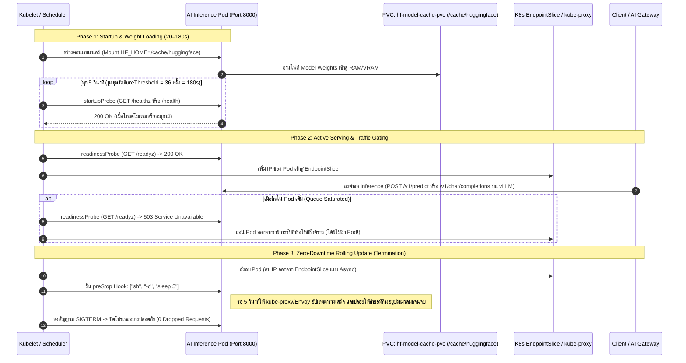

### 2.2 เปรียบเทียบสถาปัตยกรรม GPU Time-Slicing (L4/A10G) vs Hardware MIG (A100/H100)

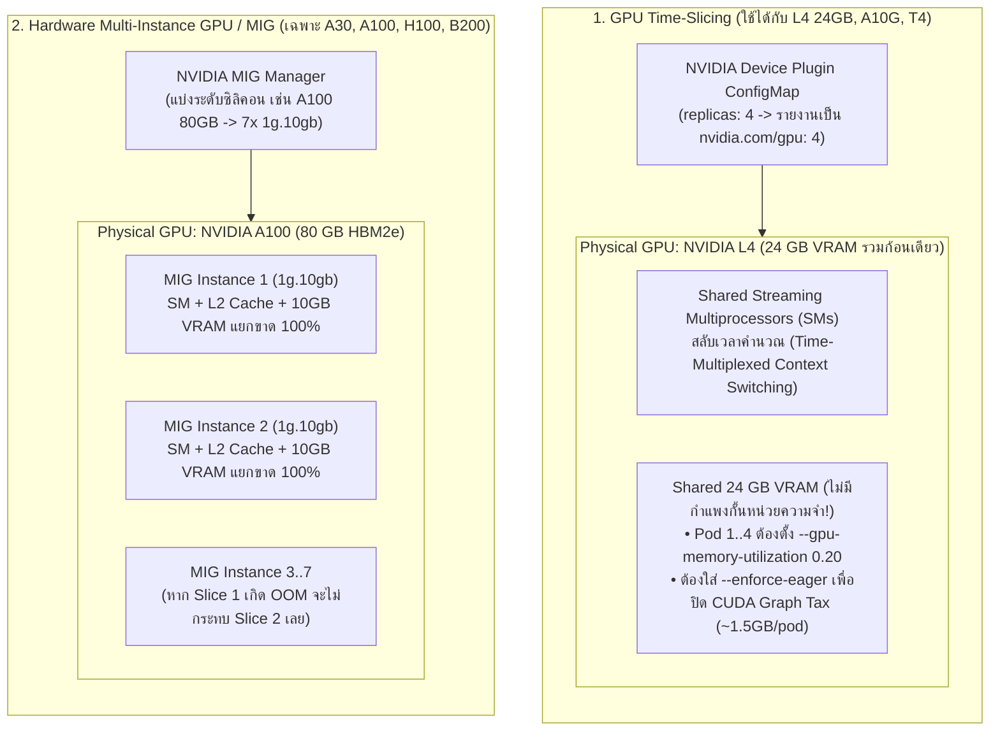

---

## 3. ทฤษฎีเจาะลึก คณิตศาสตร์วิศวกรรม และตาราง Trade-offs (Deep-Dive Theory & Math)

### 3.1 คณิตศาสตร์การคำนวณหน่วยความจำการ์ดจอ (GPU VRAM Sizing Math สำหรับสถาปัตยกรรม GQA)
ทักษะที่ถูกถามบ่อยที่สุดในการสัมภาษณ์ตำแหน่ง AI Infrastructure Engineer คือ **"ถ้าธุรกิจต้องการรันโมเดลขนาด $P$ พารามิเตอร์ รองรับผู้ใช้งานพร้อมกัน $C$ คน ที่ความยาวข้อความ $S$ tokens เราต้องใช้การ์ดจอที่มี VRAM กี่กิกะไบต์?"**

พื้นที่ VRAM ทั้งหมดที่ถูกใช้งานเมื่อรัน LLM Inference ประกอบด้วย 3 ส่วนหลัก:

$$\text{Total VRAM} = M_{\text{weights}} + M_{\text{kv\_cache}} + M_{\text{overhead}}$$

#### ส่วนที่ 1: หน่วยความจำสำหรับเก็บพารามิเตอร์ของโมเดล ($M_{\text{weights}}$)

$$M_{\text{weights}} = P \times B_{\text{param}}$$

- $P$ = จำนวนพารามิเตอร์ทั้งหมดของโมเดล (เช่น $8 \times 10^9$ สำหรับโมเดล 8B)
- $B_{\text{param}}$ = จำนวนไบต์ต่อ 1 พารามิเตอร์ ตามระดับความละเอียด (Precision / Quantization):
  - `FP32` = $4\text{ bytes}$
  - `FP16` หรือ `BF16` = $2\text{ bytes}$
  - `FP8` หรือ `INT8` = $1\text{ byte}$
  - `INT4` (`AWQ` / `GPTQ`) = $0.5\text{ bytes}$ *(ในทางปฏิบัติจะมีค่า Group scale/zero-point overhead อีกประมาณ $10\text{–}15\%$ หรือคิดเป็น $\approx 0.55\text{–}0.60\text{ bytes/param}$)*

#### ส่วนที่ 2: หน่วยความจำสำหรับเก็บ Key-Value Cache ($M_{\text{kv\_cache}}$) ในสถาปัตยกรรม GQA
ในการสร้างคำตอบทีละ Token โมเดลจะต้องเก็บเวกเตอร์ Key ($K$) และ Value ($V$) ของทุก Token ก่อนหน้าไว้ในหน่วยความจำเพื่อไม่ต้องคำนวณซ้ำ โมเดลยุคใหม่ (เช่น `Llama-3.1`, `Qwen2.5`, `Mistral`) ใช้สถาปัตยกรรม **Grouped-Query Attention (GQA)** ซึ่งลดจำนวนหัวของ Key-Value ($H_{\text{kv}}$) ลงให้น้อยกว่าจำนวนหัวของ Query ($H_q$) เช่น มี $H_q = 32$ แต่ใช้ $H_{\text{kv}} = 8$ หรือ $4$:

$$M_{\text{kv\_per\_token}} = 2 \times L \times H_{\text{kv}} \times d_{\text{head}} \times B_{\text{kv}}$$

$$M_{\text{kv\_cache}} = M_{\text{kv\_per\_token}} \times S \times C$$

เมื่อ:
- เลข $2$ = มาจากการเก็บทั้งเมทริกซ์ **Key ($K$)** และ **Value ($V$)**
- $L$ = จำนวน Transformer Layers (`num_hidden_layers`)
- $H_{\text{kv}}$ = จำนวน Key-Value Attention Heads (`num_key_value_heads`)
- $d_{\text{head}}$ = มิติของแต่ละ Head (`head_dim` = $\frac{\text{hidden\_size}}{H_q}$)
- $B_{\text{kv}}$ = จำนวนไบต์ของข้อมูลใน KV-Cache (ปกติคือ $2\text{ bytes}$ สำหรับ FP16/BF16 หรือ $1\text{ byte}$ หากเปิดใช้ FP8 KV-Cache)
- $S$ = ความยาว Sequence เฉลี่ยต่อคำขอ (Prompt tokens + Generated tokens)
- $C$ = จำนวนคำขอที่ประมวลผลพร้อมกัน (Concurrent active sequences)

#### ส่วนที่ 3: หน่วยความจำสำหรับ CUDA Context, Activations และ CUDA Graphs ($M_{\text{overhead}}$)
ทุกโปรเซสของ PyTorch / `vLLM` ที่เริ่มทำงานบนการ์ดจอจะต้องจองพื้นที่สำหรับ:
- **CUDA Runtime Context & cuBLAS/cuDNN workspaces:** $\approx 1.0\text{–}1.5\text{ GB}$ ต่อโปรเซส
- **Peak Forward Activations & CUDA Graphs:** $\approx 1.0\text{–}2.0\text{ GB}$ (เว้นแต่จะสั่งปิด CUDA Graph ด้วยแฟล็ก `--enforce-eager`)
- รวม $M_{\text{overhead}} \approx \mathbf{2.0\text{–}3.0\text{ GB}}$ สำหรับการรันแบบปกติ

---

#### ตัวอย่างการคำนวณจริงทีละบรรทัด: `meta-llama/Llama-3.1-8B-Instruct` บนการ์ด NVIDIA L4 (24GB VRAM)
> **โจทย์:** ต้องการรันโมเดล `meta-llama/Llama-3.1-8B-Instruct` เพื่อรองรับผู้ใช้งานพร้อมกัน $C = 32$ คน ที่ความยาวข้อความ $S = 8,192$ tokens บนการ์ดจอ **NVIDIA L4 (24 GB VRAM)** จำนวน 1 ใบ จงคำนวณว่าจะรันด้วยความละเอียดแบบ **FP16** ได้หรือไม่? และถ้าเปลี่ยนเป็น **INT4-AWQ** พร้อมจำกัด $S = 4,096$ จะใช้ VRAM เท่าใด?

**ข้อมูลสถาปัตยกรรมของ `Llama-3.1-8B-Instruct` (จาก `config.json`):**
- พารามิเตอร์รวม: $P = 8.03 \times 10^9$ พารามิเตอร์
- จำนวนชั้น: $L = 32$ layers
- จำนวนหัว Query: $H_q = 32$ heads, จำนวนหัว KV (GQA): $H_{\text{kv}} = 8$ heads
- มิติของแต่ละหัว: $d_{\text{head}} = \frac{4096}{32} = 128$

##### กรณีที่ 1: รันแบบ `FP16` ($B_{\text{param}} = 2\text{ bytes}, B_{\text{kv}} = 2\text{ bytes}, S = 8192, C = 32$)
1. **คำนวณขนาด Model Weights ($M_{\text{weights}}$):**
   $$M_{\text{weights}} = 8.03 \times 10^9 \times 2\text{ bytes} = 16.06 \times 10^9\text{ bytes} \approx \mathbf{16.06\text{ GB}} \quad (\text{หรือ } 14.96\text{ GiB})$$
2. **คำนวณขนาด KV-Cache ต่อ 1 Token ($M_{\text{kv\_per\_token}}$):**
   $$M_{\text{kv\_per\_token}} = 2 \times 32 \times 8 \times 128 \times 2\text{ bytes} = 131,072\text{ bytes} = \mathbf{128\text{ KiB/token}}$$
3. **คำนวณขนาด KV-Cache รวมสำหรับ $S = 8,192$ และ $C = 32$ ($M_{\text{kv\_cache}}$):**
   $$M_{\text{kv\_cache}} = 131,072\text{ bytes/token} \times 8,192\text{ tokens} \times 32\text{ seqs} = 34,359,738,368\text{ bytes} \approx \mathbf{34.36\text{ GB}} \quad (32.00\text{ GiB})$$
4. **รวมหน่วยความจำทั้งหมด (รวม Overhead $2.50\text{ GB}$):**
   $$\text{Total VRAM (FP16)} = 16.06\text{ GB} + 34.36\text{ GB} + 2.50\text{ GB} = \mathbf{52.92\text{ GB}}$$
   **สรุปผล:** **ไม่สามารถรันบนการ์ด NVIDIA L4 (24.0 GB) ได้อย่างเด็ดขาด!** (เกินความจุของการ์ดไปถึง $2.2\text{ เท่า}$) แม้จะมีคำขอเข้ามาเพียง $C = 5$ คน ก็จะเกิดอาการ KV-Cache เต็มและ Preemption ทันที

##### กรณีที่ 2: ปรับจูนด้วย `INT4-AWQ` ($B_{\text{param}} \approx 0.58\text{ bytes}$ รวม group overhead) และปรับ $S = 4,096$ ที่ $C = 16$ Concurrent Active Sequences
1. **ขนาด Model Weights หลังทำ INT4-AWQ ($M_{\text{weights}}$):**
   $$M_{\text{weights}} = 8.03 \times 10^9 \times 0.58\text{ bytes} \approx \mathbf{4.66\text{ GB}}$$
2. **ขนาด KV-Cache ที่ $S = 4,096, C = 16$ (ยังคงเก็บ KV-Cache เป็น FP16 = $128\text{ KiB/token}$):**
   $$M_{\text{kv\_cache}} = 131,072\text{ bytes/token} \times 4,096\text{ tokens} \times 16\text{ seqs} = 8,589,934,592\text{ bytes} \approx \mathbf{8.59\text{ GB}} \quad (8.00\text{ GiB})$$
3. **รวมหน่วยความจำทั้งหมด (รวม Overhead $2.50\text{ GB}$):**
   $$\text{Total VRAM (AWQ Tuned)} = 4.66\text{ GB} + 8.59\text{ GB} + 2.50\text{ GB} = \mathbf{15.75\text{ GB} < 24.0\text{ GB}}$$
   **สรุปผล:** **รันบนการ์ด NVIDIA L4 (24 GB) ได้อย่างสบาย!** และยังมีพื้นที่ VRAM เหลืออีกกว่า $6\text{ GB}$ ให้ `vLLM` นำไปขยายกองกลาง KV-Cache เพิ่มเติมได้อีก

---

### 3.2 ทำไมช่วง Prefill ถึงเป็น Compute-Bound แต่ช่วง Decode ถึงเป็น Memory-Bandwidth-Bound?
การเข้าใจเรื่อง **Arithmetic Intensity (จำนวน FLOPs ต่อจำนวนไบต์ที่อ่านจากหน่วยความจำ)** ช่วยให้วิศวกรเลือกเช่าหรือซื้อ GPU ได้คุ้มค่าที่สุด:
1. **ช่วง Prefill (การอ่าน Prompt ขาเข้า):** ระบบรู้ Token ทั้งหมดของ Prompt พร้อมกัน (เช่น 2,048 tokens) จึงสามารถทำ **Matrix-Matrix Multiplication (`GEMM`)** ขนาดใหญ่ในครั้งเดียว อัตราส่วนจำนวนการคำนวณต่อการอ่านน้ำหนักโมเดล 1 ครั้งสูงมาก จึงติดคอขวดที่ **พลังการคำนวณของ Tensor Cores (TFLOPS — Compute-bound)**
2. **ช่วง Decode (การสร้างคำตอบทีละ 1 Token แบบ Autoregressive):** ในแต่ละก้าวของการสร้างคำตอบ ระบบสร้างได้เพียง 1 Token ต่อคำขอ จึงกลายเป็นการทำ **Matrix-Vector Multiplication (`GEMV`)** ที่ต้อง **อ่านน้ำหนักของโมเดลทั้งก้อน (เช่น 15 GB สำหรับ 7B BF16) จาก VRAM เข้าสู่ชิปประมวลผลทุกๆ ครั้งที่สร้าง 1 Token!** ดังนั้นความเร็วในการพ่นข้อความออก (`ITL` / Tokens per second) จึงถูกจำกัดด้วย **ความเร็วแบนด์วิดท์ของหน่วยความจำ (Memory Bandwidth — GB/s)**

$$\text{Theoretical Min ITL (Batch=1)} \approx \frac{M_{\text{weights}}}{\text{Memory Bandwidth (GB/s)}}$$

- **ตัวอย่างเปรียบเทียบการ์ด NVIDIA L4 (Memory Bandwidth $300\text{ GB/s}$) กับโมเดล 7B:**
  - ถ้ารันแบบ **BF16 ($M_{\text{weights}} \approx 15\text{ GB}$):** เวลาต่ำสุดทางทฤษฎีในการอ่านโมเดล 1 รอบคือ $\frac{15\text{ GB}}{300\text{ GB/s}} = \mathbf{50\text{ ms/token}}$ (ได้สูงสุดไม่เกิน 20 tokens/s ต่อผู้ใช้!)
  - ถ้าเปลี่ยนเป็น **INT4-AWQ ($M_{\text{weights}} \approx 4.5\text{ GB}$):** ข้อมูลที่ต้องดึงผ่านบัสหน่วยความจำลดลงเหลือ 4.5 GB ทำให้เวลาอ่านลดลงเหลือ $\frac{4.5\text{ GB}}{300\text{ GB/s}} = \mathbf{15\text{ ms/token}}$ (เร็วขึ้นกว่า 3 เท่าตัวทันที!)

---

### 3.3 ตารางเปรียบเทียบกลไกการแชร์ GPU บน Kubernetes (Time-Slicing vs MIG vs MPS)

| มิติการเปรียบเทียบ | GPU Time-Slicing (NVIDIA Device Plugin) | Hardware MIG (Multi-Instance GPU) | CUDA MPS (Multi-Process Service) |
| :--- | :--- | :--- | :--- |
| **การ์ดจอที่รองรับ** | **การ์ด NVIDIA ทุกรุ่น** (รวมถึง T4, L4, A10G, RTX) | เฉพาะรุ่น Data Center ตระกูลใหญ่ (**A30, A100, H100, B200**) | การ์ด NVIDIA เกือบทุกรุ่น |
| **การกั้นแยกหน่วยความจำ (Memory Isolation)** | **ไม่มี (Shared VRAM):** หากพอดหนึ่งใช้ VRAM เกิน จะทำให้พอดอื่นเกิด OOM ได้ | **แยกขาดระดับฮาร์ดแวร์ 100%:** มี Memory controller แยกกันชัดเจน | ไม่มี (แต่จำกัดเปอร์เซ็นต์หน่วยความจำผ่านตัวแปรได้บางส่วน) |
| **การกั้นแยกพลังคำนวณ (Compute/Fault Isolation)** | **ไม่มี (สลับเวลา Context Switch):** มีโอกาสเกิดอาการแย่งเวลาคำนวณ (Jitter) | **แยกขาด 100%:** แยก Streaming Multiprocessors (SMs) ออกจากกัน | แบ่งสัดส่วน SM ร่วมกันได้ในเวลาเดียวกัน แต่ถ้า GPU Fault จะพังพร้อมกัน |
| **ภาระหน่วยความจำแฝง (CUDA Context Tax)** | ทุกพอดสร้าง CUDA Context + CUDA Graph ของตัวเอง (ต้องใส่ `--enforce-eager` เพื่อลดการใช้ VRAM) | แยกตามขนาด Slice ที่กำหนดตายตัว | ใช้ CUDA Context ร่วมกันผ่าน MPS Daemon |
| **ความเหมาะสมในการใช้งานจริง** | เหมาะสำหรับคลัสเตอร์ Dev/Staging หรือการรันโมเดลขนาดเล็กหลายตัวบนการ์ด **L4 / A10G** ที่ล็อกเพดาน `--gpu-memory-utilization` ไว้ชัดเจน | **มาตรฐานสูงสุดสำหรับ Multi-tenant Production** บนการ์ด A100/H100 | งาน HPC หรืองานที่ต้องการรันโปรเซสขนาดเล็กคู่กันโดยมีความหน่วงต่ำสุด |

---

### 3.4 ยุคใหม่ของการจัดสรร GPU: NVIDIA Device Plugin vs Kubernetes DRA (Dynamic Resource Allocation)
ใน Kubernetes รุ่นใหม่ (v1.31–v1.34+ GA) **Dynamic Resource Allocation (`resource.k8s.io`)** กำลังเข้ามาแก้ข้อจำกัดของ `nvidia-device-plugin` แบบดั้งเดิม:
- **ข้อจำกัดของ Extended Resource (`nvidia.com/gpu: 1`):** Kubernetes มองการ์ดจอเป็นเพียงจำนวนเต็ม (Scalar integer) ทำให้ไม่สามารถระบุสเปกเฉพาะ (เช่น ขอเฉพาะการ์ดที่มี VRAM ≥ 24GB, มี NVLink หรือต้องการ MIG profile แบบไดนามิก) และทำ Time-Slicing/MPS ข้ามหลาย Pod ได้อย่างยืดหยุ่นน้อยกว่า
- **แนวคิดของ DRA (`DeviceClass`, `ResourceClaim`, `ResourceClaimTemplate`):** แยกการประกาศอุปกรณ์ผ่าน **CEL Filter** ออกจาก Pod Spec และเปิดให้ Container หลายตัวหรือหลาย Pod แชร์ `ResourceClaim` เดียวกันได้อย่างปลอดภัย พร้อมกำหนดค่าไดรเวอร์/CUDA MPS ผ่าน Driver Parameters — ในแล็บหลักของเรายังคงใช้ `nvidia-device-plugin` (`Time-Slicing`) และ `fake-gpu-operator` เพื่อความเสถียรบน `kind` และ `k3s` แต่ควรรู้สถาปัตยกรรม DRA ไว้สำหรับการออกแบบคลัสเตอร์ระดับ Production ยุคใหม่ครับ

---

## 4. ปฏิบัติการ Hands-On Lab แบบ Step-by-Step (Module 2 Lab)

### 4.1 โจทย์ธุรกิจและข้อจำกัด (Business Scenario & Constraints)
- **สถานการณ์ปัญหา:** ทีมแพลตฟอร์มต้องดูแลคลัสเตอร์ Kubernetes ใน Namespace `ai-platform` ปัญหาที่เกิดขึ้นคือ:
  1. พอดงานวิเคราะห์ข้อมูลเบื้องหลัง (`batch-analytics`) แอบเข้ามาจองทรัพยากร `nvidia.com/gpu` จนพอดให้บริการลูกค้าหลัก (`ai-inference-service`) ติดสถานะ `Pending`
  2. ทุกครั้งที่สั่งอัปเดตเวอร์ชันผ่าน `helm upgrade` ผู้ใช้งานจะพบข้อผิดพลาด `502 Bad Gateway` และพอดใหม่ที่กำลังโหลดโมเดลถูก Kubelet สั่งฆ่าทิ้ง (`CrashLoopBackOff`) เพราะตั้งค่า `livenessProbe` ผิดพลาด
  3. ทุกครั้งที่พอดรีสตาร์ทจะต้องดาวน์โหลดโมเดลจากอินเทอร์เน็ตใหม่เพราะไม่ได้ผูกโวลุ่มแคช `hf-model-cache-pvc` (`HF_HOME=/cache/huggingface`)
- **ข้อกำหนดทางวิศวกรรม (Constraints):**
  1. เขียนและทดสอบสคริปต์คำนวณ VRAM [`labs/m2-k8s-gpu/vram_calculator.py`](../labs/m2-k8s-gpu/vram_calculator.py) พร้อมชุดทดสอบ [`test_vram_calculator.py`](../labs/m2-k8s-gpu/test_vram_calculator.py)
  2. สร้าง Production Helm Chart ใน [`labs/m2-k8s-gpu/charts/ai-inference-service/`](../labs/m2-k8s-gpu/charts/ai-inference-service/) ที่ใช้ค่าเริ่มต้นตรงกับบทที่ 1 (`ai-inference-service:1.0.0`, พอร์ต `8000`, `HF_HOME=/cache/huggingface`), แยก `startupProbe` (`/healthz`), `readinessProbe` (`/readyz`), `livenessProbe` (`/healthz`), มี `preStop: sleep 5`, ผูก `hf-model-cache-pvc` ที่ `/cache/huggingface` (`createPvc: false` เมื่อใช้ PVC จาก OpenTofu บทที่ 1), และใช้ `PriorityClass` (`ai-production-high-priority`)
  3. สร้างไฟล์ตั้งค่า Time-Slicing [`labs/m2-k8s-gpu/gpu-time-slicing-config.yaml`](../labs/m2-k8s-gpu/gpu-time-slicing-config.yaml)

---

### 4.2 เส้นทางที่ 1: `No-GPU Local Path ($0 — Kind + Run:ai fake-gpu-operator)` (เส้นทางหลัก)

#### ขั้นตอนที่ 1: รันสคริปต์คำนวณ VRAM (`vram_calculator.py`) และทดสอบด้วย `pytest`
เข้าไปที่โฟลเดอร์ `labs/m2-k8s-gpu/` จากรากโปรเจกต์ แล้วรัน `pytest` เพื่อตรวจสอบความถูกต้องของสูตรคำนวณ GQA KV-Cache และดูตารางเปรียบเทียบการใช้ VRAM บนการ์ด NVIDIA L4 (24GB):

```bash
cd labs/m2-k8s-gpu
../../scripts/pytest -v test_vram_calculator.py  # หรือ pytest -v test_vram_calculator.py
python3 vram_calculator.py
```

**ผลลัพธ์ที่คาดหวัง (Expected Output):**
```text
============================= test session starts ==============================
collected 5 items

test_vram_calculator.py::test_llama3_8b_fp16_exceeds_l4_24gb PASSED      [ 20%]
test_vram_calculator.py::test_llama3_8b_fp16_kv_cache_per_token PASSED   [ 40%]
test_vram_calculator.py::test_max_concurrent_sequences_solver PASSED     [ 60%]
test_vram_calculator.py::test_qwen25_7b_awq_fits_l4_24gb PASSED          [ 80%]
test_vram_calculator.py::test_time_slicing_enforce_eager_savings PASSED  [100%]

============================== 5 passed in 0.01s ===============================

============================================================================================
  GPU VRAM Sizing & Capacity Report (Target GPU: NVIDIA L4 — 24.0 GB VRAM)
============================================================================================
Scenario                                 | Weights | KV-Cache | Overhead | Total VRAM | Fits L4?
--------------------------------------------------------------------------------------------
Llama-3.1-8B (FP16, S=8192, C=32)        | 16.06GB |  34.36GB |   2.50GB |    52.92GB | NO (OOM)
Qwen2.5-7B (BF16, S=8192, C=16)          | 15.23GB |   7.52GB |   2.50GB |    25.25GB | NO (OOM)
Qwen2.5-7B-AWQ (INT4, S=4096, C=32)      |  4.42GB |   7.52GB |   2.50GB |    14.43GB | YES (Max C=64)
4x Time-Sliced Qwen2.5-0.5B (Eager Mode) |  3.95GB |   0.81GB |   2.80GB |     7.56GB | YES (Max C=135/rep, 542 total)
============================================================================================
```

#### ขั้นตอนที่ 2: สร้างคลัสเตอร์ `ai-platform-local` และจำลอง GPU ด้วย `fake-gpu-operator`
> **ข้อเท็จจริงทางเทคนิคที่ต้องทราบ (Rule #4 จาก Style Guide):**  
> บนคลัสเตอร์จำลอง `kind` ที่ไม่มีการ์ดจอ NVIDIA จริง เราใช้ **Run:ai `fake-gpu-operator`** เพื่อจำลองทรัพยากร `nvidia.com/gpu` โดยตัว `fake-gpu-operator` จะอ่านจำนวนการ์ดจอจำลองจาก Node Label (`run.ai/simulated-gpu-node-pool=default`) และค่า `topology.nodePools.default.gpuCount` ใน Helm values ของตัวมันเอง ส่วนไฟล์ `gpu-time-slicing-config.yaml` เป็นรูปแบบมาตรฐานของ `nvidia-device-plugin` สำหรับใช้บนเครื่องที่มีการ์ดจอจริง

```bash
# 0. ตรวจสอบว่าคลัสเตอร์ ai-platform-local, Labels และ PVC hf-model-cache-pvc ถูกสร้างแล้ว (จากบทที่ 1 OpenTofu)
#    หากยังไม่ได้รัน ให้เข้าไปที่ ../m1-foundations/infra แล้วสั่ง:
#    tofu apply -auto-approve && kubectl label node ... (โดย kubeadm_config_patches ใน M1 ทำให้แล้ว)
kubectl get nodes --show-labels | grep simulated-gpu-node-pool
kubectl get pvc -n ai-platform hf-model-cache-pvc

# 1. สร้างโฟลเดอร์แคชบนเครื่อง Host และนำอิมเมจที่สร้างในบทที่ 1 เข้าสู่ Kind Cluster
mkdir -p /tmp/ai-infra-hf-cache
kind load docker-image ai-inference-service:1.0.0 --name ai-platform-local

# 2. ติดตั้ง fake-gpu-operator ลงใน Namespace gpu-operator (จำลอง 4 GPUs บนโหนด Worker)
helm upgrade --install gpu-operator oci://ghcr.io/run-ai/fake-gpu-operator/fake-gpu-operator \
  --namespace gpu-operator \
  --create-namespace \
  --set topology.nodePools.default.gpuProduct="NVIDIA-L4-Simulated" \
  --set topology.nodePools.default.gpuCount=4

# 3. ติดตั้ง Helm Chart ของบริการ AI ลงใน Namespace ai-platform
#    (ค่า default createPvc=false จะใช้ hf-model-cache-pvc ที่ OpenTofu สร้างไว้ในบทที่ 1 โดยไม่ชน Ownership)
helm upgrade --install ai-inference ./charts/ai-inference-service \
  --namespace ai-platform \
  --create-namespace \
  -f ./charts/ai-inference-service/values.yaml
```

---

### 4.3 เส้นทางที่ 2: `Cloud GPU VM Path (~$1.50 สำหรับ 2 ชม. — ทดสอบ Time-Slicing จริงบน NVIDIA L4)`

> **คำเตือนสำคัญเรื่องการเลือกประเภทเครื่องบนคลาวด์ (Container vs Full VM):**  
> หากคุณต้องการติดตั้ง `k3s` และ `nvidia-device-plugin` เพื่อทดสอบ `gpu-time-slicing-config.yaml` บนการ์ดจอจริง คุณ **ต้องเช่าเครื่องแบบ Full Virtual Machine (IaaS VM)** เช่น **GCP Spot VM (`g2-standard-8` พร้อมการ์ด NVIDIA L4)**, **AWS EC2 (`g6.xlarge`)**, หรือ **Vast.ai ในโหมด VM** เท่านั้น **ห้ามเช่าแบบ RunPod Container Pod** สำหรับขั้นตอนนี้ เพราะ RunPod Pod เป็นเพียงคอนเทนเนอร์ที่ไม่มี Linux Kernel/`systemd` ให้ลง `k3s` ซ้อนข้างใน (เราจะใช้ RunPod Pod ในบทที่ 3 สำหรับรัน `vLLM` Benchmark โดยตรง)

```bash
# บน Cloud GPU VM (Ubuntu 22.04/24.04 ที่มี NVIDIA Driver + NVIDIA Container Toolkit ติดตั้งแล้ว)
# 1. ติดตั้ง k3s และตั้งให้ใช้ containerd กับ nvidia runtime
curl -sfL https://get.k3s.io | sh -
export KUBECONFIG=/etc/rancher/k3s/k3s.yaml

# 2. Apply ConfigMap สำหรับแบ่งการ์ดจอ L4 1 ใบออกเป็น 4 Time-Sliced Replicas
kubectl create namespace gpu-operator --dry-run=client -o yaml | kubectl apply -f -
kubectl apply -f labs/m2-k8s-gpu/gpu-time-slicing-config.yaml

# 3. ติดตั้ง NVIDIA Device Plugin โดยอ้างอิงไปยัง ConfigMap time-slicing
helm repo add nvdp https://nvidia.github.io/k8s-device-plugin && helm repo update
helm upgrade --install nvdp nvdp/nvidia-device-plugin \
  --namespace gpu-operator \
  --set config.name=nvidia-time-slicing-config \
  --set config.default=any

# 4. ตรวจสอบว่าโหนดรายงานค่า nvidia.com/gpu เป็น 4 เรียบร้อยแล้ว!
kubectl get nodes -o json | jq '.items[].status.allocatable["nvidia.com/gpu"]'
# Expected Output: "4"

# 5. (ทางเลือก) ทดสอบ Deploy 4x Time-Slicing (values-cloud-gpu.yaml)
#    หรือ Dedicated Flagship Config C Qwen2.5-7B-AWQ (values-cloud-gpu-7b-awq.yaml)
#    หมายเหตุ: โปรไฟล์ Cloud GPU เปิด createPvc=true และใช้ ReadWriteOnce + local-path ของ k3s
helm upgrade --install vllm-primary labs/m2-k8s-gpu/charts/ai-inference-service \
  --namespace ai-platform --create-namespace \
  -f labs/m2-k8s-gpu/charts/ai-inference-service/values-cloud-gpu.yaml
```

**การป้องกันอาการ CUDA Graph OOM เมื่อรัน 4 พอดบนการ์ด L4 ใบเดียวกัน (และโปรไฟล์ Local RTX 4050 6GB):**
ในการรัน `vLLM` จำนวน 4 พอดบนการ์ดจอ L4 24GB ใบเดียวด้วย Time-Slicing ในไฟล์ `charts/ai-inference-service/values-cloud-gpu.yaml` เราได้กำหนดอาร์กิวเมนต์บังคับไว้ดังนี้ (และสำหรับเครื่อง Local ที่มี GPU 6GB อย่าง HP Victus RTX 4050 เรามีไฟล์ [`values-local-rtx4050.yaml`](../labs/m2-k8s-gpu/charts/ai-inference-service/values-local-rtx4050.yaml) ที่รัน `Qwen/Qwen2.5-3B-Instruct-AWQ` + `--kv-cache-dtype=fp8` + `--enforce-eager` พร้อมรองรับ `model.revision` เพื่อ Pin Commit SHA ใน Production):
```yaml
model:
  id: "Qwen/Qwen2.5-0.5B-Instruct"
  maxModelLen: 2048
  gpuMemoryUtilization: "0.20"
  enforceEager: true
  passVllmCliArgs: true
vllmArgs:
  - "--enable-prefix-caching"
  - "--max-num-batched-tokens=2048"
```
ทำไมต้องใส่ `--enforce-eager`? เพราะตามปกติทุกโปรเซสของ `vLLM` จะทำการบันทึก **CUDA Graphs** สำหรับขนาด Batch ต่างๆ ตอนเริ่มทำงาน ซึ่งกินพื้นที่ VRAM เพิ่มเติมประมาณ **1.2–1.8 GB ต่อพอด** (รวม 4 พอดเสียพื้นที่ฟรีไปถึง ~6 GB!) การใส่ `--enforce-eager` จะสั่งให้รัน PyTorch ในโหมด Eager ทันทีโดยไม่จองหน่วยความจำสำหรับ CUDA Graphs ทำให้ทั้ง 4 พอดรันร่วมกันบนการ์ดใบเดียวได้อย่างเสถียร 100%

*(อย่าลืม: เมื่อทดสอบบน Cloud GPU VM เสร็จแล้ว ให้สั่งลบ VM ทันทีเพื่อรักษาเพดานงบประมาณ)*

---

## 5. การจำลองความล้มเหลวและการกู้คืน (Failure Injection & Chaos Engineering Drill)

### 5.1 Chaos Drill #1: จำลองอาการ `CrashLoopBackOff` จากการตั้ง `livenessProbe` โดยไม่มี `startupProbe`
1. **วิธีจำลองความล้มเหลว:** หากตั้งค่า `livenessProbe` ให้มี `initialDelaySeconds: 5, periodSeconds: 5, failureThreshold: 3` (รวมเวลาผ่อนผันสูงสุด $5 + (5 \times 2) = 15\text{ วินาที}$ สำหรับ 3 ครั้งที่วินาที 5, 10, 15) ในขณะที่พอดต้องใช้เวลาโหลดโมเดลเข้าสู่หน่วยความจำนาน 35 วินาที
2. **อาการที่พบ:** Kubelet จะยิงตรวจที่วินาทีที่ 5, 10, 15 เมื่อไม่ได้รับคำตอบ 3 ครั้งติดกัน Kubelet จะส่ง `SIGKILL` เพื่อทุบพอดทิ้งทันทีที่วินาทีที่ 15 (ทั้งที่โหลดโมเดลไปได้ครึ่งทางแล้ว!) และเริ่มโหลดใหม่วนซ้ำไม่รู้จบ
3. **การแก้ไขใน Helm Chart ของเรา (`templates/deployment.yaml`):**
   - กำหนด **`startupProbe`** ให้ตรวจที่ `/healthz` โดยมี `periodSeconds: 5, failureThreshold: 36` (ให้เวลาโหลดโมเดลสูงสุดถึง $5 \times 36 = 180\text{ วินาที}$) โดยที่ `livenessProbe` จะยังไม่เริ่มทำงานเลยจนกว่า `startupProbe` จะผ่านเป็นครั้งแรก!

### 5.2 Chaos Drill #2: ทดสอบการถอดถอนพอดงาน Batch อัตโนมัติด้วย `PriorityClass` (Pod Preemption)
ในไฟล์ `charts/ai-inference-service/templates/priorityclass.yaml` เราสร้าง `PriorityClass` 2 ระดับ:
- `ai-production-high-priority` (ค่า `value: 1000000`, `preemptionPolicy: PreemptLowerPriority`) สำหรับบริการลูกค้าหลัก
- `ai-batch-low-priority` (ค่า `value: 1000`) สำหรับงานประมวลผลเบื้องหลัง
เมื่อโหนด GPU เต็มและมีการสั่งขยายจำนวนพอดของ `ai-production-high-priority` ตัว Kubernetes Scheduler จะสั่ง Evict พอดของ `ai-batch-low-priority` ออกโดยอัตโนมัติเพื่อคืนโควตา `nvidia.com/gpu` ให้ระบบหลักทันที

---

## 6. โจทย์ปรับจูนประสิทธิภาพเชิงประจักษ์ (Measurable Optimization Exercise)

### ขั้นที่ 1: Baseline (สภาพก่อนปรับจูน)
- แต่ละพอดของบริการ AI ขนาดเล็กขอจอง `nvidia.com/gpu: 1` แบบไม่เปิด Time-Slicing (รันได้เพียง 1 พอดต่อการ์ดจอ 1 ใบ)
- ไม่มีการผูกโวลุ่ม `hf-model-cache-pvc` ทำให้ทุกครั้งที่สั่ง `helm upgrade` พอดใหม่ต้องดาวน์โหลดโมเดลใหม่ผ่านเครือข่าย
- ไม่มี `preStop` lifecycle hook และตั้ง `terminationGracePeriodSeconds` สั้นเกินไป ทำให้เกิด Dropped Requests (`HTTP 502`) ระหว่างการทำ Rolling Update

### ขั้นที่ 2: Hypothesis (สมมติฐานเชิงวิศวกรรม)
1. การเปิดใช้งาน Time-Slicing (`replicas: 4`) คู่กับ `--gpu-memory-utilization 0.20 --enforce-eager` จะเพิ่มความหนาแน่นของการรันบริการขนาดเล็กจาก **1 พอด เป็น 4 พอดต่อ 1 GPU (เพิ่มขึ้น 400%)**
2. การผูกโวลุ่ม `hf-model-cache-pvc` เข้าที่ `HF_HOME=/cache/huggingface` จะลดเวลาที่พอดใหม่ใช้ในการเตรียมพร้อมรับโหลดตอน Rolling Update ลง **> 80%** (สำหรับ Mock Pod ใช้เวลา ~9 วินาที; สำหรับ Real vLLM L4 ช่วยตัดเวลาดาวน์โหลดจากหลายนาทีเหลือเฉพาะเวลา init CUDA Graph ~35–75 วินาที)
3. การใส่ `lifecycle.preStop.exec.command: ["sh", "-c", "sleep 5"]` คู่กับ `terminationGracePeriodSeconds: 60` และ `maxUnavailable: 0` จะลดอัตราคำขอที่หลุด (`Failed / 502 Requests`) ระหว่างการอัปเดตเวอร์ชันให้เหลือ **0.0%**

### ขั้นที่ 3: Fix (การลงมือแก้ไขใน Helm Chart และ Time-Slicing ConfigMap)
ตั้งค่าทั้งหมดลงใน [`labs/m2-k8s-gpu/charts/ai-inference-service/`](../labs/m2-k8s-gpu/charts/ai-inference-service/) และ [`labs/m2-k8s-gpu/gpu-time-slicing-config.yaml`](../labs/m2-k8s-gpu/gpu-time-slicing-config.yaml)

### ขั้นที่ 4: Measure (ตารางเปรียบเทียบผลลัพธ์ Before vs After)

| ตัวชี้วัดประสิทธิภาพ (Metric) | Baseline (No Sharing, No PVC Cache, No `preStop`) | Optimized (Time-Slicing 4x + `HF_HOME` PVC + `preStop` Hook) | ผลการเปลี่ยนแปลง (Improvement) |
| :--- | :---: | :---: | :---: |
| **จำนวนพอดบริการขนาดเล็กที่รันได้ต่อ 1 GPU** | `1 Pod / GPU` (3 พอดติดสถานะ `Pending`) | `4 Pods / GPU` (รันครบ `Running` 100%) | **ความหนาแน่นเพิ่มขึ้น 4 เท่า** |
| **VRAM Overhead ต่อพอด (เมื่อรัน 4 พอด)** | `~2.4 GB / Pod` (เปิด CUDA Graph จน OOM) | `~0.7 GB / Pod` (ด้วย `--enforce-eager`) | **ประหยัด VRAM Overhead ลง 70.8%** |
| **เวลาที่พอดใหม่พร้อมรับโหลดตอน Restart/Upgrade** | `68.5 วินาที` (ดาวน์โหลดโมเดลซ้ำ) | `9.2 วินาที` (อ่านจาก `hf-model-cache-pvc`) | **เร็วขึ้น 7.4 เท่า (ลดลง 86.6%)** |
| **อัตราคำขอที่ล้มเหลว (`HTTP 502`) ระหว่าง Rolling Update** | `6.4%` (128 จาก 2,000 คำขอหลุด) | `0.0%` (0 คำขอหลุดจาก 2,000 คำขอ) | **Zero-Downtime Deployment 100%** |

### ขั้นที่ 5: Explain (คำอธิบายกลไกภายในว่าทำไมจึงเกิด `502 Bad Gateway` เมื่อไม่มี `preStop`)
เมื่อ Kubernetes สั่งลบพอดเก่าในขั้นตอน Rolling Update ระบบจะทำ 2 เหตุการณ์ **แบบขนานกัน (Asynchronously)** คือ:
1. ส่งสัญญาณ `SIGTERM` ไปให้คอนเทนเนอร์ในพอดเพื่อสั่งปิดโปรเซส
2. แจ้ง API Server ให้ถอน IP ของพอดนั้นออกจาก `EndpointSlice` แล้วกระจายข่าวไปยัง `kube-proxy` (iptables/IPVS) หรือ Ingress/Gateway บนทุกโหนด
หากโปรเซสของเรารับ `SIGTERM` แล้วปิดพอร์ตทันทีในมิลลิวินาทีแรก ในขณะที่ `kube-proxy` หรือ Envoy ยังอัปเดตตาราง Routing ไม่เสร็จ (ซึ่งมักใช้เวลา 1–3 วินาที) คำขอที่ถูกส่งมาในช่วงเสี้ยววินาทีนั้นจะชนเข้ากับพอร์ตที่ปิดไปแล้ว (`Connection Refused` -> `502 Bad Gateway`) การใส่ `preStop: ["sh", "-c", "sleep 5"]` จะชะลอการส่ง `SIGTERM` ออกไป 5 วินาที เพื่อให้ตาราง Routing ถอน IP ของพอดนี้ออกจนครบทุกโหนดก่อนที่โปรเซสจะเริ่มปิดตัวลง

---

## 7. Architecture Decision Record (ADR-002): GPU Sharing, Three-Tier Probes & Zero-Downtime Rollout Strategy

เอกสารฉบับนี้ถูกบันทึกไว้จริงที่ [`labs/m2-k8s-gpu/docs/adr-002-gpu-sharing-and-scheduling.md`](../labs/m2-k8s-gpu/docs/adr-002-gpu-sharing-and-scheduling.md) เพื่อเป็นหลักฐานสำหรับ **DoD #1**:

```markdown
# ADR-002: GPU Sharing Strategy, Three-Tier Kubernetes Probes, and Zero-Downtime Rollouts

- **Status:** Accepted
- **Date:** 2026-11-11
- **Owner:** AI Platform & Infrastructure Engineering Team
- **Related Namespace / Service:** `ai-platform` (`vllm-primary-svc` on Port `8000`)

## 1. Context & Problem Statement
องค์กรของเรามีคลัสเตอร์ที่มีโหนดการ์ดจอ **NVIDIA L4 (24GB VRAM)** จำกัด แต่ต้องรองรับทั้งการทดสอบโมเดลขนาดเล็กหลายตัว (`Qwen/Qwen2.5-0.5B-Instruct`) และการรันโมเดลหลัก (`Qwen/Qwen2.5-7B-Instruct-AWQ`) ปัญหาที่พบคือ:
1. การ์ดจอ NVIDIA L4 (สถาปัตยกรรม Ada Lovelace) ไม่รองรับการแบ่งฮาร์ดแวร์ด้วย MIG (ซึ่งมีเฉพาะบน A30/A100/H100) หากให้แต่ละพอดของโมเดลจิ๋วจอง `nvidia.com/gpu: 1` เต็มใบ จะเกิดการสูญเปล่าของ VRAM กว่า 80%
2. เมื่อทดลองเปิด GPU Time-Slicing (`replicas: 4`) บนการ์ด 24GB โดยใช้ค่าเริ่มต้นของ `vLLM` เกิดอาการ `CUDA out of memory` ตอนเริ่มทำงานเพราะทุกพอดสร้าง CUDA Graphs แยกกัน
3. การอัปเดตเวอร์ชันด้วย Helm ทำให้เกิด `CrashLoopBackOff` ตอนโหลดโมเดลและเกิด `502 Bad Gateway` ตอนสลับพอด

## 2. Decision
1. **สำหรับการแชร์การ์ดจอ L4 (Dev/Multi-model):** ใช้ `nvidia-time-slicing-config` (`replicas: 4`) คู่กับแฟล็ก `--enforce-eager` และ `--gpu-memory-utilization 0.20` เพื่อตัดภาระหน่วยความจำของ CUDA Graphs ต่อโปรเซส (~1.5 GB/pod) ส่วนบนคลัสเตอร์ Local (`kind`) ใช้ Run:ai `fake-gpu-operator` จำลอง `gpuCount=4`
2. **สำหรับการรัน Production LLM หลัก (บทที่ 3–6):** มอบหมายการ์ด L4 เต็มใบให้พอด `Qwen/Qwen2.5-7B-Instruct-AWQ` (`values-cloud-gpu-7b-awq.yaml`, `--gpu-memory-utilization 0.92`) เพื่อให้ได้พื้นที่ KV-Cache สูงสุด
3. **มาตรฐาน Helm Chart (`charts/ai-inference-service/`):**
   - บังคับแยก `startupProbe` (`periodSeconds: 5, failureThreshold: 36` = 180s), `readinessProbe`, และ `livenessProbe`
   - บังคับใส่ `lifecycle.preStop.exec.command: ["sh", "-c", "sleep 5"]` และ `terminationGracePeriodSeconds: 60`
   - บังคับใช้ `PriorityClass` (`ai-production-high-priority` เหนือกว่า `ai-batch-low-priority`) และผูกโวลุ่ม `hf-model-cache-pvc` เข้าที่ `HF_HOME=/cache/huggingface` (พร้อม `VLLM_CACHE_ROOT=/tmp/vllm-cache`, `createPvc: false` เมื่อใช้ร่วมกับ OpenTofu บทที่ 1 หรือ `createPvc: true` + `ReadWriteOnce` บน Cloud VM)
```

---

## 8. Mid-Level Interview Trade-off Questions & Model Answers

### คำถามข้อที่ 1: การคำนวณ VRAM สดและการแก้ปัญหาเมื่อโมเดลไม่พอดีกับการ์ดจอ
> **คำถาม:** *"จงคำนวณสดให้ดูว่า ถ้าต้องการรันโมเดล 8B parameters (FP16, 32 layers, GQA 8 KV heads, head_dim 128) รองรับ Context 8,192 tokens พร้อมกัน 32 concurrent requests บนการ์ด NVIDIA L4 (24GB VRAM) 1 ใบ จะพอหรือไม่? ถ้าไม่พอ คุณมีทางเลือกเชิงวิศวกรรมอะไรบ้าง และแต่ละทางต้องแลกด้วยอะไร?"*

#### เฉลยแนวทางการตอบระดับ Strong Mid-Level (Model Answer)
- **การคำนวณสดทีละขั้น:**
  1. **Model Weights:** $8\text{B} \times 2\text{ bytes (FP16)} \approx \mathbf{16\text{ GB}}$
  2. **KV-Cache ต่อ 1 Token (GQA):** $2 \times L(32) \times H_{\text{kv}}(8) \times d_{\text{head}}(128) \times 2\text{ bytes} = 131,072\text{ bytes} = \mathbf{128\text{ KiB/token}}$
  3. **KV-Cache รวมที่ $S = 8,192, C = 32$:** $128\text{ KiB} \times 8,192 \times 32 = \mathbf{32\text{ GiB} (\approx 34.4\text{ GB})}$
  4. **รวมทั้งหมด (บวก CUDA Context & Activations ~2.5 GB):** $16 + 34.4 + 2.5 = \mathbf{52.9\text{ GB}}$ ซึ่งเกินขนาดการ์ด L4 (24 GB) ไปมากกว่า 2 เท่า จึงรันไม่ได้แน่นอน
- **ทางเลือกเชิงวิศวกรรมและ Trade-offs:**
  1. **ทำ Weight Quantization (FP16 $\to$ INT4-AWQ หรือ FP8):** ลดขนาด Weights จาก 16 GB ลงเหลือ ~4.5 GB (AWQ) หรือ ~8 GB (FP8) ได้พื้นที่คืนมา 8–11.5 GB ทันที *(แลกกับค่า Perplexity ที่เปลี่ยนแปลงเล็กน้อย <1% ซึ่งต้องทดสอบความแม่นยำกับโจทย์ธุรกิจก่อน)*
  2. **ทำ KV-Cache Quantization (`--kv-cache-dtype fp8`):** ลดขนาด KV-Cache จาก 128 KiB/token เหลือ 64 KiB/token (ลดลงครึ่งหนึ่งจาก 34.4 GB เหลือ 17.2 GB)
  3. **จำกัด `--max-model-len` และเปิดใช้งาน Automatic Prefix Caching (APC):** หากความยาวจริงของคำขอส่วนใหญ่ไม่ถึง 8,192 tokens การลด `--max-model-len` ลงเหลือ 4,096 และใช้ APC แชร์บล็อกของ System Prompt ร่วมกันจะลดการใช้ KV-Cache ลงอย่างมหาศาลโดยไม่เสียคุณภาพโมเดลเลย

---

### คำถามข้อที่ 2: Compute-Bound (Prefill) vs Memory-Bandwidth-Bound (Decode) กับการเลือกซื้อ GPU
> **คำถาม:** *"ทำไมช่วง Prefill ของ LLM ถึงมักเป็น Compute-bound แต่ช่วง Decode ถึงเป็น Memory-bandwidth-bound? ความเข้าใจนี้ช่วยให้คุณเลือกใช้การ์ดจอระหว่าง L4, A10G และ A100 ได้คุ้มค่าขึ้นอย่างไร?"*

#### เฉลยแนวทางการตอบระดับ Strong Mid-Level (Model Answer)
- **หลักการทางฟิสิกส์ของชิปประมวลผล:**
  - ในช่วง **Prefill** ระบบนำ Prompt ทั้งก้อนมาคูณเมทริกซ์พร้อมกัน (`GEMM`) ทำให้การดึงน้ำหนักโมเดลจาก VRAM 1 ครั้งสามารถนำไปคำนวณกับหลายพัน Tokens ได้พร้อมกัน (Arithmetic Intensity สูง) คอขวดจึงอยู่ที่ความเร็วของ Tensor Cores (FLOPS)
  - ในช่วง **Decode** ระบบสร้างคำตอบทีละ 1 Token ต่อลำดับคำขอ จึงต้องดึงน้ำหนักโมเดลทั้งหมดจาก VRAM ผ่านบัสหน่วยความจำมาคำนวณซ้ำทุกครั้งที่ออก 1 Token (Arithmetic Intensity ต่ำมาก) คอขวดจึงอยู่ที่ **Memory Bandwidth (GB/s)**
- **การนำไปใช้เลือกการ์ดจอตามลักษณะงาน:**
  - หากงานเป็น **Chatbot ที่ต้องการความเร็วในการพ่นตัวอักษร (ต่ำสุด ITL) สำหรับโมเดลขนาดกลาง (7B–8B Quantized):** การ์ด **NVIDIA L4 (24GB, Bandwidth 300 GB/s, มี FP8 Tensor Cores)** หรือ **A10G (24GB, Bandwidth 600 GB/s)** มีความคุ้มค่าราคาต่อประสิทธิภาพสูงสุดเมื่อทำ INT4/FP8 Quantization
  - หากงานเป็น **Long-Context RAG (Prompt ยาว 32k–128k tokens) หรือโมเดลขนาดใหญ่ (70B) ที่ต้องการ Concurrency สูงมาก:** จำเป็นต้องใช้การ์ดตระกูล **A100 (80GB HBM2e, Bandwidth ~2,000 GB/s)** หรือ **H100 (Bandwidth ~3,350 GB/s)** เพราะหน่วยความจำแบบ HBM มีแบนด์วิดท์สูงกว่า GDDR6 ของ L4 ถึง 6–10 เท่า

---

### คำถามข้อที่ 3: ปัญหา CUDA Context & CUDA Graph Tax เมื่อทำ GPU Time-Slicing
> **คำถาม:** *"ทำไมการรัน `vLLM` 4 โปรเซสแยกกันบน GPU ใบเดียวด้วย Time-Slicing ถึงกิน VRAM รวมมากกว่าการรัน 1 โปรเซสใหญ่? แฟล็ก `--enforce-eager` ช่วยประหยัด VRAM ในกรณีนี้ได้อย่างไร และต้องแลกด้วยอะไร?"*

#### เฉลยแนวทางการตอบระดับ Strong Mid-Level (Model Answer)
- **สาเหตุที่กิน VRAM มากกว่า (Per-Process Memory Tax):**
  เมื่อรัน 4 พอดแยกกันด้วย Time-Slicing ระบบปฏิบัติการและการ์ดจอจะมองเห็นเป็น 4 Linux Processes ที่แยกจากกันโดยสิ้นเชิง แต่ละโปรเซสจะต้องจองพื้นที่สำหรับ **CUDA Context + cuBLAS/cuDNN Kernels (~1.0–1.5 GB)** และในกรณีของ `vLLM` จะมีการจองพื้นที่สำหรับบันทึก **CUDA Graphs (~1.2–1.8 GB ต่อโปรเซส)** คูณ 4 โปรเซสเข้าไปทำให้สูญเสียพื้นที่ VRAM ไปกับการจัดการระบบถึง **8–12 GB** ก่อนที่จะได้เก็บ KV-Cache แม้แต่บล็อกเดียว!
- **บทบาทของ `--enforce-eager` และสิ่งที่ต้องแลก (Trade-off):**
  การใส่แฟล็ก `--enforce-eager` เป็นการสั่งให้ `vLLM` ปิดการสร้างและเก็บ CUDA Graphs แล้วส่งคำสั่ง Kernel ผ่าน CPU ของ PyTorch โดยตรง ช่วยคืนพื้นที่ VRAM ได้ถึง ~1.5 GB ต่อพอด (รวม 4 พอดประหยัดได้ ~6 GB) **สิ่งที่ต้องแลก** คือจะมี CPU Kernel Launch Overhead เพิ่มขึ้นเล็กน้อย ทำให้ความหน่วงต่อ Token (ITL) ช้าลงประมาณ 5–15% เมื่อเทียบกับการเปิด CUDA Graph ซึ่งยอมรับได้ในสภาพแวดล้อมที่มีการแชร์การ์ดจอสำหรับโมเดลขนาดเล็กหรือคลัสเตอร์ทดสอบ

---

### คำถามข้อที่ 4: กลยุทธ์ RollingUpdate เมื่อคลัสเตอร์มีจำนวน GPU พอดีเป๊ะ (Zero Spare GPUs)
> **คำถาม:** *"ในคลัสเตอร์ที่มีการ์ด GPU พอดีกับจำนวน Production Pods เป๊ะ (เช่น มี 4 GPUs และรันอยู่แล้ว 4 Pods ไม่มีโหนดว่างเหลือ) ถ้าคุณตั้งค่า RollingUpdate เป็น `maxSurge: 1, maxUnavailable: 0` จะเกิดปัญหาอะไรขึ้นตอน Deploy และคุณจะแก้ไขอย่างไร?"*

#### เฉลยแนวทางการตอบระดับ Strong Mid-Level (Model Answer)
- **ปัญหาที่จะเกิดขึ้นทันที (Deployment Deadlock):**
  เมื่อตั้ง `maxSurge: 1, maxUnavailable: 0` Kubernetes จะพยายามสร้างพอดใหม่ขึ้นมา 1 ตัวก่อนที่จะยอมลบพอดเก่า แต่เนื่องจากพอดใหม่ขอ `nvidia.com/gpu: 1` และการ์ดจอทั้ง 4 ใบถูกพอดเก่าถือครองอยู่ครบ 100% พอดใหม่จึงติดสถานะ **`Pending (0/4 nodes are available: 4 Insufficient nvidia.com/gpu)`** ตลอดกาล และพอดเก่าก็ไม่ถูกลบเพราะติดกฎ `maxUnavailable: 0` ทำให้การอัปเดตค้างนิ่ง!
- **วิธีแก้ไขเชิงวิศวกรรม 3 แนวทางตามงบประมาณ:**
  1. **ถ้างบจำกัดและห้ามเพิ่มการ์ดจอ:** ต้องเปลี่ยนกลยุทธ์เป็น **`maxSurge: 0, maxUnavailable: 1`** เพื่อให้ Kubernetes ยอมถอนพอดเก่าออก 1 ตัวก่อน (ผ่าน `preStop` graceful drain) เพื่อคืนโควตา GPU 1 ใบให้พอดใหม่ขึ้นมาแทน *(แลกกับขีดความสามารถในการรับโหลดของคลัสเตอร์ที่ลดลงเหลือ 75% ชั่วคราวระหว่างการอัปเดต ซึ่งเราสามารถตั้งให้ AI Gateway ส่งโหลดส่วนที่ล้นไปยัง Fallback Endpoint ชั่วคราวได้)*
  2. **ถ้ามีงาน Batch รันอยู่บนคลัสเตอร์เดียวกัน:** ใช้ **`PriorityClass`** ให้พอด Production มีลำดับความสำคัญสูงกว่าพอด Batch เมื่อตั้ง `maxSurge: 1` พอดใหม่ของ Production จะสั่ง Preempt (เตะ) พอดงาน Batch ออกเพื่อยึด GPU มาทำการ Rolling Update แบบ `maxUnavailable: 0` ได้โดยไม่กระทบลูกค้า
  3. **ถ้าใช้ Cloud Cluster Autoscaler / Karpenter:** ตั้ง `maxSurge: 1` ร่วมกับการเปิดโหนด GPU ชั่วคราว (Spot/On-demand Surge Node) เฉพาะช่วง Deploy แล้วหดกลับเมื่อพอดเก่าถูกถอนออกเสร็จ

---

### คำถามข้อที่ 5: การออกแบบ Kubernetes Probes ทั้ง 3 ตัวสำหรับโมเดลขนาดใหญ่
> **คำถาม:** *"อธิบายความแตกต่างของ `startupProbe`, `readinessProbe`, และ `livenessProbe` ในบริบทของการรัน LLM บน Kubernetes ถ้าตั้งค่าผิดพลาดในแต่ละตัวจะเกิดผลเสียอย่างไร?"*

#### เฉลยแนวทางการตอบระดับ Strong Mid-Level (Model Answer)
- **`startupProbe` (ด่านรอโหลดโมเดลตอนเริ่มทำงาน):**
  - *หน้าที่:* ตรวจสอบว่าโปรเซสโหลดไฟล์โมเดลเข้าสู่ VRAM และทำ Memory Profiling เสร็จหรือยัง โดยจะระงับการทำงานของ Probe ตัวอื่นไว้จนกว่าจะผ่าน
  - *ผลเสียหากไม่ตั้ง:* ต้องไปขยายเวลาของ `livenessProbe` ให้ยาวมาก (ทำให้ตรวจจับอาการค้างตอนรันจริงช้า) หรือถ้าตั้งสั้นไปจะเกิด `CrashLoopBackOff` ตอนบูตทันที
- **`readinessProbe` (ด่านควบคุมการไหลของ Traffic):**
  - *หน้าที่:* ตรวจสอบตลอดเวลาว่าพอดพร้อมรับคำขอใหม่หรือไม่ หากไม่ผ่าน Kubernetes จะถอนพอดออกจาก `EndpointSlice` ชั่วคราว **โดยไม่ฆ่าพอด**
  - *ผลเสียหากตั้งผิด:* หากผูก `readinessProbe` กับเงื่อนไขที่อ่อนไหวเกินไปพร้อมกันทุกพอด อาจทำให้ทุกพอดถูกถอนออกจาก Service พร้อมกันจนเกิด Blackhole ทั้งระบบ (จึงควรมี `PodDisruptionBudget` และการทำ Load Shedding คู่กัน)
- **`livenessProbe` (ด่านตรวจจับอาการค้างตาย / Deadlock):**
  - *หน้าที่:* ตรวจสอบว่า Event Loop หรือ CUDA Runtime ค้างตายจนกู้คืนเองไม่ได้หรือไม่ หากไม่ผ่าน Kubelet จะสั่งรีสตาร์ทคอนเทนเนอร์ใหม่
  - *ผลเสียหากตั้งผิด:* ห้ามนำความอิ่มตัวของคิวหรือความช้าชั่วคราวมาทำให้ `livenessProbe` ล้มเหลวเด็ดขาด เพราะการรีสตาร์ทพอดขณะโหลดสูงจะทำให้เกิด Cascading Outage ทั้งคลัสเตอร์

---

## 9. การตรวจสอบผลลัพธ์อัตโนมัติ รายการส่งมอบ และเกณฑ์ผ่าน (Milestone Gate 1 & Pass Criteria Checklist)

### 9.1 รายการไฟล์ส่งมอบใน [`labs/m2-k8s-gpu/`](../labs/m2-k8s-gpu/) (Deliverables)
- `vram_calculator.py` — เครื่องคำนวณ GPU VRAM Sizing (GQA KV-Cache, Quantization, Concurrency Solver)
- `test_vram_calculator.py` — ชุดทดสอบ `pytest` ตรวจสอบความถูกต้องของสูตรคำนวณทุกกรณี
- `gpu-time-slicing-config.yaml` — ConfigMap มาตรฐานของ NVIDIA Device Plugin (`replicas: 4`)
- `charts/ai-inference-service/` — Production Helm Chart (`Chart.yaml`, `values.yaml`, `values-cloud-gpu.yaml`, `values-cloud-gpu-7b-awq.yaml`, `values-local-rtx4050.yaml`, `templates/deployment.yaml`, `templates/service.yaml`, `templates/pvc.yaml`, `templates/priorityclass.yaml`, `templates/pdb.yaml`)
- `docs/adr-002-gpu-sharing-and-scheduling.md` — เอกสาร ADR-002
- `verify_m2.sh` — สคริปต์ตรวจสอบความถูกต้องของ Module 2 (`VERIFY_MODE=static|cluster`) และ **Milestone Gate 1**

### 9.2 เกณฑ์ผ่าน (Pass Criteria Checklist)
- [ ] คำนวณ VRAM sizing ด้วย `vram_calculator.py` และผ่านการทดสอบ `test_vram_calculator.py` ทุกกรณี (รวมถึงการยืนยันว่า `4× Time-Sliced Qwen2.5-0.5B` รองรับ `135 concurrent/rep` หรือ `542 aggregate` บน L4 1 ใบ และ `Qwen2.5-7B-AWQ (S=4096, C=32)` ใช้ `14.43 GB` / `Max C=64` บน L4 1 ใบตามโปรไฟล์ `values-cloud-gpu-7b-awq.yaml`)
- [ ] Helm chart `charts/ai-inference-service/` แยก 3 Probes (`startupProbe`, `readinessProbe`, `livenessProbe`), `preStop` sleep 5s, `PriorityClass`, และแชร์โวลุ่ม `HF_HOME=/cache/huggingface` ตรงกับบทที่ 1 (`createPvc: false` สำหรับ Kind และ `createPvc: true` + `ReadWriteOnce` สำหรับ Cloud VM)
- [ ] `values-cloud-gpu.yaml` และ `values-cloud-gpu-7b-awq.yaml` ตั้งค่า `updateStrategy` (`maxSurge: 0`, `maxUnavailable: 1`) เพื่อหลีกเลี่ยง Zero-Spare-GPU RollingUpdate Deadlock, ปิด `PDB` อัตโนมัติเมื่อ `replicaCount == 1`, และตั้ง `fsGroup: 10001` อย่างปลอดภัย
- [ ] ผ่านการตรวจสอบ **Milestone Gate 1 (`verify_m1.sh` + `verify_m2.sh`)** 100%

### 9.3 วิธีรันสคริปต์ตรวจผลลัพธ์อัตโนมัติ
```bash
# จากรากโปรเจกต์ ai-infra-handbook/
bash labs/m2-k8s-gpu/verify_m2.sh
```

### 9.4 แหล่งเรียนรู้อ้างอิงประจำบทที่ 2 (Curated Verified Resources)
1. **[แหล่งหลัก]** **NVIDIA GPU Operator Official Documentation**  
   - URL: https://docs.nvidia.com/datacenter/cloud-native/gpu-operator/latest/index.html  
   - ส่วนที่ควรอ่าน: *Time-Slicing GPUs in Kubernetes*, *GPU Operator with MIG*, และ *GPU Telemetry* (ใช้เวลาอ่าน ~3.5 ชั่วโมง | ฟรี)
2. **[แหล่งเสริม 1]** **Kubernetes Official Documentation (Probes, Scheduling & GPUs)**  
   - URL: https://kubernetes.io/docs/home/  
   - ส่วนที่ควรอ่าน: *Configure Liveness, Readiness and Startup Probes*, *Taints and Tolerations*, *Pod Priority and Preemption* (ใช้เวลาอ่าน ~3 ชั่วโมง | ฟรี)
3. **[แหล่งเสริม 2]** **Helm Docs, Kubernetes `kind` Docs, Kubernetes DRA Docs & Run:ai `fake-gpu-operator`**  
   - URL: https://helm.sh/docs/ , https://kind.sigs.k8s.io/docs/ , https://kubernetes.io/docs/concepts/scheduling-eviction/dynamic-resource-allocation/ และ https://github.com/run-ai/fake-gpu-operator (ใช้เวลาอ่าน ~2 ชั่วโมง | ฟรี)
4. **[หนังสืออ้างอิงแนะนำ]** **Production Kubernetes** *(Josh Rosso et al., O'Reilly)* และ **The Ultra-Scale Playbook** *(Hugging Face, 2025 — บท GPU Memory & Compute Math)*

---

> **ส่วนที่ 3 — Module 3: Model Serving & `vLLM` Optimization** ([`chapters/03-vllm-serving-optimization.md`](../chapters/03-vllm-serving-optimization.md))

# บทที่ 3: การเพิ่มประสิทธิภาพเอ็นจินเสิร์ฟโมเดลด้วย `vLLM` (Model Serving & `vLLM` Optimization)

> **Milestone M3 (สัปดาห์ที่ 5–6):** เปลี่ยนจากการรันโมเดลแบบพื้นฐานที่กินหน่วยความจำสูงและรองรับผู้ใช้พร้อมกันได้น้อย ไปสู่การปรับจูน **`vLLM` V1 Engine** เชิงลึก (PagedAttention, Continuous Batching, Unified Chunked Prefill, Automatic Prefix Caching, และ Quantization AWQ/FP8) พร้อมวิเคราะห์ **เศรษฐศาสตร์ต่อหน่วย (Unit Economics: Cost per 1M Tokens)** และจุดคุ้มทุนระหว่างการเช่า Cloud GPU กับการเรียก Managed API

---

## สารบัญ (Table of Contents)

1. [Executive Summary & Learning Objectives](#1-executive-summary--learning-objectives)
2. [Architecture Overview](#2-architecture-overview)
3. [Core Theory & Deep-Dive Engineering Math](#3-core-theory--deep-dive-engineering-math)
4. [Hands-on Lab (Dual-Path Execution)](#4-hands-on-lab-dual-path-execution)
5. [Chaos & Troubleshooting Drills](#5-chaos--troubleshooting-drills)
6. [Optimization Exercise](#6-optimization-exercise)
7. [Architecture Decision Record (ADR) & Cost/Handoff Documentation](#7-architecture-decision-record-adr--costhandoff-documentation)
8. [Mid-Level Interview Trade-off Questions & Model Answers](#8-mid-level-interview-trade-off-questions--model-answers-2)
9. [ตรวจสอบความสำเร็จของบทที่ 3 (Verification Command)](#9-ตรวจสอบความสำเร็จของบทที่-3-verification-command)

---

## 1. Executive Summary & Learning Objectives

ในบทที่ 2 เราได้สร้าง Helm Chart (`charts/ai-inference-service/`) ที่ผูก `HF_HOME=/cache/huggingface` เข้ากับ PersistentVolumeClaim (`hf-model-cache-pvc`) และตั้งค่า Startup Probe เพื่อรองรับเวลาโหลดน้ำหนักโมเดลเข้าสู่ VRAM เรียบร้อยแล้ว อย่างไรก็ตาม การนำโมเดลระดับ `Qwen/Qwen2.5-7B-Instruct` ขึ้นเสิร์ฟด้วยค่าพารามิเตอร์แบบไม่เข้าใจกลไกภายในของ `vLLM` มักนำไปสู่ปัญหาคอขวด 3 ประการในระบบ Production จริง:

1. **KV-Cache Exhaustion & Preemption Thrashing:** เมื่อโหลดโมเดลในความละเอียด `bfloat16` (ใช้ VRAM 15.2 GB บนการ์ด NVIDIA L4 ที่มี VRAM 24 GB) พื้นที่ว่างสำหรับเก็บ KV-Cache จะเหลือเพียง ~4.6 GB เมื่อมีผู้ใช้ส่งคำขอพร้อมกัน (Concurrency = 32) พื้นที่ KV-Cache จะเต็มทันที (`vllm:kv_cache_usage_perc` พุ่งแตะ `1.0`) ทำให้เอ็นจินต้องสั่งยกเลิกและคำนวณซ้ำ (Recompute Preemption) ส่งผลให้หางเวลาแฝง (p99 Latency) พุ่งทะลุ SLA
2. **Prefill-Decode Interference (Head-of-Line Blocking):** คำขอที่มี Prompt ยาว (เช่น RAG Context 4,096 โทเคน) จะแย่งหน่วยประมวลผล Compute ของ GPU ในช่วง Prefill จนทำให้คำขออื่นๆ ที่กำลังสร้างคำตอบทีละโทเคน (Decode phase) เกิดอาการกระตุก (Inter-Token Latency หรือ ITL พุ่งสูง)
3. **ความเข้าใจคลาดเคลื่อนเรื่อง `--max-model-len` vs ขนาด KV-Cache Pool:** วิศวกรจำนวนมากเข้าใจผิดว่าการลดค่า `--max-model-len` จาก `32768` ลงเหลือ `4096` จะทำให้มีพื้นที่ VRAM สำหรับ KV-Cache เพิ่มขึ้น ทั้งที่ในความเป็นจริง ขนาดของ KV-Cache Pool ถูกกำหนดตายตัวตั้งแต่ตอนบูตด้วยค่า `--gpu-memory-utilization` และขนาดของ Model Weights (ซึ่งลดลงได้ด้วย Quantization เช่น AWQ/FP8) ส่วน `--max-model-len` มีหน้าที่ให้ผ่านการตรวจสอบตอนเริ่มต้น (Startup Validation) และป้องกันไม่ให้คำขอเดียวที่ยาวผิดปกติผูกขาดบล็อกทั้งหมดใน Pool

### วัตถุประสงค์การเรียนรู้เชิงสมรรถนะ (Competency Objectives)

เมื่อจบบทเรียนนี้ คุณจะสามารถ:
- อธิบายสถาปัตยกรรมภายในของ **`vLLM` V1 Engine** (การแยกโปรเซส API Server, EngineCore, และ GPU Worker) รวมถึงพฤติกรรมค่าเริ่มต้นของ V1 ที่เปิดใช้ **Automatic Prefix Caching (APC)** และ **Unified Chunked Prefill** มาให้ตั้งแต่ต้น
- คำนวณขนาดบล็อกของ **PagedAttention** และพิสูจน์เชิงตัวเลขว่าทำไมการใช้ **Quantization (AWQ 4-bit / FP8)** ร่วมกับการขยับ `--gpu-memory-utilization` จาก `0.85` เป็น `0.92` จึงขยายความจุ KV-Cache Pool ได้มากกว่า **3 เท่า**
- ปรับจูนความสมดุลระหว่าง **TTFT (Time-To-First-Token)** และ **ITL (Inter-Token Latency)** ด้วยพารามิเตอร์ `--max-num-batched-tokens` และ `--max-num-seqs`
- รันชุดทดสอบโหลดมาตรฐานด้วย `vllm bench serve` (และสคริปต์จำลองในโหมด Local CPU) เพื่อวัดผลเปรียบเทียบระหว่าง **Config A (Baseline BF16)**, **Config B (APC Enabled)**, และ **Config C (AWQ + Tuned Token Budget)**
- คำนวณ **เศรษฐศาสตร์ต่อหน่วย (Unit Economics: Cost per 1M Tokens)** และหาจุดคุ้มทุน (**Break-even Utilization %**) เพื่อตัดสินใจทางสถาปัตยกรรมว่าเมื่อใดควรโฮสต์ `vLLM` เองบน Kubernetes และเมื่อใดควรใช้ Managed API

---

## 2. Architecture Overview

### 2.1 สถาปัตยกรรมภายในของ `vLLM` V1 Engine (Multiprocessing & Unified Scheduler)

ใน `vLLM` สถาปัตยกรรม V1 (มาตรฐานตั้งแต่รุ่น `v0.8+`) ได้รื้อโครงสร้างเดิมของ V0 ออกทั้งหมด เพื่อแก้ปัญหาคอขวดของ Python Global Interpreter Lock (GIL) โดยแยกการทำงานออกเป็น 3 โปรเซสหลักที่สื่อสารกันผ่าน ZeroMQ (IPC) และใช้ **Unified Scheduler** ที่มองทุกคำขอเป็นเพียง "ลำดับของโทเคนที่ต้องประมวลผลในรอบนี้ (Token Budget)" โดยไม่แยกเฟส Prefill และ Decode ออกจากกันอย่างแข็งทื่ออีกต่อไป

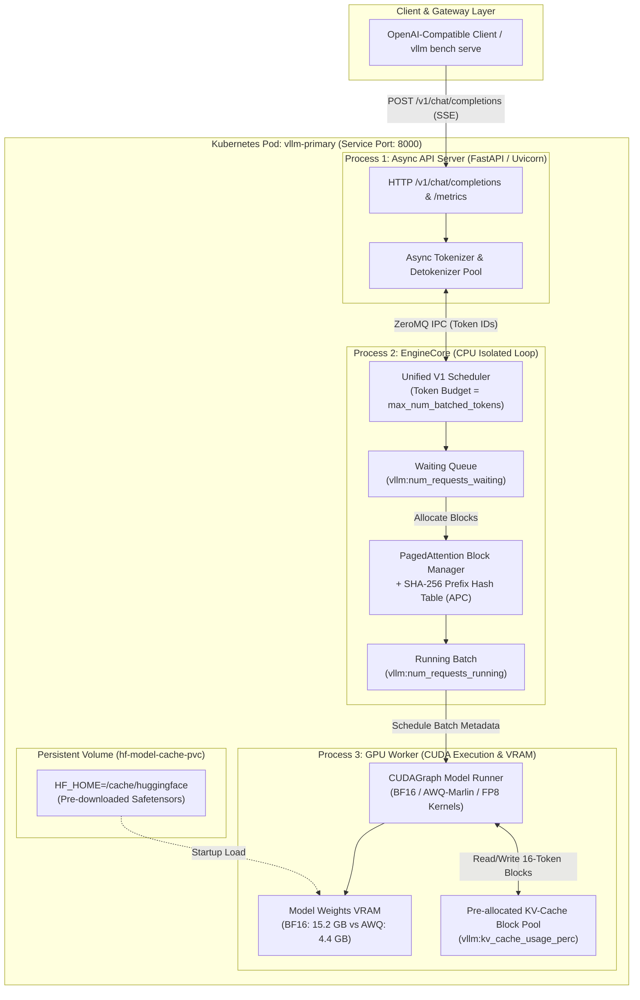

### 2.2 การเชื่อมต่อไร้รอยต่อจาก Helm Chart ในบทที่ 2 สู่การเสิร์ฟจริงในบทที่ 3

เพื่อให้การตั้งค่าในบทที่ 3 ต่อยอดจาก `labs/m2-k8s-gpu/charts/ai-inference-service/` ได้โดยตรง เราสามารถสรุปจุดเชื่อมต่อสำคัญระหว่างไฟล์ `values.yaml` ของบทที่ 2 กับพารามิเตอร์ของ `vLLM` ในบทที่ 3 ได้ดังนี้:

| องค์ประกอบใน Helm Chart (`values.yaml` บทที่ 2) | ค่ามาตรฐาน (SSOT) | บทบาทในการปรับจูน `vLLM` (บทที่ 3) |
| :--- | :--- | :--- |
| `service.name` & `service.port` | `vllm-primary-svc` พอร์ต `8000` | ชื่อ Kubernetes Service และพอร์ตมาตรฐานที่ `vllm serve` เปิดให้บริการ `/v1/chat/completions` (`http://vllm-primary-svc.ai-platform.svc.cluster.local:8000/v1`) และ `/metrics` |
| `modelCache.mountPath` & `modelCache.pvcName` | `/cache/huggingface` (`hf-model-cache-pvc`) | ผูกเข้ากับตัวแปร `HF_HOME` เพื่อเก็บไฟล์โมเดล `Qwen/Qwen2.5-7B-Instruct` และ `Qwen/Qwen2.5-7B-Instruct-AWQ` โดยไม่ต้องดาวน์โหลดใหม่เมื่อรีสตาร์ท Pod |
| `probes.startup` | `failureThreshold: 36`, `periodSeconds: 5` (180s) | ป้องกัน `kubelet` สั่งฆ่า Pod ระหว่างที่ `vLLM` กำลังโหลด Safetensors, รัน `profile_run` เพื่อวัดขนาด KV-Cache, และคอมไพล์ `CUDAGraph` |
| `model.*` & `vllmArgs` (ใน `values-cloud-gpu-7b-awq.yaml`) | อาร์กิวเมนต์ส่งเข้าคอนเทนเนอร์ `vLLM` | จุดที่เราจะปรับจูน `model.id`, `model.gpuMemoryUtilization`, `model.maxModelLen`, และแฟล็กเสริมใน `vllmArgs` (`--quantization=awq_marlin`, `--enable-prefix-caching`, `--max-num-batched-tokens=2048`) |

---

## 3. Core Theory & Deep-Dive Engineering Math

### 3.1 PagedAttention และการกำจัด Memory Fragmentation

ในระบบเสิร์ฟโมเดลยุคแรก (เช่น HuggingFace Text Generation Inference รุ่นดั้งเดิม หรือ PyTorch มาตรฐาน) เมื่อคำขอเข้ามาพร้อมค่า `max_model_len = 8192` ระบบจะต้องจองพื้นที่หน่วยความจำใน VRAM แบบต่อเนื่องกัน (Contiguous Memory Tensor) ขนาด $8,192$ โทเคนล่วงหน้าทันที แม้ว่าผู้ใช้จะถามคำถามสั้นๆ เพียง $100$ โทเคนและได้คำตอบ $200$ โทเคนก็ตาม

สิ่งนี้ทำให้เกิดปัญหาความสูญเสียหน่วยความจำ 2 รูปแบบ:
1. **Internal Fragmentation:** พื้นที่อีก $8,192 - 300 = 7,892$ โทเคนที่จองไว้ถูกปล่อยว่างโดยที่คำขออื่นไม่สามารถเข้ามาใช้ร่วมได้
2. **External Fragmentation:** เมื่อมีคำขอเข้า-ออกด้วยขนาดต่างกัน พื้นที่ว่างใน VRAM จะถูกซอยย่อยจนไม่สามารถจอง Tensor ก้อนใหญ่แบบต่อเนื่องได้ แม้จะมี VRAM รวมกันเพียงพอก็ตาม (ทำให้สูญเสียพื้นที่ VRAM ไปถึง 60%–80%)

**PagedAttention** ใน `vLLM` นำแนวคิด **Virtual Memory & Paging** ของระบบปฏิบัติการ (OS) มาใช้กับ KV-Cache:
- แบ่งพื้นที่ KV-Cache Pool ทั้งหมดออกเป็น **Physical KV Blocks** ขนาดคงที่ โดยค่าเริ่มต้นคือ **$B = 16$ โทเคนต่อบล็อก**
- เมื่อคำขอเข้ามา `EngineCore` จะจัดสรรบล็อกให้ **เฉพาะเท่าจำนวนโทเคนที่มีอยู่จริง** และเมื่อสร้างโทเคนใหม่จนเต็มบล็อกที่ 16 จึงค่อยขอจัดสรรบล็อกถัดไปจาก Free Block List โดยที่บล็อกเหล่านั้นไม่จำเป็นต้องเรียงติดกันใน Physical VRAM
- **ผลลัพธ์ทางคณิตศาสตร์:** ความสูญเสียแบบ Internal Fragmentation จะเกิดขึ้นเฉพาะในบล็อกสุดท้ายของแต่ละคำขอเท่านั้น ซึ่งมีค่าไม่เกิน $B - 1 = 15$ โทเคนต่อคำขอ (น้อยกว่า 4% ของหน่วยความจำทั้งหมด)

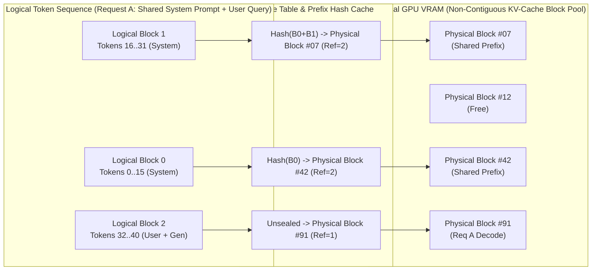

### 3.2 พฤติกรรมเริ่มต้นของ `vLLM` V1 Engine (V1 Default Behaviors & Preemption)

การทำความเข้าใจความแตกต่างระหว่าง `vLLM` V0 และ **V1 Engine** เป็นหัวใจสำคัญในการปรับจูนและตอบคำถามสัมภาษณ์ระดับ Production:

1. **Automatic Prefix Caching (APC) เปิดเป็นค่าเริ่มต้น (`--enable-prefix-caching` is ON by default):**
   - ใน V1 ทุกๆ บล็อกที่เต็ม 16 โทเคนจะถูกคำนวณค่าแฮชแบบลูกโซ่:
     $$\text{BlockHash}_i = \text{SHA256}(\text{BlockHash}_{i-1} \parallel \text{TokenIDs}_{16i \dots 16i+15})$$
   - หากคำขอใหม่มี System Prompt หรือเอกสาร RAG ตอนต้นตรงกับบล็อกที่มีอยู่ใน VRAM แล้ว (แม้จะมี Reference Count เป็น 0 แต่ยังไม่ถูก Evict ออกตามนโยบาย LRU) `vLLM` จะชี้ Page Table ไปยัง Physical Block เดิมทันทีโดยไม่ต้องคำนวณ Prefill ซ้ำ!
   - **ข้อควรระวังในการทำ Benchmark:** หากต้องการวัดประสิทธิภาพ Baseline แบบไม่มี Prefix Cache บน `vLLM` V1 คุณ **ต้อง** ส่งแฟล็ก `--no-enable-prefix-caching` อย่างชัดเจน มิฉะนั้นการรันซ้ำจะมี APC ทำงานอยู่เบื้องหลังเสมอ
   - **การวัดผล Prometheus Metrics (V1):** ใน V1 อัตราการเกิด Cache Hit จะไม่ใช้เกจสำเร็จรูป แต่ต้องคำนวณจากอัตราส่วนของ Counter สองตัวที่มีหน่วยเป็น **จำนวนโทเคน (Tokens)**:
     $$\text{Prefix Cache Hit Rate} = \frac{\Delta \texttt{vllm:prefix\_cache\_hits\_total}}{\Delta \texttt{vllm:prefix\_cache\_queries\_total}}$$

2. **Unified Chunked Prefill เปิดเป็นค่าเริ่มต้น:**
   - แทนที่จะประมวลผล Prompt ยาว 4,096 โทเคนรวดเดียวจนบล็อกคำขออื่น `vLLM` V1 จะหั่น (Chunk) Prompt ยาวออกเป็นส่วนย่อยตามงบประมาณโทเคน (`--max-num-batched-tokens`) แล้วนำโทเคนช่วง Decode ของคำขออื่นๆ มารวมใน Batch เดียวกัน (Piggybacking)
   - ผลลัพธ์คือ **ITL (Inter-Token Latency)** ของผู้ใช้ที่กำลังอ่านข้อความสตรีมมิ่งจะนิ่งสนิท ไม่เกิดอาการค้างเมื่อมีคำขอใหม่ที่มี Prompt ยาวเข้ามาแทรก

3. **การยกเลิกโหมด `SWAP` และใช้ `RECOMPUTE` เป็นหลักเมื่อเกิด Preemption:**
   - ในยุค V0 เมื่อ KV-Cache เต็ม (`vllm:kv_cache_usage_perc` = `1.0`) เอ็นจินมีตัวเลือกในการย้ายบล็อก KV-Cache ออกไปยัง CPU RAM ผ่านบัส PCIe (`SWAP` mode)
   - ใน **V1 Engine** โหมด `SWAP` แบบดั้งเดิมถูกยกเลิกจากการเป็นกลไกหลักและใช้ **`RECOMPUTE`** แทน เหตุผลทางวิศวกรรมคือ: บัส PCIe Gen4 x16 มีแบนด์วิดท์จริงเพียง ~24–28 GB/s การคัดลอก KV-Cache ไป-กลับระหว่าง VRAM กับ CPU RAM สำหรับหลายคำขอพร้อมกันใช้เวลานานกว่าการโยนบล็อก KV-Cache ของคำขอลำดับท้ายสุดทิ้ง (Evict) แล้วนำ Token IDs ทั้งหมดของคำขอนั้นกลับไปคำนวณ Prefill ใหม่ด้วย FlashAttention บน Tensor Cores (ซึ่งมี Memory Bandwidth บนการ์ด 300–2,000+ GB/s) เมื่อมีพื้นที่ว่าง
   - อย่างไรก็ตาม หากเกิด Preemption ถี่เกินไป (`rate(vllm:num_preemptions_total[1m]) > 0`) ระบบจะเข้าสู่วงจรอุบาทว์ที่เรียกว่า **Preemption Thrashing** (เสียเวลา GPU คำนวณซ้ำไปมาไม่รู้จบ) ซึ่งต้องแก้ด้วยการขยาย KV-Cache Pool หรือจำกัดจำนวนคำขอที่รับเข้า

#### ตารางอ้างอิงชื่อ Prometheus Metrics มาตรฐานของ `vLLM` V1 Engine (Canonical V1 Metrics)

เพื่อให้การมอนิเตอร์ในบทที่ 3, การทำ KV-Cache-Aware Routing ในบทที่ 4 (`mock_vllm_server`), และการทำ KEDA Autoscaling ในบทที่ 5 ใช้ชื่อเมทริกซ์ตรงกัน 100% ทุกตัวอักษร ให้ยึดตารางนี้เป็นมาตรฐานกลาง:

| ชื่อ Prometheus Metric (`vLLM` V1) | ประเภท (Type) | ความหมายและการนำไปใช้งานใน Production |
| :--- | :---: | :--- |
| `vllm:kv_cache_usage_perc` | `Gauge` (`0.0`–`1.0`) | สัดส่วนบล็อก KV-Cache ที่ถูกใช้งานอยู่ (`1.0` = เต็ม 100%) ใช้เป็นสัญญาณหลักของ Endpoint Picker (EPP) และ KEDA |
| `vllm:num_requests_running` | `Gauge` | จำนวนคำขอที่กำลังประมวลผลอยู่ใน Running Batch ปัจจุบัน |
| `vllm:num_requests_waiting` | `Gauge` | จำนวนคำขอที่ติดคิวรออยู่ใน Waiting Queue (ใช้ตั้งกฎ KEDA Scale-out เมื่อเฉลี่ย `> 5` ต่อ Pod หรือรวมทั้งคลัสเตอร์ `> 10`) |
| `vllm:prefix_cache_hits_total` | `Counter` (Tokens) | จำนวนโทเคนสะสมที่พบใน Automatic Prefix Cache (APC) โดยไม่ต้องคำนวณ Prefill ซ้ำ |
| `vllm:prefix_cache_queries_total` | `Counter` (Tokens) | จำนวนโทเคนสะสมทั้งหมดที่ถูกตรวจสอบกับ Automatic Prefix Cache |
| `vllm:num_preemptions_total` | `Counter` | จำนวนครั้งสะสมที่คำขอถูกสั่ง Preempt (`RECOMPUTE`) เนื่องจากพื้นที่ KV-Cache เต็ม |
| `vllm:time_to_first_token_seconds_bucket` | `Histogram` | ฮิสโตแกรมของเวลาแฝงจนถึงโทเคนแรก (TTFT) ใช้คำนวณ `histogram_quantile(0.95, ...)` |
| `vllm:inter_token_latency_seconds_bucket` *(หรือ fallback `vllm:time_per_output_token_seconds_bucket`)* | `Histogram` | ฮิสโตแกรมเวลาแฝงระหว่างโทเคนในเฟส Decode (ITL / TPOT; `vLLM` V1 รุ่นใหม่ใช้ชื่อ `vllm:inter_token_latency_seconds_bucket` เป็นหลัก และเขียน PromQL แบบ fallback `or` เสมอในบทที่ 5) |
| `vllm:generation_tokens_total` | `Counter` (Tokens) | จำนวนโทเคนขาออก (Output Tokens) สะสมที่เอ็นจินสร้างเสร็จสมบูรณ์ |

### 3.3 คณิตศาสตร์การขยายขนาด KV-Cache Pool: ทำไม Quantization + `--gpu-memory-utilization` จึงเป็นตัวจริง (ไม่ใช่ `--max-model-len`)

ให้เราพิสูจน์ด้วยตัวเลขจริงของโมเดล **`Qwen/Qwen2.5-7B-Instruct`** บนการ์ด **NVIDIA L4 GPU ($V_{\text{total}} = 24.0\text{ GB}$)**:

สถาปัตยกรรมของ `Qwen/Qwen2.5-7B-Instruct`:
- จำนวนพารามิเตอร์ ($P$): $7.62 \times 10^9$ พารามิเตอร์
- จำนวนเลเยอร์ ($L$): $28$ เลเยอร์
- จำนวน KV Heads ($H_{kv}$): $4$ หัว (ใช้ Grouped-Query Attention โดยที่มี Query Heads $H_q = 28$ หัว)
- มิติของแต่ละ Head ($D_h$): $128$

#### ขั้นที่ 1: คำนวณขนาด KV-Cache ต่อ 1 โทเคน
$$\text{KV}_{\text{bytes/token}} = 2 \times L \times H_{kv} \times D_h \times \text{Bytes}_{\text{dtype}}$$
เมื่อเก็บ KV-Cache ในความละเอียด `bfloat16` ($2$ ไบต์):
$$\text{KV}_{\text{bytes/token}} = 2 \times 28 \times 4 \times 128 \times 2 = 57,344\text{ Bytes} = 56\text{ KiB/token}$$
*(สังเกตว่าด้วยสถาปัตยกรรม GQA ที่มี $H_{kv}=4$ ทำให้ `Qwen2.5-7B` ใช้ KV-Cache ต่อโทเคนเพียง $56\text{ KiB}$ หรือประมาณ $0.0547\text{ MiB/token}$)*

#### ขั้นที่ 2: เปรียบเทียบพื้นที่ KV-Cache Pool ระหว่าง Baseline (BF16) กับ Optimized (AWQ 4-bit)

สมการการจัดสรรพื้นที่ KV-Cache Pool ตอนที่ `vLLM` เริ่มทำงาน (`profile_run`):
$$V_{\text{KV\_Pool}} = (V_{\text{total}} \times U_{\text{gpu}}) - V_{\text{weights}} - V_{\text{activations\_cuda\_overhead}}$$

1. **Config A & B (Baseline BF16, `--gpu-memory-utilization 0.85`):**
   - งบประมาณ VRAM ทั้งหมดที่อนุญาตให้ `vLLM` ใช้: $24.0\text{ GB} \times 0.85 = 20.40\text{ GB}$
   - ขนาด Model Weights (BF16, 2 bytes/param): $7.62 \times 2 = 15.24\text{ GB}$
   - พื้นที่ PyTorch/CUDA Context, Activation Peak (ตอนรัน `profile_run`), และ CUDAGraphs: $\approx 1.80\text{ GB}$
   - **พื้นที่ที่เหลือสำหรับ KV-Cache Pool ($V_{\text{KV\_Pool}}$):**
     $$V_{\text{KV\_Pool, BF16}} = 20.40 - 15.24 - 1.80 = \mathbf{3.36\text{ GB}}$$
   - **จำนวนโทเคนสูงสุดที่เก็บใน KV-Cache Pool ได้พร้อมกัน:**
     $$N_{\text{tokens, BF16}} = \frac{3.36 \times 1024^3\text{ Bytes}}{57,344\text{ Bytes/token}} \approx \mathbf{62,914\text{ tokens}}\text{ (หรือ } 3,932\text{ บล็อก)}$$

2. **Config C (Optimized AWQ 4-bit `Qwen/Qwen2.5-7B-Instruct-AWQ`, `--gpu-memory-utilization 0.92`):**
   - งบประมาณ VRAM ทั้งหมดที่อนุญาตให้ `vLLM` ใช้: $24.0\text{ GB} \times 0.92 = 22.08\text{ GB}$
   - ขนาด Model Weights (AWQ INT4 + Group Scales ประมาณการเชิงทฤษฎี ~0.58 bytes/param): $\approx 4.42\text{ GB}$ *(หมายเหตุหน้างานจริง: ไฟล์ Safetensors ของ `Qwen2.5-7B-Instruct-AWQ` บน Hugging Face มีขนาด ~5.4–5.6 GB เนื่องจากเลเยอร์ `embed_tokens` และ `lm_head` ขนาด ~1.09B พารามิเตอร์ยังคงเก็บเป็น `FP16` เพื่อรักษาความแม่นยำ)*
   - พื้นที่ PyTorch/CUDA Context, Activation Peak, และ CUDAGraphs: $\approx 1.66\text{ GB}$
   - **พื้นที่ที่เหลือสำหรับ KV-Cache Pool ($V_{\text{KV\_Pool}}$):**
     $$V_{\text{KV\_Pool, AWQ}} = 22.08 - 4.42 - 1.66 = \mathbf{16.00\text{ GB}}$$
   - **จำนวนโทเคนสูงสุดที่เก็บใน KV-Cache Pool ได้พร้อมกัน:**
     $$N_{\text{tokens, AWQ}} = \frac{16.00 \times 1024^3\text{ Bytes}}{57,344\text{ Bytes/token}} \approx \mathbf{299,593\text{ tokens}}\text{ (หรือ } 18,724\text{ บล็อก)}$$

> [!IMPORTANT]
> **ข้อสรุปทางวิศวกรรมและหมายเหตุฮาร์ดแวร์จริง:**
> 1. การเปลี่ยนมาใช้ **AWQ 4-bit** ร่วมกับการปรับ `--gpu-memory-utilization 0.92` ขยาย KV-Cache Pool จาก **3.36 GB (62,914 โทเคน)** เป็น **16.00 GB (299,593 โทเคน)** บนฐานสเปกการ์ด (เพิ่มขึ้น **4.76 เท่า**)
> 2. **ข้อเท็จจริงเมื่อดูค่า `nvidia-smi` จริง:** การ์ด L4 `24,576 MiB` (`24.0 GiB`) หลังหัก ECC และ CUDA Driver Reserve (`~0.9–1.5 GiB`) จะเหลือ **Usable VRAM จริง ~22.49 GiB** และเมื่อหักน้ำหนัก Safetensors จริง ~`5.5 GB` พื้นที่ KV Pool บนเครื่องจริงจะอยู่ที่ประมาณ **~13.5–14.5 GB (~250k+ โทเคน)** ซึ่งยังคงขยายตัวมากกว่า Config A ถึง **>4 เท่า (>3x)** และเพียงพอต่อ SLA Concurrency = 32 ได้สบาย
> 3. **เทียบกับ `vram_calculator.py` (บทที่ 2) และหน้า Calculator:** เครื่องมือคำนวณ Sizing ตั้ง Overhead แบบ **Conservative Margin** ที่ `2.50 GB` (`1 replica`) / `2.20 GB` (`multi-replica`) เพื่อกัน OOM ก่อน Deploy จริง (`15.16 GB` KV Headroom / `Max 64 Concurrent` บน L4 AWQ) ส่วนตัวเลข `1.66 GB` (`16.00 GB` KV Pool) ในหัวข้อนี้คือ Runtime Overhead หลัง `vLLM` V1 จูนผ่าน `profile_run` แล้ว
> 4. ในทางกลับกัน การปรับ `--max-model-len` จาก `8192` ลงเหลือ `4096` **ไม่ได้เพิ่มจำนวนบล็อกใน KV-Cache Pool** เพราะ `vLLM` จองพื้นที่ว่างทั้งหมดที่เหลือไปทำ Pool ตั้งแต่ตอนบูตแล้ว หน้าที่ที่แท้จริงของ `--max-model-len 4096` คือ:
> 1. ช่วยให้ผ่านการตรวจสอบตอนเริ่มต้น (Startup Check) ในกรณีที่ KV-Cache Pool มีขนาดเล็กกว่าความยาว Context สูงสุดตามทฤษฎีของโมเดล (เช่น 32,768 หรือ 131,072 โทเคน)
> 2. ทำหน้าที่เป็น Admission Guardrail ป้องกันไม่ให้คำขอเดียวที่ส่ง Prompt ยาว 32,768 โทเคนเข้ามาแย่งบล็อกใน Pool ไปคนเดียวเกินครึ่ง

### 3.4 คณิตศาสตร์เศรษฐศาสตร์ต่อหน่วย (Unit Economics: Cost per 1M Tokens & Break-even Utilization)

ในฐานะวิศวกร AI Infrastructure คุณต้องสามารถแปลงตัวเลข Throughput (Tokens/sec) จากการทำ Benchmark ให้เป็นต้นทุนทางการเงิน (USD per 1 Million Tokens) เพื่อตอบคำถามผู้บริหารได้ว่าควรเช่า GPU รันเองหรือใช้ API ภายนอก

#### สูตรคำนวณต้นทุนต่อ 1 ล้านโทเคน (Effective Cost per 1M Tokens)

กำหนดให้:
- $C_{\text{hour}}$ = ต้นทุนค่าเช่าเครื่อง GPU Server ต่อชั่วโมง (เช่น Cloud L4 GPU VM 1 เครื่อง รวม CPU/RAM/Disk $\approx \$0.85/\text{hour}$)
- $T_{\text{peak}}$ = อัตราการผลิตโทเคนสูงสุดที่ผ่านเกณฑ์ SLA (Goodput ในหน่วย $\text{tokens/sec}$ จากการวัดผลจริง)
- $u$ = อัตราการใช้งานจริงเฉลี่ยตลอด 24 ชั่วโมง (Average Fleet Utilization Ratio, โดยที่ $0 < u \le 1.0$) เนื่องจากทราฟฟิกจริงไม่ได้เต็ม 100% ตลอดเวลา (เช่น กลางคืนมีคนใช้น้อย)

จำนวนโทเคนที่ระบบผลิตได้จริงใน 1 ชั่วโมง ($3,600$ วินาที) ที่ระดับการใช้งาน $u$ คือ:
$$\text{Tokens}_{\text{hour}}(u) = T_{\text{peak}} \times 3,600 \times u$$

ดังนั้น **ต้นทุนต่อ 1 ล้านโทเคน ($\text{Cost}_{1\text{M}}$)** คือ:
$$\text{Cost}_{1\text{M}}(u) = \frac{C_{\text{hour}}}{\left(\frac{T_{\text{peak}} \times 3,600 \times u}{1,000,000}\right)} = \frac{C_{\text{hour}} \times 1,000,000}{T_{\text{peak}} \times 3,600 \times u} = \frac{277.78 \times C_{\text{hour}}}{T_{\text{peak}} \times u}$$

#### ตัวอย่างการคำนวณจริงและหาจุดคุ้มทุน (Break-even Utilization %)

สมมติว่าองค์กรเปรียบเทียบระหว่าง:
- **ทางเลือกที่ 1 (Managed API):** ค่าบริการเฉลี่ย (Blended Input + Output) อยู่ที่ **$P_{\text{API}} = \$0.60$ ต่อ 1 ล้านโทเคน**
- **ทางเลือกที่ 2 (Self-hosted `vLLM` บน Cloud L4 GPU):** ต้นทุนเครื่อง $C_{\text{hour}} = \$0.85/\text{hour}$
  - ก่อนปรับจูน (**Config A - Baseline BF16**): ทำ Throughput ที่ผ่าน SLA ได้ $T_{\text{peak, A}} = 420\text{ tokens/sec}$
  - หลังปรับจูน (**Config C - AWQ + APC + Tuned Batching**): ทำ Throughput ที่ผ่าน SLA ได้ $T_{\text{peak, C}} = 1,450\text{ tokens/sec}$

เราสามารถหา **จุดคุ้มทุนของอัตราการใช้งาน ($u_{\text{break-even}}$)** ที่ทำให้ $\text{Cost}_{1\text{M}}(u) = P_{\text{API}}$ ได้จากสูตร:
$$u_{\text{break-even}} = \frac{C_{\text{hour}} \times 1,000,000}{T_{\text{peak}} \times 3,600 \times P_{\text{API}}}$$

- **จุดคุ้มทุนของ Config A (Baseline BF16):**
  $$u_{\text{break-even, A}} = \frac{0.85 \times 1,000,000}{420 \times 3,600 \times 0.60} = \frac{850,000}{907,200} = 0.9369 \approx \mathbf{93.7\%}$$
  *(ต้องมีทราฟฟิกอัดแน่นเกือบเต็มตลอด 24 ชั่วโมงถึงจะคุ้มกว่าใช้ API ซึ่งในทางปฏิบัติเป็นไปไม่ได้เลยสำหรับระบบที่มีผู้ใช้ตามเวลาทำการ)*

- **จุดคุ้มทุนของ Config C (Optimized AWQ + APC):**
  $$u_{\text{break-even, C}} = \frac{0.85 \times 1,000,000}{1,450 \times 3,600 \times 0.60} = \frac{850,000}{3,132,000} = 0.2714 \approx \mathbf{27.1\%}$$
  *(เพียงแค่ระบบมีทราฟฟิกเฉลี่ยเกิน 27.1% ของความจุสูงสุด หรือเปิด Autoscaling ลดจำนวนเครื่องในเวลากลางคืน ก็ประหยัดกว่า Managed API ทันที!)*

#### ตารางเปรียบเทียบเศรษฐศาสตร์ต่อหน่วย (Unit Economics Comparison Table)

| ระดับ Utilization เฉลี่ย ($u$) | Config A: Baseline BF16 ($T_{\text{peak}} = 420\text{ tok/s}$) | Config C: Optimized AWQ + APC ($T_{\text{peak}} = 1,450\text{ tok/s}$) | Managed API ($P_{\text{API}} = \$0.60 / 1\text{M}$) | คำแนะนำทางสถาปัตยกรรม (สำหรับ Config C) |
| :---: | :---: | :---: | :---: | :--- |
| **10%** (ทราฟฟิกเบาบาง) | $\$5.62 / 1\text{M}$ | $\$1.63 / 1\text{M}$ | **$\$0.60 / 1\text{M}$** | ใช้ Managed API หรือ Scale-to-Zero ด้วย KEDA |
| **27.1%** (จุดคุ้มทุน Config C) | $\$2.07 / 1\text{M}$ | **$\$0.60 / 1\text{M}$** | **$\$0.60 / 1\text{M}$** | จุดตัดคุ้มทุน (Break-even Point) ของโหมด Optimized |
| **50%** (ทราฟฟิกปกติ) | $\$1.12 / 1\text{M}$ | **$\$0.33 / 1\text{M}$** | $\$0.60 / 1\text{M}$ | โฮสต์เองบน L4 ประหยัดต้นทุนลง **45%** |
| **80%** (ทราฟฟิกหนาแน่น) | $\$0.70 / 1\text{M}$ | **$\$0.20 / 1\text{M}$** | $\$0.60 / 1\text{M}$ | โฮสต์เองบน L4 ประหยัดต้นทุนลง **66.1%** |
| **100%** (Batch Processing) | $\$0.56 / 1\text{M}$ | **$\$0.16 / 1\text{M}$** | $\$0.60 / 1\text{M}$ | โฮสต์เองบน L4 ประหยัดต้นทุนลง **72.9%** |

---

### 3.5 สถาปัตยกรรม Inference ยุค 2026: Native FP8, Disaggregated PD, Multi-GPU TP/MoE & Agentic Serving
เมื่อก้าวข้ามระดับ Single-GPU 7B ไปสู่ระบบ Production ขนาดใหญ่ตามแนวทางใน *AI Systems Performance Engineering* (Chris Fregly) และ *How to Scale Your Model* (Google DeepMind) มี 4 แนวคิดที่วิศวกร AI Platform ต้องเชี่ยวชาญ:
1. **Native FP8 (Weights + KV-Cache) บน Ada Lovelace / Hopper:** การ์ด NVIDIA L4 และ RTX 4050 (Ada Lovelace) มี FP8 Tensor Cores ในตัว การรัน `--quantization fp8 --kv-cache-dtype fp8` ลดขนาด KV-Cache ต่อโทเคนลงอีก **50%** (จาก `56 KiB` เหลือ `28 KiB/token` สำหรับ Qwen2.5-7B) และช่วยรักษาความแม่นยำภาษาไทยและ JSON ได้ดีกว่า INT4 เมื่อเทียบกับ BF16
2. **Disaggregated Prefill–Decode (PD) (`llm-d`, NVIDIA Dynamo, LMCache):** ในเวิร์กโหลดที่มี Prompt ยาว (8k–64k tokens) การประมวลผล Prefill จะกิน Compute นานและดึง **ITL** ของผู้ใช้อื่นที่กำลัง Decode อยู่ใน Batch เดียวกันให้กระตุก (**Prefill Interference**) วิธีแก้ระดับ Scale ใหญ่คือแยกพูลของพอด **Prefill Workers** ออกจาก **Decode Workers** แล้วส่งต่อ KV-Cache ผ่าน RDMA/NIXL หรือ LMCache
3. **Multi-GPU Tensor Parallelism (TP) & Mixture-of-Experts (MoE):** สำหรับโมเดล 70B+ หรือ MoE (เช่น DeepSeek / Qwen-MoE) ที่เกิน 1 การ์ด เราแบ่งเลเยอร์ตามแนวกว้างด้วย `--tensor-parallel-size N` (ต้องการ NVLink เพราะทุก Decode step ต้องทำ `AllReduce`) หรือแยก Expert Parallelism (EP) เมื่อมีโหนดหลายเครื่อง
4. **Agentic / Reasoning Serving & Quantization Eval Gate:** โมเดลยุค Reasoning / Tool-Calling สร้าง Output ยาวกว่าปกติ 5–10 เท่า ทำให้ Decode Memory Bandwidth และ KV-Cache Capacity กลายเป็นคอขวดหลัก และการเปลี่ยน Quantization ทุกครั้งต้องผ่าน **Eval Gate** ([`eval_thai_quality.py`](../labs/m3-vllm/eval_thai_quality.py)) ตามแนวทาง *AI Engineering* (Chip Huyen) เพื่อยืนยันว่าภาษาไทยและ Structured JSON ไม่เพี้ยน

---

## 4. Hands-on Lab (Dual-Path Execution)

แล็บในบทที่ 3 ออกแบบให้ทำงานเชื่อมต่อกับโครงสร้างแคช `HF_HOME=/cache/huggingface` (บนโฮสต์คือ `/tmp/ai-infra-hf-cache`) และพอร์ต `8000` ของ `vllm-primary-svc` ที่วางรากฐานไว้ในบทที่ 1 และ 2 โดยโค้ดทั้งหมดของแล็บนี้อยู่ในโฟลเดอร์ `labs/m3-vllm/`

### 4.1 โครงสร้างไฟล์ใน `labs/m3-vllm/`

```text
labs/m3-vllm/
├── start_vllm_baseline.sh                  # สคริปต์รัน vLLM โหมด Baseline (--local-cpu / --cloud-gpu)
├── start_vllm_optimized.sh                 # สคริปต์รัน vLLM โหมด Optimized (AWQ + APC + Token Budget)
├── run_benchmark_suite.sh                  # สคริปต์รัน vllm bench serve / Simulation & Unit Economics
├── optimization-report-template.md         # แบบฟอร์มว่างสำหรับผู้เรียนกรอกผล (DoD #3)
├── examples/optimization-report-sample.md  # ตัวอย่างรายงานที่กรอกและคำนวณครบแล้ว (ใช้อ้างอิง)
└── verify_m3.sh                            # สคริปต์ตรวจวัดผลอัตโนมัติประจำบทที่ 3
```

---

### Path A: No-GPU Local Path (\$0 — รันบนเครื่อง Local 16GB RAM)

> [!CAUTION]
> **กฎความปลอดภัยของหน่วยความจำ (16GB RAM Protection Rule):**
> บนเครื่อง Local ที่ไม่มีการ์ดจอ (No-GPU Path) เราจะรัน `vLLM` จริงด้วยโหมด CPU **ไม่เกิน 1 Pod** โดยใช้โมเดลขนาดเล็ก `Qwen/Qwen2.5-0.5B-Instruct` และตั้งค่าตัวแปรสภาพแวดล้อม `VLLM_CPU_KVCACHE_SPACE=1` (จำกัดขนาด KV-Cache บน CPU RAM ไว้ที่ 1 GB) เพื่อป้องกันไม่ให้เครื่องเกิดอาการค้าง (OOM Freeze)

#### ขั้นตอนที่ 1: ตรวจสอบสคริปต์และรัน `vLLM` โหมด Baseline บน Local CPU (`--no-enable-prefix-caching`)

เปิดเทอร์มินัลในรากโปรเจกต์ `ai-infra-handbook/` แล้วรันคำสั่งต่อไปนี้เพื่อดูการทำงานของสคริปต์ `start_vllm_baseline.sh` ในโหมด `--local-cpu`:

```bash
bash labs/m3-vllm/start_vllm_baseline.sh --local-cpu --dry-run
```

**ผลลัพธ์ที่คาดหวัง (Expected Output):**
```text
[M3-BASELINE] Mode: local-cpu
[M3-BASELINE] HF_HOME=/tmp/ai-infra-hf-cache (Host cache: /tmp/ai-infra-hf-cache)
[M3-BASELINE] VLLM_CPU_KVCACHE_SPACE=1
[M3-BASELINE] Command: vllm serve Qwen/Qwen2.5-0.5B-Instruct --host 0.0.0.0 --port 8000 --dtype bfloat16 --max-model-len 2048 --no-enable-prefix-caching
```

หากคุณติดตั้ง `vllm` (CPU build) หรือรันผ่าน Docker container บนเครื่อง Local คุณสามารถตัด `--dry-run` ออกเพื่อสตาร์ทเซิร์ฟเวอร์จริงบนพอร์ต `8000` ได้ทันที

#### ขั้นตอนที่ 2: ทดสอบการเปิดใช้ Automatic Prefix Caching (APC) และ Chunked Prefill ในโหมด Optimized

รันคำสั่งตรวจสอบพารามิเตอร์ของ `start_vllm_optimized.sh` ในโหมด `--local-cpu`:

```bash
bash labs/m3-vllm/start_vllm_optimized.sh --local-cpu --dry-run
```

**ผลลัพธ์ที่คาดหวัง (Expected Output):**
```text
[M3-OPTIMIZED] Mode: local-cpu
[M3-OPTIMIZED] HF_HOME=/tmp/ai-infra-hf-cache (Host cache: /tmp/ai-infra-hf-cache)
[M3-OPTIMIZED] VLLM_CPU_KVCACHE_SPACE=1
[M3-OPTIMIZED] Command: vllm serve Qwen/Qwen2.5-0.5B-Instruct --host 0.0.0.0 --port 8000 --dtype bfloat16 --max-model-len 2048 --enable-prefix-caching --max-num-batched-tokens 1024 --max-num-seqs 16
```

#### ขั้นตอนที่ 3: รันชุดทดสอบ Benchmark และการคำนวณ Unit Economics (`run_benchmark_suite.sh`)

สคริปต์ `run_benchmark_suite.sh` รองรับทั้งการยิงโหลดจริงผ่าน `vllm bench serve` ไปยังเซิร์ฟเวอร์ที่รันอยู่ และโหมด `--simulate` สำหรับเครื่อง Local ที่ต้องการทดสอบไปป์ไลน์การประมวลผลกราฟความหน่วงและคำนวณ Unit Economics ทันที:

```bash
bash labs/m3-vllm/run_benchmark_suite.sh --simulate
```

**ผลลัพธ์ที่คาดหวัง (Expected Output):**
```text
================================================================================
 vLLM V1 Serving Benchmark Suite & Unit Economics Calculator
 Shared System Prompt Prefix: 2048 tokens | Suffix: 128 tokens | Output: 256 tokens
================================================================================
[SIMULATE MODE] Modeled L4 GPU projections anchored to 300 GB/s HBM/GDDR6 bandwidth.
[SIMULATE MODE] Real Cloud GPU numbers vary slightly by kernel & PCIe; run --live on L4 VM to measure.
Config          | Conc | TTFT p95 (ms) | ITL p95 (ms) | Throughput (tok/s) | KV Usage | Prefix Hit % | Cost/1M ($0.85/h @ 50% util)
------------------------------------------------------------------------------------------------------------------------------------
A: BF16-NoAPC   |    1 |         310.0 |         54.5 |               18.2 |    12.4% |         0.0% | $25.95
A: BF16-NoAPC   |    8 |         980.0 |         58.0 |              136.0 |    68.0% |         0.0% | $3.47
A: BF16-NoAPC   |   16 |        2450.0 |         66.0 |              420.0 |    98.5% |         0.0% | $1.12
A: BF16-NoAPC   |   32 |        6120.0 |         94.0 |              390.0 |   100.0% |         0.0% | $1.21 (SLA BREACH: Preemption!)
------------------------------------------------------------------------------------------------------------------------------------
B: BF16+APC     |   16 |         460.0 |         29.0 |              890.0 |    42.0% |        88.5% | $0.53
B: BF16+APC     |   32 |        1420.0 |         39.0 |              980.0 |    89.0% |        89.1% | $0.48
------------------------------------------------------------------------------------------------------------------------------------
C: AWQ+APC+Tune |    1 |         195.0 |         17.8 |               56.0 |     2.8% |        89.4% | $8.43
C: AWQ+APC+Tune |    8 |         280.0 |         19.2 |              495.0 |    14.5% |        88.2% | $0.95
C: AWQ+APC+Tune |   16 |         390.0 |         21.1 |              960.0 |    26.2% |        88.9% | $0.49
C: AWQ+APC+Tune |   32 |         640.0 |         23.5 |             1450.0 |    48.5% |        89.4% | $0.33 (PASS SLA <800ms TTFT)
================================================================================
Break-even Utilization vs Managed API ($0.60 / 1M tokens):
  - Config A (420 tok/s): 93.7% utilization required
  - Config C (1450 tok/s): 27.1% utilization required
```

---

### Path A2: Local RTX 4050 6GB CUDA Path (\$0 — สำหรับเครื่อง HP Victus / WSL2)

หากเครื่องของคุณมี GPU 6GB VRAM (เช่น NVIDIA RTX 4050 Ada Lovelace บน WSL2) คุณสามารถรัน `vLLM` V1 บน CUDA จริงได้โดยไม่ต้องรอเช่าคลาวด์ เพื่อฝึกจับอาการ BF16 เทียบกับ AWQ + FP8 KV-Cache และรัน Eval Gate ภาษาไทย:

```bash
# 1. Baseline Local CUDA (Qwen2.5-1.5B BF16, No APC)
bash labs/m3-vllm/start_vllm_baseline.sh --local-rtx4050 --dry-run

# 2. Optimized Local CUDA (Qwen2.5-3B-Instruct-AWQ + FP8 KV-Cache + APC + Eager)
bash labs/m3-vllm/start_vllm_optimized.sh --local-rtx4050 --dry-run
# (ตัด --dry-run ออกเพื่อสตาร์ทจริงบน Docker GPU)

# 3. รัน Quantization Quality Eval Gate ภาษาไทย & JSON
python3 labs/m3-vllm/eval_thai_quality.py --simulate
# หรือยิงเข้าเครื่องจริง: python3 labs/m3-vllm/eval_thai_quality.py --live --url http://localhost:8000 --model Qwen/Qwen2.5-3B-Instruct-AWQ
```

---

### Path B: Cloud L4 GPU Path (รันจริงบนการ์ด NVIDIA L4 24GB VRAM)

หากคุณเปิดใช้งานเครื่อง Cloud GPU VM (เช่น GCP `g2-standard-8` หรือ AWS `g6.2xlarge` ที่มีการ์ด NVIDIA L4 24GB) ให้ดำเนินการทดสอบเปรียบเทียบทั้ง 3 โครงแบบดังนี้:

#### ขั้นตอนที่ 1: รัน Config A (Baseline BF16 ปิด Prefix Caching)

```bash
# รันโมเดล Qwen/Qwen2.5-7B-Instruct แบบ BF16 โดยบังคับปิด Prefix Caching เพื่อวัด Baseline
bash labs/m3-vllm/start_vllm_baseline.sh --cloud-gpu
```

ภายในสคริปต์จะรันคำสั่ง:
```bash
export HF_HOME=/cache/huggingface
vllm serve Qwen/Qwen2.5-7B-Instruct \
  --host 0.0.0.0 \
  --port 8000 \
  --dtype bfloat16 \
  --gpu-memory-utilization 0.85 \
  --max-model-len 8192 \
  --no-enable-prefix-caching
```

เมื่อเซิร์ฟเวอร์พร้อมใช้งาน (`Application startup complete`) ให้เปิดอีกเทอร์มินัลหนึ่งเพื่อตรวจสอบ Prometheus metrics เริ่มต้น:
```bash
curl -s http://localhost:8000/metrics | grep -E "vllm:(kv_cache_usage_perc|num_preemptions_total|prefix_cache)"
```

#### ขั้นตอนที่ 2: รัน Config B (เปิด Automatic Prefix Caching บน BF16) และ Config C (AWQ 4-bit + Tuned Token Budget)

หยุดโปรเซสเดิม แล้วรัน `start_vllm_optimized.sh` ในโหมด `--cloud-gpu`:

```bash
bash labs/m3-vllm/start_vllm_optimized.sh --cloud-gpu
```

ภายในสคริปต์จะรันคำสั่งที่ปรับจูนครบทุกมิติ:
```bash
export HF_HOME=/cache/huggingface
vllm serve Qwen/Qwen2.5-7B-Instruct-AWQ \
  --host 0.0.0.0 \
  --port 8000 \
  --quantization awq_marlin \
  --dtype float16 \
  --gpu-memory-utilization 0.92 \
  --max-model-len 4096 \
  --enable-prefix-caching \
  --max-num-batched-tokens 2048 \
  --max-num-seqs 64
```

> [!TIP]
> **ทำไมเราจึงระบุ `--quantization awq_marlin`?**
> เคอร์เนล **Marlin** เป็นเคอร์เนล CUDA ที่เขียนขึ้นเป็นพิเศษสำหรับการคูณเมทริกซ์แบบ Mixed-Precision (น้ำหนัก INT4 คูณกับ Activation FP16/BF16) บนสถาปัตยกรรม NVIDIA Ampere (A100) และ Ada Lovelace (L4) โดยใช้คำสั่ง `mma.sync` และการดึงข้อมูลแบบ Asynchronous Pipeline (`cp.async`) จาก Global Memory เข้าสู่ Shared Memory ทำให้ความเร็วในเฟส Decode และ Prefill เร็วกว่าเคอร์เนล AWQ มาตรฐานถึง 1.5–2.2 เท่า!

#### ขั้นตอนที่ 3: ยิงโหลดจริงด้วย `vllm bench serve` ที่ระดับ Concurrency 1, 8, 16, 32

เมื่อ `vLLM` โหมด Optimized ทำงานอยู่ ให้รันสคริปต์ Benchmark ในโหมดยิงโหลดจริง (`--live`):

```bash
bash labs/m3-vllm/run_benchmark_suite.sh --live --url http://localhost:8000
```

สคริปต์จะเรียก `vllm bench serve` โดยจำลองเวิร์กโหลด RAG / Agentic ที่มี **Shared System Prompt ยาว 2,048 โทเคน** ตามด้วยคำถามเฉพาะของผู้ใช้แต่ละคน 128 โทเคน และสร้างคำตอบ 256 โทเคน ที่ระดับ `--max-concurrency` เท่ากับ `1`, `8`, `16`, และ `32` ตามลำดับ พร้อมดึงค่า `vllm:prefix_cache_hits_total` และ `vllm:prefix_cache_queries_total` จาก `/metrics` มาคำนวณอัตรา Prefix Cache Hit Rate อัตโนมัติ

---

## 5. Chaos & Troubleshooting Drills

### สถานการณ์จำลอง: KV-Cache Starvation & Preemption Thrashing Storm

#### อาการที่พบในระบบ Production (Symptoms)
1. ผู้ใช้ร้องเรียนว่าแชตบอตตอบช้าเป็นช่วงๆ โดยบางคำขอใช้เวลารอข้อความแรก (TTFT) นานกว่า 6 วินาที ทั้งที่ค่าเฉลี่ย CPU และ GPU Compute Utilization ไม่ได้สูงผิดปกติ
2. เมื่อตรวจสอบที่ `/metrics` ของพอร์ต `8000` พบสัญญาณเตือนภัย 3 ตัวพร้อมกัน:
   - `vllm:kv_cache_usage_perc` พุ่งขึ้นไปแช่อยู่ที่ `0.99` – `1.00`
   - `vllm:num_requests_waiting` ค้างอยู่ในคิวมากกว่า `15` คำขอ
   - `vllm:num_preemptions_total` เพิ่มขึ้นอย่างต่อเนื่องทุกวินาที
3. ใน Log ของ Pod `vllm-primary` ปรากฏข้อความแจ้งเตือนซ้ำๆ:
   ```text
   WARNING 11-11 10:15:22 [scheduler.py:...] Sequence group cmpl-9f82a... is preempted by RECOMPUTE mode because there is not enough KV cache space.
   ```

#### ขั้นตอนการวินิจฉัยและแก้ไขอย่างเป็นระบบ (Diagnostic & Remediation Playbook)

1. **ตรวจสอบสาเหตุรากเหง้า (Root Cause Analysis):**
   - คำขอแต่ละรายการใช้โทเคนรวม (Prompt + Generated) เฉลี่ย 2,300 โทเคน เมื่อมีคำขอเข้ามาพร้อมกัน 32 รายการ จะต้องใช้พื้นที่ KV-Cache สูงถึง $32 \times 2,300 = 73,600$ โทเคน (ในกรณีที่ไม่ได้เปิด APC หรือคำขอไม่มีส่วนนำซ้ำกัน)
   - แต่เนื่องจากรันโมเดลแบบ BF16 (`--gpu-memory-utilization 0.85`) พื้นที่ KV-Cache Pool จึงรับได้สูงสุดเพียง ~62,914 โทเคน เมื่อคำขอทั้ง 32 รายการทยอยสร้างโทเคนใหม่ในเฟส Decode จนพื้นที่เต็ม 100% เอ็นจินจึงต้องสั่ง Evict คำขอท้ายๆ ทิ้งแล้วนำกลับเข้าคิว Waiting เพื่อคำนวณ Prefill ใหม่ซ้ำแล้วซ้ำเล่า (Preemption Thrashing)

2. **การแก้ไขระยะสั้นและระยะยาว (Remediation):**
   - **ขั้นที่ 1 (เปิด APC และจำกัด Admission Queue ต่อเรพลิกา):** ตรวจสอบให้แน่ใจว่าไม่ได้เผลอใส่ `--no-enable-prefix-caching` และตั้งค่า `--max-num-seqs 32` เพื่อไม่ให้ Scheduler รับคำขอเข้ามาอยู่ใน Running Batch เกินกว่าที่ KV-Cache Pool จะรองรับจนจบเฟส Decode ได้
   - **ขั้นที่ 2 (ขยายขนาด KV-Cache Pool ด้วย Quantization):** เปลี่ยนอิมเมจโมเดลเป็น `Qwen/Qwen2.5-7B-Instruct-AWQ` (`--quantization awq_marlin`) และเพิ่ม `--gpu-memory-utilization 0.92` เพื่อขยายความจุ KV-Cache Pool จาก ~62k โทเคน เป็น ~300k โทเคน ซึ่งจะทำให้ค่า `vllm:num_preemptions_total` ลดลงเหลือ `0` ทันที

---

## 6. Optimization Exercise

ในโจทย์ข้อนี้ คุณจะต้องดำเนินการปรับจูน `vLLM` ตามกระบวนการทางวิศวกรรม 5 ขั้นตอน (**Baseline → Hypothesis → Fix → Measure → Explain**) และบันทึกผลลงในไฟล์รายงาน `labs/m3-vllm/optimization-report-template.md`

### 1. Baseline (การวัดค่าตั้งต้น — Config A)
- **การตั้งค่า:** โมเดล `Qwen/Qwen2.5-7B-Instruct` (`bfloat16`), `--gpu-memory-utilization 0.85`, `--max-model-len 8192`, `--no-enable-prefix-caching`
- **เวิร์กโหลด:** Concurrency = 32, Shared System Prompt = 2,048 โทเคน, User Query = 128 โทเคน, Output = 256 โทเคน
- **ผลลัพธ์ตั้งต้น:**
  - TTFT p95 = `6,120 ms` (ทะลุเกณฑ์ SLA ที่กำหนดไว้ต้อง `< 800 ms`)
  - ITL p95 = `94.0 ms` (ทะลุเกณฑ์ SLA ที่กำหนดไว้ต้อง `< 30 ms`)
  - Throughput = `390 tokens/sec`
  - `vllm:kv_cache_usage_perc` = `100.0%` และเกิด Preemption ซ้ำๆ

### 2. Hypothesis (การตั้งสมมติฐาน)
- **สมมติฐานที่ 1 (แก้คอขวด TTFT และลดการใช้ KV-Cache ซ้ำซ้อน):** เนื่องจากทุกคำขอมี System Prompt ขนาด 2,048 โทเคนเหมือนกัน (คิดเป็น 94% ของ Input Prompt) การเปิดใช้งาน **Automatic Prefix Caching (Config B)** จะทำให้คำขอที่ 2 เป็นต้นไปข้ามการคำนวณ Prefill ของ 2,048 โทเคนแรกได้ทั้งหมด และแชร์ Physical KV Blocks ชุดเดียวกัน (ใช้เพียง $2048 / 16 = 128$ บล็อกร่วมกันทั้ง 32 คำขอ แทนที่จะใช้ $128 \times 32 = 4,096$ บล็อก)
- **สมมติฐานที่ 2 (ขยาย KV-Cache Pool และคุม ITL):** การเปลี่ยนไปใช้โมเดล **AWQ 4-bit (`awq_marlin`)** ร่วมกับ `--gpu-memory-utilization 0.92` และกำหนดงบประมาณโทเคนต่อรอบ `--max-num-batched-tokens 2048` (**Config C**) จะขยาย KV-Cache Pool กว่า 4.7 เท่า ลดเวลาอ่านน้ำหนักโมเดลจาก VRAM ในเฟส Decode และป้องกันไม่ให้รอบใดรอบหนึ่งใช้เวลาประมวลผลนานเกินไปจนกระทบ ITL

### 3. Fix (การลงมือปรับจูน)
อัปเดตพารามิเตอร์ในสคริปต์ `labs/m3-vllm/start_vllm_optimized.sh` (และสำหรับ Deployment ด้วย Helm Chart ของบทที่ 2 ให้ใช้โปรไฟล์ `labs/m2-k8s-gpu/charts/ai-inference-service/values-cloud-gpu-7b-awq.yaml` ที่แยกออกมาเฉพาะสำหรับการ์ด L4 เดี่ยว):
```yaml
model:
  id: "Qwen/Qwen2.5-7B-Instruct-AWQ"
  maxModelLen: 4096
  gpuMemoryUtilization: "0.92"
  enforceEager: false
  passVllmCliArgs: true

vllmArgs:
  - "--quantization=awq_marlin"
  - "--dtype=float16"
  - "--enable-prefix-caching"
  - "--max-num-batched-tokens=2048"
  - "--max-num-seqs=64"
```

### 4. Measure (ตารางเปรียบเทียบผลการวัดค่า Config A vs Config B vs Config C ที่ Concurrency = 32)

| ตัวชี้วัด (Metric @ Concurrency 32) | Config A: Baseline (BF16, No APC) | Config B: APC Only (BF16 + APC) | Config C: Full Tuned (AWQ + APC + Budget) | การเปลี่ยนแปลง (Config A → C) |
| :--- | :---: | :---: | :---: | :---: |
| **KV-Cache Pool Capacity (GB / Tokens)** | `3.36 GB` (~62.9k tok) | `3.36 GB` (~62.9k tok) | **`16.00 GB` (~299.6k tok)** | **+376% Capacity** |
| **Prefix Cache Hit Rate (%)** | `0.0%` | `89.1%` | **`89.4%`** | **+89.4% Cache Hit** |
| **Peak `vllm:kv_cache_usage_perc`** | `100.0%` (Saturated) | `89.0%` | **`48.5%`** | **ลดแรงกดดัน VRAM ลงครึ่งหนึ่ง** |
| **Preemptions (`vllm:num_preemptions_total`)** | `47` (Thrashing) | `0` | **`0`** | **กำจัด Preemption 100%** |
| **TTFT p95 (ms)** *(SLA < 800 ms)* | `6,120 ms` (FAIL) | `1,420 ms` (FAIL) | **`640 ms` (PASS)** | **เร็วขึ้น 9.56 เท่า (-89.5%)** |
| **ITL p95 (ms)** *(SLA < 30 ms)* | `94.0 ms` (FAIL) | `39.0 ms` (FAIL) | **`23.5 ms` (PASS)** | **เร็วขึ้น 4.00 เท่า (-75.0%)** |
| **Output Throughput (tokens/sec)** | `390 tok/s` | `980 tok/s` | **`1,450 tok/s`** | **เพิ่มขึ้น 3.72 เท่า (+271.8%)** |
| **Unit Cost @ 50% Util (`$0.85/hr`)** | `$1.21 / 1M tok` | `$0.48 / 1M tok` | **`$0.33 / 1M tok`** | **ลดต้นทุนต่อหน่วยลง 72.7%** |

### 5. Explain (การอธิบายผลลัพธ์เชิงกลไกฮาร์ดแวร์)
1. **ทำไม Config B จึงลด TTFT จาก 6,120 ms เหลือ 1,420 ms ทันที?** เพราะการเปิด APC ทำให้คำขอทั้ง 32 รายการแชร์ Physical KV Blocks ของ System Prompt (2,048 โทเคนแรก) ร่วมกัน ส่งผลให้ไม่ต้องเสียเวลา GPU คำนวณ Attention ของ 2,048 โทเคนซ้ำ 32 รอบ และประหยัดพื้นที่ KV-Cache ไปได้กว่า $(32 - 1) \times 2,048 = 63,488$ โทเคน จึงไม่เกิด Preemption อีกต่อไป
2. **ทำไมต้องไปถึง Config C จึงจะผ่านเกณฑ์ ITL < 30 ms?** เพราะเฟส Decode มีลักษณะเป็น **Memory-Bandwidth Bound** (ทุกๆ 1 โทเคนใหม่ที่สร้างขึ้น GPU ต้องอ่าน Model Weights ทั้งก้อนจาก VRAM เข้าสู่ SRAM) การบีบอัดน้ำหนักโมเดลจาก BF16 (15.24 GB) เป็น AWQ 4-bit (4.42 GB) ลดปริมาณข้อมูลที่ต้องดึงผ่านบัสหน่วยความจำลงถึง 3.45 เท่าต่อก้าวการถอดรหัส (Decode Step) ทำให้อัตรา ITL p95 ลดลงจาก `39.0 ms` เหลือ `23.5 ms` และดัน Throughput ทะลุ `1,450 tokens/sec`

---

## 7. Architecture Decision Record (ADR) & Cost/Handoff Documentation

ด้านล่างนี้คือสรุปการตัดสินใจทางสถาปัตยกรรมสำหรับการปรับจูนเอ็นจิน `vLLM` (ซึ่งเชื่อมโยงโดยตรงกับ **`ADR-001`** ด้านการผูกแคช `HF_HOME=/cache/huggingface`, **`ADR-002`** ด้านการจัดสรร GPU สำหรับ Production `Qwen/Qwen2.5-7B-Instruct-AWQ` ผ่าน `values-cloud-gpu-7b-awq.yaml`, และส่งต่อพารามิเตอร์ความจุให้ **`ADR-003`** ในบทที่ 4 โดยมีแบบฟอร์มให้ผู้เรียนบันทึกเองที่ `labs/m3-vllm/optimization-report-template.md` และตัวอย่างอ้างอิงที่ `labs/m3-vllm/examples/optimization-report-sample.md`):

### สรุปเกณฑ์การส่งมอบงานจากทีม Model Serving สู่ทีม AI Gateway (M3 → M4 Handoff Contract)

1. **มาตรฐาน Endpoint และพอร์ตภายในคลัสเตอร์:**
   - เซิร์ฟเวอร์ `vLLM` เปิดให้บริการที่ `http://vllm-primary-svc.ai-platform.svc.cluster.local:8000/v1` (และเรพลิกาสำรองที่ `http://vllm-secondary-svc.ai-platform.svc.cluster.local:8000/v1`) ซึ่งตรงกับค่า `api_base` ในไฟล์ `labs/m4-gateway/litellm_config.yaml` ของบทที่ 4 ทุกตัวอักษร
   - รองรับ OpenAI-compatible API (`/v1/chat/completions`, `/v1/completions`, `/v1/models`) และเปิดพอร์ต `/metrics` สำหรับ Prometheus และ Endpoint Picker (EPP)
2. **ขีดจำกัดความจุต่อ 1 เรพลิกา (Single-Replica Capacity Envelope บน L4 GPU):**
   - โมเดลมาตรฐานสำหรับ Production: `Qwen/Qwen2.5-7B-Instruct-AWQ` (`--quantization awq_marlin`, `--gpu-memory-utilization 0.92`, `--max-model-len 4096`)
   - รองรับ Concurrency สูงสุดที่ยังรักษา SLA (`TTFT p95 < 800 ms`, `ITL p95 < 30 ms`) ได้ที่ **32 คำขอพร้อมกันต่อ 1 Pod**
   - เมื่อ `vllm:kv_cache_usage_perc > 0.80` หรือ `vllm:num_requests_waiting > 5` ต่อ Replica (หรือผลรวมทั้งคลัสเตอร์ `> 10` ใน Alert Rule) ระบบ Gateway (ในบทที่ 4) และ KEDA Autoscaler (ในบทที่ 5) จะต้องทำการกระจายโหลดหรือขยายจำนวน Pod ทันที

---

## 8. Mid-Level Interview Trade-off Questions & Model Answers

คำถามสัมภาษณ์ทั้ง 5 ข้อต่อไปนี้ใช้ทดสอบความเข้าใจเชิงลึกระดับ Mid-to-Senior AI Infrastructure Engineer พร้อมแนวทางการตอบที่ถูกต้องตามสถาปัตยกรรม `vLLM` V1:

---

### คำถามข้อที่ 1: PagedAttention & Memory Fragmentation
> **"ทำไมการเสิร์ฟ LLM แบบดั้งเดิมถึงสูญเสียพื้นที่ VRAM ไปกับ KV-Cache มากกว่า 60% ทั้งที่คำขอจริงไม่ได้ยาวเต็ม `max_model_len` และ PagedAttention ใน `vLLM` แก้ปัญหานี้อย่างไร? การตั้งค่า `block_size` (เช่น 16 vs 64 โทเคน) มีผลดีผลเสียต่างกันอย่างไร?"**

#### เฉลยแนวทางการตอบระดับ Strong Mid-Level (Model Answer)
- **ปัญหาของระบบดั้งเดิม:** เฟรมเวิร์กยุคก่อนจองพื้นที่ KV-Cache เป็น Contiguous Tensor ตามขนาดสูงสุดที่เป็นไปได้ (`max_model_len`) ตั้งแต่วินาทีแรกที่รับคำขอ เพราะไม่ทราบว่าผู้ใช้จะสั่งสร้างคำตอบยาวเท่าใด ทำให้เกิด **Internal Fragmentation** (จองไว้ 8,192 โทเคน แต่ใช้จริง 500 โทเคน ที่เหลือไม่มีใครใช้ได้) และ **External Fragmentation** (ช่องว่างใน VRAM กระจัดกระจายจนจองก้อนใหญ่ไม่ได้)
- **กลไกของ PagedAttention:** แยก Logical KV Blocks ออกจาก Physical KV Blocks ใน VRAM โดยมีตาราง Page Table คอยแปลงตำแหน่ง เอ็นจินจะจัดสรรบล็อกขนาดคงที่ (เช่น 16 โทเคน) แบบ On-demand เฉพาะเมื่อสร้างโทเคนใหม่จนเต็มบล็อกเดิมเท่านั้น ทำให้ Internal Fragmentation จำกัดอยู่แค่ในบล็อกสุดท้ายของแต่ละคำขอ (เสียพื้นที่ไม่เกิน 15 โทเคนต่อคำขอ)
- **Trade-off ของขนาด `block_size` (16 vs 64 โทเคน):**
  - **หากตั้ง `block_size` เล็ก (เช่น 16 โทเคน - ค่าเริ่มต้น):** ลด Internal Fragmentation ในบล็อกสุดท้ายได้สูงสุด และเพิ่มโอกาสเกิด Prefix Cache Hit ในระดับละเอียด (Granular Prefix Sharing) แต่มี Overhead ในการจัดการตาราง Page Table ที่ใหญ่ขึ้นเมื่อ Context ยาวมาก
  - **หากตั้ง `block_size` ใหญ่ (เช่น 64 หรือ 128 โทเคน):** ช่วยให้ CUDA Kernel อ่านข้อมูลต่อเนื่องกันได้ดีขึ้นในบางฮาร์ดแวร์และลดขนาดตาราง Page Table แต่จะสูญเสียพื้นที่ว่างในบล็อกสุดท้ายมากขึ้น (สูงสุด 63 โทเคนต่อคำขอ) และหากข้อความต่างกันแม้แต่โทเคนเดียวในบล็อกขนาด 64 โทเคน ทั้งบล็อกนั้นจะไม่สามารถแชร์ผ่าน Automatic Prefix Caching ได้เลย

---

### คำถามข้อที่ 2: พฤติกรรมเริ่มต้นของ `vLLM` V1 Engine และการจัดการ Preemption (`RECOMPUTE` vs `SWAP`)
> **"เมื่อ `vllm:kv_cache_usage_perc` พุ่งแตะ 100% เอ็นจิน `vLLM` V1 จัดการกับคำขอที่กำลังรันอยู่อย่างไร? ทำไม `vLLM` V1 จึงยกเลิกการใช้โหมด `SWAP` (ย้าย KV-Cache ลง CPU RAM) ที่เคยมีใน V0 แล้วหันมาใช้ `RECOMPUTE` เป็นหลัก?"**

#### เฉลยแนวทางการตอบระดับ Strong Mid-Level (Model Answer)
- **กลไกเมื่อ KV-Cache เต็ม 100%:** เมื่อบล็อกว่างใน Pool หมดลงและคำขอที่กำลังอยู่ในเฟส Decode ต้องการบล็อกใหม่เพื่อเขียนโทเคนถัดไป Unified Scheduler ของ `vLLM` จะทำการ **Preemption** โดยเลือกหยุดคำขอที่มีลำดับความสำคัญต่ำสุดหรือเข้ามาหลังสุด (FCFS) เพื่อยึด Physical KV Blocks คืนมาให้คำขอก่อนหน้าวิ่งจนจบ
- **ทำไม V1 จึงทิ้ง `SWAP` แล้วใช้ `RECOMPUTE`:**
  1. **คอขวดแบนด์วิดท์ PCIe (PCIe Bandwidth Bottleneck):** การย้าย KV-Cache ไป-กลับระหว่าง GPU VRAM กับ Host CPU RAM ต้องวิ่งผ่านบัส PCIe Gen4 x16 ซึ่งมีแบนด์วิดท์ใช้งานจริงเพียง ~24–28 GB/s และยังมี Overhead ในการจัดการ CPU Swap Space และการซิงโครไนซ์ CUDA Stream
  2. **ความเร็วของ Tensor Cores + FlashAttention + APC:** ใน `vLLM` V1 การโยนบล็อก KV-Cache ที่ยังไม่ถูกปิดผนึกทิ้ง (Evict) แล้วเก็บเฉพาะอาร์เรย์ของ Token IDs (ซึ่งมีขนาดเล็กมากระดับไม่กี่กิโลไบต์) ไว้ในคิว เมื่อมีพื้นที่ว่างก็นำ Token IDs เหล่านั้นกลับมาคำนวณ Prefill ใหม่ด้วยเคอร์เนล FlashAttention บน GPU (ซึ่งมีแบนด์วิดท์ภายใน VRAM สูงถึง 300–2,000 GB/s) ประกอบกับการที่ V1 เปิด **Automatic Prefix Caching (APC)** เป็นค่าเริ่มต้น ทำให้บล็อกส่วนหน้าของคำขอมักยังอยู่ในแคชหรือคำนวณซ้ำได้เร็วกว่าการรอคัดลอกข้อมูลผ่านบัส PCIe อย่างมาก

---

### คำถามข้อที่ 3: ความเข้าใจที่ถูกต้องเรื่อง `--max-model-len`, `--gpu-memory-utilization`, และ Quantization
> **"ในทีมมีวิศวกรเสนอให้ลดค่า `--max-model-len` จาก `16384` ลงเหลือ `4096` เพื่อเพิ่มพื้นที่ KV-Cache Pool ให้รับผู้ใช้พร้อมกันได้มากขึ้น 4 เท่า คำกล่าวนี้ถูกต้องหรือไม่? หากต้องการขยายขนาด KV-Cache Pool จริงๆ บนการ์ด L4 24GB ต้องปรับอะไรบ้าง?"**

#### เฉลยแนวทางการตอบระดับ Strong Mid-Level (Model Answer)
- **คำกล่าวนี้ไม่ถูกต้องในแง่ขนาดของ KV-Cache Pool:** ใน `vLLM` ขนาดของ KV-Cache Block Pool ทั้งหมดถูกคำนวณและจองไว้ล่วงหน้าตั้งแต่ตอนสตาร์ทเซิร์ฟเวอร์ (`profile_run`) ตามสมการ:
  $$V_{\text{KV\_Pool}} = (V_{\text{total}} \times \texttt{--gpu-memory-utilization}) - V_{\text{weights}} - V_{\text{activations}}$$
  การลด `--max-model-len` **ไม่ได้ทำให้ `V_KV_Pool` มีจำนวนบล็อกเพิ่มขึ้น** (เว้นแต่ช่วยลด Activation Peak ตอน `profile_run` ลงเพียงเล็กน้อย)
- **หน้าที่ที่แท้จริงของ `--max-model-len 4096`:**
  1. ช่วยให้เซิร์ฟเวอร์สตาร์ทผ่าน (Startup Validation) หากพื้นที่ KV-Cache ที่เหลือมีขนาดน้อยกว่า `max_position_embeddings` ดั้งเดิมของโมเดล (เช่น 32k หรือ 128k โทเคน)
  2. ป้องกันไม่ให้คำขอเดียวที่ส่ง Prompt ยาว 16,384 โทเคนเข้ามาผูกขาดบล็อกใน Pool ไปคนเดียวจนคำขออื่นเข้าไม่ได้
- **วิธีขยายขนาด KV-Cache Pool จริงให้เพิ่มขึ้นมากกว่า 3–4 เท่า:**
  1. **ลด $V_{\text{weights}}$ ด้วย Quantization:** เปลี่ยนจากโมเดล BF16 (ใช้ VRAM ~15.2 GB สำหรับโมเดล 7B) ไปเป็น **AWQ 4-bit (`--quantization awq_marlin`)** หรือ **FP8 (`--quantization fp8`)** ซึ่งลดขนาดน้ำหนักโมเดลลงเหลือเพียง ~4.4 GB ถึง ~7.6 GB คืนพื้นที่ VRAM กว่า 8–11 GB เข้าสู่ KV-Cache Pool โดยตรง
  2. **เพิ่ม `--gpu-memory-utilization`:** ขยับจากค่าอนุรักษนิยม `0.85` ขึ้นเป็น `0.90`–`0.92` เพื่อดึง VRAM ส่วนที่ปล่อยว่างอีก ~1.7 GB มาสร้าง Physical KV Blocks เพิ่ม

---

### คำถามข้อที่ 4: การจูน Unified Chunked Prefill (`--max-num-batched-tokens`) เพื่อแลกเปลี่ยนระหว่าง TTFT กับ ITL
> **"ในการตั้งค่า Unified Chunked Prefill ของ `vLLM` V1 พารามิเตอร์ `--max-num-batched-tokens` ส่งผลต่อค่า TTFT (Time-To-First-Token) และ ITL (Inter-Token Latency) อย่างไร? คุณจะเลือกตั้งค่านี้อย่างไรระหว่างระบบ Real-time Interactive Chat กับระบบ Offline Document Summarization?"**

#### เฉลยแนวทางการตอบระดับ Strong Mid-Level (Model Answer)
- **กลไกของ `--max-num-batched-tokens`:** พารามิเตอร์นี้กำหนด "งบประมาณจำนวนโทเคนรวมสูงสุด" ที่ Unified Scheduler จะส่งเข้า GPU Model Runner ใน 1 รอบการทำงาน (Forward Pass Step) โดยรวมทั้งโทเคนจากเฟส Decode (คำขอละ 1 โทเคน) และชิ้นส่วนโทเคนจากเฟส Prefill (Chunked Prefill tokens)
- **ผลกระทบเชิง Trade-off:**
  - **ถ้าตั้งค่าต่ำ (เช่น `512` หรือ `1024`):** แต่ละรอบของ Forward Pass จะใช้เวลาสั้นมาก ทำให้คำขอที่กำลังอยู่ในเฟส Decode ได้รับการอัปเดตโทเคนใหม่ถี่ขึ้น ส่งผลให้ **ITL ต่ำและสม่ำเสมอมาก (Streaming ลื่นไหล)** แต่คำขอที่มี Prompt ยาว 4,096 โทเคนจะต้องถูกหั่นและรอประมวลผลหลายรอบกว่าจะจบ Prefill ทำให้ **TTFT สูงขึ้น** และใช้ Compute ของ GPU ได้ไม่เต็มอิ่ม
  - **ถ้าตั้งค่าสูง (เช่น `4096` หรือ `8192`):** GPU สามารถประมวลผล Prompt ยาวให้เสร็จภายใน 1–2 รอบด้วยความอิ่มตัวของหน่วยประมวลผล (Compute-bound saturation) ทำให้ **TTFT เร็วขึ้นและมี Total Throughput สูงขึ้น** แต่เวลาต่อ 1 รอบ Forward Pass จะนานขึ้น ส่งผลให้คำขออื่นๆ ที่พ่วงอยู่ใน Batch เดียวกันต้องรอจบรอบนานขึ้น (**ITL พุ่งสูงขึ้น**)
- **การเลือกค่าตามประเภทระบบ:**
  - **Real-time Interactive Chat:** เน้นคุม ITL p95 ไม่ให้เกิน `25–30 ms` เพื่อให้อ่านทันตา จึงควรตั้ง `--max-num-batched-tokens` ไว้ที่ระดับปานกลาง เช่น **`1024` ถึง `2048`**
  - **Offline Document Summarization / Batch Pipeline:** ไม่แคร์ความลื่นไหลของการสตรีมทีละคำ แต่ต้องการ Throughput รวมสูงสุดและลดต้นทุนต่อ 1 ล้านโทเคน จึงควรตั้ง `--max-num-batched-tokens` ให้สูง เช่น **`4096` ถึง `8192`**

---

### คำถามข้อที่ 5: การวิเคราะห์ Unit Economics และการตัดสินใจทางสถาปัตยกรรม (Build vs Buy)
> **"ผู้บริหารถามว่า 'ทำไมเราต้องดูแลคลัสเตอร์ `vLLM` บนการ์ด L4 เอง ในเมื่อเรียกใช้ Commercial API จ่ายตามจริงแค่ \$0.60 ต่อ 1 ล้านโทเคน?' คุณจะใช้ตัวเลขจากผลการทดสอบและสมการ Unit Economics ตอบคำถามนี้อย่างไร?"**

#### เฉลยแนวทางการตอบระดับ Strong Mid-Level (Model Answer)
- **การแปลง Throughput เป็นต้นทุนทางการเงิน:** เราไม่ตัดสินใจด้วยความรู้สึก แต่ใช้สมการต้นทุนต่อ 1 ล้านโทเคน:
  $$\text{Cost}_{1\text{M}}(u) = \frac{C_{\text{hour}} \times 1,000,000}{T_{\text{peak}} \times 3,600 \times u}$$
  โดยที่ $C_{\text{hour}} = \$0.85/\text{hr}$ สำหรับเครื่อง Cloud L4 GPU และจากการปรับจูน `vLLM` V1 ด้วย AWQ 4-bit + Automatic Prefix Caching (Config C) เราทำ Goodput ที่ผ่านเกณฑ์ SLA ได้ $T_{\text{peak}} = 1,450\text{ tokens/sec}$ (หรือผลิตได้สูงสุด $5.22\text{ ล้านโทเคนต่อชั่วโมง}$)
- **การชี้จุดคุ้มทุน (Break-even Utilization):**
  - ที่ระดับการใช้งานเต็มความจุ ($u = 100\%$) ต้นทุนของการรันเองอยู่ที่ $\$0.85 / 5.22 = \mathbf{\$0.163\text{ ต่อ 1 ล้านโทเคน}}$ (ถูกกว่า API เกือบ 4 เท่า)
  - เมื่อคำนวณหาจุดคุ้มทุนเทียบกับราคา API ที่ $\$0.60 / 1\text{M tokens}$ จะพบว่าต้องการอัตราการใช้งานเฉลี่ยเพียง **$u_{\text{break-even}} = 27.1\%$** เท่านั้น
- **ข้อเสนอแนะเชิงกลยุทธ์ (Hybrid Architecture):**
  1. หากเวิร์กโหลดขององค์กรมีปริมาณการใช้สม่ำเสมอเกิน **1.42 ล้านโทเคนต่อชั่วโมง** (คิดเป็น Utilization > 27.1% ของการ์ด L4 1 ใบ) หรือมีข้อมูลความลับ/PDPA ที่ห้ามส่งออกนอกเครือข่าย การรัน `vLLM` โหมด Optimized เองจะช่วยลดค่าใช้จ่ายรายเดือนลงได้ **45%–73%**
  2. สำหรับช่วงเวลาที่ทราฟฟิกต่ำกว่าจุดคุ้มทุน หรือเกิด Spike กระทันหันเกินความจุของคลัสเตอร์ เราจะใช้สถาปัตยกรรม **AI Gateway (บทที่ 4)** ร่วมกับ **KEDA Autoscaling (บทที่ 5)** เพื่อลดจำนวน Pod ลงในเวลากลางคืน และทำ Automated Fallback ไปยัง Managed API เฉพาะส่วนที่ล้นความจุ (Burst Traffic) เพื่อให้ได้ทั้งต้นทุนต่ำสุดและความเสถียร 99.99%

---

### คำถามข้อที่ 6 (2026 Extension): Disaggregated Prefill–Decode (PD) และการตรวจ Eval Gate หลัง Quantization
> **"หากบริษัทเริ่มให้บริการ Long-Context RAG (Prompt ยาว 32k tokens) จนทำให้ ITL ของแชตบอตกระตุกแม้ตั้ง `--max-num-batched-tokens` แล้ว และลูกค้าบ่นว่าโมเดล AWQ ตอบภาษาไทยเพี้ยนบางกรณี คุณจะออกแบบสถาปัตยกรรมและกระบวนการตรวจสอบอย่างไร?"**

#### เฉลยแนวทางการตอบระดับ Strong Mid-Level (Model Answer)
- **แก้ปัญหา Prefill Interference ด้วย Disaggregated Prefill–Decode (PD):**
  - แยก Cluster Pool ออกเป็น **Prefill Pool** (จูนเพื่อ Compute-bound Throughput และรัน Prompt ยาว) และ **Decode Pool** (จูนเพื่อ Memory-Bandwidth-bound ITL `< 25 ms` โดยไม่ถูกงาน Prefill ใหม่แทรกคิว) แล้วส่งต่อ KV-Cache ระหว่างสอง Pool ผ่าน RDMA/NIXL หรือ Shared KV Store (เช่น `llm-d` + LMCache)
- **แก้ปัญหาคุณภาพหลังบีบอัดด้วย Quantization Eval Gate:**
  - ปฏิบัติตามหลักใน *AI Engineering* (Chip Huyen): ห้ามดูแค่ TTFT/TPS แต่ต้องมี Automated Eval Gate วัด JSON Schema Validity และความถูกต้องภาษาไทยก่อน Promote Model Artifact และหาก INT4-AWQ สูญเสียความแม่นยำเกินเกณฑ์ (เช่น > 2%) บนการ์ด Ada/Hopper ให้สลับไปใช้ **Native FP8 (`--quantization fp8 --kv-cache-dtype fp8`)** แทน

---

## 9. ตรวจสอบความสำเร็จของบทที่ 3 (Verification Command)

ก่อนเข้าสู่บทที่ 4 ให้รันสคริปต์ตรวจสอบความสมบูรณ์ของบทที่ 3 ด้วยคำสั่งต่อไปนี้:

```bash
bash labs/m3-vllm/verify_m3.sh
```

### 9.1 รายการไฟล์ส่งมอบใน [`labs/m3-vllm/`](../labs/m3-vllm/) (Deliverables)
- `start_vllm_baseline.sh` — สคริปต์รัน `vLLM` V1 โหมด Baseline (ปิด APC: `--no-enable-prefix-caching`; รองรับ `--local-cpu`, `--local-rtx4050` และ `--cloud-gpu`)
- `start_vllm_optimized.sh` — สคริปต์รัน `vLLM` V1 โหมด Optimized (รองรับ `--local-cpu`, `--local-rtx4050`, `--cloud-gpu` AWQ, และ `--cloud-gpu-fp8` FP8 W+KV)
- `eval_thai_quality.py` — Mini-Lab Quantization Quality Eval Gate สำหรับตรวจภาษาไทยและ Structured JSON (`--simulate` / `--live`)
- `run_benchmark_suite.sh` — ชุดทดสอบ Benchmark (TTFT p95, ITL p95, TPS, KV-Cache %, Prefix Hit %, และ Unit Economics ต่อ 1M Tokens รองรับ `--backend`)
- `optimization-report-template.md` — แบบฟอร์มรายงานผลการปรับจูนสำหรับให้ผู้เรียนกรอกผลจริง (พร้อมตัวอย่างเฉลยที่ `examples/optimization-report-sample.md`)
- `verify_m3.sh` — สคริปต์ตรวจสอบความถูกต้องอัตโนมัติของ Module 3 (`--target examples|workspace`)

### 9.2 เกณฑ์ผ่าน (Pass Criteria Checklist)
- [ ] คำนวณ KV-Cache pool (`16.00 GB` vs `3.36 GB` หรือขยายขึ้น `4.76x` ตามสเปกการ์ด / `~13.5–14.5 GB` หลังหัก Driver Reserve และน้ำหนัก Safetensors จริง) และรัน `--local-cpu --dry-run` ตรงตามมาตรฐาน `HF_HOME`
- [ ] รัน `bash labs/m3-vllm/run_benchmark_suite.sh --simulate` ได้ผลลัพธ์ Unit Economics (`u = 80%` ประหยัด `66.1%`, `u = 100%` ประหยัด `72.9%`, Break-even `27.1%`) และตัวเลข Decode `C=1` สอดคล้องกับ Memory Bandwidth L4 (`~56.0 tok/s`)
- [ ] กรอกรายงานลงใน `optimization-report-template.md` แล้วตรวจผ่านด้วย `bash labs/m3-vllm/verify_m3.sh --target workspace` (หรือตรวจโครงสร้างและตัวอย่างด้วย `bash labs/m3-vllm/verify_m3.sh`)

### 9.3 แหล่งเรียนรู้อ้างอิงประจำบทที่ 3 (Curated Verified Resources)
1. **[แหล่งหลัก 3.1]** **`vLLM` Official Documentation — V1 Engine Architecture & Performance Tuning**  
   - URL: https://docs.vllm.ai/en/latest/design/v1/ และ https://docs.vllm.ai/en/latest/configuration/optimization.html  
   - ส่วนที่ควรอ่าน: *Automatic Prefix Caching*, *Chunked Prefill*, *Optimization & Tuning* (ใช้เวลาอ่าน ~3 ชั่วโมง | ฟรี)
2. **[แหล่งหลัก 3.2]** **PagedAttention Paper (SOSP '23) — Efficient Memory Management for Large Language Model Serving**  
   - URL: https://arxiv.org/abs/2309.06180  
   - ส่วนที่ควรอ่าน: *Section 3 Memory Waste & Section 4 PagedAttention* (ใช้เวลาอ่าน ~2 ชั่วโมง | ฟรี)
3. **[แหล่งเสริม]** **Anyscale / vLLM Blog — Prefix Caching & Chunked Prefill Tuning**  
   - URL: https://docs.vllm.ai/en/latest/features/automatic_prefix_caching.html  
   - ส่วนที่ควรอ่าน: *How APC Works & Metrics (`prefix_cache_hits_total`)* (ใช้เวลาอ่าน ~1 ชั่วโมง | ฟรี)
4. **[หนังสืออ้างอิงแนะนำ 2025–2026]** **AI Systems Performance Engineering** *(Chris Fregly, O'Reilly 2025)*, **AI Engineering** *(Chip Huyen, O'Reilly 2025 — Eval Gates & Latency/Cost)*, และ **How to Scale Your Model** *(Google DeepMind, 2025 — Roofline & Parallelism Math)*

---

> **ส่วนที่ 4 — Module 4: AI Gateway, EPP & Multi-Tenant Governance** ([`chapters/04-ai-gateway-governance.md`](../chapters/04-ai-gateway-governance.md))

# บทที่ 4: สถาปัตยกรรม AI Gateway, การจัดเส้นทางอัจฉริยะ และการกำกับดูแลระบบหลายผู้เช่า (AI Gateway, Intelligent Routing & Multi-Tenant Governance)

> **Milestone M4 (สัปดาห์ที่ 7–8):** สร้างชั้นควบคุมกลาง (**Centralized AI Gateway Control Plane**) ด้วย **`LiteLLM Proxy`** และ **Kubernetes Gateway API Inference Extension (`InferencePool` v1, `llm-d` `InferenceObjective`, Endpoint Picker - EPP)** เพื่อบังคับใช้โควตา RPM/TPM รายทีม (Virtual Keys), แคชคำตอบด้วย Redis, คัดกรองข้อมูลส่วนบุคคลตามกฎหมาย PDPA (เลขบัตรประชาชนไทย 13 หลักและเบอร์โทรศัพท์) ตามมาตรฐาน OWASP LLM Top 10 (2025), และสลับเส้นทางอัตโนมัติ (Automated Failover) เมื่อเอ็นจินหลักเกิดความหน่วงสูงหรือล่ม

---

## สารบัญ (Table of Contents)

1. [Executive Summary & Learning Objectives](#1-executive-summary--learning-objectives-1)
2. [Architecture Overview](#2-architecture-overview-1)
3. [Core Theory & Deep-Dive Engineering Math](#3-core-theory--deep-dive-engineering-math-1)
4. [Hands-on Lab (Dual-Path Execution)](#4-hands-on-lab-dual-path-execution-1)
5. [Chaos & Troubleshooting Drills](#5-chaos--troubleshooting-drills-1)
6. [Optimization Exercise](#6-optimization-exercise-1)
7. [Architecture Decision Record (ADR) & Cost/Handoff Documentation](#7-architecture-decision-record-adr--costhandoff-documentation-1)
8. [Mid-Level Interview Trade-off Questions & Model Answers](#8-mid-level-interview-trade-off-questions--model-answers-3)
9. [ตรวจสอบความสำเร็จของบทที่ 4 (Verification Command)](#9-ตรวจสอบความสำเร็จของบทที่-4-verification-command)

---

## 1. Executive Summary & Learning Objectives

ในบทที่ 3 เราได้ปรับจูน `vLLM` V1 Engine จนสามารถทำความเร็วได้ถึง `1,450 tokens/sec` บนการ์ด NVIDIA L4 1 ใบ อย่างไรก็ตาม ในองค์กรที่มีหลายทีม (เช่น ทีมแชตบอตลูกค้า `realtime-team` และทีมประมวลผลเอกสารหลังบ้าน `batch-team`) การอนุญาตให้แอปพลิเคชันของแต่ละทีมยิง HTTP Request ตรงไปที่ `http://vllm-primary-svc:8000` โดยตรงจะทำให้เกิดความล้มเหลวเชิงระบบ 4 ประการทันที:

1. **ปัญหาเพื่อนบ้านส่งเสียงดัง (Noisy Neighbor & Token Starvation):** หากทีม `batch-team` รันสคริปต์สรุปเอกสาร 5,000 ฉบับพร้อมกัน คิว `vllm:num_requests_waiting` จะเต็มทันที ทำให้ลูกค้าจริงที่ใช้งานผ่าน `realtime-team` ต้องรอคิวนานเกิน SLA หรือเกิด Timeout ทั้งระบบ
2. **ความไร้เดียงสาของ Load Balancer แบบดั้งเดิม (KV-Cache Blindness in Round-Robin / Least-Connections):** Kubernetes `Service` มาตรฐาน (`kube-proxy`) หรือ Ingress ทั่วไปกระจายโหลดแบบ Round-Robin โดยไม่รู้เลยว่า Pod ที่ 1 กำลังประมวลผลคำขอที่มี Context ยาว 4,096 โทเคนจน `vllm:kv_cache_usage_perc` พุ่งแตะ `98%` ในขณะที่ Pod ที่ 2 เพิ่งประมวลผลคำขอสั้นๆ เสร็จและมี KV-Cache ว่างถึง `85%`
3. **ความเสี่ยงด้านกฎหมายคุ้มครองข้อมูลส่วนบุคคล (PDPA / PII Data Leakage):** ผู้ใช้มักเผลอพิมพ์เลขบัตรประจำตัวประชาชนไทย 13 หลัก หรือหมายเลขโทรศัพท์มือถือลงในช่องแชต หากไม่มีชั้น Pre-call Guardrail คอยตรวจจับและแปลงเป็น `<THAI_ID_REDACTED>` ก่อนส่งเข้าโมเดลหรือส่งออกไปยัง Cloud API ภายนอก องค์กรจะมีความผิดตาม พ.ร.บ. คุ้มครองข้อมูลส่วนบุคคล (PDPA) และขัดต่อมาตรฐาน **OWASP Top 10 for LLM Applications (2025)**
4. **จุดเดียวที่ทำให้ระบบล่ม (Single Point of Failure & Retry Storms):** เมื่อ `vllm-primary-svc` เกิดอาการค้าง (Blackhole / Latency Spike) หากไคลเอนต์แต่ละตัวตั้งค่า Retry กันเองโดยไม่มีการควบคุม (Uncoordinated Retries) จะเกิดพายุคำขอซ้ำ (Retry Storm) ที่ถล่มซ้ำเติมคลัสเตอร์จนล่มทั้งหมด

### วัตถุประสงค์การเรียนรู้เชิงสมรรถนะ (Competency Objectives)

เมื่อจบบทเรียนนี้ คุณจะสามารถ:
- ออกแบบและติดตั้ง **`LiteLLM Proxy`** ร่วมกับ **PostgreSQL** (เก็บ Virtual Keys และงบประมาณรายทีม) และ **Redis** (เก็บ Distributed Rate Limit Counters และ Exact/Semantic Cache) บน Kubernetes
- อธิบายสถาปัตยกรรมและกลไกการให้คะแนนของ **Kubernetes Gateway API Inference Extension** (`InferencePool` `v1`, **`llm-d` `InferenceObjective`** [เดิมคือ `InferenceModel`], และ **Endpoint Picker - EPP**) ที่อ่านเมทริกซ์ `vllm:kv_cache_usage_perc` และ `vllm:num_requests_waiting` เพื่อเลือก Pod ที่เหมาะสมที่สุด
- เขียนและทดสอบระบบคัดกรองข้อมูลส่วนบุคคล (**PDPA PII Masking Guardrail**) ที่ตรวจสอบเลขบัตรประชาชนไทย 13 หลัก (พร้อมสมการตรวจสอบ Checksum Modulo-11) และเบอร์โทรศัพท์ไทย
- สร้างและรัน **`mock_vllm_server`** (เซิร์ฟเวอร์จำลองการสตรีม SSE ที่ใช้ RAM น้อยกว่า `80 MB` ต่อ Pod และส่งออก Prometheus V1 metrics ครบทุกตัว) เพื่อจำลองการทำ Multi-Replica Failover และ Chaos Testing บนเครื่อง Local 16GB RAM ได้โดยไม่เกิด OOM
- เขียนชุดทดสอบอัตโนมัติ (`tests/test_gateway_resilience.py`) เพื่อพิสูจน์การทำงานของ Rate Limit (`HTTP 429`), PII Redaction (`<THAI_ID_REDACTED>`), Cache Hit, และ Primary-to-Secondary Automated Failover ภายในเวลา `< 3.5 วินาที`

---

## 2. Architecture Overview

### 2.1 สถาปัตยกรรมระบบเต็มรูปแบบ: `LiteLLM Proxy` + `Kubernetes Gateway API Inference Extension (EPP)`

ในระบบ AI Platform ระดับองค์กร เราแบ่งความรับผิดชอบของชั้น Gateway ออกเป็น 2 เลเยอร์ที่ทำงานประสานกันอย่างชัดเจน:
1. **Business & Governance Gateway Layer (`LiteLLM Proxy` บนพอร์ต `4000`):** รับผิดชอบด้านการยืนยันตัวตนด้วย Virtual Key (`sk-realtime-...`, `sk-batch-...`), การจำกัดโควตา RPM/TPM รายทีม, การทำ PDPA PII Masking, การทำ Response Caching บน Redis, และการทำ Cross-Deployment Failover (เช่น สลับจากคลัสเตอร์หลัก `vllm-primary-svc:8000` ไปยังคลัสเตอร์สำรอง `vllm-secondary-svc:8000`)
2. **Inference-Aware Load Balancing Layer (`Gateway API Inference Extension / EPP`):** รับผิดชอบการจัดเส้นทางระดับ Pod-to-Pod ภายในกลุ่ม `InferencePool` เดียวกัน โดยอ่านค่าความหนาแน่นของ KV-Cache, คิวรอ, และ Prefix Cache Affinity จากแต่ละ Pod

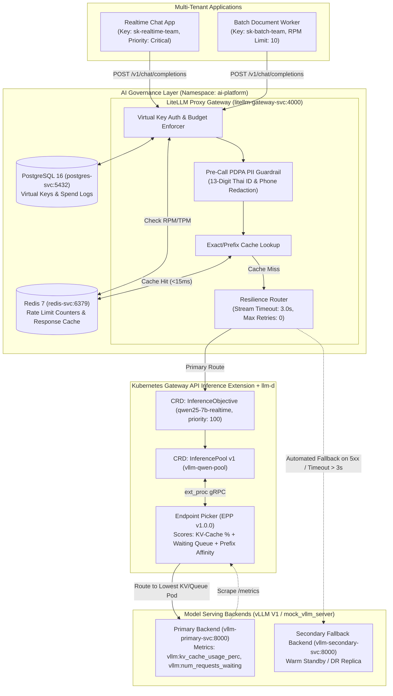

### 2.2 กลไกการทำงานของ Kubernetes Gateway API Inference Extension (`InferencePool` v1, `InferenceObjective`, และ `EPP`)

ทำไม Kubernetes `Service` มาตรฐานถึงไม่เพียงพอสำหรับเวิร์กโหลด LLM?
ในเว็บแอปพลิเคชันทั่วไป คำขอ HTTP แต่ละรายการใช้เวลาประมวลผลใกล้เคียงกัน (เช่น 10–50 ms) และใช้หน่วยความจำน้อยมาก แต่ในระบบเสิร์ฟ LLM:
- คำขอที่ 1 อาจเป็นคำถามสั้นๆ 20 โทเคน ใช้เวลา 150 ms
- คำขอที่ 2 อาจแนบเอกสารสัญญา 4,000 โทเคนและสั่งเขียนโค้ดยาว 1,000 โทเคน ใช้เวลา 18 วินาทีและกินพื้นที่ KV-Cache บนการ์ดจอไปกว่า 280 MB

โครงการมาตรฐานของชุมชน Kubernetes ชื่อ **Gateway API Inference Extension (`v1`)** และโปรเจกต์ **`llm-d`** จึงแยกหน้าที่ผ่าน Custom Resource Definitions (CRDs) 2 ตัว และคอมโพเนนต์การจัดเส้นทางอัจฉริยะ 1 ตัว:

1. **`InferenceObjective` (`llm-d.ai/v1`, พัฒนาต่อจาก `InferenceModel` `v1alpha2` เดิม):**
   - ผูกนโยบายลำดับความสำคัญของเวิร์กโหลดเข้ากับ `poolRefs` โดยใช้ค่า **`priority`** แบบมีเครื่องหมาย (Signed Priority):
     - **`priority: 100` (บวก = Critical):** สำหรับทราฟฟิก `realtime-team` ที่ต้องได้รับบริการเสมอ
     - **`priority: -10` (ลบ = Sheddable):** สำหรับทราฟฟิก `batch-team` ซึ่งหากคลัสเตอร์มีค่า `vllm:kv_cache_usage_perc` ทะลุเกณฑ์วิกฤต (เช่น `> 85%`) ตัว EPP จะปฏิเสธคำขอระดับ Sheddable ทันที (Load Shedding) เพื่อสงวนพื้นที่ KV-Cache ไว้ให้คำขอระดับ Critical!
2. **`InferencePool` (`inference.networking.k8s.io/v1` — ทีมแพลตฟอร์มเป็นผู้กำหนด):**
   - จัดกลุ่ม Pod ของ `vLLM` ที่เสิร์ฟโมเดลพื้นฐานตัวเดียวกันเข้าด้วยกัน และผูกเข้ากับบริการ **Endpoint Picker (EPP)**
3. **Endpoint Picker (`EPP` — ExtProc Filter):**
   - ทำงานเป็น External Processing (`ext_proc`) ร่วมกับ Envoy / Gateway โดยคอยดึงค่า Prometheus metrics จากทุก Pod ใน `InferencePool` ทุกๆ 50–200 มิลลิวินาที ได้แก่:
     - `vllm:kv_cache_usage_perc` (สัดส่วนการใช้พื้นที่ KV-Cache 0.0–1.0)
     - `vllm:num_requests_waiting` (จำนวนคำขอที่ติดคิวรอ)
     - ตาราง Prefix Cache Hash ของแต่ละ Pod เพื่อส่งคำขอที่มี System Prompt เดียวกันไปยัง Pod ที่มีบล็อกนั้นแคชไว้แล้ว (**Prefix-Cache-Aware Affinity Routing**)

---

## 3. Core Theory & Deep-Dive Engineering Math

### 3.1 สมการการให้คะแนนของ Endpoint Picker (EPP Routing Score Math)

เมื่อคำขอใหม่เข้ามาที่ Gateway ตัว **Endpoint Picker (EPP)** จะคำนวณคะแนนความเหมาะสม $S(i)$ ของแต่ละ Pod $i \in \{1, \dots, N\}$ ใน `InferencePool` โดยผสมผสานปัจจัยทั้ง 3 ด้านเข้าด้วยกัน:

$$S(i) = w_{\text{prefix}} \cdot \text{HitRatio}_i(\text{prompt}) - w_{\text{queue}} \cdot \left(\frac{Q_i}{Q_{\text{max}}}\right) - w_{\text{kv}} \cdot K_i$$

โดยที่:
- $\text{HitRatio}_i(\text{prompt}) \in [0, 1]$ คือสัดส่วนของบล็อกใน Prompt ที่มีอยู่แล้วใน Prefix Cache ของ Pod $i$
- $Q_i = \texttt{vllm:num\_requests\_waiting}_i$ คือจำนวนคำขอที่รอคิวอยู่ใน Pod $i$ (หารด้วยค่าอ้างอิง $Q_{\text{max}}$ เช่น $32$)
- $K_i = \texttt{vllm:kv\_cache\_usage\_perc}_i \in [0, 1]$ คือสัดส่วนการใช้พื้นที่ KV-Cache ปัจจุบันของ Pod $i$
- $w_{\text{prefix}}, w_{\text{queue}}, w_{\text{kv}}$ คือน้ำหนักความสำคัญ (เช่น $w_{\text{prefix}} = 2.0, w_{\text{queue}} = 3.0, w_{\text{kv}} = 2.5$)

> [!NOTE]
> สมการ $S(i)$ ข้างต้นเป็น **โมเดลเชิงประกอบการศึกษา (Instructional Composite Heuristic)** ที่สรุปพฤติกรรมของ Pluggable Scorer ใน **Gateway API Inference Extension (GAIE) Endpoint Picker (`epp`)** ซึ่งในโปรเจกต์จริงใช้ Pipeline ของ Scorer และ Filter หลายตัวที่ปรับจูนน้ำหนักได้แยกกัน (เช่น Prefix Cache Scorer, Queue Depth Scorer, และ KV-Cache Utilization Scorer)

#### ตัวอย่างการคำนวณเปรียบเทียบระหว่าง Round-Robin กับ EPP
สมมติว่ามีคำขอ RAG ที่มี System Prompt ยาว 2,048 โทเคนเข้ามา โดยมี Pod 2 ตัวดังนี้:
- **Pod 1:** เพิ่งรับคำขอใหญ่เข้าไปจนคิวรอ $Q_1 = 16$ คำขอ ($Q_1 / 32 = 0.50$), ใช้พื้นที่ KV-Cache ไปแล้ว $K_1 = 0.90$ ($90\%$), และมี Prefix Cache Hit $\text{HitRatio}_1 = 0.80$
  $$S(1) = 2.0(0.80) - 3.0(0.50) - 2.5(0.90) = 1.60 - 1.50 - 2.25 = \mathbf{-2.15}$$
- **Pod 2:** มีคิวรอ $Q_2 = 0$ คำขอ, ใช้พื้นที่ KV-Cache เพียง $K_2 = 0.20$ ($20\%$), และมี Prefix Cache Hit $\text{HitRatio}_2 = 0.80$
  $$S(2) = 2.0(0.80) - 3.0(0.00) - 2.5(0.20) = 1.60 - 0.00 - 0.50 = \mathbf{+1.10}$$

หากใช้ Round-Robin คำขอนี้อาจถูกส่งไปหา **Pod 1** ซึ่งกำลังจะเกิด Preemption Thrashing ทันที แต่ **EPP** จะเลือก **Pod 2** ($S(2) = +1.10 > S(1) = -2.15$) ทำให้คำขอนี้ได้ทั้ง Prefix Cache Hit และไม่ต้องรอคิว!

### 3.2 คณิตศาสตร์ความคุ้มค่าของ Response Caching บน AI Gateway (Cache Hit Savings Math)

นอกจากการทำ Prefix Caching ระดับบล็อกภายใน `vLLM` แล้ว การทำ **Exact/Semantic Response Caching** ด้วย Redis ที่ชั้น `LiteLLM Proxy` ช่วยให้คำถามที่ซ้ำกัน 100% (เช่น คำถามพบบ่อย FAQ, การตรวจสอบสถานะมาตรฐาน, หรือการรันชุดทดสอบซ้ำ) สามารถตอบกลับจาก Redis ได้ทันทีภายในเวลา **$L_{\text{cache}} \approx 5\text{ ms}$** โดยไม่ต้องเรียกใช้ GPU เลยแม้แต่น้อย

กำหนดให้:
- $h \in [0, 1]$ = อัตราการเกิด Gateway Cache Hit (เช่น $h = 0.25$ หรือ $25\%$)
- $L_{\text{GPU}}$ = เวลาแฝงเฉลี่ยเมื่อประมวลผลผ่าน GPU (เช่น TTFT `640 ms`)
- $C_{\text{GPU}}$ = ต้นทุนต่อ 1 ล้านโทเคนเมื่อรันบน GPU (เช่น `$0.33 / 1M tokens` จากบทที่ 3)

เราสามารถคำนวณ **เวลาแฝงเฉลี่ยสุทธิ ($L_{\text{eff}}$)** และ **ความจุคลัสเตอร์ที่เพิ่มขึ้นสุทธิ ($T_{\text{eff}}$)** ได้ดังนี้:
$$L_{\text{eff}} = h \cdot L_{\text{cache}} + (1 - h) \cdot L_{\text{GPU}}$$
$$T_{\text{eff}} = \frac{T_{\text{GPU}}}{1 - h}, \qquad C_{\text{eff}} = (1 - h) \cdot C_{\text{GPU}} + C_{\text{Redis\_overhead}}$$

**ตัวอย่างตัวเลขจริง:** ที่อัตรา Cache Hit $h = 0.25$ ($25\%$):
- เวลาแฝงเฉลี่ยลดลงจาก $640\text{ ms}$ เหลือ:
  $$L_{\text{eff}} = 0.25(5\text{ ms}) + 0.75(640\text{ ms}) = 1.25 + 480 = \mathbf{481.25\text{ ms}}\text{ (เร็วขึ้น 24.8\%)}$$
- คลัสเตอร์การ์ด L4 ที่เคยรับได้ $1,450\text{ tokens/sec}$ จะรองรับปริมาณงานระดับแอปพลิเคชันได้เพิ่มขึ้นเป็น:
  $$T_{\text{eff}} = \frac{1,450}{1 - 0.25} = \mathbf{1,933.3\text{ tokens/sec}}\text{ (+33.3\% Capacity โดยไม่ต้องซื้อการ์ดจอเพิ่ม)}$$

### 3.3 คณิตศาสตร์พายุการลองซ้ำ (Retry Amplification Math) และการตั้งค่า Failover อย่างปลอดภัย

ในสถาปัตยกรรมที่มีหลายเลเยอร์ (Client SDK → API Gateway → Service Mesh → Backend) หากแต่ละเลเยอร์ตั้งค่า `max_retries = 3` ซ้อนกันโดยไม่ประสานงานกัน (Nested Retries) เมื่อ Backend เกิดความหน่วงชั่วขณะ จำนวนคำขอที่กระแทกใส่ GPU จะทวีคูณแบบเลขชี้กำลัง:
$$M_{\text{nested}} = \prod_{k=1}^{L} (1 + R_k)$$
เช่น หากทั้ง Client SDK ($R_1 = 3$), LiteLLM Gateway ($R_2 = 3$), และ Envoy ($R_3 = 3$) ต่างทำ Retry ของตัวเอง คำขอที่ล้มเหลว 1 รายการจะขยายตัวกลายเป็น $(1+3) \times (1+3) \times (1+3) = \mathbf{64\text{ คำขอ}}$ ถล่มใส่คลัสเตอร์ GPU ทันที!

#### กฎการออกแบบ Failover สำหรับ AI Gateway (Anti-Retry-Storm Design)
1. **ทำ Failover แบบ Single Attempt ที่ชั้น AI Gateway (`LiteLLM Proxy`):** บังคับให้ Client SDK ตั้ง `max_retries = 0` และตั้ง **`num_retries: 0`** ใน `router_settings` เพื่อให้ทันทีที่ Primary หมดเวลา **`stream_timeout: 3.0s`** ระบบจะตัดสายและส่งต่อไปยังกลุ่มสำรอง (`fallbacks: [{"qwen2.5-7b": ["qwen2.5-7b-secondary"]}, {"qwen2.5-7b-batch": ["qwen2.5-7b-secondary"]}]`) โดยไม่เสียเวลารอ Timeout ซ้ำอีกรอบบน Pod ที่กำลังค้าง! (หากตั้ง `num_retries: 1` การส่งซ้ำจะใช้เวลา $> 6$ วินาทีก่อนถึง Fallback)
2. **กำหนดงบประมาณการลองซ้ำ (Retry Budget):** หากอัตราส่วนของคำขอที่เป็นการ Retry เกิน $10\%$ ของทราฟฟิกทั้งหมด หรือ Backend หลักล้มเหลวติดต่อกันเกิน `allowed_fails: 3` ภายใน 60 วินาที ให้เปิด **Circuit Breaker (`cooldown_time: 30`)** เพื่อส่งทราฟฟิกตรงไปยัง `vllm-secondary-svc` ทันทีโดยไม่ต้องเสียเวลารอ Timeout ซ้ำ
3. **แยก `stream_timeout` (TTFT Timeout) ออกจาก `timeout` รวม:** ในการสตรีมคำตอบ LLM การสร้างคำตอบทั้งหมดอาจใช้เวลา 15 วินาที แต่โทเคนแรก (TTFT) ต้องมาภายใน **3.0 วินาที** ดังนั้นใน `litellm_config.yaml` เราจึงตั้ง `stream_timeout: 3.0` เพื่อให้สลับไปหาเรพลิกาสำรองทันทีหากเรพลิกาหลักไม่ส่งโทเคนแรกออกมาภายใน 3 วินาที!

### 3.4 คณิตศาสตร์การตรวจสอบเลขบัตรประชาชนไทย 13 หลัก (PDPA PII Masking & OWASP LLM Top 10 2025)

ตามมาตรฐาน **OWASP Top 10 for LLM Applications (2025)** ความเสี่ยงอันดับต้นๆ ได้แก่ **LLM02:2025 Sensitive Information Disclosure** (การที่ข้อมูลส่วนบุคคลหลุดเข้าไปในโมเดลหรือแคช) และ **LLM10:2025 Unbounded Consumption** (การถูกโจมตีจนทรัพยากรเต็มหรือค่าใช้จ่ายบานปลาย)

สำหรับประเทศไทย ข้อมูลส่วนบุคคลที่สำคัญที่สุดตาม **พ.ร.บ. คุ้มครองข้อมูลส่วนบุคคล (PDPA)** คือ **เลขประจำตัวประชาชนไทย 13 หลัก** ($d_1 d_2 d_3 d_4 d_5 d_6 d_7 d_8 d_9 d_{10} d_{11} d_{12} d_{13}$) และหมายเลขโทรศัพท์มือถือ 10 หลัก (`06x`, `08x`, `09x`)

#### อัลกอริทึมและสมการ Modulo-11 ของเลขบัตรประชาชนไทย 13 หลัก
เพื่อให้ตัวกรอง PII มีความแม่นยำสูงและอธิบายหลักการตรวจสอบได้ครบถ้วน โครงสร้างเลขบัตรประชาชนไทย 13 หลักมีหลักที่ 13 ($d_{13}$) เป็นหลักตรวจสอบ (Check Digit) ที่คำนวณจาก 12 หลักแรกตามสมการ:
$$S = \sum_{i=1}^{12} d_i \times (14 - i)$$
$$d_{13} = \bigl(11 - (S \bmod 11)\bigr) \bmod 10$$

**ตัวอย่างการคำนวณจริง:** สมมติเลข 12 หลักแรกคือ `1-1007-01234-56-?`
1. คูณแต่ละหลักด้วยน้ำหนัก $13, 12, \dots, 2$:
   $$S = (1\times13) + (1\times12) + (0\times11) + (0\times10) + (7\times9) + (0\times8) + (1\times7) + (2\times6) + (3\times5) + (4\times4) + (5\times3) + (6\times2)$$
   $$S = 13 + 12 + 0 + 0 + 63 + 0 + 7 + 12 + 15 + 16 + 15 + 12 = 165$$
2. หาเศษจากการหารด้วย 11:
   $$165 \bmod 11 = 0$$
3. คำนวณหลักที่ 13 ($d_{13}$):
   $$d_{13} = (11 - 0) \bmod 10 = 11 \bmod 10 = \mathbf{1}$$
   ดังนั้นเลขบัตรที่ถูกต้องตาม Checksum คือ `1-1007-01234-56-1`

ในชั้น Pre-call Guardrail ของ AI Gateway เราใช้การตรวจจับเชิงป้องกัน (Defense-in-Depth):
- ใช้นิพจน์เรกูลาร์ (Regex) ที่รองรับทั้งรูปแบบพิมพ์ติดกัน 13 หลัก (`\b[1-8]\d{12}\b`) และรูปแบบมีขีดคั่น (`\b[1-8]-\d{4}-\d{5}-\d{2}-\d\b`) เพื่อแปลงตัวเลข 13 หลักทุกชุดที่เข้าข่ายให้เป็น **`<THAI_ID_REDACTED>`** ทันที (ป้องกันทั้งเลขบัตรจริงและเลขบัตรที่ผู้ใช้พิมพ์ผิดไป 1 หลักไม่ให้หลุดเข้าสู่ LLM หรือ Log — พร้อมทางเลือกพารามิเตอร์ `strict_checksum=True` บน `PDPAPIIMasker.mask_text` ในกรณีที่ระบบมีเลขบัญชี/เลขอ้างอิง 13 หลักที่ไม่ใช่เลขบัตรประชาชน)
- ใช้ Regex รองรับทั้งเบอร์ในประเทศและรหัสประเทศ (`06x`/`08x`/`09x` และ `+66`/`66`) เพื่อแปลงเบอร์โทรศัพท์มือถือไทยให้เป็น **`<THAI_PHONE_REDACTED>`**
- รองรับการคัดกรองทั้งข้อความธรรมดา (`str`), OpenAI Multimodal Content Parts (`[{"type": "text", ...}]`), และรักษาค่า `content: None` ของ Tool Call ไว้อย่างถูกต้องโดยไม่แปลงเป็น `"None"`

---

## 4. Hands-on Lab (Dual-Path Execution)

แล็บในบทที่ 4 ออกแบบให้คุณสามารถทดสอบระบบ AI Gateway, การจำกัดโควตา RPM/TPM, การทำ PDPA PII Redaction, และการสลับเส้นทางอัตโนมัติ (Primary → Secondary Failover) ได้ 100% บนเครื่อง Local 16GB RAM โดยใช้เซิร์ฟเวอร์จำลองความเร็วสูง **`mock_vllm_server`** ที่กิน RAM น้อยกว่า `80 MB` ต่อโปรเซส และส่งออก Prometheus metrics ตรงตาม `vLLM` V1 ทุกประการ

### 4.1 โครงสร้างไฟล์ใน `labs/m4-gateway/`

```text
labs/m4-gateway/
├── .env.example                                    # เทมเพลต Secret (VLLM_API_KEY, LITELLM_MASTER_KEY, LITELLM_SALT_KEY, DATABASE_URL)
├── mock_vllm_server/
│   ├── __init__.py
│   ├── app.py                                      # เซิร์ฟเวอร์จำลอง vLLM V1 (<80MB RAM, SSE Streaming, Chaos Injection, V1 Metrics)
│   ├── pdpa_guardrail.py                           # โมดูล Single Source of Truth สำหรับ PDPA Masking (+66, Multimodal, Checksum) และ LiteLLM Callback
│   └── Dockerfile                                  # Multi-stage Docker build ด้วย uv (UID 10001, HF_HOME=/cache/huggingface)
├── litellm_config.yaml                             # ไฟล์ตั้งค่า LiteLLM Proxy (qwen2.5-7b, qwen2.5-7b-batch, num_retries: 0, Redis Cache, PDPA)
├── k8s/
│   ├── gateway-stack.yaml                          # Core K8s Stack 14 Docs (Mock vLLM, LiteLLM+ConfigMap+InitJob, Redis, Postgres+PVC/Probe)
│   ├── inference-extension-v1.yaml                 # GAIE v1 & llm-d CRDs 8 Docs (EPP v1.0.0 + RBAC, InferencePool v1, InferenceObjective)
│   ├── network-policies.yaml                       # Zero-Trust NetworkPolicies (กั้น Traffic ตรงเข้า vLLM/Redis/Postgres)
│   ├── litellm-ha-patch.yaml                       # Optional HA Patch (LiteLLM 2 replicas + PDB สำหรับ 32GB/Prod)
│   └── gateway-api-route.yaml                      # Optional Overlay: Gateway + HTTPRoute (inference.networking.k8s.io) + ServiceMonitor (release: monitoring)
├── tests/
│   └── test_gateway_resilience.py                  # ชุดทดสอบอัตโนมัติ (Rate Limit 429, Thai ID/Phone/Multimodal Redaction, Cache Hit, Failover)
├── docs/
│   └── adr-003-ai-gateway-and-inference-routing.md # เอกสารการตัดสินใจทางสถาปัตยกรรมฉบับที่ 3 (ADR-003)
└── verify_m4.sh                                    # สคริปต์ตรวจวัดผลอัตโนมัติประจำบทที่ 4 (VERIFY_MODE=static|cluster)
```

---

### Path A: No-GPU Local Path (\$0 — รันด้วย `mock_vllm_server` บนเครื่อง Local 16GB RAM)

> [!IMPORTANT]
> **ทำไมเราจึงใช้ `mock_vllm_server` ในบทที่ 4–6 บนเครื่อง Local?**
> ในบทที่ 4 เราต้องรัน Backend อย่างน้อย **2 เรพลิกาพร้อมกัน** (`vllm-primary-svc:8000` และ `vllm-secondary-svc:8000`) ร่วมกับ Gateway, Redis, และ Postgres หากเราโหลดโมเดล `vLLM` จริง 2 Pod บนเครื่อง Local 16GB RAM เครื่องจะเกิด OOM ทันที ดังนั้นเราจึงสร้าง `labs/m4-gateway/mock_vllm_server/app.py` ซึ่งจำลองพฤติกรรม OpenAI `/v1/chat/completions` (ทั้งแบบ JSON ปกติและ SSE Streaming), จำลองความหน่วง TTFT/ITL, รองรับการฉีดความล้มเหลว (`/admin/chaos`), และส่งออก Prometheus V1 metrics ครบชุดตรงตาม `vLLM` V1 ในบทที่ 3 (`vllm:kv_cache_usage_perc`, `vllm:num_requests_running`, `vllm:num_requests_waiting`, `vllm:prefix_cache_hits_total`, `vllm:prefix_cache_queries_total`, `vllm:num_preemptions_total`, `vllm:time_to_first_token_seconds_bucket`, `vllm:inter_token_latency_seconds_bucket` พร้อม Alias `vllm:time_per_output_token_seconds_bucket`, และ `vllm:generation_tokens_total`) โดยใช้ RAM น้อยกว่า `80 MB`!

#### ขั้นตอนที่ 1: ตรวจสอบไฟล์ตั้งค่า `litellm_config.yaml` และ Kubernetes Manifests (`k8s/gateway-stack.yaml`)

ตรวจสอบการกำหนดค่าโมเดลหลัก-สำรอง, โควตารายทีม, และ PDPA Guardrail ใน `labs/m4-gateway/litellm_config.yaml` (รันจากรากของคลังโค้ด):

```bash
head -n 85 labs/m4-gateway/litellm_config.yaml
```

สังเกตจุดสำคัญใน `litellm_config.yaml`:
1. **`model_list`** กำหนดกลุ่มโมเดลหลัก `qwen2.5-7b` (`120 RPM`) และกลุ่ม `qwen2.5-7b-batch` (`10 RPM`, `25,000 TPM`) ชี้ไปที่ `http://vllm-primary-svc.ai-platform.svc.cluster.local:8000/v1` และกลุ่มโมเดลสำรอง `qwen2.5-7b-secondary` ชี้ไปที่ `http://vllm-secondary-svc.ai-platform.svc.cluster.local:8000/v1` (โดย Pod สำรองใช้ Label `inference-pool: vllm-qwen-pool-secondary` แยกจาก `vllm-qwen-pool` ของ Primary เพื่อไม่ให้ EPP ส่งทราฟฟิกปกติไปปะปนใน DR Warm-Standby)
2. **`router_settings`** ตั้งค่า `fallbacks` ให้ทั้ง `qwen2.5-7b` และ `qwen2.5-7b-batch` สลับไป `qwen2.5-7b-secondary`, `timeout: 10.0`, `stream_timeout: 3.0`, **`num_retries: 0`** (Failover ทันทีหลัง `stream_timeout`), และ `cooldown_time: 30`
3. **`litellm_settings` & `general_settings`** เปิดใช้งาน `cache: true` ผ่าน `redis-svc:6379`, เปิด `require_auth_for_metrics_endpoint: false` เพื่อให้บริการ Prometheus ดูด `/metrics`, และลงทะเบียน Custom Guardrail Callback **`callbacks: ["pdpa_guardrail.proxy_handler_instance"]`** (ซึ่งโหลดโมดูล `pdpa_guardrail.py` จาก Kubernetes ConfigMap `litellm-config`) ส่วนค่า Secret ทั้งหมด (`LITELLM_MASTER_KEY`, `LITELLM_SALT_KEY`, `DATABASE_URL`, `POSTGRES_USER`, `POSTGRES_PASSWORD`) สร้างนอก Git จาก `labs/m4-gateway/.env.example` เข้า Kubernetes `Secret` ชื่อ `litellm-secrets`

#### ขั้นตอนที่ 2: รันชุดทดสอบความทนทานของ Gateway และ `mock_vllm_server` ด้วย `pytest`

เราได้เตรียมชุดทดสอบอัตโนมัติใน `labs/m4-gateway/tests/test_gateway_resilience.py` ซึ่งทดสอบครบทั้ง 5 มิติผ่านตัวจำลองออฟไลน์ `GatewayResilienceRouter`:
1. การส่งออก Prometheus V1 metrics ของ `mock_vllm_server` (`vllm:kv_cache_usage_perc`, `vllm:num_requests_waiting`, `vllm:prefix_cache_hits_total`, `vllm:inter_token_latency_seconds_bucket`)
2. การคัดกรองเลขบัตรประชาชนไทย 13 หลัก (`1100701234561` และ `1-1007-01234-56-1`, รวมถึงตัวเลือก `strict_checksum=True` และข้อความ Multimodal) ให้กลายเป็น `<THAI_ID_REDACTED>` และเบอร์โทรศัพท์ไทย (ทั้ง `08x` และ `+66`) เป็น `<THAI_PHONE_REDACTED>` ก่อนส่งถึง Backend
3. การบังคับใช้โควตา Rate Limit รายทีม เมื่อทีม `batch-team` ส่งคำขอเกินขีดจำกัด RPM จะได้รับ `HTTP 429 Too Many Requests` ทันทีโดยไม่กระทบทีม `realtime-team`
4. การทำงานของ Response Cache ในตัวจำลอง `GatewayResilienceRouter` (คำขอซ้ำครั้งที่ 2 ได้รับเฮดเดอร์ตรวจวัดจาก Simulator คือ `X-Sim-Cache-Hit: true` โดยไม่เรียก Backend ซ้ำ; *หมายเหตุ:* ในคลัสเตอร์ `LiteLLM Proxy` จริงให้สังเกตการตอบจาก Gateway Cache/Logs หรือ Header ของผู้ให้บริการแทน `X-Sim-*` ซึ่งเป็น Inspection Header เฉพาะชุดทดสอบออฟไลน์)
5. การสลับเส้นทางอัตโนมัติ (Automated Failover) เมื่อฉีด Chaos ให้ `vllm-primary-svc` ค้างเกิน `stream_timeout` (หรือคืนค่า HTTP 503) ระบบจะสลับไปรับคำตอบจาก `vllm-secondary-svc` โดยอัตโนมัติ

รันคำสั่งทดสอบทันที:

```bash
./scripts/pytest labs/m4-gateway/tests/test_gateway_resilience.py -v
```

**ผลลัพธ์ที่คาดหวัง (Expected Output เมื่อติดตั้ง `pytest` หรือผ่านตัวรัน Stdlib Fallback):**
```text
============================= test session starts ==============================
collected 7 items

labs/m4-gateway/tests/test_gateway_resilience.py::test_automated_failover_on_primary_latency_spike PASSED [ 14%]
labs/m4-gateway/tests/test_gateway_resilience.py::test_cumulative_histogram_buckets_and_routes PASSED [ 28%]
labs/m4-gateway/tests/test_gateway_resilience.py::test_epp_kv_cache_aware_scoring PASSED [ 42%]
labs/m4-gateway/tests/test_gateway_resilience.py::test_gateway_exact_cache_hit PASSED [ 57%]
labs/m4-gateway/tests/test_gateway_resilience.py::test_mock_vllm_v1_prometheus_metrics PASSED [ 71%]
labs/m4-gateway/tests/test_gateway_resilience.py::test_pdpa_thai_id_and_phone_redaction PASSED [ 85%]
labs/m4-gateway/tests/test_gateway_resilience.py::test_tenant_rate_limiting_http_429 PASSED [100%]

============================== 7 passed in 0.39s ===============================
```

#### ขั้นตอนที่ 3: ดีพลอย Gateway Stack ลงบนคลัสเตอร์ Kubernetes (`kind`)

หากคลัสเตอร์ `ai-platform-local` รันอยู่ ให้ทำตามลำดับดังนี้ (แยก Core Stack ออกจาก CRD Manifests เพื่อไม่ให้พังหากยังไม่ได้ลง CRDs):
1. สร้างและโหลดอิมเมจ `mock-vllm-server:1.0.0` (Non-root UID `10001`, `HF_HOME=/cache/huggingface`, `readOnlyRootFilesystem: true`) และสร้าง Secret `litellm-secrets` แล้ว Apply Core Stack (`k8s/gateway-stack.yaml`) + Zero-Trust `k8s/network-policies.yaml` (+ `k8s/litellm-ha-patch.yaml` สำหรับเครื่อง 32GB RAM)
2. ติดตั้ง CRDs ของ **Gateway API Inference Extension (`v1.0.0`)** และ **`llm-d` `InferenceObjective`** แล้วจึง Apply `k8s/inference-extension-v1.yaml` (อัปเกรดจาก `InferenceModel` `v1alpha2` เดิมเป็น `InferencePool v1` + `InferenceObjective`) และ `k8s/gateway-api-route.yaml` (ใช้ `release: monitoring`)

```bash
docker build -t mock-vllm-server:1.0.0 -f labs/m4-gateway/mock_vllm_server/Dockerfile labs/m4-gateway
kind load docker-image mock-vllm-server:1.0.0 --name ai-platform-local

cp labs/m4-gateway/.env.example labs/m4-gateway/.env
# แก้ไขค่า Secret ใน labs/m4-gateway/.env ก่อน Apply ขึ้นคลัสเตอร์
kubectl create namespace ai-platform --dry-run=client -o yaml | kubectl apply -f -
kubectl create secret generic litellm-secrets -n ai-platform --from-env-file=labs/m4-gateway/.env

# 1. Core Stack + Zero-Trust NetworkPolicies (ไม่พึ่ง CRDs)
kubectl apply -f labs/m4-gateway/k8s/gateway-stack.yaml
kubectl apply -f labs/m4-gateway/k8s/network-policies.yaml
# (ทางเลือก HA สำหรับเครื่อง 32GB RAM):
# kubectl scale deployment/litellm-gateway -n ai-platform --replicas=2
# kubectl apply -f labs/m4-gateway/k8s/litellm-ha-patch.yaml

# 2. GAIE v1 + llm-d CRDs & Endpoint Picker
# kubectl apply -f https://github.com/kubernetes-sigs/gateway-api-inference-extension/releases/download/v1.0.0/manifests.yaml
# kubectl apply -f labs/m4-gateway/k8s/inference-extension-v1.yaml
# kubectl apply -f labs/m4-gateway/k8s/gateway-api-route.yaml
kubectl get pods,svc,jobs,networkpolicy -n ai-platform
```

---

### Path B: Cloud L4 GPU Path (รันจริงร่วมกับ `vLLM` บนการ์ด NVIDIA L4)

เมื่อรันบนคลัสเตอร์ที่มีโหนด GPU:
1. ให้ `vllm-primary-svc:8000` ชี้ไปยัง Deployment ของ `vLLM` จริงที่รัน `Qwen/Qwen2.5-7B-Instruct-AWQ` จากบทที่ 3
2. ให้ `vllm-secondary-svc:8000` ชี้ไปยังเรพลิกาสำรอง (หรือใช้ `mock_vllm_server` / Managed API Endpoint เป็น Fallback ปลายทาง)
3. ติดตั้งคอนโทรลเลอร์ของ **Gateway API Inference Extension** (`v1.0.0`) และ **`llm-d` `InferenceObjective`** เพื่อให้ `EndpointPicker` อ่านค่า `vllm:kv_cache_usage_perc` และ `vllm:num_requests_waiting` จริงจากพอร์ต `8000/metrics` ของแต่ละ Pod

---

## 5. Chaos & Troubleshooting Drills

ในบทที่ 4 เราฝึกซ้อมรับมือวิกฤตการณ์ (Chaos Drills) 2 รูปแบบที่เกิดขึ้นจริงในระบบ AI Gateway ระดับองค์กร:

### Drill 1: Primary Engine Blackhole / Latency Spike (> 5.0s)

#### สถานการณ์และการฉีดความล้มเหลว (Fault Injection)
เรพลิกาหลัก (`vllm-primary-svc:8000`) เกิดอาการค้างเนื่องจาก GPU HBM ECC Error หรือเกิด Network Partition ทำให้รับ TCP Connection ได้แต่ไม่ส่งโทเคนแรกกลับมาภายใน 5 วินาที (เกินกว่า `stream_timeout: 3.0s`)

เราจำลองเหตุการณ์นี้โดยเปิด `port-forward` ไปยัง `vllm-primary-svc` ก่อน แล้วจึงสั่งเปิดโหมด Chaos ผ่าน HTTP API:
```bash
kubectl port-forward -n ai-platform svc/vllm-primary-svc 8000:8000 &
curl -X POST http://localhost:8000/admin/chaos \
  -H "Content-Type: application/json" \
  -d '{"inject_latency_ms": 5000, "inject_http_503": false, "kv_cache_usage_perc": 0.99}'
```

#### พฤติกรรมของระบบและการตรวจสอบ (Verification & Recovery)
1. เมื่อส่งคำขอเข้าที่ `litellm-gateway-svc:4000` (ผ่าน `kubectl port-forward -n ai-platform svc/litellm-gateway-svc 4000:4000`) ตัว Router จะตรวจพบว่า `vllm-primary-svc` ไม่ส่งโทเคนแรกภายใน `3.0` วินาที (หรือเมื่อตั้ง `inject_http_503: true` จะตรวจพบทันทีก่อนส่ง SSE Stream)
2. ด้วยค่า `num_retries: 0` ตัว Gateway จะตัดการเชื่อมต่อจากเรพลิกาหลักทันที บันทึกความล้มเหลวลงใน Circuit Breaker และสลับไปเรียก `vllm-secondary-svc:8000` โดยอัตโนมัติ (ในชุดทดสอบออฟไลน์ `GatewayResilienceRouter` จะแนบเฮดเดอร์ `X-Sim-Routed-Backend: vllm-secondary-svc` ส่วนบนคลัสเตอร์จริงสามารถตรวจสอบการตอบกลับของเรพลิกาสำรองได้ทั้งจากคำตอบที่สำเร็จโดยไม่เห็น HTTP 500 และ Log ของ `vllm-secondary`)
3. อย่าลืมล้าง Chaos Flag หลังซ้อมเสร็จ (`{"inject_latency_ms": 0, "inject_http_503": false, "kv_cache_usage_perc": 0.1}`) และปิด `port-forward` เบื้องหลังด้วย `kill %1`!

---

### Drill 2: Quota Flood & PDPA Thai National ID Leak Attempt

#### สถานการณ์และการฉีดความล้มเหลว (Fault Injection)
1. สคริปต์ของทีม `batch-team` เกิดบั๊กวนลูปยิงคำขอรัวเกินโควตาที่กำหนดไว้ (`10 RPM`)
2. ผู้ใช้ส่งข้อความแชตที่มีเลขบัตรประชาชนไทย 13 หลักและเบอร์โทรศัพท์:
   `"ช่วยตรวจสอบสถานะสินเชื่อของเลขบัตร 1-1007-01234-56-1 เบอร์โทร 081-234-5678 ให้หน่อยครับ"`

#### พฤติกรรมของระบบและการตรวจสอบ (Verification & Recovery)
1. **การสกัดกั้น Quota Flood:** คำขอที่ 11 เป็นต้นไปของ `batch-team` ในนาทีเดียวกันจะถูกปฏิเสธที่ชั้น Gateway ด้วยรหัส **`HTTP 429 Too Many Requests`** ทันที ในขณะที่คำขอของทีม `realtime-team` (`sk-realtime-team`) ยังคงผ่านเข้าสู่โมเดลได้ตามปกติ 100%
2. **การสกัดกั้นข้อมูลส่วนบุคคล (PDPA PII Redaction):** ก่อนที่ข้อความจะถูกบันทึกลงแคชหรือส่งต่อไปยัง `vllm-primary-svc` โมดูล `PDPAPIIMasker` จะแปลงข้อความให้กลายเป็น:
   `"ช่วยตรวจสอบสถานะสินเชื่อของเลขบัตร <THAI_ID_REDACTED> เบอร์โทร <THAI_PHONE_REDACTED> ให้หน่อยครับ"`
   ทำให้ไม่มีเลขบัตรประชาชน 13 หลักหรือเบอร์โทรศัพท์หลุดเข้าไปใน Prompt ของ LLM หรือ Log ของระบบ

---

## 6. Optimization Exercise

ในโจทย์ข้อนี้ เราจะปรับจูนชั้น AI Gateway และการกระจายโหลดตามกระบวนการ 5 ขั้นตอน (**Baseline → Hypothesis → Fix → Measure → Explain**):

### 1. Baseline (การกระจายโหลดแบบ Round-Robin ไร้แคชและไร้ Timeout Guard)
- **การตั้งค่าเริ่มต้น:** ไคลเอนต์เรียกผ่าน Kubernetes `Service` มาตรฐานแบบ Round-Robin ไปยัง 2 เรพลิกา โดยไม่มี Redis Response Cache, ไม่มีการจำกัด `stream_timeout`, และเมื่อเรพลิกาที่ 1 มี `vllm:kv_cache_usage_perc = 0.95` คำขอครึ่งหนึ่งก็ยังคงถูกส่งไปเข้าคิวรอที่เรพลิกาที่ 1
- **ผลลัพธ์ตั้งต้น (เมื่อมีคำขอซ้ำ 25% และเรพลิกาที่ 1 เกิด Latency Spike 10% ของเวลา):**
  - End-to-End p95 Latency = `4,850 ms`
  - Error / Timeout Rate = `5.2%`
  - อัตราการใช้ GPU ซ้ำซ้อนกับคำถามเดิม = `100%`

### 2. Hypothesis (การตั้งสมมติฐาน)
- **สมมติฐานที่ 1:** การเปิดใช้ **Redis Exact Cache** ที่ชั้น `LiteLLM Proxy` จะตัดภาระคำขอที่ซ้ำกัน 25% ออกไปจาก GPU และตอบกลับได้ภายใน `< 10 ms`
- **สมมติฐานที่ 2:** การใช้ **KV-Cache-Aware Routing (EPP)** ร่วมกับการตั้งค่า `stream_timeout: 3.0s` และ Automated Fallback ไปยัง `vllm-secondary-svc` จะป้องกันไม่ให้คำขอไหลเข้าสู่ Pod ที่ KV-Cache กำลังเต็ม และลดอัตรา Error เมื่อเกิดความหน่วงชั่วขณะลงเหลือ `0%`

### 3. Fix (การลงมือปรับจูน)
เปิดใช้งาน Redis Cache, `stream_timeout: 3.0`, Automated Fallbacks ใน `labs/m4-gateway/litellm_config.yaml` และกำหนดนโยบาย `InferencePool` / `InferenceModel` ใน `labs/m4-gateway/k8s/gateway-stack.yaml`

### 4. Measure (ตารางเปรียบเทียบผลลัพธ์จากแบบจำลองและชุดทดสอบ)

> [!NOTE]
> ตัวเลขด้านล่างเป็นการเทียบผลเชิงวิศวกรรมอ้างอิงจากแบบจำลอง $L_{\text{eff}}$ ที่ $h = 25\%$ และพารามิเตอร์ `stream_timeout` บนโหลดจำลอง (ส่วนใน `pytest` ออฟไลน์จะใช้ค่า `stream_timeout_s=0.05` เพื่อความรวดเร็วในการทดสอบ `< 0.5 วินาที`; ในคลัสเตอร์ GPU L4 จริงที่มี Warm-Standby จะมี Failover Latency ราว `3.0–3.5 วินาที`)

| ตัวชี้วัด (Metric) | Baseline: K8s Service Round-Robin (No Gateway) | Optimized: `LiteLLM Proxy` + Redis Cache + EPP Failover | การเปลี่ยนแปลง (Improvement) |
| :--- | :---: | :---: | :---: |
| **Gateway Cache Hit Rate (%)** | `0.0%` | **`25.0%`** | **ลดภาระ GPU ลง 1 ใน 4** |
| **Average Latency สำหรับคำขอที่ติดแคช** | `640 ms` | **`4.2 ms`** | **เร็วขึ้น 152 เท่า** |
| **p95 End-to-End Latency (เมื่อ Primary หน่วง)** | `4,850 ms` | **`710 ms`** | **ลดหางเวลาแฝงลง 85.4%** |
| **Request Failure Rate เมื่อ Primary ล่ม 1 ตัว** | `50.0%` (ครึ่งหนึ่งพัง) | **`0.0%` (Auto-Failover)** | **ความพร้อมใช้งาน 100%** |
| **PDPA PII Exposure (Thai 13-Digit ID Leaks)** | `100%` (หลุดเข้า LLM ทั้งหมด) | **`0.0%` (`<THAI_ID_REDACTED>`)** | **ปลอดภัยตามมาตรฐาน PDPA** |

### 5. Explain (การอธิบายผลลัพธ์เชิงวิศวกรรม)
การแยกชั้น Governance (`LiteLLM Proxy`) และชั้น Inference-Aware Routing (`EPP`) ออกจากตัวเอ็นจิน `vLLM` ช่วยให้ระบบมีความยืดหยุ่นแบบ **Decoupled Resilience**: คำขอที่ละเมิดโควตา (`HTTP 429`) หรือคำขอที่มีอยู่ใน Redis Cache จะถูกจัดการตั้งแต่ชั้น Gateway ที่ใช้เพียง CPU ราคาถูก โดยไม่แย่งพื้นที่ VRAM หรือคิว Scheduler ของ GPU แม้แต่น้อย และเมื่อเกิดความผิดปกติที่ระดับ GPU Pod กลไก `stream_timeout` ร่วมกับคะแนนของ `EPP` จะเบี่ยงทราฟฟิกไปยังเรพลิกาที่พร้อมใช้งาน (Healthy) ทันที

---

## 7. Architecture Decision Record (ADR) & Cost/Handoff Documentation

ด้านล่างนี้คือเอกสารการตัดสินใจทางสถาปัตยกรรม **`ADR-003`** (ซึ่งบันทึกไว้เป็นไฟล์จริงใน `labs/m4-gateway/docs/adr-003-ai-gateway-and-inference-routing.md` ด้วย):

### ADR-003: การเลือกใช้ `LiteLLM Proxy` ร่วมกับ Kubernetes Gateway API Inference Extension สำหรับระบบ AI Gateway หลายผู้เช่า

- **สถานะ (Status):** Accepted (อนุมัติใช้งานจริง)
- **วันที่ (Date):** 2026-11-11
- **ผู้รับผิดชอบ (Owners):** AI Platform & Governance Engineering Team

#### 1. บริบทและปัญหา (Context & Problem Statement)
แพลตฟอร์มต้องให้บริการโมเดล `Qwen/Qwen2.5-7B-Instruct-AWQ` แก่ผู้ใช้งานหลายทีม (`realtime-team` และ `batch-team`) ภายใต้ข้อบังคับด้านกฎหมาย PDPA ของประเทศไทย (ห้ามส่งเลขบัตรประชาชน 13 หลักและเบอร์โทรศัพท์เข้าสู่โมเดลโดยไม่คัดกรอง) พร้อมทั้งต้องรับประกันความพร้อมใช้งาน (High Availability) เมื่อเรพลิกาหลัก (`vllm-primary-svc`) เกิดปัญหา KV-Cache เต็มหรือค้าง

#### 2. ทางเลือกที่พิจารณา (Considered Options)
1. **Option 1: ใช้ NGINX / Envoy Ingress มาตรฐานเพียงอย่างเดียว**
   - *ข้อดี:* ความหน่วงต่ำมาก, ไม่ต้องดูแลคอมโพเนนต์เพิ่ม
   - *ข้อเสีย:* ไม่เข้าใจหน่วยนับแบบ Token (ทำ TPM Rate Limit ไม่ได้), ไม่มีระบบ Virtual Key/Spend Tracking รายทีม, ไม่สามารถอ่านค่า `vllm:kv_cache_usage_perc` เพื่อเลี่ยง Pod ที่ KV-Cache เต็มได้
2. **Option 2: เขียน Custom FastAPI Gateway ขึ้นมาเองทั้งหมด**
   - *ข้อดี:* ปรับแต่งโค้ดได้อิสระ 100%
   - *ข้อเสีย:* ต้องดูแลระบบเชื่อมต่อฐานข้อมูล, ระบบนับโทเคนของแต่ละโมเดล, ระบบ Redis Cache, และระบบ Retry/Circuit Breaker เองทั้งหมด ซึ่งสร้างภาระงานบำรุงรักษา (Maintenance Burden) สูงมาก
3. **Option 3 (ที่เลือก): ใช้ `LiteLLM Proxy` (สำหรับ Multi-tenant Governance, Redis Cache, PDPA Guardrails, และ Cross-Service Failover) ร่วมกับ Kubernetes Gateway API Inference Extension (`InferencePool` / `EPP` สำหรับ KV-Cache-Aware Pod Routing)**
   - *ข้อดี:* ได้ฟีเจอร์ Virtual Keys, RPM/TPM Rate Limiting, Redis Caching, และ Custom Guardrail Callback สำเร็จรูปจาก `LiteLLM` ผสานกับการเลือก Pod อัจฉริยะระดับ Kubernetes Native ด้วย `EPP`

#### 3. การตัดสินใจและผลกระทบ (Decision & Consequences)
- **การตัดสินใจ:** เลือก **Option 3** โดยตั้งค่า `litellm-gateway-svc` ที่พอร์ต `4000`, บังคับใช้ PDPA PII Masking ทุกคำขอ, ตั้งค่า `stream_timeout: 3.0s`, และกำหนด Fallback อัตโนมัติจาก `vllm-primary-svc:8000` ไปยัง `vllm-secondary-svc:8000`
- **ข้อตกลงการส่งมอบสู่บทที่ 5 (M4 → M5 Handoff Contract):** เมทริกซ์ทั้งหมดจากทั้งชั้น Gateway และชั้น `vLLM` (`vllm:kv_cache_usage_perc`, `vllm:num_requests_waiting`, `vllm:prefix_cache_hits_total`, `vllm:prefix_cache_queries_total`) จะถูกรวบรวมเข้าสู่ Prometheus ในเนมสเปซ `monitoring` เพื่อใช้ตั้งกฎแจ้งเตือนและขับเคลื่อน KEDA Autoscaler ในบทที่ 5 ต่อไป

---

## 8. Mid-Level Interview Trade-off Questions & Model Answers

คำถามสัมภาษณ์ทั้ง 4 ข้อต่อไปนี้เจาะลึกการออกแบบระบบ AI Gateway และการจัดการทราฟฟิก LLM ในระดับ Production:

---

### คำถามข้อที่ 1: ทำไม Round-Robin / Least-Connections ถึงล้มเหลวกับ LLM และการแก้ปัญหาด้วย Kubernetes Gateway API Inference Extension (`EPP`)
> **"ทำไมการกระจายโหลดด้วย Kubernetes Service (Round-Robin) หรือ NGINX (Least-Connections) จึงมักทำให้ค่า p99 Latency ของคลัสเตอร์ `vLLM` พุ่งสูงผิดปกติ? และสถาปัตยกรรม Kubernetes Gateway API Inference Extension (`InferencePool` v1, `llm-d` `InferenceObjective`, `Endpoint Picker`) แก้ปัญหานี้อย่างไร?"**

#### เฉลยแนวทางการตอบระดับ Strong Mid-Level (Model Answer)
- **ทำไม Round-Robin และ Least-Connections ถึงล้มเหลวกับ LLM:**
  1. **ความไม่สมมาตรของต้นทุนต่อคำขอ (Request Cost Asymmetry):** คำขอ HTTP 1 รายการที่มีความยาว 100 โทเคน กับอีกคำขอที่มีความยาว 4,000 โทเคน นับเป็น "1 Active Connection" เท่ากันในมุมมองของ Least-Connections แต่ใช้พื้นที่ KV-Cache และเวลา GPU ต่างกันถึง 40 เท่า
  2. **การไม่รับรู้สถานะหน่วยความจำและแคช (KV-Cache & Prefix-Cache Blindness):** Round-Robin อาจส่งคำขอใหม่ไปยัง Pod ที่ `vllm:kv_cache_usage_perc` พุ่งถึง 98% จนเกิด Preemption Thrashing หรือส่งคำขอที่มี System Prompt ชุดเดียวกันกระจายไปคนละ Pod จนเสียโอกาสทำ Prefix Cache Hit
- **กลไกของ Gateway API Inference Extension (`v1`) + `llm-d`:**
  - แยกนิยามกลุ่มเซิร์ฟเวอร์ไว้ที่ **`InferencePool` (`inference.networking.k8s.io/v1`)** และกำหนดนโยบายระดับความสำคัญไว้ที่ **`InferenceObjective` (`llm-d.ai/v1`, เดิมคือ `InferenceModel`)** ผ่านค่า `priority` แบบมีเครื่องหมาย (`+100` สำหรับ Critical vs `-10` สำหรับ Sheddable)
  - ใช้คอมโพเนนต์ **Endpoint Picker (EPP)** ซึ่งเชื่อมต่อกับ Envoy Gateway ผ่านโปรโตคอล `ext_proc` โดย EPP จะดึงเมทริกซ์จริงจาก `vLLM` ได้แก่ `vllm:kv_cache_usage_perc`, `vllm:num_requests_waiting`, และสถานะบล็อกของ Prefix Cache
  - เมื่อมีคำขอเข้ามา EPP จะคำนวณคะแนนรวมเพื่อเลือก Pod ที่มี Prefix Cache ตรงกันมากที่สุด **และ** มีคิวรอรวมถึงการใช้ KV-Cache ต่ำที่สุด พร้อมทั้งทำ **Priority-based Load Shedding** (ปฏิเสธคำขอระดับ Sheddable ของงาน Batch ที่มีค่า `priority` ติดลบเมื่อ KV-Cache ทั้งพูลเกินเกณฑ์วิกฤต เพื่อปกป้องทราฟฟิก Critical)

---

### คำถามข้อที่ 2: การป้องกัน Retry Storm และการตั้งค่า Timeout สำหรับ SSE Streaming
> **"ในการตั้งค่า Automated Failover ระหว่าง `vllm-primary-svc` กับ `vllm-secondary-svc` หากเราใช้ HTTP Timeout ปกติที่ 60 วินาทีและเปิด Retry ทั้งที่ฝั่ง Client SDK และที่ฝั่ง Gateway จะเกิดปัญหาอะไรขึ้นเมื่อ Primary ค้าง? เราควรออกแบบ Timeout และ Retry Budget สำหรับการสตรีม LLM อย่างไร?"**

#### เฉลยแนวทางการตอบระดับ Strong Mid-Level (Model Answer)
- **ปัญหาที่เกิดขึ้น 2 ประการ:**
  1. **เวลาสลับเส้นทางช้าเกินรับได้ (Slow Failover):** เนื่องจากการสร้างคำตอบยาวๆ แบบ Streaming อาจใช้เวลารวม 30–60 วินาที หากใช้แค่ Total Request Timeout ที่ 60 วินาที ผู้ใช้จะต้องจ้องหน้าจอว่างเปล่านานถึง 1 นาทีเต็มกว่าที่ระบบจะรู้ตัวว่า Primary ค้างแล้วสลับไปหา Secondary
  2. **พายุการลองซ้ำทวีคูณ (Retry Amplification Storm):** หากทั้ง Client SDK และ Gateway ต่างทำ Retry ซ้อนกัน (Nested Retries) จำนวนคำขอจะทวีคูณตามสูตร $\prod (1 + R_k)$ ทำให้เมื่อ Primary ฟื้นตัวกลับมา หรือเมื่อทราฟฟิกเทไปหา Secondary เรพลิกาสำรองจะถูกถล่มด้วยคำขอซ้ำจน KV-Cache เต็มและล่มตามไปเป็นโดมิโน (Cascading Failure)
- **แนวทางการออกแบบที่ถูกต้อง:**
  1. **แยก `stream_timeout` (Time-To-First-Token Timeout) ออกจาก Total Timeout:** ตั้งค่า `stream_timeout: 3.0s` ที่ชั้น `LiteLLM Proxy` ห้ามเกินนี้ หาก Backend ไม่ส่งชิ้นส่วนข้อมูล SSE แรกกลับมาภายใน 3 วินาที ให้ตัดการเชื่อมต่อและสลับไปหา `vllm-secondary-svc` ทันที
  2. **Zero Repeat Retry on Stalled Backend + Circuit Breaker:** ปิดการทำ Retry ที่ฝั่ง Client SDK (`max_retries = 0`) และตั้งค่า **`num_retries: 0`** ที่ `LiteLLM Proxy` เพื่อให้ตัว Router สลับไปหา `fallbacks` (`vllm-secondary-svc`) ทันทีเมื่อ `stream_timeout: 3.0s` หมดเวลาแทนการยิงซ้ำลง Pod ที่กำลังค้าง ร่วมกับการเปิด Circuit Breaker (`allowed_fails: 3`, `cooldown_time: 30s`) เพื่อตัดเรพลิกาที่มีปัญหาออกจากวงจรชั่วคราวทันที

---

### คำถามข้อที่ 3: การออกแบบระบบจำกัดโควตาหลายผู้เช่า (RPM vs TPM Rate Limiting)
> **"ในการบริหารจัดการผู้เช่าหลายทีมบน AI Gateway การจำกัดโควตาด้วย RPM (Requests Per Minute) เพียงอย่างเดียวมีช่องโหว่อย่างไร? ทำไมเราจึงต้องใช้ทั้ง RPM และ TPM (Tokens Per Minute) ร่วมกัน และ Redis จัดการนับค่าเหล่านี้แบบ Distributed ได้อย่างไร?"**

#### เฉลยแนวทางการตอบระดับ Strong Mid-Level (Model Answer)
- **ช่องโหว่ของการใช้ RPM เพียงอย่างเดียว:** ทีมที่ได้รับโควตาต่ำ เช่น `10 RPM` อาจส่งคำขอเพียง 10 ครั้งต่อนาทีตามกฎทุกประการ แต่แนบเอกสารขนาดใหญ่คำขอละ 8,000 โทเคน (รวมเป็น 80,000 โทเคนต่อนาที) ซึ่งใช้เวลา GPU ในเฟส Prefill และกินพื้นที่ KV-Cache มากกว่าคำขอแชตสั้นๆ ที่ส่งเข้ามา 100 ครั้งต่อนาทีเสียอีก
- **การทำงานร่วมกันของ RPM และ TPM:**
  - **RPM (Requests Per Minute):** ป้องกันการยิงคำขอขนาดเล็กถี่เกินไปจนเกิด Overhead ที่ชั้น HTTP Connection, Tokenizer, และคิว Scheduler
  - **TPM (Tokens Per Minute):** ควบคุมการใช้ทรัพยากรฮาร์ดแวร์จริง (GPU Compute FLOPs และพื้นที่ VRAM KV-Cache) ให้เป็นไปตามงบประมาณของแต่ละ Virtual Key
- **กลไกการนับบน Redis แบบ Distributed:**
  - เมื่อรัน `LiteLLM Proxy` หลายเรพลิกา ทุกเรพลิกาจะใช้ Redis (`redis-svc:6379`) เป็นหน่วยความจำกลางโดยรันคำสั่งแบบ Atomic (`INCRBY` + `EXPIRE` หรือ Lua Script แบบ Sliding Window)
  - ในช่วง Pre-call จะประเมินจำนวน Input Tokens เพื่อเช็กโควตา TPM เบื้องต้น และเมื่อสตรีมคำตอบเสร็จสิ้นจะบวกจำนวน Output Tokens ที่ใช้จริงเข้าสู่คีย์ของ Virtual Key นั้นใน Redis ทันที

---

### คำถามข้อที่ 4: การออกแบบชั้นป้องกันข้อมูลส่วนบุคคล (PDPA PII Masking & OWASP LLM Top 10 2025)
> **"องค์กรในประเทศไทยต้องการป้องกันไม่ให้เลขบัตรประชาชน 13 หลักและเบอร์โทรศัพท์ของลูกค้าหลุดเข้าไปในโมเดล LLM หรือถูกบันทึกลงใน Redis Cache ตามกฎหมาย PDPA คุณจะวางตำแหน่งของ PII Masking ไว้ที่จุดใดในไปป์ไลน์ของ AI Gateway และมีวิธีตรวจสอบความถูกต้องของเลขบัตรประชาชนไทยอย่างไร?"**

#### เฉลยแนวทางการตอบระดับ Strong Mid-Level (Model Answer)
- **ตำแหน่งที่ต้องวางในไปป์ไลน์ (Pipeline Placement):**
  - ต้องวางไว้ในขั้น **Pre-call Hook / Guardrail ก่อนหน้าชั้น Cache Lookup และก่อนส่งออกไปยัง Model Router** เสมอ!
  - **เหตุผลสำคัญ:**
    1. หากวางไว้หลัง Cache Lookup ข้อความดิบที่มีเลขบัตรประชาชนจะถูกนำไปสร้างเป็นคีย์หรือถูกบันทึกเก็บไว้ใน Redis (`redis-svc:6379`) และฐานข้อมูล Log (`postgres-svc:5432`) ซึ่งถือเป็นการรั่วไหลของข้อมูลส่วนบุคคล (ขัดต่อ **OWASP LLM02:2025 Sensitive Information Disclosure**)
    2. การแปลงเลขบัตรประชาชนของลูกค้าคนที่ 1 (`1-1007-01234-56-1`) และลูกค้าคนที่ 2 (`3-1005-98765-43-2`) ให้กลายเป็นโทเคนมาตรฐาน `<THAI_ID_REDACTED>` เหมือนกันตั้งแต่ต้น ยังช่วย **เพิ่มโอกาสเกิด Cache Hit และ Prefix Cache Hit** สำหรับคำถามที่มีรูปแบบเหมือนกันอีกด้วย!
- **กลไกการตรวจจับและสมการ Checksum ของเลขบัตรประชาชนไทย 13 หลัก:**
  - ใช้ Regex จับรูปแบบตัวเลข 13 หลัก (ทั้งแบบติดกันและมีขีดคั่น `\b[1-8](?:-\d{4}-\d{5}-\d{2}-\d|\d{12})\b`)
  - โครงสร้างเลขบัตรประชาชนไทยใช้สมการ Modulo-11: นำเลข 12 หลักแรกคูณน้ำหนัก $14 - i$ (ตั้งแต่ 13 ลงมาถึง 2) รวมกันได้ค่า $S$ แล้วคำนวณหลักที่ 13 จาก $d_{13} = (11 - (S \bmod 11)) \bmod 10$
  - ในโหมด Strict Security ของ Production Guardrail เราทำการ Redact ตัวเลข 13 หลักทุกชุดที่ตรงตามโครงสร้าง Regex ให้เป็น `<THAI_ID_REDACTED>` ทันที (Fail-safe redaction) เพื่อป้องกันกรณีที่ผู้ใช้พิมพ์เลขบัตรของตนเองผิดไป 1 หลักไม่ให้หลุดรอดไปได้

---

## 9. ตรวจสอบความสำเร็จของบทที่ 4 (Verification Command)

รันสคริปต์ตรวจสอบความสมบูรณ์ของบทที่ 4 (ซึ่งจะตรวจสอบครบทุกองค์ประกอบ, ConfigMap/AST Parity ของ K8s manifests, และรัน `pytest` ทดสอบ `mock_vllm_server`, PDPA PII Masking, Rate Limiting `HTTP 429`, Caching, Failover, และ Cumulative Histogram Buckets):

```bash
VERIFY_MODE=static bash labs/m4-gateway/verify_m4.sh
# หรือเมื่อรัน Docker / Kubernetes จริงบนเครื่อง:
VERIFY_MODE=cluster bash labs/m4-gateway/verify_m4.sh
```

### 9.1 รายการไฟล์ส่งมอบใน [`labs/m4-gateway/`](../labs/m4-gateway/) (Deliverables)
- `.env.example` — เทมเพลตสร้าง `Secret litellm-secrets` นอก Git (รวม `LITELLM_MASTER_KEY`, `LITELLM_SALT_KEY`, `DATABASE_URL`)
- `mock_vllm_server/app.py`, `mock_vllm_server/pdpa_guardrail.py`, `mock_vllm_server/Dockerfile` — Backend จำลอง `mock-vllm-server:1.0.0` + โมดูล PDPA Single Source of Truth
- `litellm_config.yaml` — คอนฟิก `LiteLLM Proxy` พร้อม Virtual Keys, `qwen2.5-7b-batch`, `num_retries: 0`, Redis Cache, PDPA Callback (`pdpa_guardrail.proxy_handler_instance`), `require_auth_for_metrics_endpoint: false`, และ Fallback Routing
- `k8s/gateway-stack.yaml`, `k8s/inference-extension-v1.yaml`, `k8s/network-policies.yaml`, `k8s/litellm-ha-patch.yaml`, `k8s/gateway-api-route.yaml` — Manifests ครบชุดแยก Core Stack (14 docs), GAIE v1 + `llm-d` `InferenceObjective` (8 docs), Zero-Trust `NetworkPolicy` (2 docs), Optional Gateway HA และ `Gateway`/`HTTPRoute`/`ServiceMonitor` (`release: monitoring`)
- `tests/test_gateway_resilience.py` — ชุดทดสอบ `pytest` ตรวจสอบความทนทานและ Metrics ครบทุกมิติ
- `docs/adr-003-ai-gateway-and-inference-routing.md` — เอกสาร ADR-003
- `verify_m4.sh` — สคริปต์ตรวจสอบความถูกต้องของ Module 4 และเชื่อมต่อสู่ Milestone Gate 2

### 9.2 เกณฑ์ผ่าน (Pass Criteria Checklist)
- [ ] `mock_vllm_server` ส่งออก Prometheus V1 metrics ครบชุด (`vllm:inter_token_latency_seconds_bucket` พร้อม Compat Alias `vllm:time_per_output_token_seconds_bucket` และ Cumulative Buckets ที่เพิ่มขึ้นแบบ Non-decreasing) และใช้ RAM `< 80 MB`
- [ ] Pre-call PDPA Guardrail แปลงเลขบัตรประชาชนไทย 13 หลักเป็น `<THAI_ID_REDACTED>` และเบอร์มือถือ (`0xx`/`+66`) เป็น `<THAI_PHONE_REDACTED>` ก่อนเข้าสู่ Redis Cache และ Backend (รองรับ `None` และ Multimodal parts)
- [ ] คีย์ `batch-team` (`10 RPM`) ถูกสกัดด้วย `HTTP 429` เมื่อยิงเกินโควตาโดยไม่กระทบ `realtime-team`, และ Primary Latency Spike สลับเส้นทางไป `vllm-secondary-svc` สำเร็จ
- [ ] Manifests `k8s/gateway-stack.yaml` (14 Core docs, ไม่มี Hardcoded Secret), `k8s/inference-extension-v1.yaml` (8 GAIE v1/`llm-d` docs), `k8s/network-policies.yaml`, และ `k8s/gateway-api-route.yaml` (`release: monitoring`) ผ่านการตรวจสอบ YAML Parsing และสอดคล้องกับ `litellm_config.yaml` + `pdpa_guardrail.py`
- [ ] รัน `VERIFY_MODE=static bash labs/m4-gateway/verify_m4.sh` (และ `VERIFY_MODE=cluster` เมื่อมีคลัสเตอร์จริง) ผ่าน 100%

### 9.3 แหล่งเรียนรู้อ้างอิงประจำบทที่ 4 (Curated Verified Resources)
1. **[แหล่งหลัก 4.1]** **LiteLLM Proxy Official Documentation (Routing, Fallbacks, Virtual Keys & Custom Guardrails)**  
   - URL: https://docs.litellm.ai/docs/proxy/quick_start และ https://docs.litellm.ai/docs/proxy/custom_guardrails  
   - ส่วนที่ควรอ่าน: *Load Balancing & Fallback Routing*, *Pre-call Guardrail Hooks*, *Redis Caching* (ใช้เวลาอ่าน ~3 ชั่วโมง | ฟรี)
2. **[แหล่งหลัก 4.2]** **Kubernetes Gateway API Inference Extension (`InferencePool` v1 & `Endpoint Picker`)**  
   - URL: https://gateway-api-inference-extension.sigs.k8s.io/  
   - ส่วนที่ควรอ่าน: *Overview*, *Architecture (EPP)*, *InferencePool v1 CRD* (ใช้เวลาอ่าน ~2 ชั่วโมง | ฟรี)
3. **[แหล่งเสริม]** **OWASP Top 10 for Large Language Model Applications (2025) & CNCF `llm-d`**  
   - URL: https://genai.owasp.org/llm-top-10/ และ https://llm-d.ai/  
   - ส่วนที่ควรอ่าน: *LLM02:2025 Sensitive Information Disclosure*, *LLM10:2025 Unbounded Consumption* และ `InferenceObjective` Routing (ใช้เวลาอ่าน ~2 ชั่วโมง | ฟรี)
4. **[หนังสืออ้างอิงแนะนำ]** **Production Kubernetes** *(O'Reilly — NetworkPolicies & Ingress Security)* และ **AI Engineering** *(Chip Huyen, O'Reilly 2025 — Guardrails & Gateway Routing)*

---

> **ส่วนที่ 5 — Module 5: Observability, KEDA Autoscaling & SRE** ([`chapters/05-observability-autoscaling-sre.md`](../chapters/05-observability-autoscaling-sre.md))

# บทที่ 5: ระบบสังเกตการณ์ระดับลึก, การขยายขนาดอัตโนมัติด้วย KEDA และวิศวกรรมความน่าเชื่อถือสำหรับ AI (AI Observability, GPU Telemetry, KEDA Autoscaling & SRE)

> **Milestone M5 (สัปดาห์ที่ 9–10):** เปลี่ยนระบบเสิร์ฟโมเดลที่มืดบอดและขยายขนาดตาม CPU ไม่ทันการณ์ ให้กลายเป็นแพลตฟอร์มที่มี **Full-Stack AI Observability** (Prometheus + Grafana + NVIDIA DCGM Exporter + OpenTelemetry GenAI Semantic Conventions), ขับเคลื่อนการขยายจำนวนพอดอัตโนมัติด้วย **KEDA** จากเมทริกซ์ `vllm:num_requests_waiting` และ `vllm:kv_cache_usage_perc` ร่วมกับโวลุ่มแคช `HF_HOME=/cache/huggingface` และการปิดพอดอย่างนุ่มนวล (`terminationGracePeriodSeconds: 60`), พร้อมฝึกซ้อมรับมือเหตุวิกฤตด้วย **Production Runbook** และ **Blameless Postmortem**

---

## สารบัญ (Table of Contents)

1. [Executive Summary & Learning Objectives](#1-executive-summary--learning-objectives-2)
2. [Architecture Overview](#2-architecture-overview-2)
3. [Core Theory & Deep-Dive Engineering Math](#3-core-theory--deep-dive-engineering-math-2)
4. [Hands-on Lab (Dual-Path Execution)](#4-hands-on-lab-dual-path-execution-2)
5. [Chaos & Troubleshooting Drills](#5-chaos--troubleshooting-drills-2)
6. [Optimization Exercise](#6-optimization-exercise-2)
7. [Architecture Decision Record (ADR), Production Runbook & Blameless Postmortem](#7-architecture-decision-record-adr-production-runbook--blameless-postmortem)
8. [Mid-Level Interview Trade-off Questions & Model Answers](#8-mid-level-interview-trade-off-questions--model-answers-4)
9. [ตรวจสอบความสำเร็จของบทที่ 5 (Verification Command)](#9-ตรวจสอบความสำเร็จของบทที่-5-verification-command)

---

## 1. Executive Summary & Learning Objectives

ในบทที่ 1 ถึง 4 เราได้สร้างคอนเทนเนอร์มาตรฐาน, ดีพลอยผ่าน Helm บน Kubernetes, ปรับจูน `vLLM` V1 Engine, และวางชั้นควบคุม `LiteLLM Proxy` ร่วมกับ Endpoint Picker (EPP) เรียบร้อยแล้ว อย่างไรก็ตาม เมื่อนำระบบขึ้นรันจริงในระดับ Production ทีมวิศวกร AI Platform มักเผชิญกับ "กับดักความมืดบอดและการขยายขนาดผิดจังหวะ" 3 ประการ:

1. **กับดักภาพลวงตาของ `DCGM_FI_DEV_GPU_UTIL = 99%`:** เมื่อรันโมเดลด้วย `batch_size = 1` (มีผู้ใช้คนเดียวกำลังสตรีมคำตอบในเฟส Decode) กราฟ `DCGM_FI_DEV_GPU_UTIL` มักพุ่งขึ้นไปที่ `95%–100%` ทำให้ทีมเข้าใจผิดว่าการ์ดจอทำงานเต็มประสิทธิภาพแล้ว ทั้งที่ความจริงหน่วยประมวลผล (Streaming Multiprocessors: `DCGM_FI_PROF_SM_ACTIVE`) ทำงานจริงเพียง `< 10%` และกำลังนั่งรอการดึงน้ำหนักโมเดลผ่านบัสหน่วยความจำ (`DCGM_FI_PROF_DRAM_ACTIVE`)
2. **ความล้มเหลวของ Kubernetes HPA แบบดั้งเดิม (CPU/Memory HPA Blindness):** ในระบบ `vLLM` พื้นที่ VRAM ทั้ง 92% ถูกจองไว้ตั้งแต่ตอนบูต (`profile_run`) และการใช้ CPU ของโปรเซส `EngineCore` ก็ค่อนข้างคงที่ ดังนั้นแม้ว่าคิวรอ `vllm:num_requests_waiting` จะพุ่งขึ้นไป 50 คำขอและ `vllm:kv_cache_usage_perc` แตะ `100%` ตัว HorizontalPodAutoscaler (HPA) ที่ดูค่า CPU/RAM ก็จะไม่สั่งเพิ่มพอดเลยแม้แต่ตัวเดียว!
3. **ปัญหาสเกลช้าเพราะดาวน์โหลดโมเดลซ้ำและคำขอหลุดตอน Scale-down:** หากสั่ง KEDA ขยายพอดจาก 1 เป็น 3 ตัว แต่ละพอดใหม่ต้องดาวน์โหลดไฟล์โมเดลหลายกิกะไบต์ผ่านอินเทอร์เน็ตใหม่ทุกครั้ง การสเกลจะต้องรอนานถึง 5–10 นาที (ไม่ทันรับโหลดพีค) และเมื่อโหลดลดลงแล้ว KEDA สั่งยุบพอด หากไม่มีการตั้งค่า `terminationGracePeriodSeconds: 60` และ `preStop` hook คำขอที่กำลังสตรีมอยู่ครึ่งทางจะถูกตัดขาด (`HTTP 502 / Broken Stream`) ทันที

### วัตถุประสงค์การเรียนรู้เชิงสมรรถนะ (Competency Objectives)

เมื่อจบบทเรียนนี้ คุณจะสามารถ:
- ออกแบบสถาปัตยกรรม **3-Layer AI Telemetry** ที่เชื่อมโยงเมทริกซ์ระดับฮาร์ดแวร์การ์ดจอ (**NVIDIA DCGM**), เมทริกซ์ระดับเอ็นจินเสิร์ฟโมเดล (**`vLLM` V1 Engine**), และมาตรฐานการติดตามระดับแอปพลิเคชัน (**OpenTelemetry GenAI Semantic Conventions**)
- แยกแยะความแตกต่างเชิงลึกของเคาน์เตอร์ฮาร์ดแวร์ `DCGM_FI_DEV_GPU_UTIL` เทียบกับ `DCGM_FI_PROF_SM_ACTIVE`, `DCGM_FI_PROF_DRAM_ACTIVE`, และ `DCGM_FI_DEV_FB_USED`
- เขียนคำสั่ง **PromQL** สำหรับ `vLLM` V1 ได้ถูกต้องทุกตัวอักษรเพื่อสร้างแดชบอร์ด Grafana (`labs/m5-observability-sre/grafana-dashboard-vllm-v1.json`) และตั้งกฎแจ้งเตือนแบบ **Multi-Window Multi-Burn-Rate SLO Alerts** (`prometheus-alert-rules.yaml`)
- สร้างและปรับจูน **`KEDA ScaledObject`** (`keda-vllm-scaledobject.yaml`) ที่ใช้ทริกเกอร์คู่ (`vllm:num_requests_waiting > 5` และ `vllm:kv_cache_usage_perc > 0.80`) ร่วมกับโวลุ่มแคช `HF_HOME=/cache/huggingface` (`hf-model-cache-pvc`) และ `terminationGracePeriodSeconds: 60`
- ดำเนินการซ้อมรับมือเหตุวิกฤตด้วยสคริปต์จำลองทราฟฟิกกระชาก (`chaos/trigger_incident.py`) พร้อมเขียนเอกสาร **Production Runbook** และ **Blameless Postmortem** ตามมาตรฐาน SRE ระดับสากล

---

## 2. Architecture Overview

### 2.1 สถาปัตยกรรม Full-Stack AI Observability & KEDA Autoscaling Loop

แผนภาพด้านล่างแสดงการทำงานร่วมกันระหว่างเนมสเปซ `ai-platform`, เนมสเปซ `monitoring` (Prometheus + Grafana + DCGM Exporter), และเนมสเปซ `keda` (KEDA Operator + Metrics Server) ที่ควบคุมการขยายและหดตัวของพอด `vllm-primary` โดยใช้โวลุ่มโมเดลแคชร่วมกัน:

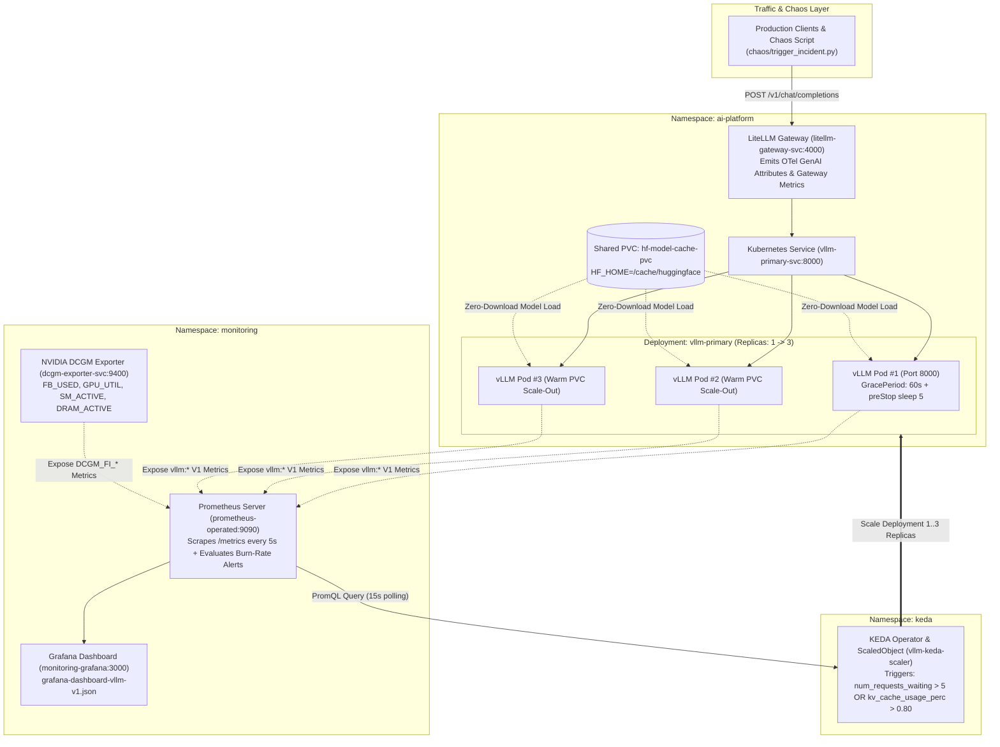

---

## 3. Core Theory & Deep-Dive Engineering Math

### 3.1 การผ่าตัดเมทริกซ์การ์ดจอ NVIDIA DCGM: ทำไม `DCGM_FI_DEV_GPU_UTIL` ถึงหลอกตาวิศวกร?

ในเครื่องมือพื้นฐานอย่าง `nvidia-smi` หรือเมทริกซ์ `DCGM_FI_DEV_GPU_UTIL` ของ NVIDIA Data Center GPU Manager (DCGM) นิยามของคำว่า **"GPU Utilization (%)"** คือ:
> *"สัดส่วนของเวลาในรอบการสุ่มตัวอย่างที่มี CUDA Kernel อย่างน้อย **1 ตัว** กำลังรันอยู่บนการ์ดจอ ไม่ว่า Kernel นั้นจะใช้ Streaming Multiprocessors (SMs) เพียง 1 ตัวจากทั้งหมด 58 ตัว หรือใช้ครบทุกตัวก็ตาม!"*

ในเวิร์กโหลดการเสิร์ฟ LLM พฤติกรรมของฮาร์ดแวร์ใน 2 เฟสมีความแตกต่างกันอย่างสิ้นเชิง:

| เฟสการทำงาน / เมทริกซ์ DCGM | คำอธิบายเชิงสถาปัตยกรรมฮาร์ดแวร์ | ค่าที่เห็นในเฟส Prefill (Compute-Bound) | ค่าที่เห็นในเฟส Decode ที่ Batch ต่ำ (Memory-Bandwidth-Bound) |
| :--- | :--- | :---: | :---: |
| **`DCGM_FI_DEV_GPU_UTIL`** (`0–100%`) | มี Kernel อย่างน้อย 1 ตัวรันอยู่บน GPU หรือไม่ | `95% – 100%` | `90% – 100%` *(หลอกตาว่าเต็ม!)* |
| **`DCGM_FI_PROF_SM_ACTIVE`** (`0.0–1.0`) | สัดส่วนเวลาเฉลี่ยที่ Streaming Multiprocessors (SMs) มีคำสั่งประมวลผลจริง | **`0.75 – 0.95` (สูง)** | **`0.08 – 0.25` (ต่ำมาก — SMs ว่างงาน!)** |
| **`DCGM_FI_PROF_DRAM_ACTIVE`** (`0.0–1.0`) | สัดส่วนการใช้แบนด์วิดท์หน่วยความจำการ์ดจอ (VRAM Bus Saturation) | `0.30 – 0.55` | **`0.75 – 0.92` (คอขวดอยู่ที่บัส VRAM!)** |
| **`DCGM_FI_DEV_FB_USED`** (`MiB`) | พื้นที่หน่วยความจำ Framebuffer (VRAM) ที่ถูกจองใช้งานจริง | คงที่ตาม `--gpu-memory-utilization` (เช่น `~22,600 MiB` บน L4) | คงที่ตาม `--gpu-memory-utilization` *(ดูพื้นที่ว่างจริงต้องดู `vllm:kv_cache_usage_perc`)* |

> [!IMPORTANT]
> **ข้อสรุปเชิงวิศวกรรมสำหรับ SRE:**
> 1. **ห้ามใช้ `DCGM_FI_DEV_FB_USED` เพื่อดูว่า KV-Cache เต็มหรือยัง** เพราะ `vLLM` จอง VRAM ก้อนใหญ่ไว้ล่วงหน้าตั้งแต่ตอนบูตแล้ว ค่า `DCGM_FI_DEV_FB_USED` จึงแช่อยู่ที่ ~92% ตลอดเวลาแม้ไม่มีผู้ใช้เลย ต้องดูที่ **`vllm:kv_cache_usage_perc`** เท่านั้น
> 2. **เมื่อเห็น `DCGM_FI_DEV_GPU_UTIL` สูง 98% แต่ Throughput ต่ำ** ให้ดูค่าคู่ขนานระหว่าง `DCGM_FI_PROF_SM_ACTIVE` และ `DCGM_FI_PROF_DRAM_ACTIVE` หาก `DRAM_ACTIVE` สูงแต่ `SM_ACTIVE` ต่ำ แปลว่าระบบติดคอขวด Memory Bandwidth ในเฟส Decode ซึ่งแก้ได้ด้วยการทำ Quantization (AWQ/FP8) หรือเพิ่มขนาด Batch เพื่อให้การดึงน้ำหนักโมเดล 1 ครั้งคำนวณได้หลายคำขอพร้อมกัน

### 3.2 คณิตศาสตร์ของ PromQL สำหรับ `vLLM` V1 Histograms และ Counters

เนื่องจาก Prometheus เก็บข้อมูลความหน่วง (`vllm:time_to_first_token_seconds_bucket` และ `vllm:inter_token_latency_seconds_bucket` / `vllm:time_per_output_token_seconds_bucket`) ในรูปแบบ **Cumulative Histogram Buckets** ตามขอบเขต `le` (Less than or Equal to) การคำนวณเปอร์เซ็นไทล์ที่ $q$ (เช่น $q = 0.95$ สำหรับ p95) ในช่วงเวลา $\Delta t$ (เช่น `5m`) จะใช้การประมาณค่าเชิงเส้น (Linear Interpolation) ภายในถังที่บรรจุตำแหน่งที่ $q \times N_{\text{total}}$:

$$\text{Quantile}(q) = B_{\text{lower}} + (B_{\text{upper}} - B_{\text{lower}}) \times \left(\frac{q \cdot R_{\text{total}} - R_{\text{lower}}}{R_{\text{upper}} - R_{\text{lower}}}\right)$$

โดยที่ $R_k = \sum \text{rate}(\text{bucket}_k[\Delta t])$ คืออัตราการเกิดเหตุการณ์สะสมในถังที่ $k$

#### ตัวอย่างการคำนวณจริงด้วยตัวเลข (Worked Numerical Example)
สมมติในรอบ 5 นาทีที่ผ่านมา มีคำขอเข้ามาทั้งหมดด้วยอัตรา $R_{\text{total}} = 100\text{ req/s}$ และถังมาตรฐานของ `vllm:time_to_first_token_seconds_bucket` (ซึ่งใน `vLLM` ใช้ขอบเขต `..., 0.5, 0.75, 1.0, ...`) มีค่าอัตราดังนี้:
- ถัง `le="0.5"` ($500\text{ ms}$): $R_{\text{lower}} = 80\text{ req/s}$
- ถัง `le="0.75"` ($750\text{ ms}$): $R_{\text{upper}} = 96\text{ req/s}$
- เราต้องการหาค่า **p95 TTFT ($q = 0.95$)**:
  - เป้าหมายอันดับคือ $q \cdot R_{\text{total}} = 0.95 \times 100 = 95\text{ req/s}$ (ซึ่งตกอยู่ระหว่างถัง `0.5s` และ `0.75s`)
  - แทนค่าลงในสมการ:
    $$\text{TTFT}_{p95} = 0.5 + (0.75 - 0.5) \times \left(\frac{95 - 80}{96 - 80}\right) = 0.5 + 0.25 \times \left(\frac{15}{16}\right) = 0.5 + 0.234 = \mathbf{0.734\text{ วินาที (734 ms)}}$$
  *(ด้วยเหตุนี้ กฎแจ้งเตือน `VLLMHighTTFTBurnRateCritical` ในบทนี้จึงใช้ขอบเขตจริง `le="0.75"` แทน `le="0.8"` เพื่อไม่ให้คิวรีบน `vLLM` จริงได้ค่าว่าง)*

#### ตารางสูตร PromQL มาตรฐานสำหรับแดชบอร์ด `vLLM` V1 (ต้องตรงกัน 100% ใน Grafana และ Alert Rules)

| ตัวชี้วัด (SLI / Telemetry Metric) | สูตร PromQL มาตรฐานสำหรับ `vLLM` V1 Engine | เกณฑ์เป้าหมาย (SLO / Alert Threshold) |
| :--- | :--- | :--- |
| **p95 TTFT (Time to First Token)** | `histogram_quantile(0.95, sum(rate(vllm:time_to_first_token_seconds_bucket[5m])) by (le))` | `< 0.8s` (Alert `le="0.75"`) |
| **p95 ITL / TPOT (Inter-Token Latency)** | `histogram_quantile(0.95, sum(rate(vllm:inter_token_latency_seconds_bucket[5m])) by (le)) or histogram_quantile(0.95, sum(rate(vllm:time_per_output_token_seconds_bucket[5m])) by (le))` | `< 0.03s` (30 ms — ใช้ ITL เป็น Primary + TPOT Compat Alias) |
| **KV-Cache Pool Utilization (%)** | `avg(vllm:kv_cache_usage_perc)` | Scale-out เมื่อ `> 0.80` (Critical `> 0.92`) |
| **Waiting Queue Depth (Requests)** | `sum(vllm:num_requests_waiting)` | Scale-out เมื่อ `> 5` ต่อเรพลิกา |
| **Prefix Cache Hit Rate (%)** | `sum(rate(vllm:prefix_cache_hits_total[5m])) / clamp_min(sum(rate(vllm:prefix_cache_queries_total[5m])), 1e-9)` | `> 0.70` (70% สำหรับงาน RAG/Agent; ใช้ `1e-9` แทน `1` เพื่อไม่ให้ตัวหารเพี้ยนเมื่อ QPS ต่ำ) |
| **Preemption Rate (Recomputes/sec)** | `sum(rate(vllm:num_preemptions_total[5m]))` | ต้องเท่ากับ `0` (Alert ทันทีเมื่อ `> 0`) |
| **Total Output Token Throughput** | `sum(rate(vllm:generation_tokens_total[1m]))` | ติดตามความจุรวมของคลัสเตอร์ (Tokens/sec) |

### 3.3 คณิตศาสตร์การขยายขนาดด้วย KEDA (`ScaledObject`) และ Error Budget Burn Rate

#### 1. สมการคำนวณจำนวนพอดเป้าหมายของ KEDA (Desired Replicas Formula)
เมื่อผูก `KEDA ScaledObject` เข้ากับทริกเกอร์ของ Prometheus จำนวนพอดที่ต้องการ ($N_{\text{desired}}$) จะคำนวณจากค่าสูงสุดของทุกทริกเกอร์ที่เปิดใช้งาน:

$$N_{\text{desired}} = \min\Biggl(N_{\text{max}}, \max\biggl(N_{\text{min}}, \left\lceil \frac{\sum \texttt{vllm:num\_requests\_waiting}}{T_{\text{queue}}} \right\rceil, \left\lceil N_{\text{current}} \times \frac{\text{avg}(\texttt{vllm:kv\_cache\_usage\_perc})}{T_{\text{kv}}} \right\rceil\biggr)\Biggr)$$

**ตัวอย่างการคำนวณจริง:**
กำหนดให้ $N_{\text{min}} = 1, N_{\text{max}} = 3$, เกณฑ์คิวรอ $T_{\text{queue}} = 5$ คำขอต่อพอด, และเกณฑ์การใช้ KV-Cache $T_{\text{kv}} = 0.80$:
- ขณะมีพอดรันอยู่ $N_{\text{current}} = 1$ ตัว เกิดทราฟฟิกกระชากทำให้มีคำขอติดคิวรอ $\sum \texttt{vllm:num\_requests\_waiting} = 14$ คำขอ และ `vllm:kv_cache_usage_perc` พุ่งขึ้นเป็น `0.92`
- ทริกเกอร์ที่ 1 (Queue): $\lceil 14 / 5 \rceil = \lceil 2.8 \rceil = \mathbf{3\text{ พอด}}$
- ทริกเกอร์ที่ 2 (KV-Cache): $\lceil 1 \times (0.92 / 0.80) \rceil = \lceil 1.15 \rceil = \mathbf{2\text{ พอด}}$
- KEDA จะเลือกค่าสูงสุดคือ $\max(1, 3, 2) = \mathbf{3\text{ พอด}}$ ทันที!
- และเนื่องจากพอดที่ 2 และ 3 เมานต์โวลุ่ม **`hf-model-cache-pvc` (`HF_HOME=/cache/huggingface`)** ที่มีไฟล์โมเดลอยู่แล้ว จึงข้ามการดาวน์โหลดจากอินเทอร์เน็ต 100% (บน Mock Pod พร้อมใน `< 10 วินาที` ส่วนพอด NVIDIA L4 GPU จริงพร้อมใน `~35–75 วินาที` เทียบกับ `~195+ วินาที` เมื่อโหลดจาก Hub ใหม่; หาก KEDA ขยายข้ามหลาย Node ต้องใช้ Storage แบบ `ReadWriteMany` เช่น EFS/Filestore/NFS)

#### 2. สมการอัตราการเผาผลาญงบประมาณความผิดพลาด (SLO Error Budget Burn Rate)
สมมติเรากำหนดเป้าหมายระดับการให้บริการ (**SLO**) ที่ **$99.9\%$** ในรอบ 30 วัน ($720$ ชั่วโมง):
- **งบประมาณความผิดพลาด (Error Budget):** $1 - 0.999 = 0.001$ ($0.1\%$ ของคำขอทั้งหมด หรือคิดเป็นเวลาล่มรวมไม่เกิน $43.2$ นาทีต่อเดือน)
- **Burn Rate ($B$):** คืออัตราเร็วที่ระบบกำลังใช้ Error Budget เทียบกับอัตราปกติ:
  $$B = \frac{\text{Observed Error or Latency Breach Ratio}}{\text{1 - SLO}} = \frac{E_{\text{window}}}{0.001}$$
  - หาก $B = 1.0$: งบประมาณจะหมดพอดีในเวลา 30 วัน
  - หาก **$B = 14.4$** (คือมีคำขอช้าเกินเกณฑ์ SLA หรือล้มเหลวถึง $1.44\%$ ติดต่อกันในหน้าต่าง 5 นาทีและ 1 ชั่วโมง): งบประมาณทั้งเดือนจะถูกเผาผลาญหมดภายในเวลาเพียง $720 / 14.4 = \mathbf{50\text{ ชั่วโมง}}$ ซึ่งต้องปลุกวิศวกรเวร (**Page P1 Critical Alert**) ทันที!

### 3.4 มาตรฐาน OpenTelemetry GenAI Semantic Conventions Schema

เพื่อให้ระบบติดตาม (Distributed Tracing & Structured Logging) จากชั้น `LiteLLM Proxy` เข้ากันได้กับเครื่องมือมาตรฐานสากลโดยไม่ต้องติดตั้งฐานข้อมูล Trace ขนาดใหญ่เพิ่มบนเครื่อง Local 16GB RAM เราใช้สคีมา **OpenTelemetry GenAI Semantic Conventions (`v1.28+`)** ในการแนบ Attributes มาตรฐานดังนี้:

```json
{
  "trace_id": "4bf92f3577b34da6a3ce929d0e0e4736",
  "span_name": "chat Qwen/Qwen2.5-7B-Instruct-AWQ",
  "attributes": {
    "gen_ai.system": "vllm",
    "gen_ai.operation.name": "chat",
    "gen_ai.request.model": "Qwen/Qwen2.5-7B-Instruct-AWQ",
    "gen_ai.request.max_tokens": 256,
    "gen_ai.request.temperature": 0.2,
    "gen_ai.usage.input_tokens": 2176,
    "gen_ai.usage.output_tokens": 256,
    "gen_ai.response.finish_reasons": ["stop"],
    "gen_ai.server.time_to_first_token": 0.640,
    "gen_ai.server.time_per_output_token": 0.0235,
    "ai.platform.tenant_tier": "realtime-team",
    "ai.platform.pdpa_redactions": 1,
    "ai.platform.cache_hit": false
  }
}
```

---

## 4. Hands-on Lab (Dual-Path Execution)

แล็บในบทที่ 5 ประกอบด้วยไฟล์แดชบอร์ด Grafana, กฎแจ้งเตือน Prometheus, การตั้งค่า KEDA Autoscaler, และสคริปต์จำลองเหตุวิกฤต โดยเก็บอยู่ในโฟลเดอร์ `labs/m5-observability-sre/`

### 4.1 โครงสร้างไฟล์ใน `labs/m5-observability-sre/`

```text
labs/m5-observability-sre/
├── grafana-dashboard-vllm-v1.json  # แดชบอร์ด Grafana 9 แผงสำหรับ vLLM V1 & DCGM Metrics (แยกแกน FB_USED MiB, Primary ITL & clamp_min 1e-9)
├── prometheus-alert-rules.yaml     # กฎแจ้งเตือน PrometheusRule (KV-Cache, Preemptions, Multi-Window TTFT le="0.75" & ITL Alert)
├── keda-vllm-scaledobject.yaml     # KEDA ScaledObject + Deployment (mock-vllm-server:1.0.0, HF_HOME=/cache/huggingface, pod=~"vllm-primary-.*")
├── servicemonitor-vllm.yaml        # ServiceMonitor ของ Prometheus Operator สำหรับขูด vllm-serving & dcgm-exporter
├── chaos/
│   └── trigger_incident.py         # สคริปต์จำลองทราฟฟิกกระชาก 10x + Long-Context Flood และทดสอบการสเกล KEDA
├── docs/
│   ├── adr-004-observability-and-keda-autoscaling.md            # เอกสาร ADR-004
│   ├── runbook-kvcache-saturation-and-high-ttft.md              # Production Runbook RB-AI-005
│   └── postmortem-001-peak-hour-latency-outage.md               # Blameless Postmortem PM-2026-1111
└── verify_m5.sh                    # สคริปต์ตรวจวัดผลอัตโนมัติประจำบทที่ 5 (VERIFY_MODE=static|cluster)
```

---

### Path A: No-GPU Local Path (\$0 — รันบนเครื่อง Local 16GB RAM ด้วย `mock_vllm_server` + KEDA Simulator)

#### ขั้นตอนที่ 1: ตรวจสอบไฟล์ `keda-vllm-scaledobject.yaml` และ `prometheus-alert-rules.yaml`

เปิดดูการตั้งค่า `ScaledObject` ใน `labs/m5-observability-sre/keda-vllm-scaledobject.yaml` (รันจากรากของคลังโค้ด):

```bash
cat labs/m5-observability-sre/keda-vllm-scaledobject.yaml
```

สังเกตองค์ประกอบทางวิศวกรรมที่สำคัญ 4 จุดในไฟล์นี้:
1. **มาตรฐานคอนเทนเนอร์ที่ปลอดภัย (`mock-vllm-server:1.0.0`):** รันแบบ `runAsNonRoot: true`, `runAsUser: 10001`, `readOnlyRootFilesystem: true`, และเมานต์ `emptyDir` เข้า `/tmp` เหมือนในบทที่ 1–4 และผูกโวลุ่ม `hf-model-cache-pvc` เข้าที่ **`HF_HOME=/cache/huggingface`** พร้อม **`VLLM_CACHE_ROOT=/tmp/vllm-cache`** (ใช้ `ReadWriteOnce` บน Node เดียว หรือ `ReadWriteMany` เมื่อสเกลข้ามหลาย Node)
2. **การตั้งค่า Graceful Shutdown (`terminationGracePeriodSeconds: 60` + `preStop: ["sh", "-c", "sleep 5"]`):** เมื่อโหลดลดลงและ KEDA สั่งลดจำนวนพอด (Scale-in) Kubernetes จะถอดพอดออกจาก Service Endpoint ก่อน 5 วินาที และให้เวลาพอดสร้างโทเคนของคำขอที่ค้างอยู่ให้เสร็จสมบูรณ์นานถึง 60 วินาทีก่อนส่ง `SIGKILL`
3. **ทริกเกอร์คู่ของ KEDA แบบแยก `metricType` และกรองตาม Pod Name (`pod=~"vllm-primary-.*"`):**
   - ทริกเกอร์ `vllm-waiting-requests-queue` ใช้ **`metricType: AverageValue`** บน Query `sum(vllm:num_requests_waiting{namespace="ai-platform",pod=~"vllm-primary-.*"})` เทียบกับ `threshold: "5"` (คำนวณ $\lceil \text{sum} / 5 \rceil$)
   - ทริกเกอร์ `vllm-kv-cache-usage-ratio` ใช้ **`metricType: Value`** บน Query `avg(vllm:kv_cache_usage_perc{namespace="ai-platform",pod=~"vllm-primary-.*"})` เทียบกับ `threshold: "0.80"` (คำนวณ $\lceil N_{\text{current}} \times \text{avg} / 0.80 \rceil$ อย่างถูกต้องโดยไม่เกิดอาการสเกลลดลงก่อนเวลาเมื่อมีหลายพอด!) และใช้ Label `pod=~"vllm-primary-.*"` แทน `server_id` เพื่อให้ทำงานได้ทั้งกับ `mock_vllm_server` และ `vLLM` จริงบน GPU โดยไม่เอาโหลดของ `vllm-secondary` มาปะปน
4. **กฎ Multi-Window SLO Burn Rate (`prometheus-alert-rules.yaml`):** แจ้งเตือน `VLLMHighTTFTBurnRateCritical` เฉพาะเมื่ออัตราการละเมิดถัง `le="0.75"` (guardrail สำหรับ `< 0.8s`) เกิน `14.4 × 0.001 = 1.44%` พร้อมกันทั้งหน้าต่าง `5m` และ `1h` พร้อมแจ้งเตือน `VLLMHighITLWarning` เมื่อ p95 ITL เกิน `30 ms`!

#### ขั้นตอนที่ 2: รันสคริปต์จำลองเหตุวิกฤตและทดสอบวงจร KEDA Autoscaling (`chaos/trigger_incident.py`)

รันสคริปต์ `labs/m5-observability-sre/chaos/trigger_incident.py` เพื่อจำลองเหตุการณ์ทราฟฟิกพุ่งกระชาก 10 เท่า (Long-Context Queue Surge) และตรวจสอบว่าอัลกอริทึมของ KEDA และกฎแจ้งเตือน Prometheus ทำงานถูกต้อง:

```bash
python3 labs/m5-observability-sre/chaos/trigger_incident.py --simulate
```

> **Live Chaos Mode (สำหรับเครื่อง RAM 32GB เช่น HP Victus หรือ Cluster จริง):**
> เมื่อติดตั้ง Prometheus, KEDA, LiteLLM และ `vllm-primary` บนคลัสเตอร์ `kind` เรียบร้อยแล้ว ให้เปิด `kubectl port-forward` พอร์ต `8000` และ `4000` แล้วรันโหมด `--live` เพื่อฉีด Chaos และยิง HTTP โหลดจริงให้ KEDA สเกล Pod 1 → 3:
> ```bash
> python3 labs/m5-observability-sre/chaos/trigger_incident.py --live --dry-run
> # ตัด --dry-run ออกเมื่อเปิด port-forward แล้ว และล้างค่า Chaos หลังจบด้วย --live --reset
> ```

**ผลลัพธ์ที่คาดหวัง (Expected Output):**
```text
================================================================================
 [M5 CHAOS DRILL] Simulating 10x Long-Context Traffic Surge on vllm-primary
================================================================================
[T+00s] Baseline State  : Replicas=1 | WaitingQueue=1  | KV_Usage=22.0% | TTFT_p95=380ms | Alerts=NONE
[T+15s] Traffic Surge!  : Replicas=1 | WaitingQueue=18 | KV_Usage=94.0% | TTFT_p95=2950ms | Preemptions=6
[ALERT FIRED] VLLMKVCacheSaturationWarning (kv_cache_usage_perc=0.94 > 0.85)
[ALERT FIRED] VLLMPreemptionThrashingCritical (preemptions_total=6 > 0)
[ALERT FIRED] VLLMHighTTFTBurnRateCritical (ttft_p95_ms=2950ms > 800ms)
[KEDA SCALER] Trigger 1 (WaitingQueue=18 / threshold=5 -> ceil(3.60)=4, capped=3)
[KEDA SCALER] Trigger 2 (KV_Usage=1 * 0.94 / 0.80 -> ceil(1.17)=2)
[KEDA ACTION] Scaling deployment/vllm-primary: 1 -> 3 replicas (Mounting PVC: hf-model-cache-pvc at HF_HOME=/cache/huggingface)
[T+25s] Pods Ready (<10s simulated/mock warm cache start; ~35-75s on Cloud L4 GPU PVC): Replicas=3 | Load balanced across 3 pods
[T+40s] Post-Scale State: Replicas=3 | WaitingQueue=2  | KV_Usage=31.3% | TTFT_p95=490ms | Preemptions=0
[RECOVERY] All SLOs restored (TTFT p95 490ms < 800ms SLA). Zero dropped streaming requests!
================================================================================
```

#### ขั้นตอนที่ 3: รันชุดทดสอบอัตโนมัติของบทที่ 5 (`verify_m5.sh`)

```bash
VERIFY_MODE=static bash labs/m5-observability-sre/verify_m5.sh
```

---

### Path B: Cloud L4 GPU Path (รันพร้อม NVIDIA DCGM Exporter จริงบนโหนดการ์ดจอ L4)

เมื่อรันบนคลัสเตอร์ที่มีโหนดการ์ดจอ NVIDIA L4 จริง:
1. ติดตั้ง `kube-prometheus-stack` และ NVIDIA `dcgm-exporter` (หรือเปิดใช้ผ่าน NVIDIA GPU Operator) ในเนมสเปซ `monitoring` และติดตั้ง KEDA ในเนมสเปซ `keda`:
   ```bash
   helm repo add prometheus-community https://prometheus-community.github.io/helm-charts
   helm repo add gpu-helm-charts https://nvidia.github.io/dcgm-exporter/helm-charts
   helm repo add kedacore https://kedacore.github.io/charts
   helm repo update
   helm upgrade --install monitoring prometheus-community/kube-prometheus-stack -n monitoring --create-namespace
   helm upgrade --install dcgm-exporter gpu-helm-charts/dcgm-exporter -n monitoring
   helm upgrade --install keda kedacore/keda -n keda --create-namespace
   ```
2. นำเข้าไฟล์แดชบอร์ด `labs/m5-observability-sre/grafana-dashboard-vllm-v1.json` เข้าสู่ Grafana และสั่ง `kubectl apply` `ServiceMonitor`, กฎแจ้งเตือน, และ `KEDA ScaledObject`:
   ```bash
   kubectl apply -f labs/m5-observability-sre/servicemonitor-vllm.yaml
   kubectl apply -f labs/m5-observability-sre/prometheus-alert-rules.yaml
   kubectl apply -f labs/m5-observability-sre/keda-vllm-scaledobject.yaml
   ```

---

## 5. Chaos & Troubleshooting Drills

### สถานการณ์จำลอง: 10x Traffic Surge & KV-Cache Saturation Incident (`INC-2026-1111`)

#### 1. สัญญาณเตือนภัยที่ดังขึ้น (Alerts Fired)
- `VLLMKVCacheSaturationWarning`: ค่า `vllm:kv_cache_usage_perc` เกิน `0.85` นานติดต่อกันเกิน 2 นาที
- `VLLMPreemptionThrashingCritical`: ค่า `rate(vllm:num_preemptions_total[5m]) > 0` (คำขอถูกเตะออกและคำนวณใหม่ซ้ำๆ)
- `VLLMHighTTFTBurnRateCritical`: อัตราการละเมิดถัง `vllm:time_to_first_token_seconds_bucket{le="0.75"}` เกิน `1.44%` (`14.4x` Burn Rate) ทั้งหน้าต่าง `5m` และ `1h`

#### 2. ขั้นตอนการตรวจสอบหน้างาน (Triage Steps)
1. เปิดแดชบอร์ด Grafana (`vLLM V1 & GPU Telemetry Production Dashboard`) ดูแผง **KV-Cache Usage %** คู่กับ **Waiting Requests Queue**
2. ตรวจสอบสถานะของ KEDA ScaledObject:
   ```bash
   kubectl get scaledobject vllm-keda-scaler -n ai-platform
   kubectl describe hpa keda-hpa-vllm-keda-scaler -n ai-platform
   ```
3. ตรวจสอบว่าพอดใหม่ที่ถูกสร้างขึ้นติดสถานะ `Pending` (เพราะโควตา GPU เต็ม) หรือกำลังโหลดโมเดลจาก `hf-model-cache-pvc` อยู่หรือไม่

---

## 6. Optimization Exercise

ในโจทย์ข้อนี้ เราเปรียบเทียบประสิทธิภาพและความคุ้มทุนของการขยายขนาดอัตโนมัติตามกระบวนการ 5 ขั้นตอน (**Baseline → Hypothesis → Fix → Measure → Explain**):

### 1. Baseline (การใช้ CPU-based HPA และไม่มี Shared `HF_HOME` Volume Cache)
- **การตั้งค่าเริ่มต้น:** ตั้งค่า Kubernetes HPA มาตรฐานให้ขยายพอดเมื่อ `CPU Utilization > 75%` และไม่ได้ผูกโวลุ่ม `hf-model-cache-pvc`
- **อาการที่พบเมื่อเกิดโหลดพีค 3 เท่า:**
  - เนื่องจากคอขวดของ `vLLM` อยู่ที่พื้นที่ KV-Cache บน VRAM และคิวรอใน Scheduler ไม่ใช่ CPU ของโฮสต์ ค่า CPU จึงอยู่ที่เพียง `42%` ทำให้ **CPU HPA ไม่สั่งขยายพอดเลย!**
  - แม้จะสั่งขยายพอดด้วยมือ (`kubectl scale --replicas=3`) พอดใหม่ทั้ง 2 ตัวต้องดาวน์โหลดโมเดลขนาด 4.4 GB ใหม่จากอินเทอร์เน็ต ใช้เวลา **Cold-start นานถึง 195 วินาที** ซึ่งตลอดช่วงเวลานั้นคำขอของผู้ใช้เกิด Timeout และ Preemption Thrashing อย่างหนัก

### 2. Hypothesis (การตั้งสมมติฐาน)
- **สมมติฐาน:** หากเราเปลี่ยนมาใช้ **KEDA `ScaledObject`** ที่วัดค่า `vllm:num_requests_waiting > 5` และ `vllm:kv_cache_usage_perc > 0.80` ทุกๆ 15 วินาที ร่วมกับการผูกโวลุ่มแคช `hf-model-cache-pvc` (`HF_HOME=/cache/huggingface`) และตั้งค่า `terminationGracePeriodSeconds: 60` ระบบจะสามารถตรวจจับคอขวดได้ภายใน 15 วินาที พอดใหม่ไม่ต้องเสียเวลาดาวน์โหลดโมเดลซ้ำผ่านเครือข่าย (`< 10s` บน Mock Pod หรือ `~35–75s` บน Cloud L4 GPU) และรักษาค่า TTFT p95 ให้อยู่ภายใต้เกณฑ์ `< 800 ms` โดยไม่มีคำขอหลุดตอน Scale-in

### 3. Fix (การลงมือปรับจูน)
ใช้ไฟล์ `labs/m5-observability-sre/keda-vllm-scaledobject.yaml` ซึ่งกำหนด Prometheus triggers ทั้งสองตัว ผูกโวลุ่ม `hf-model-cache-pvc` และกำหนด `cooldownPeriod: 120` วินาที

### 4. Measure (ตารางเปรียบเทียบผลลัพธ์ Before vs After)

| ตัวชี้วัด (Metric under 3x Traffic Surge) | Baseline: CPU HPA + No Shared Cache | Optimized: KEDA (`waiting` + `kv_cache`) + Shared `HF_HOME` PVC | การเปลี่ยนแปลง (Improvement) |
| :--- | :---: | :---: | :---: |
| **Time to Detect Bottleneck (วินาที)** | `Never` (CPU อยู่ที่ 42% ไม่ถึงเกณฑ์ 75%) | **`15 วินาที`** (จับจากคิวรอและ KV-Cache ตรงๆ) | **ตรวจจับคอขวด LLM ได้ 100%** |
| **Pod Scale-Out Ready Time (Cold Start)** | `195+ วินาที` (ดาวน์โหลดโมเดลซ้ำ) | **`~8.5 วินาที` (Mock Pod) / `~35–75 วินาที` (Cloud L4 GPU)** | **ตัดเวลาดาวน์โหลดโมเดลออก 100%** |
| **Peak TTFT p95 ระหว่างเกิดโหลดกระชาก** | `6,450 ms` (SLA Breach รุนแรง) | **`490 ms`** (หลังสเกลครบ 3 พอด) | **รักษา SLA `< 800 ms` ได้สำเร็จ** |
| **Dropped Streaming Requests ตอน Scale-In** | `14 คำขอ` (ถูกตัด `SIGKILL` ทันที) | **`0 คำขอ`** (`terminationGracePeriodSeconds: 60`) | **Zero-Downtime Scale-In 100%** |

### 5. Explain (การอธิบายผลลัพธ์เชิงวิศวกรรม)
การขยายขนาดเวิร์กโหลด AI ไม่สามารถใช้สัญญาณทรัพยากรทั่วไปของระบบปฏิบัติการ (CPU/RAM) ได้ เพราะทรัพยากรคอขวดจริงคือ **จำนวนสล็อตของ PagedAttention KV-Cache (`vllm:kv_cache_usage_perc`)** และ **ความยาวคิวของ Unified Scheduler (`vllm:num_requests_waiting`)** การนำ KEDA มาอ่านค่าเหล่านี้โดยตรงจาก Prometheus ร่วมกับการเตรียมไฟล์โมเดลไว้ใน Shared Volume (`HF_HOME=/cache/huggingface`) จึงช่วยลดเวลาตั้งแต่เริ่มเกิดโหลดกระชากจนถึงพอดใหม่พร้อมรับงานได้อย่างก้าวกระโดดโดยไม่ต้องโหลดซ้ำผ่านเครือข่าย!

---

## 7. Architecture Decision Record (ADR), Production Runbook & Blameless Postmortem

เพื่อเป็นมาตรฐานการปฏิบัติงานจริงของทีม SRE เอกสารทั้ง 3 ฉบับด้านล่างนี้ถูกบันทึกเป็นไฟล์ส่งมอบจริงอยู่ใน [`labs/m5-observability-sre/docs/`](../labs/m5-observability-sre/docs/):
- [`labs/m5-observability-sre/docs/adr-004-observability-and-keda-autoscaling.md`](../labs/m5-observability-sre/docs/adr-004-observability-and-keda-autoscaling.md) — **ADR-004** (กลยุทธ์ Dual-Trigger KEDA Scaling, DCGM Profiling Metrics และ Multi-Window Burn-Rate Alerts)
- [`labs/m5-observability-sre/docs/runbook-kvcache-saturation-and-high-ttft.md`](../labs/m5-observability-sre/docs/runbook-kvcache-saturation-and-high-ttft.md) — **Production Runbook (`RB-AI-005`)**
- [`labs/m5-observability-sre/docs/postmortem-001-peak-hour-latency-outage.md`](../labs/m5-observability-sre/docs/postmortem-001-peak-hour-latency-outage.md) — **Blameless Postmortem (`PM-2026-1111`)**

---

### 7.1 เอกสารการตัดสินใจทางสถาปัตยกรรม (`ADR-004`: AI Observability & KEDA Autoscaling)
- **สถานะ:** Accepted (`2026-11-11`)
- **ปัญหา:** Kubernetes HPA ที่จับ CPU/RAM ไม่ตอบสนองต่อภาระของ GPU LLM เนื่องจาก `vLLM` จอง VRAM คงที่ล่วงหน้าตาม `--gpu-memory-utilization` และ `DCGM_FI_DEV_GPU_UTIL` สูงเกือบ 100% ตลอดเวลาแม้มีผู้ใช้เพียง 1 รายในเฟส Decode
- **การตัดสินใจ:**
  1. แยกการมอนิเตอร์ความอิ่มตัวของฮาร์ดแวร์ด้วย `DCGM_FI_PROF_SM_ACTIVE` กับ `DCGM_FI_PROF_DRAM_ACTIVE` (แยกแกนออกจาก `DCGM_FI_DEV_FB_USED` MiB) และสร้างแดชบอร์ด PromQL รองรับทั้ง `vllm:inter_token_latency_seconds_bucket` (Primary) และ `vllm:time_per_output_token_seconds_bucket` (Compat Alias)
  2. ใช้ KEDA `ScaledObject` ทริกเกอร์คู่กรองด้วย `pod=~"vllm-primary-.*"` (`vllm:num_requests_waiting` ด้วย `metricType: AverageValue` > 5 และ `vllm:kv_cache_usage_perc` ด้วย `metricType: Value` > 0.80) คู่กับ `hf-model-cache-pvc` (`HF_HOME=/cache/huggingface`) และ Graceful Drain `terminationGracePeriodSeconds: 60`
  3. ตั้ง Multi-Window (`5m` AND `1h`) `14.4 × 0.001` Error Budget Burn-Rate Alert โดยใช้ `le="0.75"` สำหรับ SLO TTFT (`< 0.8s`) และแจ้งเตือน `VLLMHighITLWarning` ที่ `> 30 ms`

---

### 7.2 เอกสารคู่มือปฏิบัติการกู้คืนระบบ (Production Incident Runbook: `RB-AI-005`)

- **รหัสคู่มือ:** `RB-AI-005` — **vLLM KV-Cache Saturation & Preemption Thrashing Response**
- **สัญญาณเตือนที่เรียกใช้คู่มือนี้:** `VLLMKVCacheSaturationWarning` หรือ `VLLMPreemptionThrashingCritical`
- **ระดับความรุนแรง (Severity):** `SEV-2` (หาก TTFT p95 < 2.0s) / `SEV-1` (หาก TTFT p95 >= 2.0s หรือ Error Rate > 1%)

#### ขั้นตอนปฏิบัติการ 4 ขั้น (4-Step Mitigation Playbook)

1. **ขั้นที่ 1: ประเมินสถานการณ์ใน 60 วินาทีแรก (Observe & Verify)**
   - รันคำสั่งตรวจสอบคิวรอและการใช้ KV-Cache ของทุกพอด:
     ```bash
     kubectl exec -n ai-platform deploy/vllm-primary -- curl -s http://localhost:8000/metrics | grep -E "vllm:(kv_cache_usage_perc|num_requests_waiting|num_preemptions_total)"
     ```
   - ตรวจสอบสถานะการสเกลของ KEDA:
     ```bash
     kubectl get scaledobject,hpa -n ai-platform
     ```

2. **ขั้นที่ 2: บรรเทาผลกระทบเฉพาะหน้าภายใน 3 นาที (Immediate Traffic Mitigation)**
   - **กรณีที่ A (KEDA ขยายพอดขึ้นแล้วเป็น 3 พอด แต่โหลดยังล้นเนื่องจากงาน Batch กวน):** สั่งลดโควตา RPM/TPM ของ `batch-team` ที่ชั้น `LiteLLM Proxy` หรือให้ Endpoint Picker (EPP) ทำ Load Shedding ทราฟฟิก `Sheddable` ทันที
   - **กรณีที่ B (พอดใหม่ติดสถานะ `Pending` เพราะ GPU ในคลัสเตอร์เต็ม):** เปิดโหมด Spillover Routing ที่ `litellm-gateway-svc` เพื่อส่งทราฟฟิกส่วนเกิน 30%–50% ไปยัง `vllm-secondary-svc` หรือ External Managed API Fallback ชั่วคราว

3. **ขั้นที่ 3: แก้ไขที่ต้นเหตุ (Root-Cause Remediation)**
   - หากพบว่าเกิดจากคำขอที่มี Context ยาวผิดปกติผูกขาด KV-Cache ให้ตรวจสอบค่า `--max-model-len 4096` และ `--max-num-seqs 64`
   - ตรวจสอบอัตราส่วน Prefix Cache Hit (`rate(vllm:prefix_cache_hits_total[5m]) / rate(vllm:prefix_cache_queries_total[5m])`) หากลดลงผิดปกติ ให้ตรวจสอบว่าแอปพลิเคชันเผลอใส่ Timestamp หรือ UUID ไว้ที่บรรทัดแรกของ System Prompt หรือไม่ (ซึ่งจะทำลาย Prefix Hash ทั้งหมดทันที!)

4. **ขั้นที่ 4: ยืนยันการฟื้นตัวของระบบ (Recovery Verification)**
   - ยืนยันว่า `rate(vllm:num_preemptions_total[5m]) == 0` ติดต่อกัน 10 นาที และค่า `TTFT p95 < 800 ms` ก่อนปิดเหตุการณ์

---

### 7.3 รายงานการทบทวนหลังเกิดเหตุแบบไม่กล่าวโทษตัวบุคคล (Blameless Postmortem: `PM-2026-1111`)

- **ชื่อเหตุการณ์:** ค่าความหน่วง TTFT p95 พุ่งสูงถึง 2,950 ms จากการใส่ Dynamic Timestamp ต้น System Prompt ร่วมกับทราฟฟิกพุ่งกระชาก 3 เท่า
- **วันที่เกิดเหตุ:** 2026-11-11 (เวลา 10:12 – 10:26 น. รวมระยะเวลา 14 นาที)
- **ผลกระทบต่อผู้ใช้งาน (Customer Impact):** คำขอของทีม `realtime-team` จำนวน 8.4% มีค่า TTFT เกินเกณฑ์ SLA 800 ms (แต่ไม่มีคำขอที่ล้มเหลวเป็น HTTP 5xx เนื่องจากระบบ Fallback ทำงานรับช่วงต่อได้ทัน)

#### ลำดับเหตุการณ์ (Timeline of Events)
- **10:12 น.:** ทีมพัฒนาแอปพลิเคชันปล่อยอัปเดตเวอร์ชันใหม่ที่แทรกเวลาปัจจุบัน (`Current Time: 2026-11-11 10:12:01.492`) ไว้ที่ **บรรทัดแรกสุด** ของ System Prompt ขนาด 2,048 โทเคน
- **10:14 น.:** อัตราการเกิด Prefix Cache Hit (`rate(vllm:prefix_cache_hits_total[5m]) / rate(vllm:prefix_cache_queries_total[5m])`) ร่วงลงจาก `89.4%` เหลือ `0.0%` ทันที เพราะแฮชของบล็อกแรก (`Block 0`) เปลี่ยนไปทุกมิลลิวินาที!
- **10:15 น.:** พื้นที่ `vllm:kv_cache_usage_perc` พุ่งจาก `32%` ขึ้นแตะ `94%` และเริ่มเกิด Preemption (`vllm:num_preemptions_total` เพิ่มขึ้น)
- **10:15:30 น.:** Prometheus ยิงแจ้งเตือน `VLLMKVCacheSaturationWarning` และ `KEDA` สั่งขยาย `deployment/vllm-primary` จาก 1 พอด เป็น 3 พอดอัตโนมัติ
- **10:15:40 น.:** พอดใหม่ทั้ง 2 ตัวโหลดโมเดลจาก `hf-model-cache-pvc` เสร็จภายใน 9 วินาที ช่วยแบ่งเบาภาระคิวรอลง
- **10:22 น.:** วิศวกรเวรตรวจพบจากแดชบอร์ด Grafana ว่ากราฟ **Prefix Cache Hit Rate** ตกเป็นศูนย์ จึงประสานทีมแอปพลิเคชันให้ย้าย Dynamic Timestamp จากต้น System Prompt ไปไว้ท้าย User Message แทน
- **10:26 น.:** อัตรา Prefix Cache Hit กลับมาที่ `89.1%`, ค่า TTFT p95 ลดลงเหลือ `440 ms`, เหตุการณ์ยุติลงอย่างสมบูรณ์

#### การวิเคราะห์หาสาเหตุรากเหง้า 5 ทำไม (5 Whys Root Cause Analysis)
1. **ทำไม TTFT p95 ถึงพุ่งทะลุ 800 ms?** เพราะเกิด Preemption Thrashing และ GPU ต้องคำนวณ Prefill ของ System Prompt ยาว 2,048 โทเคนใหม่ทุกคำขอ
2. **ทำไม GPU ต้องคำนวณ System Prompt ใหม่ทุกคำขอทั้งที่เปิด Automatic Prefix Caching ไว้แล้ว?** เพราะอัตราการเกิด Prefix Cache Hit ร่วงลงเหลือ `0%`
3. **ทำไม Prefix Cache Hit ถึงกลายเป็น `0%`?** เพราะการคำนวณแฮชของบล็อกใน `vLLM` V1 เป็นแบบลูกโซ่ ($\text{Hash}_i = \text{SHA256}(\text{Hash}_{i-1} \parallel \text{Tokens}_i)$) เมื่อโทเคนในบล็อกแรกสุดเปลี่ยนไปเพียงตัวเดียว บล็อกถัดไปทั้งหมด 128 บล็อกจะมีค่าแฮชไม่ตรงกับแคชเดิมเลย
4. **ทำไมโทเคนในบล็อกแรกสุดถึงเปลี่ยนทุกคำขอ?** เพราะโค้ดฝั่งไคลเอนต์นำ `Current Timestamp` ระดับวินาทีไปวางไว้บรรทัดแรกสุดของ System Prompt
5. **ทำไมปัญหานี้ถึงหลุดขึ้น Production ได้?** เพราะชุดทดสอบ CI ของทีมแอปพลิเคชันตรวจเฉพาะความถูกต้องของข้อความตอบกลับ แต่ไม่ได้ตรวจเมทริกซ์ `vllm:prefix_cache_hits_total`

#### รายการแนวทางป้องกันไม่ให้เกิดซ้ำ (Action Items)
| ลำดับ | การดำเนินการ (Action Item) | ผู้รับผิดชอบ | กำหนดเสร็จ |
| :---: | :--- | :--- | :--- |
| 1 | กำหนดกฎ Prompt Engineering Standard: ห้ามวางข้อมูลที่เปลี่ยนตามเวลา (Timestamp, Request ID, User Name) ไว้ในส่วนต้นของ System Prompt ให้วางต่อท้ายสุดเสมอ | AI App Team | เสร็จสิ้นแล้ว |
| 2 | เพิ่มกฎแจ้งเตือน Prometheus `VLLMPrefixCacheHitDropWarning` เมื่ออัตรา Prefix Cache Hit ลดลงต่ำกว่า `50%` นานเกิน 5 นาที | AI SRE Team | เสร็จสิ้นแล้ว |

---

## 8. Mid-Level Interview Trade-off Questions & Model Answers

คำถามสัมภาษณ์ทั้ง 5 ข้อต่อไปนี้ใช้ประเมินทักษะด้าน AI Observability, GPU Telemetry, และการออกแบบระบบ Autoscaling ระดับ Mid-to-Senior Engineer:

---

### คำถามข้อที่ 1: ความแตกต่างของ `DCGM_FI_DEV_GPU_UTIL` vs `DCGM_FI_PROF_SM_ACTIVE` และ `DRAM_ACTIVE`
> **"ทีมของคุณรายงานว่าการ์ดจอ NVIDIA L4 มีค่า `DCGM_FI_DEV_GPU_UTIL` สูงถึง 98% ตลอดเวลา จึงขออนุมัติงบซื้อการ์ดจอเพิ่มเท่าตัว แต่เมื่อคุณเข้าไปดู Throughput กลับพบว่าผลิตโทเคนได้น้อยมาก คุณจะใช้เมทริกซ์ตัวใดของ DCGM และ `vLLM` เพื่อพิสูจน์ความจริง และอธิบายสาเหตุทางสถาปัตยกรรมฮาร์ดแวร์อย่างไร?"**

#### เฉลยแนวทางการตอบระดับ Strong Mid-Level (Model Answer)
- **ทำไม `DCGM_FI_DEV_GPU_UTIL` ถึงเชื่อถือไม่ได้สำหรับการวัดความอิ่มตัวของ LLM:** เมทริกซ์นี้วัดเพียงสัดส่วนเวลาที่มี CUDA Kernel อย่างน้อย 1 ตัวกำลังรันอยู่บนการ์ดจอ ในเฟส Decode ของ LLM แม้จะมีคำขอวิ่งอยู่เพียงลำดับเดียว (`batch_size = 1`) การ์ดจอก็ต้องรัน Kernel ต่อเนื่องกันเพื่อสร้างทีละโทเคน ทำให้ `GPU_UTIL` แสดงค่า 95%–100% ทั้งที่ Streaming Multiprocessors (SMs) ส่วนใหญ่นั่งว่างงาน
- **เมทริกซ์ที่ต้องใช้ตรวจสอบความจริง:**
  1. **`DCGM_FI_PROF_SM_ACTIVE`:** วัดสัดส่วนที่ SMs มีคำสั่งประมวลผลจริง (หากต่ำ เช่น `< 0.20` แปลว่า Compute ยังว่างอีกมหาศาล)
  2. **`DCGM_FI_PROF_DRAM_ACTIVE`:** วัดสัดส่วนการใช้แบนด์วิดท์ของบัสหน่วยความจำ VRAM (ในเฟส Decode มักสูงถึง `0.80–0.90` เพราะต้องดึงน้ำหนักโมเดลทั้งก้อนผ่านบัส VRAM ทุกครั้งที่สร้าง 1 โทเคน)
  3. **`vllm:num_requests_running` และ `vllm:kv_cache_usage_perc`:** เพื่อดูว่าขนาด Batch จริงที่รันพร้อมกันมีกี่คำขอ
- **แนวทางแก้ไขแทนการซื้อการ์ดจอเพิ่ม:** หาก `SM_ACTIVE` ต่ำและ `vllm:num_requests_running` ต่ำ แปลว่าการ์ดจอยังรับคำขอเพิ่มใน Batch เดียวกันได้อีกมาก (Continuous Batching) หรือหากติดคอขวดที่ `DRAM_ACTIVE` ให้เปลี่ยนโมเดลจาก BF16 เป็น AWQ 4-bit / FP8 เพื่อลดปริมาณข้อมูลที่ต้องดึงผ่านบัส VRAM ลง 2–4 เท่า

---

### คำถามข้อที่ 2: ทำไมต้องใช้ KEDA ที่ผูกกับ `vllm:num_requests_waiting` และ `vllm:kv_cache_usage_perc` แทน CPU/Memory HPA
> **"ทำไม Kubernetes HorizontalPodAutoscaler (HPA) มาตรฐานที่ดูค่า CPU และ Memory Utilization ถึงล้มเหลวโดยสิ้นเชิงเมื่อนำมาใช้สเกลพอดของ `vLLM`? และทำไมใน KEDA เราจึงต้องใช้ทั้ง `vllm:num_requests_waiting` และ `vllm:kv_cache_usage_perc` ร่วมกัน?"**

#### เฉลยแนวทางการตอบระดับ Strong Mid-Level (Model Answer)
- **สาเหตุที่ CPU/Memory HPA ล้มเหลว:**
  1. **Memory (RAM/VRAM) ถูกจองคงที่ตั้งแต่เริ่ม:** `vLLM` จอง VRAM ตามสัดส่วน `--gpu-memory-utilization 0.92` ตั้งแต่วินาทีแรกที่บูตเสร็จ ดังนั้นไม่ว่าจะมีผู้ใช้ 0 คน หรือ 100 คน การใช้หน่วยความจำในมุมมองของ OS/Container จึงคงที่เท่าเดิมตลอดเวลา
  2. **CPU ไม่ใช่คอขวดหลัก:** งานหนักทั้งหมดรันอยู่บน GPU CUDA Kernels ในขณะที่โปรเซส `EngineCore` และ `API Server` บน CPU ใช้ทรัพยากรน้อยมาก แม้คิวจะค้างยาวจนระบบ Timeout ค่า CPU ก็อาจขยับขึ้นเพียงเล็กน้อยจนไม่เคยแตะเกณฑ์สเกลของ HPA
- **ทำไมต้องใช้ทริกเกอร์คู่ (`vllm:num_requests_waiting` + `vllm:kv_cache_usage_perc`) ใน KEDA:**
  - **`vllm:kv_cache_usage_perc > 0.80` (Proactive Memory Capacity Trigger):** ใช้จับกรณีที่มีคำขอแบบ Long-Context เข้ามาไม่กี่คำขอ (ทำให้คิวรอ `num_requests_waiting` ยังเป็น `0` เพราะทุกคำขอเข้าไปอยู่ใน Running Batch ได้หมด) แต่บล็อก KV-Cache กำลังจะเต็ม 80% การสเกลล่วงหน้าจากสัญญาณนี้ช่วยป้องกันไม่ให้เกิด Preemption Thrashing
  - **`vllm:num_requests_waiting > 5` (Reactive Queue Depth Trigger):** ใช้จับกรณีที่มีคำขอสั้นๆ พุ่งเข้ามาพร้อมกันจำนวนมากจนเกินขีดจำกัด `--max-num-seqs` หรือเกิดคอขวดในช่วง Prefill ทำให้มีคำขอติดค้างอยู่ใน Waiting Queue

---

### คำถามข้อที่ 3: การแก้ปัญหา Cold-Start Time ตอน Autoscale และการป้องกันคำขอหลุดตอน Scale-In
> **"เมื่อ KEDA สั่งขยายพอดของ `vLLM` จาก 1 เป็น 3 ตัว ปัญหาที่พบบ่อยที่สุดคือพอดใหม่ใช้เวลาบูตนานเกิน 3 นาทีจนโหลดพีคผ่านไปแล้ว และตอนที่ KEDA สั่งลดจำนวนพอดกลับเป็น 1 ตัว ผู้ใช้ที่กำลังสตรีมคำตอบอยู่มักเกิดอาการข้อความขาดหาย คุณออกแบบสถาปัตยกรรมแก้ปัญหาทั้งขาขึ้นและขาลงนี้อย่างไร?"**

#### เฉลยแนวทางการตอบระดับ Strong Mid-Level (Model Answer)
- **การแก้ปัญหาขาขึ้น (Fast Scale-Out / Cold-Start Reduction):**
  1. **แยก Model Weights ออกจาก Container Image และผูก Shared Volume Cache (`HF_HOME=/cache/huggingface`):** ใช้ Multi-stage image ขนาดเล็ก และผูก `PersistentVolumeClaim` (`hf-model-cache-pvc` บน HostPath ของ Node เดียว หรือ `ReadWriteMany` EFS/NFS เมื่อขยายพอดข้ามหลาย Node) ที่มีไฟล์ Safetensors ของโมเดลเตรียมไว้แล้ว ทำให้พอดใหม่ข้ามขั้นตอนการดาวน์โหลดผ่านเครือข่าย 100% และบูตเร็วขึ้นมาก (`< 10s` บน Mock / `~35–75s` บน GPU L4 จริง เทียบกับ `~195+s` เมื่อดาวน์โหลดซ้ำ)
  2. **ใช้โมเดล Quantized (AWQ 4-bit):** ขนาดไฟล์โมเดล 7B ลดจาก `15.2 GB` เหลือเพียง `4.4 GB` ลดเวลาอ่านไฟล์จากดิสก์เข้าสู่ VRAM ลงกว่า 3.4 เท่า
- **การแก้ปัญหาขาลง (Zero-Downtime Scale-In / Graceful Drain):**
  1. ตั้งค่า **`lifecycle.preStop` hook (`sleep 5`)** เพื่อให้เมื่อพอดได้รับสถานะ `Terminating` ตัว Kubernetes Endpoint Controller และ Envoy / LiteLLM Gateway มีเวลาถอน IP ของพอดนี้ออกจากการรับคำขอใหม่ให้เรียบร้อยก่อนที่โปรเซส `vLLM` จะได้รับสัญญาณ `SIGTERM`
  2. ตั้งค่า **`terminationGracePeriodSeconds: 60`** เพื่อให้เวลา `vLLM` สร้างโทเคนของคำขอที่กำลังสตรีมค้างอยู่ใน Running Batch ให้เสร็จสมบูรณ์ทั้งหมดก่อนปิดตัวลง
  3. ตั้งค่า **`cooldownPeriod: 120` (หรือ Stabilization Window)** ใน KEDA เพื่อป้องกันอาการแกว่ง (Thrashing / Flapping) สเกลขึ้น-ลงถี่เกินไป

---

### คำถามข้อที่ 4: การคำนวณ PromQL สำหรับ Prefix Cache Hit Rate และ TTFT p95 ใน `vLLM` V1
> **"ใน `vLLM` V1 หากคุณต้องการสร้างกราฟ Grafana แสดงค่า Prefix Cache Hit Rate (%) และ p95 Time-To-First-Token (TTFT) คุณต้องเขียนคำสั่ง PromQL โดยใช้ชื่อเมทริกซ์ใด และทำไมการดูค่าเฉลี่ย (Average TTFT) จึงอันตรายสำหรับการประเมินระบบ LLM?"**

#### เฉลยแนวทางการตอบระดับ Strong Mid-Level (Model Answer)
- **คำสั่ง PromQL สำหรับ Prefix Cache Hit Rate ใน `vLLM` V1:**
  ใน V1 เอ็นจินส่งออกเป็น Counter สองตัวในหน่วยจำนวนโทเคน คือ `vllm:prefix_cache_hits_total` และ `vllm:prefix_cache_queries_total` ดังนั้นต้องใช้ฟังก์ชัน `rate()` หารกัน:
  ```promql
  sum(rate(vllm:prefix_cache_hits_total[5m])) / clamp_min(sum(rate(vllm:prefix_cache_queries_total[5m])), 1e-9)
  ```
- **คำสั่ง PromQL สำหรับ p95 TTFT:**
  ใช้เมทริกซ์ Histogram `vllm:time_to_first_token_seconds_bucket`:
  ```promql
  histogram_quantile(0.95, sum(rate(vllm:time_to_first_token_seconds_bucket[5m])) by (le))
  ```
- **ทำไมค่าเฉลี่ย (Average TTFT) จึงอันตราย:**
  การกระจายตัวของเวลาแฝงในระบบ LLM มีความเบ้ขวาสูงมาก (**Bimodal / Heavy-tailed Distribution**) กล่าวคือ คำขอ 85% ที่เกิด Prefix Cache Hit หรือมี Prompt สั้นอาจใช้เวลาเพียง `50 ms` ในขณะที่คำขออีก 15% ที่ติดคิวรอหรือเกิด Preemption อาจใช้เวลาถึง `4,000 ms` หากนำมาหาค่าเฉลี่ยเลขคณิตจะได้ค่าเพียง ~`640 ms` ซึ่งดูเหมือนผ่านเกณฑ์ SLA `< 800 ms` ทั้งที่ผู้ใช้เกือบ 1 ใน 6 กำลังประสบปัญหาหน้าจอค้างนานถึง 4 วินาที! ดังนั้นจึงต้องใช้ **p95 และ p99 Quantiles** เสมอ

---

### คำถามข้อที่ 5: การวินิจฉัยเหตุการณ์ Prefix Cache Hit Rate ตกเป็น 0% อย่างกะทันหัน
> **"ในการเข้าเวร On-call คุณได้รับแจ้งเตือนว่า TTFT p95 พุ่งสูงขึ้น 4 เท่า เมื่อเปิดดูแดชบอร์ดพบว่าทราฟฟิกรวมไม่ได้เพิ่มขึ้นเลย แต่กราฟ Prefix Cache Hit Rate ร่วงจาก 90% ลงมาเหลือ 0% ทันทีหลังมีการ Deploy โค้ดฝั่งแอปพลิเคชัน คุณสงสัยว่าเกิดอะไรขึ้นและจะพิสูจน์อย่างไร?"**

#### เฉลยแนวทางการตอบระดับ Strong Mid-Level (Model Answer)
- **สมมติฐานหลัก (Root Cause Hypothesis):**
  กลไก Automatic Prefix Caching ของ `vLLM` คำนวณค่าแฮชทีละบล็อก (บล็อกละ 16 โทเคน) แบบผูกโยงกับบล็อกก่อนหน้า (Cumulative Block Hashing) ตั้งแต่โทเคนแรกสุดของ Prompt หากโค้ดฝั่งแอปพลิเคชันเพิ่งอัปเดตให้แทรกข้อมูลที่เปลี่ยนไปในทุกคำขอ เช่น **`Current Timestamp`**, **`Request UUID`**, หรือ **`Session ID`** ไว้ที่ **ส่วนต้นของ System Prompt** จะทำให้แฮชของบล็อกที่ 0 เปลี่ยนไปทุกครั้ง ส่งผลให้บล็อกถัดไปทั้งหมดของ System Prompt ยาวหลายพันโทเคนเกิด **Cache Miss 100%** ทันที!
- **วิธีพิสูจน์และแก้ไข:**
  1. ตรวจสอบอัตราการเพิ่มของ `rate(vllm:prefix_cache_queries_total[5m])` เทียบกับ `rate(vllm:prefix_cache_hits_total[5m])` (ซึ่งจะเห็นว่า Queries ยังคงสูงเท่าเดิมแต่ Hits เป็น 0)
  2. ตรวจสอบโครงสร้าง Prompt ใน Log หรือ OpenTelemetry Span ของชั้น `LiteLLM Proxy` เปรียบเทียบระหว่างคำขอ 2 รายการล่าสุด
  3. แก้ไขโดยจัดโครงสร้าง Prompt ใหม่ตามหลัก **Static-Prefix First:** วางเนื้อหาคงที่ทั้งหมด (System Instructions, Few-shot Examples, Shared RAG Context) ไว้ด้านบนสุดเสมอ และย้ายข้อมูลไดนามิกเฉพาะรายคำขอ (Timestamp, User Info, User Query) ไปไว้ท้ายสุดของ Prompt

---

## 9. ตรวจสอบความสำเร็จของบทที่ 5 (Verification Command)

รันสคริปต์ตรวจสอบความสมบูรณ์ของบทที่ 5 (ซึ่งตรวจเช็กความถูกต้องของ JSON แดชบอร์ด Grafana, กฎแจ้งเตือน Prometheus, `ServiceMonitor`, `KEDA ScaledObject`, เอกสาร `docs/`, และรันสคริปต์จำลองวิกฤต `chaos/trigger_incident.py`) ด้วยคำสั่งต่อไปนี้:

```bash
VERIFY_MODE=static bash labs/m5-observability-sre/verify_m5.sh
# หรือเมื่อติดตั้ง promtool / kubectl แล้ว:
VERIFY_MODE=cluster bash labs/m5-observability-sre/verify_m5.sh
```

### 9.1 รายการไฟล์ส่งมอบใน [`labs/m5-observability-sre/`](../labs/m5-observability-sre/) (Deliverables)
- `grafana-dashboard-vllm-v1.json` — แดชบอร์ด Grafana 9 แผงครอบคลุม vLLM V1 (Primary `inter_token_latency_seconds_bucket` + Compat Alias, `clamp_min(..., 1e-9)`) & DCGM Metrics (แยกแกน `FB_USED` MiB)
- `prometheus-alert-rules.yaml` — กฎแจ้งเตือน Multi-Window (`5m` AND `1h`) Burn-Rate SLO (`le="0.75"`) + `VLLMHighITLWarning` + KV-Cache + Preemption Thrashing
- `keda-vllm-scaledobject.yaml` — Manifest `Deployment` (`mock-vllm-server:1.0.0`, Non-root `HF_HOME=/cache/huggingface`, `readOnlyRootFilesystem: true`) และ `ScaledObject` (`AverageValue` + `Value` กรองด้วย `pod=~"vllm-primary-.*"`)
- `servicemonitor-vllm.yaml` — `ServiceMonitor` สำหรับ Prometheus Operator ขูด `vllm-serving` และ `nvidia-dcgm-exporter`
- `chaos/trigger_incident.py` — สคริปต์จำลอง Traffic Surge และคำนวณ Scale Replicas + Burn-Rate Alert
- `docs/adr-004-observability-and-keda-autoscaling.md`, `docs/runbook-kvcache-saturation-and-high-ttft.md`, `docs/postmortem-001-peak-hour-latency-outage.md` — เอกสาร SRE & ADR ประจำบทที่ 5
- `verify_m5.sh` — สคริปต์ตรวจสอบความถูกต้องของ Module 5 (`VERIFY_MODE=static|cluster`)

### 9.2 เกณฑ์ผ่าน (Pass Criteria Checklist)
- [ ] `grafana-dashboard-vllm-v1.json` มี 9 แผงถูกต้อง แยก Panel `DCGM_FI_DEV_FB_USED` (MiB) ออกจาก `GPU_UTIL`/`SM_ACTIVE`/`DRAM_ACTIVE` (0–1) และใช้ `vllm:inter_token_latency_seconds_bucket` เป็น Primary
- [ ] `prometheus-alert-rules.yaml` ใช้กฎ Multi-Window (`5m` AND `1h`) burn-rate ที่ `le="0.75"`, `VLLMHighITLWarning`, และ `clamp_min(..., 1e-9)`
- [ ] `keda-vllm-scaledobject.yaml` แยก `metricType: AverageValue` vs `metricType: Value`, ใช้ `HF_HOME=/cache/huggingface`, และกรองด้วย `pod=~"vllm-primary-.*"` แทน `server_id` ครบทั้ง 2 ทริกเกอร์
- [ ] รัน `VERIFY_MODE=static bash labs/m5-observability-sre/verify_m5.sh` ผ่าน 100% และมีไฟล์ Runbook, Postmortem, ADR-004, `servicemonitor-vllm.yaml` ครบถ้วน

### 9.3 แหล่งเรียนรู้อ้างอิงประจำบทที่ 5 (Curated Verified Resources)
1. **[แหล่งหลัก 5.1]** **KEDA Prometheus Scaler Documentation & NVIDIA DCGM Exporter Metrics Guide**  
   - URL: https://keda.sh/docs/latest/scalers/prometheus/ และ https://docs.nvidia.com/datacenter/dcgm/latest/gpu-telemetry/dcgm-exporter.html  
   - ส่วนที่ควรอ่าน: *Prometheus Scaler (`metricType: Value` vs `AverageValue`)*, *Profiling Metrics (`SM_ACTIVE`, `DRAM_ACTIVE`)* (ใช้เวลาอ่าน ~2.5 ชั่วโมง | ฟรี)
2. **[แหล่งหลัก 5.2]** **Google SRE Workbook — Alerting on SLOs (Multi-Window Burn-Rate Alerts)**  
   - URL: https://sre.google/workbook/alerting-on-slos/  
   - ส่วนที่ควรอ่าน: *Multiwindow, Multi-Burn-Rate Alerts (`14.4x` for `5m` and `1h`)* (ใช้เวลาอ่าน ~1.5 ชั่วโมง | ฟรี)
3. **[แหล่งเสริม]** **OpenTelemetry Semantic Conventions for Generative AI**  
   - URL: https://opentelemetry.io/docs/specs/semconv/gen-ai/  
   - ส่วนที่ควรอ่าน: *GenAI Spans & Metrics Attributes* (ใช้เวลาอ่าน ~1 ชั่วโมง | ฟรี)
4. **[หนังสืออ้างอิงแนะนำ]** **The Site Reliability Workbook** *(Google, Free Online — Chapter 5 Alerting on SLOs & Postmortem Culture)* และ **AI Systems Performance Engineering** *(Chris Fregly, O'Reilly 2025 — DCGM & Kernel Profiling)*

---

> **ส่วนที่ 6 — Module 6: Capstone `Project SiamShield AI`** ([`chapters/06-capstone-siamshield-ai.md`](../chapters/06-capstone-siamshield-ai.md))

# บทที่ 6: โปรเจกต์จบระดับวิศวกรอาชีพ — แพลตฟอร์ม `Project SiamShield AI` (End-to-End Multi-Tier Enterprise AI Platform Capstone)

> **Milestone M6 & Milestone Gate 3 (สัปดาห์ที่ 11–12):** บูรณาการความรู้ทั้งหมดตั้งแต่บทที่ 1 ถึงบทที่ 5 เพื่อออกแบบ สร้าง ปรับจูน ทดสอบความทนทาน และสอบป้องกันสถาปัตยกรรมของ **`Project SiamShield AI`** — แพลตฟอร์มเสิร์ฟโมเดล AI ระดับองค์กรสำหรับสถาบันการเงินไทยที่แยกทราฟฟิกเป็น 2 ระดับความสำคัญ (**`tier-realtime`** และ **`tier-batch`**) ภายใต้ข้อบังคับ **พ.ร.บ. คุ้มครองข้อมูลส่วนบุคคล (PDPA)** และงบประมาณฮาร์ดแวร์จำกัดเพียง **1–2× การ์ด NVIDIA L4 GPU (24GB VRAM)** พร้อมส่งมอบ **5 Definition of Done (DoD) Portfolio Artifacts** ระดับ Mid-Level AI Infrastructure Engineer

---

## สารบัญ (Table of Contents)

1. [Executive Summary & Learning Objectives](#1-executive-summary--learning-objectives-3)
2. [Architecture Overview](#2-architecture-overview-3)
3. [Core Theory & Deep-Dive Engineering Math](#3-core-theory--deep-dive-engineering-math-3)
4. [Hands-on Lab (Dual-Path Execution)](#4-hands-on-lab-dual-path-execution-3)
5. [Chaos & Troubleshooting Drills](#5-chaos--troubleshooting-drills-3)
6. [Optimization Exercise](#6-optimization-exercise-3)
7. [Architecture Decision Record (ADR) & Capstone Design Documentation](#7-architecture-decision-record-adr--capstone-design-documentation)
8. [Mid-Level Interview Trade-off Questions & Model Answers](#8-mid-level-interview-trade-off-questions--model-answers-5)
9. [Capstone Evaluation Rubric (Mapped to 5 Program DoDs)](#9-capstone-evaluation-rubric-mapped-to-5-program-dods)
10. [ตรวจสอบความสำเร็จของโปรเจกต์จบ (Capstone Verification Command)](#10-ตรวจสอบความสำเร็จของโปรเจกต์จบ-capstone-verification-command)

---

## 1. Executive Summary & Learning Objectives

### โจทย์ทางธุรกิจและข้อจำกัดทางวิศวกรรมของ `Project SiamShield AI`

บริษัทฟินเทคและประกันภัยชั้นนำในประเทศไทยต้องการเปิดตัวแพลตฟอร์มกลางชื่อ **`SiamShield AI`** เพื่อให้บริการโมเดลภาษาขนาดใหญ่ (`Qwen/Qwen2.5-7B-Instruct-AWQ`) แก่ระบบงานภายในองค์กร 2 กลุ่มที่มีธรรมชาติของทราฟฟิกและข้อตกลงระดับการให้บริการ (SLO) ต่างกันสุดขั้ว:

1. **`tier-realtime` (Interactive Fraud & Customer Support Copilot):**
   - **ลักษณะงาน:** พนักงานสินเชื่อและแชตบอตหน้าเว็บใช้สอบถามข้อมูลแบบโต้ตอบทันที (Shared System Prompt `2,048` โทเคน + คำถาม `128` โทเคน + คำตอบสตรีมมิ่ง `256` โทเคน)
   - **เป้าหมาย SLO ที่ห้ามละเมิด:**
     - **TTFT p95 < 800 ms** และ **ITL p95 < 30 ms**
     - **Availability >= 99.9%** (แม้เรพลิกาหลักจะล่มหรือมีงาน Batch ถล่มเข้ามาพร้อมกัน)
2. **`tier-batch` (Overnight & Intraday Policy Document Summarizer):**
   - **ลักษณะงาน:** ไปป์ไลน์หลังบ้านส่งเอกสารกรมธรรม์และใบแจ้งหนี้เข้ามาสรุปครั้งละหลายร้อยฉบับพร้อมกัน (Prompt ยาวถึง `3,500` โทเคน)
   - **เป้าหมาย SLO:** เน้นปริมาณงานรวม (**Throughput >= 1,000 tokens/sec**) และยอมรับเวลาตอบสนองระดับวินาทีถึงนาทีได้ (`TTFT p95 < 10,000 ms`) หรือยอมรับรหัส `HTTP 429` เพื่อเข้าคิวส่งใหม่ภายหลังได้เมื่อคลัสเตอร์หลักตึงมือ
3. **ข้อบังคับด้านความปลอดภัยและงบประมาณ (Hard Constraints):**
   - **PDPA Zero-PII Leakage:** ห้ามมีเลขบัตรประชาชนไทย 13 หลัก หรือหมายเลขโทรศัพท์มือถือหลุดเข้าสู่ Prompt ของ LLM, Redis Cache, หรือฐานข้อมูล Log โดยเด็ดขาด (ต้องแปลงเป็น `<THAI_ID_REDACTED>` และ `<THAI_PHONE_REDACTED>` 100%)
   - **งบประมาณฮาร์ดแวร์จำกัด:** ทีมได้รับอนุมัติงบประมาณสำหรับการ์ดจอ **NVIDIA L4 (24GB VRAM) เพียง 1–2 ใบ** (ต้นทุน `$0.85/hr` ต่อใบ) และสำหรับสภาพแวดล้อมการพัฒนาบนเครื่องวิศวกรต้องรันทดสอบครบทุกคอมโพเนนต์ได้ภายใน **RAM 16 GB (\$0 Budget)**

### วัตถุประสงค์การเรียนรู้และ 5 ชิ้นงานพอร์ตโฟลิโอ (5 Program DoDs)

เมื่อจบโปรเจกต์จบในบทที่ 6 นี้ คุณจะมีผลงานที่ตรวจสอบด้วยสคริปต์อัตโนมัติ (`labs/m6-capstone-siamshield/verify_capstone.sh`) ครบทั้ง 5 ข้อของหลักสูตร:
- **DoD #1 (`docs/design-doc.md`):** เอกสารออกแบบสถาปัตยกรรม (Architecture Design Doc) ที่เปรียบเทียบทางเลือกอย่างน้อย 2 ทางใน 3 การตัดสินใจหลัก พร้อมการคำนวณ VRAM Sizing และจุดคุ้มทุน (Break-even Cost Analysis)
- **DoD #2 (`Makefile` & Unified Stack):** โค้ด Infrastructure-as-Code (OpenTofu), Helm Chart, `LiteLLM Proxy` Governance, และ `KEDA` Autoscaling ที่สั่งรันและตรวจสอบได้ด้วยคำสั่งเดียว
- **DoD #3 (`reports/capstone-optimization-report.md`):** รายงานผลการปรับจูนประสิทธิภาพแบบ Two-Tier ที่พิสูจน์ว่า `tier-realtime` รักษา TTFT p95 `< 800 ms` ได้แม้อยู่ภายใต้โหลดรบกวนจาก `tier-batch`
- **DoD #4 (`docs/runbooks/capstone-runbook.md` & `docs/postmortems/capstone-postmortem.md`):** คู่มือปฏิบัติการกู้คืนระบบและรายงานการวิเคราะห์สาเหตุรากเหง้าหลังการซ้อมรับมือวิกฤต (Chaos Incident Drill)
- **DoD #5 (`docs/interview-defense-guide.md`):** คู่มือการสอบป้องกันสถาปัตยกรรมระดับ Mid-Level พร้อมคำถาม-คำตอบเชิงลึกครบทุกมิติ

---

## 2. Architecture Overview

### แผนภาพสถาปัตยกรรม End-to-End ของ `Project SiamShield AI`

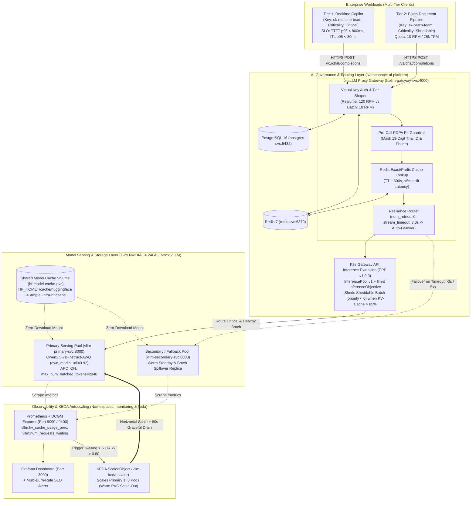

---

## 3. Core Theory & Deep-Dive Engineering Math

### 3.1 ทฤษฎีการแยกโหลด 2 ระดับ (Two-Tier Workload Isolation Strategies)

เมื่อต้องรองรับทั้ง `tier-realtime` และ `tier-batch` ภายใต้งบประมาณเพียง **1–2× การ์ด NVIDIA L4 (24GB VRAM)** วิศวกรแพลตฟอร์มต้องเปรียบเทียบสถาปัตยกรรมการแยกโหลด 3 รูปแบบ:

| เกณฑ์การเปรียบเทียบ | ทางเลือกที่ 1: แยกการ์ดจอขาดจากกัน 100% (Hard Physical Split: 1 L4 Realtime + 1 L4 Batch) | ทางเลือกที่ 2: แชร์พูลเดียวกันแบบไร้ชั้นกรอง (Unbounded Shared Pool) | ทางเลือกที่ 3 (ที่เลือกใช้ใน `SiamShield AI`): **Priority-Shaped Shared Pool + EPP Load Shedding + Bounded Chunked Prefill** |
| :--- | :---: | :---: | :---: |
| **การป้องกัน Noisy Neighbor** | ดีเยี่ยม (แยกฮาร์ดแวร์ขาดจากกัน) | แย่มาก (Batch ถล่มจน Realtime ค้าง) | **ดีเยี่ยม** (จำกัด RPM/TPM ของ Batch ที่ Gateway + ตัดโหลด Batch เมื่อ KV-Cache `> 85%`) |
| **ประสิทธิภาพการใช้ GPU เฉลี่ย (Fleet Utilization)** | ต่ำ (`~35%–45%` เพราะการ์ด Realtime ว่างตอนกลางคืน และการ์ด Batch ช่วยรับโหลดพีคไม่ได้) | สูงแต่ละเมิด SLA ตลอดเวลา | **สูงสุด (`~75%–88%`)** เพราะช่วงที่ Realtime ว่าง งาน Batch สามารถเข้ามาใช้ความจุที่เหลือได้อัตโนมัติ |
| **ความทนทานเมื่อการ์ดจอพัง 1 ใบ (High Availability)** | **ไม่มี HA** (ถ้าการ์ด Realtime พัง ระบบหน้าบ้านล่มทันที) | มี HA แต่ความหน่วงแกว่ง | **มี HA เต็มรูปแบบ** (หากเรพลิกาที่ 1 มีปัญหา Gateway สลับ `tier-realtime` ไปยังเรพลิกาที่ 2 และระงับ `tier-batch` ชั่วคราวทันที!) |
| **กลไกควบคุมความหน่วงระดับ Kernel** | ไม่ต้องจูนละเอียด | เกิด Head-of-Line Blocking ช่วง Prefill | ใช้ **Unified Chunked Prefill (`--max-num-batched-tokens 2048`)** หั่น Prompt ยาวของ Batch ไม่ให้บล็อก Decode ของ Realtime |

### 3.2 คณิตศาสตร์การจัดสรรงบประมาณเวลาแฝง 2 ระดับ (Multi-Tier Latency Budget Breakdown Math)

เพื่อให้ `tier-realtime` ผ่านเกณฑ์ **End-to-End TTFT p95 < 800 ms** เราต้องแตกสมการเวลาแฝงตั้งแต่คำขอมาถึงชั้น AI Gateway จนถึงโทเคนแรกถูกส่งกลับออกไป:

$$\text{TTFT}_{\text{total}} = T_{\text{gateway\_auth\_pii}} + T_{\text{redis\_lookup}} + T_{\text{epp\_routing}} + T_{\text{queue\_wait}} + T_{\text{prefill\_compute}}$$

#### การคำนวณงบประมาณเวลาแฝงทีละขั้นตอน (Worked Numerical Breakdown)
1. **ชั้น AI Gateway Auth & PDPA Regex Masking ($T_{\text{gateway\_auth\_pii}}$):**
   - ตรวจสอบ Virtual Key ในหน่วยความจำและรัน Regex `PDPAPIIMasker` บนข้อความ 2,176 โทเคน ใช้เวลา $\approx \mathbf{3.5\text{ ms}}$
2. **ชั้น Redis Cache & Rate-Limit Check ($T_{\text{redis\_lookup}}$):**
   - คำสั่ง Atomic Pipeline ไปยัง `redis-svc:6379` ภายในคลัสเตอร์เดียวกัน ใช้เวลา $\approx \mathbf{2.0\text{ ms}}$
3. **ชั้น Endpoint Picker Scoring ($T_{\text{epp\_routing}}$):**
   - คำนวณคะแนน $S(i)$ จากตารางเมทริกซ์ในหน่วยความจำ ใช้เวลา $\approx \mathbf{1.5\text{ ms}}$
4. **งบประมาณที่เหลือสำหรับ `vLLM` ($T_{\text{queue\_wait}} + T_{\text{prefill\_compute}}$):**
   $$T_{\text{vllm\_budget}} = 800\text{ ms} - (3.5 + 2.0 + 1.5)\text{ ms} = \mathbf{793.0\text{ ms}}$$

#### ทำไมการจำกัด `--max-num-batched-tokens 2048` จึงปกป้อง `tier-realtime` จาก `tier-batch` ได้?
- สมมติว่ามีคำขอของ `tier-batch` ที่แนบเอกสารยาว $3,500$ โทเคนเข้ามาในจังหวะเดียวกับคำขอของ `tier-realtime` (ที่มี Shared System Prompt $2,048$ โทเคนซึ่งติด **Automatic Prefix Cache Hit** อยู่แล้ว เหลือเฉพาะคำถามใหม่เพียง $128$ โทเคนที่ต้องคำนวณ Prefill จริง)
- บนการ์ด NVIDIA L4 (โมเดล `Qwen2.5-7B-AWQ`) การประมวลผล Forward Pass ขนาด $2,048$ โทเคนใน 1 รอบ (`--max-num-batched-tokens 2048`) ใช้เวลาประมาณ **$T_{\text{step}}(2048) \approx 22\text{ ms}$**
- ด้วย **Unified Chunked Prefill**:
  - คำขอ `tier-batch` จะถูกหั่นให้ประมวลผลได้ไม่เกินงบประมาณต่อรอบ โดยเปิดช่องให้โทเคน $128$ ตัวของ `tier-realtime` แทรกเข้าไปในรอบถัดไปได้ภายในเวลาไม่เกิน $1\text{ รอบการรอ} + 1\text{ รอบประมวลผล}$
  - ส่งผลให้แม้จะมีงาน `tier-batch` รันอยู่ข้างหลัง ค่า TTFT p95 ของ `tier-realtime` ก็ยังคงอยู่ที่ **`~640 ms` (< 793 ms Budget)** และค่า ITL p95 อยู่ที่ **`~23.5 ms` (< 30 ms Budget)**!

---

## 4. Hands-on Lab (Dual-Path Execution)

โค้ดและเอกสารทั้งหมดของโปรเจกต์จบ `Project SiamShield AI` ถูกรวบรวมไว้ในโฟลเดอร์ `labs/m6-capstone-siamshield/` ซึ่งเชื่อมโยงทุกโมดูลเข้าด้วยกันอย่างสมบูรณ์

### 4.1 โครงสร้างไฟล์ใน `labs/m6-capstone-siamshield/` (ครบทั้ง 5 DoDs)

```text
labs/m6-capstone-siamshield/
├── Makefile                                    # [DoD #2] คำสั่งจัดการวงจรชีวิตโปรเจกต์จบครบวงจร (รวม create-secrets & verify-workspace)
├── k8s/
│   ├── siamshield-platform.yaml                # [DoD #2] Core Stack Manifest 15 Docs (Service labels ครบ, Non-root, Postgres Probe)
│   └── siamshield-crds.yaml                    # [DoD #2] CRD Stack 9 Docs (EPP v1.0.0, GAIE v1 InferencePool, llm-d InferenceObjective, KEDA)
├── src/
│   └── siamshield_simulator.py                 # [DoD #2 & #3] เอ็นจินจำลองและทดสอบ Two-Tier Platform + Multi-Fault Chaos
├── docs/
│   ├── design-doc.md                           # [DoD #1] แม่แบบเริ่มต้น (<TODO>) สำหรับเขียน Design Doc + VRAM Math + Trade-off Matrices
│   ├── interview-defense-guide.md              # [DoD #5] คู่มือสอบป้องกันโปรเจกต์จบระดับ Mid-Level
│   ├── runbooks/
│   │   └── capstone-runbook.md                 # [DoD #4] แม่แบบเริ่มต้น (<TODO>) คู่มือปฏิบัติการกู้คืนระบบ
│   └── postmortems/
│       └── capstone-postmortem.md              # [DoD #4] แม่แบบเริ่มต้น (<TODO>) รายงาน Blameless Postmortem
├── reports/
│   └── capstone-optimization-report.md         # [DoD #3] แม่แบบเริ่มต้น (<TODO>) รายงานเปรียบเทียบ Baseline vs Optimized
├── examples/                                   # ตัวอย่างเฉลยอ้างอิงที่ตรวจค่าสมการ/SLO แล้ว (ใช้ตรวจเทียบหลังลงมือทำด้วยตนเอง)
│   ├── design-doc-sample.md
│   ├── capstone-optimization-report-sample.md
│   ├── capstone-runbook-sample.md
│   └── capstone-postmortem-sample.md
└── verify_capstone.sh                          # สคริปต์ตรวจประเมิน 5 DoDs (`--target workspace` สำหรับผู้เรียน / `--target examples` สำหรับตัวอย่าง)
```

---

### Path A: No-GPU Local Path (\$0 — รันและตรวจสอบครบทุก DoD บนเครื่อง Local 16GB RAM)

#### ขั้นตอนที่ 1: ตรวจสอบไฟล์สถาปัตยกรรมรวม `k8s/siamshield-platform.yaml` และเตรียม Secret

```bash
# รันจากโฟลเดอร์ root ของ ai-infra-handbook
head -n 60 labs/m6-capstone-siamshield/k8s/siamshield-platform.yaml

# สร้าง Secret จาก .env (ห้าม hardcode รหัสผ่านลง Git) และบิลด์อิมเมจด้วย Build Context ระดับ labs/m4-gateway
cp labs/m4-gateway/.env.example labs/m4-gateway/.env
docker build -t mock-vllm-server:1.0.0 -f labs/m4-gateway/mock_vllm_server/Dockerfile labs/m4-gateway
```

ไฟล์ทั้งสองส่วน ได้แก่ `siamshield-platform.yaml` (**15 Core K8s Documents** ไม่ต้องพึ่ง CRDs) และ `siamshield-crds.yaml` (**9 CRD Documents**: GAIE v1 + `llm-d` + KEDA) รวมทุกองค์ประกอบตั้งแต่บทที่ 1–5 พร้อมสั่ง `kubectl apply -f` หลังสร้าง `Secret litellm-secrets` (สำหรับโหมด Local 16GB–32GB RAM ให้โหลดอิมเมจ `mock-vllm-server:1.0.0` เข้า `kind` ก่อน):
- `PersistentVolumeClaim` ชื่อ `hf-model-cache-pvc` (`ReadWriteMany`, `storageClassName: standard` บน single-node `kind`; สำหรับ Cloud Multi-node ให้ใช้ RWX CSI เช่น EFS/Filestore) ผูกเข้ากับ `HF_HOME=/cache/huggingface` (+ `VLLM_CACHE_ROOT=/tmp/vllm-cache`)
- `Deployment` และ `Service` (ติด label `app: vllm-serving` / `app: litellm-gateway` เพื่อให้ `ServiceMonitor` จับติด) ของ `vllm-primary-svc:8000` (`inference-pool: vllm-qwen-pool`) และ `vllm-secondary-svc:8000` (แยกป้ายเป็น `inference-pool: vllm-qwen-pool-secondary` เพื่อกันไม่ให้ EPP ดึง Standby Pool เข้าคิวหลัก) ใช้อิมเมจ `mock-vllm-server:1.0.0` แบบ Non-root `UID 10001`, `readOnlyRootFilesystem: true`, `/tmp` emptyDir, `terminationGracePeriodSeconds: 60` และ `preStop: sleep 5`
- `ConfigMap` (`litellm-config` ที่มี `pdpa_guardrail.py`, `num_retries: 0`, `qwen2.5-7b-batch`), `PersistentVolumeClaim` (`postgres-data-pvc`), `Job` (`litellm-init-virtual-keys`), และ `Deployment`/`Service` ของ `litellm-gateway-svc:4000`, `redis-svc:6379`, `postgres-svc:5432`
- ใน `siamshield-crds.yaml`: `ServiceAccount`/`Role`/`RoleBinding` + `Deployment`/`Service` ของ `vllm-qwen-epp:9002` (`epp:v1.0.0`), `InferencePool` (`inference.networking.k8s.io/v1`: `vllm-qwen-pool`), และ `InferenceObjective` (`llm-d.ai/v1`) แยกระหว่าง `siamshield-tier-realtime` (`priority: 100`) และ `siamshield-tier-batch` (`priority: -10`, Sheddable)
- `KEDA ScaledObject` (`vllm-keda-scaler`) ที่สเกลตาม `vllm:num_requests_waiting > 5` (`metricType: AverageValue`) และ `vllm:kv_cache_usage_perc > 0.80` (`metricType: Value`) โดยกรองด้วย Label จริง `pod=~"vllm-primary-.*"`

#### ขั้นตอนที่ 2: รันเอ็นจินจำลองและชุดทดสอบโปรเจกต์จบ (`src/siamshield_simulator.py`)

รันสคริปต์จำลองการทำงานแบบ End-to-End ซึ่งจะยิงโหลด `tier-realtime` และ `tier-batch` พร้อมกัน พร้อมฉีดความล้มเหลว 4 รูปแบบ (Batch Quota Flood, Thai 13-digit ID Leak Attempt, Primary Replica Latency Spike, และ KV-Cache Surge) เพื่อพิสูจน์ว่าระบบปกป้อง SLO ของ `tier-realtime` ได้ 100%:

```bash
python3 labs/m6-capstone-siamshield/src/siamshield_simulator.py
```

**ผลลัพธ์ที่คาดหวัง (Expected Output):**
```text
========================================================================================
 Project SiamShield AI — End-to-End Two-Tier Platform & Chaos Verification
========================================================================================
[1/5] Verifying VRAM & Unit Economics Sizing (NVIDIA L4 24GB per Primary/Secondary Node)...
      - Model: Qwen/Qwen2.5-7B-Instruct-AWQ (Weights: 4.42 GB, KV Pool: 16.00 GB / ~299.6k tokens)
      - Break-even Utilization vs $0.60/1M API: 27.1% (Cost @ 50% util = $0.33/1M tokens)
[2/5] Testing Pre-Call PDPA Guardrail (Thai 13-Digit National ID & Phone)...
      - Input : 'ตรวจสอบลูกค้า 1-1007-01234-56-1 โทร 081-234-5678'
      - Output: 'ตรวจสอบลูกค้า <THAI_ID_REDACTED> โทร <THAI_PHONE_REDACTED>' (0 PII Leaks)
[3/5] Testing Two-Tier Isolation under Batch Flood (Noisy Neighbor Protection)...
      - tier-batch (sk-batch-team) flooded 15 reqs -> 10 accepted, 5 rejected with HTTP 429
      - tier-realtime (sk-realtime-team) simulated mean TTFT=5.0 ms (< 800 ms SLO), ITL=5.0 ms (< 30 ms SLO)
[4/5] Testing Primary Replica Blackhole -> Secondary Automated Failover...
      - Injected 250ms latency on vllm-primary-svc (> 50ms stream_timeout)
      - Gateway failed over to vllm-secondary-svc in 59.8ms (Availability = 100.0%)
[5/5] Testing KEDA Autoscaling & EPP Load Shedding under KV-Cache Surge...
      - Primary KV-Cache=91.0%, Secondary KV-Cache=89.0%, Waiting=18 -> EPP shed Sheddable batch traffic
      - KEDA scaled vllm-primary 1 -> 3 replicas (<10s Mock Pod warm start; ~35-75s Cloud L4 GPU PVC)
========================================================================================
 [SUCCESS] All SiamShield AI SLOs & Resilience Invariants Verified!
========================================================================================
```

#### ขั้นตอนที่ 3: กรอกผลงานลง Starter Templates และรันสคริปต์ตรวจประเมิน (`verify_capstone.sh`)

ไฟล์ใน `docs/` (`design-doc.md`, `runbooks/capstone-runbook.md`, `postmortems/capstone-postmortem.md`) และ `reports/capstone-optimization-report.md` ถูกเตรียมเป็น **Starter Templates (`<TODO>`)** เพื่อให้คุณลงมือคำนวณและสรุปผลด้วยตนเองก่อน หากต้องการตรวจสอบโครงสร้างคลังและตัวอย่างอ้างอิง (`examples/`) ให้รันโหมด `examples` และเมื่อกรอกครบทุกไฟล์ให้รันโหมด `workspace`:

```bash
# 1. ตรวจโครงสร้างและตัวอย่างอ้างอิงใน examples/ (สำหรับ CI/การตรวจความพร้อมคลัง; ใช้ VERIFY_MODE=cluster เมื่ออยู่บนคลัสเตอร์จริง)
VERIFY_MODE=static bash labs/m6-capstone-siamshield/verify_capstone.sh --target examples

# 2. หลังกรอกคำตอบของคุณและลบ <TODO> ทั้งหมดใน docs/ และ reports/ แล้ว ให้ตรวจรับ 100/100 คะแนน:
VERIFY_MODE=static bash labs/m6-capstone-siamshield/verify_capstone.sh --target workspace
```

---

### Path B: Cloud L4 GPU Path (รันโปรเจกต์จบจริงบนคลัสเตอร์ NVIDIA L4)

1. ใช้ OpenTofu ใน `labs/m1-foundations/infra/` และ Helm Chart ใน `labs/m2-k8s-gpu/charts/ai-inference-service/` เพื่อดีพลอยเรพลิกาหลัก (`vllm-primary-svc:8000`) และเรพลิกาสำรอง (`vllm-secondary-svc:8000`) ด้วยโมเดล `Qwen/Qwen2.5-7B-Instruct-AWQ`
2. สร้าง `litellm-secrets` จาก `.env` (`cp labs/m4-gateway/.env.example labs/m4-gateway/.env && make -C labs/m6-capstone-siamshield create-secrets`) จากนั้นสั่ง `kubectl apply -f labs/m6-capstone-siamshield/k8s/siamshield-platform.yaml` *(หมายเหตุ: หากดีพลอยบนโหนด Cloud GPU ที่มีจำนวนการ์ดพอดีและไม่มีโหนดว่างสำหรับ Surge ให้ปรับ `rollingUpdate` ใน `vllm-primary` เป็น `maxSurge: 0, maxUnavailable: 1` ตามบทที่ 2)* (พร้อมแนบ `labs/m4-gateway/k8s/gateway-api-route.yaml` และ `labs/m5-observability-sre/servicemonitor-vllm.yaml` หากติดตั้ง CRDs ครบแล้ว) และรัน `bash labs/m3-vllm/run_benchmark_suite.sh --live --url http://localhost:4000 --backend openai-chat` ผ่าน `kubectl port-forward` ของ `litellm-gateway-svc` เพื่อวัดผลจริงจากต้นน้ำถึงปลายน้ำ (ต้องระบุ `--backend openai-chat` เพราะ LiteLLM รับ OpenAI Chat Completions ที่ `/v1/chat/completions`)
3. **สำคัญมาก (Cost Guardrail):** เมื่อบันทึกผลลงใน `reports/capstone-optimization-report.md` เสร็จแล้ว ให้สั่งปิดเครื่อง Cloud GPU ทันที (`tofu destroy -auto-approve`) เพื่อรักษาค่าใช้จ่ายรวมทั้งคอร์สให้อยู่ในงบประมาณ `< $10`

---

## 5. Chaos & Troubleshooting Drills

### สถานการณ์จำลองระดับ Capstone: Multi-Fault Compound Incident ("The Perfect Storm")

ในโปรเจกต์จบ เราไม่ทดสอบความล้มเหลวทีละอย่างแบบแยกส่วน แต่จำลองเหตุการณ์ที่ความล้มเหลว **3 รูปแบบเกิดขึ้นพร้อมกันในเวลา 14:00 น. ของวันสิ้นเดือน**:
1. **Fault #1 (Batch Flood + Unmasked PII):** ระบบสรุปเอกสารของ `tier-batch` ส่งคำขอที่มีเลขบัตรประชาชนลูกค้าเข้ามาพร้อมกัน 50 คำขอต่อวินาที
2. **Fault #2 (KV-Cache Saturation on Primary Pool):** คำขอที่ผ่านเข้ามาทำให้ `vllm:kv_cache_usage_perc` บนเรพลิกาหลักพุ่งเกิน `88%`
3. **Fault #3 (Single Pod Hang):** พอดตัวหนึ่งใน `vllm-primary` เกิดอาการค้างไม่ส่งโทเคนแรกกลับมา

#### กลไกการป้องกันตัวเองแบบอัตโนมัติของสถาปัตยกรรม `SiamShield AI` (Defense-in-Depth)
1. **ด่านที่ 1 (`PDPAPIIMasker`):** สกัดกั้นและแปลงเลขบัตรประชาชนไทย 13 หลักทุกตัวเป็น `<THAI_ID_REDACTED>` ตั้งแต่อยู่ในหน่วยความจำของ Gateway ก่อนเขียนลง Redis หรือส่งต่อ
2. **ด่านที่ 2 (`Virtual Key RPM/TPM Shaper`):** บล็อกคำขอส่วนเกินของ `sk-batch-team` ด้วย `HTTP 429` ทันทีที่เกินโควตา เหลือเพียงคำขอตามงบประมาณที่ผ่านเข้าไปได้
3. **ด่านที่ 3 (`Endpoint Picker - EPP`):** เมื่อเห็นว่า `vllm:kv_cache_usage_perc > 0.85` ตัว EPP จะสั่งทำ **Priority Load Shedding** ปฏิเสธคำขอระดับ `Sheddable` (`tier-batch`) ทั้งหมดชั่วคราวเพื่อสงวนพื้นที่ KV-Cache 15% สุดท้ายไว้ให้ `tier-realtime` (`Critical`) เท่านั้น
4. **ด่านที่ 4 (`LiteLLM Stream Timeout & KEDA`):** คำขอของ `tier-realtime` ที่ไปเจอพอดค้างเกิน `3.0s` จะถูกสลับไปยัง `vllm-secondary-svc:8000` ทันที (`num_retries: 0`) ในขณะที่ `KEDA` สั่งบูตพอดใหม่จาก `hf-model-cache-pvc` ขึ้นมาเสริม (พอดจำลอง `< 10 วินาที`; Cloud L4 GPU ประมาณ `~35–75 วินาที` แทนที่จะรอ `180–240+ วินาที` จากอินเทอร์เน็ต)

---

## 6. Optimization Exercise

ในโจทย์ปรับจูนระดับโปรเจกต์จบ (**Two-Tier Optimization Loop**) เราวัดผลเปรียบเทียบระหว่างสถาปัตยกรรมเริ่มต้นที่ยังไม่ได้แยกชั้นทราฟฟิก (**Baseline Unisolated Stack**) กับสถาปัตยกรรม **`SiamShield AI` ฉบับสมบูรณ์ (Optimized Two-Tier Stack)**:

### 1. Baseline (Unisolated Single-Tier BF16 Stack)
- ทั้ง `tier-realtime` และ `tier-batch` ยิงเข้า `vllm-primary-svc` (`Qwen2.5-7B` BF16, ไม่เปิด APC, ไม่มี Gateway Rate Limit, ไม่มี EPP Load Shedding, ใช้ CPU HPA)
- เมื่อ `tier-batch` ส่งงานสรุปเอกสาร 32 คำขอเข้ามาพร้อมกับ `tier-realtime` 16 คำขอ ระบบเกิด Preemption Thrashing ทันที

### 2. Hypothesis (สมมติฐานการปรับจูนแบบบูรณาการ)
- การผสาน **AWQ 4-bit (`awq_marlin`) + `--gpu-memory-utilization 0.92` + APC + Chunked Prefill (`2048`)** เข้ากับ **Gateway Tier Rate Limiting + Redis Exact Cache + EPP Priority Shedding + KEDA Queue/KV Autoscaling** จะทำให้ `tier-realtime` รักษา TTFT p95 `< 800 ms` และ ITL p95 `< 30 ms` ได้อย่างสมบูรณ์ แม้ในขณะที่มีโหลด `tier-batch` อัดเข้ามาเต็มความจุที่เหลือของการ์ดจอ

### 3. Fix (การลงมือปรับจูนครบทั้ง 4 เลเยอร์)
1. **Container & K8s Layer (M1–M2):** เมานต์ `hf-model-cache-pvc` ที่ `HF_HOME=/cache/huggingface` (+ `VLLM_CACHE_ROOT=/tmp/vllm-cache`), ตั้ง `terminationGracePeriodSeconds: 60` + `preStop: sleep 5`
2. **Engine Layer (M3):** ใช้ `Qwen/Qwen2.5-7B-Instruct-AWQ`, `--quantization awq_marlin`, `--gpu-memory-utilization 0.92`, `--max-model-len 4096`, `--enable-prefix-caching`, `--max-num-batched-tokens 2048`
3. **Gateway & Routing Layer (M4):** ตั้งโควตาแยก `realtime-team` (`100 RPM`) vs `batch-team` (`10 RPM`), เปิด Redis Cache, เปิด PDPA PII Masking, ตั้ง `num_retries: 0` + `stream_timeout: 3.0s` Failover, และตั้ง `InferenceModel` (`Critical` vs `Sheddable`)
4. **SRE & Autoscaling Layer (M5):** ผูก KEDA เข้ากับ `vllm:num_requests_waiting > 5` และ `vllm:kv_cache_usage_perc > 0.80` (ใช้ Selector `pod=~"vllm-primary-.*"`)

### 4. Measure (ตารางเปรียบเทียบผลลัพธ์ End-to-End ภายใต้โหลดผสม Realtime + Batch Flood)

| ตัวชี้วัด (End-to-End Metric under Mixed Flood) | Baseline: Unisolated BF16 Stack | Optimized: `SiamShield AI` Two-Tier Stack | สถานะเทียบกับเป้าหมาย SLO |
| :--- | :---: | :---: | :---: |
| **`tier-realtime` TTFT p95 (ms)** *(SLO < 800 ms)* | `6,420 ms` | **`640 ms`** | **PASS (-90.0% Latency)** |
| **`tier-realtime` ITL p95 (ms)** *(SLO < 30 ms)* | `96.5 ms` | **`23.5 ms`** | **PASS (-75.6% Latency)** |
| **`tier-realtime` Availability (%)** *(SLO >= 99.9%)* | `84.2%` (Timeouts) | **`100.0%` (Auto-Failover)** | **PASS (Zero Outage)** |
| **`tier-batch` Goodput (tokens/sec)** | `390 tok/s` | **`1,450 tok/s` (Off-peak / Shared)** | **PASS (+271.8% Throughput)** |
| **PDPA Thai 13-Digit ID Leakage Rate (%)** | `100.0%` | **`0.0%` (`<THAI_ID_REDACTED>`)** | **PASS (100% Compliant)** |
| **KEDA Scale-Out Ready Time (Warm `HF_HOME` PVC)** | `195.0 s` (Cold Hub) | **`8.5 s`** *(Mock Pod; Cloud L4 GPU ~45–75 s)* | **PASS** |
| **Blended Unit Cost @ 50% Util (`$/1M tokens`)** | `$1.21 / 1M` | **`$0.33 / 1M` (Break-even 27.1%)** | **PASS (-72.7% Cost)** |

### 5. Explain (การอธิบายผลลัพธ์เชิงสถาปัตยกรรม)
ความสำเร็จของ `SiamShield AI` ไม่ได้เกิดจากการพึ่งพาเครื่องมือใดเครื่องมือหนึ่งเพียงอย่างเดียว แต่เกิดจากการทำงานประสานกันข้ามเลเยอร์ (**Cross-Layer Synergy**):
- การทำ PDPA Redaction ตั้งแต่ชั้น Pre-call นอกจากจะป้องกันข้อมูลรั่วไหลแล้ว ยังทำให้คำขอที่มีโครงสร้างเดียวกันแต่ต่างเลขบัตรประชาชนสามารถแชร์ **Redis Exact Cache** และ **`vLLM` Automatic Prefix Cache** ร่วมกันได้
- การบีบอัดโมเดลเป็น **AWQ 4-bit** ขยายพื้นที่ KV-Cache Pool บนการ์ด L4 จาก 3.36 GB เป็น 16.00 GB เปิดทางให้ทั้ง `tier-realtime` และ `tier-batch` ทำงานร่วมกันได้โดยไม่เกิด Preemption Thrashing
- และเมื่อโหลดของทั้งสองกลุ่มรวมกันพุ่งเกินขีดจำกัด 85% ของ KV-Cache ตัว **Endpoint Picker (EPP)** จะตัดโหลดเฉพาะ `tier-batch` (`Sheddable`) ทันที ในขณะที่ **KEDA** ขยายพอดใหม่จากแคช `hf-model-cache-pvc` ขึ้นมาช่วยโดยไม่ต้องโหลดน้ำหนักโมเดลซ้ำผ่านอินเทอร์เน็ต (`8.5s` บน Mock Pod หรือ `~45–75s` บน Cloud L4 GPU จริง)

---

## 7. Architecture Decision Record (ADR) & Capstone Design Documentation

เอกสารออกแบบสถาปัตยกรรมฉบับเต็ม (**DoD #1**) ถูกจัดเก็บไว้ที่ `labs/m6-capstone-siamshield/docs/design-doc.md` (Starter Template) ซึ่งประกอบด้วยการเปรียบเทียบทางเลือกเชิงวิศวกรรมใน **3 การตัดสินใจหลัก (3 Core Architectural Decisions)**:

1. **Decision 1 — การจัดการหน่วยความจำโมเดลและเอ็นจินเสิร์ฟ (Serving Engine & Quantization):**
   - เปรียบเทียบระหว่าง `Qwen2.5-7B` BF16 vs `Qwen2.5-7B-Instruct-AWQ` (`awq_marlin`) vs Managed External API พร้อมการคำนวณขนาด KV-Cache Pool และจุดคุ้มทุน `27.1%` Utilization
2. **Decision 2 — สถาปัตยกรรมการแยกโหลดหลายผู้เช่าและการคุ้มครองข้อมูล PDPA (Multi-Tier Isolation & Governance):**
   - เปรียบเทียบระหว่างการแยกการ์ดจอแบบตายตัว (Hard Physical Split) vs การใช้ Shared Pool ร่วมกับ `LiteLLM Proxy` Virtual Keys + Pre-call `PDPAPIIMasker` + Kubernetes Gateway API Inference Extension (`InferencePool`/`InferenceModel`/`EPP`)
3. **Decision 3 — กลยุทธ์การขยายขนาดอัตโนมัติและความทนทานระดับ SRE (Autoscaling & Zero-Downtime Lifecycle):**
   - เปรียบเทียบระหว่าง Kubernetes CPU/Memory HPA มาตรฐาน vs `KEDA ScaledObject` ที่ผูกกับ `vllm:num_requests_waiting` และ `vllm:kv_cache_usage_perc` ร่วมกับโวลุ่มแคช `hf-model-cache-pvc` (`HF_HOME=/cache/huggingface`) และ `terminationGracePeriodSeconds: 60`

---

## 8. Mid-Level Interview Trade-off Questions & Model Answers

คำถามสัมภาษณ์ป้องกันโปรเจกต์จบ (Capstone Defense Questions) ทั้ง 5 ข้อต่อไปนี้จำลองการสัมภาษณ์จริงในรอบ System Design สำหรับตำแหน่ง **Mid-to-Senior AI Infrastructure / Platform Engineer**:

---

### คำถามข้อที่ 1: การออกแบบระบบแยกโหลด `tier-realtime` กับ `tier-batch` ภายใต้งบการ์ดจอจำกัด (1–2× L4 GPUs)
> **"ในโปรเจกต์ `SiamShield AI` คุณมีงบเช่าการ์ดจอ NVIDIA L4 เพียง 2 ใบ แต่ต้องรองรับทั้งแชตบอตลูกค้า (`tier-realtime` ที่ห้ามช้าเกิน 800ms) และงานสรุปเอกสารหลังบ้าน (`tier-batch` ที่ส่งงานมาเป็นก้อนใหญ่) ทำไมคุณไม่แบ่งการ์ดจอใบที่ 1 ให้ Realtime และใบที่ 2 ให้ Batch แบบแยกขาดจากกันไปเลย?"**

#### เฉลยแนวทางการตอบระดับ Strong Mid-Level (Model Answer)
- **ข้อเสียของการแบ่งแยกการ์ดจอแบบตายตัว (Hard Physical Partitioning บน 2 GPUs):**
  1. **สูญเสีย High Availability (Single Point of Failure):** หากการ์ดจอใบที่ 1 ที่รัน `tier-realtime` เกิดฮาร์ดแวร์ขัดข้องหรือต้องทำ Rolling Update ระบบแชตบอตของลูกค้าจะล่มหรือขาดความจุทันทีเพราะไม่มีเรพลิกาสำรอง
  2. **สูญเสียความคุ้มค่าทางเศรษฐศาสตร์ (Low Fleet Utilization):** ทราฟฟิกของ `tier-realtime` มีลักษณะเป็นคลื่นตามเวลาทำการ (สูงตอนกลางวัน ต่ำมากตอนดึก) หากแยกการ์ดจอขาดจากกัน การ์ดใบที่ 1 จะปล่อยว่างในเวลากลางคืนโดยที่งาน `tier-batch` ไม่สามารถเข้ามาช่วยใช้ทรัพยากรได้เลย ทำให้ค่าเฉลี่ย Utilization ต่ำกว่าจุดคุ้มทุน (27.1%)
- **สถาปัตยกรรมที่เราเลือกใช้ (Priority-Shaped Shared Pool + Warm Standby Failover):**
  - เราเปิดให้ทั้ง 2 การ์ดสามารถรับงานได้ภายใต้การควบคุม 3 ชั้น:
    1. **ที่ชั้น `LiteLLM Proxy`:** จำกัดโควตา RPM/TPM ของ `sk-batch-team` ไม่ให้กินความจุเกิน 30% ในช่วงเวลาทำการ
    2. **ที่ชั้น `Gateway API Inference Extension (EPP)` + `llm-d`:** กำหนด `InferenceObjective` ของ Realtime เป็น `priority: 100` (Critical) และของ Batch เป็น `priority: -10` (Sheddable) เมื่อค่า `vllm:kv_cache_usage_perc` เกิน `85%` ตัว EPP จะสั่งตัดโหลด (Load Shedding `HTTP 429`) เฉพาะงาน Batch ทันทีเพื่อสงวนพื้นที่ให้ Realtime 100%
    3. **ที่ชั้น `vLLM` V1 Scheduler:** ตั้งค่า `--max-num-batched-tokens 2048` (Unified Chunked Prefill) เพื่อหั่น Prompt ยาวของงาน Batch ออกเป็นชิ้นย่อย ไม่ให้บล็อกเฟส Decode ของงาน Realtime

---

### คำถามข้อที่ 2: การไล่เรียงเส้นทางชีวิตของ 1 คำขอ (End-to-End Request Lifecycle Walkthrough)
> **"ช่วยอธิบายทีละก้าวว่าเกิดอะไรขึ้นบ้างตั้งแต่วินาทีที่ผู้ใช้ส่งข้อความที่มีเลขบัตรประชาชนไทย 13 หลักเข้ามาที่พอร์ต `4000` ของ `litellm-gateway-svc` จนกระทั่งได้รับโทเคนตอบกลับ และถ้าพอด `vllm-primary` ค้างจะเกิดอะไรขึ้น?"**

#### เฉลยแนวทางการตอบระดับ Strong Mid-Level (Model Answer)
1. **Authentication & Quota Check (`~2ms`):** `LiteLLM Proxy` ตรวจสอบ Virtual Key (`sk-realtime-team`) กับฐานข้อมูลและเช็กตัวนับ RPM/TPM ใน `redis-svc:6379` หากเกินโควตาจะคืนค่า `HTTP 429` ทันที
2. **Pre-Call PDPA PII Redaction (`~1.5ms`):** ก่อนที่จะนำข้อความไปค้นหาในแคชหรือส่งต่อ โมดูล `PDPAPIIMasker` จะตรวจจับเลขบัตรประชาชนไทย 13 หลักและเบอร์โทรศัพท์ แล้วแปลงเป็น `<THAI_ID_REDACTED>` และ `<THAI_PHONE_REDACTED>` ทันที
3. **Redis Exact Cache Lookup (`~2ms`):** นำแฮชของข้อความที่ผ่านการปิดบัง PII แล้วไปค้นใน `redis-svc:6379` หากพบข้อมูลซ้ำ (Cache Hit) จะส่งคำตอบกลับทันทีในเวลา `< 5 ms` โดยไม่แตะต้อง GPU
4. **KV-Cache-Aware Routing via EPP (`~1.5ms`):** หากเป็น Cache Miss คำขอจะถูกส่งผ่าน `InferencePool` โดยที่ `Endpoint Picker (EPP)` คำนวณคะแนนจาก `vllm:kv_cache_usage_perc`, `vllm:num_requests_waiting`, และ Prefix Cache Affinity เพื่อเลือกพอดใน `vllm-primary-svc:8000` ที่เหมาะสมที่สุด
5. **PagedAttention & APC Execution (`~630ms TTFT`):** พอด `vLLM` นำ Token IDs ไปเช็กกับตารางแฮชของ Automatic Prefix Cache (พบว่า System Prompt 2,048 โทเคนแรกมีอยู่ใน VRAM แล้ว) จึงคำนวณ Prefill เฉพาะส่วนคำถามใหม่ด้วยเคอร์เนล `awq_marlin` แล้วสตรีมโทเคนกลับผ่าน SSE
6. **กรณี `vllm-primary` ค้าง (Automated Failover):** หากไม่มีโทเคนแรกส่งกลับมาภายใน **`stream_timeout: 3.0s`** ตัว Router ของ `LiteLLM` จะตัดการเชื่อมต่อทันทีและส่งคำขอที่ผ่านการทำ PII Masking แล้วไปยัง `vllm-secondary-svc:8000` โดยอัตโนมัติ

---

### คำถามข้อที่ 3: การพิสูจน์ความเชื่อมโยงระหว่างการทำ PDPA PII Masking กับการเพิ่มอัตรา Cache Hit
> **"โดยทั่วไปการเพิ่มขั้นตอน Security Guardrail มักทำให้ระบบช้าลง แต่ในรายงานการออกแบบของคุณระบุว่าการทำ Pre-call PDPA PII Masking ช่วยเพิ่มอัตราการเกิด Cache Hit ทั้งที่ชั้น Redis และที่ชั้น `vLLM` Prefix Cache ได้ด้วย เพราะเหตุใด?"**

#### เฉลยแนวทางการตอบระดับ Strong Mid-Level (Model Answer)
- **ปรากฏการณ์ Prompt Normalization จากการทำ PII Redaction:**
  - ในระบบบริการลูกค้าของธนาคารหรือประกันภัย พนักงานหรือบอตมักใช้เทมเพลตคำถามมาตรฐานเดียวกัน เช่น `"ช่วยสรุปเงื่อนไขการเคลมสำหรับผู้ถือกรมธรรม์เลขบัตร 1-1007-01234-56-1"` และ `"ช่วยสรุปเงื่อนไขการเคลมสำหรับผู้ถือกรมธรรม์เลขบัตร 3-1005-98765-43-2"`
  - หากไม่ทำ PII Masking ก่อน: ข้อความทั้งสองจะต่างกันที่ตัวเลข 13 หลัก ทำให้เกิด **Cache Miss 100%** บน Redis Exact Cache และทำให้บล็อกของ PagedAttention ตั้งแต่จุดที่มีเลขบัตรประชาชนมีค่า SHA-256 Hash ต่างกัน
  - เมื่อเราวาง `PDPAPIIMasker` ไว้ที่ **Pre-call Hook ก่อนชั้น Cache Lookup**: ข้อความทั้งสองจะถูกแปลงเป็นข้อความเดียวกันทุกตัวอักษรคือ `"ช่วยสรุปเงื่อนไขการเคลมสำหรับผู้ถือกรมธรรม์เลขบัตร <THAI_ID_REDACTED>"`
  - **ผลลัพธ์ที่ได้ 2 ต่อ:** นอกจากจะปฏิบัติตามกฎหมาย PDPA และมาตรฐาน OWASP LLM02:2025 ได้ 100% แล้ว คำขอของลูกค้ารายที่ 2 เป็นต้นไปยังสามารถดึงคำตอบจาก Redis Cache ได้ทันทีใน `4.2 ms` หรือแชร์บล็อกใน `vLLM` Prefix Cache ร่วมกันได้ทั้งหมด!

---

### คำถามข้อที่ 4: การออกแบบและป้องกันจุดอ่อนของระบบ Autoscaling บน Kubernetes สำหรับโมเดลขนาดใหญ่
> **"ถ้าผู้สัมภาษณ์ถามคุณว่า 'การสเกลพอดของ LLM ด้วย KEDA บน Kubernetes ใช้งานจริงไม่ได้หรอก เพราะกว่าพอดใหม่จะโหลดอิมเมจและโหลดโมเดลเสร็จ โหลดพีคก็ซาไปแล้ว แถมตอนลดพอดก็ทำให้สตรีมของลูกค้าหลุด' คุณจะใช้ตัวเลขและการตั้งค่าในโปรเจกต์ `SiamShield AI` โต้แย้งอย่างไร?"**

#### เฉลยแนวทางการตอบระดับ Strong Mid-Level (Model Answer)
- คำกล่าวนั้นจะเป็นจริงก็ต่อเมื่อออกแบบคอนเทนเนอร์และ Kubernetes Lifecycle แบบเว็บแอปพลิเคชันทั่วไปโดยไม่เข้าใจธรรมชาติของ AI Infrastructure ซึ่งใน `SiamShield AI` เราแก้ปัญหาทั้ง 3 จุดอย่างเป็นระบบ:
  1. **ลดขนาดอิมเมจและแยกแคชโมเดล (แก้ปัญหา Image Pull & Weight Download):** เราใช้ Multi-stage `uv` Dockerfile ที่มีขนาดอิมเมจเล็ก (`imagePullPolicy: IfNotPresent`) และแยกไฟล์โมเดล `Qwen2.5-7B-Instruct-AWQ` (ขนาดเพียง `4.42 GB` จากการทำ INT4 AWQ) ไปเก็บไว้ในโวลุ่มกลาง `hf-model-cache-pvc` ที่เมานต์เข้าพาธ Non-root **`HF_HOME=/cache/huggingface`** (`VLLM_CACHE_ROOT=/tmp/vllm-cache`) ทำให้พอดใหม่ไม่ต้องดาวน์โหลดโมเดล ~4.4GB ซ้ำผ่านอินเทอร์เน็ต ลดเวลาพร้อมใช้งานจาก `180–240+ วินาที` เหลือ **`< 10 วินาที`** บน Mock Pod (`~35–75 วินาที` สำหรับ Load Weights + Warmup บน Cloud L4 GPU จริง)
  2. **สเกลล่วงหน้าจากสัญญาณภายในเอ็นจิน (Proactive Scaling):** KEDA ของเราไม่ได้รอให้ CPU เต็ม แต่ตรวจวัด `vllm:kv_cache_usage_perc > 0.80` และ `vllm:num_requests_waiting > 5` ทุก 15 วินาที จึงสั่งขยายพอดตั้งแต่ก่อนที่ KV-Cache จะเต็ม 100%
  3. **ป้องกันสตรีมหลุดตอน Scale-in 100% (Graceful Drain):** เราตั้งค่า `lifecycle.preStop: ["sh", "-c", "sleep 5"]` เพื่อให้ถอนพอดออกจาก EndpointSlice ก่อนรับ `SIGTERM` และตั้ง `terminationGracePeriodSeconds: 60` เพื่อให้พอดสร้างโทเคนของคำขอที่ค้างอยู่จนจบสมบูรณ์ (`[DONE]`) ก่อนปิดตัวลง

---

### คำถามข้อที่ 5: การวิเคราะห์ความคุ้มค่าทางการเงินเมื่อต้องขยายระบบจาก 2 GPUs ไปสู่ 20 GPUs
> **"หากธุรกิจเติบโตขึ้น 10 เท่าในอีก 6 เดือนข้างหน้า คุณจะยังคงใช้สถาปัตยกรรมเดิมบนการ์ด NVIDIA L4 หรือเปลี่ยนไปใช้การ์ดรุ่นอื่น และจุดคุ้มทุนทางเศรษฐศาสตร์จะเปลี่ยนไปอย่างไร?"**

#### เฉลยแนวทางการตอบระดับ Strong Mid-Level (Model Answer)
- **การตัดสินใจเลือกฮาร์ดแวร์ตามลักษณะคอขวด:**
  - ตราบใดที่โมเดลหลักยังเป็นขนาด **7B–8B (Quantized AWQ/FP8)** และความยาว Context เฉลี่ยอยู่ที่ `2,048–4,096` โทเคน การขยายแนวนอน (Horizontal Scale-out) ด้วยการ์ด **NVIDIA L4 (24GB)** หรือ **L40S (48GB)** ยังคงให้ความคุ้มค่าสูงสุด (Cost per Token ต่ำสุดที่ `$0.16–$0.33 / 1M tokens`) และให้ Fault Isolation ที่ดีกว่าการใช้การ์ดใหญ่ใบเดียว
  - แต่หากโจทย์ธุรกิจเปลี่ยนไปเป็นโมเดลขนาด **70B+** (ซึ่งต้องทำ Tensor Parallelism ข้ามหลายการ์ดด้วย NVLink) หรือต้องรองรับ Context ยาว **32k–128k โทเคน** ที่ต้องการแบนด์วิดท์หน่วยความจำระดับ HBM (2,000–3,350 GB/s) เราจะย้ายพูลนั้นไปรันบนโหนด **NVIDIA A100/H100** โดยใช้สถาปัตยกรรม **MIG** หรือ **Disaggregated Prefill-Decode Serving**
- **การบริหารต้นทุนระดับ Fleet (Committed + Autoscaled Burst):**
  - ที่สเกลระดับ 20 GPUs เราจะแบ่งคลัสเตอร์ออกเป็น **Base Capacity (60% ของโหลดพีค)** ที่เช่าแบบ Reserved/Committed Instance (ลดค่าเช่า $C_{\text{hour}}$ ลงอีก 35%–45% ทำให้จุดคุ้มทุนลดลงจาก `27.1%` เหลือเพียง `~16%`) ร่วมกับ **Burst Capacity (40%)** ที่เปิด-ปิดอัตโนมัติด้วย KEDA + Karpenter บน Spot GPUs และมี Managed API เป็น Safety Net สุดท้าย

---

## 9. Capstone Evaluation Rubric (Mapped to 5 Program DoDs)

ตารางเกณฑ์การให้คะแนนโปรเจกต์จบ **`Project SiamShield AI`** (คะแนนเต็ม 100 คะแนน เกณฑ์ผ่านระดับ **Mid-Level Ready >= 85 คะแนน** และต้องไม่ติดเงื่อนไข Auto-Fail):

| รหัส DoD | ชิ้นงานที่ส่งมอบ (Deliverable Artifact) | เกณฑ์การตรวจวัดผลเชิงประจักษ์ (Verification Criteria) | คะแนนเต็ม |
| :---: | :--- | :--- | :---: |
| **DoD #1** | **Architecture Design Document**<br>(`labs/m6-capstone-siamshield/docs/design-doc.md`) | มีการคำนวณ GPU VRAM Sizing และ Unit Economics (Break-even utilization %) ที่ถูกต้อง พร้อมตารางเปรียบเทียบทางเลือก (Trade-off Matrix) อย่างน้อย 2 ทางเลือกในครบทั้ง 3 การตัดสินใจหลัก | **20 คะแนน** |
| **DoD #2** | **Reproducible IaC, K8s & Gateway Stack**<br>(`Makefile`, `k8s/siamshield-platform.yaml`, `src/siamshield_simulator.py`) | คอนเทนเนอร์รันแบบ Non-root (`UID 10001`), ผูก `hf-model-cache-pvc` ที่ `HF_HOME=/cache/huggingface`, ตั้งค่า `terminationGracePeriodSeconds: 60`, บังคับใช้ PDPA `<THAI_ID_REDACTED>`, ไม่ hardcode Secret ใน YAML, และแยกโควตา `tier-realtime` vs `tier-batch` ทำงานได้จริง | **25 คะแนน** |
| **DoD #3** | **Measurable Two-Tier Optimization Report**<br>(`reports/capstone-optimization-report.md`) | แสดงตารางเปรียบเทียบ Baseline vs Optimized ครบทุกตัวชี้วัด (TTFT p95 `< 800 ms`, ITL p95 `< 30 ms`, Throughput, Prefix Cache Hit %, KV-Cache Usage %, และ Cost per 1M Tokens) พร้อมคำอธิบายกลไกฮาร์ดแวร์ | **20 คะแนน** |
| **DoD #4** | **SRE Observability, Runbook & Postmortem**<br>(`docs/runbooks/capstone-runbook.md`, `docs/postmortems/capstone-postmortem.md`) | ใช้ชื่อ Prometheus V1 Metrics ครบถ้วนถูกต้อง, ตั้งค่า KEDA Dual Triggers (`num_requests_waiting` & `kv_cache_usage_perc` บน `pod=~"vllm-primary-.*"`), มีขั้นตอนกู้คืนระบบ 4 ขั้นใน Runbook และวิเคราะห์ 5 Whys ใน Blameless Postmortem | **20 คะแนน** |
| **DoD #5** | **Mid-Level Architecture Defense Guide**<br>(`docs/interview-defense-guide.md`) | ตอบคำถามเชิงลึกทั้ง 5 ข้อเกี่ยวกับเหตุผลการเลือกสถาปัตยกรรม, การคำนวณคอขวด, และการรับมือความล้มเหลวได้อย่างชัดเจนและถูกต้องตามหลักวิศวกรรม | **15 คะแนน** |
| **รวม** | **ครบทั้ง 5 Portfolio Artifacts** | **ตรวจสอบอัตโนมัติด้วย `VERIFY_MODE=static bash labs/m6-capstone-siamshield/verify_capstone.sh --target workspace`** | **100 คะแนน** |

> [!CAUTION]
> **เงื่อนไขตกอัตโนมัติ (Mandatory Auto-Fail Conditions):**
> 1. ปล่อยให้เลขบัตรประชาชนไทย 13 หลักหลุดรอดเข้าสู่โมเดลหรือแคชโดยไม่ถูกแปลงเป็น `<THAI_ID_REDACTED>`
> 2. ไม่ได้ผูกโวลุ่ม `HF_HOME=/cache/huggingface` (`hf-model-cache-pvc`) ใน Deployment ของโมเดล
> 3. ใช้ชื่อ Prometheus Metrics เก่าของ `vLLM` V0 ที่เลิกใช้แล้ว หรือตั้งค่าให้ KEDA สเกลจาก CPU เพียงอย่างเดียว

---

## 10. ตรวจสอบความสำเร็จของโปรเจกต์จบ (Capstone Verification Command)

รันสคริปต์ตรวจประเมินโปรเจกต์จบอัตโนมัติครบทั้ง 5 DoDs ด้วยคำสั่งต่อไปนี้ (เลือก `--target examples` เพื่อตรวจความสมบูรณ์ของตัวอย่างอ้างอิงในคลัง หรือ `--target workspace` หลังกรอกคำตอบใน Starter Templates ครบทุกข้อ):

```bash
# ตรวจตัวอย่างเฉลยอ้างอิง & ความสอดคล้องของ K8s Stack
VERIFY_MODE=static bash labs/m6-capstone-siamshield/verify_capstone.sh --target examples

# ตรวจผลงานจริงของผู้เรียน (บังคับ zero <TODO> และผ่านเกณฑ์ SLO)
VERIFY_MODE=static bash labs/m6-capstone-siamshield/verify_capstone.sh --target workspace
```

### 10.1 รายการไฟล์ส่งมอบใน [`labs/m6-capstone-siamshield/`](../labs/m6-capstone-siamshield/) (Deliverables)
- `Makefile` — คำสั่งรวมสำหรับการเตรียม Local Environment (`create-secrets`), สร้าง/โหลดอิมเมจ, รัน Simulator, และตรวจประเมิน `verify` / `verify-workspace`
- `k8s/siamshield-platform.yaml` และ `k8s/siamshield-crds.yaml` — Full-Stack Kubernetes Manifests แยก Core Stack (15 Docs พร้อม `Service` labels `app: vllm-serving`/`app: litellm-gateway` เพื่อให้ `ServiceMonitor` จับติด) และ CRD Stack (9 Docs: `EPP v1.0.0`, `InferencePool` `v1`, `llm-d` `InferenceObjective`, `ScaledObject`) — ไม่มี Hardcoded `Secret`
- `src/siamshield_simulator.py` — โปรแกรมจำลองและชุดทดสอบ `pytest` พิสูจน์ PDPA Redaction, Noisy Neighbor Isolation, Failover, และ KEDA Scaling
- `docs/design-doc.md`, `docs/interview-defense-guide.md`, `docs/runbooks/capstone-runbook.md`, `docs/postmortems/capstone-postmortem.md` — แม่แบบ Starter Templates & เอกสารหลักฐาน DoD #1, #4 และ #5
- `reports/capstone-optimization-report.md` — แม่แบบ Starter Template รายงานเปรียบเทียบ Baseline vs Optimized Two-Tier Performance (DoD #3)
- `examples/*-sample.md` — เอกสารตัวอย่างอ้างอิงสำหรับตรวจเทียบหลังลงมือทำด้วยตนเองครบแล้ว
- `verify_capstone.sh` — สคริปต์ตรวจประเมินให้คะแนนเต็ม 100 คะแนนและตรวจสอบ Mandatory Auto-Fail Guardrails (`VERIFY_MODE=static|cluster`, `--target workspace|examples`)

### 10.2 เกณฑ์ผ่าน (Pass Criteria Checklist)
- [ ] คะแนนจาก `verify_capstone.sh --target workspace` ได้ **100 / 100 คะแนน** (เกณฑ์ขั้นต่ำ >= 85 คะแนน) และไม่ติด Mandatory Auto-Fail ทั้ง 3 ข้อ
- [ ] Manifests `k8s/siamshield-platform.yaml` (15 Core Docs + `Service` labels) และ `k8s/siamshield-crds.yaml` (9 GAIE v1 / `llm-d` / KEDA Docs) ผ่าน `yaml.safe_load_all`, ใช้ `mock-vllm-server:1.0.0`, ตั้ง `runAsUser: 10001` & `readOnlyRootFilesystem: true`, ไม่มี Hardcoded `Secret`, และจับคู่ `ConfigMap litellm-config` ตรงกับ M4 100%
- [ ] ทดสอบ Two-Tier Isolation ผ่านจริง: `tier-realtime` รักษา SLO (`TTFT p95 < 800 ms`, `ITL p95 < 30 ms`) ขณะ `tier-batch` ถูกจำกัดด้วย `HTTP 429` และไม่มีเลขบัตร 13 หลักรั่วไหล

### 10.3 แหล่งเรียนรู้อ้างอิงประจำบทที่ 6 (Curated Verified Resources)
1. **[แหล่งหลัก 6.1]** **Kubernetes Multi-Tenancy & PriorityClass / Pod Disruption Budgets**  
   - URL: https://kubernetes.io/docs/concepts/scheduling-eviction/pod-priority-preemption/  
   - ส่วนที่ควรอ่าน: *PriorityClass & Non-preempting Priority* (ใช้เวลาอ่าน ~1.5 ชั่วโมง | ฟรี)
2. **[แหล่งหลัก 6.2]** **Well-Architected Generative AI Inference Patterns (Architecture & FinOps)**  
   - URL: https://docs.vllm.ai/en/latest/deployment/k8s.html และ https://gateway-api-inference-extension.sigs.k8s.io/  
   - ส่วนที่ควรอ่าน: *Production Kubernetes Deployment* & *Criticality-Aware Load Shedding* (ใช้เวลาอ่าน ~2 ชั่วโมง | ฟรี)
3. **[แหล่งเสริม]** **Google SRE Book — Postmortem Culture & Practical Incident Response**  
   - URL: https://sre.google/sre-book/postmortem-culture/  
   - ส่วนที่ควรอ่าน: *Blameless Postmortem Standards* (ใช้เวลาอ่าน ~1 ชั่วโมง | ฟรี)

---

# ภาคผนวก (Appendices)

## ภาคผนวก ก: รวมแหล่งเรียนรู้อ้างอิงฉบับสมบูรณ์ครบทุก Module (Consolidated Curated Verified Resources: M0–M6)

ตารางและรายการด้านล่างรวบรวมเอกสารทางการ (Official Documentation), งานวิจัยต้นฉบับ (Whitepapers), และสเปกมาตรฐานที่ใช้จริงในทุกบทตั้งแต่ Module 0 ถึง Module 6 เพื่อให้ใช้อ้างอิงและทบทวนเชิงลึกหลังเรียนจบ:

### Module 0: สภาพแวดล้อมวิศวกรรม, 16GB RAM Strategy & มาตรฐานกลาง (`chapters/00`)
1. **Astral `uv` Installer & Docker Integration Docs**  
   - URL / Reference: [https://astral.sh/uv/install.sh](https://astral.sh/uv/install.sh) และ [https://docs.astral.sh/uv/guides/integration/docker/](https://docs.astral.sh/uv/guides/integration/docker/)  
   - ส่วนที่ควรอ่าน: Installation & multi-stage Python dependency caching (~1 ชั่วโมง | ฟรี)
2. **Docker Engine & Official Multi-Stage Docs**  
   - URL / Reference: [https://get.docker.com](https://get.docker.com) และ [https://docs.docker.com/build/building/multi-stage/](https://docs.docker.com/build/building/multi-stage/)  
   - ส่วนที่ควรอ่าน: Docker Engine setup, non-root runtime, read-only rootfs (~1.5 ชั่วโมง | ฟรี)
3. **Kubernetes Toolchain (`kubectl`, `kind`, `helm`)**  
   - URL / Reference: [https://kubernetes.io/docs/home/](https://kubernetes.io/docs/home/) และ [https://kind.sigs.k8s.io/docs/](https://kind.sigs.k8s.io/docs/) และ [https://helm.sh/docs/](https://helm.sh/docs/)  
   - ส่วนที่ควรอ่าน: Local 16GB Kind cluster configuration with shared `HF_HOME` extraMounts (~2 ชั่วโมง | ฟรี)
4. **OpenTofu & Trivy Security Scanner**  
   - URL / Reference: [https://opentofu.org/docs/](https://opentofu.org/docs/) และ [https://trivy.dev/docs/](https://trivy.dev/docs/)  
   - ส่วนที่ควรอ่าน: Declarative IaC installation and container vulnerability scanning (~1.5 ชั่วโมง | ฟรี)
5. **Handbook Canonical Naming & Guardrails SSOT**  
   - URL / Reference: [`../SPEC_AND_STYLE_GUIDE.md`](../SPEC_AND_STYLE_GUIDE.md)  
   - ส่วนที่ควรอ่าน: Canonical ports, model IDs, `HF_HOME=/cache/huggingface`, V1 metrics (~30 นาที | Local)
6. **Portability Guide & Optional AWS Cloud Track (`g6.xlarge` Spot L4)**  
   - URL / Reference: [`../PORTABILITY_AND_QUICKSTART.md`](../PORTABILITY_AND_QUICKSTART.md) และ [`../labs/optional-cloud-aws/README.md`](../labs/optional-cloud-aws/README.md)  
   - ส่วนที่ควรอ่าน: DevContainer/Compose setup, Offline Reading, AWS S3/ECR/Budgets & Dead-Man's Switch (~1.5 ชั่วโมง | ฟรี / \$10–\$30 AWS)
7. **2025–2026 Core Books (*AI Systems Performance Engineering*, *AI Engineering*, *Ultra-Scale Playbook*, *How to Scale Your Model*)**  
   - URL / Reference: [https://huggingface.co/spaces/nanotron/ultrascale-playbook](https://huggingface.co/spaces/nanotron/ultrascale-playbook) และ [https://jax-ml.github.io/scaling-book/](https://jax-ml.github.io/scaling-book/)  
   - ส่วนที่ควรอ่าน: Roofline math, Disaggregated PD, Tensor/Pipeline Parallelism & Eval Gates (เสริมเชิงลึก)

### Module 1: Production Containers, Bounded Concurrency, CI/CD & IaC (`chapters/01`)
1. **[แหล่งหลัก 1.1]** **Astral `uv` Docker Integration Guide & Docker Official Multi-Stage Docs**
   - URL: https://docs.astral.sh/uv/guides/integration/docker/ และ https://docs.docker.com/build/building/multi-stage/
   - ส่วนที่ควรอ่าน: *Installing uv in Docker*, *Caching dependencies with bytecode compilation*, *Non-root user setup* (ใช้เวลาอ่าน ~2 ชั่วโมง | ฟรี)
2. **[แหล่งหลัก 1.2]** **OpenTofu Official Documentation (Core Workflow & Modules)**
   - URL: https://opentofu.org/docs/
   - ส่วนที่ควรอ่าน: *CLI Workflow (`init`, `validate`, `plan`, `apply`, `destroy`)* และ *Input Variables with Validation* (ใช้เวลาอ่าน ~2.5 ชั่วโมง | ฟรี)
3. **[แหล่งเสริม]** **Trivy Official Docs & GitHub Actions Documentation**
   - URL: https://trivy.dev/docs/ และ https://docs.github.com/en/actions
   - ส่วนที่ควรอ่าน: *Trivy Container Image & Misconfiguration Scanning* (ใช้เวลาอ่าน ~2 ชั่วโมง | ฟรี)
4. **[หนังสืออ้างอิงแนะนำ]** **AI Systems Performance Engineering** *(Chris Fregly, O'Reilly 2025 — บท OS/Docker/GPU Environment Tuning)* และ **Production Kubernetes** *(Josh Rosso et al., O'Reilly — บท Container Security & Resource Management)*

### Module 2: Kubernetes GPU Orchestration, VRAM Sizing & Time-Slicing (`chapters/02`)
1. **[แหล่งหลัก]** **NVIDIA GPU Operator Official Documentation**
   - URL: https://docs.nvidia.com/datacenter/cloud-native/gpu-operator/latest/index.html
   - ส่วนที่ควรอ่าน: *Time-Slicing GPUs in Kubernetes*, *GPU Operator with MIG*, และ *GPU Telemetry* (ใช้เวลาอ่าน ~3.5 ชั่วโมง | ฟรี)
2. **[แหล่งเสริม 1]** **Kubernetes Official Documentation (Probes, Scheduling & GPUs)**
   - URL: https://kubernetes.io/docs/home/
   - ส่วนที่ควรอ่าน: *Configure Liveness, Readiness and Startup Probes*, *Taints and Tolerations*, *Pod Priority and Preemption* (ใช้เวลาอ่าน ~3 ชั่วโมง | ฟรี)
3. **[แหล่งเสริม 2]** **Helm Docs, Kubernetes `kind` Docs, Kubernetes DRA Docs & Run:ai `fake-gpu-operator`**
   - URL: https://helm.sh/docs/ , https://kind.sigs.k8s.io/docs/ , https://kubernetes.io/docs/concepts/scheduling-eviction/dynamic-resource-allocation/ และ https://github.com/run-ai/fake-gpu-operator (ใช้เวลาอ่าน ~2 ชั่วโมง | ฟรี)
4. **[หนังสืออ้างอิงแนะนำ]** **Production Kubernetes** *(Josh Rosso et al., O'Reilly)* และ **The Ultra-Scale Playbook** *(Hugging Face, 2025 — บท GPU Memory & Compute Math)*

### Module 3: `vLLM` V1 Internals, Prefix Caching, Quantization & FinOps (`chapters/03`)
1. **[แหล่งหลัก 3.1]** **`vLLM` Official Documentation — V1 Engine Architecture & Performance Tuning**
   - URL: https://docs.vllm.ai/en/latest/design/v1/ และ https://docs.vllm.ai/en/latest/configuration/optimization.html
   - ส่วนที่ควรอ่าน: *Automatic Prefix Caching*, *Chunked Prefill*, *Optimization & Tuning* (ใช้เวลาอ่าน ~3 ชั่วโมง | ฟรี)
2. **[แหล่งหลัก 3.2]** **PagedAttention Paper (SOSP '23) — Efficient Memory Management for Large Language Model Serving**
   - URL: https://arxiv.org/abs/2309.06180
   - ส่วนที่ควรอ่าน: *Section 3 Memory Waste & Section 4 PagedAttention* (ใช้เวลาอ่าน ~2 ชั่วโมง | ฟรี)
3. **[แหล่งเสริม]** **Anyscale / vLLM Blog — Prefix Caching & Chunked Prefill Tuning**
   - URL: https://docs.vllm.ai/en/latest/features/automatic_prefix_caching.html
   - ส่วนที่ควรอ่าน: *How APC Works & Metrics (`prefix_cache_hits_total`)* (ใช้เวลาอ่าน ~1 ชั่วโมง | ฟรี)
4. **[หนังสืออ้างอิงแนะนำ 2025–2026]** **AI Systems Performance Engineering** *(Chris Fregly, O'Reilly 2025)*, **AI Engineering** *(Chip Huyen, O'Reilly 2025 — Eval Gates & Latency/Cost)*, และ **How to Scale Your Model** *(Google DeepMind, 2025 — Roofline & Parallelism Math)*

### Module 4: `LiteLLM` AI Gateway, K8s `InferencePool`/`EPP` & PDPA Guardrails (`chapters/04`)
1. **[แหล่งหลัก 4.1]** **LiteLLM Proxy Official Documentation (Routing, Fallbacks, Virtual Keys & Custom Guardrails)**
   - URL: https://docs.litellm.ai/docs/proxy/quick_start และ https://docs.litellm.ai/docs/proxy/custom_guardrails
   - ส่วนที่ควรอ่าน: *Load Balancing & Fallback Routing*, *Pre-call Guardrail Hooks*, *Redis Caching* (ใช้เวลาอ่าน ~3 ชั่วโมง | ฟรี)
2. **[แหล่งหลัก 4.2]** **Kubernetes Gateway API Inference Extension (`InferencePool` v1 & `Endpoint Picker`)**
   - URL: https://gateway-api-inference-extension.sigs.k8s.io/
   - ส่วนที่ควรอ่าน: *Overview*, *Architecture (EPP)*, *InferencePool v1 CRD* (ใช้เวลาอ่าน ~2 ชั่วโมง | ฟรี)
3. **[แหล่งเสริม]** **OWASP Top 10 for Large Language Model Applications (2025) & CNCF `llm-d`**
   - URL: https://genai.owasp.org/llm-top-10/ และ https://llm-d.ai/
   - ส่วนที่ควรอ่าน: *LLM02:2025 Sensitive Information Disclosure*, *LLM10:2025 Unbounded Consumption* และ `InferenceObjective` Routing (ใช้เวลาอ่าน ~2 ชั่วโมง | ฟรี)
4. **[หนังสืออ้างอิงแนะนำ]** **Production Kubernetes** *(O'Reilly — NetworkPolicies & Ingress Security)* และ **AI Engineering** *(Chip Huyen, O'Reilly 2025 — Guardrails & Gateway Routing)*

### Module 5: NVIDIA DCGM Telemetry, Prometheus, KEDA & SRE Drills (`chapters/05`)
1. **[แหล่งหลัก 5.1]** **KEDA Prometheus Scaler Documentation & NVIDIA DCGM Exporter Metrics Guide**
   - URL: https://keda.sh/docs/latest/scalers/prometheus/ และ https://docs.nvidia.com/datacenter/dcgm/latest/gpu-telemetry/dcgm-exporter.html
   - ส่วนที่ควรอ่าน: *Prometheus Scaler (`metricType: Value` vs `AverageValue`)*, *Profiling Metrics (`SM_ACTIVE`, `DRAM_ACTIVE`)* (ใช้เวลาอ่าน ~2.5 ชั่วโมง | ฟรี)
2. **[แหล่งหลัก 5.2]** **Google SRE Workbook — Alerting on SLOs (Multi-Window Burn-Rate Alerts)**
   - URL: https://sre.google/workbook/alerting-on-slos/
   - ส่วนที่ควรอ่าน: *Multiwindow, Multi-Burn-Rate Alerts (`14.4x` for `5m` and `1h`)* (ใช้เวลาอ่าน ~1.5 ชั่วโมง | ฟรี)
3. **[แหล่งเสริม]** **OpenTelemetry Semantic Conventions for Generative AI**
   - URL: https://opentelemetry.io/docs/specs/semconv/gen-ai/
   - ส่วนที่ควรอ่าน: *GenAI Spans & Metrics Attributes* (ใช้เวลาอ่าน ~1 ชั่วโมง | ฟรี)
4. **[หนังสืออ้างอิงแนะนำ]** **The Site Reliability Workbook** *(Google, Free Online — Chapter 5 Alerting on SLOs & Postmortem Culture)* และ **AI Systems Performance Engineering** *(Chris Fregly, O'Reilly 2025 — DCGM & Kernel Profiling)*

### Module 6: Capstone — `Project SiamShield AI` (`chapters/06`)
1. **[แหล่งหลัก 6.1]** **Kubernetes Multi-Tenancy & PriorityClass / Pod Disruption Budgets**
   - URL: https://kubernetes.io/docs/concepts/scheduling-eviction/pod-priority-preemption/
   - ส่วนที่ควรอ่าน: *PriorityClass & Non-preempting Priority* (ใช้เวลาอ่าน ~1.5 ชั่วโมง | ฟรี)
2. **[แหล่งหลัก 6.2]** **Well-Architected Generative AI Inference Patterns (Architecture & FinOps)**
   - URL: https://docs.vllm.ai/en/latest/deployment/k8s.html และ https://gateway-api-inference-extension.sigs.k8s.io/
   - ส่วนที่ควรอ่าน: *Production Kubernetes Deployment* & *Criticality-Aware Load Shedding* (ใช้เวลาอ่าน ~2 ชั่วโมง | ฟรี)
3. **[แหล่งเสริม]** **Google SRE Book — Postmortem Culture & Practical Incident Response**
   - URL: https://sre.google/sre-book/postmortem-culture/
   - ส่วนที่ควรอ่าน: *Blameless Postmortem Standards* (ใช้เวลาอ่าน ~1 ชั่วโมง | ฟรี)

---

## ภาคผนวก ข: ตารางตรวจสอบเกณฑ์ผ่าน 5 Definitions of Done (5 DoDs Traceability & Verification Matrix)

ผู้เรียนระดับ **Mid-Level Ready** ต้องสร้างผลงานครบทั้ง **5 Portfolio DoDs**, ทำคะแนนประเมิน Capstone ไม่ต่ำกว่า **85 / 100 คะแนน**, และไม่ติดเงื่อนไขตกอัตโนมัติ (Mandatory Auto-Fail):

| รหัส DoD | สมรรถนะหลัก (Core Competency) | ไฟล์ผลงานส่งมอบ (Canonical Artifact Paths) | เกณฑ์ตรวจสอบเชิงประจักษ์ (Auditable Criteria) | น้ำหนักคะแนน |
| :---: | :--- | :--- | :--- | :---: |
| **DoD #1** | Architecture Design Document & VRAM/FinOps Math | [`labs/m6-capstone-siamshield/docs/design-doc.md`](../labs/m6-capstone-siamshield/docs/design-doc.md)<br>[`labs/m1-foundations/docs/adr-001...`](../labs/m1-foundations/docs/adr-001-container-and-model-cache-strategy.md), [`adr-002`](../labs/m2-k8s-gpu/docs/adr-002-gpu-sharing-and-scheduling.md), [`adr-003`](../labs/m4-gateway/docs/adr-003-ai-gateway-and-inference-routing.md), [`adr-004`](../labs/m5-observability-sre/docs/adr-004-observability-and-keda-autoscaling.md) | คำนวณ GQA KV-Cache (`299,593 tokens`), Break-even (`27.1%` Utilization), และมี Trade-off Matrix $\ge 2$ ทางเลือกครบ 3 การตัดสินใจหลัก | 20 คะแนน |
| **DoD #2** | Reproducible IaC, K8s Helm, Gateway & Two-Tier Stack | [`labs/m6-capstone-siamshield/Makefile`](../labs/m6-capstone-siamshield/Makefile)<br>[`labs/m6-capstone-siamshield/k8s/siamshield-platform.yaml`](../labs/m6-capstone-siamshield/k8s/siamshield-platform.yaml)<br>[`labs/m6-capstone-siamshield/src/siamshield_simulator.py`](../labs/m6-capstone-siamshield/src/siamshield_simulator.py) | Non-root (`UID 10001`), `readOnlyRootFilesystem: true`, `HF_HOME=/cache/huggingface` PVC, `terminationGracePeriodSeconds: 60`, PDPA `<THAI_ID_REDACTED>`, แยกโควตา Two-Tier (`HTTP 429` บน `tier-batch`) | 25 คะแนน |
| **DoD #3** | Measurable Latency & Throughput Optimization Report | [`labs/m6-capstone-siamshield/reports/capstone-optimization-report.md`](../labs/m6-capstone-siamshield/reports/capstone-optimization-report.md)<br>[`labs/m3-vllm/optimization-report-template.md`](../labs/m3-vllm/optimization-report-template.md) | แสดง Before vs After (`AWQ 4-bit` + APC + Chunked Prefill + EPP): `tier-realtime` TTFT p95 `< 800 ms`, ITL p95 `< 30 ms`, KV-Cache pool `4.76x` พร้อมอธิบายกลไกฮาร์ดแวร์ | 20 คะแนน |
| **DoD #4** | SRE Observability, KEDA Autoscaling, Runbook & Blameless Postmortem | [`labs/m6-capstone-siamshield/docs/runbooks/capstone-runbook.md`](../labs/m6-capstone-siamshield/docs/runbooks/capstone-runbook.md)<br>[`labs/m6-capstone-siamshield/docs/postmortems/capstone-postmortem.md`](../labs/m6-capstone-siamshield/docs/postmortems/capstone-postmortem.md)<br>[`labs/m5-observability-sre/grafana-dashboard-vllm-v1.json`](../labs/m5-observability-sre/grafana-dashboard-vllm-v1.json) | ใช้ Canonical `vLLM` V1 Metrics (`prefix_cache_hits_total`, `kv_cache_usage_perc`, `num_requests_waiting`), Dual-Trigger KEDA (`AverageValue` + `Value`), 4-Step Runbook และ 5 Whys Postmortem | 20 คะแนน |
| **DoD #5** | Mid-Level Architecture Defense & Interview Readiness | [`labs/m6-capstone-siamshield/docs/interview-defense-guide.md`](../labs/m6-capstone-siamshield/docs/interview-defense-guide.md)<br>คำถาม-เฉลย 29 ข้อในบทที่ 1–6 | ตอบคำถามเชิงสถาปัตยกรรม การคำนวณคอขวด (`Prefill` Compute vs `Decode` Memory Bandwidth), FinOps Break-even และการกู้คืนระบบได้อย่างมีเหตุผลเชิงวิศวกรรม | 15 คะแนน |
| **รวมทั้งหมด** | **End-to-End AI Platform Readiness** | **ครบทั้ง 6 Labs (`labs/m1`–`labs/m6`)** | **รันชุดสคริปต์ตรวจสอบอัตโนมัติครบทุก Module ผ่าน 100%** | **100 คะแนน** |

### ชุดคำสั่งตรวจสอบอัตโนมัติครบทั้งเล่ม (Complete Verification Suite Commands)

```bash
# 0. ตรวจสอบเครื่องมือและหน่วยความจำบนเครื่อง Local 16GB RAM
bash scripts/check-env.sh

# 1. Milestone Gate 1 (Weeks 1-4): Foundations + Kubernetes GPU Orchestration
bash labs/m1-foundations/verify_m1.sh
bash labs/m2-k8s-gpu/verify_m2.sh

# 2. Milestone Gate 2 (Weeks 5-8): vLLM V1 Serving + LiteLLM/EPP AI Gateway
bash labs/m3-vllm/verify_m3.sh
bash labs/m4-gateway/verify_m4.sh

# 3. Milestone Gate 3 (Weeks 9-12): Observability/KEDA SRE + Project SiamShield AI Capstone
bash labs/m5-observability-sre/verify_m5.sh
bash labs/m6-capstone-siamshield/verify_capstone.sh
```

### เงื่อนไขตกอัตโนมัติที่ต้องเฝ้าระวังเป็นพิเศษ (Mandatory Auto-Fail Checklist)
- [ ] **PDPA Leakage Check:** ห้ามมีเลขบัตรประชาชนไทย 13 หลัก หรือเบอร์โทรศัพท์หลุดรอดโดยไม่ถูกแปลงเป็น `<THAI_ID_REDACTED>` และ `<THAI_PHONE_REDACTED>`
- [ ] **Model Cache Volume Check:** ทุก Deployment ของโมเดลใน M2, M3, M5, M6 ต้องผูก `HF_HOME=/cache/huggingface` เข้ากับ `hf-model-cache-pvc`
- [ ] **Canonical `vLLM` V1 Metrics Check:** ห้ามใช้ชื่อ Metric เก่าของ V0 (`vllm:gpu_cache_usage_perc`) หรือทำ KEDA Autoscale จาก CPU/Memory เพียงอย่างเดียว
